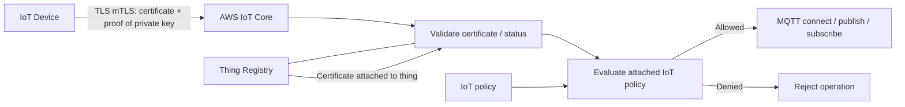
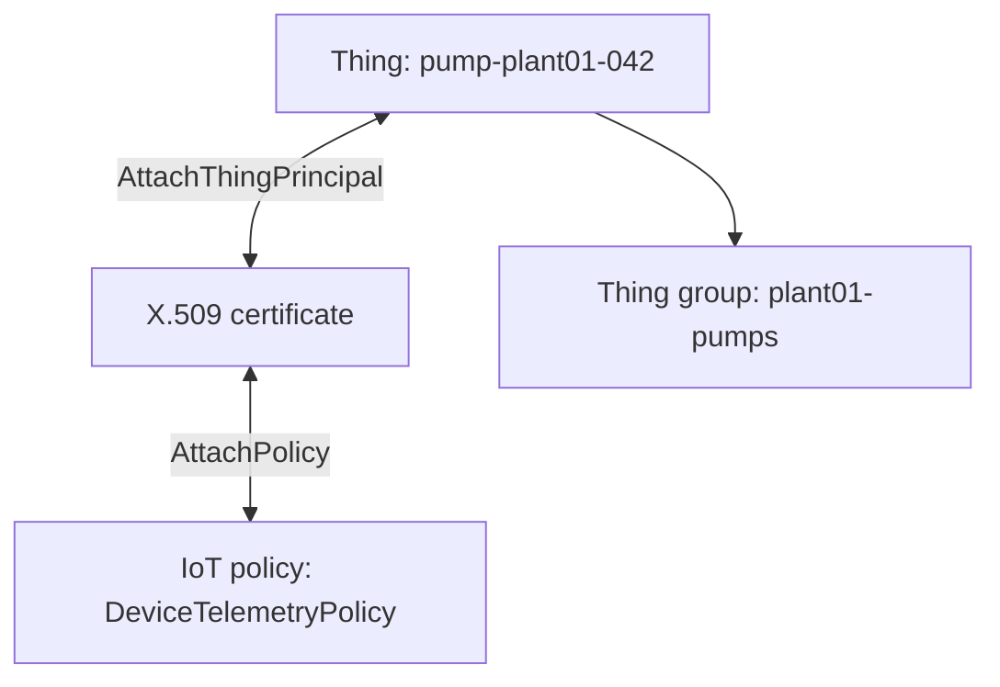
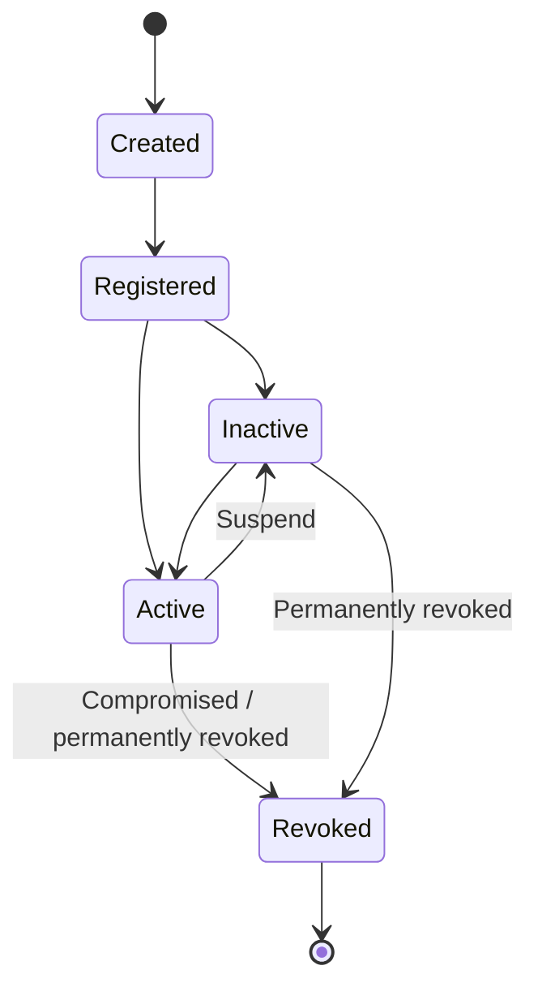

# X.509 Certificates, IoT Policies, and Device Identity

An IoT system can have thousands or millions of devices connecting to the cloud to send telemetry, receive control commands, and update state. Each device must prove its identity when connecting; the system needs to know which device is permitted to publish data, which topics it can subscribe to, and which resources it can access. Sharing a single credential across the entire fleet means compromising one device's key can affect the whole system. Overly broad policies allow a compromised device to read or write another device's data.

AWS IoT Core supports authenticating devices with X.509 client certificates over TLS mutual authentication (mTLS). Each device can hold its own unique certificate and private key; AWS IoT validates the certificate and then evaluates the AWS IoT policy attached to it to determine which MQTT/IoT actions the device may perform. Thing Registry stores device metadata and the relationship between a thing and its certificate, enabling fleet management and attribute-based policies.

Within the AWS ecosystem, X.509 identity integrates with AWS IoT Core, AWS IoT Device Management, Fleet Provisioning, AWS IoT Device Defender, AWS Certificate Manager Private CA (or an enterprise CA), AWS Lambda, EventBridge, IAM, Secrets Manager, and CloudWatch. Properly designing the certificate and policy lifecycle ensures per-device authentication, data isolation, key rotation, and credential revocation when devices are lost or suspected of compromise.

## Learning Objectives

After this lesson, you will be able to:

- Distinguish between X.509 certificates, private keys, certificate authorities (CAs), IoT things, and IoT policies.
- Explain TLS mutual authentication and SNI requirements when connecting to AWS IoT Core.
- Design a unique certificate per device and manage certificate–thing–policy relationships.
- Choose manual certificate registration, CA-based registration, JITR, JITP, bulk registration, or Fleet Provisioning.
- Write IoT policies scoping Connect, Publish, Subscribe, and Receive per thing/device.
- Safely use thing policy variables and certificate policy variables.
- Rotate, deactivate, and revoke certificates following a controlled workflow.
- Protect CAs, private keys, provisioning claims, and audit fleet activity.

## Device Identity in AWS IoT Core

AWS IoT Core separates connection authentication from action authorization. The certificate proves the device possesses the corresponding private key; the IoT policy determines what the device is allowed to do after authentication. Thing Registry describes devices in the fleet and associates certificates with logical entities.

| Component | Role | Example |
|---|---|---|
| X.509 client certificate | Proves client identity during TLS mTLS | Unique certificate for sensor `sensor-042` |
| Private key | Proves client owns the certificate | Stored in a secure element or TPM on the device |
| Certificate Authority (CA) | Signs and manages certificates for devices | Manufacturer's root CA or intermediate CA |
| AWS IoT thing | Logical representation of a device in the registry | Thing named `sensor-042` |
| IoT policy | Grants IoT data plane permissions | Allows publishing only the device's own telemetry |
| Thing group/type/attributes | Classifies and organizes the fleet | `factory=HCM-01`, `deviceType=temperature-sensor` |
| Certificate status | Controls whether the certificate may connect | `ACTIVE`, `INACTIVE`, `REVOKED` |

A certificate registered in AWS IoT without a suitable attached policy can authenticate at the TLS layer but cannot perform IoT operations. Similarly, creating a thing does not automatically generate a certificate or grant publish/subscribe permissions. These relationships must be explicitly configured.



### One Device, One Certificate

AWS recommends issuing a unique certificate per device. If 10,000 devices share a single certificate, when one device is lost or its private key is leaked, the organization cannot easily revoke just that device. With per-device certificates, you can deactivate/revoke the exact certificate, identify the associated thing, and investigate activity history.

Do not use a fleet claim certificate as a long-term operational credential across all devices. Claim certificates should only be used during the bootstrap provisioning step with a strictly restricted policy; after provisioning, each device receives its own unique certificate for ongoing connections.

### Certificates Do Not Replace Thing Registry

Certificates authenticate connections. Thing Registry stores names, types, attributes, groups, and principal associations. A device can connect using a valid certificate that is not yet attached to a thing; if the policy uses thing policy variables or requires `Thing.IsAttached`, connections or actions may be denied.

With MQTT, it is common practice to set client ID equal to thing name and attach the certificate to the thing exclusively. This convention enables policies to use `${iot:Connection.Thing.ThingName}` to scope resources per device.

## X.509 and TLS Mutual Authentication

X.509 is a digital certificate standard built on public key infrastructure (PKI). A certificate contains a public key, subject/issuer details, validity period, serial number, and the CA's signature. The corresponding private key is kept secret by the owner.

In TLS mutual authentication:

1. The device connects to the AWS IoT Core endpoint and verifies the server certificate to ensure it is talking to the genuine service.
2. AWS IoT requests a client certificate.
3. The device sends its certificate chain as required by TLS and proves possession of the private key by signing during the handshake.
4. AWS IoT verifies the certificate, registered chain/CA, validity window, and certificate status.
5. After the TLS handshake, AWS IoT evaluates the IoT policy for the connect action or MQTT operations.

The private key is never sent over the network. The certificate contains the public key and can be sent during the TLS handshake; the secret that must be protected is the private key.

### Client Certificates and CAs

A CA signs certificates to attest that a public key belongs to a verified device or entity. A typical PKI hierarchy includes:

- **Root CA:** trust anchor, usually kept offline or protected inside an HSM.
- **Intermediate CA:** signs certificates for a product line, factory, or region; helps limit blast radius and rotate signers.
- **Device certificate:** end-entity certificate issued to an individual device.

AWS IoT Core supports Amazon-issued certificates or organization-managed certificates (BYOC). When using a custom CA, register the CA certificate with AWS IoT in each account/Region where it will be used so the service can verify device certificates.

### SNI Is a Critical Connection Requirement

Clients connecting to AWS IoT Core over TLS must support Server Name Indication (SNI) and send the appropriate endpoint hostname in the TLS ClientHello. SNI enables AWS IoT to identify the endpoint/account and corresponding authentication configuration. Do not connect by IP address instead of the endpoint hostname.

For MQTT over TLS, the standard port is TCP 8883. AWS IoT Core also supports MQTT over port 443 with an appropriate ALPN protocol, such as `x-amzn-mqtt-ca` for mTLS MQTT. Exact settings depend on the SDK, device, and protocol. Always use the endpoint assigned to your account/Region and verify the ALPN/SNI requirements for the connection method.

### Certificate Validity and Attributes

Certificates carry `Not Before` and `Not After` timestamps. Devices need sufficiently accurate clocks to validate expiry and require a plan to renew certificates before expiration. Certificate subjects/issuers can include Common Name, Organization, Organizational Unit, and other attributes. AWS IoT policies can reference some of these attributes as policy variables, though non-unique attributes should not be used as unique identifiers without strict controls.

## Registering Certificates with AWS IoT Core

AWS IoT Core must know which certificates are trusted before clients can connect with them. Several registration methods exist to fit different scales and manufacturing processes.

| Method | How It Works | When Appropriate |
|---|---|---|
| Manual registration | Register individual certificates or small batches via Console/API/CLI | Labs, pilots, or small device counts |
| CA registration + manual registration | Register CA, then register individual CA-signed certificates | Custom PKI wanting explicit per-device registration |
| Just-in-time registration (JITR) | Certificates signed by a registered CA auto-register on first connect; workflow completed by customer | Large fleets with certificates installed during manufacturing |
| Just-in-time provisioning (JITP) | Registered CA links a provisioning template; first connect auto-creates thing/policy and activates certificate | Large fleets with standardized provisioning flows |
| Bulk registration | Registers known devices via a template and file in S3 | Batch manufacturing with pre-built inventory before devices connect |
| Fleet Provisioning | Devices receive unique certificates during bootstrap via claim or trusted user | Devices shipped without unique certificates or requiring self-provisioning |

### Manual Certificate Registration

For existing certificates, register them via the AWS IoT Console or `RegisterCertificate`. During registration, select the appropriate status and then attach a policy and thing if required by your design. Do not treat registration alone as complete provisioning.

Illustrative CLI example:

```bash
aws iot register-certificate \
  --certificate-pem file://device-042-certificate.pem \
  --ca-certificate-pem file://intermediate-ca.pem \
  --set-as-active
```

Parameter names and CA requirements depend on the registration case; only pass `--ca-certificate-pem` when required by the corresponding flow and API. If a certificate is registered in an inactive state, activate it after completing checks and provisioning.

### Registering a CA Certificate

When using a custom CA, AWS IoT must verify CA ownership before allowing registration. Verification typically involves generating a registration code in AWS IoT, issuing a verification certificate signed by the CA with the registration code in its subject, and calling `RegisterCACertificate` with both the CA certificate and verification certificate.

Two key CA registration modes:

- **DEFAULT:** the CA certificate can be registered in this mode by only one AWS account in a given Region.
- **SNI_ONLY:** the CA certificate can be registered across multiple accounts in the same Region; clients must send SNI as required.

CA certificates must be tightly protected. If a CA is compromised, an attacker can sign spoofed device certificates. Separate intermediate CAs by product/fleet, keep root keys offline/in HSMs, and maintain a signer rotation procedure.

### Just-in-Time Registration (JITR)

JITR applies when devices already carry unique certificates signed by a manufacturer CA. The CA is registered with AWS IoT with auto-registration enabled. When a device connects for the first time, AWS IoT registers the client certificate in `PENDING_ACTIVATION` status and emits a registration event. The enterprise system processes the event, checks the device/serial/claim in inventory, creates the thing, attaches the policy, attaches the certificate to the thing, and activates the certificate.

JITR enables using certificates installed during manufacturing while requiring a customer-managed post-processing workflow. If the workflow does not complete, the certificate does not become an active operational credential.

### Just-in-Time Provisioning (JITP)

JITP associates a provisioning template with a CA certificate. When a device using a certificate signed by that CA connects for the first time, AWS IoT uses the template to execute `RegisterThing`, create the thing and policy, attach policy/certificate, and transition the certificate to `ACTIVE` if successful.

Templates can reference certificate attributes such as country, organization, or organizational unit. If a template requires an attribute missing from the certificate, provisioning can fail. Certificate subject naming must therefore align with the template and manufacturing process.

JITP reduces custom provisioning code, but you still need error monitoring, inventory checks, and scoped permissions on the provisioning role. Never rely on unverified device-supplied certificate subjects without CA validation.

### Fleet Provisioning by Claim

Fleet Provisioning by claim uses a shared claim certificate/claim private key for bootstrapping a batch of devices. When a device connects with the claim, it invokes reserved topics to request provisioning. AWS IoT applies the provisioning template and issues a unique certificate for the device; the device stores the new credential and switches to its unique certificate for subsequent connections.

A claim certificate is a high-risk credential because many devices may share it. Its policy should only allow:

- Connecting with a client ID following a controlled pattern.
- Publishing/subscribing to the required provisioning reserved topics.
- No publishing of business telemetry or subscribing to other devices' command topics.
- No calling APIs or topics unrelated to provisioning.

If a claim certificate is leaked, deactivating it stops new devices from provisioning with that claim. However, previously provisioned devices with unique certificates remain operational; handle individual device certificates separately if impacted.

### Fleet Provisioning by Trusted User

Provisioning by trusted user fits scenarios where an end user or field technician uses an authenticated app to bootstrap a device on-site. The app/backend authenticates the user, calls `CreateProvisioningClaim`, and transfers the temporary provisioning claim (certificate plus private key) to the device over a secure setup channel. The temporary claim expires after 5 minutes; within that window, the device completes provisioning and receives a longer-lived unique certificate. This avoids embedding a shared claim private key across the entire fleet, but requires securing trusted user accounts, API permissions, the claim transfer channel, and the short expiry window.

### Choosing a Provisioning Method

| Manufacturing Condition | Method to Evaluate |
|---|---|
| Devices already have unique certificates under a controlled CA; custom verification workflow needed | JITR |
| Devices already have unique certificates and a template suffices to create resources automatically | JITP |
| Device list is known upfront and can be loaded from S3 | Bulk registration |
| Devices lack unique certificates and manufacturing cannot pre-install them | Fleet Provisioning by claim or trusted user |
| Small-scale lab/pilot | Manual registration |

## Thing Registry and the Certificate–Thing–Policy Relationship

A common design creates one thing per device. The thing name is a logical ID, such as `pump-plant01-042`. Certificates are attached to things via `AttachThingPrincipal`; IoT policies are attached to certificates via `AttachPolicy` or the corresponding API.

Key relationships:



Thing groups support hierarchical management, such as by region, plant, device type, or firmware cohort. Jobs and fleet management policies can target groups. Do not use thing groups as a substitute for topic access control; policies must still constrain resources and actions.

### Exclusive and Non-Exclusive Thing Associations

Certificates can be attached to things in exclusive or non-exclusive mode depending on the API/design. With non-exclusive association, the same certificate can be attached to multiple things; this can cause confusion when policies use thing variables. AWS recommends matching the MQTT client ID to the thing name when using thing policy variables with non-exclusive associations. For clear device identity, use a unique certificate and a single controlled thing association per device.

### The `Thing.IsAttached` Condition

The thing policy variable `${iot:Connection.Thing.IsAttached}` can be used in a condition to allow actions only when the certificate/principal is attached to a thing in the registry. This prevents a valid but unattached certificate from exercising permissions requiring registry association.

Thing policy variables are only available in MQTT or MQTT over WebSocket connections under AWS-documented conditions. The client ID must match the thing name when referencing thing name/type/attributes variables. For HTTPS publish or other protocols, do not assume these variables evaluate the same way as MQTT.

## AWS IoT Policies: Authorize After Authentication

An AWS IoT policy is a JSON document structured like an IAM policy, but using AWS IoT data plane actions and resources. Policies attached to a certificate determine where the certificate can connect, publish, subscribe, or receive messages.

Four basic MQTT actions:

| Action | Purpose | Resource ARN |
|---|---|---|
| `iot:Connect` | Open an MQTT connection | `arn:aws:iot:region:account:client/client-id` |
| `iot:Publish` | Publish messages to a topic | `arn:aws:iot:region:account:topic/topic-name` |
| `iot:Subscribe` | Subscribe to a topic filter | `arn:aws:iot:region:account:topicfilter/filter` |
| `iot:Receive` | Receive messages from a topic | `arn:aws:iot:region:account:topic/topic-name` |

`Subscribe` and `Receive` are separate permissions. A client may be allowed to subscribe yet fail to receive messages if it lacks `iot:Receive`. Likewise, granting `iot:Receive` does not implicitly allow subscribing to a topic filter.

### Example Per-Device Policy

Suppose both the thing name and MQTT client ID are `sensor-042`. The device may only connect with a client ID matching its thing name, publish telemetry to its own topic, and subscribe/receive its own commands.

```json
{
  "Version": "2012-10-17",
  "Statement": [
    {
      "Effect": "Allow",
      "Action": "iot:Connect",
      "Resource": "arn:aws:iot:ap-southeast-1:111122223333:client/${iot:Connection.Thing.ThingName}",
      "Condition": {
        "Bool": {
          "iot:Connection.Thing.IsAttached": "true"
        }
      }
    },
    {
      "Effect": "Allow",
      "Action": "iot:Publish",
      "Resource": "arn:aws:iot:ap-southeast-1:111122223333:topic/devices/${iot:Connection.Thing.ThingName}/telemetry"
    },
    {
      "Effect": "Allow",
      "Action": "iot:Subscribe",
      "Resource": "arn:aws:iot:ap-southeast-1:111122223333:topicfilter/devices/${iot:Connection.Thing.ThingName}/commands"
    },
    {
      "Effect": "Allow",
      "Action": "iot:Receive",
      "Resource": "arn:aws:iot:ap-southeast-1:111122223333:topic/devices/${iot:Connection.Thing.ThingName}/commands"
    }
  ]
}
```

Replace the Region, account ID, topic naming, and thing model with actual values. The sample policy allows only one exact command topic; if the application needs subtopics, expand the pattern carefully and test each action.

### Policy Resources and MQTT Wildcards

MQTT topic filters use `+` for single-level and `#` for multi-level matching. AWS IoT policy resource ARNs instead use policy wildcards such as `*` and `?` according to policy rules. Do not copy MQTT wildcards verbatim into ARNs without verifying how the service evaluates resources.

For example, an MQTT topic filter `devices/+/commands/#` may require a corresponding resource ARN pattern using policy wildcards like `devices/*/commands/*`. Verify with a policy simulator or real test connections, and never open `topic/*` to all devices unless genuinely required.

### Scoping Permissions by Topic

A clear topic convention keeps policies simple:

```text
devices/{thingName}/telemetry
devices/{thingName}/state
devices/{thingName}/commands
devices/{thingName}/config
fleet/{groupName}/broadcast
```

Devices normally publish only their own telemetry/state and subscribe only to their own commands/config. Publishing to `fleet/...` or subscribing to broadcasts should be designed separately; avoid letting devices publish to shared control topics.

### Thing Registry Policy Variables

Thing policy variables allow reusing a single policy across many devices:

- `${iot:Connection.Thing.ThingName}`: name of the thing associated with the certificate.
- `${iot:Connection.Thing.ThingTypeName}`: thing type.
- `${iot:Connection.Thing.Attributes[attributeName]}`: value of a thing attribute.
- `${iot:Connection.Thing.IsAttached}`: whether the principal is attached to a thing.

For example, the same policy can scope devices by a `factory` attribute. However, if the certificate is not attached to a thing or the client ID fails the condition, variables may not resolve as expected and the policy may deny access.

### Certificate Policy Variables

AWS IoT supports certain X.509 attributes as policy variables, such as:

- `${iot:Certificate.Subject.CommonName}`
- `${iot:Certificate.Subject.Organization}`
- `${iot:Certificate.Issuer.CommonName}`
- `${iot:Certificate.SerialNumber}`

These can bind client IDs or topics to certificate attributes. Keep in mind:

- If a certificate lacks the referenced attribute, the variable may not resolve and policy evaluation may behave unexpectedly.
- Serial numbers are represented in decimal form inside policy variables.
- Certain special characters in subject/issuer must be escaped per AWS rules.
- Certificate attributes might not be unique or may follow varying CA conventions; do not rely on Common Name as a unique identifier without strict controls.
- Use a `Null` condition to require mandatory attributes to be present before allowing an action.

## Least Privilege and Common Policy Pitfalls

A strong policy allows a device to perform only the actions it needs. Apply these principles:

- Restrict `iot:Connect` to a specific client ID or thing-name pattern.
- Restrict `iot:Publish` to the device's own telemetry/state topics.
- Restrict `iot:Subscribe` to required topic filters.
- Grant `iot:Receive` only for the topics the device must receive.
- Use `Thing.IsAttached` to require registry attachment when relying on registry-based design.
- Never grant `iot:*` or resource `*` to production device certificates.
- Never reuse a broad bootstrap policy as a long-term operational policy.

Common mistakes:

| Mistake | Consequence | Fix |
|---|---|---|
| Granting `iot:Subscribe` without `iot:Receive` | Subscribe succeeds but messages never arrive | Grant both actions with matching resources |
| `clientId` mismatches thing name | Thing policy variables fail to resolve as expected | Align client ID with thing name |
| Certificate not attached to thing | `Thing.IsAttached` is false or thing variables are missing | Call `AttachThingPrincipal` and verify association |
| Resource ARN uses wrong `topic`/`topicfilter` type | Publish/subscribe fails with AccessDenied | Match ARN resource type to the action |
| Policy allows `topic/*` | Device can publish into other devices' topics | Scope by thing name or certificate identity |
| Using MQTT `+`/`#` directly in policy ARNs | Policy does not match resources as intended | Use ARN wildcards per AWS IoT policy syntax |
| Policy variable missing from certificate | Unexpected evaluation or denial | Ensure attribute exists and add `Null` check |
| Same CN used across the entire fleet | Difficult to isolate individual devices | Use controlled unique thing name/serial/attribute |

## Certificate Lifecycle

The certificate lifecycle must be managed from creation, registration, activation, and usage through rotation and revocation. Certificate status and policy/thing associations must remain synchronized with device inventory.



`REVOKED` is a terminal state that cannot transition back to `ACTIVE`. If you only need to suspend a device temporarily for maintenance, use `INACTIVE`; if a private key is leaked or a certificate must be permanently invalidated, use revocation.

### Creating and Protecting Private Keys

Prefer generating private keys directly on the device using a secure element, TPM, or hardware-backed keystore when hardware supports it. The device generates a CSR and sends it to the CA through an authenticated manufacturing process to obtain its certificate; the private key never leaves the device.

When using AWS IoT `CreateKeysAndCertificate`, the private key is returned once in the response. The application must save it securely at creation time; AWS IoT cannot retrieve the private key again later. Never write private keys to logs, source control, shared firmware images, or unprotected S3 buckets.

### Zero-Downtime Certificate Rotation

Rotation workflows should include an overlap window so devices switch credentials without losing connectivity:

1. Generate a new key pair on the device or in a secure provisioning system.
2. Issue and register the new certificate.
3. Attach the corresponding policy and thing; verify the new certificate is usable.
4. Update the device to test connecting with the new certificate during a cutover window.
5. Confirm the device publishes/subscribes with expected permissions, telemetry arrives, and commands work.
6. Deactivate the old certificate after verifying the device is running on the new certificate.
7. Monitor errors and offline devices; only delete old associations/certificates per retention/audit policy.
8. Update inventory, expiration dates, and rotation status.

Do not deactivate the old certificate before the device has a working new credential, unless responding urgently to a compromise. Devices offline for extended periods require a recovery or re-provisioning procedure.

### Deactivation and Revocation

- **Deactivate:** temporarily prevents a certificate from connecting; it can be reactivated once the issue is resolved.
- **Revoke:** permanently revokes a certificate; it can never be reactivated.
- **Deactivate CA:** stops new certificates signed by that CA from auto-registering; already registered and active client certificates continue working until handled individually.

When a CA is compromised, deactivating the CA alone is not enough. You must identify all client certificates signed by that CA, revoke/deactivate affected certificates, issue a new CA, and re-provision devices per plan.

## AWS IoT Fleet Provisioning and Provisioning Templates

A provisioning template describes the resources to create when a device registers, such as thing, certificate, policy, thing group, and attributes. Templates can accept parameters from the device or from the certificate/claim context. Validate all parameters and never trust device-supplied values that govern tenant, permissions, or data partitioning.

### Templates and the Provisioning Role

The provisioning role is an IAM role assumed by AWS IoT to create resources in the account. It needs minimal permissions such as creating/registering things, attaching policies/certificates, adding to thing groups, and other template operations. Its trust policy must restrict assumption to the AWS IoT service within appropriate scope.

Never grant account-wide `iot:*` if the template only creates a bounded set of resources. Thing names and policy resources should be derived from validated parameters, preventing devices from choosing overly permissive policies.

### Reserved Topics for Fleet Provisioning

Fleet Provisioning uses MQTT reserved topics under `$aws/certificates/provisioning-templates/...` or `$aws/provisioning-templates/...` depending on the step and API. Devices must publish/subscribe to the exact create/certificate/provisioning template topics documented by AWS. The claim policy should permit only those topics; avoid granting `$aws/#` wildcards unnecessarily.

Exact topic names and payloads depend on the flow (by claim/by trusted user) and API version. Use the SDK/device SDK or AWS documentation to construct accurate payloads instead of hardcoding from outdated examples.

## Certificate Authorities and PKI Governance

A secure device PKI requires disciplined CA and issuance controls:

- Keep the root CA private key offline or in an HSM; never use the root directly to sign every device certificate.
- Segment intermediate CAs by product, manufacturing site, or environment.
- Give every device a unique key pair; never clone private keys in firmware images.
- Enforce unique conventions for certificate subject/serial/attributes and record them in inventory.
- Restrict who or which devices can request certificates and verify proof-of-possession.
- Plan CA rotation with overlap: register the new CA, issue new certificates, migrate devices, then retire the old CA.
- Audit issuance, renewal, activation, deactivation, and revocation.

AWS IoT Core can use AWS IoT-managed CAs or external CAs. AWS Certificate Manager Private CA helps issue certificates for workloads needing a private CA, though integration must be designed to deliver device certificates and manage private keys on devices. Do not confuse ACM public certificates for server endpoints with per-device X.509 client certificates.

## Protecting Device Connectivity and Data

Certificates are only one layer in a device security model:

- Store private keys in a secure element/TPM; restrict debug ports and firmware extraction.
- Enable secure boot and firmware signing to reduce the risk of malicious firmware extracting credentials.
- Use TLS mTLS and verify server certificates; never skip CA/hostname checks.
- Scope IoT policies by thing, topic, and action.
- Never treat MQTT topics as an authentication mechanism; topic names can be guessed if policies allow access.
- Use Device Defender Audit to catch overly broad policies/certificates and Detect to spot anomalous behavior.
- Use IoT Jobs to roll out firmware/configurations by cohort, track execution, and support rollback.
- Protect provisioning claims and revoke them if leaked.
- Monitor certificate expiry, rotation coverage, and un-updated devices.

## Monitoring and Auditing

AWS IoT Core integrates with CloudWatch Logs, CloudWatch metrics, CloudTrail, and AWS IoT Device Defender.

### CloudWatch and Lifecycle Events

Track:

- Successful/failed connection counts.
- TLS/authentication failures and policy authorization failures.
- Certificate registration/provisioning successes/failures.
- JITR/JITP/Fleet Provisioning errors and throttling.
- Device online/offline counts, disconnect rates, and reconnect rates.
- Certificates nearing expiry, inactive, or revoked.
- Publish/subscribe throughput and message errors by fleet/thing group.

AWS IoT emits lifecycle events for various certificate/thing/connection changes; these can be routed via MQTT reserved topics or integrated with EventBridge for supported event types. Use Lambda/Step Functions to handle provisioning and notifications, ensuring workflows are idempotent since events may be retried or reprocessed.

### AWS IoT Device Defender

Device Defender Audit inspects fleet configurations and policies, such as overly broad policies, unmanaged certificates, CA registrations, and related security settings. Detect analyzes behavioral metrics to spot devices whose traffic or behavior diverges from baselines. Findings can be sent to CloudWatch, SNS, or remediation workflows.

Example response flow:

1. Device Defender detects a device publishing messages anomalously.
2. An alert is sent to EventBridge/SNS.
3. Lambda identifies the associated thing/certificate and evaluates severity.
4. If warranted, the workflow deactivates the certificate or updates the policy to quarantine the device.
5. Preserve CloudTrail evidence, logs, and an investigation ticket.
6. After remediation, issue a new certificate and re-provision the device upon approval.

Do not automatically perform permanent revocation based on a single unverified metric. For automated responses, define thresholds, exceptions, hold periods, and recovery procedures.

### Audit Trail

CloudTrail logs control-plane APIs such as `RegisterCertificate`, `UpdateCertificate`, `AttachPolicy`, `AttachThingPrincipal`, `CreatePolicy`, `UpdatePolicy`, `RegisterCACertificate`, and provisioning operations. Enable appropriate logging, enforce retention, and restrict log deletion permissions.

Never log private keys, passwords, or sensitive payloads. For correlation, use certificate ID, thing name, serial number, client ID, and request ID.

## AWS CLI Examples for Managing Certificates and Policies

The commands below illustrate control-plane operations. Replace Region, account ID, endpoint, certificate ID, thing name, and file paths with real values. The executing IAM principal requires appropriate permissions.

### Create a Thing

```bash
aws iot create-thing \
  --thing-name sensor-042 \
  --thing-type-name TemperatureSensor
```

### Create an AWS IoT-Issued Certificate and Key Pair

```bash
aws iot create-keys-and-certificate \
  --set-as-active
```

The response includes the certificate ARN/ID, certificate PEM, public key, and private key. Store the private key securely immediately upon creation; do not print the response to shared logs or terminals. If using a custom CA, generate a CSR and issue the certificate via your enterprise PKI.

### Attach a Certificate to a Thing and Policy

```bash
aws iot attach-thing-principal \
  --thing-name sensor-042 \
  --principal arn:aws:iot:ap-southeast-1:111122223333:cert/CERTIFICATE_ID

aws iot attach-policy \
  --policy-name DeviceTelemetryPolicy \
  --target arn:aws:iot:ap-southeast-1:111122223333:cert/CERTIFICATE_ID
```

### Verify Associations and Certificate Status

```bash
aws iot list-thing-principals \
  --thing-name sensor-042

aws iot list-attached-policies \
  --target arn:aws:iot:ap-southeast-1:111122223333:cert/CERTIFICATE_ID

aws iot describe-certificate \
  --certificate-id CERTIFICATE_ID
```

### Temporarily Deactivate or Revoke

```bash
aws iot update-certificate \
  --certificate-id CERTIFICATE_ID \
  --new-status INACTIVE
```

Once a certificate is confirmed compromised and must be permanently revoked:

```bash
aws iot update-certificate \
  --certificate-id CERTIFICATE_ID \
  --new-status REVOKED
```

A `REVOKED` certificate cannot be switched back to `ACTIVE`. Confirm the certificate ID and device impact before revoking.

## Real-World Scenario: Managing a Factory Sensor Fleet

An enterprise operates 20,000 temperature sensors across multiple factories. Each device sends telemetry every 30 seconds and receives threshold configurations and firmware updates. Devices are manufactured by a partner; each has a secure element and can generate a CSR on the production line.

### Identity Design

1. The enterprise keeps the root CA in an HSM/offline and uses separate intermediate CAs per product line.
2. Each sensor generates its private key inside its secure element; the factory sends the CSR to the CA issuance service after verifying serial/asset ID.
3. The CA issues a unique client certificate with serial/subject tied to inventory.
4. The CA certificate is registered with AWS IoT in the deployment Region; choose `DEFAULT` or `SNI_ONLY` based on the account model.
5. With JITP, a provisioning template creates thing `sensor-{serial}`, policy, and required associations; with JITR, the registration event triggers a custom workflow to validate inventory, create the thing, attach certificate/policy, and activate the certificate.

### Policy Design

- Client ID must match thing name.
- Devices only publish `devices/{thingName}/telemetry` and `devices/{thingName}/state`.
- Devices only subscribe/receive granted `devices/{thingName}/commands` and config.
- `Thing.IsAttached` must be true before allowing connections.
- Thing group `plant-{plantId}` manages firmware cohorts and deployments.

### Rotation and Incidents

- Certificate expiration dates are tracked in inventory.
- Before expiry, the device generates a new key and obtains a new certificate.
- The device connects using the new certificate, verifies telemetry and commands, and then the old certificate is deactivated.
- If a sensor is lost, operations deactivates/revokes the certificate for that specific thing and investigates events.
- If an intermediate CA is compromised, disable auto-registration on that CA, identify all certificates signed by it, and roll out replacement CA/certificates.

### Monitoring

Device Defender detects a sensor publishing above baseline; a CloudWatch alarm notifies the operations team. A workflow quarantines the certificate once confirmed, while preserving telemetry/logs needed for investigation. Re-issuing a certificate requires verifying the device has been sanitized and the old private key is no longer in use.

## Best Practices

- Use a unique X.509 certificate per device; never share private keys across devices.
- Generate private keys on the device or in a secure provisioning environment and protect them in a secure element/TPM.
- Keep root CAs offline/in HSMs; use intermediate CAs to bound issuance scope.
- Register CAs in the exact target account/Region and deliberately choose `DEFAULT` or `SNI_ONLY`.
- Use JITP/JITR/Fleet Provisioning matched to manufacturing and inventory capabilities.
- Restrict claim certificates strictly to provisioning reserved topics; switch to unique certificates after bootstrap.
- Attach certificates to things and attach policies to certificates; verify both relationships.
- Specify `iot:Connect`, `iot:Publish`, `iot:Subscribe`, and `iot:Receive` explicitly and scope resource ARNs.
- Validate attribute presence when using thing/certificate policy variables; do not depend on non-unique CNs.
- Match client IDs to thing names if policies rely on thing policy variables.
- Use `Thing.IsAttached` when requiring principals to be bound to the registry.
- Maintain a pre-expiry certificate rotation process with overlap to prevent downtime.
- Distinguish temporary `INACTIVE` from permanent `REVOKED`; revocation is irreversible.
- Remember deactivating a CA does not revoke already registered client certificates.
- Enable CloudTrail, CloudWatch, and Device Defender; monitor provisioning errors and certificate expiry.
- Test policies with real devices or simulators; test both allowed and denied publish/subscribe cases.

## Production Deployment Checklist

- [ ] Define device identity, thing naming, client IDs, and inventory attributes.
- [ ] Choose CA strategy, root/intermediate hierarchy, and private key protection.
- [ ] Select manual registration, JITR, JITP, bulk registration, or Fleet Provisioning.
- [ ] Register CAs in each account/Region; verify ownership and `DEFAULT`/`SNI_ONLY` mode.
- [ ] Ensure device clients support TLS mTLS, SNI, and protocol-specific ALPN/ports.
- [ ] Issue unique certificates per device and record serial/certificate IDs in inventory.
- [ ] Create things, attach certificates, and attach IoT policies.
- [ ] Author Connect/Publish/Subscribe/Receive policies with thing-scoped resource ARNs.
- [ ] Validate `Thing.IsAttached`, client IDs, and policy variable attributes.
- [ ] Restrict claim policies and retire/rotate claims post-bootstrap where needed.
- [ ] Design certificate expiry monitoring, rotation, deactivation, and revocation runbooks.
- [ ] Secure provisioning roles, Lambdas, and templates with least-privilege IAM.
- [ ] Enable CloudTrail, CloudWatch, lifecycle events, and Device Defender.
- [ ] Test expired certificates, wrong-CA certificates, policy denials, lost devices, and CA compromises.
- [ ] Test reconnects after rotation and verify telemetry/commands function properly.
- [ ] Periodically audit unattached certificates, overly broad policies, and un-rotated devices.

## Conclusion

X.509 certificates authenticate device identity via TLS mutual authentication; private keys prove possession and must be protected on the device. AWS IoT policies determine where devices can connect, publish, subscribe, and receive; Thing Registry provides context to reuse policies per device. CA registration, JITR, JITP, and Fleet Provisioning support diverse onboarding workflows. Certificate lifecycles require clear rotation, deactivation, and revocation procedures; a CA compromise demands handling both the CA and its issued client certificates. By combining least-privilege policies, secure key storage, controlled provisioning, CloudTrail, and Device Defender, organizations can manage device identity at scale and reduce the risk of unauthorized access.

## References

- [X.509 client certificates - AWS IoT Core](https://docs.aws.amazon.com/iot/latest/developerguide/x509-client-certs.html)
- [Register a client certificate](https://docs.aws.amazon.com/iot/latest/developerguide/register-device-cert.html)
- [Create your own client certificates](https://docs.aws.amazon.com/iot/latest/developerguide/device-certs-your-own.html)
- [Register a CA certificate](https://docs.aws.amazon.com/iot/latest/developerguide/manage-your-CA-certs.html)
- [Just-in-time registration (JITR)](https://docs.aws.amazon.com/iot/latest/developerguide/auto-register-device-cert.html)
- [Just-in-time provisioning (JITP)](https://docs.aws.amazon.com/iot/latest/developerguide/jit-provisioning.html)
- [Device provisioning options](https://docs.aws.amazon.com/iot/latest/developerguide/iot-provision.html)
- [Fleet provisioning by claim and by trusted user](https://docs.aws.amazon.com/iot/latest/developerguide/provision-wo-cert.html)
- [Attach a thing or policy to a client certificate](https://docs.aws.amazon.com/iot/latest/developerguide/attach-to-cert.html)
- [AWS IoT Core policies](https://docs.aws.amazon.com/iot/latest/developerguide/iot-policies.html)
- [Thing policy variables](https://docs.aws.amazon.com/iot/latest/developerguide/thing-policy-variables.html)
- [X.509 certificate policy variables](https://docs.aws.amazon.com/iot/latest/developerguide/use-policy-variables.html)
- [Revoke a client certificate](https://docs.aws.amazon.com/iot/latest/developerguide/revoke-ca-cert.html)
- [AWS IoT Device Defender](https://docs.aws.amazon.com/iot-device-defender/latest/devguide/what-is-device-defender.html)
- [Transport security in AWS IoT Core](https://docs.aws.amazon.com/iot/latest/developerguide/transport-security.html)
