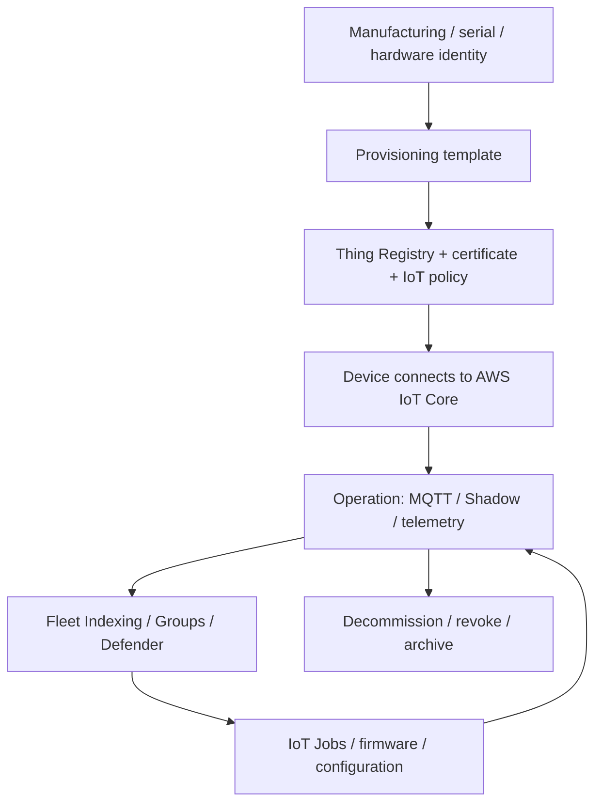

# Provisioning, Device Registry, and Fleet Management

An IoT system might start with a handful of sensors, but when deploying thousands or millions of devices, MQTT connectivity is only the first step. Every device needs a unique identity, a certificate for authentication, a policy scoping permissions, metadata identifying model/location/firmware, and lifecycle tracking so operations teams know which devices are active, need updates, or must be revoked.

AWS IoT Core provides Device Provisioning to onboard new devices, Thing Registry to store logical identities and attributes, Thing Groups for group management, Fleet Indexing to search and aggregate state, and AWS IoT Jobs to roll out remote tasks such as firmware updates. AWS IoT Device Defender adds auditing and anomaly detection. Together, these components form a fleet management pipeline from factory floor to device decommissioning.

A solid fleet workflow must answer: what is this device and who owns it; who issued its identity; which certificate is active; which topics can it publish/subscribe to; what firmware version is it running; which rollout group does it belong to; when did it last connect; and how are permissions revoked when it is lost, compromised, or retired.

## Learning Objectives

After this lesson, you will be able to:

- Distinguish between provisioning, authentication, authorization, registry, shadow, and fleet indexing.
- Design Thing Registry, thing types, attributes, and naming conventions.
- Choose static thing groups or dynamic thing groups based on management goals.
- Compare single-thing provisioning, bulk registration, JITP, JITR, and Fleet Provisioning.
- Design provisioning templates, provisioning roles, pre-provisioning hooks, and secure claim certificate workflows.
- Manage X.509 certificate lifecycles, IoT policies, thing associations, and device revocation.
- Use Fleet Indexing to search, build dynamic groups, and monitor fleet metrics.
- Use AWS IoT Jobs and Software Package Catalog to deploy firmware/configurations in waves.
- Integrate Device Defender Audit/Detect with incident response workflows.
- Design onboarding, inventory reconciliation, decommissioning, observability, and cost governance for large-scale fleets.

## 1. Lifecycle of an IoT Device

A device typically goes through these stages:

1. **Manufacturing**: assign serial number, record model/hardware revision, and install bootstrap credentials or a unique certificate.
2. **Provisioning**: register the device in AWS IoT, create the Thing, attach certificate, policy, and groups.
3. **Activation**: device connects for the first time, authenticates with its certificate, and receives initial configuration.
4. **Operation**: publish telemetry, receive commands, update Device Shadow, and send health/status.
5. **Management**: search, segment groups, track firmware, execute Jobs, and assess security posture.
6. **Maintenance**: rotate certificates, change groups, adjust configuration, update firmware, or handle offline devices.
7. **Decommissioning**: disable connection permissions, detach/revoke certificates, delete or archive metadata, and process data per retention policies.



Crucially, provisioning does not automatically mean the device is securely authenticated and authorized. Provisioning creates resources and associations; the certificate performs mutual TLS authentication; the IoT policy determines which MQTT/API actions that certificate may execute.

## 2. Core Resources in AWS IoT Core

| Resource | Role | Example |
|---|---|---|
| Thing | Logical representation of a device or entity | `pump-plant-a-00042` |
| Thing Type | Describes a device category/model | `pressure-sensor-v2` |
| Thing Attribute | Key/value metadata on a Thing | `serialNumber`, `model`, `site` |
| Thing Group | Group of devices for governance/policies/Jobs | `plant-a-production` |
| X.509 certificate | Cryptographic identity used for mutual TLS | Device's unique certificate |
| IoT Policy | Permissions for connect, publish, subscribe, receive | Allows only the Thing's own topics |
| Device Shadow | Desired/reported state of a device | Temperature settings, firmware state |
| Provisioning Template | Describes resources to create during onboarding | Thing + certificate + policy |
| Fleet Index | Index for searching/aggregating fleet data | `AWS_Things` |
| IoT Job | Remote task sent to Things/groups | OTA firmware or config change |

Thing Registry is neither a telemetry database nor a device secret store. The registry stores identity/metadata; telemetry typically flows through MQTT Rules Engine to S3, Timestream, Kinesis, DynamoDB, or downstream services. Device Shadow holds cloud-to-device synchronized state, while Fleet Indexing indexes selected data sources for search and aggregation.

## 3. Thing Registry and Naming Conventions

A Thing is the logical representation of a physical device or related entity. A Thing has a unique name within an account/Region and can have a Thing Type, attributes, group memberships, certificate/principal associations, and shadows.

Example metadata:

```json
{
  "thingName": "pump-plant-a-00042",
  "thingTypeName": "industrial-pump-v2",
  "attributes": {
    "serialNumber": "SN-000042",
    "model": "PX-200",
    "hardwareRevision": "B",
    "site": "plant-a",
    "environment": "production",
    "firmwareVersion": "2.4.1"
  }
}
```

This is an example of Thing metadata for inventory management; never store passwords, private keys, access tokens, PII, or sensitive data in attributes.

### Designing Thing Names

Thing names should stay stable across the device lifecycle, trace back to a serial/manufacturing ID, and avoid personal information. A common convention:

```text
<product-family>-<site-code>-<serial-number>
sensor-plant-a-000042
gateway-warehouse-03-000017
meter-building-07-000231
```

Do not use IP addresses, firmware versions, or owner names as Thing names because those values can change. Firmware/site/model belong in attributes or state as appropriate.

AWS IoT does not require Thing names to match MQTT client IDs, certificate IDs, or shadow names. However, using the Thing name as the MQTT client ID simplifies management; several features such as connectivity status indexing require the Thing name to match the connection's client ID. When designing a fleet, establish a consistent convention and enforce it in firmware.

### Registry Is Not Required to Connect

A client can connect to AWS IoT with a valid certificate and appropriate policy without creating a Thing. Creating a Thing simplifies inventory, search, grouping, Jobs, and certificate/shadow associations. For fleets managed over the long term, provision a Thing for every device.

## 4. Thing Types and Attributes

Thing Types classify Things sharing a common structure or traits, such as `temperature-sensor-v3`, `gateway-linux-arm64`, or `industrial-pump-v2`. A Type can define shared attributes describing characteristics like `model`, `manufacturer`, or `hardwareRevision`. Thing Type is optional; a Thing can belong to only one type at a time. Under current registry limits, a Thing with a type can have up to 50 attributes, while a Thing without a type can have up to 3 attributes. Type names cannot be changed after creation; you can deprecate a type to stop new Things from associating with it.

Thing attributes are key/value pairs typically used for infrequently changing metadata. Guidelines:

- Use attributes for identity data, model, site, environment, installation batch, or owner team.
- Use Shadow for frequently changing desired/reported state.
- Use a telemetry store for real-time and historical measurements.
- Use Fleet Indexing custom fields to search/aggregate queryable fields.
- Define valid types and values in an internal schema; registry attributes are not a schema validation engine.

Thing Type does not replace device identity or policies. Two devices of the same Thing Type still require individual certificates and controlled access permissions.

When you no longer want new Things created with an older type, mark the type as deprecated following the registry lifecycle. Before changing types, check existing Things referencing it and consumers relying on that metadata.

## 5. Thing Groups: Static and Dynamic

Thing Groups organize devices by site, product, customer segment, environment, rollout ring, or operational state.

### Static Thing Groups

Static groups have membership managed explicitly via the Console, CLI, or API. You can build parent/child hierarchies and attach policies to a parent group for inheritance by child groups and member Things.

Example hierarchy:

```text
company-fleet
  ├── plant-a
  │    ├── production
  │    └── staging
  └── plant-b
       ├── production
       └── staging
```

Static groups fit stable organizational groupings such as site, customer, or environment. Design the hierarchy upfront because a group can have at most one direct parent, and a child group's parent cannot be changed after creation. A Thing cannot belong to two groups within the same hierarchy branch, and group memberships are subject to quotas. When attaching an IoT policy to a static group, the Thing name must match the connection's MQTT client ID for the group policy to apply properly.

Thing group policies simplify updating permissions by group, yet you must still verify the effective policy on certificates/Things. Group policies do not apply to all Greengrass data-plane operations; those permissions require appropriate policies attached directly to certificates per Greengrass documentation.

### Dynamic Thing Groups

Dynamic groups derive membership from a Fleet Indexing search query. Devices automatically enter or leave the group as indexed data changes.

Example use cases:

- All devices with `firmwareVersion` older than a required patch.
- Devices disconnected for a given duration.
- Sensors with battery levels above 80% eligible for OTA.
- Devices with Device Defender violations.
- Devices of a specific model in a certain reported state.

Dynamic groups require Fleet Indexing. They have no hierarchy and cannot have IoT policies attached directly like static groups. Upon creation, a group's initial status may be `BUILDING` during backfill; use it as a rollout target only after it reaches `ACTIVE` and membership has been verified.

### Comparison

| Criterion | Static Group | Dynamic Group |
|---|---|---|
| Membership | Explicitly added/removed | Driven by query over indexed data |
| Hierarchy | Yes, one direct parent | No |
| Direct policy attachment | Supported | Not supported |
| Criteria | Organization/site/owner | State/attribute/connectivity/violation |
| Fleet Indexing | Not required for static membership | Required |
| Example | `plant-a-production` | `offline-more-than-24h` |

## 6. Certificates and IoT Policies as the Security Boundary

AWS IoT Core uses X.509 client certificates for mutual TLS authentication. Each device should have its own certificate and private key protected by a secure element/TPM or equivalent hardware mechanism. Never share one long-term certificate across an entire fleet.

Certificates have statuses such as `ACTIVE`, `INACTIVE`, and `REVOKED`. An `INACTIVE` certificate cannot connect; a revoked certificate cannot be reactivated. When compromise is suspected, revoke the certificate and investigate related sessions, topics, and resources.

IoT policies attached to certificates define permitted actions and resources. For example, policies should restrict devices to connecting only with their own client ID and publishing only to their own namespaced topics.

Illustrative policy using policy variables:

```json
{
  "Version": "2012-10-17",
  "Statement": [
    {
      "Effect": "Allow",
      "Action": "iot:Connect",
      "Resource": "arn:aws:iot:ap-southeast-1:111122223333:client/${iot:Connection.Thing.ThingName}"
    },
    {
      "Effect": "Allow",
      "Action": "iot:Publish",
      "Resource": "arn:aws:iot:ap-southeast-1:111122223333:topic/devices/${iot:Connection.Thing.ThingName}/telemetry"
    },
    {
      "Effect": "Allow",
      "Action": "iot:Subscribe",
      "Resource": "arn:aws:iot:ap-southeast-1:111122223333:topicfilter/devices/${iot:Connection.Thing.ThingName}/commands/*"
    },
    {
      "Effect": "Allow",
      "Action": "iot:Receive",
      "Resource": "arn:aws:iot:ap-southeast-1:111122223333:topic/devices/${iot:Connection.Thing.ThingName}/commands/*"
    }
  ]
}
```

This is a structural example; verify policy variable support, client ID/Thing associations, and topic ARNs in your actual account. Never use `Resource: "*"` for publish/subscribe in production when scoping by Thing is possible.

### Certificate Principal Association

Certificates can be attached to Things; provisioning templates can specify `EXCLUSIVE_THING` to bind a principal to a single Thing. If omitted, the association may be non-exclusive per template defaults. For dedicated device identity, exclusive association prevents accidentally attaching the same certificate to multiple Things.

## 7. Provisioning Methods

AWS IoT supports multiple ways to onboard devices into a fleet. Choose the method based on when devices receive unique certificates and who performs onboarding.

| Method | When Appropriate | How It Works |
|---|---|---|
| Single-thing provisioning | Small counts or individual device registration | Create Thing/certificate/policy via template/API or Console |
| Bulk registration | Device and certificate list known upfront | Place provisioning data in S3 file and register in batches |
| JITP | Devices already carry unique certificates signed by manufacturer CA | AWS IoT auto-provisions when a registered-CA-signed cert first connects |
| JITR | Unique certificates exist and custom verification workflow is needed | First connection emits event; Lambda/Rule registers/attaches/activates |
| Fleet Provisioning by claim | Cannot pre-install unique certificates securely before shipping | Device uses a claim certificate to request a permanent certificate |
| Fleet Provisioning by trusted user | Installer/end user uses an app to onboard at installation site | App issues temporary claim during onboarding session; device obtains permanent cert |

### Quick Selection Guide

- Factory has an HSM/secure provisioning station and can write unique certificates to devices: evaluate JITP/JITR or bulk registration.
- Complete inventory/certificate list already exists: bulk registration fits well.
- Devices ship to users without unique certificates, with a trusted app/installer: trusted user.
- Devices lack an onboarding app and must self-register on power-up: provisioning by claim, while managing shared claim key risks.

## 8. Provisioning Templates

A provisioning template is a JSON document describing resources to create and passed-in values. Templates typically have two sections:

- `Parameters`: declares parameter names, types, and default values.
- `Resources`: declares the Thing, certificate, and IoT policy.

Templates allow reusing one standard configuration across many devices by substituting serial/model/site via parameters instead of maintaining separate templates per device.

Condensed example:

```json
{
  "Parameters": {
    "SerialNumber": {"Type": "String"},
    "SiteCode": {"Type": "String"}
  },
  "Resources": {
    "thing": {
      "Type": "AWS::IoT::Thing",
      "Properties": {
        "ThingName": {
          "Fn::Join": ["-", ["pump", {"Ref": "SiteCode"}, {"Ref": "SerialNumber"}]]
        },
        "ThingTypeName": "industrial-pump-v2",
        "AttributePayload": {
          "serialNumber": {"Ref": "SerialNumber"},
          "site": {"Ref": "SiteCode"}
        },
        "ThingGroups": ["industrial-fleet"]
      },
      "OverrideSettings": {
        "AttributePayload": "MERGE",
        "ThingTypeName": "REPLACE",
        "ThingGroups": "DO_NOTHING"
      }
    },
    "certificate": {
      "Type": "AWS::IoT::Certificate",
      "Properties": {
        "CertificateId": {"Ref": "AWS::IoT::Certificate::Id"},
        "Status": "ACTIVE",
        "ThingPrincipalType": "EXCLUSIVE_THING"
      }
    },
    "policy": {
      "Type": "AWS::IoT::Policy",
      "Properties": {
        "PolicyName": "industrial-device-policy"
      }
    }
  }
}
```

The example assumes IoT policy `industrial-device-policy` and static group `industrial-fleet` already exist. Templates reference existing policies/groups; the provisioning role requires permission to create/attach the specified resources. `OverrideSettings` controls behavior when a Thing already exists; choose `MERGE`, `REPLACE`, `DO_NOTHING`, or `FAIL` according to desired semantics to avoid accidentally overwriting metadata or group memberships.

### Pre-Provisioning Hooks

A Lambda pre-provisioning hook can be attached to a template to validate devices before allowing registration. The hook receives provisioning request details and returns `allowProvisioning` along with `parameterOverrides`.

The hook can verify:

- Whether the serial number exists in manufacturing inventory.
- Whether the device was previously reported lost or revoked.
- Whether the batch/lot/model is eligible for onboarding.
- Whether customer/site codes are valid.
- Whether device count exceeds quota or contract limits.
- Whether the serial is already registered by another device.

If invalid, the hook rejects provisioning. The Lambda resource policy should restrict the `iot.amazonaws.com` principal using `source-arn` or `source-account` to mitigate confused deputy risks. Hooks must be idempotent and resilient to retries/throttling; avoid depending on slow operations or external services without clear timeouts.

## 9. Fleet Provisioning by Claim

Provisioning by claim suits cases where devices cannot receive unique certificates at the factory and have no trusted user app during installation.

### Before Shipping Devices

1. Create a Fleet Provisioning template.
2. Create a claim certificate and private key for onboarding.
3. Register the claim certificate in AWS IoT and attach a tightly restricted IoT policy.
4. Create a provisioning IAM role for the AWS IoT service principal to create Things/certificates/policies per template.
5. Embed claim credentials into devices via a secure manufacturing process.
6. Monitor claim certificate usage using CloudWatch metrics/logs.

The claim policy should only permit connecting and calling the required reserved provisioning MQTT topics. Never allow claim certificates to publish telemetry, subscribe to business command topics, or access other devices' topics.

Condensed example policy for a claim certificate (substitute Region, account, and template name):

```json
{
  "Version": "2012-10-17",
  "Statement": [
    {
      "Effect": "Allow",
      "Action": "iot:Connect",
      "Resource": "*"
    },
    {
      "Effect": "Allow",
      "Action": ["iot:Publish", "iot:Receive"],
      "Resource": [
        "arn:aws:iot:ap-southeast-1:111122223333:topic/$aws/certificates/create/*",
        "arn:aws:iot:ap-southeast-1:111122223333:topic/$aws/provisioning-templates/production-device-template/provision/*"
      ]
    },
    {
      "Effect": "Allow",
      "Action": "iot:Subscribe",
      "Resource": [
        "arn:aws:iot:ap-southeast-1:111122223333:topicfilter/$aws/certificates/create/*",
        "arn:aws:iot:ap-southeast-1:111122223333:topicfilter/$aws/provisioning-templates/production-device-template/provision/*"
      ]
    }
  ]
}
```

This is a bootstrap policy; keep `iot:Connect` and topic resources scoped to the minimum required by the Fleet Provisioning flow. Never reuse this policy for long-term operational certificates.

### On First Device Boot

1. Device connects using the claim certificate.
2. Device requests AWS IoT to generate a new certificate/key or submits a CSR so the private key is generated and kept on the device.
3. Device receives the certificate along with `certificateOwnershipToken`.
4. Device calls `RegisterThing` with the template and parameters such as serial/site/model.
5. AWS IoT creates the Thing and attaches the certificate and policy per template.
6. Device stores the permanent certificate/private key securely.
7. Device disconnects from the claim session and reconnects using the permanent certificate.

`certificateOwnershipToken` from `CreateKeysAndCertificate` or `CreateCertificateFromCsr` expires after one hour; `RegisterThing` must be called before expiration. If the certificate is not activated/attached in time, it may be deleted.

### Risks of Shared Claim Certificates

Because the claim private key is shared across multiple devices, one compromised device can expose onboarding capabilities for the fleet. Mitigations:

- Use claim credentials strictly for onboarding, never for long-term operations.
- Restrict the IoT policy to provisioning topics and the specific template.
- Use a pre-provisioning hook to verify serial/lot/inventory.
- Partition claim certificates by batch/factory where appropriate to bound blast radius.
- Protect private keys in secure storage and restrict debug interfaces.
- Monitor provisioning rates, unexpected serials, and failed onboarding attempts.
- Upon compromise, deactivate the claim certificate; this stops new devices from using it without disabling permanent certificates already provisioned.

## 10. Provisioning by Trusted User

This method fits scenarios where an installer or end user uses a mobile/web app to configure a device on-site.

1. The trusted user signs into the app with an authenticated account.
2. The backend/app uses a scoped IAM role to call `CreateProvisioningClaim` for an authorized template.
3. AWS IoT returns a temporary claim certificate.
4. The app transfers the claim credentials and necessary setup info (e.g. Wi-Fi) to the device over BLE or a local setup channel.
5. The device connects to AWS IoT using the temporary claim.
6. The device generates permanent certificate/keys or submits a CSR.
7. The device calls `RegisterThing`, persists the new credentials, and reconnects using the permanent certificate.

Temporary provisioning claims from `CreateProvisioningClaim` expire after 5 minutes. The app/backend must complete the flow within that window. Strictly control trusted user permissions, prevent spoofed apps, secure BLE/setup channels, and audit installer, device, and onboarding timestamps.

## 11. JITP and JITR with Unique Device Certificates

JITP/JITR fit cases where manufacturers can install unique certificates/private keys on each device before shipping. Certificates are signed by a CA registered with AWS IoT.

### Just-in-Time Provisioning (JITP)

JITP automatically provisions a device the first time it connects with a certificate signed by a registered CA. The CA is configured with automatic registration and a provisioning template. AWS IoT uses fields from the certificate subject to populate parameters and invoke `RegisterThing`. Devices must send TLS Server Name Indication (SNI) when connecting to the AWS IoT endpoint. AWS IoT may not require the device to send the entire trust chain on first connect when JITP is configured properly; however, the CA must be registered and verified following AWS procedures.

JITP can create Things, policies, attach policies/certificates, and transition certificates to `ACTIVE` upon success. Subject fields referenced in the template must exist in the certificate; missing attributes can cause provisioning failures.

### Just-in-Time Registration (JITR)

JITR also uses a registered CA and unique device certificates. When a new certificate connects for the first time, AWS IoT auto-registers it in `PENDING_ACTIVATION` status and emits an event to `$aws/events/certificates/registered/<caCertificateId>`. An organization-built Rule/Lambda or workflow validates the certificate (e.g., checking CRL/inventory), creates the Thing, attaches policy/certificate, and activates the certificate. JITR suits workflows requiring custom verification or approval prior to activation. If the workflow does not activate the certificate, the device cannot use it for normal connections.

### Comparison

| Criterion | JITP | JITR |
|---|---|---|
| Trigger | First connection using cert signed by registered CA | First connection using cert signed by registered CA |
| Provisioning logic | Template executed automatically by AWS IoT | Custom workflow triggered by event |
| Validation customization | Primarily via template/parameters | Can use Lambda/rules/databases/approvals |
| Operations | Fewer custom components | Requires handling events, retries, idempotency, and activation |
| Best suited for | Standardized CA/manufacturing where cert metadata suffices | Complex inventory checks or business policies |

Never register a public or uncontrolled CA as a provisioning CA. Verify CA ownership via AWS procedures, protect CA private keys, and maintain CA rotation/revocation plans.

## 12. Bulk Registration and Single-Thing Provisioning

### Single-Thing Provisioning

Suited for small device counts or per-device manual control. Things, certificates, policies, and associations can be created via Console/API/CLI or provisioning templates.

### Bulk Registration

When inventory and unique certificates already exist, you can generate a file of template parameters and use bulk registration. This fits large manufacturing batches or migrations from an existing PKI.

Before bulk registration:

- Check for duplicate serials or certificate IDs.
- Validate certificate chains and CA ownership.
- Validate template parameters and Thing naming conventions.
- Split batches by factory/lot for easier retries.
- Track per-device state: pending, registered, failed, quarantined.
- Support retrying failed items without creating duplicate Things/certificates.
- Reconcile device counts in the manufacturing system against Things/certificates in AWS.

## 13. Registry, Certificates, and Provisioning Role: Separating Permissions

Provisioning templates are executed using an IAM role assumed by the AWS IoT service. This role is not the device's IoT policy. Distinguish clearly:

- **Provisioning IAM role**: lets AWS IoT create/update Things, certificates, policies, and groups per template.
- **IoT policy**: attached to device certificates to govern device MQTT actions.
- **Installer IAM role**: lets trusted users/apps call APIs to create provisioning claims.
- **Backend application role**: reads registry, inventory, job states, or invokes fleet admin APIs.
- **Device private key**: stored on the device, never in IAM roles or plaintext backend databases.

Do not use an overly broad IAM role for provisioning. Allow only necessary actions and constrain resource ARNs/tags/conditions where supported by APIs.

## 14. Fleet Indexing

Fleet Indexing indexes data sources for searching and aggregating devices. Sources can include:

- Thing Registry attributes and Thing Group metadata.
- Device Shadow state.
- Device connectivity status.
- AWS IoT Device Defender violations.
- Software Package Catalog/package version data when enabled and configured.

The default Thing index is `AWS_Things`; the Thing Groups index is `AWS_ThingGroups`. Once enabled, AWS IoT updates the index based on selected data sources. You can run queries to locate devices and aggregations to summarize statistics by field.

### Use Cases

- Find all `PX-200` devices running firmware `2.4.1`.
- Find offline devices for network investigation.
- Find sensors with battery below a threshold.
- Count devices by site, model, or firmware version.
- Find devices with Device Defender violations.
- Create dynamic groups to target an OTA wave.

### Illustrative Queries

```text
thingTypeName:industrial-pump-v2 AND attributes.site:plant-a
```

```text
attributes.firmwareVersion:2.4.1 AND connectivity.connected:false
```

For numeric values like battery level, store JSON numbers in Device Shadow, enable indexing for the corresponding named/unnamed shadow, and declare a `Number` custom field if aggregations are needed. For example, `shadow.reported.batteryPercent < 20` works only when shadow indexing and fields are properly configured; Thing Registry attributes are string name/value metadata, so do not assume every attribute indexes as a JSON number.

Query syntax and field paths depend on the indexing mode and enabled data sources. You cannot search a field merely because it exists in Shadow/Registry if that source is not indexed or the field is not configured properly.

### Custom Fields and Aggregation

Fleet Indexing supports declaring custom fields to aggregate specific Thing attributes, Shadow data, or Device Defender data. Supported custom field types include `String`, `Number`, and `Boolean`. Declared types must match actual values; incompatible values may be omitted from aggregations. Avoid indexing every field unnecessarily, as it increases cost and complexity.

### Cost and Privacy

Fleet Indexing is a billed feature. Enable only the data sources needed for search/metrics. Avoid indexing or placing PII into Thing names, group names, or attributes unnecessarily; enforce access controls over search APIs and inventory data.

The `iot:SearchIndex` permission allows querying data across the granted index; callers with this permission can view data across many fleet devices. Scope permissions by index ARN and separate fleet operator, support, and auditor roles. For connectivity APIs, scope `iot:GetThingConnectivityData` by Thing ARN where appropriate and separately govern socket information retrieval.

## 15. Device Shadow and Inventory State

Thing Registry stores relatively static metadata; Device Shadow stores desired and reported state.

Example Shadow:

```json
{
  "state": {
    "desired": {
      "samplingIntervalSeconds": 30,
      "targetFirmware": "2.5.0"
    },
    "reported": {
      "samplingIntervalSeconds": 60,
      "firmwareVersion": "2.4.1",
      "batteryPercent": 76
    }
  }
}
```

The cloud can update `desired`; the device reads the delta, executes it, and updates `reported`. Fleet Indexing can index Shadow fields to find devices by state. Do not use Shadow as an event history or time-series database: Shadow represents only the latest state and document version.

### Registry or Shadow?

| Data | Best Place |
|---|---|
| Serial number, model, manufacturer | Thing attributes |
| Site, installation batch, owner team | Thing attributes or Thing Group |
| Currently running firmware | Shadow `reported` / Software Package Catalog association |
| Desired firmware | Shadow `desired` or IoT Job |
| Current battery level | Shadow `reported` |
| Per-minute battery history | Timestream/S3/Kinesis/DynamoDB per requirements |
| Firmware update command with progress tracking | IoT Jobs |

## 16. AWS IoT Jobs and Remote Task Management

AWS IoT Jobs defines a job document describing an operation and targeting one or more Things/Thing Groups. Devices receive notifications, download the job document, execute the task, and report status back to AWS IoT.

Jobs fit:

- OTA firmware/OS updates.
- Configuration or operational parameter updates.
- Running diagnostics, rotating certificates, or collecting logs safely.
- Migrating devices to a new endpoint or broker.
- Running maintenance tasks inside scheduled maintenance windows.

### Job Execution Lifecycle

An execution transitions through states such as `QUEUED`, `IN_PROGRESS`, `SUCCEEDED`, `FAILED`, `TIMED_OUT`, `REJECTED`, `REMOVED`, or `CANCELED` depending on the flow. Devices should report progress and failure reasons so backends can investigate.

### Rollout, Abort, Timeout, and Retry

AWS IoT Jobs supports configuring:

- **Rollout**: caps the rate at which jobs are sent to devices per minute; supports constant or exponential rollouts.
- **Abort**: halts a rollout if failure/timeout/rejection rates exceed thresholds.
- **Timeout**: marks executions incomplete within the allowed time limit.
- **Retry**: retries job executions when devices report failure or timeout per configuration.
- **Scheduling**: runs within defined start times or maintenance windows.

Never push new firmware to an entire fleet at once. Use rollout rings: internal devices → canary → 1% → 10% → 50% → general fleet, paired with health metrics and abort thresholds. Device firmware should support download resume, signature verification, safe installation, reboot recovery, and automatic firmware rollback if post-boot health checks fail.

### Idempotency and OTA Safety

Job documents should contain version, checksum, URL/manifest, minimum hardware revision, preconditions, and post-install validation. Devices should persist executed job IDs/versions to prevent re-running and corrupting state. Do not treat `SUCCEEDED` as proof that firmware is healthy unless the device reports healthy post-reboot.

## 17. Software Package Catalog

AWS IoT Device Management Software Package Catalog manages software inventory and versions, including firmware, OS updates, device applications, configurations, and security patches. You can associate packages/versions with Things or dynamic groups and target jobs by installed version.

A package can have multiple versions; version metadata can store release notes, artifact locations, checksums, and compatibility info. You can use the reserved named shadow `$package` to store device package inventory and configure Fleet Indexing to query it.

Example strategy:

1. Create package `pump-controller-firmware`.
2. Create version `2.5.0` with metadata specifying compatibility with hardware revisions B/C.
3. Devices report their current package version into the `$package` shadow.
4. Fleet Indexing identifies devices running `2.4.x` with compatible hardware revisions.
5. Create a dynamic group for the eligible cohort.
6. Create an IoT Job deploying version `2.5.0` to that cohort.
7. The Job updates the `$package` shadow upon completion if permissions and behavior are configured accordingly.

Software Package Catalog requires Fleet Indexing and the `$package` named shadow configured as data sources to search package versions. Enabling indexing/package catalog incurs service charges.

## 18. AWS IoT Device Defender

Device Defender checks security posture and detects anomalous fleet behavior.

### Audit

Audit evaluates account/device configurations against security best practices, such as:

- Overly broad IoT policies allowing one device to read/write multiple devices' data.
- Multiple devices unintentionally sharing one identity/certificate.
- Certificates nearing expiry or revoked yet remaining in inconsistent states.
- Risky CA/policy/configuration settings.

Audits can run on demand or on a schedule. Findings should be triaged by severity, assigned owners, and tracked through remediation.

### Detect

Detect uses security profiles/behavioral metrics to spot anomalies, such as message rates, connect/disconnect counts, authorization failures, or traffic patterns exceeding baselines. Security profiles can be attached to Thing Groups to apply across device cohorts.

### Mitigation

When a compromised device is detected, a response workflow can:

1. Identify the associated Thing/certificate/client ID.
2. Inspect Device Defender violations, CloudWatch logs, CloudTrail, and network evidence.
3. Quarantine the device by narrowing policies or deactivating/revoking the certificate.
4. Block the device from receiving sensitive OTAs/jobs until verified.
5. Rotate credentials, inspect firmware, and re-provision if needed.
6. Restore permissions once security review is complete.

Do not automatically delete a Thing upon a violation; preserve metadata and audit evidence for investigation. Balance automated mitigation against false-positive risks that could disrupt healthy devices.

## 19. Certificate Rotation and Decommissioning

Certificate lifecycles must be planned starting at manufacturing. A device operating for years may need certificate rotation upon expiration, suspected key compromise, or PKI migration.

### Rotation Strategy

1. Device generates a new CSR/key inside a secure element or hardware-backed keystore.
2. Backend verifies device/serial/authorization.
3. Issue a new certificate and attach policy/Thing associations per design.
4. Device tests connecting with the new certificate.
5. Backend verifies telemetry/health from the new identity.
6. Deactivate the old certificate after an approved overlap window.
7. Record the rotation event and update inventory.

Do not revoke the old certificate before the new certificate is verified working, except for urgent compromise containment. Once a certificate is revoked, it cannot be reactivated; a new certificate must be provisioned.

### Decommissioning

When a device is resold, lost, damaged, or reaches end-of-life:

- Stop issuing commands and transition the device to `RETIRING`/`DECOMMISSIONED` in internal inventory.
- Deactivate/revoke the certificate to block connections.
- Detach associations/policies per runbook if required.
- Cancel pending Jobs/OTAs and remove from rollout groups.
- Handle Device Shadow, telemetry, logs, and user data per retention policies.
- Store an audit record with serial, certificate ID, timestamp, reason, and approver.
- Delete Thing/registry resources only when no longer needed for auditing, billing, troubleshooting, or retention.

Do not delete the Thing as the first step to disable a device; block credentials first.

## 20. Greengrass and Edge Gateway Fleet Management

For gateways capable of local compute, AWS IoT Greengrass provides an edge runtime for components, local messaging, deployments, and on-site processing. Thing Registry and certificates still serve as the identity/management foundation for gateways, while Greengrass manages software components and the runtime.

A gateway fleet can combine:

- A Thing per gateway with attributes such as site, hardware model, and region.
- Unique certificates and IoT policies scoping connections.
- Thing Groups by site/customer/rollout ring.
- Greengrass deployments to distribute components and configurations.
- Fleet Indexing to locate gateways by connectivity, reported state, or version.
- Device Defender to audit/detect security posture.
- IoT Jobs for device tasks not managed through Greengrass deployments.

Avoid deploying two independent update mechanisms writing to the same package/runtime without a single source of truth. Choose Greengrass deployments or IoT Jobs based on artifact type and rollback mechanics.

## 21. End-to-End Onboarding Workflow

A standard factory workflow can include:

1. ERP/MES assigns serial numbers and records model/hardware revision.
2. Secure provisioning station generates keys in an HSM/secure element and issues certificates.
3. Device certificates are signed by a registered CA or included in bulk registration.
4. AWS IoT JITP/JITR/Fleet Provisioning creates the Thing and attaches certificate and policy.
5. Pre-provisioning hook validates serial, batch, warranty, and inventory state.
6. Device connects for the first time, publishes a health/boot report, and updates Shadow.
7. Backend reconciles the registry against manufacturing inventory.
8. Device joins static groups by site/customer and dynamic groups by state/firmware.
9. Fleet Indexing verifies coverage and fleet metrics.
10. Device Defender audit verifies policy/certificate posture.
11. Device transitions to `ACTIVE` in business inventory.

### Idempotency in Onboarding

Provisioning may retry due to network drops or device reboots. Use the serial number as an idempotency key in the inventory layer; ensure the same serial never unintentionally spawns multiple Things/certificates. Pre-provisioning hooks/backends must handle cases where the Thing already exists, the certificate is already attached, or a previous provisioning request is pending.

### Reconciliation

Periodically reconcile:

- Serial numbers in ERP/MES against Thing Registry.
- Whether every Thing has a valid certificate in the expected status.
- Whether every active certificate has a corresponding Thing/owner.
- Whether `ACTIVE` devices have recent connectivity/telemetry.
- Whether Thing group memberships match site/environment records.
- Whether firmware package versions match release policies.
- Whether decommissioned devices still retain active credentials.

Reconciliation catches orphan certificates, Things missing from inventory, duplicate serials, unprovisioned devices, and retired devices that still hold permissions.

## 22. Fleet Segmentation and Rollout Rings

Large fleets should be segmented across multiple dimensions:

- Site/factory/Region.
- Product model/hardware revision.
- Customer/tenant/environment.
- Firmware/OS/software package version.
- Criticality and maintenance window.
- Connectivity/health/security posture.

Use static groups for stable organizational structures and dynamic groups for state/attribute-driven cohorts. Do not create one group per device without a clear use case.

A safe rollout strategy:

| Ring | Scope | Expansion Criteria |
|---|---|---|
| Lab | Test devices | Functional and rollback tests pass |
| Internal | Internal/pilot site devices | Zero critical failures |
| Canary | Small percentage of production devices | Health/telemetry stable across observation window |
| Regional | One site or Region | Error/failure rate below threshold |
| General | Remainder of the fleet | Approval and dashboard criteria met |

Do not advance to the next ring before the previous cohort completes its observation window, even if all job executions report `SUCCEEDED`.

## 23. Monitoring and Operational Metrics

Monitor provisioning and fleet health across multiple sources:

| Source | Signals to Observe |
|---|---|
| CloudWatch provisioning metrics | Provisioning successes/failures, throttling, and template errors |
| AWS IoT logs | Connect/auth/publish/subscribe errors and device behavior |
| Fleet Indexing | Registry, Shadow, connectivity, violations, and package states |
| Fleet Metrics | Aggregate counts/percentages by query |
| IoT Jobs | Pending, in progress, succeeded, failed, timed out, rejected |
| Device Defender | Audit findings, behavior violations, and mitigations |
| Application inventory | Manufactured count, installed count, warranty, and owner |
| Greengrass | Component deployment statuses and gateway health if used |

### Fleet Operational KPIs

- Provisioning success rate by batch/factory.
- Time from manufacturing to first successful connection.
- Percentage of valid certificates and on-time rotation rate.
- Count of Things without certificates or orphaned certificates.
- Online/offline device ratio by site/model.
- Firmware compliance: percentage of devices running approved versions.
- OTA success/failure/timeout and rollback rates.
- Device Defender audit non-compliance and violation aging.
- Inventory reconciliation mismatch rate.
- Cost per active device and cost per successful OTA.

### Alerts

Configure alerts for provisioning failure spikes, abnormal claim certificate usage, certificate expirations, fleet offline spikes, job failure thresholds, firmware drift, and critical Defender findings. Alerts should include account/Region, Thing/group, batch/job ID, and a runbook link.

## 24. IAM, Policies, and Fleet Security

Separate permissions by layer:

- Manufacturing systems can only create/read inventory and request provisioning for authorized batches.
- Provisioning roles create only permitted resource types/ARNs per template.
- Devices do not use IAM users; devices authenticate with X.509 certificates and IoT policies.
- Fleet operators have search/describe/group/job permissions within their required scope.
- OTA publishers can create jobs/package versions only from reviewed artifacts.
- Security responders can deactivate/revoke certificates and quarantine devices per incident policy.
- Auditors have read-only access to registry, certificate metadata, job history, and Defender findings.

Do not grant `iot:*` to every operator. Separate `CreateThing`, `UpdateThing`, `AttachPolicy`, `UpdateCertificate`, `CreateJob`, `CreateDynamicThingGroup`, and CA/template administration permissions by role. Protect provisioning template versions and review policy changes before applying fleet-wide.

## 25. CLI Examples for Managing Things and Groups

The following examples use the AWS CLI for the target Region/account. These are administrative operations; run them in a sandbox or an approved change window.

### Create a Thing

```bash
aws iot create-thing \
  --thing-name pump-plant-a-00042 \
  --thing-type-name industrial-pump-v2 \
  --attribute-payload '{"serialNumber":"SN-000042","site":"plant-a","model":"PX-200"}' \
  --region ap-southeast-1
```

### Create a Static Group

```bash
aws iot create-thing-group \
  --thing-group-name plant-a-production \
  --region ap-southeast-1
```

### Add a Thing to a Group

```bash
aws iot add-thing-to-thing-group \
  --thing-name pump-plant-a-00042 \
  --thing-group-name plant-a-production \
  --region ap-southeast-1
```

### Inspect Thing and Group Membership

```bash
aws iot describe-thing \
  --thing-name pump-plant-a-00042 \
  --region ap-southeast-1

aws iot list-thing-groups-for-thing \
  --thing-name pump-plant-a-00042 \
  --region ap-southeast-1
```

### Create a Dynamic Group

```bash
aws iot create-dynamic-thing-group \
  --thing-group-name low-battery-devices \
  --query-string 'shadow.reported.batteryPercent < 20' \
  --region ap-southeast-1
```

Illustrative query string; Shadow indexing must be enabled beforehand, and `batteryPercent` must be recorded as a JSON number in reported state. Fields must be indexed with compatible data types. After creating, verify the group status is `ACTIVE` before targeting it in a job.

## 26. Creating an IoT Job for a Thing Group

Job documents can hold firmware update instructions and artifact metadata. Example `job-document.json`:

```json
{
  "operation": "install-firmware",
  "package": "pump-controller-firmware",
  "version": "2.5.0",
  "artifactUrl": "https://example.invalid/firmware/pump-2.5.0.bin",
  "sha256": "REPLACE_WITH_REAL_SHA256",
  "minimumHardwareRevision": "B",
  "rebootAfterInstall": true
}
```

The URL and checksum are illustrative placeholders; do not use them directly in production. Artifacts should reside in S3 or a controlled distribution point; devices must verify signatures/checksums before installing.

Example job creation:

```bash
aws iot create-job \
  --job-id pump-firmware-2-5-0-plant-a \
  --targets arn:aws:iot:ap-southeast-1:111122223333:thinggroup/plant-a-production \
  --document file://job-document.json \
  --description "Deploy pump controller firmware 2.5.0 to plant A" \
  --target-selection SNAPSHOT \
  --region ap-southeast-1
```

This job demonstrates a snapshot target. If a continuous job for a dynamic group is needed so newly eligible devices also receive the update, select continuous target selection and verify semantics prior to rollout. Production jobs require rollout configurations, abort criteria, timeouts/retries, scheduling, and approvals.

## 27. Cost and Quota Considerations

Fleet management incurs costs beyond MQTT messages:

- Thing Registry operations and provisioning API calls.
- Fleet Indexing data sources, custom fields, dynamic groups, and fleet metrics.
- Device Shadow operations and storage.
- IoT Jobs, job executions, retries, and artifact transfers.
- Software Package Catalog and metadata.
- Device Defender Audit/Detect and metrics.
- CloudWatch Logs, metrics, alarms, and data retention.
- Lambda pre-provisioning hooks, inventory databases, and backend APIs.
- S3 artifact storage, download traffic, and cross-Region transfers.

Monitor service quotas for Things, certificates, policies, Thing Groups, dynamic groups, jobs, concurrent executions, provisioning throughput, and MQTT limits. Fleet provisioning/JITP can generate heavy control-plane API call rates; during large onboarding bursts, use batching/staggering, backoff, and quota planning to avoid throttling.

Do not create dynamic groups, custom fields, or index sources for every attribute unnecessarily. Index only the fields required for search/metrics; store detailed telemetry in a specialized data store.

## 28. Troubleshooting Provisioning and Fleet Operations

| Symptom | Possible Cause | Inspection / Resolution |
|---|---|---|
| Device cannot connect with claim cert | Claim certificate inactive, wrong policy, wrong endpoint/Region, or clock skew | Check cert status, IoT policy, SNI, endpoint, and NTP |
| `RegisterThing` fails | Missing/invalid template parameters, nonexistent group, or provisioning role lacks permissions | Check template version, CloudWatch provisioning metrics, and IAM role |
| `certificateOwnershipToken` expires | Device delayed calling `RegisterThing` or provisioning interrupted | Generate a new certificate/token and complete flow within window |
| Thing created but cannot connect | Certificate not attached/active, policy missing action, or client ID mismatches policy variable | Check principal association, status, effective policy, and client ID |
| Device can publish to another device's topic | Overly broad IoT policy wildcard or incorrect policy variable | Scope topic ARNs by Thing/client identity and test authorization |
| JITP fails with valid certificate | CA lacks auto-registration, subject lacks field, or template error | Check CA registration/template and certificate subject |
| JITR certificate stuck pending | Event rule/Lambda did not run or workflow failed to attach/activate | Check IoT lifecycle events, Lambda permissions, retries, and idempotency |
| Dynamic group has no devices | Fleet Indexing disabled, field unindexed, or invalid query | Check indexing config, query syntax, and group status/backfill |
| Dynamic group stays `BUILDING` | Backfill incomplete or large fleet | Poll `DescribeThingGroup` and wait for `ACTIVE` before rollout |
| Device connectivity not indexed | Thing name mismatches MQTT client ID or connectivity indexing disabled | Standardize client IDs and verify indexing configuration |
| OTA job does not reach device | Device offline, policy lacks Jobs topics, or empty target group | Check group membership, Jobs policy, connectivity, and execution status |
| OTA failures spike | Incompatible artifact, bad checksum/signature, or overly fast rollout | Abort job, hold current ring, inspect hardware/firmware logs |
| Certificate expired or compromised | Missing rotation process or private key leaked | Quarantine, revoke/deactivate, provision new credentials, and audit |
| Registry diverges from manufacturing inventory | Provisioning retries, duplicate serials, or incomplete decommissioning | Run reconciliation and resolve orphans/duplicates with approval |

## 29. Lab: Provisioning and Managing a Sensor Fleet

Goal: onboard a batch of sensors into AWS IoT Core, organize them by site, search devices via Fleet Indexing, and create a firmware update job for a cohort.

### Preparation

1. An AWS sandbox account and Region supporting AWS IoT Core.
2. A Thing Type `temperature-sensor-v1`.
3. Static group `warehouse-a`.
4. An IoT policy scoping connect/publish/subscribe per Thing.
5. A provisioning template and least-privilege provisioning role.
6. Two or three test devices or MQTT clients simulating certificates.

### Execution

1. Create the Thing Type and static group.
2. Create a provisioning template including Thing, certificate association, and policy.
3. Choose an appropriate certificate issuance path: pre-existing unique certs or Fleet Provisioning by claim in sandbox.
4. Provision two Things with different serials and `site`, `model`, and `firmwareVersion` attributes.
5. Confirm each Thing has a unique certificate and properly attached policy.
6. Connect using an MQTT client ID matching the Thing name; publish telemetry to its dedicated topic.
7. Enable Fleet Indexing for registry and connectivity; wait for index updates.
8. Query all sensors in `warehouse-a` and check online/offline statuses.
9. Create a dynamic group targeting an older firmware version or battery threshold.
10. Wait for the group to become `ACTIVE` and verify membership.
11. Create a test job document to simulate a configuration/firmware update.
12. Target a Thing Group with appropriate rollout/abort/timeout settings and monitor execution statuses.
13. Run a Device Defender audit and address any findings.
14. Deactivate the certificate of one test device and verify it can no longer connect.

### Success Criteria

- Each device has a stable Thing name, unique certificate, and least-privilege policy.
- Registry metadata matches manufacturing inventory.
- Static/dynamic groups accurately classify cohorts.
- Fleet Indexing returns expected search/aggregation results.
- IoT Jobs can target and track individual device executions.
- Certificate deactivation/revocation takes effect and is auditable.
- Provisioning retries do not spawn unintended duplicate Things/certificates.

## 30. Common Misconceptions

- **Thing Registry is mandatory to connect via MQTT**: devices can connect with valid certificates/policies; the registry supports fleet management.
- **Thing name automatically binds to client ID/certificate/shadow**: AWS does not automatically enforce this mapping; enforce it via conventions and policies.
- **Thing attributes are a telemetry store**: attributes hold metadata; historical telemetry belongs in a dedicated data store.
- **Thing Type performs schema validation**: Thing Type categorizes devices; it does not replace validation in firmware/backend.
- **Static and dynamic groups behave identically**: static groups have explicit membership/hierarchy/policies; dynamic groups rely on indexed queries and lack hierarchy or direct policies.
- **Fleet Indexing indexes everything automatically**: only enabled and configured sources/fields are indexed.
- **Claim certificates can be used long-term for devices**: claims are strictly for onboarding; devices must transition to unique permanent certificates.
- **Deactivating a claim cert disconnects provisioned devices**: it blocks new onboarding via that claim without disconnecting already issued permanent certificates.
- **JITP and JITR are identical**: JITP uses automatic templates; JITR requires a custom workflow processing lifecycle events.
- **Provisioning templates automatically validate serials**: you need an inventory/pre-provisioning hook or backend validation.
- **Job `SUCCEEDED` means the device is healthy**: post-install health checks and post-reboot observation are still required.
- **Dynamic group membership updates instantaneously**: indexing/backfill has latency; verify status and query results.
- **Deleting a Thing is the fastest way to revoke access**: deactivate/revoke the certificate first to block connections.
- **Sharing one certificate across the fleet is simple and safe**: compromising one key compromises the entire fleet; always use unique device identities.

## 31. Production Checklist

Before operating a production fleet, verify:

- [ ] A serial/inventory source of truth and stable Thing naming rules exist.
- [ ] Thing Types/attributes store only necessary metadata, with no secrets/PII.
- [ ] Every device has a protected unique X.509 certificate and private key.
- [ ] CA and manufacturing PKI have rotation/revocation/audit procedures.
- [ ] Provisioning method fits the manufacturing/installation workflow.
- [ ] Provisioning templates are versioned, with reviewed parameters and override settings.
- [ ] Provisioning role has minimal permissions; pre-provisioning hook validates inventory if needed.
- [ ] Claim policy restricts access to reserved topics with monitoring/rotation.
- [ ] Device policy enforces least privilege, scoping connect/publish/subscribe/receive per Thing.
- [ ] Certificate associations and Thing name/client ID conventions are verified.
- [ ] Static/dynamic groups are designed for use cases and quotas.
- [ ] Fleet Indexing enables only needed sources/fields within budget.
- [ ] Device Shadow stores only desired/reported state; telemetry goes to proper data stores.
- [ ] Jobs configure rollout, abort, timeout, retry, scheduling, and post-update validation.
- [ ] Firmware is signed, checksummed, compatibility-checked, and supports rollback.
- [ ] Software Package Catalog and `$package` shadow are configured if version inventory is needed.
- [ ] Device Defender Audit/Detect have assigned owners and incident runbooks.
- [ ] Certificate rotation/decommissioning have approvals and audit trails.
- [ ] Periodic reconciliation runs between ERP/MES and Thing Registry.
- [ ] CloudWatch metrics/logs/alarms track provisioning, connectivity, jobs, and violations.
- [ ] Service quotas, burst onboarding, and OTA traffic are load-tested.
- [ ] Cost per active device, per provisioning, and per OTA is tracked.

## Conclusion

Provisioning, Device Registry, and fleet management form the foundation for operating IoT at scale. Provisioning creates Things, certificates, and policies through a repeatable workflow; Thing Registry stores identifying metadata; Thing Groups segment cohorts; Fleet Indexing enables search and aggregation; IoT Jobs rolls out tasks and OTAs; and Device Defender audits and detects risks.

Design unique identities per device, confine claim credentials to onboarding, version templates, and validate inventory before granting access. Separate metadata from telemetry, use static groups for stable structures, and use dynamic groups for changing conditions. Roll out firmware in rings with abort criteria, and maintain auditable certificate rotation and decommissioning. Combining idempotent provisioning, fleet indexing, Jobs, Defender, and reconciliation gives organizations full control over the device lifecycle from factory to retirement.

## References

- [AWS IoT Core device provisioning](https://docs.aws.amazon.com/iot/latest/developerguide/iot-provision.html)
- [Fleet provisioning for devices without certificates](https://docs.aws.amazon.com/iot/latest/developerguide/provision-wo-cert.html)
- [Provisioning devices with existing certificates](https://docs.aws.amazon.com/iot/latest/developerguide/provision-w-cert.html)
- [AWS IoT provisioning templates](https://docs.aws.amazon.com/iot/latest/developerguide/provision-template.html)
- [Just-in-time provisioning (JITP)](https://docs.aws.amazon.com/iot/latest/developerguide/jit-provisioning.html)
- [Just-in-time registration (JITR)](https://docs.aws.amazon.com/iot/latest/developerguide/jit-registration.html)
- [Managing devices with AWS IoT Registry](https://docs.aws.amazon.com/iot/latest/developerguide/iot-thing-management.html)
- [Static thing groups](https://docs.aws.amazon.com/iot/latest/developerguide/thing-groups.html)
- [Dynamic thing groups](https://docs.aws.amazon.com/iot/latest/developerguide/dynamic-thing-groups.html)
- [AWS IoT Fleet Indexing](https://docs.aws.amazon.com/iot/latest/developerguide/iot-indexing.html)
- [Managing Fleet Indexing](https://docs.aws.amazon.com/iot/latest/developerguide/managing-fleet-index.html)
- [AWS IoT Jobs](https://docs.aws.amazon.com/iot/latest/developerguide/jobs-what-is.html)
- [AWS IoT Jobs rollout, abort, timeout and retry](https://docs.aws.amazon.com/iot/latest/developerguide/jobs-configurations.html)
- [AWS IoT Device Management Software Package Catalog](https://docs.aws.amazon.com/iot/latest/developerguide/software-package-catalog.html)
- [Preparing Fleet Indexing for Software Package Catalog](https://docs.aws.amazon.com/iot/latest/developerguide/preparing-fleet-indexing.html)
- [AWS IoT Device Defender Audit](https://docs.aws.amazon.com/iot-device-defender/latest/devguide/device-defender-audit.html)
- [AWS IoT Device Defender](https://docs.aws.amazon.com/iot-device-defender/latest/devguide/what-is-device-defender.html)
- [AWS IoT Thing Registry and Device Shadow concepts](https://docs.aws.amazon.com/iot/latest/developerguide/iot-device-shadows.html)
- [AWS IoT X.509 client certificates](https://docs.aws.amazon.com/iot/latest/developerguide/x509-client-certs.html)
- [AWS IoT policies and authorization](https://docs.aws.amazon.com/iot/latest/developerguide/iot-authorization.html)
