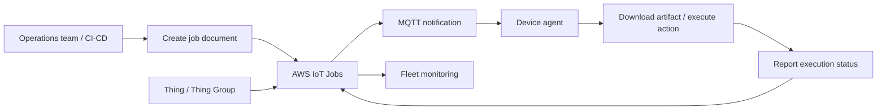
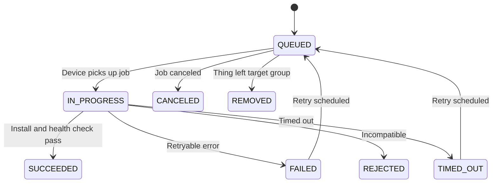
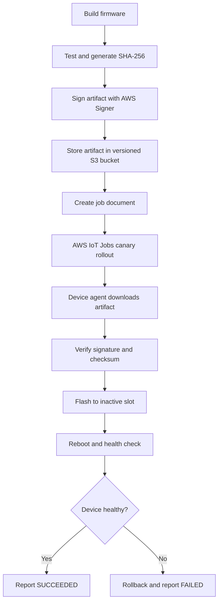

# IoT Jobs and Remote Device Updates

An IoT system may manage anywhere from a few test devices to hundreds of thousands of devices across many locations. When you need to update firmware, change configurations, collect diagnostics, or run maintenance operations, manually connecting to each device is no longer feasible. AWS IoT Jobs provides a mechanism to create, distribute, and track remote operations for individual AWS IoT Things or Thing Groups.

AWS IoT Jobs manages the deployment lifecycle and execution status. Devices still require an agent to receive the job document, download artifacts, verify integrity, execute the operation on the operating system or hardware, and report results. For firmware updates, the bootloader or OTA agent on the device is responsible for flashing firmware, rebooting, and rolling back when necessary.

## Learning Objectives

After this lesson, you will be able to:

- Explain the role of AWS IoT Jobs in remote fleet management.
- Distinguish between job, job document, target, and job execution.
- Choose snapshot jobs or continuous jobs based on the device lifecycle.
- Describe the job execution lifecycle and MQTT reserved topics.
- Create jobs via the AWS Console, AWS CLI, or API with rollout, abort, timeout, and retry settings.
- Design secure firmware update workflows using Amazon S3, presigned URLs, and Code Signing for AWS IoT.
- Track progress per device, handle failures, and roll out in waves.
- Apply security, testing, and rollback principles when operating a fleet.

## 1. What Problem Does AWS IoT Jobs Solve?

AWS IoT Jobs defines a remote operation, identifies the devices that should execute it, and notifies devices to fetch instructions. A job document contains data describing the operation; a target is a Thing or Thing Group; a job execution is an instance of the job running on a specific device.

Common use cases:

- Updating firmware or software on gateways, sensors, and industrial equipment.
- Updating configurations, endpoints, or operational parameters.
- Running maintenance commands such as certificate rotation, log cleanup, or storage checks.
- Collecting logs, diagnostics, and device status reports.
- Installing a package or application version onto compatible devices.



Jobs manages distribution and tracking. The service does not directly run shell commands, write firmware to flash, or decide how a device reboots. Those actions are the responsibility of the device agent and on-device software.

## 2. Core Components

| Component | Meaning | Example |
|---|---|---|
| Job | Deployment managed in AWS IoT Jobs | `firmware-gateway-2-4-1` |
| Job document | JSON describing the operation and parameters for devices | Download firmware 2.4.1, verify SHA-256, flash to inactive slot |
| Target | Thing or Thing Group receiving the job | `thing/plant-01-gateway-12` or `thinggroup/gateways-v2` |
| Job execution | A single run of a job on one Thing | Device `plant-01-gateway-12` installing firmware |
| Execution number | Identifier for a job execution on a device | Used when updating or querying a specific execution attempt |
| Status details | Key-value pairs describing progress or errors | `phase=download`, `bytesDownloaded=1048576` |

One job can target many devices. Each device gets its own job execution and reports progress independently. This lets operations teams see which devices have not picked up the job, which are downloading artifacts, and which have installed successfully.

A job document can be passed inline in the job creation request or stored in Amazon S3. Document contents act as the contract between backend and device agent: AWS IoT Jobs delivers the document, while the agent must parse the fields and follow the protocol defined by the development team.

## 3. Snapshot Jobs vs. Continuous Jobs

AWS IoT Jobs provides two target selection modes.

| Mode | Behavior | When Appropriate |
|---|---|---|
| `SNAPSHOT` | Applies to the target set at deployment time; completes once executions reach terminal states | Fixed update wave, such as deploying firmware to 500 existing gateways |
| `CONTINUOUS` | Continues applying to new devices added to the target Thing Group | Maintaining a fleet baseline version, onboarding new devices, or dynamic groups |

For example, an enterprise deploys firmware 2.4.1 to its current gateway group. If only that selected set needs a one-time update, use a snapshot job. If every newly added gateway joining the group must also receive version 2.4.1, use a continuous job.

For dynamic thing groups, AWS recommends continuous jobs. Dynamic groups determine membership by querying registry, connectivity, or shadow data—for instance, selecting devices with `model=GW-200` and `batteryLevel` above 80%. When a device satisfies the criteria and enters the group, a continuous job creates an execution for it.

Dynamic thing groups require Fleet Indexing to be enabled. Dynamic groups do not have manually declared membership, cannot belong to a hierarchy, and cannot have policies attached directly like static thing groups. Treat membership criteria as part of your deployment plan: if the group query is wrong, the set of devices receiving the job will be wrong too.

## 4. Job Document: The Contract Between Cloud and Device

Job documents are typically JSON. Field structure is application-defined, aside from special placeholders processed by AWS IoT Jobs such as S3 presigned URLs. A firmware update document might include operation, version, artifact URL, checksum, and installation instructions.

Example job document:

```json
{
  "operation": "installFirmware",
  "firmwareVersion": "2.4.1",
  "artifact": {
    "url": "${aws:iot:s3-presigned-url-v2:https://s3.ap-southeast-1.amazonaws.com/company-firmware/gateway/fw-2.4.1.bin}",
    "sha256": "0123456789abcdef0123456789abcdef0123456789abcdef0123456789abcdef",
    "sizeBytes": 16777216
  },
  "install": {
    "targetSlot": "inactive",
    "rebootAfterInstall": true
  }
}
```

This is an application-designed example schema, not a mandatory AWS IoT Jobs firmware schema. The SHA-256 string above only illustrates formatting; actual values must be generated by your build pipeline from the exact released artifact. The device agent must know how to read `operation`, download `artifact.url`, verify the checksum, flash firmware to `targetSlot`, and handle `rebootAfterInstall`.

A well-designed job document should:

- Have a clear `operation` or task type for agent routing.
- Include version or revision to prevent installing the wrong version.
- Reference immutable artifacts, ideally pinned to an S3 object version.
- Include a checksum or signature to verify the artifact.
- Include timeout, installation mode, or reboot parameters as needed.
- Be safe to re-run or detect already-completed states to prevent dangerous duplicate actions.
- Never contain long-term secrets, passwords, or private keys.

If a job document exceeds the MQTT payload limit (32 KB), store the document in S3 and reference it with `documentSource` when creating the job. AWS IoT Jobs reads the S3 object at job creation time; modifying the source file later does not alter the document attached to an existing job.

## 5. Job and Job Execution Lifecycle

### 5.1 Job Statuses

Job-level status describes the state of the overall deployment:

| Status | Meaning |
|---|---|
| `SCHEDULED` | Job was created with a future start schedule or maintenance window |
| `IN_PROGRESS` | Job is distributing executions or waiting for devices to finish |
| `COMPLETED` | Snapshot job finished all executions; a scheduled continuous job with an end time can also complete |
| `CANCELED` | Job was canceled or an abort configuration triggered |
| `DELETION_IN_PROGRESS` | AWS IoT Jobs is deleting the job and related executions |

A continuous job without a scheduled end time can remain `IN_PROGRESS` indefinitely to keep applying to new group members.

### 5.2 Per-Device Job Execution Statuses

| Status | Initiated By | Meaning |
|---|---|---|
| `QUEUED` | AWS IoT Jobs | Execution created and waiting for the device to pick up/process |
| `IN_PROGRESS` | Device | Device agent picked up the job and started working |
| `SUCCEEDED` | Device | Operation completed successfully |
| `FAILED` | Device | Operation failed; may be retried if configured |
| `TIMED_OUT` | AWS IoT Jobs | Execution exceeded its allowed time |
| `REJECTED` | Device | Device declined the job, e.g., hardware incompatibility |
| `REMOVED` | AWS IoT Jobs | Device left the target group before execution |
| `CANCELED` | AWS IoT Jobs | Execution canceled by request or abort/cancel configuration |

`SUCCEEDED`, `FAILED`, `TIMED_OUT`, `REJECTED`, `REMOVED`, and `CANCELED` are terminal states. A device agent cannot transition a terminal execution back to `IN_PROGRESS`; to retry, rely on retry configuration or create a new job/execution per workflow.

### 5.3 On-Device Processing Flow



AWS IoT Jobs can create multiple executions for multiple jobs targeting the same Thing. MQTT does not guarantee delivery order across multiple jobs; the agent must handle ordering, compatibility, and conflicting operations. The `StartNextPendingJobExecution` API prioritizes an already `IN_PROGRESS` execution ahead of `QUEUED` executions, helping devices resume interrupted work after disconnects.

## 6. MQTT Reserved Topics and Device Communication

Device agents typically use the MQTT Jobs API over reserved topics. In topics, `thingName` is the registered Thing name and `jobId` is the job ID. Devices can also use HTTP Signature Version 4 on port 443 with IAM credentials, or HTTP TLS on port 8443 with X.509 certificates if the client supports that protocol.

| Topic | Direction | Purpose |
|---|---|---|
| `$aws/things/{thingName}/jobs/notify` | Subscribe | Receives notifications when executions are added to or removed from the queue |
| `$aws/things/{thingName}/jobs/notify-next` | Subscribe | Receives notifications when the next execution changes |
| `$aws/things/{thingName}/jobs/get` | Publish | Requests the list of pending executions |
| `$aws/things/{thingName}/jobs/start-next` | Publish | Fetches and starts the next execution |
| `$aws/things/{thingName}/jobs/{jobId}/get` | Publish | Fetches execution details for a specific job |
| `$aws/things/{thingName}/jobs/{jobId}/update` | Publish | Updates execution status and progress |

MQTT commands have response topics such as `/accepted` and `/rejected`. AWS IoT delivers responses directly to the issuing client; these responses do not traverse the message broker and cannot be subscribed to by other clients or IoT Rules. The issuing client must still subscribe and handle the corresponding responses. For external monitoring systems to receive events via the broker, enable job/job execution events and subscribe to the appropriate event topics.

### 6.1 Starting an Execution

Upon receiving `notify` or `notify-next`, the agent can publish to:

```text
$aws/things/gateway-001/jobs/start-next
```

The payload can include a `clientToken` to match requests and responses:

```json
{
  "clientToken": "gateway-001-start-0007",
  "statusDetails": {
    "agentVersion": "1.8.0"
  }
}
```

If an execution is waiting, the response contains the job ID, job document, and `IN_PROGRESS` status. If no matching execution exists, the response omits the `execution` field. The agent must handle both cases.

### 6.2 Reporting Progress

While downloading and installing firmware, the agent publishes to:

```text
$aws/things/gateway-001/jobs/firmware-gateway-2-4-1/update
```

Example download progress report:

```json
{
  "status": "IN_PROGRESS",
  "statusDetails": {
    "phase": "download",
    "bytesDownloaded": "8388608",
    "totalBytes": "16777216"
  },
  "clientToken": "gateway-001-progress-0042"
}
```

Once installed, rebooted, and verified stable, the agent reports:

```json
{
  "status": "SUCCEEDED",
  "statusDetails": {
    "installedVersion": "2.4.1",
    "healthCheck": "passed"
  },
  "clientToken": "gateway-001-complete-0001"
}
```

Fields inside `statusDetails` are application-defined metadata. AWS IoT Jobs does not interpret them as percentage progress; monitoring systems can read these values for display or analysis.

### 6.3 Versioning and Concurrent Updates

Each execution update increments the execution's version. You can pass `expectedVersion` to prevent updates from overwriting state changed elsewhere. If the current version mismatches, the request is rejected with `VersionMismatch`; the agent should fetch the latest state before deciding how to update again.

Thing certificates and IoT policies must scope publish/subscribe permissions to the exact Thing name and required Jobs topics. Never grant broad wildcards across all Things when each certificate represents a single device.

## 7. Rollouts: Staged Fleet Deployment

Never push new firmware to an entire fleet all at once. Rollout configuration controls the rate at which devices receive notifications and job documents.

### 7.1 Constant Rollout Rate

Constant rollout caps the maximum number of devices notified per minute using `maximumPerMinute`. For instance, setting `20` distributes the job at most to 20 Things per minute. This makes network load, S3 download traffic, and concurrent device reboots predictable.

### 7.2 Exponential Rollout Rate

Exponential rollout starts at `baseRatePerMinute` and scales by `incrementFactor` once criteria such as notified Things or succeeded executions are met. You can set `maximumPerMinute` to cap peak speed.

Example: start at 10 devices/minute, double every 100 successful executions, and cap at 200 devices/minute. This lets you deploy slowly during early validation and accelerate once canary devices prove stable.

### 7.3 Abort Configuration

Abort configuration automatically cancels a job when failure rates cross a threshold after enough executions have occurred. Failure types can be `FAILED`, `REJECTED`, `TIMED_OUT`, or `ALL`.

For example, after at least 20 devices have executed, if 10% report `FAILED`, AWS IoT Jobs cancels the job to halt further rollout. Specify both `minNumberOfExecutedThings` and `thresholdPercentage`; relying on percentage alone with a tiny sample size can abort a rollout prematurely on a single failure.

Abort configuration does not replace monitoring. Track device logs, error codes, device models, and hardware revisions to identify root causes before re-launching a job.

## 8. Timeouts, Step Timers, and Retries

### 8.1 In-Progress Timeout

`inProgressTimeoutInMinutes` is the overall time limit per execution, starting when the device transitions to `IN_PROGRESS`. Valid values range from 1 minute to 7 days. If the device fails to transition the execution to a terminal state before the timer expires, AWS IoT Jobs sets the status to `TIMED_OUT`.

Set timeouts based on total time for artifact download, verification, installation, reboot, and health checks. For large firmware images or slow cellular networks, an overly short timeout creates unnecessary execution timeouts even when the firmware itself is healthy.

### 8.2 Step Timer

A step timer is a per-execution timer that can be set or refreshed when calling `StartNextPendingJobExecution` or `UpdateJobExecution`. Valid values are 1 to 10,080 minutes; `-1` cancels an active step timer. Step timers cannot extend the absolute job-level in-progress timeout.

For example, the overall execution timeout is 120 minutes. The agent sets a 30-minute step timer for downloading, then updates it to 45 minutes for installation. Even so, the entire execution must finish within the 120-minute cap.

### 8.3 Retry Configuration

Retry configuration lets AWS IoT Jobs schedule a retry execution when a device reports `FAILED` or an execution becomes `TIMED_OUT`. You can configure retry counts per failure type. AWS documentation allows up to 10 retries per execution; set limits based on failure root cause and cost.

Not every failure should be retried:

- Transient network errors or interrupted artifact downloads are good candidates for retries.
- Hardware incompatibility should report `REJECTED` and never be retried.
- Firmware failing signature or checksum verification should halt and report `FAILED`; investigate the artifact or release pipeline.
- Flash write errors may be retried if the agent/bootloader confirms the device remains in a safe state.

Each retry can incur additional cost. Pair retries with abort configurations to halt rollouts when many devices fail together. Retry counts are fixed at job creation; do not treat them as parameters to tweak mid-rollout.

## 9. Scheduling and Maintenance Windows

Scheduling configuration lets you define start time, end time, and how incomplete executions are handled when the schedule ends. You can use recurring maintenance windows so devices receive jobs only during approved downtime windows.

Key end behaviors:

| Value | Behavior at End Time |
|---|---|
| `STOP_ROLLOUT` | Stops notifying remaining devices; `QUEUED` and `IN_PROGRESS` executions continue to completion |
| `CANCEL` | Stops rollout and cancels `QUEUED` executions; `IN_PROGRESS` executions continue |
| `FORCE_CANCEL` | Stops rollout and cancels both `QUEUED` and `IN_PROGRESS` executions |

Start schedules can be set up to one year in advance, and end times up to two years per current API limits. Times are normalized to UTC internally. When designing maintenance windows, account for time zones, daylight saving time, and when devices might actually be offline.

For industrial firmware updates, schedule overnight maintenance windows, stop rollout when the window closes, and let devices already installing finish cleanly. Use `FORCE_CANCEL` only after evaluating the impact of interrupting an active operation.

## 10. Creating Jobs with AWS CLI

Basic workflow:

1. Build firmware and store the artifact in S3.
2. Create a job document referencing the artifact and checksum.
3. Prepare an IAM role allowing AWS IoT Jobs to generate presigned URLs.
4. Create the job with appropriate targets, rollout, timeout, abort, and retry settings.
5. Monitor executions per Thing.

Example creating a snapshot job for a gateway group:

```bash
aws iot create-job \
  --job-id "gateway-fw-2-4-1-20261120" \
  --targets "arn:aws:iot:ap-southeast-1:111122223333:thinggroup/production-gateways" \
  --document file://firmware-job.json \
  --description "Deploy gateway firmware 2.4.1" \
  --target-selection SNAPSHOT \
  --presigned-url-config '{"roleArn":"arn:aws:iam::111122223333:role/IoTJobsS3DownloadRole","expiresInSec":3600}' \
  --job-executions-rollout-config '{"maximumPerMinute":20}' \
  --timeout-config '{"inProgressTimeoutInMinutes":120}' \
  --abort-config '{"criteriaList":[{"failureType":"FAILED","action":"CANCEL","thresholdPercentage":10,"minNumberOfExecutedThings":20}]}' \
  --job-executions-retry-config '{"criteriaList":[{"failureType":"FAILED","numberOfRetries":2},{"failureType":"TIMED_OUT","numberOfRetries":2}]}'
```

Account ID, Thing Group ARN, role ARN, job ID, and artifact in the example are illustrative values. The role must allow `iot.amazonaws.com` to assume it and grant only `s3:GetObject` on the target artifact bucket/prefix. Its trust policy should restrict `aws:SourceAccount` and `aws:SourceArn` to mitigate confused deputy risks.

If devices joining the group after job creation also need the update, change `--target-selection SNAPSHOT` to `CONTINUOUS`. With dynamic thing groups, use continuous jobs.

### 10.1 Monitoring Jobs

Inspect job metadata:

```bash
aws iot describe-job \
  --job-id "gateway-fw-2-4-1-20261120"
```

List job executions:

```bash
aws iot list-job-executions-for-job \
  --job-id "gateway-fw-2-4-1-20261120"
```

Inspect a single device's execution:

```bash
aws iot describe-job-execution \
  --job-id "gateway-fw-2-4-1-20261120" \
  --thing-name "gateway-001"
```

These commands distinguish job-level problems from device-specific failures. While a job remains `IN_PROGRESS`, inspect `isConcurrent` and rollout progress; a job can remain `IN_PROGRESS` even after all executions are distributed while waiting for devices to complete.

## 11. Secure OTA Firmware Updates

OTA (Over-The-Air) refers to updating software or firmware over a network. A sound OTA process guarantees authentic artifacts, integrity against tampering, hardware compatibility, and recoverability from power or network loss.

### 11.1 Recommended Update Flow



A device with A/B partitions can download new firmware into the inactive slot, verify it, and instruct the bootloader to switch slots. If post-reboot health checks fail, the bootloader reverts to the previous slot. This reduces the risk of bricking devices due to a faulty update.

### 11.2 S3 Presigned URLs

Job documents can contain a placeholder for an S3 presigned URL:

```text
${aws:iot:s3-presigned-url-v2:https://s3.ap-southeast-1.amazonaws.com/company-firmware/gateway/fw-2.4.1.bin}
```

When a device requests the job document, AWS IoT Jobs replaces the placeholder with a time-limited presigned URL. The URL is not statically baked when authoring the job document. Expiration can be configured from 60 to 3,600 seconds; the default is 3,600 seconds.

When using presigned URLs, `presignedUrlConfig` requires an IAM role allowing AWS IoT to read the S3 object and a trust policy allowing the IoT service to assume it. Scope the role to the exact bucket/prefix and include `aws:SourceAccount` and `aws:SourceArn` in the trust policy. Never grant read access across every S3 bucket in the account when a job needs only one artifact folder.

For critical artifacts, enable S3 Versioning and pin the exact object version. When new firmware is uploaded, S3 generates a version ID; jobs can bind to that specific artifact version so deployments are auditable and reproducible.

### 11.3 Code Signing and On-Device Verification

AWS recommends signing code before shipping to devices so devices detect tampered artifacts. With Code Signing for AWS IoT, prepare a code-signing certificate and import it into AWS Certificate Manager (ACM), then create a signing job with AWS Signer. Code-signing certificates must have `Digital Signature` in Key Usage and `Code Signing` in Extended Key Usage. The job document must be stored in a versioned S3 bucket when using this signing workflow.

AWS IoT Jobs supports signature placeholders like:

```text
${aws:iot:code-sign-signature:s3://region.bucket/code-file@code-file-version-id}
```

The pipeline takes the signing job output and embeds the signature alongside the artifact presigned URL in the job document. When the device receives the document, the agent reads the `codesign` section and verifies the signature against the trust anchor provisioned on the device before installing firmware. Follow the Code Signing for AWS IoT workflow specifically; signing flows for Lambda or container images cannot be substituted directly for IoT firmware signing.

Devices must verify signatures using a trust anchor/public key protected inside firmware or the bootloader. Alongside signatures, SHA-256 checksums catch truncated downloads or bit errors. TLS protects the transport channel during transfer; signatures verify artifact origin and integrity independently of the transport.

Do not report `SUCCEEDED` immediately after downloading. Report success only after:

1. Downloading the complete artifact and verifying file size.
2. Verifying checksum and cryptographic signature.
3. Installing safely to target storage.
4. Rebooting or activating the new version.
5. Passing health checks confirming device and critical functions operate properly.

If the device is incompatible with the firmware version, report `REJECTED` with a reason. If download or installation fails due to a recoverable error, report `FAILED` so the retry policy can act.

## 12. Security and Access Control

AWS IoT Jobs has two permission planes to design separately: control-plane permissions for job creators and data-plane permissions for devices.

### 12.1 Job Creator Permissions

An IAM principal or CI/CD role requires appropriate AWS IoT permissions such as `iot:CreateJob`, `iot:DescribeJob`, `iot:ListJobExecutionsForJob`, `iot:DescribeJobExecution`, `iot:CancelJob`, and other workflow-specific admin actions. If the job uses presigned URLs, configure an S3 download role that the IoT service can assume.

### 12.2 Device Permissions

Devices connect to AWS IoT Core using X.509 certificates and IoT policies. The policy should allow only the exact MQTT actions needed:

- `iot:Connect` for the client ID tied to the Thing.
- `iot:Subscribe` on required response and notification topics.
- `iot:Receive` on response and notification topics.
- `iot:Publish` on `jobs/get`, `jobs/start-next`, and `jobs/{jobId}/update`.

Use policy variables or resource ARNs scoped by Thing name so one device's certificate cannot access another device's Jobs topics. When a device is revoked or retired, disable its certificate and remove it from target groups per fleet lifecycle procedures.

### 12.3 Protecting Artifacts and Job Documents

- Use a dedicated bucket or prefix for firmware releases.
- Enable S3 Versioning to pin artifact versions.
- Use SSE-S3 or SSE-KMS as required; grant least-privilege KMS permissions if using a customer-managed key.
- Sign firmware and verify signatures on devices.
- Never place long-term secrets in job documents; presigned URLs are temporary credentials.
- Audit who created each job, target group, firmware version, checksum, and rollout outcome.
- Separate production job creation permissions from regular artifact build permissions.

## 13. Fleet Monitoring and Troubleshooting

A job showing success at the service level does not mean every device installed successfully. Track execution statuses and status details per Thing.

| Symptom | Possible Cause | Resolution |
|---|---|---|
| Execution stays `QUEUED` | Device offline, not subscribed to notifications, or not calling `start-next` | Check MQTT connection, topic permissions, and agent loop |
| Execution stays `IN_PROGRESS` | Agent hung, download/install lacked timeout, or disconnected | Inspect device logs, step timer, and in-progress timeout |
| `REJECTED` spikes | Firmware incompatible with model/hardware or rejected by agent | Inspect target group, device attributes, and compatibility checks |
| `FAILED` during artifact download | Presigned URL expired, S3 permission, network, or bad checksum | Check URL lifetime, role trust, bucket policy, and download logs |
| `TIMED_OUT` spikes | Short timeout, slow network, or slow install | Measure actual duration and adjust timeout/step timer |
| `VersionMismatch` | Multiple components updating execution concurrently | Fetch latest execution, check `expectedVersion`, update cleanly |
| `LimitExceededException` creating job | Hit concurrent jobs limit or related quota | Check `isConcurrent`, wait for rollout/cancel, or request quota increase |
| Cannot load job document | Invalid S3 URL/object or document exceeds MQTT payload limit | Check S3 URL; use `documentSource` for documents over 32 KB |

Investigate systematically:

1. Check `describe-job` to review job status, rollout, and abort configuration.
2. List executions grouped by `QUEUED`, `IN_PROGRESS`, `FAILED`, `REJECTED`, or `TIMED_OUT`.
3. Pick a representative failed device and inspect `describe-job-execution` and status details.
4. Correlate device agent logs across notification receipt, download, verification, install, and reboot.
5. Verify IoT policy, S3 permissions, presigned URLs, KMS, and network connectivity.
6. Only retry or launch a new job after identifying the root cause and confirming artifacts/devices are safe.

## 14. Quotas and Limits to Plan For

Key limits per current AWS documentation:

| Limit | Reference Value | Operational Impact |
|---|---|---|
| Inline job document | 32 KB | Store larger documents in S3 and use `documentSource` |
| Presigned URL expiration | 60–3,600 seconds | URL must live long enough for device download |
| In-progress timeout | 1 minute–7 days | Size to expected execution duration |
| Step timer | 1–10,080 minutes | Bound individual execution phases |
| Concurrent jobs | Default 500 per Region/account | Quota increases available; concurrent rollout jobs count toward limit |
| Pending executions in notification | Up to 15 | Devices must process notifications and queues per API |

Quotas can vary by Region, job type, and scheduling configuration. Check AWS Service Quotas before large-scale fleet deployments. At high job volumes, avoid creating/canceling jobs en masse without accounting for concurrent job limits.

## 15. Case Study: Firmware Update for Industrial Gateways

A factory operates 2,000 gateways across multiple zones. Firmware 2.4.1 fixes connectivity bugs and improves stability. Some gateways have older hardware revisions that cannot run the new firmware.

### Step 1: Segment Devices

Thing Registry and Thing Shadow store attributes such as `model`, `hardwareRevision`, `firmwareVersion`, `site`, and `batteryLevel`. Create Thing Groups by model/revision. With dynamic groups, use queries to target only compatible devices.

### Step 2: Prepare the Artifact

The build pipeline compiles firmware, runs tests, computes SHA-256, signs with Code Signing for AWS IoT, and uploads the artifact to a versioned S3 bucket. Record version ID, checksum, code-signing profile, and build ID.

### Step 3: Canary Rollout

Create a snapshot job targeting 20 lab/canary gateways. Set a low rollout rate, generous timeout, and abort threshold. Monitor boot errors, disconnects, temperatures, and business metrics throughout a validation window.

### Step 4: Expand Rollout

If canary succeeds, create a job for a 10% pilot group before expanding to remaining cohorts. If failure rates exceed thresholds, abort the job, halt subsequent waves, and investigate root causes before re-releasing.

### Step 5: Verify and Rollback

Devices write firmware to the inactive slot, reboot, and run health checks. If health checks pass, the agent reports `SUCCEEDED` and updates the reported firmware version in Device Shadow. If checks fail, the bootloader rolls back to the old slot and the agent reports `FAILED` with an error code. Operations uses execution results to decide whether to proceed, pause, or trigger a rollback job.

## 16. Production Design Principles

- Use snapshot jobs for fixed deployment waves; use continuous jobs for newly joining group members.
- Organize Thing Groups by model, hardware revision, region, or operational criteria.
- Validate on lab and canary cohorts before increasing rollout rates.
- Configure abort thresholds, timeouts, and retries before launching production jobs.
- Use S3 Versioning, checksums, and code signing for critical firmware.
- Build device agents with download resume, idempotency, and recovery from power/network loss.
- Use A/B partitions or recovery mechanisms so failed updates never brick devices.
- Report `SUCCEEDED` only after health checks pass, not merely after download.
- Scope IoT policies to exact Things and required Jobs topics.
- Monitor both job-level status and individual job executions.
- Record actual firmware versions in registry/shadow after updates.
- Check quotas and costs prior to large-scale rollouts.

## 17. Common Misconceptions

| Misconception | Accurate Understanding |
|---|---|
| Creating a job means devices are updated | Creating a job only initiates deployment; devices must still pick it up, execute, and report |
| A job document is a shell command AWS runs on the device | Documents are JSON; the device agent parses and executes operations itself |
| Snapshot and continuous jobs are identical | Snapshot targets current members; continuous keeps applying to new group members |
| Job-level `IN_PROGRESS` means every device is running | Rollout distribution may have finished while waiting for device executions to complete |
| A presigned URL is a static URL inside the job document | The placeholder is replaced with a time-limited URL when the device fetches the document |
| Retries fix every failure type | `REJECTED` does not retry; incompatibility requires fixing targets or firmware |
| TLS alone protects firmware | TLS protects transport; code signing and checksums verify the artifact itself |
| Report `SUCCEEDED` as soon as download finishes | Verification, installation, reboot, and health checks must succeed first |
| Canceling a job immediately stops all devices | Running executions may continue depending on cancel/end behavior; `FORCE_CANCEL` behaves differently |
| Device Shadow replaces Jobs | Shadow syncs desired/reported state; Jobs manages remote operations and execution progress |

## References

- [What is AWS IoT Jobs?](https://docs.aws.amazon.com/iot/latest/developerguide/jobs-what-is.html)
- [Jobs key concepts](https://docs.aws.amazon.com/iot/latest/developerguide/key-concepts-jobs.html)
- [Jobs and job execution states](https://docs.aws.amazon.com/iot/latest/developerguide/iot-jobs-lifecycle.html)
- [Managing jobs](https://docs.aws.amazon.com/iot/latest/developerguide/create-manage-jobs.html)
- [How job configurations work](https://docs.aws.amazon.com/iot/latest/developerguide/jobs-configurations-details.html)
- [Jobs device MQTT API operations](https://docs.aws.amazon.com/iot/latest/developerguide/jobs-mqtt-api.html)
- [Devices and jobs](https://docs.aws.amazon.com/iot/latest/developerguide/jobs-devices.html)
- [Reserved topics used for Jobs](https://docs.aws.amazon.com/iot/latest/developerguide/reserved-topics.html)
- [Jobs events](https://docs.aws.amazon.com/iot/latest/developerguide/events-jobs.html)
- [Create and manage jobs by using the AWS CLI](https://docs.aws.amazon.com/iot/latest/developerguide/manage-job-cli.html)
- [AWS CLI create-job command reference](https://docs.aws.amazon.com/cli/latest/reference/iot/create-job.html)
- [Dynamic thing groups](https://docs.aws.amazon.com/iot/latest/developerguide/dynamic-thing-groups.html)
- [AWS IoT Jobs limits](https://docs.aws.amazon.com/iot/latest/developerguide/job-limits.html)
- [AWS IoT Device Management endpoints and quotas](https://docs.aws.amazon.com/general/latest/gr/iot_device_management.html)
- [Code signing for AWS IoT](https://docs.aws.amazon.com/signer/latest/developerguide/Welcome.html)
- [Sign Internet of Things (IoT) objects with AWS Signer](https://docs.aws.amazon.com/signer/latest/developerguide/iot-workflow.html)
- [OTA security and Code Signing for AWS IoT](https://docs.aws.amazon.com/freertos/latest/userguide/dev-guide-ota-security.html)
