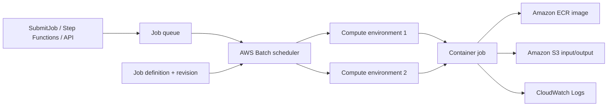

# AWS Batch Compute Environment, Job Queue, and Job Definition

A data processing system often runs many batch jobs: video transcoding, report aggregation, image processing, Monte Carlo simulations, scientific data analysis, or model training. These jobs do not necessarily require continuously running servers. Some jobs run for a few minutes, others take hours; some require GPUs or multiple nodes communicating with one another. Managing hundreds of EC2 instances manually forces teams to build schedulers, track state, allocate capacity, handle retries, and deal with failed servers.

AWS Batch is a batch job scheduling and orchestration service. Users package programs into containers, declare resources and execution settings in a job definition, submit jobs to a job queue, and AWS Batch selects a suitable compute environment to run them. A compute environment defines the infrastructure type and capacity limits; a job queue decides ordering and placement; a job definition describes the container, command, CPU, memory, IAM roles, retries, and timeouts.

Within the AWS ecosystem, AWS Batch integrates with Amazon EC2, EC2 Spot, AWS Fargate, Amazon ECS Managed Instances, Amazon EKS, Amazon ECR, IAM, Amazon CloudWatch Logs, Amazon S3, EFS, FSx, and Step Functions. Properly designing compute environments, job queues, and job definitions decouples application requirements from infrastructure, optimizes costs, and scales processing from a few jobs to thousands of parallel jobs.

## Learning Objectives

After this lesson, you can:

- Explain the roles of compute environments, job queues, job definitions, and jobs in AWS Batch.
- Choose managed or unmanaged compute environments based on required infrastructure control.
- Choose EC2 On-Demand, EC2 Spot, Fargate, Fargate Spot, or ECS Managed Instances.
- Design job queues, compute environment order, queue priority, and fair-share scheduling.
- Declare container images, commands, parameters, CPU, memory, GPUs, storage, and networking in job definitions.
- Distinguish between service-linked roles, EC2 instance roles, execution roles, and job roles.
- Configure retry strategies, timeouts, job dependencies, and parameter substitution.
- Use the AWS CLI to create compute environments, queues, job definitions, and submit jobs.
- Monitor job states, troubleshoot jobs stuck in `RUNNABLE`, and optimize capacity and cost.

## What Is AWS Batch?

AWS Batch is a managed scheduler for batch workloads. Applications do not need to manually pick servers for each job. Users describe resource requirements and containers; the scheduler locates suitable compute capacity from the compute environments attached to a queue.

AWS Batch manages the job lifecycle: accepting jobs, checking dependencies, queuing, waiting for resources, launching containers, tracking results, and applying retries/timeouts. The service does not write data processing code, replace a container registry, or automatically guarantee durable input/output data. Applications must still read and write data from S3, EFS, FSx, databases, or other suitable systems.

### Three Core Components

| Component | Question It Answers | Configuration Contents |
|---|---|---|
| Compute environment (CE) | What infrastructure do jobs run on and what is the maximum capacity? | EC2/Fargate/ECS Managed Instances/EKS, On-Demand/Spot, vCPUs, instance types, subnets, security groups, roles |
| Job queue (JQ) | Where do jobs wait, how are they prioritized, and which CE is tried first? | Queue priority, scheduling policy, CE order, ENABLED/DISABLED state |
| Job definition | Which container does a job run and what resources/permissions does it need? | Image, command, CPU, memory, GPU, IAM roles, volumes, environment, retries, timeout |



A job definition describes how to run; a queue accepts and orders jobs; a compute environment provides capacity. A job queue can be attached to multiple compute environments, and a single compute environment can be used by multiple queues. A job runs only when the queue, CE, job definition, resources, IAM, and networking all satisfy its requirements.

## Compute Environment: Where Job Resources Are Provided

A compute environment is the pool of compute resources AWS Batch uses to run jobs. Before choosing a CE, determine the workload's requirements for CPU, RAM, GPU, x86/ARM architecture, filesystems, runtime duration, interruption tolerance, and host-level control.

### Managed and Unmanaged Compute Environments

| Type | Managed by AWS Batch | Managed by User | Best Fit |
|---|---|---|---|
| Managed | Capacity and compute resource lifecycle per configuration | Choose compute type, limits, instance types, networking, storage, and certain AMI/launch template settings | Most batch workloads; automatic scaling desired |
| Unmanaged | Scheduler and job lifecycle | Create, configure, scale, and update EC2/ECS or EKS compute resources manually as required | Custom AMIs, deep infrastructure control, or custom capacity management integration |

A managed compute environment can use EC2 On-Demand, EC2 Spot, Fargate, Fargate Spot, or Amazon ECS Managed Instances depending on orchestration type. Unmanaged compute environments do not support Fargate; users must provide compute resources that meet AWS Batch/ECS/EKS requirements.

With unmanaged ECS, after creating a CE, AWS Batch provisions an associated ECS cluster; operators manually launch container instances into that cluster and ensure the AMI, ECS agent, instance role, capacity, and scaling meet requirements. With unmanaged EKS, users manage the cluster/node groups and corresponding integration configuration.

**Operational note:** AWS Batch creates and manages underlying resources such as Auto Scaling groups, Launch Templates, Spot Fleet requests, and ECS clusters. Do not manually modify Batch-managed resources unless explicitly documented by AWS. Changes outside supported APIs/console flows can cause a CE to become `INVALID`, scale incorrectly, or delay jobs.

### Common Compute Types

| Compute Type | Characteristics | When to Use |
|---|---|---|
| EC2 On-Demand | EC2 capacity billed by usage duration without Spot interruptions | Critical jobs, hard-to-checkpoint workloads, or strict deadlines |
| EC2 Spot | Uses spare EC2 capacity at lower cost; can be interrupted | Retryable/checkpointed jobs, parallel workloads, or interruption-tolerant tasks |
| Fargate | Runs containers without managing EC2 instances | Standard container jobs whose CPU/memory fit within Fargate limits |
| Fargate Spot | Lower-cost Fargate capacity that can be interrupted | Fault-tolerant workloads without GPU or host-level control needs |
| ECS Managed Instances | Amazon ECS handles provisioning, scaling, patching, and terminating EC2 instances | Need GPUs, specific instance families, large CPU/RAM, or host-level features without managing ASGs/AMIs |
| EKS compute environment | AWS Batch schedules jobs as Kubernetes pods | Organizations already operating EKS wanting integrated batch scheduling with Kubernetes |

Fargate fits when jobs fit within supported CPU/memory limits and do not require host access. ECS Managed Instances fits when more EC2 capabilities than Fargate offers are needed while letting ECS manage the lifecycle. Multi-node parallel jobs require compatible EC2 compute environments; Fargate and ECS Managed Instances do not support MNP.

### EC2 On-Demand and Spot

EC2 On-Demand suits jobs with strict deadlines or difficult recovery. EC2 Spot suits jobs that can stop and re-run. When a Spot interruption occurs, containers may be terminated; applications should save periodic checkpoints to S3/EFS/FSx and ensure idempotent output writes.

AWS Batch provides allocation strategies to select instance types when additional capacity is required:

| Strategy | Selection Method | Guidance |
|---|---|---|
| `BEST_FIT` | Prioritizes a right-sized instance type at lowest cost; may wait for a matching pool | Use when cost is prioritized and workloads can wait; has some update constraints |
| `BEST_FIT_PROGRESSIVE` | Expands across instance types with sufficient resources, prioritizing cost per vCPU | Useful for more flexible scaling |
| `BEST_FIT_PROGRESSIVE_ORDERED` | Tries instance types in the configured priority order | Use when controlling instance type order; avoid over/under-provisioning |
| `SPOT_CAPACITY_OPTIMIZED` | Prioritizes Spot pools least likely to be interrupted | Fits when Spot capacity availability is the priority |
| `SPOT_PRICE_CAPACITY_OPTIMIZED` | Balances price and capacity availability, favoring low-interruption pools at lower price | Recommended by AWS for most Spot workloads |
| `SPOT_CAPACITY_OPTIMIZED_PRIORITIZED` | Optimizes for capacity first while applying instance type order on a best-effort basis | Use when influencing instance type selection |

Allocation strategies do not apply to Fargate or ECS Managed Instances. With ECS Managed Instances, ECS selects instances based on `instanceRequirements` and capacity configuration. With Spot CEs, specifying multiple compatible instance families/sizes gives the scheduler more pools to draw from. Do not restrict to a single instance type if your goal is increasing Spot capacity acquisition likelihood.

### Fargate and Fargate Spot

Fargate eliminates managing EC2 instances. Job definitions specify CPU, memory, image, execution role, networking, and storage. Each Fargate task has its own isolation boundary. Fargate supports x86_64 and ARM64; the architecture in the job definition must match the image.

Fargate has limitations to consider:

- CPU and memory must use Fargate-supported combinations; arbitrary sizes like EC2 are not allowed.
- Multi-node parallel jobs are not supported.
- Host volume/device configurations and privileged containers are not supported as on EC2.
- Jobs require `executionRoleArn` so the ECS agent can pull images, send logs, and fetch secrets.
- A Fargate job queue may attach only Fargate compute environments (`FARGATE`/`FARGATE_SPOT`); do not mix EC2 CEs in the same queue.
- Fargate Spot does not support Windows containers. A Fargate Spot-only queue may be blocked if Windows jobs are submitted.

In a VPC, Fargate tasks typically use private subnets with a NAT Gateway or VPC endpoints to access ECR, CloudWatch Logs, S3, and required services. `assignPublicIp` defaults to `DISABLED`; if a subnet lacks NAT and a job needs outbound internet access, design appropriate outbound routing or enable public IPs according to network policy.

### Amazon ECS Managed Instances

ECS Managed Instances bridges Fargate and self-managed EC2. ECS automatically provisions, scales, patches, and terminates instances; users provide capacity limits, networking, an infrastructure role, an instance profile, and instance type constraints.

Evaluate ECS Managed Instances when jobs require:

- NVIDIA GPUs for ML inference/training or rendering.
- More CPU/memory than Fargate limits allow.
- Specific instance types/families or ARM64 architecture.
- Host devices, host volumes, privileged containers, or specialized system settings.
- Capacity Reservations or other EC2 capacity options.

Job definitions for ECS Managed Instances use `ecsProperties` and `platformCapabilities: MANAGED_INSTANCES`; do not use legacy `containerProperties`. It does not support MNP. If a queue includes both On-Demand and Spot ECS Managed Instances, all On-Demand CEs must precede Spot CEs in `computeEnvironmentOrder`.

For jobs running on Amazon EKS, job definitions use `eksProperties` to describe the pod; do not declare `platformCapabilities`, `containerProperties`, or `nodeProperties` in ECS container job format. Always choose the job definition schema matching the queue's orchestration platform.

### EC2 Capacity Limits

In a managed EC2 CE, key parameters include:

- `minvCpus`: minimum capacity retained; non-zero values may incur cost even when the queue has no jobs.
- `desiredvCpus`: desired capacity at configuration time; Batch adjusts this when scaling.
- `maxvCpus`: vCPU scale-out ceiling for the CE.
- `instanceTypes`: set of allowed instance types.
- `subnets` and `securityGroupIds`: network placement for EC2 compute resources.
- `allocationStrategy`: how instance types are chosen when new capacity is needed.

`maxvCpus` does not guarantee a large job will run. There must be an instance type with enough CPU, RAM, GPU, and compatible architecture. A job requesting 64 vCPUs cannot run if the CE only allows instances up to 32 vCPUs, even if total capacity remains available.

## Job Queue: Where Jobs Wait and Get Scheduled

A job queue is where jobs wait before the scheduler places them onto a compute environment. An account can have multiple queues to separate workloads by priority, cost, environment, or user group.

Examples:

| Queue | Purpose | Compute Environment |
|---|---|---|
| `critical-ondemand` | Critical jobs needing early start | EC2 On-Demand |
| `standard-batch` | Routine reporting and ETL | EC2 On-Demand, optionally falling back to another CE on the same platform |
| `low-cost-spot` | Retryable and delay-tolerant jobs | EC2 Spot |
| `container-serverless` | Small jobs needing no host tuning | Fargate/Fargate Spot |
| `gpu-managed` | ML or rendering requiring GPUs | ECS Managed Instances or EC2 GPU |

### Queue State and Status

Distinguish two attributes:

- `state`: `ENABLED` or `DISABLED`. An `ENABLED` queue accepts new jobs; a `DISABLED` queue does not accept new jobs, though running jobs can still finish.
- `status`: operational status such as `CREATING`, `UPDATING`, `DELETING`, `DELETED`, `VALID`, or `INVALID`.

Attach only compute environments with status `VALID` to a queue. A queue must have a compatible, enabled CE with appropriate permissions and limits before jobs can be scheduled.

### Compute Environment Order

A queue can attach up to three compute environments. The scheduler tries CEs in ascending `order`: `1` is tried before `2`. If the first CE is not `VALID`, lacks suitable resources, or cannot supply capacity, the scheduler can try the next CE.

Example:

```text
order 1: EC2 On-Demand CE
order 2: EC2 Spot CE
```

This pattern prioritizes EC2 On-Demand capacity and falls back to EC2 Spot when needed. CEs within a queue must share the same platform group and architecture: EC2 On-Demand and EC2 Spot can be combined, but EC2 and Fargate cannot be mixed. Fargate queues use only Fargate CEs. ECS Managed Instances queues use only ECS Managed Instances CEs. For an ECS Managed Instances queue containing both On-Demand and Spot, On-Demand must precede Spot.

### Queue Priority

Queue `priority` determines which queue the scheduler evaluates first when multiple queues share a compute environment. Higher numeric values have higher priority. For example, queue priority `10` is evaluated before queue priority `1`.

Queue priority does not guarantee that jobs in a high-priority queue always run ahead of every job in a lower-priority queue. The scheduler evaluates periodically and dispatches only when resources are available when a queue is evaluated. If the high-priority queue has no eligible jobs or lacks matching capacity, the scheduler can evaluate other queues. If strict execution ordering between jobs is needed, use job dependencies rather than relying on queue priority.

### FIFO and Fair-Share Scheduling

Without a scheduling policy attached, AWS Batch defaults to first-in, first-out (FIFO) within a queue. FIFO fits simple workloads, but a batch of long or resource-heavy jobs can leave smaller jobs behind them waiting for a long time (head-of-line blocking).

Fair-share scheduling distributes compute across multiple workload groups using `shareIdentifier` and a scheduling policy. You can configure:

- `shareIdentifier`: identifies a workload group, such as `team-finance` or `tenant-42`.
- `weightFactor`: adjusts relative resource weights across shares; lower weights can receive a larger share of capacity under the scheduler's calculation.
- `shareDecaySeconds`: time window used to evaluate recent usage; longer durations let past usage influence scheduling for longer.
- `computeReservation`: reserves a percentage of capacity so one share cannot consume all compute.
- `schedulingPriority` in job definitions/submissions: takes effect only on queues using fair-share scheduling.

Fair-share is useful when a single queue serves multiple teams/tenants. It does not replace job dependencies; it controls fair resource allocation rather than expressing "job B must wait for job A".

### Resource-Aware Scheduling

AWS Batch can manage consumable resources beyond CPU, memory, and GPU. Examples include commercial software license tokens, database connection limits, or allowed request quotas to partner APIs. Operators declare total resource capacity and jobs declare required usage; the scheduler launches a job only when sufficient auxiliary resources remain.

This avoids situations where EC2 has spare CPU yet jobs fail due to missing licenses or exceeding downstream limits. Resource-aware scheduling supports FIFO and fair-share across Batch-supported compute platforms.

## Job Definition: Blueprint for Running Containers

A job definition is a versioned blueprint for a job. It specifies the image, command, resources, IAM roles, environment variables, volumes, logging, retry strategy, and timeout. When submitted, a job references a job definition name or specific revision.

### Revisions and Lifecycle

When a job definition is first registered, its revision starts at `1`. Each subsequent registration under the same name creates an incrementing revision. For example:

```text
image-convert:1
image-convert:2
image-convert:3
```

Running jobs use the revision they were submitted with; registering a new revision does not modify existing jobs. Unused revisions can be marked `INACTIVE` to prevent new submissions from referencing them; already submitted jobs remain unaffected. Use specific revisions in production to guarantee reproducibility and rollback capability.

### Container Image and Command

`image` points to a container image, typically stored in Amazon ECR. The image must match the compute environment's architecture and OS. For private images, the execution role or instance role needs permission to pull the image according to the compute model.

`command` is an argument array passed to the container entrypoint/CMD. Prefer an argument array over concatenating long shell strings unless a shell is required. If a shell is needed, explicitly invoke `/bin/sh -c` or `/bin/bash -c` and escape parameters properly.

### CPU, Memory, and GPU

Use `resourceRequirements` to declare resources:

```json
"resourceRequirements": [
  { "type": "VCPU", "value": "4" },
  { "type": "MEMORY", "value": "8192" },
  { "type": "GPU", "value": "1" }
]
```

`VCPU` specifies required vCPUs; `MEMORY` is in MiB; `GPU` is the number of physical GPUs. GPUs require a compute environment with matching GPU instances. On Fargate, GPUs are not supported and CPU/memory must belong to valid pairs. Legacy `vcpus` and `memory` fields are deprecated in container properties; prefer `resourceRequirements`.

Setting resources too low can cause containers to be killed for out-of-memory or run very slowly; setting them too high lowers packing density and increases cost. Benchmark with representative data, monitor peak memory and CPU utilization, and tune accordingly.

### Environment Variables and Parameters

Job definitions can declare shared environment variables and parameters overridable at submission time. Avoid storing passwords, API keys, or credentials as plaintext environment variables. Use `secrets` to pull values from AWS Secrets Manager or Systems Manager Parameter Store; grant read permissions to the execution role as required by the configuration.

AWS Batch supports parameter substitution in `command` using the syntax `Ref::parameterName`. Each placeholder must be a separate element in the command array; Batch does not substitute placeholders embedded inside a longer string.

Example:

```json
{
  "parameters": {
    "inputBucket": "company-data",
    "inputKey": "incoming/sample.csv"
  },
  "containerProperties": {
    "command": [
      "python",
      "/app/process.py",
      "--bucket",
      "Ref::inputBucket",
      "--key",
      "Ref::inputKey"
    ]
  }
}
```

If you need to construct an `s3://bucket/key` URI, pass bucket and key as separate arguments and combine them inside the application or shell script; `s3://Ref::inputBucket/Ref::inputKey` is not substituted by Batch inside a single string.

### Volumes and Persistent Storage

A container's temporary filesystem must not be the sole storage for outputs if the job can be retried or its compute instance terminated. Options include:

- S3 for input/output objects, checkpoints, and durable results.
- EFS for a shared POSIX filesystem across jobs/instances.
- FSx for Lustre or a high-performance filesystem for HPC workloads needing matching throughput and latency.
- Host volumes only when EC2 instance lifecycles are fully understood; data is not guaranteed to persist after container/instance termination.

Fargate does not support EC2-style host path volumes; EFS can be used per supported configuration. Job definitions declare `volumes` and `mountPoints`, while IAM/network/filesystem policies must still permit access.

### Logging

Use the `awslogs` log driver to send container stdout/stderr to CloudWatch Logs. Specify clear log groups, Regions, and stream prefixes; configure retention to control cost. Do not log credentials or sensitive data.

At high job counts, log streams typically include job ID/attempt for traceability. Also log correlation IDs, input object keys, application versions, and processing stages to aid investigation.

## IAM Roles: Distinguishing Service, Host, and Container Permissions

AWS Batch uses multiple IAM roles for distinct purposes. Mixing up roles is a common reason jobs fail to pull images, fail to write to S3, or fail to provision CE capacity.

| Role | Who Assumes/Uses It? | Typical Permissions |
|---|---|---|
| AWS Batch service-linked role (`AWSServiceRoleForBatch`) | AWS Batch service | Create/manage EC2, Auto Scaling, ECS, Launch Templates, Spot resources, and logs |
| Compute environment service role (when needed) | AWS Batch service | Allows Batch to orchestrate resources; managed CEs typically use the auto-created service-linked role |
| EC2 instance role/profile | ECS agent and container instances on EC2 | Register ECS instances and retrieve metadata needed to host jobs; should not have broad application permissions |
| ECS task execution role | ECS agent/runtime | Pull images from ECR, send logs, retrieve secrets/parameters at container startup |
| Job role (`jobRoleArn`) | Code inside the container | Application permissions such as reading S3 inputs, writing S3 outputs, calling DynamoDB or other required services |
| ECS infrastructure role for Managed Instances | Amazon ECS | Manage EC2 instances and Managed Instances infrastructure |

**Execution role and job role are not the same.** The execution role enables the platform to start the container; the job role grants permissions to code running inside the container. If the application needs to read S3, grant `s3:GetObject` to the job role; there is no need to grant that permission to the entire EC2 instance profile.

Fargate jobs require an execution role. ECS Managed Instances jobs also require an execution role. With EC2, container execution/logging and application permissions should be designed according to the corresponding ECS/Batch model.

For unmanaged CEs, users must specify a service role as required; managed CEs can automatically create the service-linked role when needed. Do not delete `AWSServiceRoleForBatch` while dependent resources still exist. Apply IAM least privilege and scoped `iam:PassRole` permissions for job creators/submitters.

## Job Retries, Timeouts, and Dependencies

### Retry Strategy

A job definition can specify `retryStrategy.attempts` from 1 to 10. By default, a job gets only one attempt. When a job fails with a non-zero exit code, instance failure, or service error, it can be retried according to configuration.

`evaluateOnExit` allows deciding `RETRY` or `EXIT` based on `onExitCode`, `onReason`, and `onStatusReason`. For example:

- Retry transient errors such as throttling, service unavailability, or instance termination.
- Do not retry invalid input data, malformed schemas, or missing required parameters.
- After the bounded retry attempts are exhausted, route to error handling/DLQ and notify.

Retries do not guarantee exactly-once execution. If a job writes partial output and then fails, the next attempt may write duplicates. Use output keys scoped by job ID/attempt, temporary prefixes followed by atomic publish/manifests, or appropriate idempotency mechanisms.

### Timeout

`timeout.attemptDurationSeconds` specifies the maximum duration an attempt is allowed to run. The minimum value is 60 seconds. When a job is terminated due to timeout, it is not retried under the default timeout behavior described in AWS documentation; set timeouts high enough and check state before re-submitting.

For array jobs, the timeout applies to each child job; for multi-node parallel jobs, the timeout applies to the whole job. A timeout specified at submission time overrides the value in the job definition.

### Job Dependencies

`dependsOn` ensures a job runs only after its upstream dependencies succeed. For example:

```text
extract-data -> transform-data -> publish-report
```

If a dependency fails, dependent jobs can transition to `FAILED`. A job can depend on up to 20 other jobs under current documented limits. For complex workflows with branching, retries, and callbacks, use AWS Step Functions to orchestrate and invoke SubmitJob.

### Array Jobs

An array job runs multiple child jobs sharing the same job definition and resources but differing by index/parameters. Array sizes currently support 2 to 10,000 child jobs. For example, a Monte Carlo simulation with 5,000 parameter sets; a single submission creates a parent job and many child jobs. Each child receives `AWS_BATCH_JOB_ARRAY_INDEX` to identify its slice of data.

Array jobs fit embarrassingly parallel workloads. If parts must continuously exchange state or synchronize tightly, array jobs do not replace MPI/MNP.

### Multi-Node Parallel Jobs

A multi-node parallel (MNP) job is a single job distributed across multiple EC2 instances, also known as gang scheduling. The job definition declares `nodeProperties` including `numNodes`, `mainNode`, and node range groups. The main node launches first; child nodes are created afterward. The job completes according to the main node's state; child nodes are stopped when the job finishes.

MNP suits MPI, distributed HPC, or workloads requiring nodes to communicate over IP. The application must include a framework/library to synchronize across nodes. MNP is not supported on Fargate or ECS Managed Instances; select an EC2 compute environment and verify networking, instance types, placement, and quotas.

## AWS CLI: Creating Compute Environments, Queues, and Job Definitions

The examples below illustrate a managed EC2 pipeline. Replace account ID, Region, subnets, security groups, instance profile, role ARNs, and ECR image with values from your actual environment. Roles must be created beforehand with appropriate trust policies and permissions.

### 1. Create a Compute Environment

Create `compute-environment.json`:

```json
{
  "computeEnvironmentName": "batch-ec2-ondemand",
  "type": "MANAGED",
  "state": "ENABLED",
  "computeResources": {
    "type": "EC2",
    "allocationStrategy": "BEST_FIT_PROGRESSIVE",
    "minvCpus": 0,
    "maxvCpus": 128,
    "desiredvCpus": 0,
    "instanceTypes": ["m7i.large", "m7i.xlarge", "c7i.xlarge"],
    "subnets": ["subnet-0123456789abcdef0", "subnet-0abcdef1234567890"],
    "securityGroupIds": ["sg-0123456789abcdef0"],
    "instanceRole": "arn:aws:iam::111122223333:instance-profile/BatchEcsInstanceProfile",
    "ec2Configuration": [
      { "imageType": "ECS_AL2023" }
    ],
    "tags": {
      "Workload": "batch",
      "Environment": "production"
    }
  }
}
```

Create the CE:

```bash
aws batch create-compute-environment \
  --cli-input-json file://compute-environment.json
```

A managed CE requires `AWSServiceRoleForBatch` or a supported service role. The CE goes through creation; poll with `describe-compute-environments` until `status` is `VALID`.

### 2. Create a Job Queue

Create a medium-priority queue and attach the CE created above:

```bash
aws batch create-job-queue \
  --job-queue-name standard-batch-queue \
  --state ENABLED \
  --priority 10 \
  --compute-environment-order '[{"order":1,"computeEnvironment":"batch-ec2-ondemand"}]'
```

The CE must be in `VALID` status before attaching it to a queue. If a queue has multiple CEs, order them ascending by `order` and ensure matching platform/architecture.

### 3. Register a Job Definition

Create `job-definition.json`:

```json
{
  "jobDefinitionName": "csv-transform",
  "type": "container",
  "platformCapabilities": ["EC2"],
  "parameters": {
    "inputBucket": "company-data",
    "inputKey": "incoming/sample.csv"
  },
  "containerProperties": {
    "image": "111122223333.dkr.ecr.ap-southeast-1.amazonaws.com/csv-transform:1.0.0",
    "command": [
      "python",
      "/app/transform.py",
      "--bucket",
      "Ref::inputBucket",
      "--key",
      "Ref::inputKey"
    ],
    "resourceRequirements": [
      { "type": "VCPU", "value": "2" },
      { "type": "MEMORY", "value": "4096" }
    ],
    "executionRoleArn": "arn:aws:iam::111122223333:role/BatchExecutionRole",
    "jobRoleArn": "arn:aws:iam::111122223333:role/CsvTransformJobRole",
    "logConfiguration": {
      "logDriver": "awslogs",
      "options": {
        "awslogs-group": "/aws/batch/csv-transform",
        "awslogs-region": "ap-southeast-1",
        "awslogs-stream-prefix": "job"
      }
    }
  },
  "retryStrategy": {
    "attempts": 3
  },
  "timeout": {
    "attemptDurationSeconds": 3600
  },
  "tags": {
    "Application": "data-platform"
  }
}
```

Register it:

```bash
aws batch register-job-definition \
  --cli-input-json file://job-definition.json
```

The response returns the revision and ARN. Record the revision for controlled deployments and rollbacks.

### 4. Submit a Job

```bash
aws batch submit-job \
  --job-name transform-orders-2026-11-20 \
  --job-queue standard-batch-queue \
  --job-definition csv-transform:1 \
  --parameters inputBucket=company-data,inputKey=incoming/orders-2026-11-20.csv
```

The command returns a `jobId`. Use `describe-jobs` to inspect state, container exit code, attempts, log stream, and status reason.

### 5. Monitor and Cancel/Terminate Jobs

```bash
aws batch describe-jobs --jobs JOB_ID

aws batch cancel-job \
  --job-id JOB_ID \
  --reason "Input file was invalid"

aws batch terminate-job \
  --job-id JOB_ID \
  --reason "Stop runaway processing"
```

`cancel-job` is for jobs that have not started running or are queued; `terminate-job` stops an actively running job. Choose the action based on state and account for impact on outputs and cleanup.

## Job Lifecycle and Troubleshooting Stuck Jobs

Common states:

| State | Meaning | What to Check |
|---|---|---|
| `SUBMITTED` | Job was just accepted | Valid job definition/queue |
| `PENDING` | Waiting on dependencies or other conditions | Have upstream dependent jobs completed? |
| `RUNNABLE` | Eligible to run, waiting on scheduler/capacity | CE state, maxvCpus, instance capacity, quotas, resource requirements |
| `STARTING` | Initializing compute/container | Image pull, networking, execution role, ENI/subnet IPs, log config |
| `RUNNING` | Container is executing | CloudWatch Logs, CPU/memory, application progress |
| `SUCCEEDED` | Job exited with success code | Verify outputs and business results |
| `FAILED` | Job failed or exhausted retries/timeout | Exit code, status reason, attempt history, and logs |

### Job Stuck in `RUNNABLE` Too Long

This is a common scenario. Check in order:

1. Is the queue `state=ENABLED` and `status=VALID`?
2. Is the compute environment `state=ENABLED`, `status=VALID`, and still attached to the queue?
3. Does the CE have high enough `maxvCpus` and instance types satisfying the job's vCPU/memory/GPU?
4. Do the instance types have capacity in the Region/AZ? Are there EC2 service quotas or Spot capacity issues?
5. Do subnets have available IPs, proper routes/NAT/VPC endpoints, and security groups?
6. Does the job definition specify architecture/platform capabilities compatible with the CE?
7. Are fair-share policies, share identifiers, resource-aware scheduling, or consumable resources throttling the job?
8. Is queue order/priority causing the job to wait while a higher-priority CE lacks capacity?

A `RUNNABLE` job is not necessarily an application bug; usually the scheduler has not yet found matching capacity. Do not blindly raise `maxvCpus` if instance types are incompatible or subnets lack IPs.

### Job Stuck in `STARTING`

Check:

- Container image exists, tag/digest is valid, and image architecture matches compute architecture.
- Execution role/instance role has permissions to pull ECR images and fetch secrets.
- EC2/Fargate task has a network path to ECR, S3, CloudWatch Logs, and required services.
- Subnets have available IPs/ENIs; security groups/NACLs do not block outbound traffic.
- Log group and log configuration are valid.
- Large images or slow startup scripts are taking time.

### Job `FAILED`

Inspect `statusReason`, `container.exitCode`, attempt details, and CloudWatch Logs. Classify the failure into input/data, application bug, permissions, networking, resource exhaustion, timeout, or infrastructure interruption. Retry only potentially transient errors; deterministic failures require fixing the root cause.

## Cost and Performance Optimization

### Optimizing Compute Environments

- Pick instance families suited to the workload: compute optimized for CPU-bound, memory optimized for memory-bound, GPU instances for CUDA/ML/rendering.
- Allow multiple compatible instance types to improve capacity acquisition.
- Use Spot for interruption-tolerant jobs; checkpoint and retry to minimize lost work.
- Set `minvCpus=0` for workloads not needing warm capacity; keep minimum capacity only when startup latency matters.
- Set `maxvCpus` as a budget guardrail and concurrency control.
- With Fargate, you pay per task resources, so verify CPU/memory sizing is optimal and check whether adjusting sizes reduces runtime.
- With ECS Managed Instances, configure `maxvCpus`, allowed instance types, and scale-in behavior properly; avoid keeping instances idle too long.

### Optimizing Job Definitions

- Measure peak memory/CPU instead of guessing from a developer laptop.
- Do not request GPUs if the workload does not use them.
- Keep container images small, pin versions/digests, and minimize pull times.
- Use S3 multipart or streaming for large inputs/outputs; avoid loading entire files into memory unnecessarily.
- Increase in-application batch sizes to cut overhead when processing many small records.
- Configure sensible retries; never retry data or permission errors.
- Set timeouts to prevent runaway hung jobs; alert when jobs exceed expected durations.

### Optimizing Queues and Concurrency

- Separate queues by SLA, environment, and cost profile.
- Use fair-share so one team cannot consume all capacity.
- Use resource-aware scheduling when license or downstream limits apply.
- Use array jobs for independent tasks sharing the same definition.
- Use dependencies or Step Functions for ordered pipelines.
- Cap submission rate/concurrency so target databases or APIs are not overloaded.

### Tracking Costs

Costs can include EC2 On-Demand/Spot, EBS, Fargate vCPU/memory/storage, ECS Managed Instances capacity, ECR storage/data transfer, S3, EFS/FSx, CloudWatch Logs, NAT Gateway, data transfer, and supporting services. AWS Batch charges no separate per-job scheduler fee; primary costs come from the AWS resources consumed.

Tag CEs, queues, job definitions, and jobs to allocate costs by team, project, environment, or tenant. Track vCPU-hours, instance-hours, Fargate task duration, Spot savings, idle capacity, failed job runtime, and log storage. Measure cost per successful job rather than only cost per submitted job.

## Real-World Scenario: Processing 50,000 Product Images

An e-commerce platform needs to generate thumbnails and extract metadata for 50,000 images daily. Each image is independent, average processing time is 20 seconds, and jobs can retry if a Spot instance is interrupted.

### Design

1. The application uploads original images to the S3 prefix `raw/products/`.
2. An event or workflow creates an array job with 50,000 child jobs, each receiving an object key via parameter/index.
3. The job definition uses an image-processing container with 1 vCPU and 2 GiB memory; the app reads input from S3 and writes thumbnails to `processed/products/`.
4. The job role has only `s3:GetObject` on the raw prefix and `s3:PutObject` on the processed prefix.
5. The compute environment uses EC2 Spot across multiple instance families with allocation strategy `SPOT_PRICE_CAPACITY_OPTIMIZED`.
6. The job queue uses a fair-share policy so other groups still get capacity.
7. The retry strategy handles infrastructure failures; the application writes deterministic output keys and manifests to prevent duplicates.
8. CloudWatch Logs captures stdout/stderr; metrics track job success, processing duration, and queue wait time.

### Why Does This Design Fit?

- Images are independent, so array jobs exploit parallelism effectively.
- Spot lowers costs for interruption-tolerant workloads.
- S3 preserves inputs/outputs durably across retries.
- A least-privilege job role limits data exposure.
- Fair-share prevents a backfill wave from consuming all capacity.
- Array size or max vCPU can scale with demand within quotas and downstream limits.

If images require GPU processing or libraries needing host access, consider EC2 GPU or ECS Managed Instances. If the workload is small, short-lived, and needs no GPU/host control, Fargate can reduce server management effort.

## Common Design Mistakes

| Mistake | Consequence | Fix |
|---|---|---|
| Not distinguishing CE, queue, and job definition | Unclear where to configure capacity, scheduling, or containers | Design the three layers with clear responsibilities |
| Attaching an `INVALID` CE to a queue | Jobs are not scheduled | Wait for CE `VALID`; check status reason and roles/networking |
| Mixing EC2 and Fargate in the same queue | Invalid queue configuration | Separate queues by platform type |
| Configuring only a single Spot instance type | Frequent capacity shortages | Add compatible instance families/sizes |
| Using Spot for uncheckpointed jobs | Progress lost on interruption | Design checkpoints, idempotency, and retries |
| Confusing execution role with job role | Container pulls images but cannot access S3, or vice versa | Separate runtime permissions and application permissions |
| Putting secrets in plaintext environment variables | Credentials exposed in job definitions/console/logs | Use Secrets Manager/Parameter Store references |
| Specifying CPU/memory too low | Containers killed or run slowly | Measure peak resources and tune requirements |
| Raising queue priority when jobs are stuck `RUNNABLE` | Does not resolve capacity shortages or instance mismatches | Inspect CE, quotas, instance types, subnets, and resource requests |
| No timeout configured | Hung jobs keep consuming capacity | Set timeouts per SLA and configure alerts |
| Retrying every error | Higher cost and repeated deterministic failures | Use `evaluateOnExit`, classify errors, and use DLQs |
| Using host disk for durable outputs | Data lost when instance terminates | Write results/checkpoints to S3/EFS/FSx |
| Using queue priority as a dependency | Execution order is not guaranteed | Use `dependsOn` or Step Functions |
| Running non-Batch workloads on managed clusters | Interferes with scaling/scheduler and risks unexpected termination | Submit workloads exclusively through AWS Batch APIs |

## Production Readiness Checklist

- [ ] Identify workload CPU/memory/GPU, architecture, duration, SLA, and retryability.
- [ ] Choose managed or unmanaged compute environments.
- [ ] Select EC2 On-Demand/Spot, Fargate, ECS Managed Instances, or EKS appropriately.
- [ ] Set min/max vCPU, instance types, allocation strategy, and capacity guardrails.
- [ ] Select VPC subnets, security groups, NAT/VPC endpoints, and storage access.
- [ ] Create service-linked role, instance role, execution role, job role, and infrastructure role with proper responsibilities.
- [ ] Wait for compute environments to reach `VALID` status before attaching to queues.
- [ ] Create queues with appropriate priority, CE order, and FIFO/fair-share policies.
- [ ] Do not mix incompatible compute platforms or architectures in the same queue.
- [ ] Register job definitions with pinned image versions, commands, and benchmarked resource requirements.
- [ ] Grant application permissions via job roles; retrieve secrets from Secrets Manager/Parameter Store.
- [ ] Configure log drivers, CloudWatch log groups, and retention.
- [ ] Set up retry strategies, evaluateOnExit, timeouts, and idempotent outputs.
- [ ] Test job dependencies, array jobs, or MNP if required by the workload.
- [ ] Test Spot interruptions, instance capacity shortages, subnet IP exhaustion, and downstream throttling.
- [ ] Monitor job states, queue wait times, vCPU utilization, job duration, retries, and failed jobs.
- [ ] Apply tags and analyze cost per successful job.
- [ ] Write runbooks for `INVALID` CEs/queues, long `RUNNABLE` jobs, long `STARTING` jobs, and `FAILED` jobs.

## Conclusion

AWS Batch separates compute provisioning, scheduling, and execution definitions into three components. Compute environments define infrastructure type, capacity, and networking; job queues decide where jobs wait, priorities, and CE order; job definitions describe images, commands, resources, IAM roles, storage, retries, and timeouts. EC2 suits workloads needing instance control or MNP; Spot reduces costs for interruption-tolerant jobs; Fargate simplifies container workloads; ECS Managed Instances provides additional EC2 capabilities without self-managing server lifecycles. Combined with queue scheduling, least-privilege roles, checkpointing, observability, and cost controls, AWS Batch handles large-scale batch and HPC workloads while greatly reducing the need to build a custom scheduler.

## References

- [AWS Batch components](https://docs.aws.amazon.com/batch/latest/userguide/batch_components.html)
- [Compute environments for AWS Batch](https://docs.aws.amazon.com/batch/latest/userguide/compute_environments.html)
- [Managed compute environments](https://docs.aws.amazon.com/batch/latest/userguide/managed_compute_environments.html)
- [Unmanaged compute environments](https://docs.aws.amazon.com/batch/latest/userguide/unmanaged_compute_environments.html)
- [Create a compute environment](https://docs.aws.amazon.com/batch/latest/userguide/create-compute-environment.html)
- [Instance type allocation strategies](https://docs.aws.amazon.com/batch/latest/userguide/allocation-strategies.html)
- [Fargate compute environments](https://docs.aws.amazon.com/batch/latest/userguide/fargate-compute-environments.html)
- [Amazon ECS Managed Instances compute environments](https://docs.aws.amazon.com/batch/latest/userguide/ecs_managed_instances.html)
- [Job queues](https://docs.aws.amazon.com/batch/latest/userguide/job_queues.html)
- [Fair-share scheduling policies](https://docs.aws.amazon.com/batch/latest/userguide/job_scheduling.html)
- [Resource-aware scheduling](https://docs.aws.amazon.com/batch/latest/userguide/resource-aware-scheduling.html)
- [Job definition parameters for ContainerProperties](https://docs.aws.amazon.com/batch/latest/userguide/job_definition_parameters.html)
- [Job definitions on Amazon ECS Managed Instances](https://docs.aws.amazon.com/batch/latest/userguide/ecs-managed-instances-job-definitions.html)
- [Using roles for AWS Batch](https://docs.aws.amazon.com/batch/latest/userguide/using-service-linked-roles-batch-general.html)
- [Automated job retries](https://docs.aws.amazon.com/batch/latest/userguide/job_retries.html)
- [Job dependencies](https://docs.aws.amazon.com/batch/latest/userguide/job_dependencies.html)
- [Array jobs](https://docs.aws.amazon.com/batch/latest/userguide/array_jobs.html)
- [Multi-node parallel jobs](https://docs.aws.amazon.com/batch/latest/userguide/multi-node-parallel-jobs.html)
- [AWS Batch pricing](https://aws.amazon.com/batch/pricing/)
