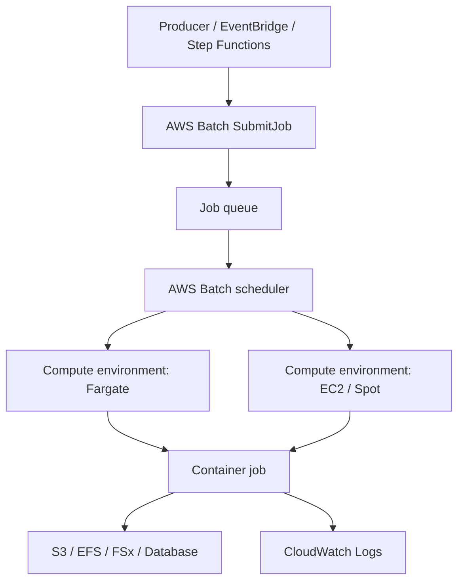
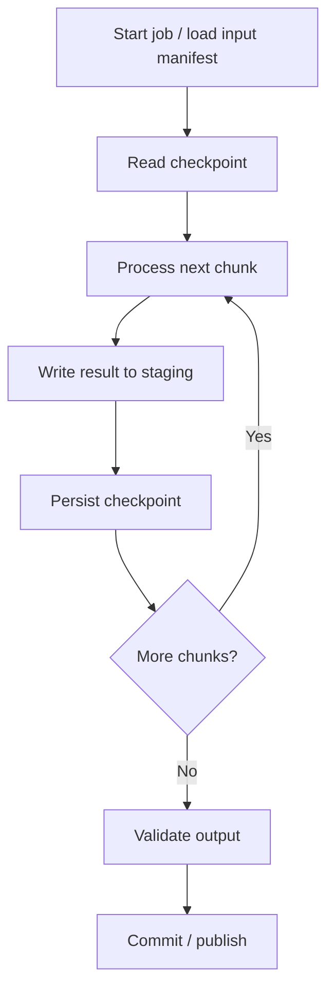
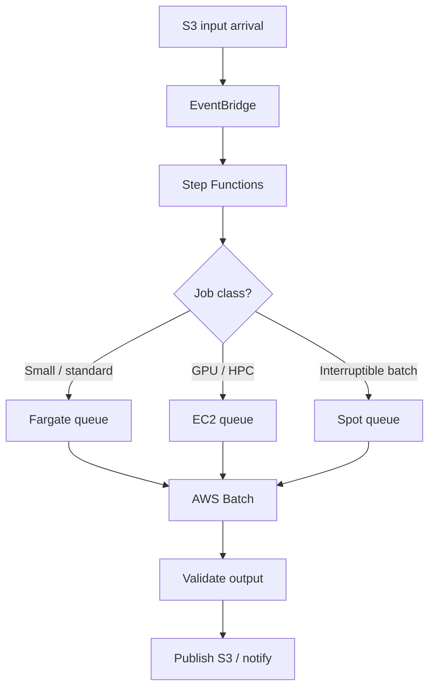

# Combining Fargate, EC2, and Spot for Batch Processing

Batch processing runs work over a dataset or a group of tasks and terminates upon completion, rather than keeping an always-on service running to serve continuous requests. Examples include converting millions of images, generating end-of-day reports, analyzing logs, rendering video, running scientific simulations, training models in batches, or processing thousands of files arriving in Amazon S3.

On AWS, **AWS Batch** orchestrates queuing, scheduling, and running container jobs across compute environments. A job can run on **AWS Fargate**, **Amazon EC2 On-Demand**, or **Amazon EC2 Spot**; for suitable workloads, **Fargate Spot** can also be used. Each model differs in pricing, customizability, resource limits, and interruption tolerance.

The architectural goal is matching the right compute type to workload characteristics:
- Fargate fits container jobs needing rapid deployment, no server management, and resource requirements within Fargate limits.
- EC2 On-Demand fits workloads needing GPUs, specialized instances, custom AMIs, EFA, high vCPU/RAM, or host-level control.
- EC2 Spot fits tasks that can checkpoint, retry, or re-run when capacity is reclaimed.
- Fargate Spot fits Fargate container jobs that can tolerate interruption and want to leverage Spot capacity.

This lesson belongs to the `CLOUD_PROVIDERS_AWS` module, connecting compute, containers, IAM, VPC, S3, ECR, storage, monitoring, and cost optimization. After this lesson, you can:

- Describe AWS Batch architecture including job definitions, job queues, the scheduler, and compute environments.
- Compare Fargate, EC2 On-Demand, EC2 Spot, and Fargate Spot.
- Select compute based on CPU, RAM, GPU, storage, networking, runtime, and interruption tolerance.
- Design job queues, compute environment order, and fallback strategies.
- Create job definitions, submit jobs, and configure retries/timeouts.
- Design checkpointing, idempotency, and Spot interruption handling.
- Organize storage, networking, IAM, and logging for batch workloads.
- Estimate costs and operate scalable batch pipelines.

## 1. Batch Workloads and Characteristics to Classify

Batch workloads typically have finite inputs or can be divided into independent processing units. A job reads data, performs transformations, writes results, and terminates. Workloads may arrive on a schedule, via events, or on user submission.

Examples:

| Workload | Characteristics | Typical Compute Needs |
|---|---|---|
| Bulk image resizing | Many independent tasks, moderate CPU | Fargate or EC2 Spot |
| End-of-day report generation | Scheduled, must finish before deadline | Fargate or EC2 On-Demand |
| Video rendering | High CPU/GPU, long runtime | EC2, optionally Spot if checkpointing is supported |
| Scientific simulation | High CPU/RAM/network, possibly MPI | EC2, EFA, and FSx |
| Log analysis | Many files, elastic workload | Fargate or EC2 Spot |
| ML image inference | May require GPU | EC2 GPU |
| Partitioned ETL | Many tasks retryable independently | Fargate or EC2 Spot |
| Deadline-sensitive work | Requires predictable capacity | EC2 On-Demand or Fargate On-Demand |

Before choosing compute, answer:

- How many vCPUs and how much RAM does a single job need?
- Does it need GPUs, EFA, local NVMe, custom kernel/modules, or privileged containers?
- Does the job run for seconds, minutes, or hours?
- Can it be split into independent tasks?
- If stopped mid-run, can it resume from a checkpoint?
- Does the deadline allow waiting for Spot capacity?
- Do inputs/outputs reside in S3, EFS, FSx, or a database?
- Does it need internet access, internal endpoints, or VPC services?
- How many concurrent jobs run, and what is the peak burst?

Never pick Spot solely for low hourly price. If a job cannot recover after being stopped and has a hard deadline, retry costs or missed deadlines can outweigh compute savings.

## 2. What Components Make Up AWS Batch?

AWS Batch is a batch job scheduling and management service. Users define containers and resource requirements, submit jobs to a queue, and the scheduler chooses an appropriate compute environment to run them.

Key components:

| Component | Role |
|---|---|
| Job definition | Describes image, command, vCPU, RAM, roles, volumes, retries, and timeout |
| Job | A specific submitted execution |
| Job queue | Holds jobs waiting to be processed by the scheduler |
| Scheduling policy | Controls how compute is shared across workloads/teams |
| Compute environment (CE) | Resource pool running containers, using EC2 or Fargate |
| Scheduler | Evaluates jobs, dependencies, queues, and capacity |
| Job state | States: SUBMITTED, PENDING, RUNNABLE, STARTING, RUNNING, SUCCEEDED, or FAILED |

Overall architecture:



AWS Batch can manage capacity for managed compute environments. With EC2, Batch launches and scales instances based on demand; with Fargate, Batch requests task capacity from Fargate. Operators still must design images, IAM, networking, storage, retries, and data handling.

## 3. Compute Environments and Job Queues

A **compute environment** defines the compute type, network placement, and capacity Batch can use. A **job queue** accepts jobs and connects to one or more compute environments in a defined order.

In a managed compute environment, AWS Batch handles provisioning and reclaiming capacity based on configured settings such as compute type, instance types, min/max vCPUs, subnets, and security groups.

Common compute resource types in this topic:

| Compute Resource Type | Model |
|---|---|
| `EC2` | Amazon EC2 On-Demand |
| `SPOT` | Amazon EC2 Spot |
| `FARGATE` | AWS Fargate On-Demand |
| `FARGATE_SPOT` | AWS Fargate Spot |

EC2 and Spot are two provisioning models backed by EC2. Fargate and Fargate Spot are two provisioning models backed by Fargate. They can be ordered within a queue of the same provisioning model group so the scheduler tries capacity in order.

### 3.1. Job Queue Compatibility Rules

AWS Batch does not allow mixing EC2 compute environments and Fargate compute environments in the same job queue. Compute environments attached to a queue must belong to the same group: EC2/Spot or Fargate/Fargate Spot. Compute environments in the same queue must also have compatible CPU architectures.

Therefore, if you want to use both Fargate and EC2 in one system:
- Create a dedicated queue for Fargate workloads.
- Create a dedicated queue for EC2 workloads.
- Use producers, Step Functions, or routing logic to pick the queue by job type.
- Within each queue, use compute environment order to prioritize or fall back across compatible capacity models.

A Fargate queue can combine Fargate Spot and Fargate On-Demand; an EC2 queue can combine EC2 Spot and EC2 On-Demand. Do not design a single queue containing all four types.

### 3.2. Compute Environment Order

When a queue has multiple compute environments, the scheduler tries them in ascending order of the `order` field. For example, order 1 is tried before order 2. If the first compute environment is invalid or cannot supply matching resources, the scheduler can try the next compute environment.

Example strategies:
- Fargate Spot order 1, Fargate On-Demand order 2: prioritize Spot, with On-Demand capacity as the next option.
- EC2 Spot order 1, EC2 On-Demand order 2: prioritize Spot, with On-Demand capacity as the next option.
- EC2 On-Demand order 1, EC2 Spot order 2: prioritize stable capacity; Spot is the secondary option if suitable.

Order is not a guarantee that jobs always run on the first compute environment. Job definitions must be compatible with the compute environment; architecture, resources, and CE status all affect placement.

## 4. AWS Fargate for Batch Containers

AWS Fargate is a serverless compute engine for containers. When using Fargate in AWS Batch, users package the application into an image and declare CPU/RAM, networking, and IAM roles. There is no need to create EC2 clusters, manage AMIs, or scale instances.

Fargate fits when:
- Container jobs are standalone and need no host-level customization.
- Resource requirements fit within Fargate limits.
- Reducing capacity management effort is desired.
- Workloads do not need GPUs, EFA, or Multi-node Parallel.
- Load is intermittent and keeping idle EC2 workers running should be avoided.
- Task-level isolation is needed.

AWS Batch can often spin up Fargate capacity faster than waiting to provision an EC2 instance; actual startup time also depends on image size, networking, and job volume.

### 4.1. Key Fargate Limitations

Per current AWS Batch documentation, Fargate supports jobs up to 32 vCPU and 244 GiB memory. Key limits and conditions:

- GPUs are not supported for Batch jobs on Fargate.
- Custom AMIs, EC2 launch templates, and selecting EC2 instance types are not supported.
- Privileged containers are not supported.
- Host-level devices, kernel tuning, and certain Linux parameters available on EC2 are not provided.
- Multi-node Parallel jobs requiring multi-node coordination are not supported.
- CPU/memory must use Fargate-supported combinations.
- Job definitions must declare `platformCapabilities: ["FARGATE"]`.
- `executionRoleArn` and vCPU/memory resource requirements must be declared.
- Fargate Spot does not support Windows containers.
- Do not design a Fargate Batch job expected to run longer than 14 days.

If a job requires GPUs, custom AMIs, EFA, more than 32 vCPUs, or more than 244 GiB RAM, evaluate an EC2 compute environment.

### 4.2. Storage on Fargate

Each Fargate task has its own ephemeral storage. Default capacity and expansion limits depend on platform version; on supported platform versions, larger ephemeral storage can be configured. Data in ephemeral storage is not durable once a task terminates.

Options:
- Use ephemeral storage for temporary files, scratch data, and small intermediates.
- Use S3 for durable inputs/outputs.
- Use EFS when multiple tasks must access a shared filesystem.
- Use databases/object stores for state and checkpoints.

Never assume data on the container filesystem survives after a task stops or restarts.

## 5. EC2 On-Demand for Batch

EC2 On-Demand provides virtual machines in the instance types a workload needs. In AWS Batch, a compute environment can specify one or more instance families, vCPU capacity, AMIs, and matching settings.

EC2 fits when:
- GPUs or specialized instance families are needed.
- More RAM or vCPUs than Fargate limits allow are needed.
- Custom AMIs, launch templates, kernels/modules, or host-level access are needed.
- Local NVMe/instance store or specialized I/O optimization is needed.
- EFA, placement groups, or MPI are needed.
- Multi-node Parallel jobs are needed.
- Large numbers of concurrent jobs require high dispatch throughput.
- Finer control over instance placement and capacity is desired.

### 5.1. Choosing an Instance Family

| Workload | Reference Instance Family | Reason |
|---|---|---|
| CPU batch | C family | Compute optimized |
| Memory-heavy | R, X families | Large RAM |
| General purpose | M family | Balanced CPU/RAM |
| GPU inference/rendering | G family | GPUs for graphics/inference |
| GPU training/HPC | P family | High-performance GPUs |
| Storage intensive | I, D families depending on generation | Suitable local storage/IOPS |
| Network/HPC | C/M/R with suitable network/EFA | Throughput and latency |

Family names are only a starting point. Compare CPU generation, RAM/vCPU ratio, network bandwidth, EBS bandwidth, local storage, GPU, EFA support, pricing, and Region availability.

### 5.2. Managed and Unmanaged Compute Environments

A managed CE lets AWS Batch manage capacity and instance lifecycles according to configuration parameters. An unmanaged CE is for organizations that want to manage EC2 capacity and ECS container instances themselves via custom processes.

For most batch systems, a managed CE reduces operational effort. Use an unmanaged CE only when special infrastructure controls are required and the team can maintain capacity, AMIs, ECS agents, instance registration, scaling, and lifecycles.

## 6. EC2 Spot for Interruption-Tolerant Batch

EC2 Spot uses spare AWS EC2 capacity at prices that fluctuate by Spot pool. Prices are typically much lower than On-Demand, though AWS can reclaim capacity when needed.

Spot fits:
- Jobs that can retry or checkpoint.
- Independent, stateless, or chunked tasks.
- Workloads with flexible deadlines.
- Batch jobs flexible across multiple instance types/AZs.
- Rendering, ETL, log processing, simulations, and data transformations that do not require a single uninterrupted process.

Not suitable when:
- Progress cannot be recovered after interruption.
- Losing a run causes major consequences.
- Jobs require guaranteed capacity at an exact time.
- Workloads have non-idempotent side effects.
- There is no durable way to save outputs/checkpoints.

### 6.1. Spot Interruption

When EC2 Spot capacity is reclaimed, EC2 typically emits an interruption notice about two minutes before terminating or stopping the instance. Applications should not treat this window as guaranteed to finish a job; it is only an opportunity to shut down and checkpoint.

AWS Batch can retry jobs when instances fail or are terminated if retry attempts remain. For compute environments using ECS orchestration and Spot Instances, AWS Batch enables Spot instance draining by default for compute environments created or updated on or after 2026-10-09. Upon receiving a notice, the container instance transitions to `DRAINING` to stop accepting new jobs and allow running jobs to handle shutdown in the remaining time. Verify launch template settings if this behavior has been overridden.

### 6.2. Diversify Instance Types and AZs

Spot capacity is partitioned by instance type and Availability Zone. Selecting only one instance type in one AZ shrinks the available Spot pools.

Recommendations:
- List multiple instance types compatible with the job.
- Select multiple suitable Availability Zones.
- Use instance families equivalent in architecture and resources.
- Avoid locking workloads to a single instance size if they can run across multiple sizes.
- Monitor capacity errors and interruption rates.

Diversification increases the chance of acquiring capacity. However, the image and job definition must be compatible with all selected instance types.

## 7. Fargate Spot

Fargate Spot runs tasks on spare Fargate capacity. This model preserves the serverless Fargate experience while allowing interruptions when capacity changes.

Suitable for:
- Stateless or checkpointable container jobs.
- Retryable workloads.
- CPU/RAM requirements within Fargate limits.
- Batch jobs able to wait if Spot capacity is temporarily unavailable.
- Avoiding EC2 instance management while optimizing costs.

Not suitable for:
- Windows containers.
- GPUs, EFA, host customization, or resources outside Fargate.
- Jobs that cannot tolerate interruptions.
- Workloads needing guaranteed capacity to start on an exact schedule.

When a Fargate Spot task is stopped due to interruption, ECS sends roughly a two-minute warning as a task state change event to EventBridge and a SIGTERM signal to the running task. Applications must catch SIGTERM, save checkpoints, and exit cleanly within the grace window. Fargate Spot capacity may be unavailable at times, causing longer wait times.

### 7.1. Fargate Spot and Fargate On-Demand in One Queue

A Fargate job queue can attach both `FARGATE_SPOT` and `FARGATE` compute environments, provided the CEs share compatible provisioning models and architectures. For example:
- CE `fargate-spot`, order 1.
- CE `fargate-ondemand`, order 2.

This prioritizes Spot while giving the scheduler Fargate On-Demand as a secondary option when the first CE cannot provide placement. Monitor jobs in RUNNABLE and check queue/CE status; do not assume fallback is instantaneous in every capacity scenario.

## 8. Comparing Fargate, EC2, and Spot

| Criterion | Fargate On-Demand | Fargate Spot | EC2 On-Demand | EC2 Spot |
|---|---|---|---|---|
| Server management | Managed by AWS | Managed by AWS | AWS Batch manages instances if managed CE | AWS Batch manages Spot instances if managed CE |
| Spot reclaim interruption | No | Yes | Not from Spot reclaim | Yes |
| GPU | No | No | Yes, per instance | Yes, per instance |
| Custom AMI/host tuning | No | No | Yes | Yes |
| EFA/MPI/MNP | Not suitable/not supported | No | Yes with supported config | EFA usable on supported instances; AWS Batch MNP does not support Spot |
| Resource ceiling | Fargate limits | Fargate limits | Per instance | Per instance with Spot capacity |
| Capacity planning | Less | Less, though Spot may be scarce | Must choose families/capacity | Must diversify Spot pools |
| Cost | Per vCPU/RAM and task duration | Fargate Spot price | Per EC2 instance | Variable Spot price |
| Fault tolerance | App handles job errors | Requires checkpoint/retry | App handles job errors | Requires checkpoint/retry |
| Best fit | Simple container jobs, clear deadlines | Flexible, retryable jobs | Specialized/HPC/stable jobs | Fault-tolerant, cost-optimized batch |

### 8.1. Quick Selection Rules

- Choose Fargate On-Demand if you want simplicity, no host access, and relatively firm deadlines.
- Choose Fargate Spot if the job fits Fargate limits, can be stopped, and can retry.
- Choose EC2 On-Demand if you need GPUs, EFA, MNP, custom AMIs, high RAM/vCPU, or host control.
- Choose EC2 Spot if the workload can checkpoint, diversify instance types, and tolerate capacity interruptions.
- Use multiple queues when workloads differ in compute platform or SLA.

## 9. Allocation Strategies for EC2 Spot

AWS Batch selects Spot instance types from configured pools. Allocation strategies shape the trade-off between price and capacity availability.

Notable strategies:
- `SPOT_CAPACITY_OPTIMIZED`: prioritizes pools with deeper capacity to lower interruption risk.
- `SPOT_PRICE_CAPACITY_OPTIMIZED`: considers both capacity and price, picking pools unlikely to be interrupted within a favorable price tier; AWS recommends this for most Spot workloads.
- `SPOT_CAPACITY_OPTIMIZED_PRIORITIZED`: advanced strategy for influencing instance type preference order while still prioritizing capacity.

Do not use current Spot price as a fixed forecast for the entire runtime. Capacity and prices vary by Region, AZ, instance type, and time.

### 9.1. Diversification Matters More Than Just Lowest Price

The cheapest Spot pool may have tight capacity and a higher interruption rate. For batch workloads, completion time and retry overhead are part of total cost.

Example:
- Workload A chooses a single cheapest instance type but is frequently reclaimed.
- Workload B lets Batch pick from multiple compatible instance types with deeper capacity.
- Workload B may finish faster and more reliably even at a slightly higher hourly rate.

Evaluate by total cost to complete the batch, not merely hourly instance price.

## 10. Job Definition: Packaging the Work

A job definition describes how to run a container:
- Container image and tag/digest.
- Command and parameters.
- vCPU, memory, and GPU if supported by the platform.
- Execution role and job role.
- Environment variables.
- Volume/mount points.
- Network configuration.
- Retry strategy and timeout.
- Log configuration.
- Platform capabilities.

Use immutable images by digest or version tag; avoid the `latest` tag in production because image contents can change while the job definition stays the same.

### 10.1. Fargate Job Definition Example

```json
{
  "jobDefinitionName": "image-resize-fargate",
  "type": "container",
  "platformCapabilities": ["FARGATE"],
  "containerProperties": {
    "image": "111122223333.dkr.ecr.ap-southeast-1.amazonaws.com/image-worker:1.4.2",
    "executionRoleArn": "arn:aws:iam::111122223333:role/BatchTaskExecutionRole",
    "jobRoleArn": "arn:aws:iam::111122223333:role/ImageWorkerJobRole",
    "resourceRequirements": [
      {"type": "VCPU", "value": "1"},
      {"type": "MEMORY", "value": "2048"}
    ],
    "networkConfiguration": {
      "assignPublicIp": "DISABLED"
    },
    "logConfiguration": {
      "logDriver": "awslogs",
      "options": {
        "awslogs-group": "/aws/batch/image-worker",
        "awslogs-region": "ap-southeast-1",
        "awslogs-stream-prefix": "job"
      }
    }
  },
  "retryStrategy": {
    "attempts": 3
  },
  "timeout": {
    "attemptDurationSeconds": 3600
  }
}
```

This example uses 1 vCPU and 2 GiB RAM. vCPU/memory values must be a Fargate-supported combination. For Fargate, declare vCPU and memory inside `resourceRequirements`; do not use legacy `vcpus` and `memory` fields in containerProperties. Fargate requires an execution role so the agent can pull images, write logs, and retrieve configured secrets; the job role is used by code inside the container to call AWS APIs.

### 10.2. EC2 Job Definition Example

```json
{
  "jobDefinitionName": "video-render-ec2",
  "type": "container",
  "platformCapabilities": ["EC2"],
  "containerProperties": {
    "image": "111122223333.dkr.ecr.ap-southeast-1.amazonaws.com/video-renderer:3.1.0",
    "jobRoleArn": "arn:aws:iam::111122223333:role/VideoRenderJobRole",
    "vcpus": 8,
    "memory": 32768,
    "resourceRequirements": [
      {"type": "GPU", "value": "1"}
    ],
    "mountPoints": [
      {
        "sourceVolume": "scratch",
        "containerPath": "/scratch",
        "readOnly": false
      }
    ],
    "volumes": [
      {
        "name": "scratch",
        "host": {"sourcePath": "/local/scratch"}
      }
    ]
  },
  "retryStrategy": {
    "attempts": 2
  },
  "timeout": {
    "attemptDurationSeconds": 14400
  }
}
```

The EC2 example illustrates a job needing a GPU and a host volume. The host path must exist and be prepared on the compute instance; manage this via an AMI or launch template. Do not copy host volume/GPU settings into a Fargate job definition.

## 11. EC2 and Spot Compute Environments

An EC2 managed compute environment typically defines:
- Capacity type: `EC2` or `SPOT`.
- Allocation strategy.
- List of instance types.
- Min/max/desired vCPU.
- Subnets and security groups.
- Instance profile role.
- Service role for AWS Batch.
- Launch template/AMI if customization is needed.
- Tags and scaling configuration.

Conceptual configuration example for EC2 Spot:

```json
{
  "type": "MANAGED",
  "computeResources": {
    "type": "SPOT",
    "allocationStrategy": "SPOT_PRICE_CAPACITY_OPTIMIZED",
    "spotIamFleetRole": "arn:aws:iam::111122223333:role/AmazonEC2SpotFleetTaggingRole",
    "minvCpus": 0,
    "maxvCpus": 256,
    "desiredvCpus": 0,
    "instanceTypes": ["c7i", "c7a", "m7i", "m7a"],
    "subnets": [
      "subnet-11111111",
      "subnet-22222222"
    ],
    "securityGroupIds": [
      "sg-0123456789abcdef0"
    ],
    "instanceRole": "arn:aws:iam::111122223333:instance-profile/BatchInstanceProfile"
  }
}
```

This illustrates the `computeResources` section; when creating a Spot CE, configure the Spot Fleet IAM role and service-linked roles per AWS guidance, along with service role, Region, tags, and other required fields. `instanceRole` is the instance profile ARN for EC2 container instances, distinct from the container's `jobRoleArn`. The Spot Fleet role requires the current `AmazonEC2SpotFleetTaggingRole` policy to support tagging Spot Instances.

### 11.1. Fargate Compute Environment

A Fargate CE uses `type: MANAGED` and compute resource type `FARGATE` or `FARGATE_SPOT`. EC2 fields such as `instanceTypes`, `instanceRole`, `launchTemplate`, `minvCpus`, `desiredvCpus`, `placementGroup`, and `allocationStrategy` do not apply to a Fargate CE.

With Fargate, configure subnets and security groups; the job's network configuration must align. If private subnets lack a NAT gateway for internet access, provide appropriate endpoints or configure public IPs per requirements and network policy. Production environments generally favor private networking and VPC endpoints for required services.

## 12. Job Queues, Priority, and Fair-Share Scheduling

A job queue specifies where jobs wait. Queues can be organized by:
- SLA: critical, standard, best-effort.
- Team or business unit.
- Compute class: Fargate, EC2 GPU, EC2 Spot.
- Environment: dev, staging, production.
- Data domain or pipeline.

Queue priority determines relative priority across queues sharing a compute environment. A scheduling policy can enable fair-share scheduling to keep one workload from consuming all capacity.

### 12.1. Fair-Share Scheduling

Fair-share scheduling uses share identifiers to divide compute across teams or workloads. Key concepts:
- Share identifier: identifies a workload/team.
- Weight factor: influences resource weighting.
- Share decay time: how long past usage affects fairness calculations.
- Compute reservation: reserves a portion of capacity for inactive shares per policy.

Fair-share helps when multiple teams share a queue/compute pool. If stricter SLA isolation is needed, use dedicated queues and appropriate priorities. Do not confuse fair-share with compute environment order: fair-share governs which workload runs next; CE order chooses which capacity environment is tried first.

## 13. Job Arrays and Dependencies

AWS Batch supports job arrays to spawn many child jobs from a single job definition. For example, for a 5,000-file dataset, each child job processes one file or partition.

Job arrays remove the need to submit each job manually. Containers read the `AWS_BATCH_JOB_ARRAY_INDEX` environment variable to identify the child job's work slice. Job arrays suit embarrassingly parallel workloads where tasks have minimal inter-dependency.

Job dependencies ensure job B runs only after job A succeeds. `dependsOn` can build chains or dependencies between array jobs. If an upstream dependency fails, downstream jobs transition to FAILED instead of running with missing data.

Example:
- Job A loads the manifest.
- Job B is an array job processing partitions.
- Job C aggregates results after all child jobs succeed.
- Job D publishes the dataset.

## 14. Submitting Jobs with AWS CLI

After creating the job definition, compute environment, and queue, submit a job:

```bash
aws batch submit-job \
  --job-name resize-batch-2026-11-20 \
  --job-queue image-processing-queue \
  --job-definition image-resize-fargate \
  --parameters inputBucket=company-input,inputPrefix=images/2026-11-20/ \
  --region ap-southeast-1
```

The CLI returns a job ID. Monitor it:

```bash
aws batch describe-jobs \
  --jobs <job-id> \
  --region ap-southeast-1
```

Cancel a queued or waiting job:

```bash
aws batch cancel-job \
  --job-id <job-id> \
  --reason "Input batch was superseded"
```

For jobs currently `RUNNING`, use `terminate-job` per operational procedures. Cancel/terminate are operational actions; never assume a cancelled job will automatically retry.

## 15. Retry Strategy and Timeouts

AWS Batch lets you configure a retry strategy for jobs. Attempt counts can range from 1 to 10. You can use `evaluateOnExit` to choose retry or exit based on exit code, reason, or status reason.

Example:

```json
{
  "attempts": 4,
  "evaluateOnExit": [
    {
      "action": "RETRY",
      "onReason": "AGENT"
    },
    {
      "action": "RETRY",
      "onStatusReason": "Task failed to start"
    },
    {
      "action": "EXIT",
      "onExitCode": "2"
    },
    {
      "action": "EXIT",
      "onReason": "*"
    }
  ]
}
```

The example above retries certain infrastructure errors and exits on specific application errors. Rule order and pattern values must be verified against actual error reasons; if no rule matches, Batch follows default retry strategy behavior.

### 15.1. Retries Do Not Replace Checkpointing

Retries typically re-run the container/job attempt. If a job processed 80% of data without saving progress, a new attempt may have to start over. Therefore:
- Save checkpoints per partition or chunk.
- Write outputs to a staging path.
- Use idempotency keys.
- Mark a partition complete only after committing output.
- Log the attempt number and run ID.

AWS Batch sets the `AWS_BATCH_JOB_ATTEMPT` environment variable so the container knows the current attempt number. Never use attempt number as a business key because attempts change across retries.

### 15.2. Timeout

`attemptDurationSeconds` caps the runtime of a single job attempt; the minimum value is 60 seconds. When time expires, Batch sends SIGTERM for graceful shutdown; if the container is still running after the grace period, Batch may send SIGKILL.

An important caveat: a job terminated due to timeout is not automatically retried like a normal failure. If timeout requires follow-up action, design an orchestrator or explicit resubmission workflow. Jobs running on Fargate should not be expected to last longer than 14 days.

## 16. Handling Spot Interruptions and Checkpointing

A batch job should be designed to stop and resume. Never rely solely on memory or an instance's ephemeral filesystem.

### 16.1. Checkpoint Pattern



A checkpoint should record:
- Job/batch ID.
- Input version or S3 object version.
- Processed chunk/partition.
- Output location and checksum.
- Schema/code version.
- Write timestamp.
- Commit status.

If a Spot interruption occurs, the container may receive SIGTERM or instance draining. The application should stop taking new work, finish whatever safe work it can, write the checkpoint, and flush outputs. Do not start a new long computation during the shutdown window.

### 16.2. Idempotent Outputs

A retry may reprocess a chunk. To prevent duplication:
- Write outputs to keys deterministically scoped by batch/partition.
- Use a manifest or commit marker to confirm complete output.
- Use conditional writes or transactions where supported by the service.
- For databases, use upserts by business key or transactions.
- Never publish results downstream before the batch commits.
- Keep separate attempt history for auditing.

Stable S3 object keys alone do not guarantee atomic commits across multiple files. For multi-part outputs, write to a staging prefix and write a manifest/commit marker last so consumers read only completed batches.

## 17. Storage for Batch Workloads

Choose storage based on durability, throughput, latency, and sharing needs.

| Storage | Used For | Notes |
|---|---|---|
| Amazon S3 | Input/output, datasets, checkpoints, archives | Object storage, ideal for exchanging data between jobs |
| Amazon EBS | Block storage for EC2 container instances | Attachable volumes with selectable performance |
| EC2 instance store/NVMe | High-speed scratch | Ephemeral data; lost when the instance stops |
| Amazon EFS | Shared filesystem across multiple tasks/instances | Fits POSIX shared access |
| Amazon FSx for Lustre | HPC, high throughput, parallel file access | Commonly paired with an S3 data repository |
| Amazon FSx for OpenZFS/Windows File Server | Workloads needing specialized filesystem semantics | Choose by protocol and performance profile |

Fargate supports EFS volumes in compatible configurations; there is no host instance store for jobs to manage directly. EC2 can use EBS or local NVMe depending on instance type. For HPC, FSx for Lustre provides a shared high-performance filesystem across compute nodes.

Never use local scratch as the sole store for results. When an instance terminates or Spot reclaims it, local data can be lost.

## 18. Networking and Security

AWS Batch jobs typically run in VPC subnets and security groups configured in the compute environment or job network configuration depending on compute type.

Design considerations:
- Use private subnets across multiple AZs when resiliency is needed.
- Allow egress only to required services.
- Use VPC endpoints for S3, ECR, CloudWatch Logs, Secrets Manager, and supported services where appropriate.
- If there is no NAT and jobs need internet access, design an appropriate network path; on Fargate, `assignPublicIp` and subnet configurations must align.
- Restrict inbound rules; batch workers usually only need outbound access to dependencies.
- Use KMS encryption for sensitive data.
- Store secrets in Secrets Manager or Systems Manager Parameter Store.

### 18.1. Distinguishing IAM Roles

| Role | Used By | Typical Permissions |
|---|---|---|
| AWS Batch service-linked/service role | AWS Batch service | Manage compute environments and related resources |
| EC2 instance profile | ECS container instance on EC2 | Agent pulls images, registers with cluster, and performs host tasks |
| Task execution role | Fargate/ECS agent | Pull ECR images, send logs, fetch configured secrets |
| Job role | Code inside the container | Read S3 input, write output, call DynamoDB or business services |

Do not collapse all permissions into one admin role. The job role should read only the specific input prefix and write only the specific output prefix. The execution role does not need business permissions when container code uses a separate job role.

## 19. Images, Logging, and Application Configuration

Container images are usually stored in Amazon ECR. CI/CD pipelines should:
- Build images from reviewed Dockerfiles.
- Scan images and dependencies.
- Pin versions/digests.
- Test on the matching CPU architecture.
- Never embed secrets into image layers.
- Keep images compatible with the runtime and compute environment.

AWS Batch can send container logs to CloudWatch Logs via log configuration. Log:
- Job ID and attempt.
- Batch ID/partition.
- Input/output URIs.
- Checkpoints.
- Processing time per chunk.
- Exit codes and error categories.
- Business metrics.

Avoid logging full sensitive payloads or credentials. Set log group retention and metric filters for critical errors.

## 20. HPC and Workloads Requiring EC2

HPC (High Performance Computing) typically needs high throughput, low network latency, synchronized compute nodes, and parallel storage. Workloads like MPI simulations, molecular dynamics, computational fluid dynamics, or distributed rendering require coordinated multi-node execution.

EC2 On-Demand is better suited than Fargate when you need:
- GPUs.
- Elastic Fabric Adapter (EFA).
- Placement groups to optimize network locality.
- Custom AMIs and kernels/modules.
- Multi-node Parallel jobs.
- High instance memory/network bandwidth.
- Shared high-performance storage such as FSx for Lustre.

### 20.1. EFA and MPI

EFA delivers high-performance networking for supported distributed HPC/ML workloads. MPI workloads typically require:
- Uniform node configurations and appropriate placement.
- EFA-capable instance types.
- Proper security group and network settings.
- Compatible MPI libraries and drivers.
- A shared filesystem or mechanism to distribute inputs/outputs.
- Matching job definition and multi-node parallel settings.

Not every MPI workload suits Spot. If a synchronized distributed process loses one node, the entire job can fail. Implement application-level checkpointing or choose On-Demand when restart costs are too high.

### 20.2. Multi-Node Parallel Jobs

AWS Batch Multi-node Parallel (MNP) jobs run a single job across multiple EC2 container instances, with node indices and a main node. MNP suits workloads requiring cross-node coordination; do not use Fargate or EC2 Spot for this job type. AWS Batch currently does not support MNP jobs on Spot Instances.

With MNP, manage:
- Node count and resources per node.
- Placement and networking.
- Coordination between the main node and child nodes.
- Shared inputs/outputs.
- Failure behavior when a node is lost.
- Application-level checkpoint/restart.

## 21. Orchestration: Combining Batch with Step Functions and EventBridge

AWS Batch focuses on scheduling and executing batch jobs. Step Functions orchestrates multi-step business workflows; EventBridge triggers pipelines on events or schedules.

Example flow:
1. S3 receives a new manifest.
2. EventBridge emits an event.
3. Step Functions inspects the manifest and picks a queue.
4. Submits the AWS Batch job.
5. Waits for job completion.
6. Validates outputs and quality.
7. Publishes the dataset or sends an alert.



Step Functions can wait for an AWS Batch job to finish via the `.sync` service integration pattern in Standard Workflows. If using callbacks or custom polling, handle timeouts, cancellations, and job states explicitly.

Avoid submitting millions of child jobs via a single state machine execution if orchestration overhead becomes a bottleneck. Use job arrays, batched submissions, or queue/streaming workers suited to scale.

## 22. Cost Model and Cost Optimization

Total batch cost is more than compute pricing. Account for:

- vCPU/RAM or EC2 instance hours.
- Fargate task duration and configured extra ephemeral storage.
- EBS, EFS, FSx, and S3 storage/requests.
- Data transfer across AZs, Regions, or the internet.
- NAT Gateway processing and hourly fees.
- ECR image storage and data transfer.
- CloudWatch Logs ingestion/storage.
- Retries caused by interruptions or application errors.
- Idle capacity in EC2 compute environments.

### 22.1. Fargate Cost

Fargate bills by requested task resources and runtime duration. Small or infrequent jobs avoid EC2 idle costs. However, for continuous high-utilization workloads, EC2 instances may be more economical depending on bin packing and instance types.

Reduce costs by:
- Sizing vCPU/RAM close to actual demand.
- Reducing image size and startup overhead.
- Provisioning only necessary ephemeral storage.
- Not keeping tasks alive while waiting on data.
- Batching multiple files per job when startup overhead dominates.

### 22.2. EC2 Spot Cost

Spot typically lowers compute rates compared to On-Demand, but factor in:
- Interruption probability.
- Re-run time.
- Checkpointing and storage costs.
- Capacity wait times.
- SLA impact.

Diversify instance types and AZs, pick an appropriate allocation strategy, split jobs into small chunks, and checkpoint regularly. Measure cost per completed job rather than cost per instance-hour.

### 22.3. EC2 On-Demand Cost

On-Demand fits jobs needing predictable capacity. Optimize by:
- Scaling minvCpus to 0 when warm capacity is unneeded.
- Picking instances matched to resource profiles.
- Optimizing bin packing and concurrency.
- Applying Savings Plans/commitments to steady baselines per financial policy.
- Separating critical and best-effort queues so large capacity is not held for all workloads.

## 23. Observability and Operations

Monitor both job states and compute environments.

| Signal | Meaning |
|---|---|
| Job state counts | Jobs waiting, running, succeeded, or failed |
| Time in RUNNABLE | Wait time for capacity or dependencies |
| Job duration | Execution time |
| Retry/attempt count | Instability and interruption frequency |
| CE status | Whether the compute environment is VALID or INVALID |
| Desired/min/max vCPU | Capacity scaling |
| Spot interruption | Interruption rates and reclaimed workloads |
| Queue backlog/age | Congestion level |
| CPU/RAM utilization | Resource sizing |
| Output completeness | Whether the batch produced complete data |

Use CloudWatch metrics, logs, EventBridge job state change events, and the AWS Batch console to monitor. For Spot, use appropriate interruption dashboards/metrics to evaluate pools and allocation strategies.

### 23.1. Job States and Handling Long RUNNABLE Times

A job in RUNNABLE means it is eligible to run but has not yet been placed on compute by the scheduler. Possible causes:
- CE lacks sufficient capacity.
- CE is INVALID or incompatible.
- Job requests more vCPU/RAM than currently available capacity.
- Instance types cannot satisfy GPU or resource requirements.
- Subnets ran out of IPs.
- Service quotas or account quotas reached.
- Spot capacity is temporarily unavailable.
- CE architecture or platform is incompatible with the job definition.

Do not blindly raise maxvCpus when jobs stay RUNNABLE too long. Check CE status, job resource requirements, subnet IPs, quotas, instance families, and queue order first.

## 24. Common Troubleshooting

| Symptom | Possible Cause | Resolution |
|---|---|---|
| Job stays RUNNABLE long | Insufficient capacity or unsuitable CE | Check CE status, vCPU, memory, instance types, and queue order |
| CE INVALID | Misconfigured role, subnet, security group, launch template, or quota | Inspect status reason and CloudTrail |
| Fargate job fails to start | Invalid CPU/memory combination, subnet/IP, or quota | Check job definition, subnets, and Fargate quotas |
| Fargate Spot job waits long | Spot capacity unavailable | Add a Fargate On-Demand CE to the same queue or use another queue per SLA |
| EC2 Spot job fails | Instance reclaimed or agent error | Retry strategy, checkpointing, and diversify instance types |
| Container fails to pull image | ECR permissions/networking | Check execution/instance role and ECR endpoints/NAT |
| Cannot write logs | CloudWatch Logs permissions/networking | Check execution role and log group |
| Job missing data | Wrong S3 path/role/manifest | Check job role, object version, and input validation |
| Job runs but duplicates output | Non-idempotent retries | Use batch ID, staging, and commit markers |
| GPU not allocated | CE instance families lack GPUs or wrong job definition | Check GPU resource requirement and instance types |
| MNP fails on Fargate | Platform does not support MNP | Use a compatible EC2 CE |
| Timed-out job does not retry | Timeout termination does not auto-retry | Design explicit timeout handling and resubmission |

## 25. Real-World Scenario: Processing 100,000 Product Images

An e-commerce store needs to generate thumbnails, convert formats, and validate quality for 100,000 images after each upload wave. Each image can be processed independently, with inputs and outputs stored in S3.

### 25.1. Splitting the Workload

- Each job processes a batch of 100–500 images.
- An input manifest specifies the list of keys.
- Jobs write thumbnails to a staging prefix.
- Each chunk carries a batch ID and partition ID.
- Upon completion, the job writes a result manifest.
- A validation step checks image counts, dimensions, and formats.
- Only after validation succeeds is the curated prefix published.

### 25.2. Choosing Compute

- Small jobs needing no host tuning: Fargate.
- Retryable jobs with flexible deadlines: Fargate Spot or EC2 Spot.
- If GPU/AI inference is needed: EC2 GPU.
- Fargate queues and EC2 queues are separated; Step Functions chooses the queue by job class.

### 25.3. Retries and Idempotency

If a chunk job hits a Spot interruption:
- Batch retries per the retry strategy.
- The new attempt reads the checkpoint or reruns the chunk.
- Outputs use deterministic keys by batch/chunk.
- The manifest commits only when all files in the chunk succeed.
- Validation removes duplicates and detects missing files.

### 25.4. Cost and SLA

Measure:
- Total completion time for all 100,000 images.
- Cost per 1,000 successful images.
- Retry/interruption rate.
- RUNNABLE wait time.
- S3 request, data transfer, and logging costs.

If Spot cuts compute cost but pushes completion beyond SLA, move a portion of critical workloads to On-Demand while keeping Spot for best-effort backlogs.

## 26. Design Mistakes to Avoid

| Mistake | Consequence | Fix |
|---|---|---|
| Choosing Fargate for GPU/HPC | Job is unsupported | Choose appropriate EC2 |
| Mixing EC2 and Fargate CEs in one queue | Invalid queue | Separate queues by compute platform |
| Choosing only one Spot instance type | Narrow capacity pool, frequent waits/interruptions | Diversify instance types and AZs |
| Using Spot for uncheckpointed jobs | Lost progress and wasted retry costs | Add checkpoints or choose On-Demand |
| Setting timeout expecting Batch to auto-retry | Timed-out jobs become FAILED | Build separate retry/resubmit logic |
| Writing outputs directly before completion | Consumers read partial outputs | Use staging and commit markers |
| Using local disk as sole output location | Data lost when instance terminates | Persist outputs durably |
| Granting job role bucket-wide S3 access | Larger blast radius | Least privilege scoped by prefix |
| Not monitoring RUNNABLE age | Late detection of capacity shortages | Alert on queue age |
| Using one queue for all SLAs | Critical workloads blocked by best-effort backlog | Separate queues/priorities/fair-share |
| Ignoring NAT/data transfer/log costs | Total spend exceeds budget | Measure end-to-end cost per job |

## 27. Checklist for Deploying AWS Batch with Fargate, EC2, and Spot

- [ ] Classify workloads by CPU, RAM, GPU, network, storage, and duration.
- [ ] Identify which jobs can retry/checkpoint.
- [ ] Choose Fargate for container jobs within limits needing no host access.
- [ ] Choose EC2 for GPUs, EFA, MNP, custom AMIs, or large resources.
- [ ] Choose Spot for interruption-tolerant workloads.
- [ ] Separate EC2 queues and Fargate queues.
- [ ] Combine only CEs with compatible provisioning models in a queue.
- [ ] Verify architecture compatibility across CEs.
- [ ] Configure compute environment order for fallback.
- [ ] Choose allocation strategies and diversify Spot pools.
- [ ] Package immutable images in ECR.
- [ ] Configure job definitions with separate execution roles and job roles.
- [ ] Set retry strategies and understand timeout behavior.
- [ ] Design checkpointing, idempotency, and staging/commit.
- [ ] Use S3/EFS/FSx for durable data and shared storage.
- [ ] Configure private subnets, endpoints/NAT, and security groups.
- [ ] Set up logs, metrics, alarms, and EventBridge notifications.
- [ ] Monitor queue backlog, RUNNABLE age, and CE status.
- [ ] Test Spot interruptions, capacity shortages, and job retries.
- [ ] Measure cost per successful job and end-to-end SLA.

## 28. Knowledge Summary

AWS Batch orchestrates container jobs through job definitions, job queues, a scheduler, and compute environments. Fargate reduces infrastructure management and suits container jobs within resource limits that do not require GPUs or host customization. EC2 On-Demand suits workloads needing specialized instances, GPUs, EFA, MNP, custom AMIs, or large resources. EC2 Spot and Fargate Spot lower costs for interruptible batch jobs, provided checkpointing, retries, and idempotency are implemented.

On-Demand and Spot can be combined within the same compute platform group using multiple ordered compute environments. AWS Batch does not allow mixing EC2 and Fargate in the same queue; separate queues and let an orchestrator select queues by workload. A Fargate queue can combine Fargate Spot and Fargate On-Demand; an EC2 queue can combine EC2 Spot and EC2 On-Demand.

A reliable batch system requires small retryable jobs, output staging/commit, durable storage, least-privilege IAM, proper networking, monitoring, and cost tracking. For HPC or GPU/EFA/MPI workloads, EC2 is usually the right choice. For simple, flexible container jobs, Fargate minimizes operational overhead. Choose compute based on SLA, resource profile, and application recoverability rather than hourly rate alone.

## References

- [AWS Batch compute environments](https://docs.aws.amazon.com/batch/latest/userguide/compute_environments.html)
- [Managed compute environments](https://docs.aws.amazon.com/batch/latest/userguide/managed_compute_environments.html)
- [AWS Batch job queues on Fargate](https://docs.aws.amazon.com/batch/latest/userguide/fargate-job-queues.html)
- [AWS Batch compute environments on Fargate](https://docs.aws.amazon.com/batch/latest/userguide/fargate-compute-environments.html)
- [AWS Batch job definitions on Fargate](https://docs.aws.amazon.com/batch/latest/userguide/fargate-job-definitions.html)
- [When to use Fargate](https://docs.aws.amazon.com/batch/latest/userguide/when-to-use-fargate.html)
- [Instance type allocation strategies for AWS Batch](https://docs.aws.amazon.com/batch/latest/userguide/allocation-strategies.html)
- [Use EC2 Spot best practices for AWS Batch](https://docs.aws.amazon.com/batch/latest/userguide/bestpractice6.html)
- [Amazon EC2 Spot Fleet IAM role for AWS Batch](https://docs.aws.amazon.com/batch/latest/userguide/spot_fleet_IAM_role.html)
- [Using service-linked roles for AWS Batch](https://docs.aws.amazon.com/batch/latest/userguide/using-service-linked-roles-batch-general.html)
- [Automated job retries](https://docs.aws.amazon.com/batch/latest/userguide/job_retries.html)
- [AWS Batch job timeouts](https://docs.aws.amazon.com/batch/latest/userguide/job_timeouts.html)
- [AWS Batch job dependencies](https://docs.aws.amazon.com/batch/latest/userguide/job_dependencies.html)
- [Fair-share scheduling policies](https://docs.aws.amazon.com/batch/latest/userguide/job_scheduling.html)
- [AWS Batch job definition parameters](https://docs.aws.amazon.com/batch/latest/userguide/job_definition_parameters.html)
- [AWS Batch submit job](https://docs.aws.amazon.com/batch/latest/userguide/submit_job.html)
- [Fargate Spot termination notices](https://docs.aws.amazon.com/AmazonECS/latest/developerguide/fargate-capacity-providers.html)
- [AWS Batch multi-node parallel jobs](https://docs.aws.amazon.com/batch/latest/userguide/multi-node-parallel-jobs.html)
