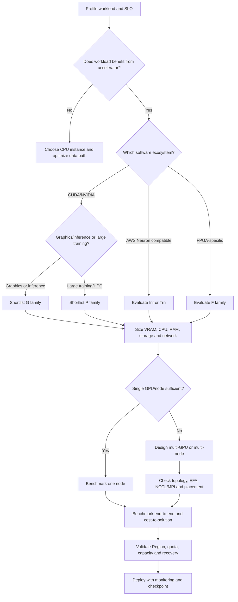

# GPU Instances and Selecting Accelerated Resources

A GPU instance is an Amazon EC2 instance equipped with one or more graphics processing units (GPUs) or specialized accelerators to execute parallel computations. They suit deep learning, inference, image/video processing, scientific simulations, rendering, and certain HPC workloads. Selecting an instance should be based on computation type, accelerator memory capacity, GPU-to-GPU interconnect, CPU/RAM, networking, storage, software stack, and capacity availability in the target Region.

AWS offers several accelerated computing families. The G family typically serves graphics, visualization, inference, and small-to-medium accelerated workloads. The P family targets high-performance training and HPC with NVIDIA GPUs. AWS Trainium and Inferentia are purpose-built AWS accelerators, not NVIDIA GPUs; they use the AWS Neuron SDK and have their own programming model, libraries, and compatibility profile. Do not pick an instance merely because its family name sounds newer or it has more GPUs.

This lesson focuses on reading EC2 specifications, identifying bottlenecks, estimating GPU memory, deciding between single-node and multi-node, designing EFA/networking and storage, preparing AMIs/drivers, choosing schedulers, and controlling costs. The goal is selecting a configuration that meets workload demands with measurable performance and reasonable total cost.

After this lesson, learners can:

- Distinguish GPU instances from specialized accelerators such as Trainium and Inferentia.
- Choose G, P, or accelerator families for training, inference, graphics, and HPC.
- Read GPU count, GPU memory, CPU, system RAM, network bandwidth, and local storage specs.
- Estimate memory required for models, activations, optimizers, batches, and KV cache.
- Decide among single-GPU, single-node multi-GPU, or distributed multi-node setups.
- Explain the roles of NVLink/NVSwitch, EFA, NCCL, MPI, and cluster placement groups.
- Select compatible AMIs, NVIDIA drivers, CUDA, frameworks, and containers.
- Choose AWS Batch, AWS ParallelCluster/Slurm, or EKS/EC2 to orchestrate workloads.
- Design checkpointing, fault tolerance, security, capacity planning, and cost controls.

## 1. GPU Instances in AWS Architecture

### 1.1. What Problems Do GPUs and Accelerators Solve?

CPUs are optimized for diverse sequential tasks, control flow, and general-purpose processing. GPUs contain many execution units to handle massive parallel math, especially matrix/vector operations. Deep learning relies on large matrix multiplications for forward passes, backward passes, and optimizers; GPUs execute those calculations in parallel with high throughput.

A GPU instance typically includes:

- Host CPUs to coordinate processes, data loaders, networking, and I/O.
- System memory (RAM) to hold datasets, caches, and application state.
- One or more GPUs with dedicated VRAM for models, activations, batches, and workspaces.
- Internal GPU interconnects such as PCIe or NVLink/NVSwitch depending on instance type.
- ENA/EFA network interfaces to exchange data with storage, services, or other nodes.
- Storage such as EBS, NVMe instance store, and shared filesystems.

Not every workload needs a GPU. If an application is bottlenecked by CPU preprocessing, databases, networking, or storage, adding GPUs may not improve throughput. Before picking an instance, measure the proportion of time spent on compute, data loading, synchronization, and I/O.

### 1.2. GPU Instances and Purpose-Built Accelerators

| Family | Hardware | Typical Workloads | Ecosystem |
|---|---|---|---|
| G family | NVIDIA GPUs or other GPUs depending on generation | Graphics, visualization, inference, small/medium ML | CUDA for NVIDIA; drivers/frameworks per GPU |
| P family | High-performance NVIDIA GPUs | Large-scale training, multi-GPU, HPC | CUDA, cuDNN, NCCL, ML frameworks |
| Inf family | AWS Inferentia | Cost/throughput-optimized model inference | AWS Neuron SDK, compiler/runtime |
| Trn family | AWS Trainium/Trainium2 | Model training and some inference workloads | AWS Neuron SDK, framework integrations |
| F family | FPGA | Specialized hardware acceleration | FPGA toolchains and application-specific designs |

Trainium and Inferentia are accelerator chips purpose-built for AI workloads. They do not run CUDA like NVIDIA GPUs. When evaluating them, check framework/operator support, model conversion, compiler, runtime, and porting effort. A benchmark is only meaningful when run on the exact model, precision, batch size, sequence length, and software stack intended for deployment.

### 1.3. Training, Inference, and HPC Have Different Profiles

| Workload | Typically Dominant Resources | What to Optimize |
|---|---|---|
| Small model training | GPU compute, VRAM, data loader | GPU utilization, batch size, time-to-train |
| Large model training | Total VRAM, GPU interconnect, EFA, storage | Scaling efficiency, tokens/s, checkpoint time |
| Online inference | VRAM, latency, concurrency, CPU | p50/p95/p99 latency, throughput, cost/request |
| Batch inference | GPU throughput, storage, queue depth | Cost per million records, completion time |
| Computer vision/video | GPU, decode/encode, storage bandwidth | Frames/s, resolution, pipeline balance |
| Scientific simulation | GPU/CPU ratio, memory, inter-node communication | Time-to-solution, MPI efficiency |
| Rendering/visualization | GPU graphics capability, display, memory | Frame rate, rendering time, session density |

An inference workload may need large GPU memory to fit a model without needing multi-node interconnects. Conversely, distributed training may need very fast networking and GPU-to-GPU communication; a fast single GPU with weak inter-node networking may fail to deliver expected performance.

## 2. Reading EC2 Accelerated Instance Families

### 2.1. G Family: Graphics, Inference, and Accelerated Workloads

Current example families in the EC2 accelerated computing catalog:

| Family | Typical Accelerator | Intended Use |
|---|---|---|
| G4dn | NVIDIA T4 | Graphics, inference, and small/medium ML workloads |
| G5 | NVIDIA A10G | Graphics, inference, medium training |
| G6 | NVIDIA L4 | Efficient inference, video, graphics, and ML |
| G6e | NVIDIA L40S | Inference and graphics/AI workloads needing higher VRAM |
| G7 | NVIDIA RTX PRO 4500 | Next-generation graphics and accelerated workloads |
| G7e | NVIDIA RTX PRO Server 6000 | Graphics/AI workloads requiring large VRAM |

The G family typically fits when accelerating a single application or serving inference requests. G6 and G6e offer multiple sizes; smaller sizes have a single GPU, while larger instances include multiple GPUs. Do not assume total instance VRAM by summing across GPUs if the application cannot shard the model or batch across GPUs.

### 2.2. P Family: High-Performance Training and HPC

| Family | Typical GPU | Selection Characteristics |
|---|---|---|
| P4d/P4de | NVIDIA A100 | A100-generation multi-GPU training/HPC |
| P5 | NVIDIA H100 | Large-model training and inference |
| P5e/P5en | NVIDIA H200 | Workloads needing high GPU memory and bandwidth |
| P6-B200 | NVIDIA B200 | Large-scale training/inference with Blackwell GPUs |
| P6-B300 | NVIDIA B300 | Next-gen accelerator configurations with very large GPU memory |
| P6e-GB200 | NVIDIA GB200 Grace Blackwell | Multi-GPU systems pairing Grace CPUs with Blackwell GPUs |

Example configurations in the current catalog show significant VRAM differences: P5.48xlarge has 8 H100s with 80 GiB per GPU; P5e/P5en.48xlarge has 8 H200s with about 141 GiB per GPU; P6-B200.48xlarge has 8 B200s with about 179 GiB per GPU; P6-B300.48xlarge has 8 B300s with about 268 GiB per GPU. P6e-GB200.36xlarge has 4 B200 GPUs with about 185 GiB per GPU. These are examples for reading specification tables, not default recommendations for every model.

### 2.3. Inf and Trn: Non-CUDA Accelerators

| Family | Accelerator | Primary Purpose | Notes |
|---|---|---|---|
| Inf1 | First-gen AWS Inferentia | Inference | Verify legacy model compatibility |
| Inf2 | AWS Inferentia2 | Deep learning inference | Uses Neuron SDK and compiler/runtime |
| Trn1/Trn1n | AWS Trainium | Training | Uses Neuron SDK; Trn1n increases network for distributed training |
| Trn2/Trn2u | AWS Trainium2 | Large-scale training | Check framework, topology, and instance availability |

If a workload already depends on custom CUDA libraries, moving to Trainium/Inferentia may require code changes and testing. When models/frameworks have strong Neuron support, purpose-built accelerators can deliver compelling price/performance. Benchmark end-to-end instead of comparing chip specs alone.

### 2.4. Do Not Select by Generation or GPU Count Alone

Two instances with the same GPU count can differ in GPU architecture, VRAM, memory bandwidth, GPU interconnect, CPU/RAM, networking, and local NVMe. A model might fit on four 80 GiB GPUs yet fail to fit on eight 40 GiB GPUs if the framework does not shard the model properly or each process holds a full model replica.

Before shortlisting, inspect EC2 instance type specifications and verify availability in the actual Region/AZ. AWS continuously adds families, models, and sizes; family names and configurations in documentation may change. Always consult the current catalog or `DescribeInstanceTypes` rather than relying on outdated pricing sheets or articles.

## 3. Sizing GPU Configurations by Workload

### 3.1. Gather Requirements Before Selecting an Instance

Build a workload profile rather than starting from an instance name. Minimum details:

| Category | What to Measure or Define |
|---|---|
| Model/application | Framework, model architecture, parameter count, custom operators, precision |
| GPU compute | Required FLOPS, target utilization, batch throughput |
| GPU memory | Model weights, gradients, optimizer states, activations, KV cache, workspace |
| CPU | Data preprocessing, tokenization, decompression, orchestration |
| System RAM | Dataset cache, data loader workers, host-side buffers |
| Storage | Dataset size, read/write throughput, IOPS, metadata operations |
| Network | Bytes exchanged across nodes, storage throughput, latency |
| Parallelism | Data parallel, tensor parallel, pipeline parallel, model parallel |
| Availability | Region, AZ, service quotas, On-Demand/Spot/capacity reservations |
| SLO | Time-to-train, p95 latency, throughput, deadline, and budget |

Measure a baseline on a small configuration or existing GPU. If GPU utilization is low while CPU or storage is saturated, fix the data pipeline before upgrading GPUs. If GPU utilization is high while VRAM is nearly full, reduce batch/context or select larger GPU memory. If GPUs sit idle during distributed training, measure collective networking and synchronization.

### 3.2. Estimating Model Memory

VRAM must hold more than model weights. Components typically include:

- Weights/parameters.
- Gradients during training.
- Optimizer states such as Adam moments.
- Master weights when using mixed precision.
- Activations retained for the backward pass.
- Temporary CUDA/cuDNN/framework workspace.
- Batch inputs, attention buffers, and communication buffers.
- KV cache during autoregressive inference.

Rough weight footprint estimate:

| Precision/Format | Approx. Bytes/Parameter | Notes |
|---|---:|---|
| FP32 | 4 | Full precision, large footprint |
| FP16/BF16 | 2 | Common for mixed precision |
| FP8 | 1 | Requires hardware/framework support and accuracy validation |
| INT8 | 1 | Additional scaling/metadata overhead |
| INT4 | 0.5 | Additional scaling/metadata; quality depends on quantization |

For example: a 7-billion-parameter model in BF16 has roughly 14 GB of weights via 7e9 × 2 bytes, before activations, workspace, and buffers. If the model is sharded across multiple GPUs, per-GPU weight memory drops; if using data parallelism where each GPU holds a model copy, cluster total VRAM cannot simply be summed as one unified pool.

### 3.3. Training Requires Far More Memory Than Weights

In mixed-precision training with Adam, a rough rule of thumb is around 12–20 bytes per parameter before adding activations and workspace. A common illustrative breakdown is 2 bytes weights + 2 bytes gradients + 4 bytes master weights + 8 bytes optimizer moments = 16 bytes/parameter. Actual usage depends on framework, precision, optimizer, sharding, and implementation.

Thus, a 7B model may require roughly 112 GB for model/optimizer states under the 16 bytes/parameter assumption, before adding activations, communication buffers, and fragmentation. A single 80 GiB GPU will not hold the entire state under that setup; sharding, model parallelism, optimizer offloading, quantization, or multiple GPUs are needed.

Memory-reduction techniques:

- Mixed precision (BF16/FP16/FP8) where hardware and models support it.
- Activation checkpointing to recompute selected activations instead of retaining all of them.
- Gradient accumulation to simulate larger batches with smaller micro-batches.
- FSDP/ZeRO to shard weights, gradients, and optimizer states.
- CPU/NVMe offloading when increased latency/I/O is acceptable.
- Quantization or parameter-efficient fine-tuning where appropriate.

Every technique carries trade-offs. For example, activation checkpointing reduces VRAM at the expense of compute; offloading saves VRAM at the risk of creating PCIe/network/storage bottlenecks. Benchmark the complete training step.

### 3.4. KV Cache and Inference Concurrency

During autoregressive inference, the KV cache stores keys/values of prior tokens for every layer. Memory grows with layer count, context length, batch/concurrent sequences, KV head count, head dimension, and precision.

A simplified estimate:

```text
KV cache bytes ≈
  2 × layers × batch × sequence_length
    × num_kv_heads × head_dim × bytes_per_value
```

The factor of 2 accounts for key and value. This formula is an approximation; GQA/MQA architectures, paged attention, sliding windows, cache quantization, and implementation details can alter actual usage.

An inference server can run out of VRAM even when weights easily fit on the GPU, because concurrent requests simultaneously retain KV caches. Measure concurrency, context length, and generated tokens; consider increasing VRAM, lowering max context/concurrency, using paged KV caches, or scaling out across replicas.

### 3.5. Selecting GPU Count and Instance Size

| Scenario | Selection Guidance |
|---|---|
| Model fits in VRAM, low latency, minimal communication | Single GPU or a single GPU on G family |
| Training needs more compute while model fits one GPU | Single-node multi-GPU data parallel |
| Model does not fit on one GPU | Tensor/model parallel or FSDP sharding |
| Distributed training across multiple nodes | P family with EFA, NCCL, and cluster placement group |
| Independent batch inference | Multiple single-GPU workers/replicas; scale by queue |
| Tightly coupled HPC MPI | Instances with EFA, placement groups, and matching topology |
| Model portable to Neuron | Evaluate Trn/Inf via benchmarking and porting effort |

Adding GPUs does not yield linear throughput scaling automatically. Communication, synchronization, data loading, framework overhead, and stragglers can erode scaling efficiency. Evaluate real throughput per dollar or time-to-completion rather than comparing peak TFLOPS alone.

## 4. Multi-GPU, Interconnects, and Distributed Computing

### 4.1. Single-Node Multi-GPU

On an EC2 instance with multiple GPUs, frameworks can split workloads via data parallelism, tensor parallelism, or pipeline parallelism. GPU-to-GPU communication travels over PCIe or NVLink/NVSwitch depending on instance type.

- Data parallel: each GPU processes different batches; gradients are synchronized.
- Tensor parallel: splits tensors/matrices across GPUs; requires frequent communication.
- Pipeline parallel: splits layers into stages and passes activations between stages.
- Fully Sharded Data Parallel (FSDP): shards model state across GPUs/workers to reduce per-GPU memory.

Before committing to a multi-GPU instance, inspect topology using `nvidia-smi topo -m`, GPU count, GPU memory, NVLink/NVSwitch, and PCIe bandwidth. Run `nccl-tests` or framework benchmarks to measure collective communication. Do not assume all GPUs on an instance share identical topology or peer-to-peer bandwidth.

### 4.2. Multi-Node and Elastic Fabric Adapter

When training across multiple EC2 instances, nodes exchange gradients, tensors, or activations. Standard TCP/IP can introduce significant overhead and latency. Elastic Fabric Adapter (EFA) is a network interface for AI/ML and HPC workloads delivering low-latency, high-throughput communication via OS-bypass/Libfabric.

EFA integrates with:

- NVIDIA NCCL for multi-GPU/distributed deep learning.
- MPI (Open MPI/Intel MPI) for HPC.
- Libfabric for transport access.
- RDMA capabilities and accelerator data transfers on supported instances/drivers.

Not every instance supports EFA or every RDMA feature. Verify instance type and Region; capabilities such as RDMA write, GPUDirect RDMA, or accelerator-initiated transfers are available only on specific instance types.

### 4.3. Cluster Placement Groups

Cluster placement groups place instances close together within a single Availability Zone, enabling low latency and high network throughput between nodes. They are commonly used for tightly coupled HPC and distributed training.

Constraints to keep in mind:

- Cluster placement groups do not span multiple AZs.
- EFA traffic does not route across AZs or different VPCs.
- Capacity can be harder to acquire when launching many instances simultaneously.
- Using the same instance type in a single launch request improves acquisition odds.
- On-Demand Capacity Reservations can be combined with cluster placement groups when predictable capacity is required.

Cluster placement groups optimize inter-node networking, at the cost of concentrating the failure domain into one AZ. Design checkpointing and recovery so workloads can restart in another cluster/AZ if needed.

### 4.4. Verifying EFA and NCCL

Checks after launching an EFA-enabled instance:

```bash
echo "GPU inventory and topology"
nvidia-smi
nvidia-smi topo -m

# Verify EFA interface and libfabric provider
fi_info -p efa

# Run NCCL tests after installing a compatible NCCL test build
./build/all_reduce_perf -b 8M -e 1G -f 2 -g 8
```

The NCCL test command illustrates an 8-GPU node with a binary compiled against compatible CUDA/NCCL versions. For multi-node setups, configure MPI/hostfiles, EFA security groups, and network interfaces per AWS guidance; do not run the single-node command unmodified across a multi-node cluster.

## 5. Storage and Data Pipelines for GPU Workloads

### 5.1. Why Can Storage Leave GPUs Idle?

GPUs require a continuous feed of batches. If datasets sit on low-throughput storage and data loaders cannot read fast enough, GPUs stall waiting on I/O and utilization drops. In training, bottlenecks often arise from reading small files, metadata lookups, decompression, augmentation, or networking rather than sequential bandwidth.

Measure:

- Read/write throughput and IOPS.
- File open/stat latency and metadata operations.
- File sizes, file counts, and access patterns.
- Data loader worker counts, prefetch queues, and CPU preprocessing.
- Cache hit rates, local NVMe usage, and network traffic.
- Time taken to write checkpoints to storage.

### 5.2. Choosing Storage by Pattern

| Service/Storage | Characteristics | Role in GPU/HPC |
|---|---|---|
| Amazon S3 | Durable, massively scalable object storage | Dataset source, checkpoint archive, artifact/model repository |
| EBS gp3 | Flexible block storage with configurable IOPS/throughput | Boot volumes, packages, dataset caches, local checkpoints |
| EBS io2 | High-performance, high-durability block storage | Workloads needing consistent block IOPS/latency |
| EC2 instance store NVMe | Ephemeral local storage, high throughput | Scratch data, caches, temporary shards, and staging |
| Amazon FSx for Lustre | High-throughput parallel file system | Shared datasets/checkpoints across multiple compute nodes |
| Amazon EFS | Shared NFS file system | Shared home/config or moderate file-based workloads; benchmark first on large datasets |

Instance store loses data on stop/terminate or host replacement per instance type semantics. Never treat instance store as the sole copy of datasets, checkpoints, or model artifacts. Sync data that must persist to S3/EBS/FSx by design.

### 5.3. FSx for Lustre for Large Datasets

Amazon FSx for Lustre is a managed parallel file system built for high-throughput storage workloads such as HPC, ML, video processing, and financial modeling. Multiple compute nodes can mount the same file system. FSx for Lustre integrates with S3 data repositories to import/export data in workflows.

A common pattern:

1. Source datasets are managed in S3.
2. Create FSx for Lustre and link an S3 data repository.
3. Stage required data into the filesystem ahead of time or lazily on job access.
4. GPU nodes mount the filesystem and read data shards in parallel.
5. Checkpoints/model outputs are written to the filesystem and exported/synced back to S3.
6. After the job, review storage/throughput costs and delete unneeded resources.

For high-throughput filesystems, EFA-enabled FSx for Lustre can increase client throughput; certain configurations support GPUDirect Storage (GDS). Verify client instances, filesystem deployment types, EFA/GDS support, and software stack before enabling.

### 5.4. Data Loaders and Checkpoints

Optimize data pipelines in order:

- Shard datasets so multiple workers read in parallel.
- Choose suitable file formats; avoid millions of tiny files when metadata becomes the bottleneck.
- Prefetch batches and overlap I/O with GPU compute.
- Leverage local NVMe as a rebuildable cache.
- Tune worker counts to CPU, RAM, and storage capacity.
- Compress data when network/storage savings outweigh CPU decompression cost.
- Write checkpoints periodically and keep multiple generations for recovery.

Checkpoints should include model weights, optimizer/scheduler states, RNG states, training step, configuration, and dataset position metadata. In distributed training, checkpoints must stay consistent across ranks/workers. Test actual restoration; writing a checkpoint file does not automatically guarantee training resumes cleanly.

## 6. AMIs, Drivers, CUDA, and Containers

### 6.1. Choosing the Right AMI

AWS Deep Learning AMIs (DLAMI) are preconfigured machine images for deep learning that may include NVIDIA drivers, CUDA, cuDNN, frameworks, container tooling, and optimized libraries. DLAMIs cut initial setup time, though OS versions, kernels, drivers, CUDA, frameworks, and supported instance types must still be verified.

Common options:

- AWS Deep Learning Base GPU AMI: GPU foundation with drivers and core tools; install frameworks yourself.
- Framework Deep Learning AMIs: environments preloaded with selected frameworks and packages.
- AWS Neuron AMI: environments tailored for Trainium/Inferentia.
- Custom AMI: verified dependencies, hardening, startup speed, and benchmarked builds.

The newest AMI is not guaranteed to remain compatible with older code or containers. Pin versions and run regression tests before updating production AMIs.

### 6.2. Driver and CUDA Compatibility

The NVIDIA driver must be compatible with the GPU architecture, kernel, and CUDA runtime used by the framework/container. Containers usually bundle CUDA runtime/libraries while still relying on the host NVIDIA driver. Never mix mismatched drivers haphazardly across host and container.

Verify on the instance:

```bash
nvidia-smi
nvcc --version
python -c "import torch; print(torch.__version__); print(torch.cuda.is_available()); print(torch.cuda.device_count())"
```

`nvidia-smi` displays GPUs, driver version, and utilization; `nvcc --version` shows the CUDA compiler toolkit if installed. `torch.cuda.is_available()` confirms PyTorch can initialize CUDA in the current environment. These commands do not replace real benchmarks or multi-node NCCL checks.

### 6.3. Containerizing GPU Workloads

Containers package frameworks, Python dependencies, model code, and libraries. For a container to see GPUs:

- The host needs a compatible NVIDIA driver.
- The NVIDIA Container Toolkit or integrated runtime must be configured.
- The scheduler/container runtime must allocate GPU devices to the container.
- The container image must include a compatible CUDA runtime and framework.
- For multi-GPU, the container needs proper permissions/device mappings for all allocated GPUs.

Never bundle kernel drivers inside a container as a substitute for host drivers. Pin images by digest/version, scan for vulnerabilities, and preserve Dockerfiles for reproducibility.

### 6.4. Neuron Software Stack

Trainium/Inferentia use the AWS Neuron SDK, comprising a compiler, runtime, and framework integrations. Verify Neuron SDK compatibility with the AMI, kernel, framework, and instance family. Some models/operators may be unsupported or require graph changes; compile models and benchmark on the target instance before deciding to migrate production workloads.

## 7. Scheduling and Orchestration

### 7.1. Choosing Tools by Workload Type

| Tool | Best Fit | Considerations |
|---|---|---|
| Direct EC2/Auto Scaling | A few GPU nodes, inference services, or custom environments | Self-managed lifecycle, scaling, and placement |
| AWS Batch | Batch jobs/containers needing queues, retries, and compute environment scaling | GPU resources must be declared in job definitions; choose supported families |
| AWS ParallelCluster + Slurm | HPC, MPI, distributed training, and multi-user clusters | Slurm manages partitions, queues, nodes, and jobs |
| Amazon EKS | GPU workloads as Kubernetes deployments/jobs | Requires GPU drivers/device plugins, node groups, and scheduler policies |
| SageMaker AI | Managed training/inference via jobs/endpoints | Suits teams wanting managed ML abstractions without managing full EC2 clusters |

AWS Batch supports NVIDIA GPU jobs on instance families listed in current documentation such as P3/P4/P5/P6 and G3/G4/G5/G6/Gr6/G7/G7e. The AWS Batch GPU scheduler does not support G4ad AMD GPUs via standard GPU resource requirements; custom AMIs/launch templates may require separate handling. Always verify the supported family list before creating compute environments.

AWS ParallelCluster currently uses Slurm as the recommended scheduler for HPC. Starting with ParallelCluster 3.16.0, the AWS Batch scheduler is no longer supported inside ParallelCluster; standalone AWS Batch service still supports GPU jobs. Do not confuse these two integrations.

### 7.2. AWS Batch GPU Job Definition

With AWS Batch, declare the GPU count pinned to a job in `resourceRequirements`. Requested GPUs cannot be used by other jobs while the job runs on that instance.

Example job definition:

```json
{
  "jobDefinitionName": "gpu-training",
  "type": "container",
  "platformCapabilities": ["EC2"],
  "containerProperties": {
    "image": "123456789012.dkr.ecr.ap-southeast-1.amazonaws.com/training:stable",
    "resourceRequirements": [
      { "type": "VCPU", "value": "16" },
      { "type": "MEMORY", "value": "65536" },
      { "type": "GPU", "value": "1" }
    ],
    "command": ["python", "train.py"]
  }
}
```

This illustrates resource requirements rather than a complete job definition for every environment. The compute environment must use instance families compatible with GPU scheduling and sufficient vCPU/memory. If a job requests GPUs unavailable in the compute environment, it may remain in `RUNNABLE` without starting.

### 7.3. Slurm on AWS ParallelCluster

ParallelCluster deploys an HPC cluster with a head node and compute nodes. Slurm provides partitions/queues, job submission, resource allocation, accounting, and fleet scaling per configuration. One partition can serve GPU nodes while another handles CPU preprocessing or high-memory jobs.

Example Slurm job script:

```bash
#!/bin/bash
#SBATCH --job-name=train-model
#SBATCH --partition=gpu
#SBATCH --nodes=2
#SBATCH --ntasks-per-node=8
#SBATCH --gres=gpu:8
#SBATCH --time=08:00:00
#SBATCH --output=logs/%x-%j.out

srun python -m torch.distributed.run --nnodes=2 --nproc_per_node=8 train.py
```

Nodes, tasks, and GPU counts must match the compute resource topology. For distributed training, configure NCCL/EFA, host discovery, rendezvous endpoints, and network interfaces per framework requirements. This script is an illustrative skeleton; verify Slurm GRES settings and ParallelCluster queue configs.

### 7.4. GPU Scheduling in Kubernetes

On EKS, GPU nodes require compatible AMIs/drivers and the NVIDIA device plugin or GPU operator components. Pods request GPUs via the extended resource `nvidia.com/gpu`. The scheduler places pods only on nodes with available GPU capacity.

Manage:

- Dedicated GPU node groups/compute pools.
- Taints/tolerations and node selectors so CPU jobs do not occupy GPU nodes.
- GPU requests/limits and GPU sharing if supported by the platform.
- Autoscaling and node startup latency.
- Image pulls, model downloads, and dataset mounts.
- GPU health monitoring, device plugins, and driver upgrades.

## 8. Capacity, Placement, and Instance Availability

### 8.1. Region, AZ, and Service Quotas

GPU capacity is often scarcer than general-purpose instances. Before finalizing production designs:

1. Identify supported instance models in the Region/AZ.
2. Check On-Demand/Spot quotas per instance family.
3. Verify subnet IP capacity and EFA/ENI limits.
4. Check network interface counts, EBS bandwidth, and storage quotas.
5. Test launching the exact instance type, AMI, subnet, and placement group.
6. If workloads have deadlines, plan Capacity Reservations or Capacity Blocks where supported by product/instance/Region.

Quotas are scoped per account and Region. Seeing an instance type in a catalog does not guarantee an account can launch it. Verify service quotas, instance type offerings, and live capacity.

### 8.2. Checking GPU and EFA Instance Offerings

Use the EC2 API to list GPU-equipped instances in a Region:

```bash
aws ec2 describe-instance-types --region <REGION> --query "InstanceTypes[?GpuInfo.Gpus != null].[InstanceType, GpuInfo.Gpus[].Name, GpuInfo.Gpus[].MemoryInfo.SizeInMiB]" --output table
```

To find instances supporting EFA:

```bash
aws ec2 describe-instance-types --region <REGION> --filters Name=network-info.efa-supported,Values=true --query "InstanceTypes[*].InstanceType" --output text
```

These outputs show type offerings, not live free capacity in an AZ. Use `describe-instance-type-offerings` to inspect per-AZ offerings and verify quotas/capacity via launch tests or reservations.

### 8.3. Placement and Capacity Reservations

Cluster placement groups suit tightly coupled clusters, though launching many GPU instances simultaneously can hit `InsufficientInstanceCapacity`. To reduce risk:

- Prefer identical instance types within a single cluster placement group.
- Provision On-Demand Capacity Reservations inside the placement group when deterministic capacity is needed.
- Stay flexible across instance sizes/families if frameworks support multiple configurations.
- Verify quotas and capacity ahead of scheduled training runs.
- Keep clusters inside one AZ for EFA traffic; design checkpoint/restore to recover in another AZ if an AZ suffers an outage.

Do not confuse Savings Plans or Reserved Instances with capacity reservations. They reduce billing rates without necessarily reserving the exact GPU capacity needed to launch.

## 9. Reliability, Security, and Operations

### 9.1. Checkpointing and Recovery

GPU training can run for hours or days. An interruption or node failure can waste substantial compute without checkpoints.

Design recovery:

- Write checkpoints on a time or step cadence.
- Persist checkpoints to durable storage such as S3/FSx/EBS per durability needs.
- For distributed training, synchronize checkpoints across ranks and write completion manifests.
- Save optimizer state, scheduler state, RNG state, epoch/step, and data sampler position.
- Use atomic write/rename or manifests to distinguish complete checkpoints from in-flight files.
- Test restoring from checkpoints on new instances/clusters.
- Measure checkpoint duration and its impact on training throughput.

### 9.2. Spot Instances for GPU Jobs

Spot can cut costs for interruption-tolerant batch jobs. EC2 can emit an interruption notice about two minutes before reclaiming an instance. Spot fits stateless, fault-tolerant, flexible, and checkpointed workloads; it does not fit tightly coupled distributed training or workloads that cannot survive losing a node mid-collective.

If using Spot:

- Checkpoint more frequently than your acceptable compute-loss window.
- Handle rebalance recommendations and interruption notices via EventBridge.
- Split jobs into independent tasks where possible.
- Stay flexible across instance types and AZs to improve capacity acquisition.
- Pick capacity-prioritized allocation strategies when interruption costs are high.
- Do not assume every GPU Spot node can instantly fail over to an identical On-Demand instance.

In multi-node distributed jobs, losing one node can fail the entire job. Use Spot only when the framework/scheduler supports elastic recovery or fast checkpoint/restart whose restart cost has been factored in.

### 9.3. Workload and Data Security

- Attach minimal IAM instance/task roles; avoid long-lived access keys inside AMIs/containers.
- Enforce IMDSv2 and restrict instance metadata access.
- Encrypt EBS, S3, and FSx with AWS KMS per organizational policy.
- Restrict security groups, subnets, and outbound access; use VPC endpoints where appropriate.
- For EFA, configure security groups per OS-bypass rules: allow inbound/outbound traffic between interfaces sharing the same security group per AWS docs, while restricting membership to cluster nodes.
- Never write sensitive datasets into logs or container images.
- Scan container images, pin dependencies, and update drivers/AMIs on a controlled schedule.
- Separate development, training, and production accounts/roles when isolation is required.
- Use CloudTrail, CloudWatch, and audit trails for administrative actions.

### 9.4. Monitoring GPUs and Clusters

Monitor at GPU, node, job, and storage levels:

| Metric | Why It Matters |
|---|---|
| GPU utilization | Shows whether GPUs are truly busy or stalled on CPU/I/O |
| GPU memory used/free | Detects OOMs and memory fragmentation |
| GPU temperature/power | Identifies thermal/power throttling |
| GPU ECC/Xid errors | Detects hardware/driver faults |
| CPU/RAM utilization | Identifies preprocessing or host bottlenecks |
| Network/EFA throughput | Measures communication and collective bottlenecks |
| NCCL collective time | Isolates synchronization overhead |
| Storage throughput/latency | Identifies data loader bottlenecks |
| Job queue wait time | Measures capacity and scheduler congestion |
| Checkpoint duration/failures | Evaluates recoverability |
| Cost per training step/inference | Compares configuration efficiency |

Use CloudWatch for system metrics/logs and NVIDIA DCGM or compatible exporters for GPU telemetry. With FSx for Lustre, monitor throughput, metadata performance, and client traffic. With Slurm/AWS Batch, monitor queue depth, pending jobs, failed jobs, and compute environment utilization.

### 9.5. Cost Optimization

Total cost goes beyond hourly EC2 pricing:

- GPU instance hours and idle node time.
- EBS, FSx for Lustre, and S3 storage and requests.
- Cross-AZ/Region or internet data transfer.
- EFA adds no extra interface charge, though instances, networking, and storage still incur costs.
- Checkpoint/restart overhead and non-productive GPU time.
- CloudWatch metrics/logs, snapshots, and artifact retention.

Mitigations:

- Use smaller GPUs or CPUs for preprocessing, orchestration, and low-traffic inference.
- Use G family instead of P family when high interconnects or huge VRAM are unnecessary.
- Scale to zero or scale compute environments to queues when no jobs run.
- Use Spot for checkpointable, interruption-tolerant jobs.
- Use On-Demand Capacity Reservations when guaranteed capacity is essential; evaluate reservation costs.
- Optimize batch size, precision, data loaders, and GPU utilization before adding nodes.
- Track cost per epoch, cost per million tokens, or cost per completed job.

Compare configurations by cost-to-solution: total spend to complete a training/inference run at target quality and SLO. An instance with a higher hourly price can still cost less overall if it finishes significantly faster.

## 10. Real-World Example: Selecting GPUs for Computer Vision Model Training

### 10.1. Context

A team is building a manufacturing defect-detection model from production-line images. The dataset contains tens of millions of images; training requires many epochs, large batches, and augmentations. The team must choose among G6e, P5, and P5e and test on AWS before committing to longer-term capacity.

### 10.2. Selection Process

**Step 1 — Profile workload:** measure model architecture, input resolution, batch size, precision, parameter count, activation memory, and epoch duration on an available GPU.

**Step 2 — Size memory:** sum weights + gradients + optimizer + activations + workspace. If one GPU is insufficient, try mixed precision, activation checkpointing, or FSDP/model parallelism before scaling node counts.

**Step 3 — Shortlist:** G6e may fit inference/graphics and moderate training; P5 fits H100 multi-GPU training; P5e provides H200 with larger VRAM for memory-bound workloads. Compare CPU, networking, and local NVMe as well.

**Step 4 — Measure data pipeline:** stage datasets onto FSx for Lustre or cache on local NVMe; measure GPU utilization and storage throughput. Increase data loader workers until I/O stalls disappear without overloading CPU/RAM.

**Step 5 — Measure scaling:** benchmark single GPU, single-node multi-GPU, and multi-node with EFA if needed. Record samples/second, epoch duration, scaling efficiency, and communication time.

**Step 6 — Evaluate cost:** compare cost/epoch and total training duration including checkpoints, storage, data transfer, and idle time.

**Step 7 — Finalize production:** validate quotas/capacity, AMIs/drivers, checkpoint restoration, monitoring, security, and runbooks before starting long runs.

### 10.3. Sample Decision Table

| Measurement Result | Decision |
|---|---|
| Single GPU fits VRAM with high GPU utilization | Stay single-GPU or raise batch size up to SLO |
| VRAM insufficient while compute has headroom | Pick larger GPU memory or sharding |
| Low GPU utilization, high CPU | Optimize preprocessing/data loader |
| GPUs waiting on data, high storage latency | Cache/stage dataset, consider FSx for Lustre |
| Poor multi-GPU scaling | Inspect topology, NCCL, batch size, and communication |
| Poor multi-node scaling | Inspect EFA, placement groups, networking, and synchronization |
| Spot interruptions waste significant compute | Checkpoint more often or use On-Demand for tightly coupled jobs |

## 11. Decision Workflow for Choosing a GPU Instance

### 11.1. Decision Flow



### 11.2. Practical Evaluation Order

A concise workflow:

1. Confirm whether the workload genuinely benefits from an accelerator.
2. Pick the software ecosystem: CUDA/NVIDIA, AWS Neuron, or FPGA.
3. Size per-GPU VRAM and total usable memory across the framework.
4. Calculate required CPU/RAM, storage throughput, and networking.
5. Choose single GPU, multi-GPU node, or multi-node.
6. Verify EFA, GPU interconnect, placement group, and scheduler support.
7. Check Region/AZ, quotas, capacity, AMIs, and drivers.
8. Benchmark end-to-end and compute cost-to-solution.
9. Test interruptions, checkpoint/restore, and production monitoring.

## 12. Hands-On Exercise: Choosing a GPU Instance for a Training Workload

### Context

A data science team is training a vision transformer on a large image dataset. The model has 7 billion parameters, uses BF16, large batch sizes, and the Adam optimizer. Training must finish within a fixed window; the dataset initially resides in S3. The team can evaluate G6e, P5, or P5e and consider multi-GPU setups.

### Tasks

1. Build a workload profile: model, precision, input resolution, batch, epochs, data size, and SLO.
2. Estimate weights, gradients, optimizer states, activations, and workspace.
3. Compute preliminary VRAM needs and decide whether FSDP/model parallelism is required.
4. Compare G6e, P5, and P5e by GPU type, VRAM/GPU, GPU count, CPU/RAM, networking, and local storage.
5. Determine whether training fits on one GPU, single-node multi-GPU, or multi-node.
6. If multi-node, verify EFA support, NCCL, cluster placement groups, and single-AZ requirements.
7. Design a storage pipeline from S3 to FSx for Lustre or local NVMe cache.
8. Choose a compatible DLAMI/custom AMI, NVIDIA driver, CUDA, and container version.
9. Choose AWS Batch or ParallelCluster/Slurm; write a job definition or Slurm script.
10. Define checkpoint frequency, Spot suitability, failure recovery, and cost budget.
11. Propose CloudWatch/DCGM metrics to detect GPU idleness, OOMs, network bottlenecks, and storage bottlenecks.
12. Benchmark at least two configurations and report cost/epoch, time-to-train, and scaling efficiency.

### Completion Criteria

- Instance selection is backed by workload profile and benchmarks.
- VRAM estimates include activations/optimizers/caches, not only model weights.
- Multi-GPU memory is not treated as one unified pool without sharding.
- Networking/interconnects are verified if workloads are distributed.
- Storage provides adequate throughput for data loaders.
- AMIs/drivers/CUDA/frameworks are pinned and verified compatible.
- Scheduler explicitly declares GPU resources.
- Checkpoints restore cleanly onto a fresh node.
- Spot is chosen only when the workload tolerates interruption.
- Cost-to-solution and measurement limitations are reported.

## 13. Self-Check Questions

1. How does a GPU instance differ from a CPU instance?
2. Why cannot Trainium and Inferentia be treated as NVIDIA GPUs?
3. Which workloads do the G family and P family typically serve?
4. Why does memory across multiple GPUs not automatically combine into a single unified memory pool?
5. Besides model weights, what else consumes VRAM during training?
6. Which factors cause KV cache growth during inference?
7. How does data parallelism differ from tensor parallelism?
8. When can EFA improve distributed training?
9. Why must EFA traffic remain within the same AZ and VPC?
10. What do cluster placement groups help with, and what are their limits?
11. Which storage patterns fit FSx for Lustre?
12. Why must CUDA/driver/framework compatibility be checked?
13. Which resources must an AWS Batch GPU job declare?
14. Which scheduler does AWS ParallelCluster currently recommend for HPC?
15. When is Spot suitable vs. unsuitable for GPU training?
16. Which metrics reveal that GPUs are waiting on storage or networking?

### Suggested Answers

1. GPUs have many parallel execution units suited for parallel math; CPUs suit control flow and general-purpose processing.
2. Trainium/Inferentia are AWS accelerators using the Neuron SDK rather than the CUDA/NVIDIA driver stack.
3. G typically serves graphics/inference and moderate ML; P targets high-performance training and HPC.
4. Each GPU has separate VRAM; frameworks must use model/tensor sharding or supported memory sharing mechanisms.
5. Gradients, optimizer states, master weights, activations, workspace, communication buffers, and KV cache.
6. Layer count, context length, batch/concurrency, KV heads, head dimension, and precision.
7. Data parallel replicates the model and splits batches; tensor parallel splits computations/tensors across GPUs.
8. When nodes exchange large volumes of gradients/tensors and network latency/throughput becomes the bottleneck.
9. EFA transport does not route across AZs or different VPCs; cluster topology must respect that constraint.
10. They place instances close together in one AZ to lower latency/boost throughput; they cannot span AZs and capacity can be constrained.
11. Large datasets/checkpoints requiring high parallel filesystem throughput across multiple clients.
12. Host drivers, CUDA runtime, frameworks, and GPU architecture must align for kernels to run reliably.
13. Declare GPU count alongside vCPU and memory in the job definition.
14. Slurm is the recommended scheduler; standalone AWS Batch service can still run GPU jobs.
15. Spot suits independent, fault-tolerant, checkpointable jobs; it is unsuitable for tightly coupled multi-node jobs that cannot tolerate losing a node.
16. GPU utilization, memory, CPU/RAM, EFA/network throughput, NCCL time, storage throughput/latency, and data loader wait.

## 14. Production Readiness Checklist

- [ ] Workload profile includes model, precision, batch, SLO, and deadline.
- [ ] CPU, GPU, VRAM, RAM, storage, and network bottlenecks identified.
- [ ] GPU family chosen based on software stack and workload.
- [ ] VRAM estimates include weights, optimizer, gradients, activations, workspace, and KV cache.
- [ ] GPU count, memory per GPU, interconnect topology, and network bandwidth checked.
- [ ] Multi-node workloads verified for EFA, NCCL/MPI, and cluster placement groups.
- [ ] EFA traffic kept within a single AZ/VPC.
- [ ] Region, AZ, quotas, instance offerings, and live capacity verified.
- [ ] Capacity Reservations/Capacity Blocks considered for deadline-sensitive workloads.
- [ ] AMI, kernel, NVIDIA driver, CUDA, framework, and container pinned/tested.
- [ ] Trainium/Inferentia workloads use a compatible Neuron SDK.
- [ ] Dataset pipeline has sufficient throughput; checkpoints reside on durable storage.
- [ ] AWS Batch jobs declare GPU resources accurately or Slurm GRES is configured.
- [ ] Spot used only when workloads checkpoint and tolerate interruption.
- [ ] IAM roles, IMDSv2, KMS, security groups, and container images secured.
- [ ] CloudWatch/DCGM monitor GPU, networking, storage, queues, and job health.
- [ ] Checkpoint restoration and node-failure/scaling runbooks tested.
- [ ] Cost-to-solution measured and budgets/alarms configured.

## 15. References

- [Amazon EC2 accelerated computing instance specifications](https://docs.aws.amazon.com/ec2/latest/instancetypes/ac.html)
- [Get started with GPU accelerated instances](https://docs.aws.amazon.com/AWSEC2/latest/UserGuide/gpu-instances-started.html)
- [Elastic Fabric Adapter for AI/ML and HPC workloads](https://docs.aws.amazon.com/AWSEC2/latest/UserGuide/efa.html)
- [Create and attach an Elastic Fabric Adapter](https://docs.aws.amazon.com/AWSEC2/latest/UserGuide/create-efa.html)
- [Get started with EFA and MPI for HPC workloads](https://docs.aws.amazon.com/AWSEC2/latest/UserGuide/efa-start.html)
- [Placement strategies for EC2 placement groups](https://docs.aws.amazon.com/AWSEC2/latest/UserGuide/placement-strategies.html)
- [What are AWS Deep Learning AMIs?](https://docs.aws.amazon.com/dlami/latest/devguide/what-is-dlami.html)
- [Run GPU jobs with AWS Batch](https://docs.aws.amazon.com/batch/latest/userguide/gpu-jobs.html)
- [Slurm Workload Manager with AWS ParallelCluster](https://docs.aws.amazon.com/parallelcluster/latest/ug/slurm-workload-manager-v3.html)
- [AWS ParallelCluster scheduling configuration](https://docs.aws.amazon.com/parallelcluster/latest/ug/Scheduling-v3.html)
- [What is Amazon FSx for Lustre?](https://docs.aws.amazon.com/fsx/latest/LustreGuide/what-is.html)
- [Amazon FSx for Lustre performance](https://docs.aws.amazon.com/fsx/latest/LustreGuide/performance.html)
- [Working with EFA-enabled FSx for Lustre file systems](https://docs.aws.amazon.com/fsx/latest/LustreGuide/efa-file-systems.html)
- [Best practices for Amazon EC2 Spot](https://docs.aws.amazon.com/AWSEC2/latest/UserGuide/spot-best-practices.html)
- [Spot Instance interruptions](https://docs.aws.amazon.com/AWSEC2/latest/UserGuide/spot-interruptions.html)
