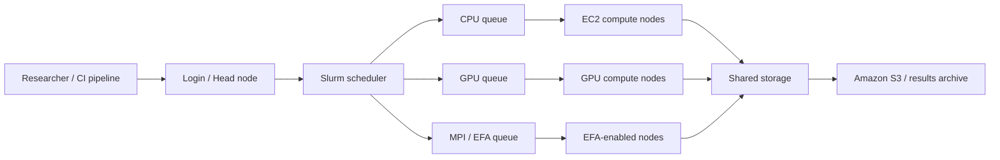

# AWS ParallelCluster and HPC Cluster Architecture

High Performance Computing (HPC) solves problems requiring substantial compute resources and coordination across many machines, such as aerodynamic simulations, weather modeling, genomic analysis, materials simulation, and scientific model training. Instead of running one program on a single server, an HPC cluster distributes work across many compute nodes, uses a scheduler to allocate resources, and relies on high-speed networking to exchange data between nodes.

AWS ParallelCluster is an AWS-supported open-source tool for deploying and managing HPC clusters on AWS. It provisions resources such as a head node, compute fleet, scheduler, networking, and shared storage from a configuration file. You can build test environments, research clusters, or production infrastructure that scales dynamically with job demand.

AWS ParallelCluster is not a fully managed HPC service. Operations teams remain responsible for cluster design, scheduler management, AMI updates, access control, data, scientific applications, and the costs of AWS resources provisioned.

## Learning Objectives

After this lesson, you can:

- Explain the role of AWS ParallelCluster in AWS HPC architectures.
- Distinguish head nodes, compute nodes, login nodes, queues/partitions, and compute resources.
- Describe how Slurm schedules jobs and how ParallelCluster scales the compute fleet.
- Design VPCs, subnets, security groups, placement groups, and Elastic Fabric Adapter (EFA).
- Choose Amazon EBS, Amazon EFS, Amazon FSx for Lustre, and shared storage systems by I/O pattern.
- Read and author AWS ParallelCluster v3 YAML configuration files.
- Create, monitor, update, and delete clusters using the `pcluster` CLI.
- Optimize performance, resiliency, security, and costs for HPC workloads.
- Distinguish AWS ParallelCluster from AWS Parallel Computing Service (AWS PCS).

## 1. HPC and the Role of ParallelCluster

HPC typically tackles problems divisible into many tasks or concurrent processes. Two common computational patterns exist:

- **Loosely coupled / embarrassingly parallel:** many independent tasks, each processing a dataset or parameter set. For example, running thousands of simulations with varying boundary conditions.
- **Tightly coupled / MPI:** many concurrent processes exchanging data frequently over a low-latency network. For example, a CFD simulation partitioning a spatial mesh across multiple nodes.

Workload patterns dictate compute, network, and storage choices. Independent tasks usually prioritize throughput and cost per job. MPI is sensitive to latency, bandwidth, topology, and inter-node communication; therefore, EFA, placement groups, and HPC-oriented instance families must be evaluated.

AWS ParallelCluster automates cluster creation and integrates the scheduler with EC2. You describe the configuration in YAML, deploy via the `pcluster` CLI or API, and users log in and submit jobs using scheduler commands.



ParallelCluster provisions and orchestrates AWS resources. The scheduler decides which jobs run and how many resources they need; HPC software such as OpenFOAM, GROMACS, LAMMPS, WRF, or custom internal applications performs the computations on compute nodes.

## 2. Components of a ParallelCluster Cluster

| Component | Role | Design Notes |
|---|---|---|
| Head node | Cluster administration and orchestration point; runs the Slurm controller and cluster management daemons | Do not use as a compute node for scientific jobs; needs adequate CPU, RAM, and networking for large clusters |
| Compute node | Runs user jobs | Can be CPU, GPU, or HPC-optimized instances; typically launched and terminated with load |
| Login node | Provides a login and job submission environment separate from the head node | Useful for multi-group environments; configure when needed and restrict access |
| Scheduler | Queues, schedules, and allocates CPUs, RAM, GPUs, and nodes | AWS ParallelCluster v3 uses Slurm in current configurations |
| Queue / partition | Groups resources and scheduling policies | Examples: `cpu`, `gpu`, `mpi`, `short` |
| Compute resource | A group of nodes sharing an instance configuration within a queue | Can set min/max, instance type, Spot, or capacity reservations |
| Shared storage | Shares home directories, inputs, outputs, and checkpoints across nodes | Choose by IOPS, throughput, latency, capacity, and lifecycle |
| VPC and security groups | Provides connectivity among nodes, storage, and AWS services | Design private subnets and least-privilege network flows |

### 2.1 Head Node

The head node is a critical administrative component. It runs the scheduler controller, manages compute fleet state, supports node bootstrapping, and provides an operator entry point. The head node can also serve NFS when using certain internal EBS-based shared storage setups.

Although the head node does not run scientific jobs, its performance affects cluster scaling and management. For large clusters, provision enough CPU, RAM, network bandwidth, and EBS bandwidth to manage many nodes concurrently. If NFS is served from the head node, shared storage I/O also adds load to this machine.

### 2.2 Compute Nodes and Compute Fleet

Compute nodes run application processes. With Slurm, each node runs the `slurmd` daemon to receive and execute job allocations. The compute fleet is the set of compute nodes managed by ParallelCluster.

Compute nodes are generally treated as replaceable resources. Long-lived data should reside on shared storage or S3; avoid storing critical results solely on instance store or a compute node's root volume.

ParallelCluster supports static and dynamic nodes. Static nodes are kept running per cluster configuration. Dynamic nodes launch when the scheduler needs resources and can terminate after sitting idle past the scale-down timeout. Setting `MinCount: 0` on a compute resource is common so the cluster scales from zero; `MaxCount` caps the maximum nodes for that resource.

### 2.3 Login Node

A login node provides an environment for users to log in, prepare inputs, compile code, or submit jobs. Separating login nodes from the head node reduces the number of users directly accessing the administrative node. In multi-team environments, integrate LDAP/Active Directory or a suitable identity mechanism and configure shared home directories.

## 3. Slurm: Scheduler and Queues/Partitions

Slurm is an open-source workload manager widely used in HPC clusters. It accepts jobs, checks resource requirements, queues work, allocates nodes, and tracks execution state.

A job can request:

- Number of nodes (`--nodes`).
- Number of tasks or MPI ranks (`--ntasks`).
- CPUs per task (`--cpus-per-task`).
- Memory (`--mem` or `--mem-per-cpu`).
- GPUs (`--gres=gpu:...` or equivalent GRES syntax).
- Maximum wall time (`--time`).
- Partition/queue (`--partition`).
- Special resources or constraints such as CPU type, GPU type, or architecture.

Example Slurm batch script:

```bash
#!/bin/bash
#SBATCH --job-name=weather-model
#SBATCH --partition=cpu
#SBATCH --nodes=4
#SBATCH --ntasks-per-node=32
#SBATCH --time=02:00:00
#SBATCH --output=logs/%x-%j.out

module load openmpi
module load wrf

srun ./wrf.exe
```

Save the file as `run-wrf.sbatch`, create the `logs` directory, and submit the job:

```bash
mkdir -p logs
sbatch run-wrf.sbatch
squeue --me
```

Common Slurm commands:

| Command | Purpose |
|---|---|
| `sbatch` | Submit a batch job |
| `srun` | Run a job step or parallel command within an allocation |
| `squeue` | View pending and running jobs |
| `sinfo` | View partition and node states |
| `scancel` | Cancel a job |
| `scontrol show job` | Inspect detailed job properties |
| `sacct` | View accounting and job history if accounting is configured |

### 3.1 Queues/Partitions

A cluster can define multiple queues/partitions with different compute configurations. For example:

| Queue | Resources | Workload |
|---|---|---|
| `cpu` | General-purpose or compute-optimized EC2 | ETL, preprocessing, CPU simulations |
| `gpu` | EC2 GPU instances | CUDA, deep learning, GPU simulations |
| `mpi` | HPC instances, EFA, and placement groups | Tightly coupled MPI |
| `short` | Small nodes, short runtimes | Testing and interactive tasks |

A queue acts as a scheduling boundary. Compute resources inside a queue define EC2 instance types and node limits. Avoid creating too many queues without clear differences in hardware, priority, capacity, or usage policies.

### 3.2 Compute Resources and Capacity Types

In a Slurm configuration, a compute resource can specify a single `InstanceType` or an `Instances` list under the supported schema. Options include:

- `ONDEMAND`: fits workloads needing steady availability or no interruption tolerance.
- `SPOT`: lowers cost for jobs with checkpoints, retries, or interruption tolerance.
- `CAPACITY_BLOCK`: intended for certain reserved GPU/HPC capacity needs for fixed durations and supported instance types.

With Spot, pick an allocation strategy aligned with availability or price priorities. Using Spot for uncheckpointed or long-running unrecoverable jobs can increase total completion time and actual cost.

### 3.3 Scaling Up and Scaling Down

Slurm tracks the resources required by pending jobs. ParallelCluster integrates with Slurm's resume/suspend mechanism to launch compute nodes matching demand and terminate dynamic nodes when idle. `SlurmSettings/ScaledownIdletime` defines how many minutes a node sits without jobs before termination; the current default is 10 minutes.

ParallelCluster does not decide business job prioritization itself. Slurm's scheduler and policies handle queuing order; ParallelCluster provisions AWS resources matching scheduler requests. If nodes fail to launch, check both the Slurm queue and ParallelCluster provisioning logs.

## 4. Network Architecture for HPC

A cluster typically runs in an organization-managed VPC or a VPC created by ParallelCluster from config. Head nodes, compute nodes, and login nodes connect via subnets and security groups. Shared storage requires dedicated network paths matching the filesystem protocol.

### 4.1 Public and Private Subnets

A common pattern places the head node or login node in a subnet with controlled administrative access, while compute nodes reside in private subnets. Compute nodes do not need public IPs if NAT Gateways, VPC endpoints, or equivalent paths exist to fetch packages, access S3, and reach AWS services.

In production environments, prefer:

- Placing compute nodes in private subnets.
- Restricting SSH to head/login nodes to administrative CIDRs or using bastion/SSM per supported architecture.
- Using VPC endpoints for S3, CloudWatch Logs, and AWS APIs where appropriate.
- Opening only required ports among head, compute, login, and storage.
- Avoiding assigning public IPs across the entire compute fleet.

### 4.2 Security Groups

Default security groups created by ParallelCluster permit traffic among nodes in the cluster. For stricter environments, you can supply custom security groups for head, compute, and login nodes. When replacing default security groups, ensure all scheduler and storage traffic remains allowed.

Common ports in Slurm setups:

| Port | Direction | Purpose |
|---|---|---|
| TCP 22 | Inbound to head from admin IPs; to compute from head/login | SSH |
| TCP 6817–6819 | Between head, compute, and login | Slurm controller/daemon communication |
| TCP 8443 | Inbound to head/login if DCV is enabled | Remote visualization |
| TCP/UDP 111, 2049 | Nodes to NFS server or NFS server to nodes | NFS shared storage |
| TCP 443 outbound | Nodes to AWS APIs when not using VPC endpoints | HTTPS |

EFA requires traffic between EFA-enabled compute nodes. Shared storage such as FSx for Lustre has its own ports; for instance, FSx for Lustre requires TCP 988 and 1018–1023 depending on configuration/version. Consult each storage service's documentation to finalize security groups. Never copy a generic port list without checking the exact protocols in use.

### 4.3 Placement Groups

Cluster placement groups place EC2 instances physically close within a single Availability Zone, optimizing latency and network throughput for communication-heavy multi-node workloads. With Slurm, placement groups can be configured at the queue or compute resource level.

When enabling ParallelCluster-managed placement groups, verify version-specific behavior. Since ParallelCluster 3.3.0, enabling a placement group without specifying a name/ID at the queue level can create separate placement groups per compute resource; if a single shared group across the queue is desired, configure an explicit name accordingly.

Placement groups can reduce the likelihood of acquiring full capacity when launching many instances at once. For large MPI runs, benchmark both performance and real allocation feasibility.

### 4.4 Elastic Fabric Adapter (EFA)

EFA is a network interface built for HPC workloads requiring low-latency, high-throughput node-to-node communication. EFA supports applications using libfabric and compatible frameworks such as MPI and certain NCCL workloads.

To use EFA:

1. Select an EFA-supported instance type in the target Region/AZ.
2. Enable `Efa/Enabled` on the compute resource.
3. Use a placement group when the workload needs tight network locality.
4. Permit EFA traffic between compute nodes in the security group.
5. Install and verify matching EFA drivers, libfabric, MPI stack, and application libraries.

EFA does not operate across multiple Availability Zones. For tightly coupled MPI, compute nodes and EFA-enabled FSx for Lustre are usually placed in the same AZ. Multi-AZ may broaden capacity options or resiliency, but raises inter-AZ latency and data transfer costs; choose according to application requirements.

## 5. Selecting Compute Instances for HPC

No single instance family is optimal for every problem. Start from the application profile:

| Need | Resource Group to Evaluate | Metrics to Benchmark |
|---|---|---|
| Scalar/vector CPU | Compute optimized or HPC instances | CPU throughput, memory bandwidth, scaling efficiency |
| Large memory | Memory optimized or HPC instances with sufficient RAM | RAM per core, memory bandwidth, NUMA locality |
| GPU | GPU instances per CUDA/ROCm/framework | GPU memory, inter-GPU bandwidth, GPU utilization |
| Tightly coupled MPI | EFA-capable instances, placement groups | Latency, bandwidth, all-reduce, scaling efficiency |
| Many independent jobs | Instances balancing throughput and cost | Jobs/hour, cost/job, queue wait |
| Burst workloads | Spot or compute fleet scaling from zero | Interruption handling, startup latency, retry cost |

### 5.1 CPU and NUMA

Multi-threaded applications must be tuned to core counts, threads, NUMA topology, and memory bandwidth. For OpenMP jobs, align thread counts with CPU allocations. For MPI runs, balance ranks per node and threads per rank.

Example:

```bash
export OMP_NUM_THREADS=8
srun --nodes=2 --ntasks-per-node=4 --cpus-per-task=8 ./solver
```

In this example, each node runs four MPI tasks, with each task using eight CPU threads. Real values should be tuned to hardware topology and application guidance.

### 5.2 GPU

GPU workloads require checking GPU count, GPU memory, drivers, CUDA version, EFA/NCCL support, and GPU scheduling across jobs. Enable GPU health checks in compute resource settings where supported. Never assign GPU instances to CPU-only jobs; it increases cost without improving performance.

### 5.3 Instance Architecture

Compute instances in a cluster must have compatible processor architectures per configuration requirements. Do not mix `x86_64` and `arm64` arbitrarily within the same cluster. If both architectures are needed, separate them into distinct clusters or explicitly supported environments.

## 6. Shared Storage and HPC Data

HPC typically involves three data classes:

- Input datasets: shared input data read across many jobs.
- Scratch/intermediate: temporary files, checkpoints, and high-speed intermediate outputs.
- Output/archive: long-lived results shared with external systems.

Do not force every data class onto one filesystem. Pick storage according to IOPS, throughput, metadata operations, file size, concurrency, and data lifecycle.

### 6.1 Storage Comparison

| Service | Characteristics | Best Fit |
|---|---|---|
| Amazon EBS | Block storage attached to EC2; shared EBS in ParallelCluster can be exported from the head node over NFS | Small home directories, packages, low node counts, or test workloads |
| Amazon EFS | Managed NFS, elastic capacity, mounts across many nodes | Home directories, small files, shared data, and broad sharing workloads |
| Amazon FSx for Lustre | High-throughput parallel filesystem, high IOPS, low latency | Scratch and large HPC datasets with parallel multi-node reads/writes |
| FSx for ONTAP / OpenZFS | File storage with snapshots, NFS/SMB, or specialized filesystem features | Environments already using ONTAP/ZFS or integrating existing datasets |
| Amazon File Cache | Caches data from supported storage origins | Workloads needing cached datasets close to compute |
| Amazon S3 | Durable object storage cost-effective for large data | Source datasets, archives, and long-term outputs; often paired with FSx for Lustre |

Sharing EBS via NFS from the head node can be economical for small clusters. As compute node counts and I/O demand rise, the head node becomes a bottleneck. EFS scales better for home/shared files. FSx for Lustre fits workloads needing parallel read/write throughput on large datasets.

### 6.2 FSx for Lustre and S3 Data Repositories

FSx for Lustre can link to an S3 data repository. Datasets can be imported into the Lustre namespace for high-performance reads by compute nodes, while source data and outputs sync with S3 per policy.

Typical pattern:

1. Store source datasets in S3.
2. Link the S3 bucket/prefix to FSx for Lustre.
3. Import metadata or needed data into the filesystem.
4. Run HPC jobs on compute nodes writing scratch/outputs to Lustre.
5. Export modified data or results back to S3 per policy.

For EFA-enabled workloads, the filesystem and compute nodes must satisfy single-AZ and security group requirements. EFA-enabled FSx for Lustre can improve performance for suitable workloads, though not every app benefits; benchmark against real I/O patterns.

### 6.3 Managed Storage and External Storage

ParallelCluster supports two storage lifecycles:

- **Managed:** ParallelCluster creates and can delete volumes/filesystems with the cluster lifecycle.
- **External:** pre-existing filesystems managed independently of the cluster.

For managed shared storage, the default `DeletionPolicy` is `Delete`. Deleting a cluster, renaming `SharedStorage/Name`, or removing storage from config can delete the filesystem and its data. To preserve data, set `DeletionPolicy: Retain` or use external storage, while maintaining independent backups.

Example attaching an existing FSx for Lustre filesystem:

```yaml
SharedStorage:
  - MountDir: /fsx
    Name: research-fsx
    StorageType: FsxLustre
    FsxLustreSettings:
      FileSystemId: fs-0123456789abcdef0
```

When `FileSystemId` is specified, the config references an external filesystem; ParallelCluster neither creates nor deletes it. Configure compatible security groups and subnets before mounting.

## 7. AWS ParallelCluster v3 Configuration File

ParallelCluster v3 uses a YAML file to describe a cluster. Main sections typically include:

| Section | Meaning |
|---|---|
| `Region` | AWS Region where the cluster deploys |
| `Image` | Operating system or compatible AMI |
| `HeadNode` | Instance type, subnet, SSH, IAM, and head node settings |
| `Scheduling` | Scheduler, Slurm settings, queues, and compute resources |
| `SharedStorage` | EBS/EFS/FSx and mount directories |
| `Monitoring` | CloudWatch Logs, dashboards, alarms, and retention |

Foundational example with one CPU queue:

```yaml
Region: ap-southeast-1
Image:
  Os: alinux2023

HeadNode:
  InstanceType: c7i.large
  Networking:
    SubnetId: subnet-0123456789abcdef0
  Ssh:
    KeyName: hpc-admin-key
    AllowedIps: 203.0.113.10/32

Scheduling:
  Scheduler: slurm
  SlurmSettings:
    ScaledownIdletime: 10
  SlurmQueues:
    - Name: cpu
      CapacityType: ONDEMAND
      Networking:
        SubnetIds:
          - subnet-0123456789abcdef0
      ComputeResources:
        - Name: c7i
          InstanceType: c7i.4xlarge
          MinCount: 0
          MaxCount: 32

Monitoring:
  Logs:
    CloudWatch:
      Enabled: true
      RetentionInDays: 90
      DeletionPolicy: Retain
  Dashboards:
    CloudWatch:
      Enabled: true
```

Subnet IDs, key pairs, and IP CIDRs are illustrative; replace them with your account's resources. This is a starter config to understand the schema, not a complete production config. Add IAM, security groups, shared storage, VPC endpoints, KMS, and capacity limits as required.

### 7.1 Adding a GPU or MPI Queue

You can define a second queue with different compute resources. Conceptual example:

```yaml
    - Name: mpi
      CapacityType: ONDEMAND
      Networking:
        SubnetIds:
          - subnet-0123456789abcdef0
        PlacementGroup:
          Enabled: true
      ComputeResources:
        - Name: hpc
          InstanceType: hpc7a.96xlarge
          MinCount: 0
          MaxCount: 16
          Efa:
            Enabled: true
```

Use only instance types supporting EFA in the target Region/AZ; verify instance families, quotas, capacity, and placement group allocation before deploying. When using EFA-enabled FSx for Lustre, compute and filesystem must share the same AZ. When `Efa` is enabled, security groups must allow required traffic between compute nodes.

### 7.2 Enabling Managed Shared Storage

Example creating FSx for Lustre managed by ParallelCluster:

```yaml
SharedStorage:
  - MountDir: /scratch
    Name: scratch-lustre
    StorageType: FsxLustre
    FsxLustreSettings:
      StorageCapacity: 1200
      DeploymentType: SCRATCH_2
      DeletionPolicy: Retain
```

Capacity, deployment type, throughput, KMS, and backups must match filesystem type and Region. `SCRATCH_2` suits temporary processing data; critical data must be synced/backed up to durable storage. `Retain` prevents deleting the filesystem with the cluster lifecycle, but does not replace backups and independent filesystem governance.

## 8. Deploying Clusters with the `pcluster` CLI

### 8.1 Preparation

Before creating a cluster:

1. Choose a Region offering the required instance types, EFA, storage, and ParallelCluster version.
2. Install compatible AWS CLI and AWS ParallelCluster CLI versions.
3. Configure credentials via IAM Identity Center or short-lived roles/credentials.
4. Verify IAM policies permit creating CloudFormation, EC2, IAM roles/profiles, storage, networking, and related resources.
5. Create or select VPCs, subnets, security groups, key pairs, and storage.
6. Verify EC2 quotas and capacity for target instance families.

The ParallelCluster CLI can be installed from PyPI. Pin the CLI version in automation and use the official AMI corresponding to that exact ParallelCluster version.

### 8.2 Creating and Validating Configs

```bash
pcluster version
pcluster configure --config cluster-config.yaml
```

`configure` walks through selecting Region, key pair, scheduler, OS, head node, queues, and networking. For production, edit YAML under code review and version control rather than relying solely on the wizard.

Validate the configuration before provisioning resources:

```bash
pcluster create-cluster \
  --cluster-name research-hpc \
  --cluster-configuration cluster-config.yaml \
  --region ap-southeast-1 \
  --dryrun true
```

If validation passes, create the cluster:

```bash
pcluster create-cluster \
  --cluster-name research-hpc \
  --cluster-configuration cluster-config.yaml \
  --region ap-southeast-1
```

ParallelCluster uses AWS CloudFormation to create resources. Monitor progress:

```bash
pcluster describe-cluster \
  --cluster-name research-hpc \
  --region ap-southeast-1

pcluster describe-compute-fleet \
  --cluster-name research-hpc \
  --region ap-southeast-1
```

Wait until the cluster is ready and the compute fleet is in an appropriate state before submitting jobs. A cluster can finish creating while a dynamic compute fleet still has zero nodes; that is normal when `MinCount: 0`.

### 8.3 Connecting and Submitting Jobs

```bash
pcluster ssh \
  --cluster-name research-hpc \
  --region ap-southeast-1
```

On the head/login node, check the scheduler:

```bash
sinfo
squeue
sbatch run-wrf.sbatch
```

### 8.4 Stopping and Deleting the Compute Fleet

To pause compute and cut costs, stop the fleet:

```bash
pcluster update-compute-fleet \
  --cluster-name research-hpc \
  --status STOP_REQUESTED \
  --region ap-southeast-1
```

Wait for `STOPPED` status. To start it again:

```bash
pcluster update-compute-fleet \
  --cluster-name research-hpc \
  --status START_REQUESTED \
  --region ap-southeast-1
```

Delete the cluster when no longer needed:

```bash
pcluster delete-cluster \
  --cluster-name research-hpc \
  --region ap-southeast-1
```

Before deleting, verify running jobs, managed/external shared storage, backups, log retention, and independently managed resources. If managed storage uses `DeletionPolicy: Delete`, data may be deleted along with the cluster.

## 9. Custom AMIs and Bootstrap Actions

Some workloads require specific compilers, MPI libraries, CUDA, drivers, solvers, or packages. Two customization paths exist:

- **Custom bootstrap actions:** run scripts when nodes launch or finish configuring. Fits installing packages, mounting extra storage, fetching configs, or registering agents.
- **Custom AMIs:** bake the OS and dependencies into an image to reduce boot time and ensure consistent environments.

AWS ParallelCluster provides `pcluster build-image`, which uses EC2 Image Builder to produce custom AMIs. Example:

```bash
pcluster build-image \
  --image-id research-hpc-al2023-v1 \
  --image-configuration image-config.yaml \
  --region ap-southeast-1
```

Custom AMIs should be rebuilt or re-validated when upgrading ParallelCluster versions. Official AMIs are built for specific ParallelCluster releases and do not self-patch OS packages automatically. Maintain testing, image building, cluster update, and rollback processes.

Prefer bootstrap scripts when changes are simple and repeatable. Use custom AMIs when dependencies are complex, boot speed matters, or a verified software stack is required. Avoid ad-hoc manual installs on individual compute nodes, which break reproducibility.

## 10. Performance Tuning for HPC Workloads

### 10.1 Networking and MPI

For MPI, performance depends on rank count, topology, message sizes, collective operations, and latency. EFA, placement groups, and high-bandwidth instance families can boost results, though application-level benchmarking is essential.

Verify:

- Whether the MPI library supports libfabric/EFA.
- Whether EFA devices appear on compute nodes.
- Whether job allocations place the expected node and task counts.
- Whether ranks are pinned appropriately to CPUs/NUMA nodes.
- Whether security groups and placement groups have proper scope.
- Actual communication throughput via microbenchmarks and representative applications.

### 10.2 Storage I/O

HPC can be filesystem-bound rather than CPU/GPU-bound. Measure read/write throughput, metadata operations, concurrent open files, and access patterns. Many small files create heavy metadata load; large sequential files favor throughput.

Good practices:

- Stage large input datasets onto FSx for Lustre or suitable storage before launching batches.
- Use local NVMe/instance store for temporary scratch when applications support it and data is rebuildable.
- Place checkpoints and critical results on durable shared storage.
- Sync outputs back to S3 in batches; avoid thousands of concurrent jobs writing to one prefix unless required.
- Clean up scratch space after jobs finish per policy.

### 10.3 Job Sizing and Scheduler Tuning

Jobs requesting more nodes than needed waste capacity and lengthen queue waits. Jobs requesting too little CPU or RAM run slowly or fail with out-of-memory errors. Gather job history to tune:

- CPU utilization and peak memory.
- GPU utilization and GPU memory.
- Elapsed time, queue wait, and node counts.
- I/O throughput and checkpoint duration.
- Scaling efficiency as node count grows.

For MPI jobs, adding nodes does not guarantee linear speedup. High communication overhead or uneven data partitioning can degrade performance when scaling out.

## 11. Securing HPC Clusters

### 11.1 IAM and Instance Roles

Separate IAM roles for cluster deployers from instance roles used by head/compute nodes. Deployers need permissions to create and update infrastructure. Node roles should only read inputs, write outputs, emit logs, or fetch secrets required by workloads.

In configuration, use `AdditionalIamPolicies` to append permissions to the default ParallelCluster role. AWS recommends this approach when extending permissions, because specifying a custom `InstanceRole` requires you to maintain all ParallelCluster-required permissions across releases.

Never store long-lived AWS access keys on nodes. Use instance profiles/roles and temporary credentials. When applications access S3, scope buckets/prefixes and `GetObject`/`PutObject` permissions to the task.

### 11.2 SSH, Login, and Identity

Restrict `Ssh/AllowedIps` to administrative IPs or prefixes. Never leave `0.0.0.0/0` in production. For multi-user environments, consider login nodes and enterprise identity integration, managing group permissions, quotas, and home directories.

### 11.3 Encryption and Data Protection

- Enable EBS encryption on root volumes and shared EBS.
- Configure appropriate KMS key policies when using customer managed keys.
- Enable encryption at rest and in transit for EFS/FSx as required.
- Restrict S3 access and enable versioning/lifecycle policies for critical data.
- Store required secrets in Secrets Manager; never embed passwords in YAML or bootstrap scripts.
- Protect research results, patient data, or sensitive datasets per organizational policy.

### 11.4 Network Isolation

Keep compute nodes in private subnets and open only required flows to head/login nodes, storage, and AWS APIs. When using custom security groups, verify scheduler, NFS/Lustre, EFA, and HTTPS ports. An overly restrictive security group can allow nodes to boot yet fail to register with Slurm or mount filesystems.

## 12. Monitoring, Logs, and Troubleshooting

ParallelCluster integrates with CloudWatch metrics, CloudWatch Logs, CloudTrail, and EventBridge. You can monitor node states, CPU, storage, provisioning logs, and administrative API calls.

### 12.1 Key Logs

| Log | Location / Purpose |
|---|---|
| CloudFormation init | `/var/log/cfn-init.log` – instance and resource initialization errors |
| Bootstrap/configuration | `/var/log/chef-client.log` – node configuration steps |
| Slurm resume | `/var/log/parallelcluster/slurm_resume.log` – dynamic node launch errors |
| Slurm suspend | `/var/log/parallelcluster/slurm_suspend.log` – dynamic node termination errors |
| Cluster manager | `/var/log/parallelcluster/clustermgtd` – launch/terminate management and cluster operations |
| Slurm controller | `/var/log/slurmctld.log` – scheduler, queues, and allocations |
| Compute manager | `/var/log/parallelcluster/computemgtd` – compute node state management |
| Slurm daemon | `/var/log/slurmd.log` – initialization and execution errors on compute nodes |
| Cloud-init | `/var/log/cloud-init-output.log` – boot scripts and commands on nodes |

ParallelCluster creates a CloudWatch log group for the cluster and can retain logs after cluster deletion. Configure retention and `DeletionPolicy` according to audit and cost requirements.

### 12.2 Troubleshooting Matrix

| Symptom | Possible Cause | Resolution |
|---|---|---|
| Cluster creation fails | Missing IAM permissions, bad subnet/route, insufficient instance capacity | Inspect CloudFormation events, `cfn-init.log`, IAM, and subnets |
| Job stays pending too long | Partition inactive, insufficient CPU/RAM/GPU, or nodes not launching | Run `squeue`, `sinfo`, `scontrol show job`, check `slurm_resume.log` |
| `InsufficientInstanceCapacity` | EC2 lacks capacity for that instance type/AZ | Try another subnet/AZ if valid, alternative instances, Spot strategy, or Capacity Reservations |
| Compute node launches then disappears | Bootstrap, AMI, Slurm daemon, or network failure | Check `cloud-init-output.log`, `slurmd.log`, `computemgtd` |
| Node fails to mount FSx/EFS | Wrong security group, DNS, subnet, or mount target | Verify ports, mount target AZ, DNS, and filesystem status |
| MPI runs slowly | EFA not active, bad placement group, poor rank/NUMA pinning | Verify EFA/libfabric, benchmark network, and check pinning |
| No logs in CloudWatch | Log config overridden or agent not running | Check Monitoring config and CloudWatch agent |
| Storage data lost after cluster deletion | Managed storage used `DeletionPolicy: Delete` | Check config, restore backups, and switch to external/Retain |

### 12.3 Diagnostic Workflow

1. Check cluster and compute fleet states with `pcluster describe-cluster` and `describe-compute-fleet`.
2. Inspect queue and job status with `sinfo`, `squeue`, and `scontrol`.
3. Distinguish scheduler issues from EC2 provisioning errors.
4. Read corresponding logs on the head node and in CloudWatch.
5. Check subnets, security groups, routes, IAM, quotas, and EC2 capacity.
6. If a failing cluster risks unexpected spend, stop the compute fleet before deep investigation.
7. Update AMIs/configs only after preserving necessary logs and data.

## 13. Cluster Updates and Lifecycle

AWS ParallelCluster manages infrastructure through CloudFormation. Avoid editing resources created by the cluster stack manually when changes are unsupported in config; instead, update YAML and run `pcluster update-cluster`.

Some changes require stopping the compute fleet first, such as changing instance types, subnets, or certain storage/queue settings. Check each field's update policy before applying.

Compute nodes are ephemeral. To update compute node AMIs, stop the fleet, update `CustomAmi` in queue settings, and run an update. Test applications and modules before rolling out cluster-wide.

Before deleting a cluster:

- Wait for or cancel jobs per operational procedures.
- Save checkpoints and unsynced results.
- Verify managed/external shared storage and deletion policies.
- Archive logs, metrics, YAML configs, and AMI versions.
- Verify snapshots/backups can restore cleanly.
- Clean up any manually created auxiliary resources no longer needed.

## 14. Costs and FinOps for HPC

ParallelCluster charges no separate CLI/API fee; costs come from AWS resources provisioned and used. Major components:

- EC2 head node, login nodes, and compute nodes.
- EBS root volumes, EFS, FSx for Lustre, and backups.
- Data transfer, especially across AZs or Regions.
- NAT Gateways, VPC endpoints, CloudWatch Logs, and monitoring.
- S3 storage, KMS, and supporting services.
- EC2 Capacity Reservations or Capacity Blocks if used.

Cost controls:

- Use dynamic compute fleets with `MinCount: 0` for intermittent workloads.
- Tune `ScaledownIdletime` to trim idle nodes without forcing short jobs to wait on constant cold starts.
- Use Spot for checkpointable, retryable jobs.
- Pick right-sized instance families based on benchmarks to avoid overprovisioning CPU/GPU/RAM.
- Use FSx for Lustre for high-I/O scratch and sync persistent data back to S3.
- Set CloudWatch retention, S3 lifecycle rules, and backup retention.
- Tag resources by project, team, cost center, and workload.
- Configure AWS Budgets and alerts before launching large benchmarks or simulations.

Measure cost per scientific result or completed job, not only hourly EC2 rates. A pricier instance that finishes faster may deliver a lower cost-to-solution.

## 15. AWS ParallelCluster vs. AWS Parallel Computing Service

AWS also offers AWS Parallel Computing Service (AWS PCS), a managed Slurm cluster service. Both serve HPC needs but have different operational boundaries.

| Criterion | AWS ParallelCluster | AWS PCS |
|---|---|---|
| Model | Cluster management tool; you operate many cluster components | Managed Slurm controller service handling portions of lifecycle/operations |
| Scheduler | Slurm in current v3 configurations | Slurm |
| Control plane | Head node and ParallelCluster components live in the customer's account | Slurm controller runs in an AWS-managed account; compute runs in the customer's account |
| Customization | Deep control over AMIs, bootstrapping, networking, and cluster components | Focused on AWS PCS-supported configurations; less controller management burden |
| Operations | Customer handles more patching, controller ops, and maintenance | AWS manages the controller, updates, and aspects of observability |
| Best fit | Need deep infrastructure control, custom setups, self-managed environments, or bespoke cluster workflows | Want managed Slurm, reduced controller ops, and standardized lifecycle |

If an organization needs direct head node control, deep bootstrapping, or integration with existing cluster patterns, ParallelCluster fits well. If you want a managed Slurm controller with reduced maintenance overhead, evaluate AWS PCS. AWS PCS is a separate service, not a managed mode inside ParallelCluster.

Version note: starting with AWS ParallelCluster 3.16.0, AWS Batch is no longer supported as a ParallelCluster scheduler. For new designs, use Slurm; if you need the cloud-native AWS Batch scheduler, deploy AWS Batch under its own architecture. Do not copy `Scheduler: awsbatch` configs from older ParallelCluster documentation into versions 3.16 or newer.

## 16. Case Study: CFD Simulations on an HPC Cluster

An engineering team needs to run CFD simulations across multiple turbine blade designs. Each simulation can run independently, while individual simulations may also use multi-node MPI.

### Step 1: Split the Workload

- Queue `cpu` handles preprocessing and small simulations.
- Queue `mpi` handles large simulations needing multiple nodes and EFA.
- Shared home uses EFS; scratch uses FSx for Lustre.
- Source datasets and long-term results live in S3.

### Step 2: Prepare Data

Store meshes, boundary conditions, and inputs in S3. Sync needed datasets to FSx for Lustre before submitting jobs. Create separate directories per experiment ID so jobs do not overwrite each other's outputs.

### Step 3: Submit and Monitor

Users submit jobs to `cpu` or `mpi`. Slurm schedules them; ParallelCluster scales the compute fleet to match demand. Monitor queue wait, node provisioning, CPU utilization, network, and filesystem throughput.

### Step 4: Checkpoints and Result Archival

The application writes periodic checkpoints to durable storage or syncs from scratch. If a Spot interruption or node failure occurs, jobs can requeue/retry from checkpoints. Final outputs sync back to S3 tagged with experiment metadata, solver version, input dataset, and cluster config.

### Step 5: Optimize Cost-to-Solution

Benchmark node counts, MPI ranks, EFA, and FSx throughput. Compare completion time, queue wait, and total cost. Use Spot for retryable experiments; reserve On-Demand for strict-deadline jobs.

## 17. Production Checklist

- [ ] Choose ParallelCluster or AWS PCS based on operational ownership and customization needs.
- [ ] Pick a Region/AZ with required instances, EFA, FSx, and quotas.
- [ ] Profile workload CPU, GPU, MPI, I/O, and job durations.
- [ ] Design head node, login nodes, compute queues, and compute resources.
- [ ] Choose static/dynamic capacity, `MinCount`, `MaxCount`, Spot, or On-Demand.
- [ ] Design VPC, private subnets, security groups, NAT/VPC endpoints, and SSH access.
- [ ] Enable EFA/placement groups for high-performance communication workloads.
- [ ] Select EBS/EFS/FSx for Lustre/S3 by I/O pattern and data lifecycle.
- [ ] Explicitly define managed/external storage and `DeletionPolicy`.
- [ ] Enforce least-privilege IAM, instance roles, and KMS encryption.
- [ ] Standardize AMIs, compilers, MPI, GPU drivers, and bootstrap scripts.
- [ ] Test Slurm queues, job submissions, scaling, and checkpoint/restore.
- [ ] Enable CloudWatch logs, dashboards, alarms, and log retention.
- [ ] Set budget alerts, tags, and cost allocation.
- [ ] Test cluster update, AMI update, and safe cluster deletion procedures.

## 18. Common Misconceptions

| Misconception | Reality |
|---|---|
| The head node runs the main HPC jobs | The head node manages and orchestrates; compute nodes run jobs |
| ParallelCluster writes or optimizes MPI applications | It provisions infrastructure and schedulers; apps must be built/benchmarked separately |
| Adding nodes always makes jobs faster | Communication overhead, I/O, and scaling efficiency can limit gains |
| EFA works across multiple AZs | EFA does not support cross-AZ traffic; tightly coupled MPI requires a single AZ |
| EBS shared from the head node is always fast enough | Head-node NFS can bottleneck as clusters grow |
| Deleting a cluster deletes only compute nodes | Managed shared storage may be deleted per `DeletionPolicy`; verify data first |
| Spot is always cheaper overall than On-Demand | Interruptions, retries, and checkpoint overhead can raise cost-to-solution |
| ParallelCluster is a fully managed Slurm service | Customers still manage many components; AWS PCS provides managed Slurm |
| AWS Batch scheduler is supported in all ParallelCluster v3 versions | Starting in ParallelCluster 3.16.0, AWS Batch is no longer supported as a scheduler |

## References

- [What is AWS ParallelCluster?](https://docs.aws.amazon.com/parallelcluster/latest/ug/what-is-aws-parallelcluster.html)
- [Configure and create a cluster](https://docs.aws.amazon.com/parallelcluster/latest/ug/creating-the-cluster-v3.html)
- [Configure and create your first cluster with the CLI](https://docs.aws.amazon.com/parallelcluster/latest/ug/install-v3-configuring.html)
- [AWS ParallelCluster CLI commands](https://docs.aws.amazon.com/parallelcluster/latest/ug/commands-v3.html)
- [pcluster create-cluster](https://docs.aws.amazon.com/parallelcluster/latest/ug/pcluster.create-cluster-v3.html)
- [HeadNode section](https://docs.aws.amazon.com/parallelcluster/latest/ug/HeadNode-v3.html)
- [Scheduling section](https://docs.aws.amazon.com/parallelcluster/latest/ug/Scheduling-v3.html)
- [SharedStorage section](https://docs.aws.amazon.com/parallelcluster/latest/ug/SharedStorage-v3.html)
- [Shared storage](https://docs.aws.amazon.com/parallelcluster/latest/ug/shared-storage-quotas-integration-v3.html)
- [FSx for Lustre](https://docs.aws.amazon.com/parallelcluster/latest/ug/shared-storage-config-fsxlustre-v3.html)
- [Best practices](https://docs.aws.amazon.com/parallelcluster/latest/ug/best-practices-v3.html)
- [EFA-enabled FSx for Lustre tutorial](https://docs.aws.amazon.com/parallelcluster/latest/ug/tutorial-efa-enabled-fsx-lustre.html)
- [Security groups for restricted environments](https://docs.aws.amazon.com/parallelcluster/latest/ug/security-groups-configuration.html)
- [Monitoring AWS ParallelCluster and logs](https://docs.aws.amazon.com/parallelcluster/latest/ug/monitoring-overview.html)
- [CloudWatch Logs integration](https://docs.aws.amazon.com/parallelcluster/latest/ug/cloudwatch-logs-v3.html)
- [Troubleshooting scaling issues](https://docs.aws.amazon.com/parallelcluster/latest/ug/troubleshooting-v3-scaling-issues.html)
- [Building a custom AWS ParallelCluster AMI](https://docs.aws.amazon.com/parallelcluster/latest/ug/building-custom-ami-v3.html)
- [AMI patching and instance replacement](https://docs.aws.amazon.com/parallelcluster/latest/ug/instance-updates-ami-patch-v3.html)
- [What is AWS Parallel Computing Service?](https://docs.aws.amazon.com/pcs/latest/userguide/what-is-service.html)
- [AWS PCS clusters](https://docs.aws.amazon.com/pcs/latest/userguide/working-with_clusters.html)
