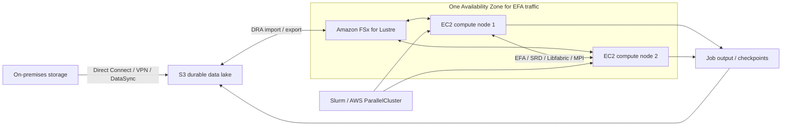

# FSx for Lustre, EFA, and HPC Data Pipelines

## 1. Why Does HPC Need Purpose-Built Storage and Networking?

High Performance Computing (HPC) solves problems with many parallel compute processes: aerodynamic simulations, weather forecasting, molecular modeling, seismic processing, rendering, and satellite image analysis. These processes frequently exchange data continuously and read/write from a shared set of large files.

A cluster with hundreds of compute nodes can hit two bottlenecks:

- **Storage I/O:** many nodes read the same dataset, write large checkpoints, or create millions of small files. A conventional file server cannot sustain the required throughput, metadata operations, and concurrency.
- **Inter-node communication:** MPI ranks exchange messages constantly. Latency and CPU overhead of standard TCP/IP networking can limit scale-out efficiency.

AWS provides two key components to address these two bottlenecks:

- **Amazon FSx for Lustre:** a managed parallel file system providing high-throughput shared POSIX storage for compute nodes.
- **Elastic Fabric Adapter (EFA):** a network interface accelerating inter-EC2-instance communication via OS bypass and Scalable Reliable Datagram (SRD), integrating with Libfabric and HPC middleware.

A complete data pipeline typically adds Amazon S3 as a durable data repository, AWS DataSync for data movement, AWS Direct Connect or Site-to-Site VPN for on-premises connectivity, and EC2/AWS ParallelCluster/Slurm to orchestrate jobs.

FSx for Lustre and EFA address two distinct I/O paths. FSx accelerates shared file reads and writes; EFA accelerates communication between processes/instances and, with a compatible EFA-enabled file system, boosts client-to-FSx throughput. Applications benefit only when storage layout, MPI/runtime, instance types, and network topology all align.

## 2. Learning Objectives

After this lesson, learners can:

1. Explain the parallel architecture of FSx for Lustre and the roles of metadata and data servers.
2. Choose Scratch or Persistent, SSD, Intelligent-Tiering, or HDD based on workload.
3. Design S3 data repository associations (DRAs), automatic import/export, and data repository tasks.
4. Distinguish metadata import, lazy data access, and data export.
5. Understand file striping, Object Storage Targets (OSTs), Metadata Targets (MDTs), and metadata IOPS.
6. Explain EFA, ENA, Libfabric, MPI, SRD, and OS bypass.
7. Design EFA-enabled FSx for Lustre with EC2 clients using matching AZs, subnet CIDRs, and security groups.
8. Select cluster placement groups and instance types for tightly coupled HPC.
9. Choose data paths from on-premises or object storage into HPC: Direct Connect, VPN, DataSync, S3 DRA.
10. Mount FSx for Lustre on Linux EC2 and verify health.
11. Optimize I/O patterns, stripe counts, metadata, and checkpoints.
12. Protect data using encryption, IAM, security groups, backups, and lifecycle policies.
13. Monitor throughput, metadata, queues, networking, and costs.
14. Build an ingest → compute → export → cleanup workflow using the AWS CLI.

## 3. Reference Architecture for an HPC Workload

A typical pipeline has two data paths:

1. Bulk data path: on-premises/object storage → S3 or DataSync → FSx for Lustre → compute nodes → FSx → S3/results repository.
2. Communication path: MPI ranks on EC2 instances ↔ EFA/Libfabric ↔ other MPI ranks.



FSx for Lustre can be mounted by many compute nodes as a shared filesystem. S3 holds durable copies or a data lake; DRA enables the filesystem and S3 to exchange files/metadata. EFA traffic has strict topology constraints: it cannot traverse different Availability Zones or VPCs. Direct Connect/VPN serves standard IP data flows from on-premises; it is not an EFA MPI path.

## 4. What Is FSx for Lustre?

Amazon FSx for Lustre is a managed parallel file system built on Lustre, designed for workloads needing concurrent multi-client access and high throughput. Compute nodes mount the same filesystem via the Lustre client and read/write files using familiar POSIX APIs.

Unlike object storage, Lustre presents data as files and directories. Applications can use open/read/write/rename/stat and file locking. Multiple clients access different files or byte ranges in parallel.

Key characteristics:

- Scales out across multiple file servers and disks.
- Clients communicate directly with storage servers, avoiding a single head-node bottleneck.
- Dedicated metadata path for filenames, directories, permissions, and timestamps.
- Integrates with S3 to import input datasets and export results.
- Multiple deployment/storage classes for scratch, persistent, SSD, Intelligent-Tiering, and HDD.
- Works with EC2, AWS ParallelCluster, properly configured containers, and connected on-premises clients.

FSx for Lustre does not replace S3 for all data. S3 suits durable object storage, API-based sharing, and data lakes; Lustre suits high-performance working space while jobs run.

## 5. Parallel Structure: MDT, MDS, OST, and OSS

A Lustre filesystem divides work between metadata and file data.

| Component | Role |
|---|---|
| Metadata Server (MDS) | Handles client metadata requests |
| Metadata Target (MDT) | Stores directory entries, filenames, permissions, timestamps, and metadata |
| Object Storage Server (OSS) | Serves file data from storage targets |
| Object Storage Target (OST) | Stores file data chunks |
| Lustre client | Mounts the filesystem and sends metadata/data requests |

When an application opens a file, the client queries metadata to locate the file and verify permissions. When reading/writing contents, data flows to/from the corresponding OSTs. Consequently, a workload can be metadata-bound even when large-file data throughput still has headroom.

Examples:

- A job reading 100 large files typically needs high data throughput.
- A job creating 10 million small files can bottleneck on metadata IOPS and directory operations.
- A job where many ranks append to a single file can cause lock contention or serialization.
- A job writing concurrent checkpoints needs file and stripe layouts spread across many OSTs.

Separating these two load profiles helps choose the right throughput capacity, metadata IOPS, and layout.

## 6. Choosing Deployment Type and Storage Class

FSx for Lustre provides two deployment options and three storage classes. Choose deployment type and storage class at filesystem creation; availability and limits depend on Region, Lustre version, and configuration.

### 6.1. Scratch and Persistent

| Attribute | Scratch | Persistent |
|---|---|---|
| Purpose | Temporary storage, short-term jobs | Long-running or interruption-sensitive workloads |
| Replication | Data is not replicated | Data is replicated per storage class |
| When a file server fails | Data on the failed server/disk may become inaccessible | FSx replaces failed infrastructure; client requests retry |
| Backups | FSx backups not supported | Backups supported if filesystem is not linked to S3 DRA |
| Best fit | Intermediate files, scratch space, rebuildable data | Shared working data, production HPC data |

Scratch can deliver high burst throughput for short-lived workloads, but never use it as the sole store for unrecoverable results.

Persistent SSD/HDD replicates data within a single AZ; Persistent Intelligent-Tiering replicates across multiple AZs per FSx documentation. This does not make every FSx for Lustre type a multi-AZ mount endpoint; EFA traffic and client placement still carry specific limits.

### 6.2. Storage Classes

| Storage Class | Characteristics | When to Consider |
|---|---|---|
| SSD | Low latency across the entire dataset; high, consistent throughput | Metadata-heavy, random I/O, or latency-sensitive |
| Intelligent-Tiering | Elastic tiering; frequently accessed data served fast, optional SSD read cache | Large datasets with shifting access patterns |
| HDD | Capacity/cost-effective for certain sequential workloads; optional SSD read cache on supported configs | Large datasets, minimal random I/O, relaxed latency |

Do not pick a storage class based solely on price per GiB. Measure random/sequential I/O, metadata operations, working-set size, read-cache hit rate, and throughput demands.

### 6.3. Persistent 1 and Persistent 2

- Persistent 1 supports SSD/HDD and suits long-lived workloads not requiring peak IOPS/throughput; this deployment type is created via the AWS CLI or API.
- Persistent 2 is the newer generation, supporting SSD and Intelligent-Tiering, higher throughput/metadata performance, and configurable metadata options.
- Persistent 2 can enable EFA at filesystem creation and configure metadata performance.
- Persistent 2 is available in select Regions; verify Region availability before designing.

Throughput tiers vary by storage class/deployment type: Persistent 1 SSD supports 50/100/200 MB/s/TiB; Persistent 1 HDD supports 12/40 MB/s/TiB; Persistent 2 SSD supports 125/250/500/1,000 MB/s/TiB. For Intelligent-Tiering, users provision total throughput capacity rather than throughput per TiB.

## 7. Linking S3 with Data Repository Associations

A Data Repository Association (DRA) links a directory in FSx for Lustre to an S3 bucket or prefix. The DRA creates a 1:1 mapping between filesystem paths and S3 object keys.

Examples:

| FSx Path | S3 Path |
|---|---|
| `/input` | `s3://hpc-data/input/` |
| `/results` | `s3://hpc-data/results/` |
| `/reference` | `s3://hpc-data/reference/` |

DRA brings datasets from S3 into the filesystem namespace, automatically imports S3 metadata changes, automatically exports new/changed/deleted files from FSx back to S3, and runs on-demand import/export data repository tasks.

A filesystem can have up to 8 DRAs; each association requires a distinct FSx directory and S3 bucket/prefix. DRA is not supported on filesystems using Intelligent-Tiering or Scratch 1; DRA supports Lustre versions 2.12 and 2.15 as documented by AWS. Automatic export also does not support Lustre 2.10 or Scratch 1. Check the compatibility matrix before picking storage class and filesystem version.

### 7.1. Metadata Import and Lazy Data Access

When linked to S3, FSx imports metadata to display files and directories. Object contents are fetched into the filesystem when an application first accesses a file. Thus, seeing filenames in a directory does not mean all bytes have been preloaded into Lustre.

For workloads requiring predictable startup times, pre-stage or warm the working set before launching jobs. Run import tasks and pre-read needed files; monitor cache/throughput to avoid thousands of compute ranks triggering a cold-start burst simultaneously.

### 7.2. Automatic Import/Export

Import policies define which S3 events propagate into FSx: New, Changed, Deleted, or combinations. Export policies define which FSx changes write back to S3.

Notes:

- Automatic import requires the S3 bucket and FSx filesystem to be in the same Region.
- Automatic export can write to an S3 bucket in a different Region.
- Automatic import and export can both be enabled on the same DRA.
- If the same file is modified in both S3 and Lustre, they can overwrite each other; FSx does not resolve application conflicts.
- Application-level coordination or strict single-source-of-truth conventions per phase are required.
- Certain changes from S3 Lifecycle expiration or versioning operations are not synced by automatic import like standard S3 deletes; check specific import policy limits.
- Do not delete an S3 bucket while filesystems remain linked.

Do not treat bidirectional DRA as a distributed lock or transactional database. Design ingest/compute/export flows with clear ownership.


## 8. Data Repository Tasks

A data repository task imports or exports files/metadata for a specified scope.

- **Import task:** syncs metadata and file changes from S3 into FSx.
- **Export task:** writes new or modified files/metadata from FSx back to S3.
- **Automatic import:** can run alongside import tasks.
- **Automatic export and export tasks:** cannot be used concurrently on the same filesystem per current documentation.

Use tasks when proactively staging datasets before a job, syncing results after job completion, or reconciling metadata after bulk updates.

Tasks are not real-time replication guarantees. Track task status, failure counts, and object counts in workflows; submit compute jobs only after input data is confirmed ready.

## 9. Striping: Splitting Files Across Multiple OSTs

Striping divides file contents into chunks stored across multiple OSTs. When multiple OSTs serve a single file concurrently, aggregate throughput can exceed a single OST.

Common parameters:

- Stripe count: number of OSTs storing parts of the file.
- Stripe size: size of each chunk before moving to the next OST.
- Stripe offset: starting OST, usually left for the system to choose.
- Progressive File Layout (PFL): adjusts layout progressively as file size grows.

For example, an 8 GiB file with stripe count 4 and stripe size 1 MiB distributes chunks round-robin across four OSTs. Multiple storage servers can serve a large read simultaneously.

### 9.1. When to Increase Stripe Count?

Increasing stripe count helps large files accessed in parallel by many clients needing aggregate OST bandwidth.

Do not set a large stripe count for all files:

- Small files incur unnecessary metadata/network overhead.
- Metadata operations on wide-striped layouts may require round-trips to multiple targets.
- Append-only log files usually do not need high stripe counts.
- Many large files sharing identical stripe offsets can create hot spots if poorly distributed.

Measure on real workloads before tuning.

### 9.2. Commands to Inspect and Set Striping

```bash
# View a file's layout
lfs getstripe /fsx/dataset/model.bin

# View OST and MDT usage
lfs df -h /fsx

# Create a new file with stripe count 8
lfs setstripe -c 8 /fsx/output/large-result.bin

# Set default layout for new files in a directory
lfs setstripe -c 8 /fsx/output/
```

`lfs setstripe` defines the layout for new files or files created inside the configured directory. It does not automatically restripe existing files; use `lfs migrate` or create a new file and copy data when changing layouts.

## 10. Metadata IOPS and Small-File Workloads

Metadata performance governs how quickly files and directories are created, opened, closed, listed, renamed, and deleted. A pipeline creating millions of small files can run slowly even when data throughput is far below capacity.

Persistent 2 lets you configure Metadata IOPS independently of storage capacity. Two modes exist:

- AUTOMATIC: FSx automatically provisions based on storage capacity (SSD) or throughput capacity (Intelligent-Tiering).
- USER_PROVISIONED: users specify metadata IOPS from supported values.

Examples of metadata-heavy workloads:

- Many ranks creating one small file per task.
- Directories containing millions of entries.
- Workflows repeatedly stat/open/close files.
- Job schedulers scanning datasets prior to computation.

Improve performance by packing records into larger containers/files, sharding large directories, reducing redundant stat/open calls, avoiding massive empty-file creation, and provisioning appropriate metadata IOPS.

## 11. What Is EFA?

Elastic Fabric Adapter (EFA) is a network interface built for applications needing low-latency, high-throughput communication between EC2 instances, especially HPC and distributed AI/ML.

EFA provides:

- OS bypass: user-space applications/runtimes talk directly to the EFA device via Libfabric, bypassing kernel TCP/IP overhead.
- SRD transport: Scalable Reliable Datagram providing reliable transport and congestion control.
- Integration with MPI implementations and NCCL/NIXL in supported configurations.
- Inter-instance communication within EFA-supported AWS topologies.

ENA still provides standard IP networking within the VPC. EFA adds a high-performance communication path for compatible middleware; it does not magically make arbitrary TCP sockets or applications EFA-aware.

EFA is an EC2 networking feature with no extra per-interface charge, though instances, compute, placement, storage, and data transfer still incur charges.

## 12. EFA, Libfabric, and MPI

In HPC, applications typically use MPI to send/receive messages between ranks. MPI implementations can use Libfabric/OpenFabrics Interfaces (OFI) to access transport providers.

Conceptual data path:

1. Application calls MPI_Send/MPI_Recv or a collective operation.
2. MPI library selects a compatible transport/provider.
3. Libfabric exposes the user-space API.
4. EFA provider uses the EFA device and SRD transport.
5. Remote rank receives the message via EFA/Libfabric/MPI.

EFA is compatible with AWS-supported MPI stacks such as Open MPI 4.1+ and Intel MPI 2019 Update 5+ in documented configurations. Verify MPI, Libfabric, kernel, driver, and instance type versions; do not mix incompatible versions arbitrarily.

Some MPI applications may need recompilation or runtime flags to select the EFA provider. If an application falls back to TCP/ENA, merely attaching an EFA device may yield no speedup.

## 13. EFA for FSx for Lustre

FSx for Lustre can be created in EFA-enabled mode to raise throughput from a single client instance to the filesystem. AWS recommends considering EFA for filesystems with throughput capacity above 10 GBps.

Key prerequisites:

- The filesystem must use Persistent 2 and have metadata configuration enabled.
- EFA must be enabled at creation; it cannot be toggled on/off on an existing filesystem.
- EFA clients and the FSx filesystem must reside in the same Availability Zone.
- Client and filesystem subnets must fall within the same /16 CIDR range in the VPC.
- Clients require Nitro v4 or newer EC2 instances supporting EFA; trn2 is excluded in current FSx EFA guidance.
- Client OS must be on the supported list, currently including Amazon Linux 2023, RHEL 9.5+, or Ubuntu 22.04+ with kernel 6.8+.
- Install the Lustre client, EFA modules/drivers, and configure EFA interfaces.
- Filesystem and clients must use EFA-enabled security groups meeting requirements.

A filesystem supports up to 8,192 EFA connections across all client instances. Each configured EFA interface on a client counts as one connection; account for interfaces per node when sizing clusters.

Metadata traffic between clients and FSx always travels over TCP, even when the data path uses EFA. An EFA-enabled filesystem can also communicate over ENA or ENA Express; EFA is used only when both client and workload meet prerequisites.

In documented configurations, maximum throughput to a single client can reach 700 Gbps over EFA and up to 1,200 Gbps when pairing EFA with GPUDirect Storage. These are supported configuration limits rather than guaranteed throughput for every job; actual performance depends on instances, filesystem capacity, data layout, and workload.

### 13.1. EFA, ENA Express, and GPUDirect Storage

- **ENA:** traditional IP networking inside a VPC.
- **EFA:** OS-bypass path for Libfabric-enabled applications.
- **ENA Express:** optimizes TCP/IP paths between supported instances.
- **GPUDirect Storage (GDS):** enables direct data paths from storage to GPU memory, reducing CPU involvement and memory copies in supported GPU/driver configurations.

With EFA-enabled FSx for Lustre, GDS currently supports AWS-listed instance families such as P5, P5e, P5en, P6-B200, and P6-B300; compatible CUDA, NVIDIA driver, and GDS driver versions are required. Do not assume every GPU instance supports GDS.

## 14. Placement Groups and HPC Topology

Cluster placement groups place EC2 instances close together within one Availability Zone to minimize network latency and maximize inter-instance throughput. They are standard for tightly coupled MPI workloads.

Notes:

- Cluster placement groups span only one AZ.
- EFA traffic never crosses AZs or different VPCs.
- EFA-enabled FSx clients and filesystems require the same AZ and same /16 CIDR.
- Placement groups are not strictly mandatory for EFA, though AWS recommends them for latency-sensitive workloads.
- When scaling clusters, capacity may become scarce; consider On-Demand Capacity Reservations.
- Avoid mixing too many instance types if doing so reduces full-capacity acquisition odds.
- Internet or Direct Connect traffic inside a cluster placement group has specific limits; do not use cluster placement groups as a WAN accelerator.

A cluster can use ENA/IP for control planes, S3, package repositories, and external transfers while reserving EFA for internal MPI traffic. Subnet/AZ design must accommodate both paths.

## 15. HPC Data Paths: Choosing by Scale and Access Pattern

No single transfer method fits every case. Choose based on dataset size, update frequency, latency, network distance, file count, metadata preservation, and verification requirements.

| Method | Direction | Strengths | Notes |
|---|---|---|---|
| S3 + FSx DRA | S3 ↔ FSx | Integrated file/object namespace, automatic import/export | Not a synchronous transaction; avoid concurrent conflicting writes |
| AWS DataSync | On-prem/NFS/SMB/object/S3/FSx | Managed transfers, verification, scheduling, incremental sync | Uses tasks/agents per location; not a low-latency shared mount |
| Direct Connect | On-prem ↔ VPC/AWS | Private network path, predictable bandwidth planning | Requires routing, VLAN, DX gateway/VGW/TGW, and redundancy design |
| Site-to-Site VPN | On-prem ↔ VPC | Quick setup, IPsec encryption | Throughput/latency depend on VPN tunnels and internet path |
| Mount FSx directly over DX/VPN | On-prem client ↔ Lustre | POSIX access to filesystem | Requires Lustre client, DNS, routing, ports, and stable connectivity |
| Offline bulk transfer | Massive datasets or constrained networks | Independent of WAN transfer time | Move data offline into S3 first, then import into FSx |

### 15.1. S3 as a Durable Landing Zone

A common pattern ingests input data into S3 first. S3 is a durable object store suited for versioning, lifecycle policies, data lakes, auditing, and cross-service sharing. Next, DRA imports metadata/files into FSx for POSIX access by compute nodes.

When jobs finish, export outputs from FSx back to S3. Separate prefixes by job ID, dataset version, and run date to prevent overwriting outputs from other jobs.

### 15.2. Direct Mounting from On-Premises

FSx for Lustre supports on-premises clients over Direct Connect or Site-to-Site VPN. This lets local servers copy data into the filesystem or access the shared filesystem directly.

However, Direct Connect/VPN provides IP connectivity only; it does not carry EFA OS-bypass traffic from on-premises into HPC. EFA operates between EC2 instances in supported topologies. For on-premises transfers, use TCP/Lustre or DataSync as appropriate.

### 15.3. When to Choose DataSync?

Use DataSync for one-time migrations, recurring ingests, periodic replication, or copying data between on-premises and AWS storage. DataSync supports transfers to/from FSx for Lustre via dedicated locations.

Enhanced mode supports FSx for Lustre versions 2.12 and newer; if a filesystem runs 2.10, use Basic mode or upgrade following supported procedures. DataSync mounts FSx using the Lustre client and requires access across the mounted path.

## 16. Direct Connect, VPN, and Network Design

When choosing Direct Connect or VPN, determine:

- Average and burst bandwidth of ingress/egress data.
- File counts, file sizes, and metadata operations.
- Latency and packet loss between on-premises and AWS.
- Circuit/tunnel redundancy and routing failover.
- VPC/subnets, route tables, DNS resolution, and security groups.
- Encryption in transit per security policy.
- Bandwidth bottlenecks on local clients, routers, firewalls, and on-premises storage.

Direct Connect suits private connectivity with planned bandwidth and steady traffic. VPN can fit smaller environments, backup paths, or proofs of concept. Backup VPNs can pair with Direct Connect depending on architecture.

If mounting FSx directly from on-premises, verify filesystem DNS resolution across the network, compatible Lustre clients, and required ports. Never design EFA MPI traffic over DX/VPN because EFA is not a WAN transport.


## 17. Security Groups and Ports for Lustre/EFA

FSx for Lustre is accessed via network interfaces in the attached VPC. Only resources in the associated VPC or properly peered/connected networks can reach those interfaces.

### 17.1. Lustre TCP Traffic

For standard clients and filesystems, security groups must permit traffic between Lustre clients and FSx on:

| Protocol | Port | Purpose |
|---|---:|---|
| TCP | 988 | Lustre LNet traffic |
| TCP | 1018–1023 | Lustre client/server communication |

Configure matching inbound/outbound rules on both filesystem and client security groups; file servers also communicate with one another. Use security group IDs or specific subnet CIDRs per AWS guidance and least privilege.

### 17.2. EFA-Enabled Security Groups

For EFA-enabled FSx for Lustre, security group rules differ from TCP-only setups:

- The filesystem SG must allow all inbound/outbound traffic with itself and with the client SG.
- The client SG must allow all inbound/outbound traffic with the filesystem SG.
- EFA rules must directly reference security group IDs.
- CIDR rules, even 0.0.0.0/0, do not satisfy EFA requirements regardless of open ports.

Therefore, create dedicated SGs for EFA filesystems and EFA clients, carefully verifying self-referencing rules and source/destination SG IDs before mounting.

Never delete or modify FSx-managed network interfaces. Altering service ENIs can sever filesystem connectivity.

## 18. AWS DataSync: Transfer, Verification, and Scheduling

DataSync is a managed service for moving data across on-premises storage, object storage, and AWS storage services. When transferring to/from FSx for Lustre, create a DataSync location pointing to the filesystem and mount path.

Basic flow:

1. Create a source location.
2. Create an FSx for Lustre destination/source location.
3. Create a DataSync task with filters and options.
4. Run the task or configure a schedule.
5. Monitor task execution, bytes/files transferred, skipped files, and errors.
6. Verify verification status before feeding datasets into jobs.

### 18.1. Basic Mode and Enhanced Mode

- Basic mode supports broad transfer scenarios and works with FSx for Lustre.
- Enhanced mode parallelizes massive file/object counts, optimizing listing, preparation, transfer, and verification.
- Enhanced mode with FSx for Lustre requires Lustre version 2.12 or higher.
- Select task mode at creation; mode cannot be changed afterward.
- The VPC used for DataSync must use default tenancy; dedicated tenancy is not supported.

A DataSync location for FSx uses the Lustre client and mounts the filesystem as UID/GID 0 for full data access. Review root access, security groups, and IAM roles during security reviews.

### 18.2. Integrity Verification

DataSync can verify checksums and metadata between source and destination. Enhanced mode verifies transferred data; Basic mode provides verification options, including full post-transfer verification, which adds runtime on large datasets.

If files are actively written during a DataSync transfer, verification can report inconsistencies. To capture stable versions, run the task after applications finish writing files.

Use include/exclude filters to scope datasets; consider manifests when strict file lists are needed; avoid syncing active checkpoints unless the workflow supports snapshots or coordination.

## 19. Installing the Lustre Client and Mounting FSx on EC2

EC2 clients need an OS/kernel supported by FSx for Lustre and a Lustre client matching the filesystem version. On EFA clients, also install EFA drivers/modules and configure EFA interfaces.

Mount procedure:

1. Retrieve DNS name and mount name from the FSx console or DescribeFileSystems.
2. Install the Lustre client matching your Linux distribution/kernel.
3. Verify security groups, routing, DNS, and ports.
4. Create the mount point.
5. Mount the filesystem and confirm with df/lfs commands.

Example:

```bash
sudo mkdir -p /fsx

sudo mount -t lustre -o relatime,flock \
  fs-0123456789abcdef0.fsx.us-east-1.amazonaws.com@tcp:/mountname \
  /fsx

df -h /fsx
lfs df -h /fsx
```

Replace the DNS name and mount name with actual values from your filesystem. `relatime` reduces metadata updates compared to strict atime; `flock` enables file locking. If workloads require exact access times, evaluate atime and measure performance impact.

For automatic mount at boot, configure /etc/fstab per AWS instructions using _netdev and systemd automount as appropriate to prevent boot races before networking is ready. Do not copy mount options between EFA-enabled and non-EFA filesystems without consulting documentation for that specific filesystem type.

## 20. End-to-End Performance Optimization

Real-world performance is bounded by the slowest segment in the data path:

- Client instance network throughput.
- Filesystem network throughput.
- Disk throughput/IOPS.
- Metadata IOPS.
- File striping and OST count.
- Application I/O patterns.
- Cache hit rate and working set.
- Concurrent accessing clients/ranks.

When reading data already cached in memory/SSD, networking may be the bottleneck. When writing or reading uncached data, throughput is capped by the lower of network throughput and disk throughput.

### 20.1. Optimizing File Layouts

- Stripe large files across multiple OSTs when high throughput is required.
- Avoid wide striping on small files.
- Separate small-file and large-file workloads into directories with tailored layouts.
- Use PFL when datasets span varied file sizes.
- Inspect layout and OST balance using lfs getstripe and lfs df.
- Consider imported file chunk sizes for S3-imported datasets to distribute data evenly.

### 20.2. Optimizing Metadata

- Reduce small file counts by packing records into larger containers/chunks when feasible.
- Shard huge directories across multiple subdirectories.
- Avoid thousands of ranks hitting stat/open/close on one hot directory.
- Evaluate Persistent 2 metadata IOPS options.
- Monitor metadata operation latency alongside data throughput.

### 20.3. Benchmarking Representative Workloads

Use application-representative benchmarks such as IOR for parallel file I/O and mdtest for metadata workloads. Test reads, writes, random/sequential access, file sizes, concurrency, and checkpoint patterns.

Never benchmark a single node or single large file and extrapolate to cluster-wide performance. Measure scale-out across nodes/ranks and track total application runtime rather than raw storage MB/s alone.

## 21. Orchestrating HPC Jobs with Slurm and AWS ParallelCluster

AWS ParallelCluster can provision a cluster with a head node, compute queues, and shared storage such as FSx for Lustre. The Slurm scheduler dispatches jobs onto compute nodes; FSx provides the shared working directory and datasets.

Suggested workflow:

1. User submits a job with dataset version and resource requirements.
2. Job prolog checks mounts, input manifests, and scratch capacity.
3. Stage needed data from S3/FSx repositories.
4. Launch MPI ranks on EFA-enabled EC2 instances.
5. Application reads inputs and writes checkpoints/outputs to FSx.
6. Job epilog exports outputs back to S3 or data repositories.
7. Record run metadata, exit codes, and performance metrics.
8. Clean up temporary files after confirming export completion.

Never let one job delete directories still used by another job. Isolate prefixes by project/job ID and enforce ownership/permissions.

## 22. Durability, Backups, and Recovery

Match persistence to data recoverability:

- Scratch fits rebuildable intermediate data; a file server failure can lose data on that server.
- Persistent replicates data and automatically replaces failed infrastructure.
- S3 DRA serves as a durable data repository for inputs/outputs.
- Persistent filesystems not linked to S3 can use automatic daily backups or user-initiated backups.
- FSx backups are not supported on Scratch or on filesystems linked to an S3 data repository.

Automatic daily backup retention ranges from 0–90 days; default 0 means automatic backups are disabled. Backups are incremental, filesystem-consistent, and restorable to a new filesystem.

For DRA-linked filesystems, the S3 bucket acts as the durable repository; FSx backups are unavailable because the filesystem may hold only a working set rather than the full dataset. Configure S3 versioning, lifecycle rules, replication, and recovery separately.

Recovery tests should verify correct dataset versions, completed DRA imports or restores, accurate POSIX permissions/ownership, successful Lustre client remounts, functional EFA/MPI stacks, and job resumption from valid checkpoints.

## 23. Security and Data Protection

### 23.1. Encryption

FSx for Lustre encrypts data at rest. Persistent filesystems allow choosing a KMS key. Scratch filesystems use AWS-managed keys. Scratch 2 and Persistent support encryption in transit when accessed from supported EC2 instance types; verify Region/instance compatibility.

DataSync, Direct Connect/VPN, and S3 DRA have their own encryption/security controls. Map explicitly where data is encrypted in transit and at rest.

### 23.2. IAM and S3

- Separate IAM roles for creating/managing filesystems, mounting clients, DRA import/export, and DataSync tasks.
- Scope S3 bucket policies to specific prefixes and required roles.
- Scope KMS key policies to principals needing read/write access.
- Enable S3 Block Public Access.
- Do not grant broad permissions to compute nodes that only need to read inputs or write an output prefix.
- Apply tags by project, environment, owner, and cost center.

### 23.3. POSIX Permissions and Multi-Tenant HPC

FSx for Lustre enforces POSIX ownership/permissions. Maintain consistent UID/GID mappings across compute nodes, project groups, and on-premises clients. Mismatched UIDs/GIDs across nodes cause unexpected file access behavior.

Segregate directories by team/project, enforce umask/default ACLs per policy, and avoid using 777 permissions as a default workaround.

## 24. Monitoring, Metrics, and Performance Troubleshooting

Monitor both filesystem and clients:

| Area | Metrics to Watch | Question |
|---|---|---|
| Throughput | DataReadBytes, DataWriteBytes, network throughput | Hitting filesystem or client limits? |
| IOPS | DataReadOperations, DataWriteOperations | Too many small I/O operations? |
| Metadata | Metadata IOPS utilization/operations | Experiencing a metadata bottleneck? |
| Capacity | Storage utilization, free space, OST usage | Is any OST full or imbalanced? |
| S3 DRA | Import/export backlog, task status, errors | Is the dataset synced? |
| DataSync | Bytes/files transferred, errors, verification | Did transfer complete and pass verification? |
| EC2/EFA | Network throughput, retransmits, CPU, MPI timings | Is the app actually using the EFA path? |
| Scheduler | Queue wait, job duration, node failures | Does the cluster have enough capacity? |

Common scenarios:

- **Mount timeout:** check DNS, routing, security groups, ports 988/1018–1023, and Lustre client/kernel.
- **EFA not used:** check instance support, EFA driver, Libfabric provider, MPI runtime, AZ, and /16 subnet.
- **Slow metadata:** measure file counts/directory hot spots, metadata IOPS, and open/stat/rename patterns.
- **A few OSTs overloaded:** inspect stripe layouts and file distribution.
- **S3 data missing in FSx:** check DRA lifecycle, import policy, S3 event configs, and import task status.
- **Exports not updating S3:** check export policy/tasks, bucket permissions, and object conflicts.
- **DataSync task fails:** check location mount paths, SGs, IAM roles, file permissions, and verification logs.
- **Poor MPI scaling:** measure communication time, rank placement, instance types, EFA provider, and collective algorithms.


## 25. Cost and Capacity Planning

HPC costs typically span compute, storage, network/data transfer, and orchestration. Price the complete workload rather than filesystem cost per GiB alone.

| Component | Billing Factors to Consider |
|---|---|
| EC2 compute | Instance hours, Spot/On-Demand, Capacity Reservations |
| FSx for Lustre | Storage capacity, storage class, throughput capacity, metadata IOPS |
| FSx backups | Backup storage and retention (if eligible for backups) |
| S3 | Storage classes, requests, data retrieval, replication, and lifecycle |
| DataSync | Data processed, agent/transfer mode, and task frequency |
| Direct Connect | Port hours, data transfer, and circuit/provider fees |
| VPN | VPN connection hours and data transfer |
| EBS/AMI | Boot volumes, scratch volumes, and snapshots |
| CloudWatch | Metrics, logs, dashboards, and alarms |

### 25.1. Right-Sizing Provisioned Throughput

With Persistent SSD, throughput capacity scales with storage capacity multiplied by provisioned throughput per TiB. Raising storage capacity simultaneously increases tier-based throughput capacity. Persistent 2 supports higher SSD tiers than Persistent 1.

Intelligent-Tiering provisions throughput capacity independently of storage capacity; choices include 1,000 MBps, 2,000 MBps, or multiples of 4,000 MBps, with optional SSD read cache. EFA on Intelligent-Tiering requires throughput capacity of 4,000 MBps or a multiple of 4,000 MBps per current documentation.

Do not provision peak tiers upfront without benchmarking. Use test workloads, scale capacity incrementally, and observe throughput, metadata IOPS, client networking, and application runtime.

### 25.2. Reducing Transfer Costs

- Keep compute and FSx in matching Region/AZ topologies to avoid unnecessary data movement.
- Use S3 DRA for repository patterns rather than copying entire datasets over the WAN repeatedly.
- Stage only the working set needed into FSx.
- Export results and checkpoints worth keeping; delete intermediate data after verification.
- Use DataSync incremental/filters for recurring syncs.
- Avoid running multiple huge copy jobs simultaneously competing for bandwidth with MPI/storage traffic.
- Track cost per job or per TB processed and apply project/team tags.

## 26. AWS CLI Example: Creating EFA-Enabled FSx for Lustre

The example below creates a Persistent 2 SSD filesystem with metadata configuration and EFA. For EFA-enabled Persistent 2 SSD, storage capacity must follow increments tied to the throughput tier; for instance, the 1,000 MB/s/TiB tier uses 4.8 TiB increments. This is an illustrative config; check Region availability, storage-capacity increments, throughput tiers, instance support, and EFA security groups before running.

```bash
aws fsx create-file-system \
  --file-system-type LUSTRE \
  --file-system-type-version 2.15 \
  --storage-capacity 4800 \
  --storage-type SSD \
  --subnet-ids subnet-0123456789abcdef0 \
  --security-group-ids sg-0123456789abcdef0 \
  --lustre-configuration '{
    "DeploymentType": "PERSISTENT_2",
    "PerUnitStorageThroughput": 1000,
    "MetadataConfiguration": {
      "Mode": "AUTOMATIC"
    },
    "EfaEnabled": true
  }' \
  --tags Key=Project,Value=hpc-simulation Key=Environment,Value=prod \
  --region us-east-1
```

In production, use designed subnets/AZs, security groups, KMS keys, backup windows, storage capacity, and throughput. EFA-enabled settings cannot be turned on or off after filesystem creation; changing this requires creating a new filesystem and migrating data.

### 26.1. Inspecting the Filesystem

```bash
aws fsx describe-file-systems \
  --file-system-ids fs-0123456789abcdef0 \
  --region us-east-1
```

Inspect Lifecycle, DNSName, MountName, DeploymentType, StorageType, PerUnitStorageThroughput, MetadataConfiguration, EfaEnabled, and NetworkInterfaceIds before configuring clients.

### 26.2. Creating a DRA Linked to S3

```bash
aws fsx create-data-repository-association \
  --file-system-id fs-0123456789abcdef0 \
  --file-system-path /input \
  --data-repository-path s3://hpc-data-prod/input/ \
  --s3 "AutoImportPolicy={Events=[NEW,CHANGED,DELETED]},AutoExportPolicy={Events=[NEW,CHANGED,DELETED]}" \
  --region us-east-1
```

DRAs are created asynchronously. Check lifecycle state before running dependent jobs. Bucket policies/IAM roles must allow the FSx service to access the exact bucket/prefix.

### 26.3. Creating a DataSync Location for FSx

```bash
aws datasync create-location-fsx-lustre \
  --fsx-filesystem-arn arn:aws:fsx:us-east-1:111122223333:file-system/fs-0123456789abcdef0 \
  --security-group-arns arn:aws:ec2:us-east-1:111122223333:security-group/sg-0123456789abcdef0 \
  --subdirectory /input \
  --region us-east-1
```

The command returns a LocationArn. Create a task between matching source/destination locations, select mode and verification options, and start execution:

```bash
aws datasync start-task-execution \
  --task-arn arn:aws:datasync:us-east-1:111122223333:task/task-0123456789abcdef0 \
  --region us-east-1
```

Save the TaskExecutionArn to track status, bytes/files transferred, errors, and verification.

## 27. Hands-On Exercise: Running an HPC Data Pipeline

### 27.1. Objective

Create a shared FSx for Lustre environment for compute nodes, ingest a dataset from S3, run a parallel workload, write outputs, and export results back to S3.

### 27.2. Prerequisites

- Lab AWS account and a Region supporting Persistent 2/EFA if testing EFA.
- VPC, subnets, and security groups for FSx and EC2 clients.
- Input/output S3 bucket.
- EC2 instance types supporting Lustre; if testing EFA, choose Nitro/EFA-supported instances.
- Lustre client and EFA drivers compatible with OS/kernel.
- AWS ParallelCluster/Slurm if practicing scheduler orchestration.
- A test dataset large enough to observe throughput, without sensitive data.

### 27.3. Lab Steps

1. Create an S3 bucket with Block Public Access, encryption, and separate prefixes for input/results.
2. Prepare EFA security groups using SG-ID references; if testing TCP Lustre only, open ports 988 and 1018–1023.
3. Create an FSx for Lustre filesystem with an appropriate deployment/storage class.
4. If testing EFA-enabled FSx, create Persistent 2 with metadata configuration and EFA enabled from the start.
5. Create a DRA for the input prefix and pick an import policy.
6. Wait for DRA AVAILABLE; run an import task if needed.
7. Launch EC2 compute nodes in the same AZ and /16 CIDR as the EFA-enabled filesystem when using EFA.
8. Install the Lustre client; install EFA drivers/modules and MPI/Libfabric stack if testing EFA.
9. Mount FSx and verify with df, lfs df, and lfs getstripe.
10. Run IOR to measure parallel read/write; run mdtest to measure metadata performance.
11. Test multiple stripe counts on large files; compare throughput and OST utilization.
12. Run an MPI workload over EFA and confirm the runtime/provider uses EFA.
13. Write checkpoints/outputs to a job-specific directory.
14. Export outputs to S3 via DRA automatic export or an export task.
15. Verify objects in S3 and checksums/metadata as required.
16. Clean up intermediate files, stop/terminate compute resources, and review costs.

### 27.4. Completion Criteria

- Compute nodes successfully mount FSx for Lustre.
- S3 datasets appear under the expected filesystem paths.
- DRA import/export operates per configured policies.
- EFA clients satisfy AZ, /16 subnet, instance, OS, and SG prerequisites.
- Benchmarks measure throughput and metadata performance.
- MPI jobs execute over the EFA path if testing EFA.
- Outputs are exported and verified in S3.
- Job states, errors, and costs are recorded.

## 28. Detailed Troubleshooting

| Symptom | Possible Cause | Resolution |
|---|---|---|
| FSx filesystem does not reach AVAILABLE | Invalid SG, subnet, quota, or configuration | Check service events, subnet/AZ, and FSx quotas |
| Mount times out | Wrong DNS, route, SG, or ports | Check DNS, TCP 988/1018–1023, routes, and client |
| Incompatible Lustre client | Unsupported kernel/client version | Use OS/kernel and client versions from the compatibility matrix |
| EFA fails to attach/work | Unsupported instance/OS/driver or wrong SG | Verify Nitro generation, EFA support, drivers, and SG-ID rules |
| EFA FSx creation fails | Not Persistent 2 or missing metadata config | Check DeploymentType and MetadataConfiguration |
| EFA path not used | Wrong MPI/Libfabric provider | Verify libfabric, MPI build/runtime, and EFA device |
| Low throughput | Network/disk tier, stripe count, or cache misses | Measure layer by layer; tune layout and throughput |
| Slow metadata operations | Too many small files or low metadata IOPS | Run mdtest, pack files, raise metadata IOPS if appropriate |
| Slow S3 imports | Metadata backlog or high event rate | Check AgeOfOldestQueuedMessage, S3 event rate, and import tasks |
| DRA state MISCONFIGURED | FSx S3 event notifications altered/deleted | Restore DRA config and run an import task to reconcile |
| Export overwrites files | Same object modified from both S3 and FSx | Enforce single-writer ownership and isolated output prefixes |
| DataSync access denied | Missing SG/IAM/location permissions | Check FSx SG, DataSync role, mount path, and S3 permissions |
| DataSync verification fails | Files modified during transfer or metadata mismatch | Re-run when source is quiet and inspect task options |


## 29. Design Example: Batch Seismic Simulation

A research group receives multi-terabyte seismic datasets from field acquisition equipment. They need to run many simulation jobs on EC2, with each job reading the shared dataset and writing its own checkpoints and outputs.

| Stage | Service/Component | Design |
|---|---|---|
| Ingest | Direct Connect + DataSync | Copies data from on-premises storage into S3 |
| Durable landing | S3 | Versioned prefixes by survey ID and dataset version |
| Stage | FSx for Lustre DRA | Imports metadata and warms needed working sets |
| Compute | EC2 + Slurm/ParallelCluster | Runs MPI jobs inside a cluster placement group |
| Interconnect | EFA | MPI communication between compute nodes |
| Shared I/O | FSx for Lustre | Reads inputs, writes checkpoints and intermediate files |
| Export | DRA/DataSync | Sends completed outputs back to S3 |
| Archive | S3 lifecycle | Transitions older results to appropriate storage classes |
| Observability | CloudWatch/CloudTrail | Monitors jobs, storage, networking, and access |

Data conventions:

- Immutable input prefixes keyed by survey/version.
- Dedicated output prefix per job ID.
- Periodic checkpoints accompanied by manifests marking completed checkpoints.
- Export only closed/completed checkpoints.
- Scheduler never assigns the same output directory to two independent jobs.
- Jobs can resume from the latest checkpoint if a compute node is interrupted.

This architecture keeps durable copies in S3, parallel I/O on FSx, and internal communication on EFA. Direct Connect/DataSync handles WAN ingest and egress.

## 30. Common Anti-Patterns

| Anti-Pattern | Consequence | Improvement |
|---|---|---|
| Using Scratch as the sole copy of results | Data may be lost if a file server/disk fails | Export to S3 or use Persistent |
| Using FSx as a long-term object archive | Wastes provisioned filesystem and metadata spend | Use S3 as the durable repository |
| Picking the largest Persistent SSD without benchmarking | Overprovisioned storage/throughput | Measure I/O and scale to workload |
| Enabling EFA while MPI still uses TCP | Misses OS-bypass benefits | Configure Libfabric/MPI provider and verify runtime |
| Placing EFA clients in a different AZ from the filesystem | EFA path does not work | Co-locate AZ and /16 CIDR |
| Using CIDR 0.0.0.0/0 instead of SG IDs in EFA rules | EFA security group validation fails | Use SG-ID references as required |
| Striping all small files across every OST | Raises metadata/network overhead | Match layout to file size and I/O pattern |
| Creating millions of tiny files | Metadata bottleneck | Pack files or shard directories |
| Treating DRA as a synchronous bidirectional database | Races and overwritten files | Enforce single-writer ownership, versioning, and orchestration |
| Editing the same file simultaneously in S3 and Lustre | No guaranteed last-writer conflict resolution | Implement application-level coordination |
| Running DataSync while checkpoints are actively written | Verification failures or inconsistent copies | Transfer only closed files or completed checkpoints |
| Polling import/export status without alarms | Prolonged backlogs go unnoticed | Monitor DRA lifecycle and CloudWatch metrics |
| Scattering compute, FSx, and EFA clients across AZs arbitrarily | High latency or EFA unusable | Design placement/AZ topology upfront |
| Using EFA for on-premises traffic over DX/VPN | Invalid topology; no EFA WAN path | Use IP/Lustre/DataSync for WAN; EFA for internal EC2 |
| Ignoring DataSync, S3 requests, and data transfer costs | Incomplete cost estimates | Calculate end-to-end cost per job |

## 31. Self-Check Questions

### Question 1

What problem does FSx for Lustre solve in HPC?

**Answer:** It provides a shared parallel filesystem allowing many compute nodes to read/write data concurrently with high throughput and a POSIX interface.

### Question 2

How does Scratch differ from Persistent?

**Answer:** Scratch optimizes for temporary data without replication; Persistent serves long-term workloads, replicates data per storage class, and automatically replaces failed infrastructure.

### Question 3

What roles do MDS/MDT and OSS/OST play?

**Answer:** MDS/MDT manage metadata; OSS/OST serve file data. Small-file-heavy workloads can bottleneck on metadata even when data throughput remains available.

### Question 4

Does linking a DRA mean all object data is immediately copied into FSx?

**Answer:** No. Metadata is imported to expose files/directories; object contents are fetched on first access or when pre-staged.

### Question 5

Can EFA be enabled after creating an FSx for Lustre filesystem?

**Answer:** No. The EFA-enabled setting must be chosen at filesystem creation.

### Question 6

Can EFA traffic cross Availability Zones or different VPCs?

**Answer:** No. EFA data traffic requires a supported topology; for FSx EFA, clients and filesystem must share the same AZ and /16 CIDR range.

### Question 7

Why does EFA not automatically accelerate every application?

**Answer:** Applications or middleware must use a compatible Libfabric/EFA provider. If MPI/runtime still takes the TCP path, the EFA device goes unused.

### Question 8

When should you increase stripe count?

**Answer:** For large files and parallel read/write workloads needing multiple OSTs serving simultaneously. Small files generally should not be widely striped.

### Question 9

What does DataSync Enhanced mode require for FSx for Lustre?

**Answer:** The filesystem needs Lustre version 2.12 or higher; on 2.10, use Basic mode or upgrade following supported instructions.

### Question 10

Why shouldn't an FSx filesystem linked to an S3 DRA be backed up with FSx backups?

**Answer:** FSx backups do not support filesystems linked to S3 data repositories; S3 serves as the durable repository and FSx may hold only a working set.

### Question 11

How must EFA security groups reference each other?

**Answer:** Use security group IDs between the filesystem SG and client SG, plus self-referencing rules on the filesystem SG; CIDR rules do not satisfy EFA requirements.

### Question 12

Which data path suits ingesting an on-premises dataset into HPC?

**Answer:** Use Direct Connect/VPN for network connectivity and DataSync for verified transfers; data can land in S3 first and stage into FSx via DRA.

## 32. Production Checklist

### Storage architecture

- [ ] Scratch/Persistent chosen based on durability and data retention needs.
- [ ] SSD/Intelligent-Tiering/HDD chosen based on I/O pattern and working set.
- [ ] Throughput capacity and Metadata IOPS grounded in benchmarks.
- [ ] S3 DRA paths do not overlap and have clear ownership.
- [ ] DRA lifecycle is AVAILABLE before jobs consume data.
- [ ] Import/export policies and conflict handling defined.
- [ ] Backup/recovery strategy aligns with DRA and deployment type.

### EFA and compute topology

- [ ] EC2 instance types support EFA.
- [ ] Client OS/kernel and Lustre/EFA drivers are compatible.
- [ ] EFA enabled at creation on FSx Persistent 2 with valid metadata configuration.
- [ ] Clients and FSx share the same AZ and /16 CIDR range.
- [ ] EFA security groups use SG-ID references.
- [ ] MPI/Libfabric runtime verified to use the EFA provider.
- [ ] Cluster placement group and capacity plan meet workload demands.
- [ ] EFA restricted to internal traffic within supported topologies.

### Data transfer

- [ ] Direct Connect/VPN routing and redundancy verified.
- [ ] DataSync locations/task mode match Lustre version.
- [ ] Verification mode and filters configured.
- [ ] Checkpoints/outputs transferred only when stable.
- [ ] S3 prefixes separate input, output, checkpoints, and job IDs.
- [ ] Alarms configured for import/export backlogs and DataSync failures.

### Security and operations

- [ ] S3 Block Public Access, bucket policies, and KMS policies follow least privilege.
- [ ] FSx encryption at rest and in transit verified.
- [ ] POSIX UIDs/GIDs and project permissions consistent.
- [ ] CloudWatch dashboards cover throughput, metadata, storage, and jobs.
- [ ] CloudTrail audits API changes and access.
- [ ] Runbooks exist for mount, EFA, DRA, DataSync, and MPI failures.
- [ ] Cost allocation tags applied by project/owner/cost center.
- [ ] Cleanup and retention policies exist for intermediate/checkpoint data.

## 33. Official References

### Amazon FSx for Lustre

- [What is Amazon FSx for Lustre?](https://docs.aws.amazon.com/fsx/latest/LustreGuide/what-is.html)
- [Deployment and storage class options](https://docs.aws.amazon.com/fsx/latest/LustreGuide/using-fsx-lustre.html)
- [FSx for Lustre performance](https://docs.aws.amazon.com/fsx/latest/LustreGuide/performance.html)
- [Working with EFA-enabled file systems](https://docs.aws.amazon.com/fsx/latest/LustreGuide/efa-file-systems.html)
- [Configuring EFA clients](https://docs.aws.amazon.com/fsx/latest/LustreGuide/configure-efa-clients.html)
- [Linking your file system to an S3 bucket](https://docs.aws.amazon.com/fsx/latest/LustreGuide/create-dra-linked-data-repo.html)
- [Overview of data repositories](https://docs.aws.amazon.com/fsx/latest/LustreGuide/overview-dra-data-repo.html)
- [Automatically import updates from S3](https://docs.aws.amazon.com/fsx/latest/LustreGuide/autoimport-data-repo-dra.html)
- [Automatically export updates to S3](https://docs.aws.amazon.com/fsx/latest/LustreGuide/autoexport-data-repo-dra.html)
- [File system access control with Amazon VPC](https://docs.aws.amazon.com/fsx/latest/LustreGuide/limit-access-security-groups.html)
- [Mounting from an EC2 instance](https://docs.aws.amazon.com/fsx/latest/LustreGuide/mounting-ec2-instance.html)
- [Protecting your data with backups](https://docs.aws.amazon.com/fsx/latest/LustreGuide/using-backups-fsx.html)

### EFA, EC2, and HPC

- [Elastic Fabric Adapter for AI/ML and HPC](https://docs.aws.amazon.com/AWSEC2/latest/UserGuide/efa.html)
- [Get started with EFA and MPI](https://docs.aws.amazon.com/AWSEC2/latest/UserGuide/efa-start.html)
- [Placement strategies for EC2 placement groups](https://docs.aws.amazon.com/AWSEC2/latest/UserGuide/placement-strategies.html)
- [AWS HPC FAQs](https://aws.amazon.com/hpc/faqs/)
- [AWS ParallelCluster shared storage](https://docs.aws.amazon.com/parallelcluster/latest/ug/shared-storage-quotas-integration-v3.html)

### Data transfer and operations

- [Configuring DataSync transfers with FSx for Lustre](https://docs.aws.amazon.com/datasync/latest/userguide/create-lustre-location.html)
- [How DataSync works](https://docs.aws.amazon.com/datasync/latest/userguide/how-datasync-transfer-works.html)
- [Choosing a DataSync task mode](https://docs.aws.amazon.com/datasync/latest/userguide/choosing-task-mode.html)
- [Using Amazon FSx with on-premises data](https://docs.aws.amazon.com/fsx/latest/LustreGuide/fsx-on-premises.html)
- [Amazon FSx for Lustre pricing](https://aws.amazon.com/fsx/lustre/pricing/)
- [AWS DataSync pricing](https://aws.amazon.com/datasync/pricing/)
