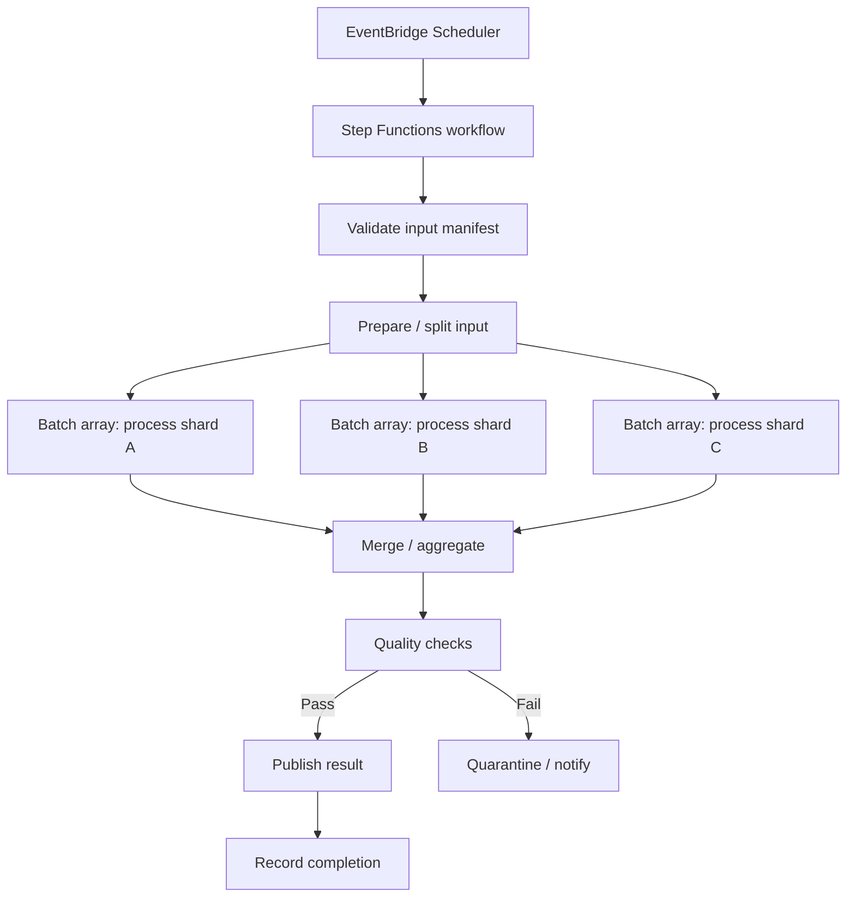
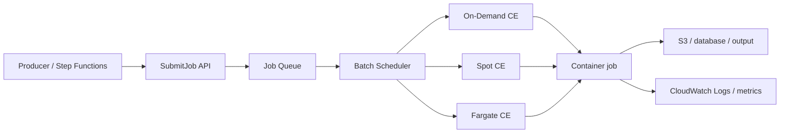

# Batch Pipeline Orchestration and Compute Cost Control

Many workloads do not need to return results immediately when a user sends a request. They can run on a schedule, process a large dataset, generate end-of-day reports, simulate multiple scenarios, or perform scientific computations over several hours. These workloads suit batch computing: bundling work into jobs, queuing them, provisioning compute when needed, tracking state, and reclaiming resources upon completion.

AWS Batch manages scheduling and running containerized batch jobs across compute environments. Amazon EventBridge Scheduler triggers pipelines on cron/rate schedules or one-time timestamps. AWS Step Functions orchestrates steps with dependencies, retries, branching, parallelism, and error handling. Services such as AWS Glue, Amazon EMR, ECS/Fargate, Lambda, S3, FSx for Lustre, and ECR can handle specialized parts within the same pipeline.

Good orchestration ensures pipelines execute in the proper order, recover from failures, and avoid wasting resources. Cost control requires picking the right compute platform, sizing CPU/RAM/GPU requests closely to demand, leveraging Spot for interruption-tolerant workloads, bounding concurrency, scaling down when idle, optimizing data movement, and measuring cost per workload.

## Learning Objectives

After this lesson, you can:

- Distinguish the roles of EventBridge Scheduler, Step Functions, and AWS Batch.
- Model pipelines as DAGs with jobs, dependencies, parallel branches, and aggregation steps.
- Choose among AWS Batch array jobs, job dependencies, Step Functions Map/Distributed Map, or multi-node jobs.
- Design job definitions, job queues, compute environments, and scheduling policies.
- Choose EC2 On-Demand, EC2 Spot, Fargate, or appropriate compute options.
- Design retries, timeouts, checkpoints, idempotency, cancellations, and failure handling.
- Bound compute capacity via vCPU/GPU/memory requests, max vCPUs, concurrency, and fair-share scheduling.
- Optimize costs using Spot, right-sizing, scale-to-zero, scale-down delays, Savings Plans, and storage/network controls.
- Monitor job states, CloudWatch metrics/logs, Step Functions executions, and tag-based costs.
- Build batch pipelines that are resilient, auditable, and budget-controlled.

## 1. Batch Computing and Pipeline Orchestration

Batch computing processes a finite set of tasks without synchronous user interaction. Each job typically reads inputs, executes a program/container, writes outputs, and terminates with a succeeded or failed state.

Example workloads:

- Bulk processing millions of images/videos.
- Generating revenue reports, reconciling transactions, or computing end-of-day invoices.
- ETL/ELT of data from S3, databases, or data warehouses.
- Monte Carlo simulations, parameter sweeps, rendering, or scientific computing.
- Model training/scoring, feature generation, and large-scale data processing.
- Periodic tasks such as backup validation, log compaction, and archival.

A pipeline often consists of multiple dependent jobs. For example, an aggregation job must not start until all shards finish processing; a publish job must not run if validation fails.

### What Is a DAG?

A DAG (Directed Acyclic Graph) is a directed graph without cycles. Each node represents a processing step; edges express dependencies. Pipeline DAGs let independent steps run in parallel while synchronizing only at required join points.



Orchestration decides *when* and *in what order* jobs run. The batch scheduler decides *which jobs* receive resources and *where* they execute. These two layers complement each other.

## 2. Choosing the Right Orchestration Service

| Component | Primary Responsibility | When Appropriate |
|---|---|---|
| Amazon EventBridge Scheduler | Triggers APIs on cron, rate, or one-time schedules; retries and DLQ | Starting pipelines on a schedule or specific timestamp |
| AWS Step Functions | Coordinates workflows, state, dependencies, branching, retries, timeouts, and parallelism | Multi-step pipelines with conditions, approvals, or execution history needs |
| AWS Batch | Queues, scheduling, compute capacity, and executing container batch jobs | Jobs requiring CPU/RAM/GPU, long runtimes, or large-scale parallelism |
| AWS Glue | Serverless ETL, Spark, Data Catalog, and data quality | Data pipelines suited to Glue connectors/formats and ETL semantics |
| Amazon EMR | Spark/Hadoop/Trino and distributed data processing | Need framework/cluster control or specialized big-data workloads |
| Amazon ECS/Fargate | Runs container services/tasks without managing EC2 | Small/medium, short-lived, or event-driven container tasks |
| AWS Lambda | Runs short event-driven tasks within service limits | Lightweight orchestration, validation, notifications, or glue logic |
| AWS ParallelCluster / HPC stack | Provisions clusters and HPC schedulers such as Slurm | Research groups needing interactive/long-lived HPC clusters |

Do not use AWS Batch merely to run a tiny Lambda-sized task. Do not use Step Functions as a CPU/GPU scheduler. Do not use EventBridge Scheduler to encode a complex DAG via dozens of independent schedules when the pipeline needs centralized dependencies and error handling.

## 3. Overall AWS Batch Architecture

AWS Batch comprises these key components:

| Component | Role |
|---|---|
| Job definition | Specifies container image, command, vCPU, memory, GPU, roles, environment, retries, and timeout |
| Job queue | Holds jobs waiting for scheduler evaluation; has priority and scheduling policy |
| Compute environment (CE) | Pool of compute resources running jobs: EC2, Spot, Fargate, or supported platforms |
| Batch scheduler | Evaluates jobs, dependencies, queues, capacity, and placement |
| Job | A specific submission with parameters, overrides, tags, and target queue |
| Job attempt | A single container execution; can be retried per strategy |
| Scheduling policy | Controls fair-share or capacity division across workloads |
| Consumable resource | Logical resources beyond CPU/RAM, such as license tokens or API concurrency |

A job is submitted to a queue. The scheduler checks dependencies and resource requirements, then places the job onto a matching compute environment. Managed compute environments can automatically provision/scale/terminate EC2 capacity or use Fargate; AWS Batch manages underlying resources per configuration.



AWS Batch charges no separate orchestration fee; customers pay for the AWS resources consumed by jobs such as EC2, EBS, Fargate, S3, FSx, CloudWatch, and data transfer. This is key when budgeting: costs come primarily from compute and supporting services, not the number of job definitions or queues. <https://aws.amazon.com/batch/pricing/>

## 4. Job Definition: Declaring Resources and Runtime Environment

A job definition is a versioned description of a workload. It defines the image, command, resource requirements, environment variables, execution role, volumes, logging, retry strategy, and timeout.

### Container Image

Package code and runtime into a container image stored in Amazon ECR or a supported registry. Best practices:

- Pin images using immutable versions/tags or digests.
- Avoid `latest` in production because image contents can change between runs.
- Scan images, update base images, and remove unnecessary packages.
- Keep images small to reduce pull times and storage/transfer costs.
- Use multi-stage builds to separate build tools from runtime images.

### Resource Requirements

Declare vCPU, memory, and GPU to match actual needs. For modern container jobs, use `resourceRequirements` instead of legacy `vcpus`/`memory` where required by the API.

Abbreviated job definition example:

```json
{
  "jobDefinitionName": "daily-transform",
  "type": "container",
  "platformCapabilities": ["EC2"],
  "containerProperties": {
    "image": "111122223333.dkr.ecr.ap-southeast-1.amazonaws.com/daily-transform:1.4.2",
    "command": ["python", "main.py", "--input", "Ref::inputPrefix"],
    "resourceRequirements": [
      {"type": "VCPU", "value": "2"},
      {"type": "MEMORY", "value": "4096"}
    ],
    "jobRoleArn": "arn:aws:iam::111122223333:role/DailyTransformJobRole",
    "executionRoleArn": "arn:aws:iam::111122223333:role/BatchTaskExecutionRole",
    "environment": [
      {"name": "LOG_LEVEL", "value": "INFO"}
    ],
    "readonlyRootFilesystem": true
  },
  "parameters": {
    "inputPrefix": "s3://example-data/input/"
  },
  "retryStrategy": {"attempts": 2},
  "timeout": {"attemptDurationSeconds": 3600},
  "propagateTags": true
}
```

This illustrates an EC2 compute environment; replace account, image, roles, and inputs. For Fargate/EKS/ECS Managed Instances, job definition structures and supported fields may differ. `executionRoleArn` allows the ECS/Fargate agent to pull images and send logs; `jobRoleArn` grants AWS API permissions to code inside the container. Do not merge the two roles unnecessarily.

### Resource Requests Must Reflect Reality

If a job requests 8 vCPU/32 GiB while using only 1 vCPU/4 GiB, the scheduler reserves excess capacity and reduces concurrent job density. If requests are too low, jobs suffer OOMs, throttling, or slowdowns. Measure peak CPU/memory across varied inputs and size requests with sensible headroom.

GPU jobs must declare appropriate accelerator counts/types and run on a compute environment with compatible GPU instances. Do not allocate GPUs to CPU-only jobs.

## 5. Job Queues and Compute Environments

### Job Queue

A job queue holds pending workloads. A queue has a state, priority, and an optional scheduling policy. Queues can be separated by:

- Production vs. development.
- High SLA vs. best-effort.
- CPU, memory-intensive, and GPU workloads.
- On-Demand vs. Spot preference.
- Team/tenant or cost center.

Queue priority determines which queue the scheduler evaluates first among associated queues. Priority does not replace dependencies; if job B must wait for job A, declare a dependency or use Step Functions.

### Compute Environment

A compute environment defines compute type, instance types, VPC/subnets/security groups, min/desired/max vCPUs, Spot settings, and allocation strategy.

- **Managed CE:** AWS Batch manages capacity and scaling; fits most workloads.
- **Unmanaged CE:** customer manages compute resources; choose only when special configurations are needed and operational responsibility is accepted.
- **EC2 On-Demand:** capacity billed at On-Demand rates, suited to workloads needing high stability.
- **EC2 Spot:** uses spare EC2 capacity at lower cost, though instances can be reclaimed.
- **Fargate/Fargate Spot:** runs containers without managing EC2; subject to instance/GPU/network/volume and platform limits.
- **ECS Managed Instances / EKS compute:** platform choices depending on container architecture and current service capabilities.

A queue can attach multiple compute environments in order. The scheduler tries the first valid CE with sufficient capacity; if unavailable, it evaluates the next CE per configuration. This allows prioritizing On-Demand first and falling back to Spot, or ordering CEs by instance type.

### Do Not Manually Modify Managed Resources

AWS Batch manages Auto Scaling Groups, launch templates, ECS clusters, and instances belonging to managed CEs. Do not manually add ECS services/tasks or modify ASGs/instances outside AWS-supported APIs. Direct edits can mark CEs `INVALID`, break scaling, or incur unexpected costs.

## 6. Designing Queues by SLA and Criticality

Do not lump every job into a single queue when SLAs and resource profiles differ.

Example:

| Queue | Priority | Compute | Purpose |
|---|---:|---|---|
| `critical-ondemand` | High | EC2 On-Demand | Deadline-bound reporting/regulatory closes |
| `standard-batch` | Medium | On-Demand + Spot fallback | Scheduled ETL and order processing |
| `best-effort-spot` | Low | EC2 Spot | Backfills, reprocessing, simulations |
| `gpu-research` | Per quota | GPU CE | Training/scientific workloads |
| `dev-sandbox` | Low | Fargate or capped CE | Testing, CI, and development |

Dedicated queues allow applying max vCPU, fair-share, IAM, tags, and budgets per workload. However, too many queues/CEs increase complexity and fragment capacity. Start with a small set of meaningful queues and expand based on observed metrics.

## 7. Job States and Monitoring Progress

An AWS Batch job typically passes through these states:

| State | Meaning |
|---|---|
| `SUBMITTED` | Job was just submitted, not yet evaluated |
| `PENDING` | Waiting on job dependencies; jobs waiting on consumable resources under resource-aware scheduling may remain in `RUNNABLE` |
| `RUNNABLE` | Ready to run, waiting on compute capacity |
| `STARTING` | Scheduled onto compute; container initializing/pulling image |
| `RUNNING` | Container executing |
| `SUCCEEDED` | Container exited with exit code 0 |
| `FAILED` | Job exhausted attempts or terminated with failure |

Jobs stuck in `RUNNABLE` usually signal insufficient capacity, quotas, incompatible instance types, CE state issues, or mismatched resource requests. Jobs stuck in `STARTING` may point to large images, ECR/network slowdowns, container dependencies, or init containers. With `attemptDurationSeconds`, the timeout clock starts when a job enters `RUNNING`; queue wait and `STARTING` time are excluded. Measure queue wait, startup time, and execution runtime separately when calculating end-to-end SLAs.

`FAILED` jobs remain inspectable in AWS Batch for a retention period; default logs go to CloudWatch Logs group `/aws/batch/job`. Set explicit retention to avoid indefinite log storage or premature deletion before audits.

## 8. Dependencies and DAGs in AWS Batch

AWS Batch supports job dependencies. Dependent jobs transition to `RUNNABLE` only after required upstream jobs finish successfully. If a dependency fails, dependent jobs can transition to `FAILED`.

Example DAG:

```text
Extract-A ─┐
Extract-B ─┼─> Aggregate ─> Validate ─> Publish
Extract-C ─┘
```

`SubmitJob` accepts `dependsOn` to declare job IDs and dependency types. A job can depend on up to 20 jobs under current quotas. Use Batch dependencies for simple DAGs contained within Batch; use Step Functions when branching, conditions, callbacks, approvals, overall timeouts, or multi-service integrations are required.

Never use queue priority to simulate dependencies. Priority only influences scheduler evaluation order; it never guarantees one job waits for another to succeed.

## 9. Array Jobs for Independent Parallel Tasks

An array job spawns multiple child jobs sharing a job definition and resource configuration. Each child receives `AWS_BATCH_JOB_ARRAY_INDEX` to process a distinct slice of data. Supported array sizes currently range from 2 to 10,000 child jobs.

Ideal for:

- Monte Carlo simulations.
- Parameter sweeps.
- Rendering individual frames or frame batches.
- Running the same transformation across many partitions.
- Scoring independent shards.
- Processing files/objects listed in a manifest.

Example container code:

```python
import os

index = int(os.environ["AWS_BATCH_JOB_ARRAY_INDEX"])
manifest_path = os.environ["INPUT_MANIFEST"]

with open(manifest_path, "r", encoding="utf-8") as stream:
    partitions = [line.strip() for line in stream if line.strip()]

partition = partitions[index]
process_partition(partition)
```

This example assumes the manifest has at least as many lines as the array size and each child handles a unique partition. For large manifests, avoid loading the entire list into every child; use S3 object/partition naming computable directly from the index or store compact mappings.

Array jobs support `SEQUENTIAL` and `N_TO_N` dependencies where appropriate. The parent array is a management resource over the children; if any child fails, the parent can fail once all children finish. Monitor child-level failures rather than checking only parent status.

### Array Jobs vs. Step Functions Distributed Map?

| Criterion | AWS Batch Array Job | Step Functions Distributed Map |
|---|---|---|
| Goal | Many child containers sharing one job definition | Orchestrating each item with a child workflow |
| Scale | Up to 10,000 child jobs/array | Up to 10,000 concurrent child workflow executions per default/configured limit |
| Input | Array index/parameters with app-side input mapping | JSON array or S3 ItemReader (CSV/JSON/manifest supported) |
| Orchestration | Batch job lifecycle and dependencies | Workflow state, retry/catch, branching, result writer |
| Best fit | Homogeneous tasks, heavy containers, Monte Carlo | Multi-step per-item workflows or per-item execution history needs |
| Orchestration fee | No separate AWS Batch fee; pay for compute | Step Functions billed by workflow type and usage |

Distributed Map fits large S3 datasets, high concurrency, or execution histories exceeding Inline Map limits. Inline Map fits up to 40 concurrent iterations with bounded workflow history. Distributed Map runs inside Standard workflows; child executions can be Standard or Express per configuration. Bound concurrency to downstream capacity rather than setting 10,000 just because the service allows it.

## 10. Multi-Node Parallel Jobs and HPC

Some HPC problems require multiple nodes collaborating within a single job, such as MPI simulations, computational fluid dynamics, genomics, or scientific modeling. AWS Batch supports multi-node parallel (MNP) jobs on compatible compute environments/platforms.

An MNP job defines node counts, a main node, and child nodes. The main node coordinates; other nodes participate in computation. AWS Batch exposes node details and the main node's private IP via environment variables such as `AWS_BATCH_JOB_MAIN_NODE_PRIVATE_IPV4_ADDRESS`.

When designing HPC:

- Choose instance families aligned with CPU, memory, GPU, and network bandwidth needs.
- Check placement/network topology and Elastic Fabric Adapter (EFA) support for MPI workloads requiring low-latency/high-throughput communication.
- Pick FSx for Lustre, EFS, or S3 by I/O pattern; never treat S3 as a shared POSIX filesystem.
- Measure checkpoint intervals, restart costs, and parallel scaling efficiency.
- Verify EC2, GPU, EFA, ENI quotas and capacity in the target Region/AZ.
- Use a dedicated queue for MNP so one multi-node job does not starve other workloads.

For ECS/EC2 MNP, AWS Batch requires a managed compute environment; unmanaged CEs and Spot CEs are not supported. Fargate also does not support MNP. Create a dedicated CE for MNP using a cluster placement group in a single Availability Zone, and ensure `maxvCpus`/EC2 quotas accommodate all nodes. AWS Batch also supports MNP on Amazon EKS; verify EKS-specific networking and job definition constraints separately.

To use EFA, besides supported instance types and OSes, the AMI must include EFA drivers, instances must share a cluster placement group, security groups must permit internal traffic between members, and the job definition must pass through `/dev/infiniband/uverbs0` into the container per AWS guidance. Missing any prerequisite can leave MPI falling back to an unintended network path or failing to initialize EFA.

MNP is poorly suited for independent shardable tasks; array jobs or Distributed Map are usually simpler. Check current support matrices for compute platforms, instance types, networking, and job definitions before locking in an architecture.

## 11. Step Functions Orchestrating Batch Jobs

Step Functions can invoke AWS Batch using the optimized integration `arn:aws:states:::batch:submitJob.sync`. The `.sync` suffix makes a Standard workflow wait until the Batch job completes before advancing states.

Minimal state machine example. The execution input carries `runDate` and `manifestUri`; job `PrepareInput` writes a manifest to S3 at an agreed URI. The AWS Batch integration returns job metadata rather than arbitrary container stdout/results, so the workflow passes the manifest URI via state input:

```json
{
  "Comment": "Daily batch pipeline",
  "StartAt": "PrepareInput",
  "States": {
    "PrepareInput": {
      "Type": "Task",
      "Resource": "arn:aws:states:::batch:submitJob.sync",
      "Parameters": {
        "JobName": "prepare-input",
        "JobQueue": "arn:aws:batch:ap-southeast-1:111122223333:job-queue/standard-batch",
        "JobDefinition": "arn:aws:batch:ap-southeast-1:111122223333:job-definition/prepare-input:3",
        "Parameters": {
          "runDate.$": "$.runDate"
        },
        "RetryStrategy": {"Attempts": 2},
        "PropagateTags": true,
        "Tags": {
          "Application": "daily-report",
          "Environment": "production"
        }
      },
      "ResultPath": "$.prepareResult",
      "Next": "ProcessPartitions"
    },
    "ProcessPartitions": {
      "Type": "Task",
      "Resource": "arn:aws:states:::batch:submitJob.sync",
      "Parameters": {
        "JobName": "process-partitions",
        "JobQueue": "arn:aws:batch:ap-southeast-1:111122223333:job-queue/standard-batch",
        "JobDefinition": "arn:aws:batch:ap-southeast-1:111122223333:job-definition/process-partition:5",
        "ArrayProperties": {"Size": 100},
        "Parameters": {
          "manifest.$": "$.manifestUri"
        },
        "RetryStrategy": {"Attempts": 2}
      },
      "ResultPath": "$.processResult",
      "Next": "Publish"
    },
    "Publish": {
      "Type": "Task",
      "Resource": "arn:aws:states:::batch:submitJob.sync",
      "Parameters": {
        "JobName": "publish-results",
        "JobQueue": "arn:aws:batch:ap-southeast-1:111122223333:job-queue/critical-ondemand",
        "JobDefinition": "arn:aws:batch:ap-southeast-1:111122223333:job-definition/publish-results:2"
      },
      "End": true
    }
  }
}
```

This example illustrates ASL JSONPath syntax; adjust input/result paths and parameters to match actual workflow outputs. `ResultPath` retains the state's job metadata in execution data; avoid passing large manifests in state payloads when S3 URIs can be passed instead.

### Standard or Express Workflows?

Standard workflows suit long-running batch pipelines needing `.sync`, execution history, and extended durations. Express workflows optimize high throughput and short durations, capped at 5 minutes maximum. Asynchronous Express has at-least-once semantics so executions may run more than once; Synchronous Express has at-most-once semantics. Choose carefully based on invocation style and side-effect design. Express supports only request-response service integrations, not `.sync` for Batch. Consequently, pipelines waiting on Batch jobs typically use Standard workflows.

### IAM for `.sync`

The Step Functions execution role needs permissions to submit/describe/terminate Batch jobs plus associated EventBridge permissions required by the optimized integration to track completion. Scope permissions to specific job definition/queue ARNs where supported by API/resource policies; never copy sample wildcard policies into production unreviewed.

### DescribeJobs Throttling Consideration

For certain jobs such as multi-node jobs or jobs using ECS/EKS properties, Step Functions may detect completion via `DescribeJobs` polling. If the API is throttled, the state can stay running even after the job finishes. Where suitable, use a task token callback so the job calls `SendTaskSuccess`/`SendTaskFailure` directly, while protecting tokens and ensuring idempotent callbacks.

## 12. EventBridge Scheduler Triggering Pipelines

EventBridge Scheduler is the preferred service for cron/rate and one-time schedules. It provides an execution role to invoke target APIs, retry policies, maximum event age, flexible time windows, and SQS DLQs.

Daily schedule example:

```text
cron(0 1 * * ? *)
```

This expression fires at 01:00 UTC daily. If business operations follow Vietnam time, convert to UTC or configure the IANA timezone `Asia/Ho_Chi_Minh` where supported by the schedule API/console. Never assume cron defaults to local time.

### What Should the Scheduler Target Be?

- Invoke `states:StartExecution` to launch Step Functions for multi-step pipelines.
- Invoke `batch:SubmitJob` directly for a single independent job needing no DAG orchestration.
- Invoke Lambda to validate/prepare inputs before starting a workflow.

Configure retry policies and SQS DLQs for failed invocations. A DLQ captures only delivery failures after retries; it does not replace failure handling inside Step Functions or AWS Batch. Process DLQ messages via controlled redrive procedures to prevent launching duplicate logical batches.

### Preventing Overlapping Scheduled Runs

If a prior batch can run past the next scheduled trigger, choose one of these approaches:

- Use Step Functions/a DynamoDB lock table allowing only one execution per business date.
- Check manifest/batch state before submitting.
- Enqueue requests in SQS and cap consumer concurrency.
- Allow overlap only when input/output partitions and idempotency keys are strictly isolated.

Do not rely on flexible time windows alone to prevent overlap; flexible windows spread invocation timing rather than locking business batches.

## 13. Retries, Timeouts, and Failure Handling

Configure retries at the proper layer. AWS Batch retries container attempts; Step Functions retries states; EventBridge Scheduler retries target invocations. Enabling unbounded retries across all three layers can multiply executions and costs.

### AWS Batch Retry Strategy

AWS Batch supports 1 to 10 attempts. Use `evaluateOnExit` to retry transient errors and fail fast on permanent errors.

Example:

```json
{
  "attempts": 3,
  "evaluateOnExit": [
    {
      "onStatusReason": "Host EC2*",
      "action": "RETRY"
    },
    {
      "onReason": "AGENT",
      "action": "RETRY"
    },
    {
      "onExitCode": "2",
      "action": "EXIT"
    },
    {
      "onReason": "*",
      "action": "EXIT"
    }
  ]
}
```

These patterns are illustrative; `onStatusReason`, `onReason`, and `onExitCode` must match real failure reasons. Add a trailing `EXIT` rule to avoid endlessly retrying unclassified errors.

### Timeout

Set `attemptDurationSeconds` based on maximum single-attempt runtime. Timeouts must be long enough for large inputs yet short enough to stop runaway spend. Pipelines also need overall Step Functions timeouts and Scheduler maximum age/timeouts.

### Retry Matrix

| Failure | Suggested Handling |
|---|---|
| EC2/Spot interruption | Retry job from checkpoint or restart small shard |
| API throttling | Exponential backoff with jitter |
| Transient S3/network error | Bounded retries, log request IDs |
| Invalid input/schema | Fail fast, quarantine, and notify owner |
| IAM AccessDenied | Do not retry blindly; fix policies/configuration |
| Out-of-memory | Adjust partitions/resource requests or code |
| Business validation failure | Stop pipeline, do not publish outputs |
| Output written before workflow timeout | Check batch state/idempotency before re-running |

## 14. Idempotency and Exactly-Once Semantics

Batch jobs can be retried after Spot interruptions, host failures, timeouts, or network errors. A job might finish writing output and lose connectivity before reporting success; the next retry then processes the same input again.

Never assume AWS Batch or Step Functions automatically provides exactly-once side effects. Design for idempotency:

- Assign a unique `batchId` per logical run, e.g. `billing-2026-11-20`.
- Write outputs to staging prefixes keyed by `batchId` and shard ID.
- Use DynamoDB conditional writes or transactions to claim/commit batch state.
- Write manifests recording input version/ETag, output path, row count, and checksums.
- Publish pointers/manifests only after all shards pass validation.
- Use idempotency keys on downstream APIs or build deduplicating consumers.
- Expire/clean up staging data via lifecycle policies after publishing and retention windows.

### Batch Manifest Example

```json
{
  "batchId": "billing-2026-11-20",
  "input": "s3://finance-raw/billing/date=2026-11-20/manifest.json",
  "inputVersion": "source-snapshot-2026-11-20T00:00Z",
  "expectedShards": 100,
  "outputPrefix": "s3://finance-curated/_staging/batchId=billing-2026-11-20/",
  "status": "PROCESSING"
}
```

Manifests enable reconciling interrupted runs. If the same batch ID is already `COMPLETED`, workflows can skip or return the published result. If still `PROCESSING`, inspect leases/heartbeats and job states before deciding to resume.

## 15. Spot Instances for Batch Workloads

EC2 Spot leverages spare EC2 capacity at lower rates than On-Demand, though AWS can reclaim instances when capacity is needed. Spot suits workloads that can retry, checkpoint, shard, or tolerate delayed completion.

### Spot-Friendly Workloads

- Monte Carlo simulations with independent samples.
- Shardable backfills/reprocessing.
- Retryable rendering, transcoding, and media processing.
- Data transformations holding no unique state on instances.
- Training/compute jobs with frequent checkpoints.

### Workloads Suited for On-Demand or Hybrid

- Jobs with strict deadlines that cannot retry.
- Workloads holding uncheckpointed state on local disk.
- Non-idempotent transactional tasks.
- License/hardware dependencies that are hard to reinitialize.
- Jobs so short that startup/retry overhead outweighs Spot savings.

### Allocation Strategy

AWS Batch supports multiple allocation strategies. For Spot, `SPOT_PRICE_CAPACITY_OPTIMIZED` is generally recommended to balance price and capacity depth; `SPOT_CAPACITY_OPTIMIZED` favors pools least likely to be interrupted. For On-Demand EC2, strategies like `BEST_FIT_PROGRESSIVE` select fitting instances and expand across sizes. `BEST_FIT` can keep unit cost low but may wait if the chosen instance type lacks capacity.

Include multiple compatible instance types/families to widen Spot capacity pools. Restricting to one instance type causes longer queue waits or higher interruption risk. Never mix incompatible CPU architectures, memory, GPU, or network profiles into the same pool.

### Spot Interruption Handling

Design jobs to:

- Save checkpoints periodically to S3/EFS/FSx or durable storage.
- Break long workloads into smaller units.
- Catch SIGTERM/termination notices when delivered by the runtime.
- Flush progress before the container exits.
- Retry from checkpoints and verify outputs are not duplicated.
- Never store unique data on instance store.

AWS advises shortening job durations or checkpointing frequently; units around 30 minutes or shorter reduce interruption exposure compared to long uncheckpointed jobs. This is practical guidance, not a guarantee that Spot will not be reclaimed.

## 16. Hybrid Queues: On-Demand First, Spot Second

A common pattern attaches multiple CEs to one queue:

1. An On-Demand CE ordered first for SLA-sensitive workloads.
2. A Spot CE ordered second to absorb overflow or best-effort workloads.
3. A job queue with suitable priority/fair-share policies.
4. Job definitions and containers handling retries/checkpoints.

Alternatively, separate queues explicitly:

- `critical-ondemand`: On-Demand only, strict deadlines.
- `flexible-spot`: Spot only, backfills and simulations.
- `standard-hybrid`: On-Demand + Spot ordered via CE order.

Never assume every job spills over to Spot automatically when an On-Demand CE runs out of capacity; behavior depends on queue/CE mapping, allocation strategies, and whether the CE satisfies resource requirements. Test with representative workloads and observe queue states.

## 17. Right-Sizing Compute and Bin Packing

Compute cost depends on instance count, instance type, runtime, and utilization. Right-sizing trims overprovisioned CPU/RAM/GPU.

Process:

1. Run baselines using representative small/medium/large inputs.
2. Record CPU utilization, peak memory, disk I/O, networking, and duration.
3. Test varied vCPU/memory requests.
4. Measure how many jobs pack onto an instance and resulting queue wait times.
5. Check for OOMs/throttling and runtime variance.
6. Choose the smallest request meeting SLAs with appropriate headroom.

### Bin Packing

If an instance has 16 vCPUs and 64 GiB RAM, jobs requesting 4 vCPU/16 GiB can pack four jobs per host barring other constraints. If each job requests 8 vCPU/40 GiB, only one job fits despite spare vCPUs remaining. Consequently, the CPU-to-memory ratio matters more than vCPU count alone.

### Max vCPU and Scale to Zero

Set `maxvCpus` to cap compute scale-out and protect budgets. For EC2 managed CEs that can scale to zero, set `minvCpus` to 0 if cold starts are acceptable; Fargate does not use min/desired/max vCPU parameters identically. Size `maxvCpus` to budget/quotas and note: for On-Demand EC2, allocation strategies other than `BEST_FIT` can exceed `maxvCpus` by up to one instance to fulfill capacity.

Do not keep `minvCpus` high if queues sit empty frequently. Warm capacity cuts startup latency while still billing idle instances.

## 18. Scale-Down Delay and Cold-Start Trade-Offs

In EC2 managed compute environments, AWS Batch can keep instances running briefly after jobs finish so subsequent jobs reuse them, avoiding instance boot and image pull delays. `minScaleDownDelayMinutes` controls the minimum wait before terminating idle instances after the last job.

- Longer delay: cuts cold starts and can raise throughput for steady streams; trades off paying for idle instances.
- Short/zero delay: reclaims capacity quickly and lowers idle spend; incoming jobs wait on instance launches and image pulls.
- Fargate lacks the same EC2 managed CE scale-down delay setting; Fargate billing tracks task resources and duration directly.

Measure inter-arrival times between batches. If jobs arrive continuously every few minutes, keeping warm capacity briefly can save total time and cost. If jobs run once nightly, scaling to zero usually makes more sense.

## 19. Fair-Share Scheduling and Resource-Aware Scheduling

### FIFO and Fair-Share

Without a scheduling policy attached, AWS Batch defaults to FIFO. One huge job at the head of the queue can stall smaller jobs behind it. Fair-share scheduling divides compute across share identifiers such as teams, tenants, or workload classes.

Key concepts:

- `shareIdentifier`: identifies a workload group.
- `weightFactor`: sharing weight; lower values receive a larger share of compute compared to higher-weighted shares.
- `shareDecaySeconds`: window over which recent usage influences fair-share calculations.
- `computeReservation`: reserves a fraction of capacity for inactive shares so one share cannot monopolize all resources.

Fair-share governs fairness and keeps one tenant from starving queues, though it does not replace quotas or budgets. Assign share identifiers from application/team context and apply matching cost allocation tags.

### Resource-Aware Scheduling

Jobs may need resources beyond CPU/RAM, such as license tokens, database connection slots, or third-party API quotas. AWS Batch consumable resources let jobs declare logical resource counts; the scheduler dispatches jobs only when both compute and consumable resources are available.

For example, if an organization owns 20 simulation software licenses, declare 1 token per job so Batch does not launch 100 containers when only 20 can actually run. Resource-aware scheduling cuts failed jobs and idle compute wasted on missing licenses.

## 20. Storage and Data Locality

Compute is not the only cost driver. Storage and networking frequently bottleneck jobs reading millions of files or writing massive outputs.

| Service | Characteristics | When to Use |
|---|---|---|
| Amazon S3 | Durable object storage decoupled from compute | Inputs/outputs, checkpoints, manifests, and archives |
| Amazon EBS | Block storage attached to EC2 instances | Scratch volumes, databases, or block-I/O workloads |
| Amazon EFS | Shared NFS filesystem | Multiple jobs needing shared POSIX paths and metadata/file sharing |
| FSx for Lustre | High-throughput parallel filesystem with S3 integration | HPC, ML, and parallel file read/write workloads |
| Instance store | Ephemeral local disk | Rebuildable scratch/intermediate data |

### Data Locality

Co-locate compute and data in the same Region; choose matching subnets/AZs and storage to minimize latency and data transfer. With FSx for Lustre, benchmark metadata operations and throughput; with S3, use sensible prefixes, partitions, and file sizes. Avoid routing bulk S3 reads through a NAT Gateway when VPC endpoints for S3/ECR and AWS services apply.

### Small Files and Compaction

Millions of small files inflate S3 request charges, listing time, and application overhead. Compact files into larger shards using manifests, compaction jobs, and columnar formats where appropriate. Optimal file size depends on engine and access pattern; benchmark rather than applying a rigid universal size.

## 21. Network Costs and Private Connectivity

Jobs can incur networking charges from:

- NAT Gateway hourly and data-processing fees.
- Cross-AZ, cross-Region, or internet data transfer.
- S3/ECR/API traffic flowing through NAT.
- Direct Connect/VPN and data egress.
- Transfers to/from FSx/EFS or databases.

Mitigations:

- Use an S3 Gateway VPC Endpoint for in-VPC S3 traffic where appropriate.
- Use Interface VPC Endpoints for ECR API/DKR, CloudWatch Logs, STS, and needed services based on pricing/architecture.
- Place jobs in proper subnets/routes; omit public IPs unless required.
- Reduce cross-AZ data shuffles via placement and data locality when feasible.
- Compress data and avoid moving intermediate datasets across Regions.
- Monitor NAT bytes, VPC Flow Logs, and Cost Explorer data transfer dimensions.

VPC endpoints also carry hourly/data charges; compare endpoint cost against NAT processing fees given your traffic volume and AZ count before deploying.

## 22. Optimizing Containers and Startup Time

Jobs can linger in `STARTING` before processing a single byte. Common culprits are image pulls, runtime dependency downloads, init containers, and volume mounts.

- Use slim base images, smart layer caching, and multi-stage builds.
- Bake dependencies into images instead of downloading from the internet on every run.
- Pin image digests and host registries near compute Regions.
- Configure ECR lifecycle policies to prune stale images while retaining rollback versions.
- Avoid mounting thousands of individual files when archives or object manifests work better.
- Initialize connections/clients lazily when jobs actually need them.
- Track `STARTING` duration separately from `RUNNING` duration.

If a job runs for 30 seconds after spending 90 seconds pulling an image, resizing compute will not fix the bottleneck. Cut startup overhead or batch multiple items per container.

## 23. Step Functions and EventBridge Scheduler Costs

AWS Batch charges no separate orchestration fee, whereas Step Functions and supporting services have their own pricing models.

### Step Functions

- Standard workflows typically bill per state transition.
- Express workflows bill by execution count, duration, and memory consumed.
- Distributed Map incurs workflow/child execution/result processing charges plus called service costs.
- `.sync` holds a state open until the Batch job completes; account for state transitions and workflow duration.

In Standard workflows, `.sync` wait time is an operational/SLA metric; pricing follows state transitions rather than wait duration like Express. Cut costs by eliminating redundant polling loops, avoiding spawning one execution per tiny record when batching works, using array jobs for homogeneous containers, and picking Standard vs. Express with matching semantics. Never pick Express just for lower unit price when workflows require `.sync`, long runtimes, or non-idempotent steps.

### EventBridge Scheduler

Costs depend on invocation counts and features/Region per current pricing. Avoid creating per-record or per-device schedules when a single schedule can trigger a manifest-driven batch. Delete or disable unused test schedules; one-time schedules can be configured to auto-delete upon completion.

## 24. Tagging and Workload Chargeback

Tags attribute compute and supporting service spend to teams, applications, and projects.

Recommended tags:

| Tag | Example |
|---|---|
| `Application` | `daily-billing` |
| `Workload` | `backfill` / `production-etl` / `simulation` |
| `Environment` | `prod` / `dev` |
| `CostCenter` | `FIN-042` |
| `Owner` | `data-platform` |
| `BatchId` | `billing-2026-11-20` |
| `Priority` | `critical` / `best-effort` |

AWS Batch supports tagging jobs, job definitions, queues, compute environments, and scheduling policies. Enable `propagateTags` to carry tags from job definitions to ECS tasks or from jobs to tasks per supported APIs/platforms. Compute environment tags do not automatically propagate to every underlying resource; verify tags on resources created for CEs. EKS jobs also differ in tag propagation behavior.

To view cost allocations, activate user-defined cost allocation tags in Billing/Cost Management and analyze them in Cost Explorer or CUR 2.0. Not every network or storage charge carries a workload tag directly; use Cost Categories, shared cost allocation rules, or unit metrics like cost per job/GB.

## 25. Budgets, Cost Explorer, and Anomaly Detection

Batch FinOps should track both aggregate budgets and unit metrics.

- **AWS Budgets:** set budgets by account, service, tag, or Cost Category; alert on actual or forecasted spend.
- **Cost Explorer:** slice spend by service, Region, usage type, linked account, and activated cost allocation tags.
- **Cost and Usage Report (CUR) 2.0 / Data Exports:** inspect line items, usage quantities, resources/tags, and charge types.
- **Cost Anomaly Detection:** detect abnormal spend spikes across services/accounts/cost monitors.
- **Compute Optimizer:** review right-sizing recommendations for supported resources; does not replace container workload profiling.
- **Pricing Calculator:** model scenarios before scaling up.

### Savings Plans for Steady Baselines

If workloads have steady On-Demand compute baselines, evaluate Compute Savings Plans or EC2 Instance Savings Plans to discount eligible usage. Compute Savings Plans cover EC2, Fargate, and Lambda; EC2 Instance Savings Plans apply to committed instance families/Regions. Savings Plans provide no capacity reservations and do not apply to Spot usage. Measure your steady On-Demand baseline before committing to 1- or 3-year terms; leave burst/variable demand on Spot or flexible On-Demand. Never purchase commitments based on brief batch peaks if usage can drop seasonally.

### Unit Economics

Look beyond the total monthly bill. Measure:

- Cost per completed job.
- Cost per GB processed.
- Cost per million records.
- Cost per simulation run/result.
- Cost per successful pipeline, including retries/failures.
- Queue wait time and cost of lateness.

A configuration with a lower hourly rate can cost more per outcome if it runs longer, retries frequently, or writes excessive intermediate data.

## 26. Budget Guardrails and Controlling Runaway Jobs

Place guardrails across multiple layers:

1. CE `maxvCpus` caps compute scale-out.
2. Separate queues isolate critical and best-effort workloads.
3. Fair-share bounds relative capacity usage across teams.
4. Job timeouts stop hung jobs.
5. Step Functions timeouts/heartbeats bound workflow durations.
6. EventBridge Scheduler retries/maximum age/DLQs limit repeated invocations.
7. Application-level budget checks reject oversized batches or quota-exceeding requests.
8. AWS Budgets alerts and optional actions notify or constrain spending.

AWS Budgets alerts are not instantaneous circuit breakers. Billing data has reporting lag; never rely on a budget alert alone to halt a runaway running job. Prevent runaway spend proactively in compute/job limits and application validation.

## 27. Monitoring and Observability

Monitor three layers: orchestration, Batch compute, and business outcomes.

### AWS Batch

- Job counts by state: `SUBMITTED`, `PENDING`, `RUNNABLE`, `STARTING`, `RUNNING`, `SUCCEEDED`, `FAILED`.
- Queue depth and time spent in `RUNNABLE`.
- CE desired/min/max vCPU, utilization, and scaling activity.
- Job attempts, exit reasons, timeouts, and Spot interruptions.
- GPU utilization, peak memory, and disk/network I/O where relevant.
- `STARTING` duration and image pull time.

### Step Functions

- Execution counts, durations, and failed/timed-out/aborted executions.
- State retry counts, errors/causes, and execution history.
- Distributed Map Runs: total/succeeded/failed/timed-out items and concurrency.
- Workflow input/output references, batch IDs, and job IDs.

### Business Metrics

- Input records/GB and output records/GB.
- Data quality/rejection counts.
- Processing throughput and cost per unit.
- Batch freshness, missed deadlines, and completion times.
- Duplicate/late inputs, retry recoveries, and output reconciliation.

Set CloudWatch Logs retention per audit and incident policies. Include job ID, attempt, batch ID, shard ID, and trace/correlation ID in structured logs. Avoid logging secrets or raw personal data.

## 28. Security and Least-Privilege Separation

A batch pipeline typically involves several IAM roles:

- **Step Functions execution role:** calls Batch, EventBridge, Lambda, and required orchestration services.
- **Batch service role:** lets AWS Batch manage compute environments.
- **Task execution role:** lets the ECS/Fargate agent pull ECR images, write logs, and fetch configured secrets.
- **Job role:** AWS API permissions for application code inside the container.
- **Scheduler execution role:** calls target APIs such as `states:StartExecution` or `batch:SubmitJob`.

Separate roles per workload, scoping S3 prefixes, KMS keys, queue/job definition ARNs, and secrets. Use Secrets Manager/Parameter Store rather than passing credentials via environment variables or job parameters. Enable encryption at rest and in transit, scan images, and avoid privileged containers unless required.

For multi-tenant batch pipelines, isolate queues, roles, and data prefixes by tenant; do not trust caller-supplied job parameters alone. Validate input manifests and authorize tenants before submitting jobs.

## 29. AWS CLI: Submitting, Inspecting, and Cancelling Jobs

### Submit a Job

```bash
aws batch submit-job \
  --job-name daily-transform-2026-11-20 \
  --job-queue standard-batch \
  --job-definition daily-transform:3 \
  --parameters inputPrefix=s3://example-data/input/date=2026-11-20/ \
  --retry-strategy attempts=2 \
  --timeout attemptDurationSeconds=3600 \
  --tags Application=daily-report,Environment=production,CostCenter=FIN-042 \
  --region ap-southeast-1
```

### Submit an Array Job

```bash
aws batch submit-job \
  --job-name monte-carlo-2026-11-20 \
  --job-queue best-effort-spot \
  --job-definition monte-carlo:5 \
  --array-properties size=500 \
  --retry-strategy attempts=3 \
  --region ap-southeast-1
```

### Inspect Job Details

```bash
aws batch describe-jobs \
  --jobs 11111111-2222-3333-4444-555555555555 \
  --region ap-southeast-1
```

### List Jobs in a Queue

```bash
aws batch list-jobs \
  --job-queue standard-batch \
  --job-status RUNNABLE \
  --region ap-southeast-1
```

### Cancel a Queued Job or Terminate a Running Job

```bash
aws batch cancel-job \
  --job-id 11111111-2222-3333-4444-555555555555 \
  --reason "Input manifest invalid" \
  --region ap-southeast-1

aws batch terminate-job \
  --job-id 66666666-7777-8888-9999-000000000000 \
  --reason "Budget guardrail triggered" \
  --region ap-southeast-1
```

`cancel-job` applies to jobs not yet started; `terminate-job` stops running jobs. Integrate both with batch state and idempotency so partial outputs are never left published.

## 30. Troubleshooting Batch Pipelines and Costs

| Symptom | Possible Cause | Resolution |
|---|---|---|
| Job stays `RUNNABLE` long | Insufficient instances/capacity, `INVALID` CE, quotas, or resource request exceeds instances | Check queue snapshot, CE state, vCPU/GPU/memory, EC2 quotas, and instance types |
| Job stays `STARTING` long | Large image, slow ECR/network, init containers, or volume mounts | Optimize image, VPC endpoints, subnets/routes, and startup dependencies |
| Frequent OOMs | Memory request too low, data skew, or leak | Profile memory, split shards, raise memory appropriately |
| Low CPU utilization but high bill | Job stalled on I/O, over-requested CPU, or startup overhead | Optimize I/O/images, right-size CPU, and batch inputs |
| Frequent Spot failures | Narrow capacity pool, long uncheckpointed jobs | Broaden instance types, use price-capacity-optimized, checkpoint and retry |
| Critical queue starved | Misconfigured queue priority/fair-share/CE order | Review priorities, share identifiers, CE capacity, and max vCPUs |
| Two batches overwrite outputs | Overlapping schedules or missing idempotency keys | Use locks/manifests, batch IDs, and staging/publish |
| Step Functions waits indefinitely | `.sync` polling throttled or Batch job not terminal | Check DescribeJobs quota, job state, event permissions, and callback options |
| Retries spike the bill | Multi-layer retries, permanent errors, or output side effects | Cap retries, use evaluateOnExit, enforce idempotency, alert on attempt counts |
| Compute does not scale to zero | minvCpus > 0, delay, or jobs still pending/running | Check CE scaling config, queue depth, and scale-down delay |
| Rising NAT charges | Pulling images/downloading dependencies/reading S3 over NAT | Use VPC endpoints, private ECR, bake dependencies, and keep traffic local |
| CloudWatch Logs spike | Excessive debug logging or unlimited retention | Trim log volume, set retention, sample, and use structured logs |
| Output missing shards | A child array job failed while only parent summary was checked | Inspect child executions, verify manifest completeness, and retry failed shards |

## 31. Hands-On Exercise: Sharded ETL Pipeline with Budget Controls

The goal is building a scheduled pipeline that prepares a manifest, processes 100 shards via an AWS Batch array job, validates outputs, and publishes once all shards succeed.

### Prerequisites

1. Sandbox AWS account and Region with AWS Batch, Step Functions, and EventBridge Scheduler.
2. S3 prefixes for input, staging, and curated output.
3. ECR image containing `prepare`, `process-shard`, `validate`, and `publish` scripts.
4. Job definitions and job queues for On-Demand/Spot.
5. Managed compute environments with budget-appropriate max vCPUs.
6. Separate IAM roles for Scheduler, Step Functions, Batch execution, and jobs.
7. CloudWatch log groups/alarms and an AWS Budget.

### Execution Steps

1. Upload a test dataset and create an input manifest with 100 shards.
2. Create job definition `process-shard` with baseline-measured vCPU/memory.
3. Create queue `standard-batch` attaching On-Demand and Spot CEs per policy.
4. Submit a size-100 array job; each child reads its shard via `AWS_BATCH_JOB_ARRAY_INDEX`.
5. Write each shard to a staging prefix containing `batchId` and shard ID.
6. Use Step Functions `.sync` to wait for prepare and array jobs to finish.
7. Run the validate job, confirming all 100 shards and business totals.
8. Publish the manifest/pointer only when validation passes.
9. Add Retry/Catch and intentionally fail one shard to observe retries and recovery.
10. Create an EventBridge Scheduler schedule running the workflow on UTC cron.
11. Add a DLQ for Scheduler invocations and a redrive procedure.
12. Tag resources with Application/Environment/CostCenter/BatchId.
13. Measure queue wait, startup time, runtime, CPU/memory, Spot retries, and cost per GB.
14. Vary workers and max vCPUs to compare SLA vs. cost.
15. Verify CE scale-down once the queue drains and configure budget alarms.

### Expected Outcomes

- Pipeline runs on schedule with full execution history.
- Job dependencies enforce prepare → process → validate → publish ordering.
- Array children process their assigned shards without overwriting one another.
- Retrying the same batch creates no duplicates.
- Validation failures block publishing.
- Spot interruptions resume/retry cleanly from checkpoints.
- Compute scales back to minimum capacity after the batch finishes.
- Dashboards show job states, queue waits, runtimes, retries, and cost per unit.
- Budgets/guardrails prevent workloads from exceeding approved capacity.

## 32. Common Misconceptions

- **AWS Batch is a full DAG orchestrator:** Batch manages queues/scheduling/jobs; Step Functions handles multi-step workflows, branching, and approvals.
- **Queue priority acts as a dependency:** priority never guarantees job B waits for job A to succeed.
- **A `RUNNABLE` job is currently running:** it is only eligible and waiting on compute capacity.
- **Raising max vCPU always lowers completion time:** it can raise spend while bottlenecks sit in storage, networking, or licenses.
- **Spot is always cheaper for total workload cost:** interruption/retry/checkpoint overhead can raise total cost.
- **More retries always improve reliability:** retrying permanent errors only multiplies spend.
- **Step Functions Express can wait on Batch jobs with `.sync`:** `.sync` for Batch requires Standard workflows.
- **Array jobs and Distributed Map are identical:** one spawns child container jobs, while the other spawns child workflow executions.
- **AWS Batch has its own service fee:** there is no separate AWS Batch fee; underlying AWS resources are billed.
- **Compute environment tags automatically propagate to all EC2/ECS resources:** propagation has limits; verify resource-level tags.
- **Budget alarms stop jobs immediately:** billing data has latency; use max vCPU, timeouts, and concurrency as guardrails.
- **S3 is a shared POSIX filesystem:** S3 is object storage; workloads needing POSIX shared filesystems should evaluate EFS/FSx.
- **Job success means the pipeline published cleanly:** separate validation and publish steps are required.
- **Deleting a schedule cancels already-submitted jobs:** it stops future invocations; submitted jobs must be cancelled/terminated separately.

## 33. Production Checklist

Before promoting a batch pipeline to production, verify:

- [ ] Every job has an owner, input contract, output contract, and SLA.
- [ ] DAG/dependencies are documented; EventBridge, Step Functions, and Batch roles are properly split.
- [ ] Job definitions pin image versions/digests and declare right-sized CPU/RAM/GPU.
- [ ] Job queues separate workloads appropriately by priority/SLA/cost center.
- [ ] Compute environments have suitable min/max vCPU, instance types, and scaling policies.
- [ ] Spot is used only for retryable/checkpointed/idempotent workloads.
- [ ] Array job/Distributed Map concurrency does not exceed downstream capacity.
- [ ] Retry strategies distinguish transient errors from permanent ones.
- [ ] Timeouts are configured for attempts, workflows, and schedules.
- [ ] Batch IDs, idempotency keys, staging, manifests, and publish states are designed.
- [ ] Output validation and reconciliation run before publishing.
- [ ] Container images are scanned, slimmed, and hosted in ECR in the target Region.
- [ ] S3/EFS/FSx/EBS are matched to I/O patterns with clear lifecycle/retention policies.
- [ ] VPC endpoints/NAT/data transfer are optimized for traffic patterns.
- [ ] IAM roles are isolated with least privilege; no secrets appear in job parameters.
- [ ] CloudWatch logs/metrics/alarms and Step Functions execution history have owners.
- [ ] Application/Workload/Environment/CostCenter/Owner tags are applied and propagated properly.
- [ ] Cost allocation tags are activated; CUR 2.0/Cost Explorer report workload spend.
- [ ] Budget alerts, max vCPU, timeouts, and concurrency guardrails are tested.
- [ ] Queue wait, runtime, retries, Spot interruptions, and cost per unit are tracked.
- [ ] Runbooks exist for cancel/terminate, DLQ redrive, replay/backfill, and publish rollback.
- [ ] Load testing, failure injection, and Spot interruption drills ran before scaling up.

## Conclusion

Orchestrating batch pipelines on AWS requires clear separation of concerns: EventBridge Scheduler handles timed triggers; Step Functions manages DAGs and error handling; AWS Batch queues work, provisions compute, and executes container jobs. Use Batch dependencies for simple chains, array jobs for homogeneous parallel tasks, Distributed Map for multi-step parallel workflows, and MNP for multi-node coordinated HPC.

Cost control begins with accurate resource requests, appropriate queues/CEs, capped max vCPUs, scale-to-zero where feasible, and Spot for interruption-tolerant workloads. Optimize images, storage, data locality, and networking to eliminate hidden charges. Finally, pair batch IDs/idempotency, checkpointing, selective retries, tagging, Cost Explorer/CUR, and budget guardrails so every run is traceable, recoverable, and measurable per business outcome.

## References

- [AWS Batch User Guide](https://docs.aws.amazon.com/batch/latest/userguide/what-is-batch.html)
- [Components of AWS Batch](https://docs.aws.amazon.com/batch/latest/userguide/batch_components.html)
- [Compute environments for AWS Batch](https://docs.aws.amazon.com/batch/latest/userguide/compute_environments.html)
- [Managed compute environments](https://docs.aws.amazon.com/batch/latest/userguide/managed_compute_environments.html)
- [Job queues](https://docs.aws.amazon.com/batch/latest/userguide/job_queues.html)
- [Job definitions and container properties](https://docs.aws.amazon.com/batch/latest/userguide/job_definition_parameters.html)
- [AWS Batch job states](https://docs.aws.amazon.com/batch/latest/userguide/job_states.html)
- [AWS Batch job dependencies](https://docs.aws.amazon.com/batch/latest/userguide/job_dependencies.html)
- [AWS Batch array jobs](https://docs.aws.amazon.com/batch/latest/userguide/array_jobs.html)
- [Multi-node parallel jobs](https://docs.aws.amazon.com/batch/latest/userguide/multi-node-parallel-jobs.html)
- [Compute environment considerations for multi-node parallel jobs](https://docs.aws.amazon.com/batch/latest/userguide/mnp-ce.html)
- [Elastic Fabric Adapter with AWS Batch](https://docs.aws.amazon.com/batch/latest/userguide/efa.html)
- [AWS Batch allocation strategies](https://docs.aws.amazon.com/batch/latest/userguide/allocation-strategies.html)
- [AWS Batch fair-share scheduling](https://docs.aws.amazon.com/batch/latest/userguide/job_scheduling.html)
- [AWS Batch resource-aware scheduling](https://docs.aws.amazon.com/batch/latest/userguide/resource-aware-scheduling.html)
- [AWS Batch automated job retries](https://docs.aws.amazon.com/batch/latest/userguide/job_retries.html)
- [AWS Batch Spot best practices](https://docs.aws.amazon.com/batch/latest/userguide/bestpractice6.html)
- [AWS Batch scaling updates](https://docs.aws.amazon.com/batch/latest/userguide/scaling-updates.html)
- [AWS Batch tagging](https://docs.aws.amazon.com/batch/latest/userguide/tag-resources.html)
- [AWS Batch pricing](https://aws.amazon.com/batch/pricing/)
- [Run AWS Batch workloads with Step Functions](https://docs.aws.amazon.com/step-functions/latest/dg/connect-batch.html)
- [Step Functions service integration patterns](https://docs.aws.amazon.com/step-functions/latest/dg/connect-to-resource.html)
- [Choosing Step Functions workflow type](https://docs.aws.amazon.com/step-functions/latest/dg/choosing-workflow-type.html)
- [Distributed Map for large-scale parallel workloads](https://docs.aws.amazon.com/step-functions/latest/dg/state-map-distributed.html)
- [Amazon EventBridge Scheduler](https://docs.aws.amazon.com/scheduler/latest/UserGuide/what-is-scheduler.html)
- [EventBridge Scheduler retry and DLQ](https://docs.aws.amazon.com/scheduler/latest/UserGuide/managing-schedule.html)
- [AWS Cost Explorer](https://docs.aws.amazon.com/cost-management/latest/userguide/ce-what-is.html)
- [AWS Budgets](https://docs.aws.amazon.com/cost-management/latest/userguide/budgets-managing-costs.html)
- [AWS Cost and Usage Report 2.0 / Data Exports](https://docs.aws.amazon.com/cur/latest/userguide/what-is-data-exports.html)
- [Savings Plans: eligible services and usage](https://docs.aws.amazon.com/savingsplans/latest/userguide/sp-services.html)
