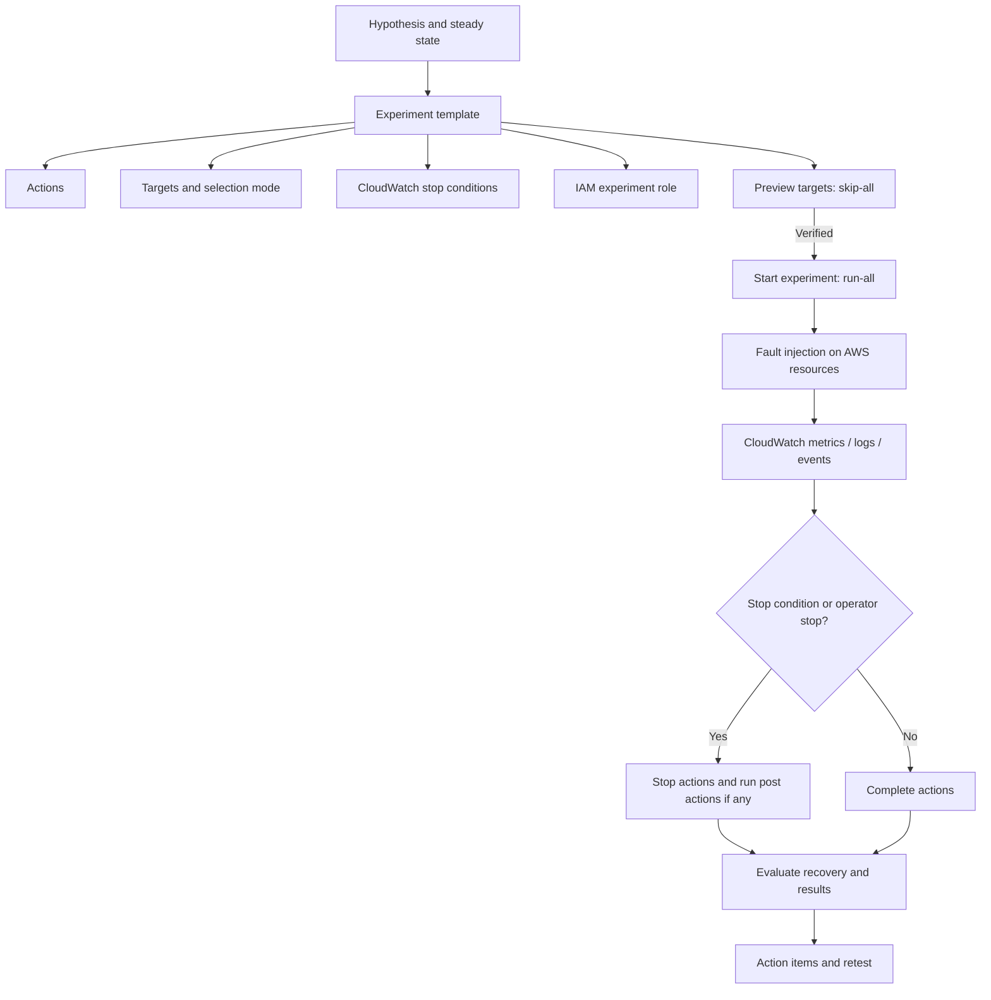

# AWS Fault Injection Service and Chaos Experiments

A distributed system may perform well when all components are healthy, yet fail when an Availability Zone loses connectivity, an EC2 instance stops, database failover is slow, or an API returns throttling errors. These conditions are difficult to reproduce with standard unit or integration tests. If an organization waits for real incidents to observe system behavior, it may discover too late that retry storms, timeouts, queue backlogs, or failover mechanisms do not work as expected.

AWS Fault Injection Service (AWS FIS) is a managed service for running fault injection experiments on real AWS resources. FIS lets you introduce controlled disruptions—such as stopping EC2 instances, injecting API errors, adding network latency, dropping packets, stopping ECS tasks, or triggering Aurora failover. Operations teams observe the application's response, compare it against a hypothesis, and improve resilience before similar failures impact users.

Within the AWS ecosystem, AWS FIS integrates with Amazon CloudWatch alarms, CloudTrail, EventBridge, IAM, Amazon S3, EC2, ECS, EKS, RDS/Aurora, EBS, Lambda, Kinesis, and networking services. A safe experiment must clearly define the objective, target resource scope, actions, duration, execution permissions, stop conditions, and recovery procedures. FIS provides the execution engine and guardrails; application teams remain responsible for hypotheses, monitoring, operational procedures, and evaluating results.

## Learning Objectives

After this lesson, you will be able to:

- Explain chaos engineering, fault injection, hypotheses, and steady state.
- Distinguish between an AWS FIS experiment, experiment template, action, target, and stop condition.
- Choose appropriate FIS actions for EC2, ECS, EKS, RDS, EBS, Lambda, and networking.
- Design targets using resource IDs, tags, filters, parameters, and selection modes.
- Configure experiment roles using least-privilege IAM and service-linked roles.
- Create CloudWatch alarms as stop conditions and use the Safety Lever to halt all experiments in a Region.
- Distinguish action duration, post actions, rollbacks, and unrecoverable faults.
- Create, preview, start, monitor, and stop experiments using the AWS Console or CLI.
- Use logging, CloudTrail, EventBridge, and experiment reports to gather evidence.
- Design controlled multi-account experiments and game days.
- Evaluate results against SLOs, RTO/RPO, error rates, latency, and recovery behavior.

## Chaos Engineering and Fault Injection

Chaos engineering is the practice of validating system resilience by proactively introducing controlled disruptions. The goal is not to inject random failures just to see whether the system crashes; the goal is to test a specific hypothesis about system behavior and use the findings to improve design.

Example hypothesis:

> If one EC2 instance in the Auto Scaling group is stopped, the Application Load Balancer and Auto Scaling will shift traffic to healthy instances; the error rate will not exceed 1% and p95 latency will remain below 800 ms during instance replacement.

An experiment requires:

1. **Hypothesis:** an explicit prediction of what will happen when a fault is injected.
2. **Steady state:** normal application behavior measured by technical and business metrics.
3. **Blast radius:** the scope of impacted resources, such as a single instance or a percentage of tasks.
4. **Fault injection:** the action creating the disruption.
5. **Observation:** measuring system behavior during and after the experiment.
6. **Stop/rollback:** halting the experiment or recovering when thresholds are breached.
7. **Learning:** documenting weaknesses, remediation items, and retesting.

### How Fault Injection Differs from Functional Testing

| Test Type | Primary Question | Example |
|---|---|---|
| Unit test | Does a function handle inputs/outputs properly? | Retry function increases backoff per configuration |
| Integration test | Do components communicate properly? | Service writes data to DynamoDB |
| Load/stress test | How much load can the system sustain? | Ramp requests to 5,000 RPS |
| Failover test | Does switching to a standby component work? | Aurora fails over to a reader instance |
| Fault injection/chaos experiment | How does the system respond when a dependency fails? | Block connectivity between a subnet and S3 |
| Game day | How do people, runbooks, and systems coordinate during an incident? | Simulate losing an AZ with the on-call team |

These methods complement each other. Fault injection does not replace unit tests, load tests, or disaster recovery tests; it validates a different layer of resilience assumptions.

## What Is AWS Fault Injection Service?

AWS FIS is a managed service for creating and orchestrating fault injection experiments against real AWS resources. It provides a library of predefined actions per resource type, target selection mechanisms, IAM execution roles, CloudWatch stop conditions, and progress tracking.

FIS acts on real AWS resources. Stopping EC2 instances, blocking networking, stopping ECS tasks, or failing over databases can impact live workloads. Therefore, start in test/pre-production environments with a small scope and full monitoring before expanding into controlled production experiments.

### Core Concepts

| Concept | Meaning | Example |
|---|---|---|
| Experiment template | Blueprint describing the full experiment | Stop one EC2 instance for 3 minutes |
| Experiment | A specific execution run from a template | Run on Nov 20 with resolved targets |
| Action | Activity that injects a fault or supports the experiment | `aws:ec2:stop-instances` |
| Target | Group of resources an action impacts | Instances tagged `ChaosEligible=true` |
| Selection mode | How many resources to pick from the target set | `COUNT(1)`, `PERCENT(25)`, `ALL` |
| Stop condition | CloudWatch alarm that causes FIS to stop the experiment | Alarm when HTTP 5xx rate exceeds 2% |
| Experiment role | IAM role assumed by FIS to perform actions | Role scoped to stop/start only designated instances |
| Post action | Recovery action after the fault duration ends | Restart EC2 after stop duration |
| Safety Lever | Switch that stops all experiments in an account/Region | Engage during an unexpected application incident |



An experiment template can execute actions sequentially or in parallel. An action can reference another action via `startAfter`; if unspecified, an action can begin immediately when the experiment starts. FIS resolves all targets before running the action set. If targets fail to resolve, the experiment can fail according to `emptyTargetResolutionMode`.

## Experiment Template Components

### Actions

An action is the operation FIS performs on targets. Each action includes:

- `actionId`: the action identifier supported by AWS FIS, e.g., `aws:ec2:stop-instances`.
- `parameters`: parameters such as duration, percentage, port, or fault type.
- `targets`: target name matching the action's resource type.
- `startAfter`: list of actions that must complete before the current action begins.
- `description`: description of the action's purpose so operators understand its impact.

Actions can run sequentially or in parallel. Each action name must be unique within an experiment; to run the same action ID multiple times, add multiple action entries with distinct names.

### Targets

Targets define the set of resources FIS is allowed to act upon. You can specify:

- Specific resource ARNs/IDs.
- Resource tags.
- Resource filters based on attributes such as VPC, state, or Availability Zone.
- Resource parameters supported by the action.
- Selection mode to pick all or a subset of resolved resources.

Targets are resolved at the start of the experiment and held fixed for the duration of the experiment. If no targets are found, the experiment fails by default. Avoid overly broad tags like `Environment=production` without narrowing by application or fault eligibility.

### Selection Mode

| Mode | Meaning | Example |
|---|---|---|
| `ALL` | Impact all resolved resources | Stop all 3 test instances |
| `COUNT(n)` | Randomly select exactly n resources | `COUNT(1)` selects one instance |
| `PERCENT(n)` | Randomly select a percentage | `PERCENT(25)` selects 25% of targets |

When resource counts do not divide evenly, FIS rounds down for `PERCENT`. For instance, 50% of 5 instances selects 2. If the percentage yields fewer than one resource, zero targets are selected and the experiment may fail. If multiple target definitions cover the same resource type, the same resource could be selected multiple times in some configurations; review target design before running.

### Stop Conditions

A stop condition references a CloudWatch alarm. When the alarm enters the ALARM state during an experiment, FIS halts the experiment. Examples:

- HTTP 5xx rate exceeds threshold.
- p95/p99 latency exceeds SLO.
- Healthy target count drops below minimum.
- Queue age or retry count exceeds limits.
- Database connections, replication lag, or error rate exceed thresholds.

Alarms must be built on metrics representing steady state with appropriate evaluation periods. Overly sensitive alarms may stop every experiment due to brief noise; overly slow alarms may allow faults to persist beyond acceptable tolerance. FIS supports up to 5 stop conditions per template under current default quotas.

Example stop condition configuration:

```json
{
  "stopConditions": [
    {
      "source": "aws:cloudwatch:alarm",
      "value": "arn:aws:cloudwatch:ap-southeast-1:111122223333:alarm/checkout-high-error-rate"
    }
  ]
}
```

If a template uses no stop conditions, configure `source: none`. For experiments capable of impacting critical services, create alarms and verify they trigger properly before running.

## Commonly Used Action Groups

AWS FIS provides actions across many services. Available actions, resource types, parameters, and IAM permissions can evolve; use `list-actions` and `get-action` to verify before authoring templates.

| Service/Group | Example Actions | What Can Be Verified |
|---|---|---|
| EC2 | `aws:ec2:stop-instances`, `reboot-instances`, `terminate-instances`, Spot interruptions | Auto Scaling, health checks, failover, checkpointing, and instance recovery |
| Auto Scaling | Inject `InsufficientInstanceCapacity` into launch requests | Handling capacity shortages and scale-out failures |
| ECS | `aws:ecs:stop-task`, `aws:ecs:drain-container-instances`, `aws:ecs:task-cpu-stress`, `aws:ecs:task-network-latency` | Service scheduler, task replacement, circuit breakers, and health checks |
| EKS | `aws:eks:pod-delete`, `aws:eks:pod-cpu-stress`, `aws:eks:pod-memory-stress`, `aws:eks:pod-network-packet-loss` | Kubernetes probes, replica scheduling, PDBs, autoscaling, and service mesh |
| RDS/Aurora | `aws:rds:failover-db-cluster`, reboot DB instance | Connection retries, DNS refresh, failover, connection pools, and recovery time |
| EBS | `aws:ebs:pause-volume-io`, `aws:ebs:volume-io-latency` | Storage timeouts, queueing, and application behavior under slow volumes |
| Network | Disrupt subnet connectivity, VPC endpoints, or cross-Region routes | Resilience to connectivity loss, dependency fallbacks, and retries |
| Lambda | `aws:lambda:invocation-add-delay`, `aws:lambda:invocation-error`, `aws:lambda:invocation-http-integration-response` | Retries, DLQs/destinations, timeouts, API integration, and idempotency |
| Kinesis | Expired iterator or provisioned throughput exceptions | Consumer recovery, retry/backoff, and checkpointing |
| DynamoDB/MemoryDB | Pause replication in global/multi-Region tables | Replication lag, consistency, and failover behavior |
| IAM/API | Inject API internal, throttling, or unavailable errors into target role requests | SDK retries, backoff, circuit breakers, and quota handling |
| Systems Manager | `aws:ssm:send-command` with an appropriate document | Custom faults on EC2/managed nodes within allowed scope |

### Example: EC2 Stop and Restart

The `aws:ec2:stop-instances` action calls `StopInstances` on target EC2 instances. You can set `startInstancesAfterDuration` so FIS automatically restarts them after a duration between 1 minute and 12 hours. If EBS volumes are encrypted, the experiment role needs the appropriate KMS permissions to restart the instances.

Not every action self-recovers. `terminate-instances` is destructive; terminated instances cannot be restored by a post action. Spot interruptions may leave instances stopped depending on interruption behavior; action documentation defines post-interruption state. Always read the action reference before assuming automatic cleanup.

### Example: Network Disruption

The `aws:network:disrupt-connectivity` action clones a Network ACL, adds deny rules, and associates that ACL with the subnet for the duration of the action. When the action finishes, FIS deletes the cloned ACL and restores the original association. Supported scopes can include intra-AZ traffic, DynamoDB, S3, VPC, or prefix lists per supported parameters.

This action has a broad blast radius if the target subnet hosts multiple workloads. Target subnets dedicated to the test application, check NACL quotas, and maintain an independent administrative access path so you do not lock yourself out of operations.

### Example: RDS Failover

`aws:rds:failover-db-cluster` invokes `FailoverDBCluster` on an Aurora DB cluster (and compatible cluster types listed in the action reference). This experiment tests:

- Whether the application reconnects when the writer endpoint shifts to a new instance.
- Whether DNS caches and connection pools refresh the endpoint.
- Whether retries avoid causing a request storm.
- How in-flight transactions are handled when connections drop.
- Whether recovery time meets RTO.

Do not use a failover test as a substitute for backup/restore or full-Region disaster recovery testing. It tests a database cluster failover scenario.

### Custom Faults via Systems Manager

AWS FIS provides `aws:ssm:send-command` to send an SSM document to managed nodes. This supports custom faults when built-in actions do not cover the scenario under test. Ensure nodes are managed by Systems Manager, documents are reviewed, commands are time-bounded with cleanup, and the IAM role permits only the required documents/targets. Never run arbitrary commands that could delete data or escalate privileges beyond the experiment objective.

## Designing Safe Experiments

AWS FIS executes real actions on real resources. Safe practice starts with a narrow scope and expands only with evidence.

### 1. Define Objective and Hypothesis

State the exact question to answer, e.g.: "If one ECS task is stopped, does the service maintain at least 2 healthy tasks and keep p95 latency under 500 ms?" Avoid vague goals like "test system resilience."

### 2. Define Steady State

Record baseline metrics before the experiment:

- Request rate and error rate.
- p50/p95/p99 latency.
- Healthy host/task/pod count.
- CPU, memory, disk I/O, and network.
- Queue depth/age, retry count, and timeouts.
- Database connection count, replication lag, and failover metrics.
- Business metrics such as checkout success, login success, or completed transactions.

Choose metrics that reflect user impact and can drive CloudWatch alarms. An experiment watching only CPU without measuring transaction success rate can miss business impact.

### 3. Choose Environment and Blast Radius

Start in sandbox or pre-production sized closely to production. Use dedicated tags like `ChaosEligible=true`, `Application=orders`, and `Environment=staging` for exact targeting. Begin with `COUNT(1)` or `PERCENT(5)` rather than `ALL`. Verify target preview before starting.

If running in production, require change approval, on-call notification, a low-risk window, customer impact criteria, a rollback runbook, and stop conditions. Never run experiments during an ongoing incident unless the incident commander explicitly decides to use FIS as part of incident response.

### 4. Prepare Recovery and Rollback

Before running, determine:

- Whether the action automatically expires after its duration or requires a post action.
- Whether any actions are irreversible, such as terminating instances or deleting resources.
- Whether data is checkpointed/snapshotted/backed up.
- Whether operators can access systems if a network fault occurs.
- Whether manual steps are required for recovery.
- Whether the account/Region Safety Lever is accessible and who is authorized to engage it.

FIS supports post actions for certain actions; post actions run after the action duration. Not all actions support them. Stopping an experiment or engaging the Safety Lever does not automatically undo every side effect; check action-specific cleanup and runbooks.

### 5. Prepare Alarms and Logging

Build a CloudWatch dashboard covering baseline, injection, and recovery. Create stop-condition alarms ahead of time. Enable experiment logging to CloudWatch Logs or S3 if detailed traces are required. FIS logging is off by default; log destinations may incur costs.

### 6. Preview Targets and Verify Permissions

Run the experiment with `actionsMode=skip-all` to inspect target resolution and validate logging setup. Preview mode does not inject faults and does not prove the experiment role has permissions to execute the action. Review IAM policies and test with a small experiment in a test environment.

### 7. Run, Observe, and Stop on Time

Monitor action states, targets, CloudWatch metrics, logs, and business SLOs. If a stop condition triggers or an operator observes impact exceeding thresholds, stop the experiment and execute the recovery runbook. Do not wait until the experiment finishes to look at metrics.

### 8. Evaluate and Improve

Compare steady state against data during and after the experiment. Record hypothesis pass/fail, time to detect, time to recover, user impact, root causes, and action items. After fixing the system, re-run the same template or updated version to verify improvement.

## IAM and Execution Permissions

AWS FIS uses two distinct role layers:

- **Service-linked role `AWSServiceRoleForFIS`:** allows FIS to manage monitoring and resource selection. FIS uses the managed policy `AmazonFISServiceRolePolicy`.
- **Experiment role:** declared in the experiment template (`roleArn`), allowing FIS to perform actions on target resources.

The experiment role needs a trust policy allowing `fis.amazonaws.com` to assume it. Add `aws:SourceAccount` and `aws:SourceArn` conditions to mitigate confused deputy risks. The permission policy should grant only actions required for the experiment, scoped by ARN/tags and action condition keys where supported.

Abbreviated trust policy example:

```json
{
  "Version": "2012-10-17",
  "Statement": [
    {
      "Effect": "Allow",
      "Principal": { "Service": "fis.amazonaws.com" },
      "Action": "sts:AssumeRole",
      "Condition": {
        "StringEquals": {
          "aws:SourceAccount": "111122223333"
        },
        "ArnLike": {
          "aws:SourceArn": "arn:aws:fis:ap-southeast-1:111122223333:experiment/*"
        }
      }
    }
  ]
}
```

This illustrates the trust relationship; source ARN conditions must match the ARN format and how FIS assumes roles per current documentation. Action permission policies should be authored specifically from the action reference. Never attach a managed policy spanning all services if the experiment only stops one EC2 instance.

Users creating or starting experiments need appropriate FIS permissions and `iam:PassRole` to pass the experiment role. Restrict `iam:PassRole` to specific roles and the `fis.amazonaws.com` service. For actions requiring KMS, SSM, ECS, EKS, or network permissions, check dependent permissions in the action reference.

### Permissions for Multi-Account Experiments

A multi-account experiment has an orchestrator account owning the template/experiment and target accounts containing impacted resources. FIS uses role chaining:

1. FIS assumes the orchestrator experiment role.
2. The orchestrator role is permitted to assume target account roles.
3. Target account roles have permissions to execute actions on resources in their respective accounts.
4. Trust policies across accounts and FIS must match.

Use consistent tags across accounts to target the same workload tier. When targeting by Availability Zone across multiple accounts, use AZ IDs rather than AZ names because AZ names can map differently between accounts. Cross-account stop conditions require configuring CloudWatch cross-account alarms.

## Stop Conditions and Safety Lever

### Stop Conditions

A stop condition is a guardrail attached to a specific experiment template. When the CloudWatch alarm reaches ALARM state, FIS stops the experiment. Stop conditions fit application-specific thresholds, such as a service's error rate or latency.

Stop conditions do not replace operator monitoring. Alarms can lack metrics, be misconfigured, or react slower than fault propagation. Test alarms by generating an appropriate test state and confirming FIS receives the alarm state.

### Safety Lever

Each AWS account has one Safety Lever per Region. When the lever is `engaged`:

- Running experiments in that account/Region are stopped.
- New experiments are prevented from starting and may end in `cancelled` state.
- Stopped/cancelled experiments cannot be resumed; after disengaging, a new run must be started from the template.

The Safety Lever is useful during unexpected incidents or when an organization needs to freeze all chaos experiments in a Region. Permissions to engage/disengage should be restricted to incident commanders or authorized operations teams. The Safety Lever stops experiments but does not guarantee reversal of irreversible actions; always inspect resource states and recovery runbooks.

CLI examples:

```bash
# Check Safety Lever state
aws fis get-safety-lever --id default

# Engage: stop running experiments and block new runs
aws fis update-safety-lever-state \
  --id default \
  --state "status=engaged,reason=application-incident"

# Disengage after the incident is resolved
aws fis update-safety-lever-state \
  --id default \
  --state "status=disengaged,reason=incident-resolved"
```

## Experiment Logging, Monitoring, and Reporting

### Tracking States

Common experiment states:

| State | Meaning |
|---|---|
| `pending` | Experiment is waiting to launch |
| `initiating` | FIS is preparing the experiment and resolving targets |
| `running` | Actions are executing |
| `completed` | All actions finished successfully |
| `stopping` | Experiment is stopping due to alarm or operator request |
| `stopped` | Running/pending actions have been stopped |
| `failed` | Experiment failed due to configuration, permissions, target, or dependent service errors |
| `cancelled` | Experiment was cancelled, e.g., Safety Lever engaged |

Action states can include `pending`, `initiating`, `running`, `completed`, `cancelled`, `skipped`, `stopping`, `stopped`, and `failed`. An experiment state of `completed` only means actions executed per template; it does not automatically prove the resilience hypothesis passed. Inspect metrics and business outcomes.

### CloudWatch and EventBridge

CloudWatch measures application impact and tracks FIS usage/quotas. Create dashboards with timestamps marking before, during, and after the experiment. EventBridge emits events when experiment states change; route these to SNS, Lambda, or workflows to notify teams and automatically create tickets.

CloudTrail logs FIS API calls and related control-plane changes. For multi-account experiments, check CloudTrail in both orchestrator and target accounts.

### Experiment Logging

Experiment logging is disabled by default. Logs can be sent to CloudWatch Logs or S3. Logs contain experiment start/end events, target resolution, action start/end/errors, resolved targets, and states. The current log schema is version 2; detailed fields depend on `log_type` and `target_type`.

Log delivery to S3/CloudWatch Logs incurs charges from the destination service. If an S3 bucket uses a customer managed KMS key, the experiment role needs appropriate KMS permissions. Restrict log access because logs can expose ARNs, resource names, and infrastructure topology.

### Experiment Reports

FIS can generate a PDF report after a successful experiment. The report summarizes actions and can include a snapshot of one CloudWatch dashboard, highlighting start/end timestamps along with pre-/post-experiment metric windows. Reports are saved to S3 and downloadable from the FIS console. Only one CloudWatch dashboard can be included per report; the report bucket must reside in the same Region as the experiment.

Reports are not generated for `cancelled` experiments or target previews with `actionsMode=skip-all`. Use experiment logs to investigate failed experiments; reports primarily serve as audit evidence and summaries of completed runs. You can use S3 Object Lock to protect reports under audit policies.

## Creating and Running an Experiment with the AWS CLI

The example below tests Auto Scaling recovery by randomly stopping one EC2 instance tagged `ChaosEligible=true` in staging. The action automatically restarts the instance after 3 minutes. The template includes a CloudWatch alarm stop condition.

### 1. Create the Experiment Template JSON

Create `ec2-stop-experiment.json`:

```json
{
  "description": "Stop one staging instance and verify application recovery",
  "targets": {
    "testInstances": {
      "resourceType": "aws:ec2:instance",
      "resourceTags": {
        "Environment": "staging",
        "ChaosEligible": "true"
      },
      "selectionMode": "COUNT(1)"
    }
  },
  "actions": {
    "stopOneInstance": {
      "actionId": "aws:ec2:stop-instances",
      "description": "Stop one tagged staging EC2 instance",
      "parameters": {
        "startInstancesAfterDuration": "PT3M"
      },
      "targets": {
        "Instances": "testInstances"
      }
    }
  },
  "stopConditions": [
    {
      "source": "aws:cloudwatch:alarm",
      "value": "arn:aws:cloudwatch:ap-southeast-1:111122223333:alarm/staging-high-5xx-rate"
    }
  ],
  "roleArn": "arn:aws:iam::111122223333:role/FISStagingExperimentRole",
  "tags": {
    "Application": "orders",
    "Environment": "staging",
    "Owner": "platform-team"
  },
  "experimentOptions": {
    "accountTargeting": "single-account",
    "emptyTargetResolutionMode": "fail"
  }
}
```

Substitute the account ID, Region, alarm ARN, role ARN, and tags for your environment. Resource tags in this example are combined with AND: an instance must carry both tags. Do not use tag selectors if tagging is ungoverned; target preview is a mandatory step in the operational workflow.

### 2. Create the Template

```bash
aws fis create-experiment-template \
  --cli-input-json file://ec2-stop-experiment.json
```

The response returns `experimentTemplate.id`. Record the ID and verify the template with `get-experiment-template` before running.

### 3. Preview Targets Without Injecting Faults

```bash
aws fis start-experiment \
  --experiment-template-id EXTxxxxxxxxxxxxxxx \
  --experiment-options actionsMode=skip-all
```

`skip-all` runs target resolution while skipping all actions. Inspect the list of resolved targets and logging. Preview does not confirm the experiment role has sufficient permissions to inject faults; still review IAM and test in a non-production environment.

### 4. Start the Real Experiment

```bash
aws fis start-experiment \
  --experiment-template-id EXTxxxxxxxxxxxxxxx \
  --experiment-options actionsMode=run-all
```

Save `experiment.id` from the response for tracking. `run-all` is the default mode when omitted; specify it explicitly in automation to avoid confusion with preview runs.

### 5. Monitor and Stop the Experiment

```bash
aws fis get-experiment --id EXPxxxxxxxxxxxxxxx

aws fis list-experiments \
  --experiment-template-id EXTxxxxxxxxxxxxxxx

aws fis stop-experiment \
  --id EXPxxxxxxxxxxxxxxx
```

When stopping an experiment, FIS completes any unfinished post actions before halting if configured on the action. Stopped or failed experiments cannot be resumed; start a new experiment from the same template after addressing the root cause.

### 6. List Actions and Inspect Details

```bash
aws fis list-actions

aws fis get-action \
  --id aws:ec2:stop-instances
```

In PowerShell, JSON arguments must be escaped per shell syntax; you can use JSON files or proper quoting. `get-action` shows current resource types, parameters, and required permissions. This is a good check before adopting new actions or updating templates.

## Multi-Account Experiments

Large applications often span multiple AWS accounts: networking account, database account, application account, and observability account. Multi-account experiments allow an orchestrator account to run one template impacting resources across multiple target accounts.

The model consists of:

- **Orchestrator account:** owns the template/experiment and coordinates execution.
- **Target account:** holds the impacted resources.
- **Target account configuration:** declares the account ID, role ARN, and description per account.
- **Role chaining:** FIS assumes the orchestrator role; the orchestrator role assumes the target account role; the target role executes the action.

Best practices:

- Use consistent tag naming across target accounts.
- Use AZ IDs instead of AZ names when targeting by AZ across accounts.
- Grant scoped permissions per target account and action.
- Enable CloudTrail in all accounts.
- Configure CloudWatch cross-account alarms for aggregated stop conditions.
- Notify teams owning target accounts; FIS may display notifications in the AWS Health dashboard of impacted target accounts.

Multi-account experiments fit game days for multi-account systems, provided IAM trusts and stop permissions are prepared in each account. The Safety Lever in the account/Region where the experiment runs stops that experiment; to halt experiments independently in target accounts, consider the corresponding Safety Levers in the relevant accounts/Regions.

## Real-World Scenario: Resilience Testing an Order Application

An order system comprises an Application Load Balancer, an ECS service on EC2, an Aurora cluster, ElastiCache, and Kinesis Data Streams. The operations team wants to verify the application keeps serving when a task stops, the database fails over, or connectivity to a dependency drops.

### Experiment A: Stop One ECS Task

**Hypothesis:** If one task is stopped, the ECS service scheduler launches a replacement task; healthy task count stays at least two and p95 latency remains under 700 ms.

Design:

1. Target ECS tasks using staging-specific tags/criteria.
2. Run `aws:ecs:stop-task` with `COUNT(1)`.
3. Configure stop condition alarms on 5xx rate or healthy task count below threshold.
4. Monitor ECS service desired/running counts, deployment events, ALB target health, and p95 latency.
5. Inspect task replacement time and in-flight requests when the task stopped.

### Experiment B: Aurora Failover

**Hypothesis:** If the writer fails over, the application reconnects within 30 seconds, retries do not create a storm, and transactions are not duplicated.

Design:

1. Select a staging Aurora cluster with writer/reader topology matching production.
2. Run `aws:rds:failover-db-cluster`.
3. Monitor failover events, connection errors, database connections, application retries, transaction rollbacks, and API latency.
4. Verify connection pools refresh DNS and evict stale connections.
5. Reconcile completed transactions against the source of truth to detect duplicate/lost writes.

### Experiment C: Loss of Connectivity to S3

**Hypothesis:** If a worker group's subnet loses its path to S3, workers retry with backoff, avoid retry storms, and route failed requests to a durable queue.

Design:

1. Use a dedicated subnet for staging workers.
2. Run `aws:network:disrupt-connectivity` with scope `s3` for a short duration.
3. Monitor S3 request errors, worker retries, queue age, dead-letter count, and throughput.
4. Trigger a stop condition if queue age breaches SLA or error rate exceeds threshold.
5. Confirm the original NACL association is restored when the action ends and workers drain the backlog.

### Evaluating Results

| Metric | Expectation | Outcome to Record |
|---|---|---|
| HTTP 5xx | Does not exceed configured threshold | Peak, duration, and recovery time |
| p95 latency | Within SLO or recovers within RTO | Time elevation started and returned to baseline |
| Healthy tasks/targets | Always above minimum | Lowest count and replacement time |
| Database reconnect | Within 30 seconds | Connection errors, retry count, and failover duration |
| Queue age | Does not breach SLA | Backlog peak and drain time |
| Duplicate/lost transactions | Zero duplicates/losses | Reconciliation against source of truth |

The outcome is never just "experiment completed." If the hypothesis fails, create action items: tune health checks, timeouts, retries, connection pools, queue durability, autoscaling, or dependency fallbacks. After fixing, re-run the experiment under the same conditions to prove improvement.

## Cost, Quotas, and Limits

AWS FIS charges based on action execution duration and target account counts per current pricing. Beyond FIS fees, experiments can generate EC2, EBS, networking, CloudWatch Logs, S3, database, or other service charges. Logging and PDF reports can also incur CloudWatch/S3 costs.

Some default Regional quotas currently published in AWS documentation:

| Quota | Default Limit |
|---|---:|
| Experiment templates | 500 |
| Concurrent active experiments | 5 |
| Actions per experiment template | 20 |
| Concurrent running actions in an experiment | 10 |
| Stop conditions per template | 5 |
| Single action duration | Up to 12 hours |
| Single experiment duration | Up to 12 hours |
| Completed experiment data retention in FIS | 120 days |

These are reference quotas from documentation at the time of writing; verify Service Quotas and FIS quotas for your account/Region before planning. Specific target limits depend on the action and resource type.

## Troubleshooting

| Symptom / Error | Common Cause | Resolution |
|---|---|---|
| `AuthorizationFailure` | Experiment role lacks action/target permissions; service-linked role creation blocked by SCP | Inspect action permissions, trust policy, `iam:PassRole`, SCPs, and `AWSServiceRoleForFIS` |
| `InvalidTarget` | Wrong ARN, non-matching tags, deleted resource, or target not bound to action | Inspect resolved targets, tag keys/values, and resource types |
| `ConfigurationFailure` | Wrong action parameters, incompatible target type, or template schema error | Use `get-action`, read `location`/error details, and fix schema |
| `DependentServiceFailure` | Target service API errored or throttled | Check service health, CloudTrail, and retry after identifying root cause |
| `QuotaExceededFailure` | Exceeded FIS quotas or target service quotas | Check FIS quotas, EC2/RDS/CloudWatch quotas, and action limits |
| Experiment `failed` immediately on start | Empty target resolution or role cannot be assumed | Preview with `skip-all`, verify role and target scope |
| Experiment `running` while action `pending` | Action waiting on `startAfter` or predecessor still executing | Inspect dependency graph and duration of preceding action |
| Stop condition did not trigger | Alarm using wrong metric/dimension, alarm not in ALARM, or missing cross-account access | Check alarm history, metric dimensions, and cross-account sharing |
| Network action did not recover | NACL association/cleanup failed or out-of-band change intervened | Inspect ACL tagged `managedByFIS=true`, associations, and experiment logs; run recovery runbook |
| EC2 stopped and did not restart | Missing `startInstancesAfterDuration`, missing KMS permissions, or ASG terminated instance | Check action parameters, KMS grants, instance state, and Auto Scaling activity |
| Experiment `cancelled` | Safety Lever is engaged | Check Safety Lever, incident reason, and re-run only after authorization |

When investigating, prioritize experiment logs, action states, resolved targets, and CloudTrail. Do not rely solely on overall experiment status because one action may fail while others completed.

## Best Practices

- Start in test/pre-production using a small target set.
- Write quantitative hypotheses before creating templates.
- Define steady state using both technical and business metrics.
- Use dedicated tags for chaos experiments and run target previews before every execution.
- Prefer `COUNT(1)` or a small percentage before increasing blast radius.
- Attach CloudWatch stop conditions and test alarms prior to experiments.
- Use least-privilege experiment roles; never grant permissions to modify every resource in the account.
- Use post actions when supported; maintain runbooks for non-rollbackable actions.
- Distinguish between stopping an experiment, engaging the Safety Lever, and recovering resources; they are not equivalent.
- Enable experiment logging and archive reports when audit evidence is needed.
- Use AZ IDs in multi-account experiments.
- Never run fault injection during an active incident without incident commander approval.
- Measure recovery time, error budgets, retry storms, queue backlogs, and duplicate/lost data.
- Track action items with owners, deadlines, and retesting after fixes.
- Check action references, Region support, IAM permissions, pricing, and quotas before adopting new actions.

## Production Readiness Checklist

- [ ] Identify application owner, incident commander, on-call engineer, and experiment approver.
- [ ] Review architecture, dependency map, outage history, and recovery runbooks.
- [ ] Write hypotheses with quantitative thresholds and steady-state metrics.
- [ ] Configure deployment targets, tags, filters, and selection modes with a small blast radius.
- [ ] Verify target preview using `actionsMode=skip-all`.
- [ ] Verify experiment role trust policy, least privilege, and `iam:PassRole`.
- [ ] Verify service-linked role `AWSServiceRoleForFIS` and SCPs.
- [ ] Create CloudWatch stop-condition alarms and verify alarm history.
- [ ] Define action durations, post actions, cleanup, and manual recovery plans.
- [ ] Confirm Safety Lever availability in the account/Region and engage/disengage permissions.
- [ ] Enable experiment logging, CloudTrail, dashboards, and EventBridge/SNS notifications.
- [ ] Run in test environments, then staging; expand to production only with approval.
- [ ] Monitor action states, resolved targets, latency, error rate, and business metrics.
- [ ] Stop the experiment if thresholds are breached or unexpected incidents occur.
- [ ] Archive PDF reports/logs, record hypothesis pass/fail, and capture action items.
- [ ] Retest after remediation; update template versions and runbooks.
- [ ] Verify FIS quotas, action quotas, service quotas, and costs before scaling up.

## Conclusion

AWS Fault Injection Service helps validate resilience by running controlled fault injection actions on real AWS resources. Experiment templates combine actions, targets, stop conditions, and IAM experiment roles; target selection governs blast radius; and CloudWatch alarms plus the Safety Lever provide stopping mechanisms. FIS supports many resource groups—such as EC2, ECS, EKS, RDS, EBS, Lambda, Kinesis, and networking—though rollback capabilities vary by action. A sound workflow begins with quantitative hypotheses, baselines, test environments, target previews, least-privilege IAM, monitoring, and recovery plans. Afterward, teams evaluate SLOs/RTO, log weaknesses, and re-run post-remediation to turn findings into concrete reliability improvements.

## References

- [What is AWS Fault Injection Service?](https://docs.aws.amazon.com/fis/latest/userguide/what-is.html)
- [Planning your AWS FIS experiments](https://docs.aws.amazon.com/fis/latest/userguide/getting-started-planning.html)
- [AWS FIS experiment template components](https://docs.aws.amazon.com/fis/latest/userguide/experiment-templates.html)
- [Actions for AWS FIS](https://docs.aws.amazon.com/fis/latest/userguide/action-sequence.html)
- [AWS FIS Actions reference](https://docs.aws.amazon.com/fis/latest/userguide/fis-actions-reference.html)
- [Targets for AWS FIS](https://docs.aws.amazon.com/fis/latest/userguide/targets.html)
- [Stop conditions for AWS FIS](https://docs.aws.amazon.com/fis/latest/userguide/stop-conditions.html)
- [Safety Levers for AWS FIS](https://docs.aws.amazon.com/fis/latest/userguide/safety-lever.html)
- [Experiment options for AWS FIS](https://docs.aws.amazon.com/fis/latest/userguide/experiment-options.html)
- [IAM roles for AWS FIS experiments](https://docs.aws.amazon.com/fis/latest/userguide/getting-started-iam-service-role.html)
- [Use service-linked roles for AWS FIS](https://docs.aws.amazon.com/fis/latest/userguide/using-service-linked-roles.html)
- [Monitoring AWS FIS experiments](https://docs.aws.amazon.com/fis/latest/userguide/monitoring-experiments.html)
- [Experiment logging for AWS FIS](https://docs.aws.amazon.com/fis/latest/userguide/monitoring-logging.html)
- [Experiment report configurations](https://docs.aws.amazon.com/fis/latest/userguide/experiment-report-configuration.html)
- [Working with multi-account experiments](https://docs.aws.amazon.com/fis/latest/userguide/multi-account.html)
- [Quotas and limitations for AWS FIS](https://docs.aws.amazon.com/fis/latest/userguide/fis-quotas.html)
- [Troubleshooting AWS FIS](https://docs.aws.amazon.com/fis/latest/userguide/troubleshooting.html)
- [AWS Fault Injection Service pricing](https://aws.amazon.com/fis/pricing/)
