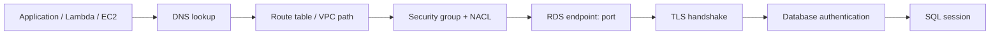

# Diagnosing RDS Connectivity, Query Locks, and DynamoDB Throttling

When applications access databases on AWS, failures commonly appear in three forms: inability to open connections to Amazon RDS, queries waiting on transactions or locks, and requests to Amazon DynamoDB being throttled. All three symptoms can slow down or break an API together, yet their root causes and fixes differ.

Effective diagnosis identifies the exact failing layer before altering configuration. For RDS, verify instance status, endpoint, DNS, port, VPC routes, security groups, network ACLs, TLS, authentication, and connection limits. Once connected yet queries run slow, distinguish lock waits from CPU, I/O, or execution plans. For DynamoDB, inspect `ThrottlingReasons` and the resource ARN to see whether requests are constrained by a partition key range, provisioned throughput, account quotas, or a user-configured maximum throughput.

This lesson belongs to the `CLOUD_PROVIDERS_AWS` module, connecting RDS, DynamoDB, VPC, IAM, CloudWatch, Database Insights, and distributed applications. After this lesson, you will be able to:

- Classify RDS failures into network, DNS, TLS, authentication, connection exhaustion, and engine availability.
- Test the path from applications to RDS using the AWS CLI, DNS lookups, and TCP/TLS probes.
- Use metrics, logs, and Database Insights to separate slow queries from lock contention.
- Find blocking sessions in RDS for PostgreSQL and RDS for MySQL/Aurora MySQL.
- Choose safe remediations for lock waits, deadlocks, and idle-in-transaction sessions.
- Read `ThrottlingReasons` and ARNs in DynamoDB exceptions.
- Distinguish hot partitions, provisioned throughput, account quotas, and on-demand maximum throughput.
- Monitor CloudWatch metrics, use Contributor Insights, and design retries/backoff.
- Build a runbook covering verification, remediation, and post-incident checks.

## 1. Start by Classifying Symptoms

Do not start by immediately upsizing instances, widening security groups, or raising throughput. First classify which failure category you are facing.

| Symptom | Cause Group to Inspect | Initial Evidence |
|---|---|---|
| Socket timeout opening connection to RDS | DNS, routing, SGs, NACLs, firewalls, endpoint/port | DNS lookup, TCP test, VPC config |
| Connected yet login fails | Username/password, IAM DB auth, TLS, database/user grants | Error code, auth logs, TLS settings |
| Connection refused or too many connections | DB status, port listener, `max_connections`, connection churn | RDS events, `DatabaseConnections`, engine process list |
| Long-running queries, sessions in waiting state | Locks, CPU, I/O, networking, or query plans | Wait events, active sessions, blocking queries |
| Transactions deadlocked | Inconsistent lock ordering, concurrent writes | Deadlock logs/engine diagnostics |
| DynamoDB throws throttling exceptions | Partitions, table/GSI capacity, account quotas, or configured maximum | `ThrottlingReasons`, resource ARN |
| DynamoDB errors affect only specific keys | Hot partitions or skewed access patterns | Contributor Insights and key distribution |
| Batch writes return `UnprocessedItems` | Capacity or partition pressure | Unprocessed count, retry metrics |

Collect application logs, CloudWatch metrics, RDS events, and DynamoDB exceptions across the exact same time window. Record UTC timestamps, Region, account, DB identifier/table name, request IDs, query fingerprints, client identity, and recent deployments. Never write passwords, tokens, or sensitive data into incident logs.

## 2. Diagnosing Amazon RDS Connectivity Layer by Layer

A connection to RDS traverses multiple layers:

1. The application uses the right endpoint and port.
2. DNS resolves the endpoint to an IP.
3. Route tables direct traffic to the right VPC/subnet or inter-VPC link.
4. Security groups permit traffic to the database port.
5. Network ACLs and firewalls allow both outbound and return traffic.
6. The TLS handshake succeeds if required.
7. The database accepts the connection and authenticates the user.
8. The database has remaining connection slots and capacity to serve the workload.



If TCP cannot connect, do not investigate SQL grants or locks yet. If TCP/TLS succeeds yet login is rejected, switch to authentication. If login succeeds yet queries run slow, switch to query performance and lock diagnosis.

## 3. Verifying Status, Endpoint, and Port

Retrieve endpoints and status from RDS instead of hardcoding IPs. Endpoint DNS can resolve to a different address after failover or infrastructure changes.

AWS CLI:

```bash
aws rds describe-db-instances \
  --db-instance-identifier orders-db \
  --region ap-southeast-1 \
  --query 'DBInstances[0].{Status:DBInstanceStatus,Endpoint:Endpoint.Address,Port:Endpoint.Port,Public:PubliclyAccessible,AZ:AvailabilityZone,SecurityGroups:VpcSecurityGroups[*].VpcSecurityGroupId}'
```

For Aurora DB clusters, retrieve writer/reader endpoints via `describe-db-clusters`:

```bash
aws rds describe-db-clusters \
  --db-cluster-identifier orders-cluster \
  --region ap-southeast-1 \
  --query 'DBClusters[0].{Status:Status,WriterEndpoint:Endpoint,ReaderEndpoint:ReaderEndpoint,Port:Port}'
```

Verify:
- Is `DBInstanceStatus` in an available state?
- Does the endpoint match the intended DB instance/cluster and environment?
- Does the port match the engine and actual configuration?
- Is the instance public or private per design?
- Which security groups are attached to the DB?
- Are the subnet group and AZ appropriate?

Common default ports:

| Engine | Typical Default Port |
|---|---:|
| RDS for PostgreSQL | 5432 |
| RDS for MySQL / MariaDB | 3306 |
| RDS for SQL Server | 1433 |
| RDS for Oracle | 1521 |

Ports can be customized at DB creation. Always use `Endpoint.Port` from the RDS API or console.

## 4. Testing DNS and TCP from the Application's Exact Location

Test connectivity from the exact subnet, security group, and runtime as the failing application. Testing from an admin laptop can yield different results if the laptop traverses a VPN, Direct Connect, or public network.

On Linux:

```bash
nslookup orders-db.abcdefghijk.ap-southeast-1.rds.amazonaws.com
nc -vz orders-db.abcdefghijk.ap-southeast-1.rds.amazonaws.com 5432
```

On Windows PowerShell:

```powershell
Resolve-DnsName orders-db.abcdefghijk.ap-southeast-1.rds.amazonaws.com
Test-NetConnection orders-db.abcdefghijk.ap-southeast-1.rds.amazonaws.com -Port 5432
```

Interpretation:
- DNS lookup fails: check endpoint, VPC DNS resolution/hostnames, resolvers, and client network DNS config.
- DNS succeeds yet TCP times out: check routes, SGs, NACLs, firewalls, peering/TGW/VPN, and subnets.
- TCP reports connection refused: verify endpoint/port, DB status, and listener; also check whether a proxy or firewall sends resets.
- TCP succeeds yet TLS/login fails: check CA bundles, hostname verification, auth, and database grants.

Never rely solely on `ping` as evidence. ICMP can be blocked while the database TCP port works normally.

## 5. Security Groups, NACLs, and Route Tables

### 5.1. Security Groups

Security groups are stateful firewalls. For private DBs, create an inbound rule on the database port sourcing the application tier's security group rather than opening broad CIDRs.

Examples:
- RDS PostgreSQL inbound TCP 5432 from `sg-app`.
- RDS MySQL inbound TCP 3306 from `sg-worker`.
- Application security group allows matching outbound traffic to the DB port.

A DB security group never needs `0.0.0.0/0` inbound to troubleshoot connectivity errors. Widening sources increases exposure and can mask routing or source identity errors.

### 5.2. Network ACLs

NACLs are stateless. You must allow both request and response directions, including the DB port inbound/outbound as needed and ephemeral ports on the return path per network configuration. An NACL allowing the DB port inbound while blocking ephemeral return traffic will still break connections.

### 5.3. Route Tables and Cross-VPC Connectivity

If the application and RDS reside in different VPCs, verify:
- VPC peering or Transit Gateway attachments are `active`.
- Route tables on both sides route to the opposite CIDR.
- CIDRs do not overlap.
- SGs/NACLs permit exact sources/destinations.
- DNS resolution over peering is enabled if using private DNS endpoints.
- Never assume VPC peering supports transitive routing.

For VPN or Direct Connect, check route propagation, BGP, on-premises firewalls, and return paths. Network paths must be bidirectional.

## 6. Public Accessibility and Private Connectivity

`PubliclyAccessible=true` is only part of Internet reachability; you also need subnet routes through an Internet Gateway, security groups permitting the source, and matching network conditions. For production databases, keep RDS in private subnets and allow access only from application tiers, VPNs, controlled bastions, or private network links.

Never toggle a DB to publicly accessible just for a "quick test." If administrative access is needed, use VPN/SSM/bastions or a temporary tightly scoped compute instance inside the VPC. Remove or revoke temporary paths immediately afterward.

## 7. TLS, Certificates, and Authentication

A successful TCP connection does not prove TLS or database authentication is valid.

Check:
- Does the client use a CA bundle matching the current RDS CA?
- Does the hostname in the connection string match the endpoint certificate?
- Does the client enforce hostname verification rather than encrypting without verifying server identity?
- Do DB parameters/engine settings require SSL/TLS?
- Does the secret in Secrets Manager match the active username/password?
- If using IAM database authentication, was the token generated for the right endpoint, port, Region, and user; remember tokens are short-lived and passed as the password when connecting.

PostgreSQL example enforcing TLS verification:

```bash
psql "host=orders-db.abcdefghijk.ap-southeast-1.rds.amazonaws.com port=5432 dbname=orders user=app_user sslmode=verify-full sslrootcert=global-bundle.pem connect_timeout=5"
```

MySQL example:

```bash
mysql --host=orders-db.abcdefghijk.ap-southeast-1.rds.amazonaws.com \
  --port=3306 --user=app_user \
  --ssl-mode=VERIFY_IDENTITY --ssl-ca=global-bundle.pem
```

Never disable TLS verification as a permanent workaround. If errors follow certificate rotation, update trust stores and client drivers on schedule rather than dropping hostname verification.

## 8. Connection Exhaustion and RDS Connection Limits

Applications can reach the database over the network yet fail to obtain sessions when the DB nears or hits `max_connections`. Every connection consumes resources; setting the limit too high raises memory pressure and context switching.

Common causes:
- Opening a new connection per request without closing it.
- Sudden Lambda concurrency spikes where each execution environment builds its own pool.
- Application connection pool max size set too high.
- Long-lived or idle transactions/connections.
- Scaling workers without scaling DB capacity correspondingly.
- Post-failover reconnect storms from all clients at once.

### 8.1. Checking Connections in PostgreSQL

```sql
SELECT
    current_setting('max_connections')::int AS max_connections,
    count(*) AS current_connections,
    count(*) FILTER (WHERE state = 'idle') AS idle_connections,
    count(*) FILTER (WHERE state = 'idle in transaction') AS idle_in_transaction
FROM pg_stat_activity;
```

Locate sessions holding long-running transactions:

```sql
SELECT
    pid,
    usename,
    application_name,
    client_addr,
    state,
    now() - xact_start AS transaction_age,
    wait_event_type,
    wait_event,
    left(query, 200) AS recent_query
FROM pg_stat_activity
WHERE xact_start IS NOT NULL
ORDER BY xact_start;
```

### 8.2. Checking Connections in MySQL

```sql
SHOW GLOBAL STATUS LIKE 'Threads_connected';
SHOW GLOBAL STATUS LIKE 'Max_used_connections';
SHOW VARIABLES LIKE 'max_connections';
SHOW FULL PROCESSLIST;
```

Compare current and peak connections against the limit. Inspect users, hosts, and connection states to identify which pool holds sessions. Never increase `max_connections` without checking memory and workload concurrency.

### 8.3. Connection Pooling and RDS Proxy

Use connection pooling in applications to reuse sessions. For workloads creating many short-lived connections—especially bursting Lambda functions or microservices—Amazon RDS Proxy pools and shares backend database connections.

RDS Proxy reduces connection churn and shields the DB from oversubscription. It does not speed up slow queries, resolve lock contention, or expand the DB's SQL execution capacity.

Metrics/settings to monitor:
- `ClientConnections`: client connections into the proxy.
- `DatabaseConnections`: proxy connections to the database.
- `MaxDatabaseConnectionsAllowed`: backend connection cap allowed to the workload by the proxy.
- `DatabaseConnectionsBorrowLatency`: time clients wait to borrow a backend connection.
- `MaxConnectionsPercent`, `MaxIdleConnectionsPercent`, `ConnectionBorrowTimeout`.

If borrow latency rises and the pool hits max, inspect connection utilization, transaction duration, pinning, concurrency, and headroom. Do not simply raise `MaxConnectionsPercent`; the database still has finite resources.

## 9. Using CloudWatch and Database Insights for RDS

Once connectivity is verified, inspect metrics over the exact incident window:

| Metric/Signal | Used to Detect |
|---|---|
| `DatabaseConnections` | Rising connection counts or nearing limits |
| `CPUUtilization` | CPU saturation or CPU-heavy queries |
| `FreeableMemory` | Memory pressure |
| `FreeStorageSpace` | Storage exhaustion |
| `ReadLatency`, `WriteLatency` | I/O latency |
| `ReadIOPS`, `WriteIOPS` | Read/write activity levels |
| `DiskQueueDepth` | Growing I/O queues |
| Database load / wait events | Sessions waiting on CPU, locks, I/O, or other resources |
| RDS events | Failover, reboots, maintenance, or DB status changes |

Database Insights/Performance Insights breaks down DB load by wait events and SQL. A single wait event alone is not automatically an incident; inspect proportions, durations, trends, and top SQL. If DB load is high while CPU stays low, many sessions are likely waiting on locks or I/O.

Enhanced Monitoring provides OS-level visibility such as CPU, memory, processes, and disk. Combine it with engine statistics rather than inferring causes from one metric alone.

## 10. Distinguishing Lock Waits from Slow Queries

Locks ensure consistency when multiple transactions access the same data. A lock wait happens when one transaction waits for another transaction to release a compatible lock. Lock waits are not synonymous with deadlocks.

| Phenomenon | Symptom | Diagnostic Focus |
|---|---|---|
| Lock wait | Session waits on a lock held by another transaction | Blocking PID/thread, lock type, transaction age |
| Deadlock | Two or more transactions form a wait cycle | Deadlock logs and operation ordering |
| CPU-bound query | Active sessions wait on CPU or high CPU | SQL plans, indexes, cardinality, parallelism |
| I/O-bound query | I/O wait events, rising latency/queue depth | Storage, scan volume, cache, query plans |
| Connection pressure | Many idle/active sessions, too many connections errors | Pool sizing, leaks, concurrency |
| Client/network wait | DB waits on client or client slowly consumes results | Network, result sizes, client processing |

A single query can both hold locks and wait on I/O or clients. Identify which session is blocking and which sessions are blocked, transaction age, SQL statements, and application owners.

## 11. Diagnosing Query Locks in RDS for PostgreSQL

PostgreSQL uses MVCC. Normal readers do not block writers and writers do not block readers; row-level conflicts typically involve writes or explicit locking such as `UPDATE`, `SELECT ... FOR UPDATE`, and `SELECT ... FOR KEY SHARE`.

The `Lock:transactionid` wait event indicates a transaction is waiting on a row-level lock held by another transaction. A common cause is a session in `idle in transaction` state: an earlier SQL statement finished yet the transaction never ran `COMMIT`/`ROLLBACK`, keeping locks held.

### 11.1. Finding Blocked and Blocking Sessions

```sql
SELECT
    blocked.pid AS blocked_pid,
    blocked.usename AS blocked_user,
    now() - blocked.query_start AS blocked_query_age,
    blocked.wait_event_type,
    blocked.wait_event,
    left(blocked.query, 200) AS blocked_query,
    blocker.pid AS blocker_pid,
    blocker.usename AS blocker_user,
    now() - blocker.xact_start AS blocker_transaction_age,
    blocker.state AS blocker_state,
    left(blocker.query, 200) AS blocker_query
FROM pg_stat_activity AS blocked
JOIN LATERAL unnest(pg_blocking_pids(blocked.pid)) AS p(blocker_pid)
    ON true
JOIN pg_stat_activity AS blocker
    ON blocker.pid = p.blocker_pid
WHERE blocked.wait_event_type = 'Lock'
ORDER BY blocked.query_start;
```

Interpreting output:
- `blocked_pid`: session unable to proceed.
- `blocker_pid`: session holding the obstructing lock.
- `blocker_state = idle in transaction`: transaction opened yet the application never committed or rolled back.
- `blocker_transaction_age`: older transactions mean locks may be held longer.

One blocker can block many sessions. Find the root blocker in the chain before terminating sessions.

### 11.2. Inspecting Locks and Long Transactions

```sql
SELECT
    pid,
    locktype,
    mode,
    granted,
    relation::regclass AS relation,
    transactionid
FROM pg_locks
WHERE NOT granted
ORDER BY pid;
```

To view active sessions, transaction ages, and wait states, use `pg_stat_activity`. Combining `pg_locks` with `pg_blocking_pids` avoids manually reconstructing the entire lock graph.

### 11.3. Resolving Blockers in PostgreSQL

Preferred order:
1. Identify the application owner and transaction holding the lock.
2. If the application is still healthy, let it finish `COMMIT`/`ROLLBACK` or fix code to shorten transactions.
3. If one specific query runs overly long while the transaction must stay, consider canceling the query after assessing impact.
4. Terminate the backend only after clearly identifying the session and accepting rollback impact.

`pg_cancel_backend(pid)` requests canceling the active query; the session may remain open. If the query ran inside an explicit transaction, the transaction enters an aborted state and the application must `ROLLBACK` to release transaction locks. `pg_terminate_backend(pid)` kills the session and rolls back uncommitted transactions, which can take time and add load. Require appropriate permissions; never mass-terminate sessions blindly.

## 12. Diagnosing Locks in RDS for MySQL and Aurora MySQL

InnoDB uses row-level locking and metadata locks. Transactions wait on row locks when updating the same rows; DDL or metadata operations can wait on metadata locks.

### 12.1. Checking InnoDB Status

```sql
SHOW ENGINE INNODB STATUS\G
```

Inspect `TRANSACTIONS`, `LATEST DETECTED DEADLOCK`, and lock wait details. Output identifies waiting transactions, lock types, tables/indexes, and SQL queries involved.

### 12.2. Viewing Lock Waits in Performance Schema

On MySQL versions supporting Performance Schema lock tables:

```sql
SELECT
    w.REQUESTING_ENGINE_TRANSACTION_ID AS waiting_trx,
    rl.OBJECT_SCHEMA,
    rl.OBJECT_NAME,
    rl.INDEX_NAME,
    rl.LOCK_MODE AS waiting_lock_mode,
    w.BLOCKING_ENGINE_TRANSACTION_ID AS blocking_trx,
    bl.LOCK_MODE AS blocking_lock_mode,
    bl.LOCK_TYPE AS blocking_lock_type
FROM performance_schema.data_lock_waits AS w
JOIN performance_schema.data_locks AS rl
    ON w.ENGINE = rl.ENGINE
   AND w.REQUESTING_ENGINE_LOCK_ID = rl.ENGINE_LOCK_ID
JOIN performance_schema.data_locks AS bl
    ON w.ENGINE = bl.ENGINE
   AND w.BLOCKING_ENGINE_LOCK_ID = bl.ENGINE_LOCK_ID;
```

You need read privileges on Performance Schema and must verify table/column names for your engine version. On older versions, lock instrumentation schemas differ. If tables are missing or permissions are lacking, start with `SHOW ENGINE INNODB STATUS`, `SHOW FULL PROCESSLIST`, and Performance Insights/Database Insights.

### 12.3. Resolving Blockers in MySQL

- `KILL QUERY <processlist_id>` stops the active query while keeping the connection open; inside explicit transactions, check and `COMMIT`/`ROLLBACK` properly because the transaction may still hold locks.
- `KILL CONNECTION <processlist_id>` closes the connection; uncommitted transactions roll back.
- `innodb_lock_wait_timeout` governs how long InnoDB waits for a row lock.
- Deadlocks are detected by InnoDB, which picks one transaction as victim; applications must retry the entire rolled-back transaction.

Never raise lock wait timeouts to mask long blockers. Investigate transaction owners, index access paths, update ordering, and transaction scope before adjusting timeouts.

## 13. Common Causes of Lock Contention

- Keeping transactions open too long or holding transactions across external API calls.
- Multiple requests updating the same hot row, such as an inventory counter or account balance.
- Transactions updating multiple tables in inconsistent order, causing deadlocks.
- Missing indexes causing `UPDATE`/`DELETE` statements to lock or scan far more rows than expected.
- Oversized batch updates holding locks for extended periods.
- Broad use of `SELECT ... FOR UPDATE`.
- DDL, `VACUUM FULL`, materialized view refreshes, or maintenance competing for locks.
- Connections stuck in `idle-in-transaction` because the application failed to commit or roll back.

### 13.1. Reducing Contention

- Keep transactions short and never make network/API calls inside transactions.
- Update rows in a consistent order across threads.
- Add appropriate indexes for `UPDATE`/`DELETE` predicates.
- Split large batches into smaller chunks with commit boundaries.
- Reduce concurrency on the same business key.
- Use optimistic locking/version columns where appropriate.
- Use queues to serialize operations requiring strict per-entity ordering.
- Configure transaction/statement/idle-in-transaction timeouts aligned with SLAs.
- Re-measure lock waits and deadlock rates after changes.

Never clear locks by terminating sessions before confirming whether they are executing critical business work.

## 14. Deadlocks and Lock Timeouts

Deadlocks occur when transaction A holds a lock needed by B while B holds a lock needed by A. The database detects the cycle and aborts one transaction to break it.

Example:
- Transaction A updates account 1 then account 2.
- Transaction B updates account 2 then account 1.
- Both transactions can block each other indefinitely.

Ways to reduce deadlocks:
- Always update resources in a consistent lock order.
- Keep transactions small.
- Use indexes and precise predicates.
- Avoid user interaction or network calls inside transactions.
- Retry the entire rolled-back transaction with bounded attempts and jitter.
- Log deadlock details to identify conflicting SQL pairs.

A lock timeout usually indicates a transaction waited longer than allowed; it is not necessarily a deadlock. Raising timeouts only makes requests wait longer and holds more connections open. Fix the blocker or reduce contention instead.

## 15. What Is DynamoDB Throttling?

DynamoDB throttling occurs when requests exceed throughput limits or protective limits on a table, index, partition, or account. DynamoDB throttles proactively to protect performance and control consumption.

Throttling can affect:
- Provisioned capacity tables.
- On-demand capacity tables.
- Global Secondary Indexes (GSIs).
- Specific key ranges/partitions.
- User-configured maximum throughput caps.
- Account-level regional quotas.

Key point: spare total table capacity does not guarantee every partition key range can absorb a traffic spike. A hot key can be throttled while other partitions sit lightly loaded.

## 16. Reading `ThrottlingReasons` and Resource ARNs

Newer DynamoDB throttling exceptions can include a `ThrottlingReasons` list. Each entry provides:
- `reason`: code combining resource type, operation type, and limit type.
- `resource`: ARN of the impacted table or index.

Reason structure:

```text
<ResourceType><OperationType><LimitType>
```

| Component | Value | Meaning |
|---|---|---|
| ResourceType | `Table` or `Index` | Table or GSI being throttled |
| OperationType | `Read` or `Write` | Read or write operation |
| LimitType | `KeyRangeThroughputExceeded` | Partition/key range overloaded |
| LimitType | `ProvisionedThroughputExceeded` | Exceeded provisioned RCU/WCU |
| LimitType | `AccountLimitExceeded` | Exceeded account-level throughput quota |
| LimitType | `MaxOnDemandThroughputExceeded` | Exceeded configured on-demand maximum throughput |

Examples:
- `TableWriteKeyRangeThroughputExceeded`: writes to a table key range hit limits.
- `IndexWriteProvisionedThroughputExceeded`: writes to a GSI exceeded the index's provisioned WCU.
- `TableReadAccountLimitExceeded`: reads on an on-demand table hit the account quota.
- `IndexReadMaxOnDemandThroughputExceeded`: reads on a GSI exceeded user-configured maximum throughput.

Resource ARNs pinpoint the exact table or index. Do not stop at inspecting the exception class like `ProvisionedThroughputExceededException`; read every reason and ARN, especially when writes update a base table plus one or more GSIs.

## 17. Four Throttling Cause Categories and How to Fix Them

| Category | When It Happens | Remediation Approach |
|---|---|---|
| Key range throughput exceeded | One partition/key range receives concentrated traffic | Find hot keys, redesign partition keys, write sharding, distribute access |
| Provisioned throughput exceeded | Total reads/writes exceed provisioned RCU/WCU | Increase capacity, enable/tune auto scaling, reduce requests/bytes |
| Account limit exceeded | On-demand table/GSI hits account regional throughput quota | Check quotas, distribute load, or request quota increase |
| On-demand maximum throughput exceeded | Workload exceeds user-configured maximum throughput | Adjust maximum throughput if budget and quotas permit |

Raising RCU/WCU does not fix a hot key. Switching to on-demand does not eliminate partition-level throughput limits. Raising maximum throughput cannot bypass account quotas. Choose fixes matching the exact `LimitType`.

## 18. Detecting Hot Partitions and Hot Keys

Hot partitions typically result from one partition key receiving excessive requests or skewed key distributions. Examples:
- All devices writing to partition key `status=ACTIVE`.
- Every page view incrementing a counter on a single item.
- One large tenant generating most traffic.
- A shared partition key paired with a monotonically increasing sort key, or skewed keys concentrating access on one key range.

Use CloudWatch Contributor Insights for DynamoDB to identify the most frequently accessed or throttled keys. Select throttled-keys view to focus on failing keys; use accessed-and-throttled keys to compare overall traffic against throttling.

### 18.1. Designing Better Partition Keys

A good partition key distributes traffic evenly and matches access patterns. Techniques:
- Use high-cardinality keys with even distribution.
- Avoid a single fixed value for most writes.
- Partition by tenant/device/entity when access patterns permit.
- Use write sharding when a single logical key must absorb heavy writes.
- Spread reads using caches or materialized aggregates.
- Evaluate GSI partition keys independently; the base table may distribute well while a GSI still runs hot.

Write sharding example:
- Replace `PK = DAILY_COUNTER#2026-11-20`
- With `PK = DAILY_COUNTER#2026-11-20#SHARD#00..15`

The application picks a shard on writes and reads/aggregates across shards when needed. The trade-off is greater query and aggregation complexity. Size shard counts around real throughput and scaling needs.

### 18.2. When Raising Capacity Does Not Help

If `ThrottlingReason` is `KeyRangeThroughputExceeded`, raising total table capacity may not solve the problem. You must distribute keys/access patterns. For sequential key-range scans, rate-limit scans and use parallel segmented scans where appropriate to spread load.

## 19. Provisioned Throughput, On-Demand, and GSIs

### 19.1. Provisioned Mode

When `ProvisionedThroughputExceeded` appears:
- Compare `ConsumedReadCapacityUnits` against `ProvisionedReadCapacityUnits`.
- Compare `ConsumedWriteCapacityUnits` against `ProvisionedWriteCapacityUnits`.
- Check whether the base table or a GSI is impacted.
- Inspect auto scaling policies, target utilization, scale-out delay, and traffic schedules.
- Reduce unnecessary reads/writes via query/key design, projections, caching, and batch APIs.

Auto scaling takes time to react; sudden bursts can hit before capacity scales out.

### 19.2. On-Demand Mode

On-demand adjusts capacity with traffic yet remains subject to account-level quotas, key range limits, and configured maximum throughput. Read the reason:
- `AccountLimitExceeded`: check Service Quotas and regional limits.
- `MaxOnDemandThroughputExceeded`: inspect maximum throughput settings on the table/GSI.
- `KeyRangeThroughputExceeded`: revisit partition keys/access patterns.

Never switch provisioned to on-demand blindly upon seeing throttling without diagnosing root cause. Changing billing modes does not fix hot partitions or inefficient query patterns.

### 19.3. GSI Throttling

Each GSI has its own partition key, projection, and capacity/access pattern. When writing items to a base table, DynamoDB must also update affected GSIs. A GSI can become a bottleneck even when the base table has ample capacity.

Check:
- Does the ARN in the exception end with `/index/<index-name>`?
- Read/write throttle metrics on the GSI.
- Does the GSI partition key have low cardinality?
- Does the projection store unnecessary attributes?
- Is a GSI backfill or index creation consuming write capacity?
- Can queries use another index or tighter key conditions?

Never raise only base table WCU when exceptions point to a throttled index.

## 20. CloudWatch Metrics for DynamoDB

Common metrics in the `AWS/DynamoDB` namespace:

| Metric | Meaning |
|---|---|
| `ThrottledRequests` | Requests with at least one throttled event |
| `ReadThrottleEvents` | Throttled read events |
| `WriteThrottleEvents` | Throttled write events |
| `ReadKeyRangeThroughputThrottleEvents` | Read throttles from partition/key range |
| `WriteKeyRangeThroughputThrottleEvents` | Write throttles from partition/key range |
| `ReadAccountLimitThrottleEvents` | Reads hitting account quota |
| `WriteAccountLimitThrottleEvents` | Writes hitting account quota |
| `ReadMaxOnDemandThroughputThrottleEvents` | Reads exceeding on-demand maximum |
| `WriteMaxOnDemandThroughputThrottleEvents` | Writes exceeding on-demand maximum |
| `ConsumedReadCapacityUnits` / `ConsumedWriteCapacityUnits` | Consumed capacity |
| `ProvisionedReadCapacityUnits` / `ProvisionedWriteCapacityUnits` | Provisioned capacity |

`ThrottledRequests` increments once per request if at least one internal event was throttled; thus it can undercount total throttled events. Cross-check `ReadThrottleEvents`, `WriteThrottleEvents`, and cause-specific metrics. For GSIs, include both `TableName` and `GlobalSecondaryIndexName` dimensions when viewing metrics.

Example fetching `ThrottledRequests`:

```bash
aws cloudwatch get-metric-statistics \
  --namespace AWS/DynamoDB \
  --metric-name ThrottledRequests \
  --dimensions Name=TableName,Value=CustomerOrders \
  --start-time 2026-11-20T00:00:00Z \
  --end-time 2026-11-20T01:00:00Z \
  --period 60 \
  --statistics Sum \
  --region ap-southeast-1
```

Align the time window with application errors. For GSI-scoped metrics, include the corresponding index name dimension.

## 21. Retries, Exponential Backoff, and Idempotency

Throttling is often a transient signal or a sign of mismatched capacity/access patterns. Retries can help requests succeed after load subsides, yet immediate retries amplify pressure and escalate outages.

Use exponential backoff with jitter:
1. Catch the throttling exception.
2. Check retryability and retry limits.
3. Wait progressively longer per attempt.
4. Add random jitter so clients do not retry in lockstep.
5. Cap total retry duration and attempt count.
6. If still failing, log reason/resource ARN and route to error handling or re-queueing.

AWS SDKs include built-in retry modes and backoff; prefer configuring SDK settings over writing custom infinite retry loops. Verify retry mode, max attempts, and behavior for your SDK version.

### 21.1. `BatchWriteItem` and `UnprocessedItems`

`BatchWriteItem` can return `UnprocessedItems` when part of a batch was not processed. Applications must retry only the remaining items with exponential backoff. Never re-send the entire batch if only a subset failed, unless operations are explicitly idempotent.

Similarly, `BatchGetItem` can return `UnprocessedKeys`. Retry unprocessed keys up to a bounded limit. Monitor unprocessed ratios to catch capacity or hot-key issues early.

### 21.2. Idempotency and Side Effects

Retries can send the same request multiple times. For writes:
- Use deterministic primary keys or request IDs.
- Use conditional expressions when creating items at most once.
- Design updates to be idempotent.
- For multi-item transactions, consider `TransactWriteItems` and client request tokens within supported limits.
- Never re-send notifications or payments solely because a DynamoDB request retried.

Backoff treats transient symptoms; idempotency protects correctness when requests repeat.

## 22. Inspecting Tables and Indexes with the AWS CLI

Inspect status, capacity mode, and GSIs:

```bash
aws dynamodb describe-table \
  --table-name CustomerOrders \
  --region ap-southeast-1 \
  --query 'Table.{Status:TableStatus,BillingMode:BillingModeSummary.BillingMode,Provisioned:ProvisionedThroughput,GSIs:GlobalSecondaryIndexes[*].{Name:IndexName,Status:IndexStatus,Provisioned:ProvisionedThroughput}}'
```

When throttled:
1. Extract the full exception from application logs.
2. Read all `ThrottlingReasons`.
3. Inspect resource ARNs to pinpoint table vs. GSI.
4. Inspect CloudWatch metrics for the exact resource and time window.
5. For key range issues, enable Contributor Insights and locate hot keys.
6. For provisioned capacity, compare consumed vs. provisioned capacity.
7. For account limits, inspect Service Quotas.
8. For max on-demand, inspect maximum throughput settings.
9. Apply a targeted change, re-measure, and confirm throttling drops.

## 23. RDS Connectivity Troubleshooting Runbook

### Phase A — Scope the Incident

- Is one application failing or are all clients failing?
- Is it isolated to one AZ/subnet or Region-wide?
- Did it start after deployment, secret rotation, failover, or maintenance?
- Is it DNS, TCP timeout, TLS, authentication, or too many connections?
- Is the RDS instance/cluster in an available state?

### Phase B — Check Networking

- Fetch endpoint/port from the RDS API.
- Resolve DNS from the failing runtime.
- Test TCP to the DB port.
- Check SG sources/destinations.
- Check bidirectional NACLs and ephemeral ports.
- Check route tables, peering/TGW/VPN, and CIDR overlap.
- Check public accessibility only if the architecture requires public access.

### Phase C — Check Database

- Verify TLS CA and hostname.
- Verify credentials/IAM DB auth.
- Check current connections vs. `max_connections`.
- Check RDS events, failover, and maintenance.
- Check connection pools, RDS Proxy, and borrow latency.
- Once logged in, run a simple query such as `SELECT 1`.

### Phase D — Recover and Verify

- Fix the exact misconfigured layer.
- Never widen SGs or disable TLS as a long-term workaround.
- Re-test from the actual application runtime.
- Confirm pools establish connections and queries succeed.
- Monitor connection counts, latency, and error rates post-fix.

## 24. RDS Lock Contention Runbook

1. Identify engine/version and the slow-query window.
2. Inspect Database Insights/Performance Insights: top SQL and wait events.
3. List active sessions, transaction ages, and wait states.
4. Use `pg_blocking_pids` for PostgreSQL or Performance Schema/InnoDB diagnostics for MySQL.
5. Identify the root blocker, application owner, and transaction age.
6. Check for `idle-in-transaction`, long transactions, batch updates, and lock ordering.
7. Cancel/terminate sessions only when impact is understood and approved.
8. Fix transaction boundaries, indexes, concurrency, or query plans.
9. Measure lock waits, deadlock rates, query latency, and DB load post-deployment.

Never terminate every session waiting on locks. Killing the wrong transaction can trigger heavy rollbacks or disrupt business operations.

## 25. DynamoDB Throttling Runbook

1. Capture the exception and read `ThrottlingReasons`.
2. Record the resource ARN and identify table vs. GSI.
3. Classify as `KeyRangeThroughputExceeded`, `ProvisionedThroughputExceeded`, `AccountLimitExceeded`, or `MaxOnDemandThroughputExceeded`.
4. Correlate cause-specific CloudWatch metrics.
5. For key range, enable Contributor Insights and locate hot keys/key ranges.
6. For provisioned, check consumed/provisioned capacity, auto scaling, and bursts.
7. For account limits, check regional quotas.
8. For on-demand maximum, check maximum throughput settings.
9. Ensure bounded retries/backoff/jitter and `UnprocessedItems` handling.
10. Adjust keys/indexes/capacity per root cause, then verify throttle events and latency drop.

## 26. Real-World Scenario: Slow Order API with Concurrent RDS and DynamoDB Errors

A checkout API uses RDS PostgreSQL to store orders and DynamoDB to store cart state. Following a traffic surge, API latency spikes, some requests time out, and logs report DynamoDB throttling.

Investigation:
- RDS TCP probes succeed, yet `DatabaseConnections` climbs near the limit.
- Database Insights shows many sessions waiting on `Lock:transactionid`.
- `pg_stat_activity` reveals an `idle in transaction` session holding a row lock.
- DynamoDB exceptions report `TableWriteKeyRangeThroughputExceeded` with the Cart table ARN.
- Contributor Insights highlights a single partition key `tenant#global` receiving most writes.

Remediation:
- Fix application transactions to commit/roll back early and never hold transactions across external service calls.
- Reduce concurrency on the same order row and add connection pooling/RDS Proxy where appropriate.
- Redesign the DynamoDB key to spread writes; if one logical aggregate must concentrate traffic, apply write sharding and aggregate on reads.
- Keep retries bounded with exponential backoff and jitter.
- Re-check lock waits, DB connection utilization, hot keys, and throttling metrics.

Takeaway: upgrading the RDS instance class does not automatically release transaction locks; raising DynamoDB table capacity does not automatically split a hot key. Each symptom must be fixed at the right layer.

## 27. Common Mistakes

| Mistake | Why It Fails | Proper Fix |
|---|---|---|
| Opening RDS SG to all IPs | Increases risk and does not fix bad routes/DNS | Permit only required source security groups/CIDRs |
| Hardcoding static RDS IPs | Breaks after failover or endpoint changes | Use DNS endpoints and client re-resolution |
| Disabling TLS verification | Hides CA/hostname errors and weakens security | Update CA bundles and enforce verification |
| Raising `max_connections` immediately | Increases memory pressure and context switching | Pool connections, cut churn, and right-size |
| Using RDS Proxy to fix slow queries | Proxy does not add SQL execution capacity | Analyze query plans, wait events, and DB load |
| Terminating all blockers | Can trigger huge rollbacks and lost work | Identify root blocker and impact first |
| Checking only `ThrottledRequests` | Aggregate metric can undercount throttled events | Check cause-specific metrics and exceptions |
| Raising RCU/WCU for a hot key | Single partition can still overload | Redesign partition keys/sharding |
| Switching to on-demand to end all throttling | Does not remove partition/account/max limits | Read `ThrottlingReason` first |
| Retrying immediately without limits | Amplifies load and triggers retry storms | Bounded exponential backoff + jitter |
| Checking only the base table | A GSI may be the throttled resource | Check ARNs and metrics for the exact index |
| Skipping post-change verification | Unknown whether the failure is actually resolved | Monitor metrics and business success rates |

## 28. Operations Checklist

### RDS Connectivity

- [ ] Confirm instance/cluster status, endpoint, and port.
- [ ] Test DNS from the exact application runtime.
- [ ] Test TCP to the database port.
- [ ] Verify security groups, NACLs, and bidirectional route tables.
- [ ] Verify VPC peering/TGW/VPN and zero CIDR overlap.
- [ ] Verify TLS CA, hostname verification, and authentication.
- [ ] Monitor `DatabaseConnections`, CPU, memory, and RDS events.
- [ ] Check pool sizing, connection leaks, and RDS Proxy if used.
- [ ] Use DNS endpoints for failover tolerance and reconnection.

### RDS Locks and Query Contention

- [ ] Identify engine/version and top wait events.
- [ ] Inspect active sessions and transaction ages.
- [ ] PostgreSQL: use `pg_stat_activity`, `pg_blocking_pids`, `pg_locks`.
- [ ] MySQL: use `SHOW ENGINE INNODB STATUS`, Performance Schema, and process lists.
- [ ] Identify root blockers before canceling/terminating.
- [ ] Check for `idle-in-transaction` and long-running transactions.
- [ ] Inspect indexes, query plans, and transaction ordering.
- [ ] Implement bounded whole-transaction retries for deadlocks.

### DynamoDB Throttling

- [ ] Capture exceptions, `ThrottlingReasons`, and resource ARNs.
- [ ] Distinguish tables from GSIs and reads from writes.
- [ ] Read cause-specific CloudWatch metrics.
- [ ] Enable Contributor Insights when suspecting hot keys.
- [ ] Review partition key distribution and GSI key design.
- [ ] Check provisioned capacity/auto scaling or on-demand limits/quotas.
- [ ] Retry with exponential backoff, jitter, and limits.
- [ ] Handle `UnprocessedItems`/`UnprocessedKeys`.
- [ ] Ensure idempotent writes and re-measure after changes.

## 29. Summary

RDS connectivity failures must be diagnosed from outside in: endpoint/DNS, routing, security groups, NACLs, TLS, authentication, connection limits, and database health. Testing from the actual runtime separates network timeouts from login errors. Connection pooling and RDS Proxy reduce connection pressure yet do not fix bad query plans or lock contention.

Lock waits occur when sessions wait on another transaction to release locks; deadlocks are wait cycles across multiple transactions. PostgreSQL provides `pg_stat_activity`, `pg_locks`, and `pg_blocking_pids`; MySQL provides InnoDB status and Performance Schema lock tables. Keep transactions short, enforce consistent update ordering, index properly, and resolve blockers carefully.

DynamoDB throttling falls into four primary categories: key range, provisioned throughput, account-level limits, and on-demand maximum throughput. Read `ThrottlingReasons` alongside resource ARNs to pinpoint the exact table/GSI and cause. Contributor Insights reveals hot keys; capacity scaling addresses total throughput shortages, while key redesign/write sharding resolves hot partitions. Retries must include backoff, jitter, bounds, and idempotency.

A strong runbook does not end once configuration changes. Re-verify using metrics, query latency, lock waits, throttle events, and request success rates; document root causes and preventive actions so future incidents resolve faster.

## References

- [Troubleshooting connection issues to your Amazon RDS DB instance](https://docs.aws.amazon.com/AmazonRDS/latest/gettingstartedguide/connecting-troubleshooting.html)
- [Troubleshooting for Amazon RDS](https://docs.aws.amazon.com/AmazonRDS/latest/UserGuide/CHAP_Troubleshooting.html)
- [Initial troubleshooting for common PostgreSQL performance issues in RDS for PostgreSQL](https://docs.aws.amazon.com/AmazonRDS/latest/UserGuide/PostgreSQL.InitialTroubleshooting.html)
- [RDS for PostgreSQL wait event: Lock:transactionid](https://docs.aws.amazon.com/AmazonRDS/latest/UserGuide/wait-event.locktransactionid.html)
- [RDS for PostgreSQL wait events](https://docs.aws.amazon.com/AmazonRDS/latest/UserGuide/PostgreSQL.Tuning.concepts.waits.html)
- [Aurora MySQL row lock wait](https://docs.aws.amazon.com/AmazonRDS/latest/AuroraUserGuide/ams-waits.row-lock-wait.html)
- [Aurora MySQL wait events](https://docs.aws.amazon.com/AmazonRDS/latest/AuroraUserGuide/AuroraMySQL.Reference.Waitevents.html)
- [Amazon RDS Proxy](https://docs.aws.amazon.com/AmazonRDS/latest/UserGuide/rds-proxy.html)
- [RDS Proxy connection considerations](https://docs.aws.amazon.com/AmazonRDS/latest/UserGuide/rds-proxy-connections.html)
- [Troubleshooting for RDS Proxy](https://docs.aws.amazon.com/AmazonRDS/latest/UserGuide/rds-proxy.troubleshooting.html)
- [Diagnosing throttling in Amazon DynamoDB](https://docs.aws.amazon.com/amazondynamodb/latest/developerguide/throttling-diagnosing-workflow.html)
- [DynamoDB throttling resolution guide](https://docs.aws.amazon.com/amazondynamodb/latest/developerguide/troubleshooting-throttling-diagnostics.html)
- [Troubleshooting throttling in Amazon DynamoDB](https://docs.aws.amazon.com/amazondynamodb/latest/developerguide/TroubleshootingThrottling.html)
- [CloudWatch throttling metrics for DynamoDB](https://docs.aws.amazon.com/amazondynamodb/latest/developerguide/TroubleshootingThrottling-cloudwatch.html)
- [Identifying hot keys using CloudWatch Contributor Insights](https://docs.aws.amazon.com/amazondynamodb/latest/developerguide/contributorinsights_HowItWorks.html)
- [Best practices for designing and using partition keys effectively](https://docs.aws.amazon.com/amazondynamodb/latest/developerguide/bp-partition-key-design.html)
