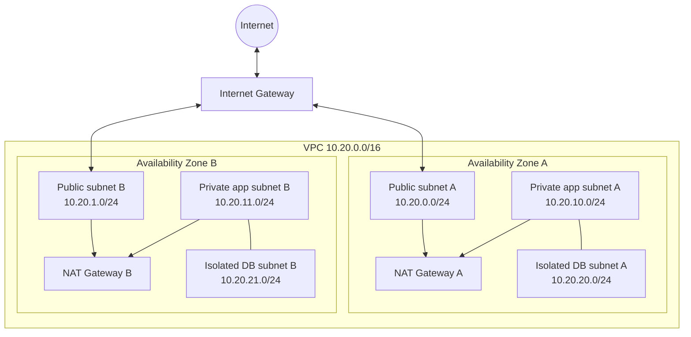

# Building a Two-AZ VPC with Public and Private Subnets

In this hands-on lab, you will build an Amazon VPC spanning two Availability Zones (AZs), consisting of two public subnets, two private application subnets, and two isolated database subnets. Public subnets use an Internet Gateway (IGW) for direct Internet traffic. Private application subnets use a NAT Gateway placed in the same AZ to proactively establish outbound connections when updating packages or calling public services. Database subnets only have the VPC internal route, with no default route to the Internet.

This architecture is a common foundation for multi-tier applications on AWS: load balancers or controlled bastions can sit in public subnets; application servers reside in private subnets; databases reside in isolated subnets. In production environments, consider AWS Systems Manager Session Manager instead of opening SSH, VPC endpoints for AWS services, and security controls required by your organization.

This lesson belongs to the **Foundational Hands-On Labs** chapter in the AWS module. Learners will work with Region/AZ, CIDR, subnet, route table, IGW, NAT Gateway, and security group; and understand how network components combine to form packet paths.

After this hands-on lab, you will be able to:

- Explain the roles of VPC, AZ, subnet, CIDR, route table, and gateway.
- Design non-overlapping IP addressing for two AZs.
- Create public, private application, and isolated database subnets.
- Configure an IGW and per-AZ NAT Gateways.
- Associate route tables with the right subnets and verify paths.
- Distinguish a public subnet from an EC2 instance's public IP.
- Apply security groups according to application traffic flows.
- Verify the configuration using the AWS CLI and clean up resources after the lab.

## 1. Target Architecture

### 1.1. Network Diagram



The diagram illustrates the default routes and logical network relationships. NAT Gateways are placed in public subnets; the private application subnet in AZ A routes outbound through NAT Gateway A, and AZ B through NAT Gateway B. Database subnets have no Internet route. The links between app and database represent internal communication via the VPC `local` route; security groups must still permit the required ports.

### 1.2. Role of Each Subnet

| Subnet | AZ A | AZ B | Purpose | Default route |
|---|---|---|---|---|
| Public | `10.20.0.0/24` | `10.20.1.0/24` | Load balancers, NAT Gateways, resources that truly require a public IP | `0.0.0.0/0` → IGW |
| Private application | `10.20.10.0/24` | `10.20.11.0/24` | EC2/ECS/EKS application nodes | `0.0.0.0/0` → NAT Gateway in the same AZ |
| Isolated database | `10.20.20.0/24` | `10.20.21.0/24` | RDS/database private endpoints or data tier | No Internet default route |

A subnet is called public when its route table has a route to an Internet Gateway. Instances in a public subnet still need a public IPv4 address or Elastic IP along with an appropriate security group to communicate directly with the Internet. Enabling auto-assign public IPv4 alone does not create an Internet path if the route table lacks an IGW.

Private subnets have no direct route to an IGW. A NAT Gateway allows instances to initiate outbound connections to the Internet; new inbound connections from the Internet are not forwarded by the NAT Gateway. Isolated subnets have no NAT/IGW default route, making them suitable for a database tier that does not require direct Internet connectivity.

### 1.3. Why Use Two NAT Gateways?

A NAT Gateway is highly available within a single AZ, but it is an AZ-specific resource. Placing one NAT Gateway in AZ A and sharing it across private subnets in both AZs creates a cross-AZ dependency and breaks outbound connectivity for AZ B if AZ A experiences an outage. It can also incur cross-AZ data transfer charges.

This lab creates one NAT Gateway per AZ and routes each private subnet to the NAT Gateway in the same AZ. This approach increases hourly and data-processing costs, but improves AZ independence. A single shared NAT Gateway can be a cost-saving option for a sandbox; you must accept the trade-offs in availability, cross-AZ costs, and failure domain.

## 2. Preparation Before Creating the VPC

### 2.1. Account and IAM Permissions

You need:

- An AWS account for the lab and permissions to manage Amazon VPC/EC2 networking.
- AWS CLI v2 installed on your machine.
- Credentials configured via IAM Identity Center, a role, or an organization-approved method.
- Permissions to create/delete VPCs, subnets, route tables, Internet Gateways, NAT Gateways, Elastic IPs, and security groups.
- Permissions to describe Availability Zones and call STS to confirm identity.

Do not use root access keys. Do not put access keys/secret keys in scripts, configuration files, or Git. If using AWS IAM Identity Center, sign in with `aws sso login --profile <PROFILE>` and add `--profile` to commands as needed.

### 2.2. Choosing a Region and Two AZs

The examples use Region `ap-southeast-1`. Verify that the Region is permitted by your organization and has at least two available AZs:

```bash
aws sts get-caller-identity

aws ec2 describe-availability-zones   --region ap-southeast-1   --filters Name=state,Values=available   --query "AvailabilityZones[].{Name:ZoneName,State:State,OptIn:OptInStatus}"   --output table
```

Select two AZs from the output and assign them to variables `AZ_A` and `AZ_B`. AZ names can map to different physical locations across AWS accounts; when coordinating across multiple accounts, use the AZ ID to identify the same physical location.

### 2.3. Tools and Environment Variables

The following commands use Bash on Linux/macOS, WSL, or CloudShell. Replace the AZs with the two names returned for your account:

```bash
export AWS_REGION="ap-southeast-1"
export AZ_A="ap-southeast-1a"
export AZ_B="ap-southeast-1b"
export NAME="vpc-two-az-lab"
export VPC_CIDR="10.20.0.0/16"
```

Verify the variables:

```bash
printf 'Region=%s\nAZ_A=%s\nAZ_B=%s\nVPC=%s\n'   "$AWS_REGION" "$AZ_A" "$AZ_B" "$VPC_CIDR"
```

The lab CIDR must not overlap with on-premises networks, VPC peering, Transit Gateway, or other VPCs you plan to connect. The VPC uses an IPv4 CIDR `/16`; each subnet uses `/24`. A VPC IPv4 subnet cannot be resized after creation, so address planning is required upfront.

## 3. IP Address Design

### 3.1. Address Plan

| Subnet | CIDR | AZ | Assignable IPv4 addresses for workloads |
|---|---|---|---:|
| Public A | `10.20.0.0/24` | AZ A | 251 |
| Public B | `10.20.1.0/24` | AZ B | 251 |
| App private A | `10.20.10.0/24` | AZ A | 251 |
| App private B | `10.20.11.0/24` | AZ B | 251 |
| DB isolated A | `10.20.20.0/24` | AZ A | 251 |
| DB isolated B | `10.20.21.0/24` | AZ B | 251 |

AWS reserves the first 4 and last 1 IPv4 addresses (5 total) in each subnet, so a `/24` subnet has 251 addresses assignable to interfaces. Do not assign overlapping child CIDRs. When additional AZs or tiers are needed, reserve address ranges using a clear convention, such as `/20` per AZ or per workload group.

### 3.2. Planned Route Tables

| Route table | Subnet associations | Routes |
|---|---|---|
| Public RT | Public A, Public B | VPC local; `0.0.0.0/0` → IGW |
| App RT A | App private A | VPC local; `0.0.0.0/0` → NAT A |
| App RT B | App private B | VPC local; `0.0.0.0/0` → NAT B |
| DB isolated RT | DB A, DB B | VPC local only |

A route table determines the next hop based on the destination address. Security groups and network ACLs determine whether traffic is permitted to pass. Having a route does not guarantee connectivity succeeds; both bidirectional routing and permissive policies are required.

## 4. Creating the VPC and Subnets

### 4.1. Creating the VPC

Create the VPC with CIDR `10.20.0.0/16`, and enable DNS resolution and DNS hostnames so workloads can use internal DNS:

```bash
VPC_ID=$(aws ec2 create-vpc   --region "$AWS_REGION"   --cidr-block "$VPC_CIDR"   --query 'Vpc.VpcId' --output text)

aws ec2 create-tags --region "$AWS_REGION"   --resources "$VPC_ID"   --tags Key=Name,Value="$NAME-vpc"

aws ec2 modify-vpc-attribute --region "$AWS_REGION"   --vpc-id "$VPC_ID" --enable-dns-support '{"Value":true}'

aws ec2 modify-vpc-attribute --region "$AWS_REGION"   --vpc-id "$VPC_ID" --enable-dns-hostnames '{"Value":true}'

echo "VPC_ID=$VPC_ID"
```

`enable-dns-support` enables DNS resolution within the VPC; `enable-dns-hostnames` allows assigning DNS hostnames to instances with public IPv4 addresses when the relevant conditions are met. Both attributes are commonly required for many AWS services and VPC endpoint private DNS.

### 4.2. Creating Six Subnets

Create each subnet in the chosen AZ. After each command, save the subnet ID into a variable for subsequent steps:

```bash
PUB_A=$(aws ec2 create-subnet --region "$AWS_REGION"   --vpc-id "$VPC_ID" --availability-zone "$AZ_A"   --cidr-block 10.20.0.0/24 --query 'Subnet.SubnetId' --output text)

PUB_B=$(aws ec2 create-subnet --region "$AWS_REGION"   --vpc-id "$VPC_ID" --availability-zone "$AZ_B"   --cidr-block 10.20.1.0/24 --query 'Subnet.SubnetId' --output text)

APP_A=$(aws ec2 create-subnet --region "$AWS_REGION"   --vpc-id "$VPC_ID" --availability-zone "$AZ_A"   --cidr-block 10.20.10.0/24 --query 'Subnet.SubnetId' --output text)

APP_B=$(aws ec2 create-subnet --region "$AWS_REGION"   --vpc-id "$VPC_ID" --availability-zone "$AZ_B"   --cidr-block 10.20.11.0/24 --query 'Subnet.SubnetId' --output text)

DB_A=$(aws ec2 create-subnet --region "$AWS_REGION"   --vpc-id "$VPC_ID" --availability-zone "$AZ_A"   --cidr-block 10.20.20.0/24 --query 'Subnet.SubnetId' --output text)

DB_B=$(aws ec2 create-subnet --region "$AWS_REGION"   --vpc-id "$VPC_ID" --availability-zone "$AZ_B"   --cidr-block 10.20.21.0/24 --query 'Subnet.SubnetId' --output text)

echo "PUB_A=$PUB_A PUB_B=$PUB_B"
echo "APP_A=$APP_A APP_B=$APP_B"
echo "DB_A=$DB_A DB_B=$DB_B"
```

Attach `Name` tags for easy identification in the console and in describe commands:

```bash
aws ec2 create-tags --region "$AWS_REGION"   --resources "$PUB_A" "$PUB_B" "$APP_A" "$APP_B" "$DB_A" "$DB_B"   --tags Key=Project,Value="$NAME"

aws ec2 create-tags --region "$AWS_REGION" --resources "$PUB_A" --tags Key=Name,Value="$NAME-public-a"
aws ec2 create-tags --region "$AWS_REGION" --resources "$PUB_B" --tags Key=Name,Value="$NAME-public-b"
aws ec2 create-tags --region "$AWS_REGION" --resources "$APP_A" --tags Key=Name,Value="$NAME-app-a"
aws ec2 create-tags --region "$AWS_REGION" --resources "$APP_B" --tags Key=Name,Value="$NAME-app-b"
aws ec2 create-tags --region "$AWS_REGION" --resources "$DB_A" --tags Key=Name,Value="$NAME-db-a"
aws ec2 create-tags --region "$AWS_REGION" --resources "$DB_B" --tags Key=Name,Value="$NAME-db-b"
```

### 4.3. Enabling Auto-Assign Public IPv4 for Public Subnets

Public subnets typically enable auto-assign public IPv4 if instances in the subnet need a public IPv4 address assigned by default. Private application and DB subnets keep the default of not auto-assigning public IPv4:

```bash
aws ec2 modify-subnet-attribute --region "$AWS_REGION"   --subnet-id "$PUB_A" --map-public-ip-on-launch

aws ec2 modify-subnet-attribute --region "$AWS_REGION"   --subnet-id "$PUB_B" --map-public-ip-on-launch
```

This attribute only governs automatically assigning a public IPv4 address at instance launch. It does not replace a route to the IGW, security groups, or network ACLs.

## 5. Connecting Public Subnets to the Internet Gateway

### 5.1. Creating and Attaching the IGW

An Internet Gateway is a VPC-level component that provides a route target for Internet traffic of resources with a public IPv4/EIP. One VPC can have one IGW attached at a time:

```bash
IGW_ID=$(aws ec2 create-internet-gateway --region "$AWS_REGION"   --query 'InternetGateway.InternetGatewayId' --output text)

aws ec2 create-tags --region "$AWS_REGION"   --resources "$IGW_ID" --tags Key=Name,Value="$NAME-igw"

aws ec2 attach-internet-gateway --region "$AWS_REGION"   --internet-gateway-id "$IGW_ID" --vpc-id "$VPC_ID"

echo "IGW_ID=$IGW_ID"
```

### 5.2. Creating the Public Route Table

Create a shared route table for the two public subnets, add a default route to the IGW, and associate each subnet:

```bash
PUBLIC_RT=$(aws ec2 create-route-table --region "$AWS_REGION"   --vpc-id "$VPC_ID" --query 'RouteTable.RouteTableId' --output text)

aws ec2 create-tags --region "$AWS_REGION"   --resources "$PUBLIC_RT" --tags Key=Name,Value="$NAME-public-rt"

aws ec2 create-route --region "$AWS_REGION"   --route-table-id "$PUBLIC_RT"   --destination-cidr-block 0.0.0.0/0   --gateway-id "$IGW_ID"

aws ec2 associate-route-table --region "$AWS_REGION"   --route-table-id "$PUBLIC_RT" --subnet-id "$PUB_A"

aws ec2 associate-route-table --region "$AWS_REGION"   --route-table-id "$PUBLIC_RT" --subnet-id "$PUB_B"
```

Public subnets A and B now have a default route to the IGW. However, only instances with a public IPv4/EIP and a permissive security group can receive direct Internet connections. A route table does not open inbound ports on its own.

### 5.3. Verifying the Public Route

```bash
aws ec2 describe-route-tables --region "$AWS_REGION"   --route-table-ids "$PUBLIC_RT"   --query 'RouteTables[0].{Routes:Routes,Associations:Associations}'   --output json
```

Verify there is a `10.20.0.0/16` route with target `local`, a `0.0.0.0/0` route with target set to the IGW ID, and associations for both public subnets. If a route is in the `blackhole` state, check that the IGW is attached and the target resource still exists.

## 6. Creating NAT Gateways for Private Application Subnets

### 6.1. Allocating Elastic IPs

A public NAT Gateway requires an Elastic IP to perform source network address translation for outbound Internet traffic. Allocate one EIP for each AZ:

```bash
EIP_A=$(aws ec2 allocate-address --region "$AWS_REGION"   --domain vpc --query 'AllocationId' --output text)

EIP_B=$(aws ec2 allocate-address --region "$AWS_REGION"   --domain vpc --query 'AllocationId' --output text)

echo "EIP_A=$EIP_A EIP_B=$EIP_B"
```

### 6.2. Creating NAT Gateways in the Corresponding Public Subnets

A NAT Gateway must reside in a public subnet that already has a default route to the IGW. Create NAT A in public A and NAT B in public B:

```bash
NAT_A=$(aws ec2 create-nat-gateway --region "$AWS_REGION"   --subnet-id "$PUB_A" --allocation-id "$EIP_A"   --connectivity-type public   --query 'NatGateway.NatGatewayId' --output text)

NAT_B=$(aws ec2 create-nat-gateway --region "$AWS_REGION"   --subnet-id "$PUB_B" --allocation-id "$EIP_B"   --connectivity-type public   --query 'NatGateway.NatGatewayId' --output text)

aws ec2 create-tags --region "$AWS_REGION"   --resources "$NAT_A" --tags Key=Name,Value="$NAME-nat-a"

aws ec2 create-tags --region "$AWS_REGION"   --resources "$NAT_B" --tags Key=Name,Value="$NAME-nat-b"

echo "NAT_A=$NAT_A NAT_B=$NAT_B"
```

A NAT Gateway takes time to transition to the `available` state. Wait before adding routes:

```bash
aws ec2 wait nat-gateway-available --region "$AWS_REGION"   --nat-gateway-ids "$NAT_A"

aws ec2 wait nat-gateway-available --region "$AWS_REGION"   --nat-gateway-ids "$NAT_B"
```

If a NAT Gateway does not reach the `available` state, check the subnet, EIP, quota, and NAT status in the EC2 console or API. Do not add a default route to a failed or deleted NAT.

### 6.3. Creating Separate Private Route Tables per AZ

Separate route tables by AZ so each app subnet always uses the NAT Gateway in the same AZ:

```bash
APP_RT_A=$(aws ec2 create-route-table --region "$AWS_REGION"   --vpc-id "$VPC_ID" --query 'RouteTable.RouteTableId' --output text)

APP_RT_B=$(aws ec2 create-route-table --region "$AWS_REGION"   --vpc-id "$VPC_ID" --query 'RouteTable.RouteTableId' --output text)

aws ec2 create-tags --region "$AWS_REGION"   --resources "$APP_RT_A" --tags Key=Name,Value="$NAME-app-rt-a"

aws ec2 create-tags --region "$AWS_REGION"   --resources "$APP_RT_B" --tags Key=Name,Value="$NAME-app-rt-b"

aws ec2 create-route --region "$AWS_REGION"   --route-table-id "$APP_RT_A"   --destination-cidr-block 0.0.0.0/0 --nat-gateway-id "$NAT_A"

aws ec2 create-route --region "$AWS_REGION"   --route-table-id "$APP_RT_B"   --destination-cidr-block 0.0.0.0/0 --nat-gateway-id "$NAT_B"

aws ec2 associate-route-table --region "$AWS_REGION"   --route-table-id "$APP_RT_A" --subnet-id "$APP_A"

aws ec2 associate-route-table --region "$AWS_REGION"   --route-table-id "$APP_RT_B" --subnet-id "$APP_B"
```

When an app instance in private A calls out to the Internet, the route table sends traffic to NAT A. NAT A translates the source address to its EIP and forwards it via the public route table and IGW. The response returns to the EIP, and the NAT Gateway maps it back to the private instance. The private instance does not need a public IPv4 address.

### 6.4. Creating an Isolated Route Table for Database Subnets

Database subnets only need the VPC internal route. Create a dedicated route table and associate it with both DB subnets; do not add a `0.0.0.0/0` route:

```bash
DB_RT=$(aws ec2 create-route-table --region "$AWS_REGION"   --vpc-id "$VPC_ID" --query 'RouteTable.RouteTableId' --output text)

aws ec2 create-tags --region "$AWS_REGION"   --resources "$DB_RT" --tags Key=Name,Value="$NAME-db-isolated-rt"

aws ec2 associate-route-table --region "$AWS_REGION"   --route-table-id "$DB_RT" --subnet-id "$DB_A"

aws ec2 associate-route-table --region "$AWS_REGION"   --route-table-id "$DB_RT" --subnet-id "$DB_B"
```

Every route table in the VPC has a `local` route for communication between VPC CIDRs. DB subnets can still receive traffic from app subnets if the `local` route and security groups allow it. Having no Internet default route reduces direct outbound paths, but it does not replace security groups, database authentication, encryption, or application-layer access controls.

## 7. Configuring Security Groups by Application Tier

### 7.1. Creating Security Groups

A security group is a stateful virtual firewall attached to a network interface. Inbound/outbound rules are evaluated at the interface level; return traffic for an allowed connection is permitted automatically. Create security groups for application and database:

```bash
APP_SG=$(aws ec2 create-security-group --region "$AWS_REGION"   --group-name "$NAME-app-sg"   --description "Application tier in private subnets"   --vpc-id "$VPC_ID" --query 'GroupId' --output text)

DB_SG=$(aws ec2 create-security-group --region "$AWS_REGION"   --group-name "$NAME-db-sg"   --description "Database tier in isolated subnets"   --vpc-id "$VPC_ID" --query 'GroupId' --output text)

echo "APP_SG=$APP_SG DB_SG=$DB_SG"
```

### 7.2. Restricting Database Inbound Traffic to Application Only

For example, a PostgreSQL database listens on TCP 5432. Allow only the application security group as the source:

```bash
aws ec2 authorize-security-group-ingress --region "$AWS_REGION"   --group-id "$DB_SG"   --protocol tcp --port 5432   --source-group "$APP_SG"
```

If using MySQL, change the port to TCP 3306; for SQL Server, use TCP 1433. Never open a database port to `0.0.0.0/0`. In production, restrict the application SG's outbound rules to required destinations/ports instead of the default allow-all if your security baseline mandates it.

### 7.3. Expected Traffic Flows

| Source | Destination | Port | Control |
|---|---|---:|---|
| Internet client | Public ALB/NLB | 443 | ALB SG allows HTTPS only from appropriate client CIDRs |
| ALB SG | App SG | 8080/8443 | App SG accepts traffic only from ALB SG |
| App SG | DB SG | 5432 | DB SG accepts traffic only from App SG |
| App subnet | Internet via NAT | 443/80 | Route to NAT; outbound SG/NACL permits |
| DB subnet | Internet | No default route | No NAT/IGW route |

This lab does not create an ALB or EC2 instances; the table above illustrates the rule pattern for a multi-tier application. In an actual deployment, create an ALB SG, add inbound HTTPS for approved CIDRs, and add an inbound rule to the app SG referencing the ALB SG as the source. Do not open public SSH/RDP merely for testing convenience.

## 8. Adding a VPC Endpoint for AWS Service Access (Optional)

### 8.1. S3 Gateway Endpoint

Private application subnets may need to read model artifacts or datasets from S3. Without an endpoint, traffic may traverse the NAT Gateway and incur NAT processing/data transfer charges. An S3 Gateway Endpoint creates a route to the S3 prefix list in the specified route tables, eliminating the need for a NAT or public IP for S3 traffic.

```bash
S3_ENDPOINT=$(aws ec2 create-vpc-endpoint --region "$AWS_REGION"   --vpc-id "$VPC_ID"   --service-name "com.amazonaws.$AWS_REGION.s3"   --vpc-endpoint-type Gateway   --route-table-ids "$APP_RT_A" "$APP_RT_B"   --query 'VpcEndpoint.VpcEndpointId' --output text)

echo "S3_ENDPOINT=$S3_ENDPOINT"
```

A Gateway endpoint has no hourly charge. The endpoint policy and bucket policy still determine which principals/buckets can be accessed. An S3 Gateway Endpoint is not an interface endpoint and does not provide private DNS hostnames. If you need to access other AWS services such as Systems Manager, ECR, or CloudWatch from private subnets, review the corresponding interface endpoints, endpoint security groups, private DNS, and pricing.

### 8.2. When Do You Need an Interface Endpoint?

An Interface VPC endpoint creates dedicated network interfaces inside subnets and uses AWS PrivateLink to access services without an Internet route. For instance, private EC2 instances requiring Systems Manager may need the appropriate endpoints for `ssm`, `ssmmessages`, and `ec2messages` depending on Region/agent version. ECR image pulls, CloudWatch Logs, and Secrets Manager also have dedicated endpoints.

Interface endpoints incur hourly and data-processing charges; they require a security group permitting TCP 443 from client subnets/SGs. Private DNS requires VPC DNS support and DNS hostnames to be properly enabled. Provision endpoints only for services actually needed; do not create endpoints in bulk during a lab.

## 9. Verifying the Network Configuration

### 9.1. Checking the VPC and Subnets

Confirm the VPC has the expected CIDR and DNS attributes enabled:

```bash
aws ec2 describe-vpcs --region "$AWS_REGION"   --vpc-ids "$VPC_ID"   --query 'Vpcs[0].{VpcId:VpcId,Cidr:CidrBlock,State:State,IsDefault:IsDefault}'   --output table

aws ec2 describe-vpc-attribute --region "$AWS_REGION"   --vpc-id "$VPC_ID" --attribute enableDnsSupport

aws ec2 describe-vpc-attribute --region "$AWS_REGION"   --vpc-id "$VPC_ID" --attribute enableDnsHostnames
```

List the six subnets along with AZ, CIDR, and public IPv4 mapping:

```bash
aws ec2 describe-subnets --region "$AWS_REGION"   --filters Name=vpc-id,Values="$VPC_ID"   --query 'Subnets[].{SubnetId:SubnetId,Cidr:CidrBlock,AZ:AvailabilityZone,PublicIPv4:MapPublicIpOnLaunch,State:State}'   --output table
```

Expected result: six subnets across two AZs; only public A/B have `PublicIPv4=true`. App and DB subnets have `false`.

### 9.2. Checking Route Tables

Inspect the public, app A, app B, and DB route tables sequentially:

```bash
for RT in "$PUBLIC_RT" "$APP_RT_A" "$APP_RT_B" "$DB_RT"; do
  echo "=== $RT ==="
  aws ec2 describe-route-tables --region "$AWS_REGION"     --route-table-ids "$RT"     --query 'RouteTables[0].{Routes:Routes,Associations:Associations}'     --output json
done
```

Compare results against the table:

| Route table | Expected default route |
|---|---|
| Public RT | `0.0.0.0/0` → IGW |
| App RT A | `0.0.0.0/0` → NAT A |
| App RT B | `0.0.0.0/0` → NAT B |
| DB isolated RT | No `0.0.0.0/0` |

Every route table includes the `local` route for the VPC CIDR. If a subnet lacks an explicit association, it uses the VPC's main route table. In this lab, all six subnets must be explicitly associated with their respective route tables.

### 9.3. Checking NAT Gateways and IGW

```bash
aws ec2 describe-nat-gateways --region "$AWS_REGION"   --filter Name=vpc-id,Values="$VPC_ID"   --query 'NatGateways[].{NatId:NatGatewayId,Subnet:SubnetId,State:State,Addresses:NatGatewayAddresses}'   --output table

aws ec2 describe-internet-gateways --region "$AWS_REGION"   --filters Name=attachment.vpc-id,Values="$VPC_ID"   --query 'InternetGateways[].{IGW:InternetGatewayId,Attachments:Attachments}'   --output json
```

Both NAT Gateways must be in the `available` state, each located in a public subnet in a different AZ with an Elastic IP. The IGW must show an attachment to the VPC. If a NAT is `pending`, wait longer; if `failed`, inspect the failure message and verify EIP/subnet/quota.

### 9.4. Checking Security Groups

```bash
aws ec2 describe-security-groups --region "$AWS_REGION"   --group-ids "$APP_SG" "$DB_SG"   --query 'SecurityGroups[].{GroupId:GroupId,Name:GroupName,VpcId:VpcId,Ingress:IpPermissions,Egress:IpPermissionsEgress}'   --output json
```

The DB SG must have TCP 5432 ingress with `APP_SG` as the source. There must be no inbound rule from `0.0.0.0/0`. The newly created App SG has no inbound rules; add the ALB SG as the source if deploying an application after the lab.

### 9.5. Verifying Paths with Actual Workloads

This lab creates network resources without launching EC2 or RDS, so no end-to-end test packets are generated yet. When adding an EC2 test instance:

- A public test instance must be in a public subnet, have a public IPv4/EIP, use the public route table, and have an SG permitting the exact port from approved source IPs.
- A private app test instance must be in an app subnet without a public IPv4 address; you can use Systems Manager Session Manager if the instance role, SSM agent, and VPC endpoints/NAT are configured.
- From the private app instance, verify DNS and outbound HTTPS to the target endpoint; if the NAT route is correct, responses return through the NAT.
- A DB test instance should not be exposed to the Internet; verify only the application SG can reach the database port.

You can use VPC Reachability Analyzer to analyze the path between source and destination ENIs, route tables, security groups, and network ACLs. The tool analyzes network configuration; it does not replace live application testing or host-level firewall verification.

## 10. Cleaning Up Resources After the Lab

NAT Gateways and Elastic IPs can incur charges while they remain provisioned. Delete resources immediately after completing the lab if you do not need to keep the VPC. Retain the ID variables in the same terminal session or record them securely to clean up the right resources.

### 10.1. Deleting the VPC Endpoint (If Created)

If you created the S3 Gateway Endpoint, delete the endpoint before deleting subnets/route tables:

```bash
aws ec2 delete-vpc-endpoints --region "$AWS_REGION"   --vpc-endpoint-ids "$S3_ENDPOINT"
```

Wait for the endpoint to transition to `deleted` before deleting the associated route tables. A Gateway endpoint does not create network interfaces (ENIs). If you skipped the optional endpoint section, skip this step.

### 10.2. Removing NAT Routes and Deleting NAT Gateways

Delete the default routes pointing to the NAT Gateways first, then delete both NAT Gateways:

```bash
aws ec2 delete-route --region "$AWS_REGION"   --route-table-id "$APP_RT_A" --destination-cidr-block 0.0.0.0/0

aws ec2 delete-route --region "$AWS_REGION"   --route-table-id "$APP_RT_B" --destination-cidr-block 0.0.0.0/0

aws ec2 delete-nat-gateway --region "$AWS_REGION" --nat-gateway-id "$NAT_A"
aws ec2 delete-nat-gateway --region "$AWS_REGION" --nat-gateway-id "$NAT_B"

aws ec2 wait nat-gateway-deleted --region "$AWS_REGION"   --nat-gateway-ids "$NAT_A"

aws ec2 wait nat-gateway-deleted --region "$AWS_REGION"   --nat-gateway-ids "$NAT_B"

aws ec2 release-address --region "$AWS_REGION" --allocation-id "$EIP_A"
aws ec2 release-address --region "$AWS_REGION" --allocation-id "$EIP_B"
```

Only release EIPs after the NAT Gateways are `deleted`. If an EIP is in use by another resource, AWS will reject the release; verify the allocation ID before proceeding.

### 10.3. Deleting Security Groups, Subnets, and Route Tables

The database SG references the application SG, so delete the DB SG first and then delete the APP SG:

```bash
aws ec2 delete-security-group --region "$AWS_REGION" --group-id "$DB_SG"
aws ec2 delete-security-group --region "$AWS_REGION" --group-id "$APP_SG"

aws ec2 delete-subnet --region "$AWS_REGION" --subnet-id "$DB_A"
aws ec2 delete-subnet --region "$AWS_REGION" --subnet-id "$DB_B"
aws ec2 delete-subnet --region "$AWS_REGION" --subnet-id "$APP_A"
aws ec2 delete-subnet --region "$AWS_REGION" --subnet-id "$APP_B"
aws ec2 delete-subnet --region "$AWS_REGION" --subnet-id "$PUB_A"
aws ec2 delete-subnet --region "$AWS_REGION" --subnet-id "$PUB_B"

aws ec2 delete-route-table --region "$AWS_REGION" --route-table-id "$DB_RT"
aws ec2 delete-route-table --region "$AWS_REGION" --route-table-id "$APP_RT_A"
aws ec2 delete-route-table --region "$AWS_REGION" --route-table-id "$APP_RT_B"
```

If a security group is attached to an ENI/instance or referenced by another security group, AWS will prevent deletion. Delete workloads/ENIs and referencing rules first. A route table can only be deleted when it has no associations; deleting subnets removes their corresponding associations.

### 10.4. Detaching the IGW and Deleting the VPC

Delete the public default route, detach the IGW, then delete the IGW and VPC:

```bash
aws ec2 delete-route --region "$AWS_REGION"   --route-table-id "$PUBLIC_RT" --destination-cidr-block 0.0.0.0/0
aws ec2 delete-route-table --region "$AWS_REGION" --route-table-id "$PUBLIC_RT"

aws ec2 detach-internet-gateway --region "$AWS_REGION"   --internet-gateway-id "$IGW_ID" --vpc-id "$VPC_ID"

aws ec2 delete-internet-gateway --region "$AWS_REGION"   --internet-gateway-id "$IGW_ID"

aws ec2 delete-vpc --region "$AWS_REGION" --vpc-id "$VPC_ID"
```

After deleting the default route, delete the public route table before detaching the IGW. If the VPC still has dependencies, use `describe-network-interfaces`, `describe-vpc-endpoints`, `describe-nat-gateways`, and `describe-internet-gateways` to identify remaining resources. Do not accidentally delete another VPC.

## 11. Troubleshooting

| Symptom | Common Cause | How to Check |
|---|---|---|
| Subnet creation reports CIDR conflict | CIDR overlaps with an existing subnet | Describe subnets in the VPC and choose an unused CIDR |
| Cannot create NAT Gateway | Missing EIP, quota, invalid subnet, or AZ capacity | Check EIP allocation, subnet state, NAT quota, and failure message |
| NAT Gateway stuck in pending | NAT is being provisioned | Wait for `available` state; do not create routes until ready |
| Private instance cannot reach Internet | Missing NAT route, NAT not available, SG/NACL blocking, or NAT public subnet lacks IGW route | Check app RT routes, NAT state, public RT, and egress rules |
| Public instance cannot access Internet | Missing public IPv4/EIP, IGW route, or inbound/outbound SG/NACL | Check public IP, route table, and firewall rules |
| Public subnet does not assign public IPv4 | `MapPublicIpOnLaunch` disabled or instance launched before enabling | Enable attribute on subnet; existing instances need an EIP or relaunch |
| App cannot connect to database | DB SG does not allow source `APP_SG`, wrong port, or database not ready | Check SG source/port, local route, and database status |
| DB subnet still has Internet route | Accidentally associated main/public/app route table | Check associations and associate the DB isolated RT |
| Route shows `blackhole` state | Target NAT/IGW was deleted or is invalid | Update route to a valid target or delete the stale route |
| Cannot delete VPC | Remaining NAT, endpoint, ENI, subnet, IGW, or dependency | List resources in the VPC and delete in dependency order |

### 11.1. Distinguishing Routes, Security Groups, and Network ACLs

- Route tables select the next hop for traffic.
- Security groups are stateful firewalls at the network interface; response traffic is allowed automatically.
- Network ACLs are stateless firewalls at the subnet; both outbound and inbound directions must be allowed, including ephemeral ports for responses.
- NAT Gateways provide outbound address translation; they do not open inbound access from the Internet.
- Internet Gateways provide a target for Internet routes; instances still require a public IPv4/EIP and appropriate security groups.

If routing is correct but connectivity still fails, check security groups, NACLs, DNS, OS firewalls, application listeners, and destination health status.

## 12. Lab Cost and Limitations

This lab creates two public NAT Gateways, two Elastic IPs, one VPC, six subnets, four route tables, and two security groups. NAT Gateways charge hourly and per GB of data processed; public IPv4 addresses can also incur charges under current pricing. Therefore, do not leave NAT Gateways running overnight unnecessarily.

| Resource | Cost Factor | Notes |
|---|---|---|
| VPC, subnet, route table, IGW | No separate hourly charge for these basic components | Workloads attached to the VPC still incur their own charges |
| NAT Gateway | Hourly charge and data processing fee | Two AZs with two NAT Gateways cost more than one shared NAT |
| Elastic IP/public IPv4 | Public IPv4 charges per current pricing policy | Release EIPs after deleting NAT Gateways |
| Data transfer | Depends on path, AZ/Region, and target service | Cross-AZ NAT/traffic can increase total costs |
| Interface VPC endpoint | Hourly charge and data processing fee | Do not create endpoints unless needed |
| S3 Gateway Endpoint | No separate hourly charge for the gateway endpoint | S3 requests/storage/transfer still incur standard S3 pricing |

Pricing varies by Region and over time. Check the AWS Pricing Calculator or pricing pages before running a lab long-term. Because there are no EC2/RDS resources in the basic lab, it generates no compute/database charges; if extended with instances, an ALB, or RDS, factor in those costs.

## 13. Extension Exercise: Testing a Three-Tier Application

After successfully building the network, extend the lab with an application tier and a database tier. This is optional and may incur additional EC2, ALB, and RDS charges.

### 13.1. Extension Objectives

- Create an Application Load Balancer across the two public subnets.
- Launch EC2 instances or ECS tasks across the two private application subnets.
- Attach the application SG accepting traffic only from the ALB SG.
- Create an RDS DB subnet group from the two isolated DB subnets.
- Attach the DB SG accepting the database port only from the APP SG.
- Use Session Manager or an approved administrative method to access private instances.
- Verify the app reaches the database via private IP/DNS; the database has no public accessibility.
- Verify ALB health checks and traffic failover when one AZ is unhealthy.

### 13.2. Design Requirements

An RDS DB subnet group typically requires subnets in at least two AZs for Multi-AZ configurations. When creating RDS, set `Publicly accessible` to No and attach the DB SG. Do not rely on an isolated route table as the sole protection for a database; security groups, database authentication, encryption at rest/in transit, and backup policies must still be configured.

For an internet-facing ALB, select the two public subnets across two AZs. The ALB SG accepts HTTPS from approved client CIDRs; the app SG accepts the application port only from the ALB SG. Do not allow the app SG to accept traffic directly from the Internet.

### 13.3. Test Criteria

| Test | Expected Result |
|---|---|
| Client accesses ALB over HTTPS | Succeeds when listener/certificate/SG are correct |
| ALB reaches app targets | Health checks healthy in both AZs |
| App connects to DB | Succeeds on the configured DB port |
| Internet accesses app instance directly | Fails because app has no public IP and SG is not open publicly |
| Internet accesses DB | Fails because DB subnet has no Internet route and DB SG only allows `APP_SG` |
| App downloads artifacts from S3 via gateway endpoint | Routed via S3 prefix list, bypassing NAT |
| NAT A becomes unavailable | App A loses outbound via NAT A; app B continues using NAT B if AZ B is healthy |

## 14. Self-Check Questions

1. What condition makes a subnet a public subnet?
2. Why does an instance in a public subnet still need a public IPv4 address or Elastic IP?
3. How do the roles of an Internet Gateway and a NAT Gateway differ?
4. Why should private application subnets in two AZs route through a NAT Gateway in the same AZ?
5. Why do isolated DB subnets have no Internet default route?
6. What does a route table decide? What does a security group decide?
7. How do security groups differ from network ACLs regarding connection state?
8. How many IPv4 addresses does AWS reserve in each subnet?
9. Why must subnet CIDRs not overlap?
10. How does an S3 Gateway Endpoint help private subnets access S3?
11. How does an interface endpoint differ from a gateway endpoint?
12. If routes are correct but a private EC2 instance cannot reach the Internet, what should you check?
13. Why can a shared single NAT Gateway create a cross-AZ dependency?
14. Why should databases be placed in private/isolated subnets and accept traffic only from the app SG?

### Suggested Answers

1. A subnet whose route table contains a route to an Internet Gateway.
2. A route to an IGW does not assign a public address automatically; the instance needs a public IPv4/EIP and appropriate SG/NACL rules.
3. An IGW allows resources with public addresses to communicate with the Internet per routing; a NAT Gateway allows private resources to initiate outbound connections and receive responses.
4. Reduces cross-AZ dependencies, avoids cross-AZ data transfer charges, and preserves outbound connectivity in the healthy AZ if another AZ experiences an outage.
5. Reduces direct outbound Internet paths for the database; the database still communicates internally via the `local` route and security groups.
6. Route tables choose the next hop; security groups control permitted traffic at the network interface.
7. Security groups are stateful; network ACLs are stateless and require rules for both request and response directions.
8. AWS reserves 5 IPv4 addresses in each subnet.
9. Overlapping CIDRs create ambiguous routing and prevent valid subnet/peering creation.
10. The endpoint adds a route to the S3 prefix list in the route table; S3 traffic does not require a NAT or public IP.
11. Gateway endpoints use route tables for S3/DynamoDB; interface endpoints create ENIs and use PrivateLink for supported services.
12. Private RT routes, NAT state, public RT/IGW, SG egress, NACLs, DNS, and OS/application firewalls.
13. Private subnets in the other AZ must rely on the NAT in that AZ; a NAT/AZ failure breaks outbound and incurs cross-AZ transfer.
14. Reduces exposure; only the application tier can reach the database port per SG rules.

## 15. Lab Completion Checklist

- [ ] Verified AWS account, Region, and two AZs.
- [ ] VPC CIDR does not overlap with any networks to be connected.
- [ ] VPC has DNS support and DNS hostnames enabled.
- [ ] All six subnets exist with CIDRs and AZs matching the address plan.
- [ ] Only public subnets have auto-assign public IPv4 enabled.
- [ ] IGW is attached to the correct VPC.
- [ ] Public route table has a `0.0.0.0/0` route to the IGW and associates both public subnets.
- [ ] One NAT Gateway/EIP exists in the public subnet of each AZ.
- [ ] NAT Gateways are in the `available` state.
- [ ] App private subnets A/B route through the NAT in the same AZ.
- [ ] DB isolated subnets A/B associate with the DB route table containing only the `local` route.
- [ ] DB SG accepts the database port only from the APP SG.
- [ ] S3 Gateway Endpoint (if created) is attached only to the required app route tables.
- [ ] Verified route tables, subnet associations, NAT state, and IGW attachment.
- [ ] Recorded resource IDs needed for cleanup.
- [ ] Deleted NAT Gateways, released EIPs, and cleaned up the VPC upon completion.

## 16. References

- [What is Amazon VPC?](https://docs.aws.amazon.com/vpc/latest/userguide/what-is-amazon-vpc.html)
- [VPC and subnet sizing](https://docs.aws.amazon.com/vpc/latest/userguide/subnet-sizing.html)
- [Subnet route tables](https://docs.aws.amazon.com/vpc/latest/userguide/subnet-route-tables.html)
- [Internet gateways](https://docs.aws.amazon.com/vpc/latest/userguide/VPC_Internet_Gateway.html)
- [NAT gateways](https://docs.aws.amazon.com/vpc/latest/userguide/vpc-nat-gateway.html)
- [Route tables for NAT gateways](https://docs.aws.amazon.com/vpc/latest/userguide/route-table-options.html)
- [Security groups](https://docs.aws.amazon.com/vpc/latest/userguide/vpc-security-groups.html)
- [Network ACLs](https://docs.aws.amazon.com/vpc/latest/userguide/vpc-network-acls.html)
- [Gateway VPC endpoints](https://docs.aws.amazon.com/vpc/latest/privatelink/gateway-endpoints.html)
- [Interface VPC endpoints](https://docs.aws.amazon.com/vpc/latest/privatelink/interface-endpoints.html)
- [VPC Reachability Analyzer](https://docs.aws.amazon.com/vpc/latest/reachability/what-is-reachability-analyzer.html)
- [AWS CLI reference for Amazon EC2](https://docs.aws.amazon.com/cli/latest/reference/ec2/index.html)
- [Amazon VPC pricing](https://aws.amazon.com/vpc/pricing/)
