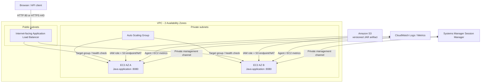

# Running a Java Application on EC2 Behind an ALB and Auto Scaling

Running a Java application on a single EC2 instance works for quick testing, but it becomes a single point of failure in production. If the instance fails, the application stops serving traffic; if traffic spikes, a single server may run out of CPU or memory; if servers are updated manually one by one, instances easily drift to different versions. A common AWS architecture places an Application Load Balancer (ALB) in front of a fleet of EC2 instances managed by EC2 Auto Scaling. The ALB receives HTTP/HTTPS requests and routes them to healthy instances; the Auto Scaling Group (ASG) maintains the desired instance count, replaces unhealthy instances, and adjusts capacity based on load.

In this hands-on lab, you will package a Java 21/Spring Boot application into an executable JAR, store the artifact in Amazon S3, and deploy it on Amazon Linux 2023 EC2 instances. The ALB sits in public subnets; the EC2 instances sit in private subnets and accept traffic only from the ALB's security group. A launch template defines how instances are initialized, user data installs Java and starts the application via systemd, a target group checks the health endpoint, and the ASG automatically registers/deregisters instances with the ALB.

This lesson belongs to the **Foundational Hands-On Labs** chapter in the AWS Cloud Providers module: learners practice selecting services, deploying applications securely, monitoring, recovery, and cost control. The architecture uses an IAM instance profile to download artifacts from S3, Systems Manager Session Manager for server administration without public SSH, CloudWatch for log/metric observability, and target tracking for capacity scaling.

## Lab Objectives

Upon completing this lab, you will be able to:

- Build a Java/Spring Boot application into an executable JAR.
- Create or prepare a VPC with public/private subnets across at least two Availability Zones.
- Design security groups following the ALB → EC2 flow, restricting the application port to receive traffic only from the ALB.
- Create an IAM role/instance profile for EC2 with permissions to read the exact artifact in S3 and use Systems Manager.
- Create an Application Load Balancer, target group, and listener.
- Create a launch template with Amazon Linux 2023, IMDSv2, EBS encryption, and user data.
- Create an Auto Scaling Group attached to the target group, enable ELB health checks, and configure a health check grace period.
- Verify health, request distribution, failed instance replacement, and scale-out/scale-in.
- Update application versions using launch template versions and instance refresh.
- Read CloudWatch logs/metrics and troubleshoot bootstrap, health check, IAM, or networking errors.
- Clean up resources after completion to avoid ongoing charges.

## Architecture and Request Flow



Request flow:

1. The client calls the ALB's DNS name.
2. The listener receives requests on port 80 (lab) or 443 (production).
3. The listener rule forwards requests to the target group.
4. The ALB selects a `healthy` target and forwards the request to port 8080 on EC2.
5. The Java application processes the request and returns a response through the ALB.
6. The ALB sends periodic health checks to each target's readiness endpoint.
7. The ASG uses EC2 health checks and ELB health checks to decide whether an instance needs replacement.

Bootstrap flow:

1. The ASG launches an EC2 instance from the launch template.
2. EC2 runs user data, installs Amazon Corretto 21 and AWS CLI, and downloads the JAR from S3 using the instance profile.
3. systemd starts the Spring Boot application.
4. The application listens on port 8080 and returns HTTP 200 at `/actuator/health/readiness`.
5. The ALB marks the target healthy after passing the configured number of consecutive health checks.

## Resources to Prepare

| Resource | Lab Configuration |
|---|---|
| AWS Region | Choose a Region supporting the services used; use the same Region for VPC, ALB, ASG, S3, and CloudWatch where convenient |
| VPC | A VPC with DNS resolution and DNS hostnames enabled |
| Public subnets | At least 2 subnets across 2 AZs, routed to an Internet Gateway |
| Private subnets | At least 2 subnets across 2 AZs, routed to a NAT Gateway or appropriate VPC endpoints |
| EC2 AMI | Amazon Linux 2023 x86_64 |
| Instance type | `t3.small` or equivalent for the lab application |
| Java | Amazon Corretto 21 headless |
| Application port | TCP 8080 |
| ALB listener | HTTP 80 for lab; HTTPS 443 with an ACM certificate for production |
| ASG | Minimum 2, desired 2, maximum 4 |
| Health check grace period | 300 seconds, tuned based on actual bootstrap time |
| Artifact | `orders-api-1.0.0.jar` in a private S3 bucket |

### Lab Cost and Limits

ALB, EC2, EBS, NAT Gateway, S3, CloudWatch Logs, and data transfer can incur charges. Two EC2 instances plus an ALB running continuously will accumulate time-based charges. If using a NAT Gateway, hourly and data-processing costs can be noticeable; VPC interface endpoints also have separate hourly/data charges. Complete the cleanup section when finished.

Do not use a production account or real customer data for an initial hands-on run. Choose a small instance type, cap ASG `max=4`, set a budget/alert, and use tag `Project=java-alb-asg-lab` to identify resources.

## Step 1 — Create the Java/Spring Boot Application

The application returns instance details to observe ALB request distribution, while exposing a Spring Boot Actuator readiness endpoint for target group health checks.

### 1.1. Project Structure

```text
orders-api/
  pom.xml
  src/
    main/
      java/
        com/example/orders/
          OrdersApplication.java
          StatusController.java
      resources/
        application.properties
```

### 1.2. Maven `pom.xml`

The example uses Spring Boot 3.5.x and Java 21. In real deployments, pin a patch version tested by your organization instead of using floating versions.

```xml
<?xml version="1.0" encoding="UTF-8"?>
<project xmlns="http://maven.apache.org/POM/4.0.0"
         xmlns:xsi="http://www.w3.org/2001/XMLSchema-instance"
         xsi:schemaLocation="http://maven.apache.org/POM/4.0.0
         https://maven.apache.org/xsd/maven-4.0.0.xsd">
    <modelVersion>4.0.0</modelVersion>

    <groupId>com.example</groupId>
    <artifactId>orders-api</artifactId>
    <version>1.0.0</version>
    <name>orders-api</name>

    <parent>
        <groupId>org.springframework.boot</groupId>
        <artifactId>spring-boot-starter-parent</artifactId>
        <version>3.5.0</version>
        <relativePath/>
    </parent>

    <properties>
        <java.version>21</java.version>
    </properties>

    <dependencies>
        <dependency>
            <groupId>org.springframework.boot</groupId>
            <artifactId>spring-boot-starter-web</artifactId>
        </dependency>
        <dependency>
            <groupId>org.springframework.boot</groupId>
            <artifactId>spring-boot-starter-actuator</artifactId>
        </dependency>
    </dependencies>

    <build>
        <plugins>
            <plugin>
                <groupId>org.springframework.boot</groupId>
                <artifactId>spring-boot-maven-plugin</artifactId>
            </plugin>
        </plugins>
    </build>
</project>
```

### 1.3. Main Application

`src/main/java/com/example/orders/OrdersApplication.java`:

```java
package com.example.orders;

import org.springframework.boot.SpringApplication;
import org.springframework.boot.autoconfigure.SpringBootApplication;

@SpringBootApplication
public class OrdersApplication {
    public static void main(String[] args) {
        SpringApplication.run(OrdersApplication.class, args);
    }
}
```

### 1.4. Status Endpoint

`src/main/java/com/example/orders/StatusController.java`:

```java
package com.example.orders;

import java.net.InetAddress;
import java.time.Instant;
import java.util.Map;

import org.springframework.beans.factory.annotation.Value;
import org.springframework.web.bind.annotation.GetMapping;
import org.springframework.web.bind.annotation.RestController;

@RestController
public class StatusController {
    @Value("${app.version:local}")
    private String appVersion;

    @GetMapping("/")
    public Map<String, Object> index() throws Exception {
        return Map.of(
                "service", "orders-api",
                "version", appVersion,
                "instance", InetAddress.getLocalHost().getHostName(),
                "timestamp", Instant.now().toString()
        );
    }

    @GetMapping("/api/version")
    public Map<String, String> version() {
        return Map.of("service", "orders-api", "version", appVersion);
    }
}
```

### 1.5. `application.properties`

`src/main/resources/application.properties`:

```properties
spring.application.name=orders-api
server.port=8080
server.shutdown=graceful
spring.lifecycle.timeout-per-shutdown-phase=30s

management.endpoints.web.exposure.include=health,info
management.endpoint.health.probes.enabled=true
management.endpoint.health.show-details=never

info.app.name=orders-api
info.app.description=Java application behind ALB and Auto Scaling
```

Spring Boot creates a readiness endpoint at `/actuator/health/readiness` when probes are enabled. This endpoint returns HTTP 200 when the application is ready. Do not expose sensitive configuration details in Actuator; do not enable `show-details=always` on client-accessible endpoints.

### 1.6. Build and Test Locally

From the project directory:

```bash
mvn clean package
java -jar target/orders-api-1.0.0.jar
```

Verify in another terminal:

```bash
curl -i http://localhost:8080/
curl -i http://localhost:8080/actuator/health/readiness
```

Expected results:

- `/` returns HTTP 200 and JSON containing `service`, `version`, `instance`, and `timestamp`.
- `/actuator/health/readiness` returns HTTP 200 with status `UP`.
- The application listens on port 8080.

If the readiness endpoint returns 404, check the `spring-boot-starter-actuator` dependency and `management.endpoint.health.probes.enabled=true`.

## Step 2 — Upload the Artifact to Amazon S3

S3 holds the versioned JAR so new EC2 instances can download the exact same artifact when the ASG scales out or replaces instances. Do not make the bucket public and do not embed AWS access keys in user data.

### 2.1. Create the Bucket

Bucket names must be globally unique. Enable Block Public Access and encryption. For production, enable versioning and use a bucket policy restricting access by prefix.

```bash
export AWS_REGION=ap-southeast-1
export ACCOUNT_ID=$(aws sts get-caller-identity --query Account --output text)
export ARTIFACT_BUCKET="orders-api-artifacts-${ACCOUNT_ID}-${AWS_REGION}"

aws s3api create-bucket \
  --bucket "$ARTIFACT_BUCKET" \
  --region "$AWS_REGION" \
  --create-bucket-configuration LocationConstraint="$AWS_REGION"

aws s3api put-public-access-block \
  --bucket "$ARTIFACT_BUCKET" \
  --public-access-block-configuration BlockPublicAcls=true,IgnorePublicAcls=true,BlockPublicPolicy=true,RestrictPublicBuckets=true

aws s3api put-bucket-encryption \
  --bucket "$ARTIFACT_BUCKET" \
  --server-side-encryption-configuration '{"Rules":[{"ApplyServerSideEncryptionByDefault":{"SSEAlgorithm":"AES256"}}]}'

aws s3api put-bucket-versioning \
  --bucket "$ARTIFACT_BUCKET" \
  --versioning-configuration Status=Enabled
```

The command above illustrates Region `ap-southeast-1`. If creating the bucket in `us-east-1`, omit `--create-bucket-configuration LocationConstraint=...`; for other Regions, specify the matching `LocationConstraint`. If the bucket uses an SSE-KMS customer managed key, the EC2 role must have `kms:Decrypt` and the key policy must allow that role.

### 2.2. Upload the JAR and Checksum

```bash
export ARTIFACT_KEY=orders-api/1.0.0/orders-api.jar
export JAR_PATH=target/orders-api-1.0.0.jar

sha256sum "$JAR_PATH"
aws s3 cp "$JAR_PATH" "s3://${ARTIFACT_BUCKET}/${ARTIFACT_KEY}" \
  --region "$AWS_REGION" \
  --sse AES256
```

Record the file's SHA-256 checksum to include in user data. For each release, use a new version/prefix instead of overwriting the same key, for example `orders-api/1.0.1/orders-api.jar`.

On macOS where `sha256sum` is not installed by default, use `shasum -a 256 "$JAR_PATH"` to compute the same SHA-256 checksum.

### 2.3. Verify the Object

```bash
aws s3api head-object \
  --bucket "$ARTIFACT_BUCKET" \
  --key "$ARTIFACT_KEY" \
  --region "$AWS_REGION"
```

Verify `ContentLength`, `LastModified`, encryption, and version ID. Do not rely on `ETag` as a default SHA-256 because multipart uploads or encryption can make `ETag` differ from the content hash.

## Step 3 — Prepare the VPC and Security Groups

### 3.1. VPC and Subnet Layout

Use a VPC spanning at least two Availability Zones:

| Subnet | AZ | Route table | Resource |
|---|---|---|---|
| `public-a` | AZ A | `0.0.0.0/0` to Internet Gateway | ALB node |
| `public-b` | AZ B | `0.0.0.0/0` to Internet Gateway | ALB node |
| `private-app-a` | AZ A | NAT Gateway or VPC endpoints | EC2 ASG |
| `private-app-b` | AZ B | NAT Gateway or VPC endpoints | EC2 ASG |

Set the subnet/VPC IDs into environment variables for use in subsequent commands:

```bash
export VPC_ID=vpc-REPLACE_ME
export PUBLIC_SUBNET_A=subnet-public-a
export PUBLIC_SUBNET_B=subnet-public-b
export PRIVATE_SUBNET_A=subnet-private-a
export PRIVATE_SUBNET_B=subnet-private-b
```

An internet-facing ALB requires public subnets in at least two AZs. EC2 instances reside in private subnets and do not need public IPv4 addresses. Ensure subnets have enough IP addresses for the ALB, EC2, ENIs, and scale-out.

If you do not have a VPC yet, create the VPC/subnets/route tables/Internet Gateway/NAT Gateway following the module's networking hands-on lab. This lab assumes the network already exists to focus on Java, ALB, and Auto Scaling.

### 3.2. Outbound Paths for Private Instances

EC2 instances need to download Java packages and artifacts, send logs, and receive management commands. There are two options:

- **NAT Gateway:** simple for labs, allowing private instances to reach external endpoints and required repositories. Requires routing private subnets to a NAT Gateway in a public subnet.
- **VPC endpoints:** reduces NAT dependency and keeps AWS traffic inside the AWS network. Create an S3 Gateway Endpoint for artifacts/repositories; appropriate Interface Endpoints for `ssm`, `ssmmessages`, `ec2messages` as needed, `logs`, `monitoring`, or other services. Endpoint security groups must permit TCP 443 from private instances.

For private subnets without NAT, confirm all bootstrap dependencies are reachable via VPC endpoints. If `dnf` cannot reach Amazon Linux repositories or the CloudWatch agent cannot ship logs, user data may still fail even with an S3 endpoint.

### 3.3. Create the Security Group for the ALB

Create security group `orders-alb-sg` in the VPC:

| Direction | Protocol/port | Source/destination | Purpose |
|---|---|---|---|
| Inbound | TCP 80 | `0.0.0.0/0` | HTTP for lab |
| Inbound | TCP 443 | `0.0.0.0/0` | Required only when configuring HTTPS |
| Outbound | TCP 8080 | `orders-ec2-sg` | Forward requests and health checks to the application |

Security groups are stateful, so response traffic is permitted automatically. If restricting outbound traffic, allow the ALB to reach the instance listener port and health check port.

### 3.4. Create the Security Group for EC2

Create security group `orders-ec2-sg`:

| Direction | Protocol/port | Source/destination | Purpose |
|---|---|---|---|
| Inbound | TCP 8080 | Security group `orders-alb-sg` | Only the ALB may call the application |
| Inbound | No SSH 22 | — | Administer via Session Manager |
| Outbound | TCP 443 | NAT/VPC endpoints per network design | S3, SSM, CloudWatch, and package repositories |

Do not set the inbound port 8080 source to `0.0.0.0/0`. When the ALB's security group is the source, EC2 accepts traffic only from ENIs belonging to the ALB security group. Do not open public SSH merely for debugging convenience; use Systems Manager Session Manager.

Example creating both security groups via CLI:

```bash
export ALB_SG_ID=$(aws ec2 create-security-group \
  --group-name orders-alb-sg \
  --description "Public listener for orders ALB" \
  --vpc-id "$VPC_ID" \
  --query GroupId --output text)

export EC2_SG_ID=$(aws ec2 create-security-group \
  --group-name orders-ec2-sg \
  --description "Allow application traffic only from orders ALB" \
  --vpc-id "$VPC_ID" \
  --query GroupId --output text)

aws ec2 authorize-security-group-ingress \
  --group-id "$ALB_SG_ID" \
  --protocol tcp --port 80 --cidr 0.0.0.0/0

aws ec2 authorize-security-group-ingress \
  --group-id "$EC2_SG_ID" \
  --protocol tcp --port 8080 --source-group "$ALB_SG_ID"
```

New security groups have an allow-all outbound rule by default. This is a simple setup for a lab; production should restrict outbound to the S3 gateway endpoint, interface endpoints, NAT/proxy, and actual dependencies. If enabling an HTTPS listener, add inbound TCP 443 to the ALB security group. Do not add inbound SSH to the EC2 security group.

## Step 4 — Create the IAM Role and Instance Profile for EC2

The EC2 instance profile provides temporary credentials via the Instance Metadata Service. Do not create an IAM user/access key to embed in user data or files on the instance.

### 4.1. Trust Policy

Create `ec2-trust-policy.json`:

```json
{
  "Version": "2012-10-17",
  "Statement": [
    {
      "Effect": "Allow",
      "Principal": { "Service": "ec2.amazonaws.com" },
      "Action": "sts:AssumeRole"
    }
  ]
}
```

### 4.2. Create the Role and Permissions

```bash
aws iam create-role \
  --role-name OrdersApiEc2Role \
  --assume-role-policy-document file://ec2-trust-policy.json

aws iam attach-role-policy \
  --role-name OrdersApiEc2Role \
  --policy-arn arn:aws:iam::aws:policy/AmazonSSMManagedInstanceCore

aws iam attach-role-policy \
  --role-name OrdersApiEc2Role \
  --policy-arn arn:aws:iam::aws:policy/CloudWatchAgentServerPolicy
```

Create an inline policy allowing reads only for the exact artifact object:

```json
{
  "Version": "2012-10-17",
  "Statement": [
    {
      "Sid": "ReadOrdersApiArtifact",
      "Effect": "Allow",
      "Action": ["s3:GetObject"],
      "Resource": "arn:aws:s3:::YOUR_ARTIFACT_BUCKET/orders-api/1.0.0/orders-api.jar"
    }
  ]
}
```

Save as `orders-artifact-read.json`, replace the bucket name, and attach it:

```bash
aws iam put-role-policy \
  --role-name OrdersApiEc2Role \
  --policy-name ReadOrdersApiArtifact \
  --policy-document file://orders-artifact-read.json
```

If downloading multiple versions, you can scope permissions to prefix `orders-api/*`, but keep the scope as narrow as possible. If the artifact is encrypted with SSE-KMS, add `kms:Decrypt` for the exact key ARN and update the key policy. The S3 bucket policy may also need to allow the role if the bucket resides in another account.

### 4.3. Create the Instance Profile

```bash
aws iam create-instance-profile \
  --instance-profile-name OrdersApiInstanceProfile

aws iam add-role-to-instance-profile \
  --instance-profile-name OrdersApiInstanceProfile \
  --role-name OrdersApiEc2Role
```

Wait for IAM propagation before launching EC2 instances. Attach the instance profile to the launch template. This role is intended only for the application/host; users do not need `iam:PassRole` on that role unless they are responsible for provisioning infrastructure.

## Step 5 — Create the Application Load Balancer and Target Group

### 5.1. Target Group

The target group uses target type `instance`, HTTP protocol, and port 8080. The health check calls Spring Boot's readiness endpoint.

```bash
aws elbv2 create-target-group \
  --name orders-api-tg \
  --protocol HTTP \
  --port 8080 \
  --target-type instance \
  --vpc-id "$VPC_ID" \
  --health-check-protocol HTTP \
  --health-check-port traffic-port \
  --health-check-path /actuator/health/readiness \
  --health-check-interval-seconds 15 \
  --health-check-timeout-seconds 5 \
  --healthy-threshold-count 2 \
  --unhealthy-threshold-count 3 \
  --matcher HttpCode=200
```

Save `TargetGroupArn` from the response. The ALB health check sends an HTTP GET to each registered target. Targets must be registered, the target's AZ must be enabled on the ALB, and the target must pass the initial health check before receiving traffic.

### 5.2. Create the ALB

```bash
aws elbv2 create-load-balancer \
  --name orders-api-alb \
  --type application \
  --scheme internet-facing \
  --ip-address-type ipv4 \
  --subnets "$PUBLIC_SUBNET_A" "$PUBLIC_SUBNET_B" \
  --security-groups "$ALB_SG_ID"
```

Save `LoadBalancerArn` and `DNSName`. The ALB must be in the same VPC as the target group. Wait for the ALB to transition to the `active` state.

### 5.3. Create an HTTP Listener for the Lab

```bash
aws elbv2 create-listener \
  --load-balancer-arn "$ALB_ARN" \
  --protocol HTTP \
  --port 80 \
  --default-actions Type=forward,TargetGroupArn="$TARGET_GROUP_ARN"
```

For production, issue an ACM certificate for your domain, configure an HTTPS 443 listener with the certificate, and configure an HTTP 80 listener redirecting to HTTPS. Do not transmit credentials or sensitive data over HTTP.

## Step 6 — Write User Data to Install Java and Run the Application

User data executes when an EC2 instance launches for the first time. The ASG uses the same launch template so every new instance bootstraps identically. Bootstrap scripts should be idempotent where necessary, log output, and fail loudly if they cannot install or start the application.

### 6.1. User Data Script

Create `user-data.sh`; replace `YOUR_ARTIFACT_BUCKET`, the object key, and the SHA-256 checksum with your prepared values:

```bash
#!/bin/bash
set -Eeuo pipefail

exec > >(tee -a /var/log/user-data.log | logger -t user-data -s 2>/dev/console) 2>&1

ARTIFACT_BUCKET="YOUR_ARTIFACT_BUCKET"
ARTIFACT_KEY="orders-api/1.0.0/orders-api.jar"
EXPECTED_SHA256="REPLACE_WITH_SHA256"

TOKEN=$(curl -fsS -X PUT \
  "http://169.254.169.254/latest/api/token" \
  -H "X-aws-ec2-metadata-token-ttl-seconds: 21600")
AWS_REGION=$(curl -fsS \
  -H "X-aws-ec2-metadata-token: ${TOKEN}" \
  http://169.254.169.254/latest/meta-data/placement/region)

dnf install -y java-21-amazon-corretto-headless awscli-2 amazon-cloudwatch-agent

id orders-api >/dev/null 2>&1 || \
  useradd --system --home-dir /opt/orders-api --shell /sbin/nologin orders-api

install -d -o orders-api -g orders-api /opt/orders-api
install -d -o orders-api -g orders-api /var/log/orders-api

aws s3 cp \
  "s3://${ARTIFACT_BUCKET}/${ARTIFACT_KEY}" \
  /opt/orders-api/app.jar \
  --region "${AWS_REGION}"

echo "${EXPECTED_SHA256}  /opt/orders-api/app.jar" | sha256sum --check --status
chown orders-api:orders-api /opt/orders-api/app.jar
chmod 0440 /opt/orders-api/app.jar

cat >/etc/systemd/system/orders-api.service <<'UNIT'
[Unit]
Description=Orders API - Spring Boot application
After=network-online.target
Wants=network-online.target

[Service]
Type=simple
User=orders-api
Group=orders-api
WorkingDirectory=/opt/orders-api
Environment=SERVER_PORT=8080
Environment=APP_VERSION=1.0.0
ExecStart=/usr/bin/java -XX:MaxRAMPercentage=75 -jar /opt/orders-api/app.jar
Restart=on-failure
RestartSec=5
SuccessExitStatus=143
KillSignal=SIGTERM
TimeoutStopSec=40
StandardOutput=append:/var/log/orders-api/app.log
StandardError=inherit

[Install]
WantedBy=multi-user.target
UNIT

cat >/opt/aws/amazon-cloudwatch-agent/etc/amazon-cloudwatch-agent.json <<'CWCONFIG'
{
  "logs": {
    "logs_collected": {
      "files": {
        "collect_list": [
          {
            "file_path": "/var/log/orders-api/app.log",
            "log_group_name": "/aws/ec2/orders-api",
            "log_stream_name": "{instance_id}",
            "timezone": "UTC"
          },
          {
            "file_path": "/var/log/user-data.log",
            "log_group_name": "/aws/ec2/orders-api-bootstrap",
            "log_stream_name": "{instance_id}",
            "timezone": "UTC"
          }
        ]
      }
    }
  }
}
CWCONFIG

systemctl daemon-reload
systemctl enable --now orders-api.service

amazon-cloudwatch-agent-ctl \
  -a fetch-config \
  -m ec2 \
  -c file:/opt/aws/amazon-cloudwatch-agent/etc/amazon-cloudwatch-agent.json \
  -s

for attempt in $(seq 1 60); do
  if curl -fsS http://127.0.0.1:8080/actuator/health/readiness >/dev/null; then
    echo "Orders API is ready"
    exit 0
  fi
  sleep 5
done

echo "Orders API did not become ready" >&2
systemctl status orders-api.service --no-pager || true
exit 1
```

### 6.2. Why Does User Data Use These Settings?

- `set -Eeuo pipefail` stops the script on errors to prevent an instance from being treated as bootstrapped successfully when an artifact is missing.
- An IMDSv2 token is used to retrieve the Region; the launch template will enforce IMDSv2.
- `dnf` installs Amazon Corretto 21 headless, AWS CLI v2, and CloudWatch Agent.
- The application runs under a dedicated Linux user, not as root.
- The JAR is downloaded via the instance profile and verified with SHA-256 before starting.
- systemd starts the application automatically on reboot and restarts it if the process crashes.
- Spring Boot graceful shutdown allows in-flight requests to complete within the timeout window.
- CloudWatch Agent ships application and bootstrap logs to CloudWatch Logs.
- The readiness loop ensures user data reports an error if the application fails to start.

User data is not a complete deployment mechanism for all production workloads. For larger applications, consider baking AMIs with EC2 Image Builder/Packer or using CodeDeploy/Systems Manager State Manager to reduce bootstrap time and manage releases more cleanly.

## Step 7 — Create the EC2 Launch Template

The launch template defines the AMI, instance type, IAM instance profile, security group, EBS, metadata options, and user data. The ASG uses this template every time it launches a new instance.

### 7.1. Retrieve the Amazon Linux 2023 AMI

```bash
export AMI_ID=$(aws ssm get-parameter \
  --name /aws/service/ami-amazon-linux-latest/al2023-ami-kernel-default-x86_64 \
  --region "$AWS_REGION" \
  --query Parameter.Value \
  --output text)

echo "$AMI_ID"
```

Ensure the AMI architecture matches the instance type and Java package. If using Graviton, select an ARM64 AMI and compatible image/application dependencies.

### 7.2. Encode User Data

On Linux/macOS:

```bash
base64 -w 0 user-data.sh > user-data.b64
```

On macOS if `base64 -w` is not supported:

```bash
base64 < user-data.sh | tr -d '\n' > user-data.b64
```

In PowerShell:

```powershell
$bytes = [System.IO.File]::ReadAllBytes("user-data.sh")
$encoded = [Convert]::ToBase64String($bytes)
Set-Content -NoNewline -Path user-data.b64 -Value $encoded
```

### 7.3. Launch Template Data

Create `launch-template-data.json`, replacing the placeholders:

```json
{
  "ImageId": "ami-REPLACE_ME",
  "InstanceType": "t3.small",
  "IamInstanceProfile": {
    "Name": "OrdersApiInstanceProfile"
  },
  "SecurityGroupIds": [
    "sg-REPLACE_EC2_SG"
  ],
  "MetadataOptions": {
    "HttpEndpoint": "enabled",
    "HttpTokens": "required",
    "HttpPutResponseHopLimit": 1
  },
  "BlockDeviceMappings": [
    {
      "DeviceName": "/dev/xvda",
      "Ebs": {
        "VolumeSize": 12,
        "VolumeType": "gp3",
        "Encrypted": true,
        "DeleteOnTermination": true
      }
    }
  ],
  "Monitoring": {
    "Enabled": true
  },
  "UserData": "BASE64_ENCODED_USER_DATA",
  "TagSpecifications": [
    {
      "ResourceType": "instance",
      "Tags": [
        { "Key": "Name", "Value": "orders-api" },
        { "Key": "Project", "Value": "java-alb-asg-lab" },
        { "Key": "Environment", "Value": "lab" }
      ]
    },
    {
      "ResourceType": "volume",
      "Tags": [
        { "Key": "Project", "Value": "java-alb-asg-lab" }
      ]
    }
  ]
}
```

Insert the contents of `user-data.b64` into the `UserData` field. Do not put access keys, passwords, or secrets into user data; user data can be read by principals with permissions to view launch templates/instance metadata. Configuration data in this example contains only bucket/object names, version, and checksum.

### 7.4. Create the Launch Template

```bash
aws ec2 create-launch-template \
  --launch-template-name orders-api-lt \
  --version-description orders-api-1.0.0 \
  --launch-template-data file://launch-template-data.json
```

Save `LaunchTemplateId`. Metadata options enforce IMDSv2 (`HttpTokens=required`), EBS volumes are encrypted, and detailed monitoring is enabled. Because the ASG specifies private subnets, no public IP is needed in the launch template.

## Step 8 — Create the Auto Scaling Group and Attach the Target Group

The ASG maintains desired capacity and automatically registers/deregisters instances with the target group. When the target group reports an instance unhealthy and ELB health checks are enabled on the ASG, Auto Scaling can replace that instance.

### 8.1. Create the ASG

```bash
aws autoscaling create-auto-scaling-group \
  --auto-scaling-group-name orders-api-asg \
  --launch-template LaunchTemplateId=lt-REPLACE_ME,Version='$Latest' \
  --min-size 2 \
  --max-size 4 \
  --desired-capacity 2 \
  --vpc-zone-identifier "$PRIVATE_SUBNET_A,$PRIVATE_SUBNET_B" \
  --target-group-arns "$TARGET_GROUP_ARN" \
  --health-check-type ELB \
  --health-check-grace-period 300 \
  --default-instance-warmup 180 \
  --tags Key=Project,Value=java-alb-asg-lab,PropagateAtLaunch=true Key=Environment,Value=lab,PropagateAtLaunch=true
```

Replace `lt-REPLACE_ME`, the subnet IDs, and the target group ARN. With the AWS CLI, the health check grace period defaults to 0 seconds if unspecified; therefore, the command explicitly sets 300 seconds so the application has time to bootstrap. Actual values should be based on measured startup times.

`DefaultInstanceWarmup` helps target tracking wait for new instances to finish initializing before including them in aggregate metrics. If extending the lab to a mixed instances policy with Spot capacity, consider enabling capacity rebalancing and designing checkpoints/retries in the application.

### 8.2. Inspect the ASG

```bash
aws autoscaling describe-auto-scaling-groups \
  --auto-scaling-group-names orders-api-asg

aws autoscaling describe-scaling-activities \
  --auto-scaling-group-name orders-api-asg \
  --max-records 20
```

Wait for both instances to reach `InService`. The target group may show `initial` during the first health check. After passing health checks, target status must be `healthy`.

### 8.3. Check Target Health

```bash
aws elbv2 describe-target-health \
  --target-group-arn "$TARGET_GROUP_ARN"
```

If a target is `unhealthy`, check `Reason` and `Description`. Do not look only at the EC2 instance state `running`; a running instance does not mean the Java application is ready or reachable by the ALB.

## Step 9 — Test the Application Through the ALB

Retrieve the ALB DNS name:

```bash
aws elbv2 describe-load-balancers \
  --names orders-api-alb \
  --query 'LoadBalancers[0].DNSName' \
  --output text
```

Call the endpoints:

```bash
curl -i http://ALB_DNS_NAME/
curl -i http://ALB_DNS_NAME/actuator/health/readiness
```

Send multiple requests to observe the instance hostname changing:

```bash
for i in $(seq 1 20); do
  curl -fsS http://ALB_DNS_NAME/
  echo
done
```

Because the ALB distributes traffic by connection/flow and keep-alive, every request is not guaranteed to alternate across instances strictly. If you always see the same hostname, send additional requests using new connections and verify both targets are `healthy`.

## Step 10 — Configure an Auto Scaling Policy

An ASG can scale based on CPU utilization, ALB request count per target, custom CloudWatch metrics, or a fixed schedule. For the lab, use target tracking targeting 50% average CPU.

### 10.1. Create a Target Tracking Policy

Create `cpu-target-tracking.json`:

```json
{
  "TargetValue": 50.0,
  "PredefinedMetricSpecification": {
    "PredefinedMetricType": "ASGAverageCPUUtilization"
  },
  "DisableScaleIn": false
}
```

Apply it:

```bash
aws autoscaling put-scaling-policy \
  --auto-scaling-group-name orders-api-asg \
  --policy-name orders-api-cpu-50 \
  --policy-type TargetTrackingScaling \
  --target-tracking-configuration file://cpu-target-tracking.json
```

AWS creates and manages CloudWatch alarms for the target tracking policy. Do not edit alarms managed by Auto Scaling directly. The 50% target value is a testing target; adjust it according to actual CPU profile and latency requirements.

### 10.2. Generate Test Load

From a client machine or test environment, use a tool such as `hey` or `ab` to generate moderate load:

```bash
hey -z 5m -c 30 http://ALB_DNS_NAME/
```

Monitor desired capacity, in-service instances, CPU, and ALB request count. The ASG needs time to evaluate metrics, launch instances, and wait for health checks; scale-out is not instantaneous. Stop the load test once you observe the scaling behavior.

### 10.3. Manually Adjust Capacity to Observe Behavior

```bash
aws autoscaling set-desired-capacity \
  --auto-scaling-group-name orders-api-asg \
  --desired-capacity 3
```

Wait for the third instance to enter `InService` and become `healthy` in the target group. Then return desired capacity to 2:

```bash
aws autoscaling set-desired-capacity \
  --auto-scaling-group-name orders-api-asg \
  --desired-capacity 2
```

The ASG will not scale below `min-size=2`. During the lab, do not increase desired above `max-size=4`.

## Step 11 — Verify Self-Healing and Health Checks

### 11.1. Distinguish the Three Health Layers

| Health signal | Checked by | Example |
|---|---|---|
| EC2 status checks | EC2 | System reachability and instance reachability |
| ALB target health | ALB | HTTP GET `/actuator/health/readiness` on port 8080 |
| ASG health | Auto Scaling | EC2 checks and, when enabled, ELB health status |

When an ASG uses only EC2 health checks, an instance may still be considered healthy at the EC2 layer even if the Java application hangs. Enable `--health-check-type ELB` so the ASG can replace instances reported unhealthy by the ALB.

### 11.2. Simulate an Unhealthy Application

From Systems Manager Session Manager or Run Command, stop the service on one lab instance:

```bash
sudo systemctl stop orders-api.service
```

Observe:

1. The target group marks the instance `unhealthy` after the configured failed health check threshold.
2. The ASG records the ELB health failure.
3. The ASG terminates and replaces the unhealthy instance to maintain desired capacity.
4. The new instance runs user data, downloads the JAR, and starts Java.
5. The new target becomes `healthy` after its readiness endpoint returns HTTP 200.

Do not perform this in production. To quickly recover an instance before the ASG replaces it, you could run `sudo systemctl start orders-api.service`, but the goal of this step is to observe self-healing, so watch the replacement workflow first.

### 11.3. Terminate an Instance via Auto Scaling

Pick an instance ID belonging to the ASG and run:

```bash
aws autoscaling terminate-instance-in-auto-scaling-group \
  --instance-id i-REPLACE_ME \
  --no-should-decrement-desired-capacity
```

The ASG maintains desired capacity and launches a replacement instance. Do not arbitrarily run EC2 `terminate-instances` in this lab, because the Auto Scaling command explicitly expresses the intent to terminate an instance without decrementing desired capacity.

## Step 12 — Update the Application Safely Using Instance Refresh

When building version `1.0.1`, upload the JAR to a new S3 key, create a new launch template version with the updated `ARTIFACT_KEY` and checksum, then update the ASG and start an instance refresh.

Workflow:

1. Build and test JAR `1.0.1`.
2. Upload `orders-api/1.0.1/orders-api.jar` to S3.
3. Update the IAM policy to allow reading the new key if the policy is scoped to the exact object.
4. Create `user-data-v2.sh` pointing to the new artifact and new checksum.
5. Encode user data and update `launch-template-data-v2.json`.
6. Create a new launch template version.
7. Update the ASG to use the new version.
8. Start an instance refresh with an appropriate minimum healthy percentage.
9. Monitor target health, error rates, and the version endpoint.

Example:

```bash
aws ec2 create-launch-template-version \
  --launch-template-id "$LAUNCH_TEMPLATE_ID" \
  --source-version '$Latest' \
  --version-description orders-api-1.0.1 \
  --launch-template-data file://launch-template-data-v2.json

aws autoscaling update-auto-scaling-group \
  --auto-scaling-group-name orders-api-asg \
  --launch-template LaunchTemplateId="$LAUNCH_TEMPLATE_ID",Version='$Latest'

aws autoscaling start-instance-refresh \
  --auto-scaling-group-name orders-api-asg \
  --preferences '{"MinHealthyPercentage":100,"MaxHealthyPercentage":150,"InstanceWarmup":180,"SkipMatching":true}'
```

Instance refresh gradually replaces instances according to the new launch template version. `MinHealthyPercentage=100` keeps full desired capacity healthy during replacement; `MaxHealthyPercentage=150` allows temporarily scaling from 2 up to 3 instances so a replacement launches before terminating an old instance. This requires extra capacity/quota and can incur short-term costs. Tune percentages and warmup based on actual bootstrap time, capacity headroom, and availability targets.

If the new version has defects, cancel the refresh, revert the ASG to the previous launch template version, and run another instance refresh. Keep the previous artifact in S3 until the rollback window closes.

## Step 13 — Monitor Logs and Metrics

### 13.1. CloudWatch Logs

Open CloudWatch Logs and inspect the log groups:

- `/aws/ec2/orders-api`: Spring Boot stdout/stderr.
- `/aws/ec2/orders-api-bootstrap`: user data logs.

Each instance creates a log stream named by instance ID. Look for messages such as:

- `Orders API is ready`.
- Spring Boot startup completed.
- Exceptions, `OutOfMemoryError`, or port binding failures.
- S3 `AccessDenied`, timeouts, or checksum mismatches.
- DNF package installation failures.

### 13.2. CloudWatch Metrics

Track the key metrics:

| Metric | Source | Meaning |
|---|---|---|
| `CPUUtilization` | EC2 | CPU usage on instances |
| `HealthyHostCount` | ALB/Target Group | Count of healthy targets |
| `UnHealthyHostCount` | ALB/Target Group | Count of unhealthy targets |
| `RequestCount` | ALB | Number of requests received |
| `TargetResponseTime` | ALB | Time taken by targets to respond |
| `HTTPCode_ELB_5XX_Count` | ALB | 5xx errors generated by the load balancer |
| `HTTPCode_Target_5XX_Count` | ALB | 5xx errors returned by target applications |
| `GroupInServiceInstances` | Auto Scaling | Number of `InService` instances |
| `GroupDesiredCapacity` | Auto Scaling | ASG desired capacity |
| `GroupPendingInstances` | Auto Scaling | Instances currently launching |

ALB metrics have dimensions by `LoadBalancer`, `TargetGroup`, or `AvailabilityZone` depending on the metric. Auto Scaling group metrics collection must be enabled if group metrics do not appear. EC2 basic monitoring has a longer interval than detailed monitoring; choose the granularity suited to your SLA and budget.

### 13.3. Create Basic Alarms

Create CloudWatch alarms for `UnHealthyHostCount > 0` or `HTTPCode_Target_5XX_Count` exceeding a threshold. Integrate SNS to notify the operations team. Avoid overly sensitive alarms triggered on a single datapoint if traffic is low; choose appropriate period and evaluation periods.

## Troubleshooting

| Symptom | Common Cause | How to Check / Resolve |
|---|---|---|
| ALB DNS unreachable | ALB not yet active, public subnet route missing IGW, SG blocks listener | Check ALB state, subnet mapping, route tables, NACLs, and ALB SG |
| Target `unhealthy` with `Target.Timeout` | EC2 SG does not allow ALB on port 8080, app not listening, or route/network issue | Verify SG source is ALB SG, `ss -lntp`, curl localhost, and curl private IP from inside VPC |
| `Target.ResponseCodeMismatch` | Wrong health path or endpoint returns non-200 status | Call `/actuator/health/readiness` directly, check matcher/path and Spring configuration |
| Target `unused` | AZ not enabled on ALB, target not registered, or listener does not forward to target group | Check enabled AZs, ASG attachment, listener rules, and target registration |
| EC2 running but no healthy targets | User data failed, app failed to start, or health grace period too short | Inspect `/var/log/user-data.log`, `systemctl status`, CloudWatch Logs, and adjust grace period per measurements |
| User data `AccessDenied` downloading JAR | Instance profile lacks `s3:GetObject`, or bucket/KMS policy denies | Check instance profile, role policy, bucket policy, and KMS key policy |
| User data fails to download packages | Private subnet lacks NAT/S3 route/VPC endpoints or DNS | Check route tables, endpoint policies, endpoint SG, DNS, and DNF logs |
| SSM instance not online | Missing SSM role policy, endpoint/egress, or SSM Agent issue | Check `AmazonSSMManagedInstanceCore`, `ssm`/`ssmmessages` endpoints, and agent status |
| Java process exits immediately | Corrupt JAR, incompatible Java version, insufficient memory, or config error | Run `journalctl -u orders-api`, `java -version`, check JAR and application logs |
| Port 8080 not listening | App bound to `localhost` or a different port | Spring Boot binds all interfaces by default; check `server.address`, `server.port`, and `ss -lntp` |
| ASG does not replace unhealthy instances | ASG uses only EC2 health checks or target group not attached | Set `HealthCheckType=ELB`, check target group ARN and scaling activities |
| ASG continuously replaces instances | Wrong health path, grace period too short, slow bootstrap, or app crash | Check health reason, activity history, bootstrap logs; fix root cause before increasing grace period |
| ASG does not scale out | Scaling policy not attached, insufficient metric breach, max capacity reached, or cooldown | Check scaling activities, policy, CloudWatch alarm, max size, and quotas |
| Instance refresh slow/failing | Insufficient healthy capacity, invalid launch template, subnet IP exhaustion, or bootstrap error | Check refresh status, target health, ASG activities, and launch template version |

### Diagnostic Commands on the Instance

Via Session Manager:

```bash
sudo systemctl status orders-api.service
sudo journalctl -u orders-api.service -n 100 --no-pager
sudo tail -n 100 /var/log/user-data.log
sudo tail -n 100 /var/log/orders-api/app.log
sudo ss -lntp | grep 8080
curl -i http://127.0.0.1:8080/actuator/health/readiness
java -version
aws sts get-caller-identity
```

These commands help isolate application, port, bootstrap, IAM, and networking issues. Do not paste output containing credentials/tokens or sensitive data into public tickets.

## Security and Production Operations

- Use an HTTPS listener with an ACM certificate; redirect HTTP to HTTPS.
- Keep EC2 instances in private subnets and do not assign public IPs unless required.
- Permit the application port only from the ALB security group.
- Require IMDSv2 in the launch template; do not use a metadata hop limit larger than required.
- Use a least-privilege IAM instance profile and do not store access keys in user data.
- Encrypt EBS volumes, S3 artifacts, and logs; manage KMS key policies/rotation.
- Use SSM Session Manager instead of public SSH; enable auditing/logging per policy.
- Pin AMI, Java runtime, and application artifact versions; test updates before rollout.
- Use launch template versions and instance refresh for rollouts; retain rollback artifacts.
- Configure the health check path to report readiness only, avoiding dependence on an external endpoint that could mark all instances unhealthy simultaneously during transient dependency failures.
- Set the health check grace period based on measured bootstrap time, not overly high to mask failures.
- Configure deregistration delay and Spring graceful shutdown to minimize dropped in-flight requests during scale-in.
- Use multiple AZs, ASG minimum capacity, and ALB cross-zone behavior aligned with availability requirements.
- Monitor `HealthyHostCount`, 5xx errors, target response time, CPU, ASG activities, and bootstrap failures.
- Use lifecycle hooks if you need to prevent instances from entering `InService` until bootstrap/registration completes.
- Test backups, recovery, deployment rollbacks, and AZ failures according to runbooks.

## Lab Completion Checklist

- [ ] Java application builds into an executable JAR and runs successfully locally.
- [ ] S3 bucket is private with encryption enabled, and the artifact is uploaded with the proper version.
- [ ] VPC has 2 public subnets and 2 private subnets across at least 2 AZs.
- [ ] ALB security group opens only the required listener ports.
- [ ] EC2 security group accepts port 8080 only from the ALB security group.
- [ ] IAM role/instance profile has the required S3 read, SSM, and CloudWatch permissions.
- [ ] Launch template uses AL2023, Corretto 21, IMDSv2 required, and EBS encryption.
- [ ] User data downloads the exact JAR, verifies the checksum, and creates the systemd service.
- [ ] Target group health check uses `/actuator/health/readiness` and expects HTTP 200.
- [ ] ALB is active and the listener forwards traffic to the target group.
- [ ] ASG has min 2, desired 2, max 4, is attached to the target group, and uses ELB health checks.
- [ ] Both targets reach `healthy` and the ALB returns the application JSON.
- [ ] Tested scaling capacity and observed requests distributed across multiple instances.
- [ ] Tested instance failure and confirmed the ASG launched a replacement.
- [ ] Inspected CloudWatch application/bootstrap logs and metrics.
- [ ] Created or verified the target tracking policy.
- [ ] Understood the launch template versioning and instance refresh workflow.
- [ ] Deleted lab resources upon completion.

## Resource Cleanup

Perform cleanup in order to avoid dependency errors:

1. Set ASG desired capacity to 0 or delete the ASG with force delete after confirming no workloads need to be kept.
2. Delete scaling policies and scheduled actions if created.
3. Delete the ALB listener.
4. Delete the ALB.
5. Wait until the target group is no longer attached, then delete the target group.
6. Delete the launch template if no other ASG references it.
7. Delete security groups once no ENIs, load balancers, or instances use them.
8. Delete S3 artifact objects and the bucket if dedicated to the lab; for versioned buckets, delete all object versions and delete markers.
9. Delete the IAM instance profile, detach managed policies, delete inline policies, and delete the IAM role.
10. Delete CloudWatch log groups or set short retention if audit retention is unnecessary.
11. Delete NAT Gateways, VPC endpoints, subnets, and the VPC only if created exclusively for this lab and unused by other workloads.

Example cleanup commands (replace with exact IDs):

```bash
aws autoscaling delete-auto-scaling-group \
  --auto-scaling-group-name orders-api-asg \
  --force-delete

aws elbv2 delete-listener --listener-arn LISTENER_ARN
aws elbv2 delete-load-balancer --load-balancer-arn LOAD_BALANCER_ARN
aws elbv2 delete-target-group --target-group-arn TARGET_GROUP_ARN

aws ec2 delete-launch-template --launch-template-id LAUNCH_TEMPLATE_ID
```

Do not delete shared VPCs/subnets/route tables. If bucket versioning is enabled, `aws s3 rb --force` does not remove all object versions in every scenario; list and delete all object versions/delete markers before deleting the bucket.

## Conclusion

Running a Java application behind an ALB and Auto Scaling requires coordinating application bootstrap, networking, health checks, IAM, and capacity management. The launch template creates consistent EC2 instances; user data installs Java and starts the application; the target group checks readiness; the ALB routes traffic only to healthy targets; and the ASG maintains instance count and replaces unhealthy instances. Adding SSM, CloudWatch, IMDSv2, EBS/S3 encryption, scaling policies, and instance refresh enables safer operations and controlled application updates.

## References

- [Amazon Corretto 21 on Amazon Linux 2023](https://docs.aws.amazon.com/corretto/latest/corretto-21-ug/amazon-linux-install.html)
- [Run commands on an EC2 Linux instance at launch](https://docs.aws.amazon.com/AWSEC2/latest/UserGuide/user-data.html)
- [Create an EC2 launch template](https://docs.aws.amazon.com/autoscaling/ec2/userguide/create-launch-template.html)
- [Configure launch template metadata options](https://docs.aws.amazon.com/autoscaling/ec2/userguide/advanced-settings-for-your-launch-template.html)
- [Require IMDSv2 for new EC2 instances](https://docs.aws.amazon.com/AWSEC2/latest/UserGuide/configuring-IMDS-new-instances.html)
- [Target groups for Application Load Balancers](https://docs.aws.amazon.com/elasticloadbalancing/latest/application/load-balancer-target-groups.html)
- [Health checks for ALB target groups](https://docs.aws.amazon.com/elasticloadbalancing/latest/application/target-group-health-checks.html)
- [Security groups for Application Load Balancers](https://docs.aws.amazon.com/elasticloadbalancing/latest/application/load-balancer-update-security-groups.html)
- [Attach a target group to an Auto Scaling group](https://docs.aws.amazon.com/autoscaling/ec2/userguide/attach-load-balancer-asg.html)
- [Set the Auto Scaling health check grace period](https://docs.aws.amazon.com/autoscaling/ec2/userguide/health-check-grace-period.html)
- [Troubleshoot unhealthy Auto Scaling instances](https://docs.aws.amazon.com/autoscaling/ec2/userguide/ts-as-healthchecks.html)
- [Update Auto Scaling instances with instance refresh](https://docs.aws.amazon.com/autoscaling/ec2/userguide/instance-refresh-overview.html)
- [Systems Manager VPC endpoints](https://docs.aws.amazon.com/systems-manager/latest/userguide/setup-create-vpc.html)
- [Install the CloudWatch agent using Systems Manager](https://docs.aws.amazon.com/AmazonCloudWatch/latest/monitoring/installing-cloudwatch-agent-ssm.html)
- [Amazon Linux 2023 package management](https://docs.aws.amazon.com/linux/al2023/ug/package-management.html)
