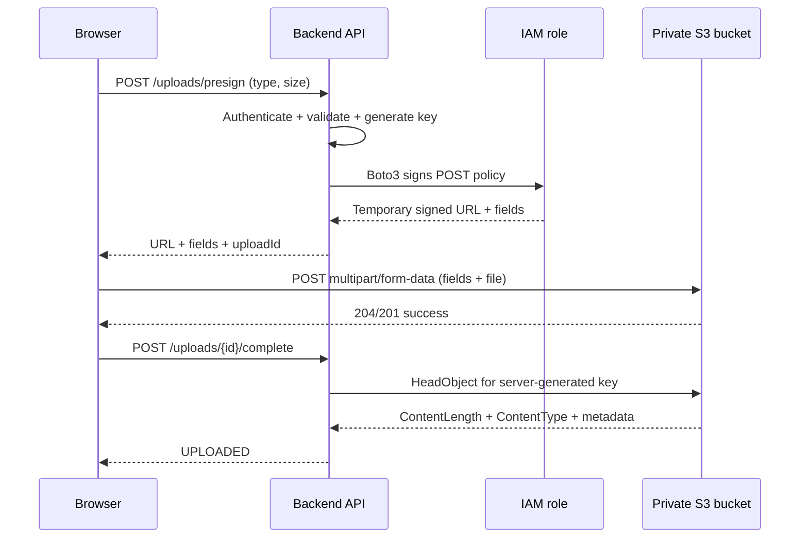

# Building a Private S3 Upload Flow with Presigned URLs

Web applications frequently need to let users upload images, documents, or data files to Amazon S3. A naive yet unsuitable approach is embedding AWS access keys in the browser or proxying all file bytes through the backend. Client-side access keys can be leaked, and the backend becomes a bottleneck when many users upload large files.

With presigned URLs, the backend authenticates the user, chooses the object key, and generates a time-limited S3 permission using the backend's IAM role. The browser sends the file directly to S3 using that temporary authorization. The bucket remains private; the uploader does not need AWS credentials and receives no permissions to access other objects.

In this hands-on lab, you will create a private bucket, scope IAM permissions, configure CORS for the frontend, build a Python API with Boto3 to issue presigned POST authorizations, upload directly from the browser, and verify the object on the backend. We use presigned POST so the policy can enforce file size limits via `content-length-range`. At the end, we compare it with presigned PUT and extend the design to multipart uploads.

## Learning Objectives

After this lesson, you will be able to:

- Explain how a presigned URL operates based on the permissions of the IAM principal signing the request.
- Distinguish presigned PUT from presigned POST, and understand the limitations of each approach.
- Create a private S3 bucket with Block Public Access, Bucket owner enforced, default encryption, and an HTTPS-only policy.
- Grant least-privilege IAM permissions for the backend to authorize uploads and verify objects.
- Generate a presigned POST with a server-generated object key and policy conditions limiting size/content type.
- Upload directly from the browser using `FormData` and handle CORS.
- Verify objects via `HeadObject`, validate size/type, and manage upload state.
- Identify risks of presigned URLs such as bearer token exposure, replay, overwrite, and expiration.
- Design a production workflow with authentication, quarantine, malware scanning, auditing, and cleanup.
- Know when multipart uploads, checksums, SSE-KMS, or S3 event notifications are needed.

## 1. Architecture to Build

The upload flow consists of three steps:

1. The browser sends file metadata to the backend, such as MIME type and size.
2. The backend authenticates the user, validates metadata, generates a random object key, and creates a short-lived presigned POST.
3. The browser sends the file directly to S3 using the signed URL and form fields. After uploading, the browser calls the backend to verify the object.



The backend never receives the file bytes in the main flow. It only signs the upload authorization and verifies the result. S3 does not need a public bucket policy: the presigned request is authenticated by the signature of the IAM principal that generated the URL. <https://docs.aws.amazon.com/AmazonS3/latest/userguide/using-presigned-url.html>

### Components Used

| Component | Role |
|---|---|
| Amazon S3 | Stores objects in a private bucket |
| IAM role | Backend permissions to sign uploads and read metadata |
| Boto3 | Generates presigned POSTs and calls `HeadObject` |
| FastAPI | API that issues upload authorizations and confirms completion |
| Browser `FormData` | Sends the file directly to S3 |
| S3 CORS | Allows the frontend origin to call S3 from the browser |
| CloudWatch / CloudTrail | Backend logs and auditing of API control plane/data events when configured |

## 2. What Is a Presigned URL?

A presigned URL is an S3 request pre-signed using the credentials of an IAM user or IAM role. The URL/form fields encode signature details, action, resource, and expiration. The recipient can execute the exact signed request without holding their own AWS credentials.

A backend with `s3:PutObject` permission on a prefix can sign upload authorization for an object key within that prefix. The URL recipient can perform only the signed operation, such as uploading an object at the specified key. They do not automatically gain permissions to list the bucket, read other objects, or delete objects.

A presigned URL is a bearer capability: anyone holding the URL/fields can use them while they remain valid. Do not log full URLs, send them to analytics, store them in public storage, or place them in page query strings where they could enter browser history or referrer headers. Return URLs over HTTPS and send them only to authenticated users.

### Expiration

- AWS SDKs/CLI can generate presigned URLs with a configurable lifetime up to 7 days under SigV4.
- A URL signed with temporary credentials from an IAM role expires when those credentials expire, even if `ExpiresIn` is longer.
- Backends typically use role credentials that rotate automatically; therefore, a 5-minute URL can be a practical choice for small uploads.
- Revoked/deactivated credentials or changed permissions can also invalidate the request.
- S3 checks expiration when the request starts. Requests that start before expiration may continue, while retries after expiration will fail.

In this lab, we set expiration to 300 seconds. Do not issue multi-hour URLs just to give users time to pick a file; generate the URL right before upload and issue a new URL when retrying. <https://docs.aws.amazon.com/AmazonS3/latest/userguide/using-presigned-url.html>

### Presigned URLs Can Be Reused

Presigned URLs are not one-time tokens by default. Anyone holding the URL can replay the request to the same key while it remains valid. For uploads, a subsequent PUT/POST to the same key can overwrite the previous object. Therefore:

- Generate a new random key for every upload.
- Keep lifetimes short and do not reuse a URL after the upload finishes.
- Have the backend persist upload state and reject re-issuing URLs for a completed upload intent.
- Use S3 Versioning or conditional workflows if protecting objects against overwrite is required.
- Do not treat deleting an object as revoking a URL; an unexpired URL can re-upload an object to the same key.

## 3. Choosing Presigned PUT vs. Presigned POST

| Criterion | Presigned PUT | Presigned POST |
|---|---|---|
| HTTP request | `PUT` raw object body directly | `POST multipart/form-data` with fields and file |
| Client | Uses `fetch`/XHR with a File/Blob body | Uses `FormData` |
| Signed constraints | Signed method, key, headers, checksum, and parameters | POST policy supports conditions like exact key, content type, prefix, and `content-length-range` |
| Size enforcement | No `content-length-range` policy like POST; must verify post-upload or use another flow | Can enforce file size limits inside the POST policy |
| Content-Type | Must send the exact signed header | Can bind the `Content-Type` field inside the policy |
| Best suited for | Simple uploads, clients requiring PUT, SDK integrations | Browser form uploads and policy conditions, especially file-size ranges |

This lab uses presigned POST because we want to enforce a 10 MiB maximum file size directly at S3. Presigned PUT is also valid for private uploads, but checking `size_bytes` on the backend before signing a PUT only validates what the client claims; it does not force the PUT request itself to match that size. With PUT, you must inspect the object after upload and delete/quarantine oversized objects, or pick presigned POST when a hard policy limit is required. <https://docs.aws.amazon.com/AmazonS3/latest/developerguide/sigv4-HTTPPOSTConstructPolicy.html>

## 4. Preparing the Lab Environment

You need:

- An AWS sandbox account with permissions to create S3 buckets, IAM policies/roles, and configure CORS.
- AWS CLI v2 installed and signed in via AWS IAM Identity Center/SSO or an organization-approved credential provider.
- Python 3.10+.
- A frontend running at `http://127.0.0.1:5173` or a local HTML page served over an HTTP server.
- An example Region such as `ap-southeast-1` (Singapore).

Do not put access keys in source code, frontends, or committed `.env` files. When running locally, use an AWS profile/SSO; when deploying the backend to AWS, attach an IAM role to the compute service so the SDK fetches temporary credentials automatically.

Verify CLI identity:

```bash
aws sts get-caller-identity
aws configure get region
```

If using AWS IAM Identity Center:

```bash
aws configure sso
aws sso login --profile aws-lab
```

Set the profile/Region for the backend terminal:

```bash
export AWS_PROFILE=aws-lab
export AWS_REGION=ap-southeast-1
```

In PowerShell:

```powershell
$env:AWS_PROFILE = "aws-lab"
$env:AWS_REGION = "ap-southeast-1"
```

## 5. Creating the Private S3 Bucket

Choose a globally unique bucket name. For example, use `my-private-upload-lab-<unique-suffix>`; replace the suffix with your own random string.

```bash
export AWS_REGION=ap-southeast-1
export BUCKET=my-private-upload-lab-20261120-a7f3c9

aws s3api create-bucket \
  --bucket "$BUCKET" \
  --region "$AWS_REGION" \
  --create-bucket-configuration LocationConstraint="$AWS_REGION"
```

For `us-east-1`, the `create-bucket` command does not use `--create-bucket-configuration LocationConstraint`. Boto3's Region and endpoint must match the bucket Region to avoid signature/redirect errors.

### Enable Block Public Access

Enable all four public access block settings:

```bash
aws s3api put-public-access-block \
  --bucket "$BUCKET" \
  --public-access-block-configuration \
  BlockPublicAcls=true,IgnorePublicAcls=true,BlockPublicPolicy=true,RestrictPublicBuckets=true
```

### Disable ACLs via Bucket Owner Enforced

```bash
aws s3api put-bucket-ownership-controls \
  --bucket "$BUCKET" \
  --ownership-controls 'Rules=[{ObjectOwnership=BucketOwnerEnforced}]'
```

Bucket owner enforced disables ACLs and makes the bucket owner own all objects. The application does not need to send `x-amz-acl` on upload. Do not add a `public-read` ACL to presigned requests.

### Enable Default Encryption

```bash
aws s3api put-bucket-encryption \
  --bucket "$BUCKET" \
  --server-side-encryption-configuration \
  '{"Rules":[{"ApplyServerSideEncryptionByDefault":{"SSEAlgorithm":"AES256"}}]}'
```

The example uses SSE-S3 (`AES256`). S3 encrypts new objects using default server-side encryption; the client does not need to send encryption headers in the form. If your organization requires SSE-KMS, configure default encryption with a KMS key and grant the required KMS permissions to the principal/workflow; do not add KMS headers to the form manually unless included in the signature/policy and CORS.

### Enable Versioning (Optional)

```bash
aws s3api put-bucket-versioning \
  --bucket "$BUCKET" \
  --versioning-configuration Status=Enabled
```

Versioning helps recover previous versions if a key is re-uploaded, though noncurrent versions still incur storage costs. If versioning is enabled, configure a lifecycle rule to expire noncurrent versions per retention requirements. In this lab, you can skip this step to keep the bucket simpler.

### Bucket Policy Blocking HTTP Only

Create `bucket-policy.json`:

```json
{
  "Version": "2012-10-17",
  "Statement": [
    {
      "Sid": "DenyInsecureTransport",
      "Effect": "Deny",
      "Principal": "*",
      "Action": "s3:*",
      "Resource": [
        "arn:aws:s3:::my-private-upload-lab-20261120-a7f3c9",
        "arn:aws:s3:::my-private-upload-lab-20261120-a7f3c9/*"
      ],
      "Condition": {
        "Bool": {"aws:SecureTransport": "false"}
      }
    }
  ]
}
```

Replace the bucket name with yours and apply it:

```bash
aws s3api put-bucket-policy \
  --bucket "$BUCKET" \
  --policy file://bucket-policy.json
```

This policy only adds a Deny when requests do not use TLS. It does not grant public access or allow everyone to upload. Presigned URLs use HTTPS.

Verify the configuration:

```bash
aws s3api get-public-access-block --bucket "$BUCKET"
aws s3api get-bucket-ownership-controls --bucket "$BUCKET"
aws s3api get-bucket-encryption --bucket "$BUCKET"
aws s3api get-bucket-policy-status --bucket "$BUCKET"
```

## 6. Configuring CORS for the Frontend

CORS (Cross-Origin Resource Sharing) is the browser mechanism controlling requests across different origins. If the frontend runs at `http://127.0.0.1:5173` and S3 is on another domain, the browser requires a CORS rule permitting that origin and method.

Create `cors.json`:

```json
{
  "CORSRules": [
    {
      "AllowedOrigins": ["http://127.0.0.1:5173"],
      "AllowedMethods": ["POST"],
      "AllowedHeaders": ["*"],
      "ExposeHeaders": ["ETag", "x-amz-request-id"],
      "MaxAgeSeconds": 3000
    }
  ]
}
```

Apply it:

```bash
aws s3api put-bucket-cors \
  --bucket "$BUCKET" \
  --cors-configuration file://cors.json

aws s3api get-bucket-cors --bucket "$BUCKET"
```

In production, replace `localhost` with your exact frontend origin, such as `https://app.example.com`. Add `GET`, `HEAD`, or `PUT` only when the application actually needs them. CORS is not authorization: it does not stop `curl`, server-to-server requests, or anyone using a leaked presigned URL. Bucket policies and signatures still govern access control. <https://docs.aws.amazon.com/AmazonS3/latest/userguide/cors.html>

## 7. Least-Privilege IAM Policy for the Backend

The backend only needs to operate on the `uploads/` prefix:

- `s3:PutObject`: sign object creation permissions via presigned POST.
- `s3:GetObject`: call `HeadObject` to verify the object after upload.
- `s3:DeleteObject`: optional, used to delete objects rejected during validation.

`s3:ListAllMyBuckets`, `s3:ListBucket`, or `s3:*` are unnecessary for this upload API. Create `upload-backend-policy.json`:

```json
{
  "Version": "2012-10-17",
  "Statement": [
    {
      "Sid": "UploadOnlyToPrivatePrefix",
      "Effect": "Allow",
      "Action": ["s3:PutObject", "s3:GetObject", "s3:DeleteObject"],
      "Resource": "arn:aws:s3:::my-private-upload-lab-20261120-a7f3c9/uploads/*"
    }
  ]
}
```

Replace the bucket name, then create the IAM policy and attach it to the backend role:

```bash
aws iam create-policy \
  --policy-name PrivateUploadBackendPolicy \
  --policy-document file://upload-backend-policy.json
```

The command returns the policy ARN. Attach the policy to the IAM role running the backend:

```bash
aws iam attach-role-policy \
  --role-name PrivateUploadBackendRole \
  --policy-arn arn:aws:iam::111122223333:policy/PrivateUploadBackendPolicy
```

Replace the account ID, policy ARN, and role name. If the backend runs locally, the signed-in user/role profile must have equivalent permissions to sign requests; production should use an IAM role attached to Lambda/ECS/EC2/EKS rather than static access keys. If SSE-KMS is enabled, add the required KMS permissions and corresponding key policy.

`HeadObject` requires object read permission (`s3:GetObject`). If you only issue URLs without post-upload verification, you could omit this permission, though production systems should perform verification and state tracking.

## 8. Building the FastAPI Backend with Boto3

Create a working directory and install dependencies:

```bash
mkdir s3-presigned-upload
cd s3-presigned-upload
python -m venv .venv
source .venv/bin/activate
pip install fastapi uvicorn boto3
```

On Windows PowerShell, activate the environment with:

```powershell
python -m venv .venv
.\.venv\Scripts\Activate.ps1
pip install fastapi uvicorn boto3
```

Set environment variables:

```bash
export UPLOAD_BUCKET=my-private-upload-lab-20261120-a7f3c9
export AWS_REGION=ap-southeast-1
export FRONTEND_ORIGIN=http://127.0.0.1:5173
```

PowerShell:

```powershell
$env:UPLOAD_BUCKET = "my-private-upload-lab-20261120-a7f3c9"
$env:AWS_REGION = "ap-southeast-1"
$env:FRONTEND_ORIGIN = "http://127.0.0.1:5173"
```

Create `app.py`:

```python
import os
import re
import uuid

import boto3
from botocore.config import Config
from botocore.exceptions import BotoCoreError, ClientError
from fastapi import Depends, FastAPI, HTTPException
from fastapi.middleware.cors import CORSMiddleware
from pydantic import BaseModel, Field


BUCKET = os.environ["UPLOAD_BUCKET"]
REGION = os.environ.get("AWS_REGION", "ap-southeast-1")
MAX_UPLOAD_BYTES = 10 * 1024 * 1024  # 10 MiB
URL_TTL_SECONDS = 300
ALLOWED_CONTENT_TYPES = {
    "image/jpeg",
    "image/png",
    "application/pdf",
}

s3 = boto3.client(
    "s3",
    region_name=REGION,
    config=Config(signature_version="s3v4"),
)

app = FastAPI(title="Private S3 Upload API")
FRONTEND_ORIGIN = os.environ.get("FRONTEND_ORIGIN", "http://127.0.0.1:5173")
app.add_middleware(
    CORSMiddleware,
    allow_origins=[FRONTEND_ORIGIN],
    allow_methods=["POST"],
    allow_headers=["Content-Type", "Authorization"],
)


class PresignRequest(BaseModel):
    content_type: str
    size_bytes: int = Field(gt=0, le=MAX_UPLOAD_BYTES)


def get_current_user() -> str:
    """Lab-only identity. Replace with verified JWT/Cognito/IdP auth in production."""
    return "student-001"


def object_key(user_id: str, upload_id: str) -> str:
    return f"uploads/{user_id}/{upload_id}"


@app.post("/uploads/presign")
def create_presigned_upload(
    request: PresignRequest,
    user_id: str = Depends(get_current_user),
):
    if request.content_type not in ALLOWED_CONTENT_TYPES:
        raise HTTPException(status_code=415, detail="Unsupported content type")

    # Client metadata is untrusted. The POST policy also enforces the file size at S3.
    upload_id = uuid.uuid4().hex
    key = object_key(user_id, upload_id)

    try:
        post = s3.generate_presigned_post(
            Bucket=BUCKET,
            Key=key,
            Fields={"Content-Type": request.content_type},
            Conditions=[
                {"Content-Type": request.content_type},
                ["content-length-range", 1, MAX_UPLOAD_BYTES],
            ],
            ExpiresIn=URL_TTL_SECONDS,
        )
    except BotoCoreError as exc:
        raise HTTPException(status_code=502, detail="Could not create upload authorization") from exc

    return {
        "upload_id": upload_id,
        "url": post["url"],
        "fields": post["fields"],
        "expires_in": URL_TTL_SECONDS,
        "max_size_bytes": MAX_UPLOAD_BYTES,
    }


@app.post("/uploads/{upload_id}/complete")
def complete_upload(
    upload_id: str,
    user_id: str = Depends(get_current_user),
):
    if not re.fullmatch(r"[0-9a-f]{32}", upload_id):
        raise HTTPException(status_code=400, detail="Invalid upload id")

    # Reconstruct the key from the authenticated identity; never accept an arbitrary key from the browser.
    key = object_key(user_id, upload_id)
    try:
        head = s3.head_object(Bucket=BUCKET, Key=key)
    except ClientError as exc:
        code = exc.response.get("Error", {}).get("Code", "Unknown")
        if code in {"403", "404", "AccessDenied", "NoSuchKey", "NotFound"}:
            # Without s3:ListBucket, S3 may return 403 for a missing key.
            raise HTTPException(status_code=404, detail="Uploaded object not found or not accessible") from exc
        raise HTTPException(status_code=502, detail="Could not verify uploaded object") from exc
    except BotoCoreError as exc:
        raise HTTPException(status_code=502, detail="Could not reach S3 to verify uploaded object") from exc

    size_bytes = head.get("ContentLength", 0)
    content_type = head.get("ContentType", "")
    if not (1 <= size_bytes <= MAX_UPLOAD_BYTES):
        s3.delete_object(Bucket=BUCKET, Key=key)
        raise HTTPException(status_code=400, detail="Uploaded object size is outside allowed range")
    if content_type not in ALLOWED_CONTENT_TYPES:
        s3.delete_object(Bucket=BUCKET, Key=key)
        raise HTTPException(status_code=415, detail="Uploaded object content type is not allowed")

    return {
        "upload_id": upload_id,
        "status": "UPLOADED",
        "size_bytes": size_bytes,
        "content_type": content_type,
        "etag": head.get("ETag"),
        "server_side_encryption": head.get("ServerSideEncryption"),
    }
```

### Understanding the Backend

- `get_current_user()` is a stub so the lab can run standalone. In production, extract the user ID from a verified JWT/Cognito/IdP token; never trust an arbitrary user ID from the request body or header.
- The object key is server-generated from the authenticated user ID and a random UUID. Do not use client-supplied filenames as keys because they can collide, contain unexpected path characters, or overwrite objects.
- `generate_presigned_post()` returns a URL and fields containing the policy and signature. The browser must submit these fields untouched.
- `Content-Type` is constrained to the exact value in the POST policy.
- `content-length-range` restricts uploaded file size from 1 byte to 10 MiB.
- The complete API reconstructs the key from the authenticated user + upload ID and calls `HeadObject`; the client cannot specify an arbitrary bucket/key.
- The IAM policy intentionally omits `s3:ListBucket`; therefore, S3 may return `403` instead of `404` when a key does not exist. The API maps both to `404` to avoid leaking object existence; when debugging `403`, verify both IAM and bucket policies.
- The backend re-checks size and content type as defense-in-depth. Browser-reported MIME types can still be spoofed; production systems must inspect file signatures/magic bytes and scan contents before trusting files.

This example uses a fixed in-memory identity and does not persist upload intents in a database, so it is for learning only. Production systems must persist upload intents in DynamoDB/RDS with `uploadId`, user/tenant, key, expected content type/size, expiry, state, and idempotency; the complete endpoint must transition state once using a conditional update.

Run the API:

```bash
uvicorn app:app --reload --host 127.0.0.1 --port 8000
```

Open `http://127.0.0.1:8000/docs` to view the API docs.

In a second terminal, from the directory containing `index.html`, run a static server:

```bash
python -m http.server 5173 --bind 127.0.0.1
```

Open the frontend using the exact origin `http://127.0.0.1:5173`. There are two independent CORS configurations here: FastAPI allows the browser to call the backend on port 8000; S3 CORS allows the browser to upload directly to the bucket. Configuring CORS only on S3 still allows the browser to block requests to the backend API.

## 9. Building the Direct-Upload Frontend

Create an `index.html` file and serve it from `http://127.0.0.1:5173` (for example using Vite or a static HTTP server). Minimal HTML/JavaScript example:

```html
<!doctype html>
<html lang="en">
<head>
  <meta charset="utf-8" />
  <meta name="viewport" content="width=device-width, initial-scale=1" />
  <title>Private S3 upload lab</title>
</head>
<body>
  <h1>Upload private files to S3</h1>
  <input id="file" type="file" accept="image/png,image/jpeg,application/pdf" />
  <button id="upload">Upload</button>
  <pre id="status"></pre>

  <script>
    const API = "http://127.0.0.1:8000";
    const status = document.querySelector("#status");

    document.querySelector("#upload").addEventListener("click", async () => {
      const file = document.querySelector("#file").files[0];
      if (!file) {
        status.textContent = "Please select a file.";
        return;
      }

      try {
        status.textContent = "Requesting upload authorization...";
        const presignResponse = await fetch(`${API}/uploads/presign`, {
          method: "POST",
          headers: { "Content-Type": "application/json" },
          body: JSON.stringify({
            content_type: file.type,
            size_bytes: file.size
          })
        });
        if (!presignResponse.ok) {
          throw new Error(`Presign API failed: ${presignResponse.status} ${await presignResponse.text()}`);
        }

        const authorization = await presignResponse.json();
        const form = new FormData();
        for (const [name, value] of Object.entries(authorization.fields)) {
          form.append(name, value);
        }
        form.append("file", file);

        status.textContent = "Uploading directly to S3...";
        const s3Response = await fetch(authorization.url, {
          method: "POST",
          body: form
        });
        if (!s3Response.ok) {
          throw new Error(`S3 upload failed: ${s3Response.status} ${await s3Response.text()}`);
        }

        status.textContent = "Verifying uploaded object...";
        const completeResponse = await fetch(
          `${API}/uploads/${authorization.upload_id}/complete`,
          { method: "POST" }
        );
        if (!completeResponse.ok) {
          throw new Error(`Complete API failed: ${completeResponse.status} ${await completeResponse.text()}`);
        }

        const result = await completeResponse.json();
        status.textContent = JSON.stringify(result, null, 2);
      } catch (error) {
        status.textContent = error.message;
      }
    });
  </script>
</body>
</html>
```

The browser sends no AWS credentials to S3. It submits the signed form fields along with the file. Do not manually set `Content-Type: multipart/form-data` in `fetch`; the browser must automatically append the multipart boundary to the header. Do not modify the fields, URL, or policy returned by the backend.

## 10. Testing the Upload Flow

1. Ensure the bucket, IAM permissions, and CORS are configured.
2. Start FastAPI on port 8000.
3. Start the frontend at `http://127.0.0.1:5173`.
4. Select a PNG/JPEG/PDF file smaller than 10 MiB.
5. Click Upload and observe the status output.
6. When the complete endpoint returns `UPLOADED`, note the `upload_id` to inspect the object.

Verify the object with the AWS CLI. The backend generates keys formatted as `uploads/student-001/<uuid>`; grab `upload_id` from the response and run:

```bash
export UPLOAD_ID=replace-with-upload-id

aws s3api head-object \
  --bucket "$BUCKET" \
  --key "uploads/student-001/$UPLOAD_ID" \
  --region "$AWS_REGION"
```

The output should show `ContentLength`, `ContentType`, and `ServerSideEncryption` set to `AES256` (if using the SSE-S3 configuration above). The object remains private; `head-object` succeeds here because the CLI uses an authorized IAM principal, not because the object is public.

Verify the bucket does not grant public access:

```bash
aws s3api get-public-access-block --bucket "$BUCKET"
aws s3api get-bucket-policy-status --bucket "$BUCKET"
```

## 11. Testing Rejection Cases

Try the following scenarios and observe the API/S3 responses:

| Test | Expected Result |
|---|---|
| `text/plain` file | Backend returns `415 Unsupported Media Type` |
| Metadata declares size 0 or > 10 MiB | Pydantic returns `422` |
| Actual file > 10 MiB while metadata declares small size | S3 rejects POST due to `content-length-range` |
| Modifying a field in the presigned form | S3 returns policy/signature error |
| Using the URL after expiration | S3 rejects the request |
| Calling complete before uploading | Backend returns `404` |
| Changing `upload_id` to a non-32-char hex UUID | Backend returns `400` |
| Uploading from an origin absent in CORS | Browser blocks reading the response |
| Calling the URL via `curl` from any origin | CORS does not stop `curl`; signature and IAM still govern access |

Specifically, CORS is not an attacker-prevention mechanism. If a URL leaks, an attacker can use `curl` or another server while the URL remains valid. Protecting URLs, keeping TTLs short, scoping keys/sizes/types, and tracking upload state are the primary controls.

## 12. Optional: Presigned PUT with Boto3

If clients must upload using PUT, the backend can use:

```python
url = s3.generate_presigned_url(
    ClientMethod="put_object",
    Params={
        "Bucket": BUCKET,
        "Key": key,
        "ContentType": content_type,
    },
    ExpiresIn=300,
    HttpMethod="PUT",
)
```

The client must send the exact signed HTTP method and `Content-Type`:

```javascript
const response = await fetch(presignedUrl, {
  method: "PUT",
  headers: { "Content-Type": file.type },
  body: file
});
```

CORS for PUT must include `AllowedMethods: ["PUT"]`; if the signed request includes custom headers such as checksum or SSE-KMS headers, CORS must also allow those headers. If `Content-Type` is signed as `image/png` but the client sends `application/octet-stream`, S3 may return `SignatureDoesNotMatch`.

Presigned PUT lacks the POST policy `content-length-range` condition. If a hard limit is required, use POST policy as in the main lab or have the backend inspect objects after upload and delete/quarantine oversized ones. Validating client-declared `size_bytes` before signing a PUT is insufficient to enforce actual size.

## 13. Content-Type Does Not Prove File Contents

The browser sends `file.type`, but this value is client-supplied and can be forged. The POST policy only ensures the request uses the signed `Content-Type`; it does not verify that the underlying bytes are actually a valid PNG or PDF.

In production:

1. Upload into a dedicated quarantine prefix/bucket.
2. The backend verifies size, checksum, and metadata using `HeadObject`.
3. A worker reads part or all of the file to inspect magic bytes/actual format.
4. Scan for malware using an internal service or approved solution.
5. Only after passing all checks, move the object to the approved prefix/bucket.
6. Never allow other users to download quarantined objects before scanning completes.

S3 event notifications/EventBridge can trigger Lambda, Step Functions, or a queue to drive the scanning pipeline. Design consumers to be idempotent because event delivery can repeat; do not assume exactly-once event processing.

## 14. Checksums and Integrity Verification

ETags are not always MD5 checksums of object content. For multipart uploads or certain encryption/implementation paths, ETag has different semantics. Do not rely on ETag as sole proof that a file was not altered.

You can use S3-supported checksum headers such as SHA-256/CRC32C with SigV4. If a checksum is included in the presigned request, it must be properly signed and the browser must send the matching value. The backend can store the expected checksum in the upload intent and verify checksum/metadata post-upload via the appropriate API.

For small files in this lab, we do not pass checksums. For critical documents or software artifacts, compute checksums on the client/server, sign the corresponding headers, and verify integrity before marking the object approved.

## 15. SSE-S3 and SSE-KMS

Default bucket encryption in this lab uses SSE-S3 (`AES256`). If you need key management, key usage auditing, or separate key policies, use SSE-KMS:

- Configure bucket default encryption with a KMS key ARN.
- Grant least-privilege KMS permissions to the IAM principal and key policy according to the S3 encryption model.
- If the presigned request requires explicit encryption headers, those headers must be included in the signed request/form fields and the CORS allowlist.
- Do not send the KMS key ID to the browser unless the request contract explicitly requires it.
- Evaluate KMS request costs and the impact of key rotation or disabling keys.

When bucket default encryption is set to SSE-KMS, S3 encrypts new objects without requiring the client to select a key. Verify IAM/KMS policies and test an actual upload using the exact role signing presigned requests before deploying.

## 16. Multipart Upload for Large Files

Simple presigned POST/PUT suits small and medium objects. For large objects or unstable networks, multipart upload splits a file into parts and allows retrying individual parts.

General flow:

1. The backend calls `CreateMultipartUpload` to obtain an upload ID.
2. The backend generates presigned URLs for each `UploadPart` (each URL bound to bucket, key, upload ID, and part number).
3. The browser uploads parts in parallel with bounded concurrency.
4. The browser sends each part's ETag/checksum back to the backend.
5. The backend validates the parts list and calls `CompleteMultipartUpload`.
6. If the upload fails or expires, the backend calls `AbortMultipartUpload`.

Multipart upload enables per-part retries, supports large objects up to current S3 limits, and avoids re-sending entire files. Bound part counts/parallelism, store the upload ID server-side, and configure an `AbortIncompleteMultipartUpload` lifecycle rule to clean up stalled uploads. Do not let clients complete multipart uploads directly if the backend needs to enforce part lists and ownership.

## 17. Protecting Object Keys and Preventing Overwrites

An object key is a namespace within a bucket, not a filesystem path. Structure keys by user/tenant and upload ID:

```text
uploads/<tenant-id>/<user-id>/<random-upload-id>
```

Principles:

- The backend generates the key; never accept arbitrary keys from the browser.
- Do not use filenames as the full key.
- Do not allow clients to pick `approved/`, `public/`, or another tenant's prefix.
- Use UUIDs/ULIDs with sufficient entropy to prevent key guessing.
- Never reuse keys across upload intents.
- Persist upload intents and states in a database so complete/abort are idempotent.
- For strict overwrite protection, consider versioning, appropriate object locks, or conditional write/commit workflows.

A presigned URL grants write access to a specific key, but while valid, anyone holding it can replay it. A random `upload_id` does not turn the URL into a one-time capability. The backend can stop issuing new URLs after completion, yet an old URL still works until expiration or credential invalidation.

## 18. Backend Authentication and Authorization

Presigned URLs do not replace application authentication. Before issuing a URL, the backend must:

- Authenticate via JWT/session/Cognito/enterprise IdP.
- Extract the user ID/tenant ID from the verified token, never from arbitrary client fields.
- Check whether the user is authorized to upload to the corresponding business entity/record.
- Rate-limit pending uploads, requests per minute, and total storage per tenant.
- Validate the MIME allowlist, size, and extension as a secondary check.
- Generate the key inside the user/tenant prefix.
- Log an audit event containing user, tenant, upload ID, key, TTL, and timestamp.
- Allow completing/aborting only upload intents created by that user.

The IAM role signing the URL needs write permission to the exact bucket prefix. End users must never receive the backend's AWS credentials or be allowed to choose the IAM role, bucket, or arbitrary object keys.

## 19. How CORS, Bucket Policy, and IAM Differ

| Mechanism | Question It Answers | Is It Authorization? |
|---|---|---|
| CORS | Which browser origins may send requests and read responses for which methods/headers? | No |
| IAM policy | Which actions/resources may an AWS principal invoke? | Yes |
| Bucket policy | Which principals/requests does the bucket resource allow or deny? | Yes |
| Block Public Access | Are public access configurations blocked? | Anti-public guardrail |
| Presigned signature/policy | Which specific request may be executed within what timeframe? | Temporary IAM-backed capability |

A request can pass CORS and still be denied by IAM/S3. Conversely, `curl` is not governed by browser CORS; given a valid presigned URL, `curl` can still upload. Keep both Block Public Access and private bucket settings enabled throughout the lab.

## 20. Monitoring and Auditing

Monitor across layers:

- Backend logs: user/tenant, upload ID, content type, size, S3 request ID, and errors.
- Application metrics: presign count, upload completion rate, rejected size/type counts, average upload duration.
- S3 metrics: request count, 4xx/5xx errors, bytes uploaded, storage size.
- CloudTrail management events: changes to bucket policies, encryption, CORS, IAM, and public access settings.
- S3 data events: enable CloudTrail data event selectors if object-level auditing of `PutObject`, `GetObject`, and `DeleteObject` is required; note that data events incur charges.
- S3 server access logging or CloudTrail data events per investigation requirements.

Do not log full presigned URLs because the query string contains the signature/token. Log the upload ID and S3 request ID to correlate incidents.

## 21. Troubleshooting

| Symptom | Common Cause | Resolution |
|---|---|---|
| `SignatureDoesNotMatch` | Method/Content-Type/fields differ from signed request, modified URL, wrong Region, or clock skew | Submit exact URL/fields; check Region, headers, and system clock |
| `AccessDenied` | IAM role lacks `s3:PutObject`, bucket policy Deny, SCP, or KMS policy | Check identity policy, bucket policy, SCPs, key policy, and the exact signing role |
| `ExpiredToken` | Temporary credentials have expired | Backend refreshes credentials and issues a new URL |
| `Request has expired` | URL exceeded TTL or request started after expiration | Issue a new URL right before upload; shorten user wait time before upload |
| Browser reports CORS error | Origin/method/header mismatches CORS rule or invalid preflight | Inspect DevTools Network, origin, method, and `AllowedHeaders` |
| Upload succeeds but complete returns 404 | Key checked by backend mismatches form key or upload incomplete | Compare upload ID, authenticated user, `fields.key`, and Region |
| Oversized upload fails with `PolicyConditionFailed` | File exceeds `content-length-range` | Reduce file size or switch to multipart flow |
| Disallowed file format still uploads | Client forged MIME type; POST policy only checks the form field | Inspect magic bytes and run malware scanning post-upload |
| Object gets overwritten | URL can be replayed to the same key while unexpired | Use a new key per upload, short TTL, and state/versioning |
| S3 rejects ACL header | Bucket uses `BucketOwnerEnforced` | Remove `x-amz-acl`/ACL fields from the request |
| Local backend cannot find credentials | AWS SSO not logged in or profile/Region unset | Run `aws sso login`, check `AWS_PROFILE`, `AWS_REGION`, and `get-caller-identity` |
| SSE-KMS upload denied | Role or KMS key policy lacks permissions | Verify KMS permissions, key policy, and signed encryption headers |

To debug signatures, first check the HTTP method, bucket Region, expiration, and signed headers/fields. Never paste presigned URLs into public tickets or chats; URLs act as temporary credentials.

## 22. Post-Lab Resource Cleanup

Delete objects in the lab prefix:

```bash
aws s3 rm "s3://$BUCKET/uploads/" --recursive --region "$AWS_REGION"
```

If versioning is enabled, the command above creates delete markers and does not delete noncurrent versions. List and delete object versions using a separate process or use a non-versioned lab bucket.

Once objects are removed, delete the bucket:

```bash
aws s3api delete-bucket --bucket "$BUCKET" --region "$AWS_REGION"
```

If the bucket still contains objects, versions, or delete markers, S3 refuses deletion. Remove all data first before deleting the bucket. Detach the IAM policy from the role and delete the policy if created only for the lab; do not delete roles shared by other workloads.

## 23. Production Readiness Enhancements

Before taking the upload flow to production, complete:

- Authentication/authorization backed by a verified IdP.
- Upload intents persisted in DynamoDB/RDS with state machine `PENDING → UPLOADED → SCANNING → APPROVED/REJECTED`.
- Conditional updates to make complete/abort idempotent and prevent business-logic replay.
- Short presigned URL TTLs, random object keys, and tenant-scoped prefixes.
- POST policies enforcing size/content type; real file inspection post-upload.
- Quarantine bucket/prefix and malware scanning before objects are consumed.
- S3 Block Public Access, Bucket owner enforced, default encryption, and TLS-only policy.
- Exact CORS origin allowlist with minimal methods/headers.
- Least-privilege IAM roles and KMS key policies if using SSE-KMS.
- S3 Versioning/lifecycle/retention aligned with recovery and compliance needs.
- Rate limits, per-user/tenant quotas, limits on pending uploads, and total storage caps.
- Multipart upload with abort cleanup for large files.
- Checksums for integrity verification; never assume ETag is always MD5.
- CloudTrail data events, S3 metrics, and CloudWatch alarms per audit requirements.
- Never log presigned URLs, secrets, or sensitive payloads.
- Track costs across requests, storage, transfer, KMS, and scanning compute.

## 24. Reinforcement Exercises

1. Change the MIME allowlist to `image/jpeg`, `image/png`, and `application/pdf`; try uploading an unsupported type.
2. Lower `MAX_UPLOAD_BYTES` to 1 MiB and test with a larger file.
3. Change the CORS origin to a different origin and observe the browser error.
4. Set TTL to 30 seconds, wait for expiration, and try uploading.
5. Try reusing the same presigned POST twice to observe how an object key can be overwritten.
6. Add a `tenant_id` extracted from the verified identity to the object prefix.
7. Add a DynamoDB upload-intent table with conditional state transitions.
8. Design an S3 event pipeline to scan files and move them from quarantine to approved.
9. Compare presigned PUT and POST; explain how POST policy enforces `content-length-range`.
10. Implement a multipart upload flow for large files, including abort handling when a client disconnects.

## 25. Completion Checklist

- [ ] Bucket created in the right Region with a globally unique name.
- [ ] Block Public Access enabled with all four settings.
- [ ] Object Ownership set to `BucketOwnerEnforced`.
- [ ] Default encryption enabled.
- [ ] Bucket policy denies unencrypted HTTP.
- [ ] CORS permits only the required frontend origin.
- [ ] Backend role has permissions only on prefix `uploads/*`.
- [ ] Backend generates random keys and rejects client-supplied keys.
- [ ] Presigned POST has a short TTL, exact `Content-Type`, and `content-length-range`.
- [ ] Browser submits unmodified fields and file using `FormData`.
- [ ] Backend verifies the object using `HeadObject`.
- [ ] MIME type is treated as untrusted metadata; post-upload scanning/validation exists.
- [ ] Presigned URLs do not appear in logs/analytics.
- [ ] CORS is not mistaken for an authorization mechanism.
- [ ] Tested expiration, signature mismatch, `AccessDenied`, and oversized file errors.
- [ ] Cleanup exists for orphaned objects and incomplete multipart uploads.

## Conclusion

Presigned URLs allow a backend to grant temporary S3 permissions without exposing AWS credentials to the browser or making the bucket public. The backend authenticates the user, generates the object key, restricts permissions, and signs the request; the browser uploads directly; and the backend verifies the object afterward.

In this lab, presigned POST fits well because POST policies enforce file sizes via `content-length-range`. CORS only enables browsers from approved origins to make calls; IAM, bucket policies, Block Public Access, and signatures govern actual access. In production, persist upload intents, inspect real file contents, scan for malware, mitigate replay/overwrite risks, audit operations, and clean up temporary data.

## References

- [Download and upload objects with presigned URLs](https://docs.aws.amazon.com/AmazonS3/latest/userguide/using-presigned-url.html)
- [Uploading objects with presigned URLs](https://docs.aws.amazon.com/AmazonS3/latest/userguide/PresignedUrlUploadObject.html)
- [POST Policy and policy conditions](https://docs.aws.amazon.com/AmazonS3/latest/developerguide/sigv4-HTTPPOSTConstructPolicy.html)
- [Boto3: generate_presigned_post](https://boto3.amazonaws.com/v1/documentation/api/latest/reference/services/s3/client/generate_presigned_post.html)
- [Boto3: generate_presigned_url](https://boto3.amazonaws.com/v1/documentation/api/latest/reference/services/s3/client/generate_presigned_url.html)
- [Using cross-origin resource sharing (CORS)](https://docs.aws.amazon.com/AmazonS3/latest/userguide/cors.html)
- [Blocking public access to your Amazon S3 storage](https://docs.aws.amazon.com/AmazonS3/latest/userguide/access-control-block-public-access.html)
- [Object Ownership and Bucket owner enforced](https://docs.aws.amazon.com/AmazonS3/latest/userguide/about-object-ownership.html)
- [Default encryption for S3 buckets](https://docs.aws.amazon.com/AmazonS3/latest/userguide/bucket-encryption.html)
- [Checking object integrity in Amazon S3](https://docs.aws.amazon.com/AmazonS3/latest/userguide/checking-object-integrity.html)
- [Using multipart upload with Amazon S3](https://docs.aws.amazon.com/AmazonS3/latest/userguide/mpuoverview.html)
- [Abort incomplete multipart uploads with lifecycle](https://docs.aws.amazon.com/AmazonS3/latest/userguide/mpu-abort-incomplete-mpu-lifecycle-config.html)
