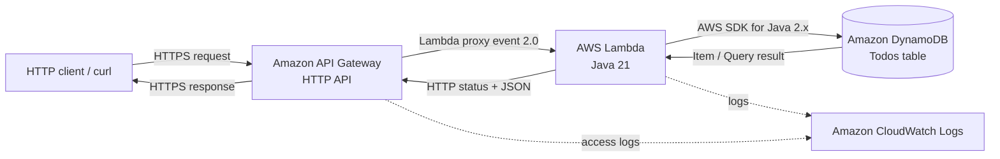

# Building a Serverless API with API Gateway, Lambda, and DynamoDB

In this hands-on lab, you build a small REST-style API to manage a todo list. Amazon API Gateway receives HTTP requests, AWS Lambda executes business logic in Java, and Amazon DynamoDB stores the data. The AWS Serverless Application Model (AWS SAM) declares all resources in a single template so you can build, deploy, test, and tear down the environment with repeatable commands.

This architecture illustrates a common serverless pattern: API Gateway is the interface layer, Lambda is the compute layer, and DynamoDB is the storage layer. You do not manage application servers or database servers yourself. AWS manages infrastructure operations; you remain responsible for API design, IAM permissions, data, security, observability, and cost.

## Learning Objectives

After this hands-on lab, you will be able to:

- Explain the request flow from API Gateway to Lambda and DynamoDB.
- Create an HTTP API with `GET`, `POST`, `PUT`, and `DELETE` routes.
- Write a Lambda handler in Java 21 using AWS SDK for Java 2.x.
- Grant least-privilege permissions for Lambda to read and write only the target DynamoDB table.
- Use AWS SAM to build, deploy, and manage the application lifecycle.
- Test the API with `curl` and monitor logs in Amazon CloudWatch.
- Recognize limitations of the basic CRUD pattern and understand how to scale it for production.

## 1. Lab Architecture

The `todos` management API exposes the following endpoints:

| Method | Path | Function |
|---|---|---|
| `GET` | `/todos` | List a page of todos |
| `POST` | `/todos` | Create a new todo |
| `GET` | `/todos/{id}` | Retrieve one todo by ID |
| `PUT` | `/todos/{id}` | Update title and completion status |
| `DELETE` | `/todos/{id}` | Delete a todo |



API Gateway routes requests by HTTP method and path. For HTTP APIs, API Gateway sends a payload format version 2.0 event to Lambda. Lambda reads `routeKey`, `pathParameters`, `queryStringParameters`, and `body`, then calls DynamoDB using the function's IAM execution role. Lambda returns an object with `statusCode`, `headers`, and `body`; API Gateway relays that response back to the client.

### Role of Each Service

| Service | Responsibility |
|---|---|
| Amazon API Gateway HTTP API | Provides HTTPS endpoints, routing, and Lambda integration |
| AWS Lambda | Runs the Java handler per invocation and scales automatically with requests |
| Amazon DynamoDB | Stores todos as items in a NoSQL table |
| AWS IAM | Grants permissions for Lambda to invoke only the required DynamoDB APIs |
| AWS SAM / CloudFormation | Declares, deploys, and manages resources as Infrastructure as Code |
| Amazon CloudWatch | Stores application logs and API access logs |

HTTP API is well suited for serverless APIs needing Lambda routing and integration with low cost and complexity. If you need specialized features such as API keys and usage plans, response caching, or advanced REST API configuration, evaluate API Gateway REST API.

## 2. Environment Preparation

You need:

- An AWS account with permissions to deploy CloudFormation, Lambda, API Gateway, DynamoDB, IAM, and CloudWatch Logs.
- AWS CLI configured with valid credentials.
- Current AWS SAM CLI version.
- JDK 21 and Apache Maven.
- Docker if you want to run `sam build --use-container` or `sam local start-api`.
- A Region supporting Lambda Java 21, API Gateway HTTP API, and DynamoDB.

Check tools:

```bash
aws --version
sam --version
java -version
mvn -version
aws sts get-caller-identity
```

`get-caller-identity` confirms the deploying principal. Never use root access keys or store long-term access keys in the project. Prefer IAM Identity Center or temporary roles/credentials for development environments.

Set a default Region, for example Singapore:

```bash
aws configure set region ap-southeast-1
```

Subsequent commands assume the AWS CLI uses the right profile and Region. If using a named profile, pass `--profile <profile-name>` to AWS CLI commands or export `AWS_PROFILE` in your shell.

## 3. Creating the Project Structure

Create the project directory:

```text
serverless-todo-api/
├── pom.xml
├── template.yaml
└── src/
    └── main/
        └── java/
            └── example/
                └── TodoHandler.java
```

`pom.xml` manages dependencies and packages the Java artifact. `template.yaml` defines the DynamoDB table, HTTP API, Lambda function, IAM policy, and endpoint outputs. `TodoHandler.java` contains the CRUD logic.

## 4. Declaring Maven Dependencies

Create `pom.xml`:

```xml
<project xmlns="http://maven.apache.org/POM/4.0.0"
         xmlns:xsi="http://www.w3.org/2001/XMLSchema-instance"
         xsi:schemaLocation="http://maven.apache.org/POM/4.0.0 https://maven.apache.org/xsd/maven-4.0.0.xsd">
    <modelVersion>4.0.0</modelVersion>

    <groupId>example</groupId>
    <artifactId>serverless-todo-api</artifactId>
    <version>1.0.0</version>
    <packaging>jar</packaging>

    <properties>
        <maven.compiler.release>21</maven.compiler.release>
        <project.build.sourceEncoding>UTF-8</project.build.sourceEncoding>
        <aws.sdk.version>2.31.54</aws.sdk.version>
        <jackson.version>2.18.2</jackson.version>
    </properties>

    <dependencyManagement>
        <dependencies>
            <dependency>
                <groupId>software.amazon.awssdk</groupId>
                <artifactId>bom</artifactId>
                <version>${aws.sdk.version}</version>
                <type>pom</type>
                <scope>import</scope>
            </dependency>
        </dependencies>
    </dependencyManagement>

    <dependencies>
        <dependency>
            <groupId>com.amazonaws</groupId>
            <artifactId>aws-lambda-java-core</artifactId>
            <version>1.2.3</version>
        </dependency>
        <dependency>
            <groupId>software.amazon.awssdk</groupId>
            <artifactId>dynamodb</artifactId>
        </dependency>
        <dependency>
            <groupId>com.fasterxml.jackson.core</groupId>
            <artifactId>jackson-databind</artifactId>
            <version>${jackson.version}</version>
        </dependency>
    </dependencies>

    <build>
        <plugins>
            <plugin>
                <groupId>org.apache.maven.plugins</groupId>
                <artifactId>maven-compiler-plugin</artifactId>
                <version>3.13.0</version>
                <configuration>
                    <release>21</release>
                </configuration>
            </plugin>
            <plugin>
                <groupId>org.apache.maven.plugins</groupId>
                <artifactId>maven-shade-plugin</artifactId>
                <version>3.6.0</version>
                <executions>
                    <execution>
                        <phase>package</phase>
                        <goals>
                            <goal>shade</goal>
                        </goals>
                        <configuration>
                            <createDependencyReducedPom>false</createDependencyReducedPom>
                            <filters>
                                <filter>
                                    <artifact>*:*</artifact>
                                    <excludes>
                                        <exclude>META-INF/*.SF</exclude>
                                        <exclude>META-INF/*.DSA</exclude>
                                        <exclude>META-INF/*.RSA</exclude>
                                    </excludes>
                                </filter>
                            </filters>
                        </configuration>
                    </execution>
                </executions>
            </plugin>
        </plugins>
    </build>
</project>
```

The project uses Lambda Java Core to declare the handler, AWS SDK for Java 2.x to call DynamoDB, and Jackson to parse/serialize JSON. The Maven Shade Plugin bundles dependencies into the deployable JAR. Dependency versions are pinned for reproducible builds; when starting a new project, check for security patches and update dependencies per your organization's version management policy.

## 5. Writing the Java Lambda Handler

Create `src/main/java/example/TodoHandler.java`:

```java
package example;

import com.amazonaws.services.lambda.runtime.Context;
import com.amazonaws.services.lambda.runtime.RequestHandler;
import com.fasterxml.jackson.core.JsonProcessingException;
import com.fasterxml.jackson.databind.JsonNode;
import com.fasterxml.jackson.databind.ObjectMapper;
import software.amazon.awssdk.services.dynamodb.DynamoDbClient;
import software.amazon.awssdk.services.dynamodb.model.AttributeValue;
import software.amazon.awssdk.services.dynamodb.model.ConditionalCheckFailedException;
import software.amazon.awssdk.services.dynamodb.model.DeleteItemRequest;
import software.amazon.awssdk.services.dynamodb.model.GetItemRequest;
import software.amazon.awssdk.services.dynamodb.model.PutItemRequest;
import software.amazon.awssdk.services.dynamodb.model.ReturnValue;
import software.amazon.awssdk.services.dynamodb.model.ScanRequest;
import software.amazon.awssdk.services.dynamodb.model.ScanResponse;
import software.amazon.awssdk.services.dynamodb.model.UpdateItemRequest;

import java.nio.charset.StandardCharsets;
import java.time.Instant;
import java.util.ArrayList;
import java.util.Base64;
import java.util.LinkedHashMap;
import java.util.List;
import java.util.Map;
import java.util.Objects;
import java.util.UUID;

public class TodoHandler implements RequestHandler<Map<String, Object>, Map<String, Object>> {

    private static final ObjectMapper JSON = new ObjectMapper();
    private static final DynamoDbClient DDB = DynamoDbClient.builder().build();
    private static final String TABLE_NAME = System.getenv("TABLE_NAME");
    private static final int PAGE_SIZE = 25;

    @Override
    public Map<String, Object> handleRequest(Map<String, Object> event, Context context) {
        String routeKey = Objects.toString(event.get("routeKey"), "");

        try {
            return switch (routeKey) {
                case "GET /todos" -> listTodos(event);
                case "POST /todos" -> createTodo(event);
                case "GET /todos/{id}" -> getTodo(event);
                case "PUT /todos/{id}" -> updateTodo(event);
                case "DELETE /todos/{id}" -> deleteTodo(event);
                default -> json(404, Map.of("message", "Route not found"));
            };
        } catch (IllegalArgumentException e) {
            return json(400, Map.of("message", e.getMessage()));
        } catch (Exception e) {
            context.getLogger().log("requestId=" + requestId(event)
                    + " route=" + routeKey
                    + " errorType=" + e.getClass().getSimpleName());
            return json(500, Map.of("message", "Internal server error"));
        }
    }

    private Map<String, Object> listTodos(Map<String, Object> event) throws JsonProcessingException {
        String nextToken = queryParameter(event, "nextToken");
        ScanRequest.Builder request = ScanRequest.builder()
                .tableName(TABLE_NAME)
                .limit(PAGE_SIZE);

        if (nextToken != null && !nextToken.isBlank()) {
            request.exclusiveStartKey(decodeToken(nextToken));
        }

        ScanResponse result = DDB.scan(request.build());
        List<Map<String, Object>> items = new ArrayList<>();
        for (Map<String, AttributeValue> item : result.items()) {
            items.add(toTodo(item));
        }

        Map<String, Object> body = new LinkedHashMap<>();
        body.put("items", items);
        body.put("count", items.size());
        body.put("nextToken", result.lastEvaluatedKey().isEmpty()
                ? null
                : encodeToken(result.lastEvaluatedKey()));
        return json(200, body);
    }

    private Map<String, Object> createTodo(Map<String, Object> event)
            throws JsonProcessingException {
        JsonNode body = parseBody(event);
        String title = requiredTitle(body);
        String id = UUID.randomUUID().toString();
        String createdAt = Instant.now().toString();

        Map<String, AttributeValue> item = new LinkedHashMap<>();
        item.put("id", stringValue(id));
        item.put("title", stringValue(title));
        item.put("completed", booleanValue(false));
        item.put("createdAt", stringValue(createdAt));

        DDB.putItem(PutItemRequest.builder()
                .tableName(TABLE_NAME)
                .item(item)
                .conditionExpression("attribute_not_exists(#id)")
                .expressionAttributeNames(Map.of("#id", "id"))
                .build());

        return json(201, Map.of(
                "id", id,
                "title", title,
                "completed", false,
                "createdAt", createdAt));
    }

    private Map<String, Object> getTodo(Map<String, Object> event)
            throws JsonProcessingException {
        String id = pathParameter(event, "id");
        var result = DDB.getItem(GetItemRequest.builder()
                .tableName(TABLE_NAME)
                .key(key(id))
                .consistentRead(true)
                .build());

        if (result.item().isEmpty()) {
            return json(404, Map.of("message", "Todo not found"));
        }
        return json(200, toTodo(result.item()));
    }

    private Map<String, Object> updateTodo(Map<String, Object> event)
            throws JsonProcessingException {
        String id = pathParameter(event, "id");
        JsonNode body = parseBody(event);
        String title = requiredTitle(body);
        if (!body.has("completed") || !body.get("completed").isBoolean()) {
            throw new IllegalArgumentException("Field 'completed' must be a boolean");
        }

        try {
            var result = DDB.updateItem(UpdateItemRequest.builder()
                    .tableName(TABLE_NAME)
                    .key(key(id))
                    .updateExpression("SET #title = :title, #completed = :completed, #updatedAt = :updatedAt")
                    .conditionExpression("attribute_exists(#id)")
                    .expressionAttributeNames(Map.of(
                            "#id", "id",
                            "#title", "title",
                            "#completed", "completed",
                            "#updatedAt", "updatedAt"))
                    .expressionAttributeValues(Map.of(
                            ":title", stringValue(title),
                            ":completed", booleanValue(body.get("completed").asBoolean()),
                            ":updatedAt", stringValue(Instant.now().toString())))
                    .returnValues(ReturnValue.ALL_NEW)
                    .build());
            return json(200, toTodo(result.attributes()));
        } catch (ConditionalCheckFailedException e) {
            return json(404, Map.of("message", "Todo not found"));
        }
    }

    private Map<String, Object> deleteTodo(Map<String, Object> event)
            throws JsonProcessingException {
        String id = pathParameter(event, "id");
        var result = DDB.deleteItem(DeleteItemRequest.builder()
                .tableName(TABLE_NAME)
                .key(key(id))
                .returnValues(ReturnValue.ALL_OLD)
                .build());

        if (result.attributes().isEmpty()) {
            return json(404, Map.of("message", "Todo not found"));
        }
        return json(200, Map.of("message", "Todo deleted", "id", id));
    }

    private static JsonNode parseBody(Map<String, Object> event) {
        Object rawBody = event.get("body");
        if (!(rawBody instanceof String body) || body.isBlank()) {
            throw new IllegalArgumentException("Request body is required");
        }
        try {
            JsonNode node = JSON.readTree(body);
            if (node == null || !node.isObject()) {
                throw new IllegalArgumentException("Request body must be a JSON object");
            }
            return node;
        } catch (JsonProcessingException e) {
            throw new IllegalArgumentException("Request body must be valid JSON");
        }
    }

    private static String requiredTitle(JsonNode body) {
        if (!body.has("title") || !body.get("title").isTextual()) {
            throw new IllegalArgumentException("Field 'title' must be a string");
        }
        String title = body.get("title").asText().trim();
        if (title.isEmpty() || title.length() > 200) {
            throw new IllegalArgumentException("Field 'title' must contain 1 to 200 characters");
        }
        return title;
    }

    private static String pathParameter(Map<String, Object> event, String name) {
        Object raw = event.get("pathParameters");
        if (raw instanceof Map<?, ?> values) {
            Object value = values.get(name);
            if (value instanceof String text && !text.isBlank()) {
                return text;
            }
        }
        throw new IllegalArgumentException("Missing path parameter: " + name);
    }

    private static String queryParameter(Map<String, Object> event, String name) {
        Object raw = event.get("queryStringParameters");
        if (raw instanceof Map<?, ?> values) {
            Object value = values.get(name);
            return value instanceof String text ? text : null;
        }
        return null;
    }

    private static Map<String, AttributeValue> key(String id) {
        return Map.of("id", stringValue(id));
    }

    private static AttributeValue stringValue(String value) {
        return AttributeValue.builder().s(value).build();
    }

    private static AttributeValue booleanValue(boolean value) {
        return AttributeValue.builder().bool(value).build();
    }

    private static Map<String, Object> toTodo(Map<String, AttributeValue> item) {
        Map<String, Object> todo = new LinkedHashMap<>();
        todo.put("id", item.get("id").s());
        todo.put("title", item.get("title").s());
        todo.put("completed", Boolean.TRUE.equals(item.get("completed").bool()));
        todo.put("createdAt", item.get("createdAt").s());
        if (item.containsKey("updatedAt")) {
            todo.put("updatedAt", item.get("updatedAt").s());
        }
        return todo;
    }

    private static String encodeToken(Map<String, AttributeValue> lastKey) {
        String id = lastKey.get("id").s();
        return Base64.getUrlEncoder().withoutPadding()
                .encodeToString(id.getBytes(StandardCharsets.UTF_8));
    }

    private static Map<String, AttributeValue> decodeToken(String token) {
        try {
            String id = new String(Base64.getUrlDecoder().decode(token), StandardCharsets.UTF_8);
            if (id.isBlank()) {
                throw new IllegalArgumentException("Invalid nextToken");
            }
            return key(id);
        } catch (IllegalArgumentException e) {
            throw new IllegalArgumentException("Invalid nextToken");
        }
    }

    private static String requestId(Map<String, Object> event) {
        Object raw = event.get("requestContext");
        if (raw instanceof Map<?, ?> context) {
            return Objects.toString(context.get("requestId"), "unknown");
        }
        return "unknown";
    }

    private static Map<String, Object> json(int statusCode, Object body)
            throws JsonProcessingException {
        return Map.of(
                "statusCode", statusCode,
                "headers", Map.of("content-type", "application/json; charset=utf-8"),
                "body", JSON.writeValueAsString(body));
    }
}
```

The handler uses `routeKey` from HTTP API payload 2.0 to dispatch operations. `TABLE_NAME` is read from an environment variable; the SDK automatically obtains credentials from the Lambda execution role and the Region from the runtime. Never put access keys/secret keys in code.

Listing todos uses `Scan` with a page size of 25 to demonstrate pagination. `nextToken` is a URL-safe cursor containing the last partition key of the page. Scan reads across the entire keyspace page by page, so it suits small demo tables; production systems should typically design partition keys by tenant/user and use `Query` to avoid full-table scans.

## 6. Declaring Infrastructure with AWS SAM

Create `template.yaml` in the project root:

```yaml
AWSTemplateFormatVersion: '2010-09-09'
Transform: AWS::Serverless-2016-10-31
Description: Todo API using API Gateway HTTP API, Lambda Java 21 and DynamoDB

Resources:
  TodosTable:
    Type: AWS::DynamoDB::Table
    Properties:
      TableName: !Sub '${AWS::StackName}-todos'
      BillingMode: PAY_PER_REQUEST
      AttributeDefinitions:
        - AttributeName: id
          AttributeType: S
      KeySchema:
        - AttributeName: id
          KeyType: HASH
      SSESpecification:
        SSEEnabled: true

  ApiAccessLogs:
    Type: AWS::Logs::LogGroup
    Properties:
      LogGroupName: !Sub '/aws/apigateway/${AWS::StackName}'
      RetentionInDays: 14

  TodoApi:
    Type: AWS::Serverless::HttpApi
    Properties:
      StageName: '$default'
      AccessLogSettings:
        DestinationArn: !GetAtt ApiAccessLogs.Arn
        Format: '$context.requestId $context.requestTime $context.httpMethod $context.routeKey $context.status'

  TodoFunction:
    Type: AWS::Serverless::Function
    Properties:
      FunctionName: !Sub '${AWS::StackName}-todo-api'
      CodeUri: .
      Handler: example.TodoHandler::handleRequest
      Runtime: java21
      MemorySize: 512
      Timeout: 10
      Tracing: Active
      Environment:
        Variables:
          TABLE_NAME: !Ref TodosTable
      Policies:
        - DynamoDBCrudPolicy:
            TableName: !Ref TodosTable
      Events:
        ListTodos:
          Type: HttpApi
          Properties:
            ApiId: !Ref TodoApi
            Path: /todos
            Method: GET
        CreateTodo:
          Type: HttpApi
          Properties:
            ApiId: !Ref TodoApi
            Path: /todos
            Method: POST
        GetTodo:
          Type: HttpApi
          Properties:
            ApiId: !Ref TodoApi
            Path: /todos/{id}
            Method: GET
        UpdateTodo:
          Type: HttpApi
          Properties:
            ApiId: !Ref TodoApi
            Path: /todos/{id}
            Method: PUT
        DeleteTodo:
          Type: HttpApi
          Properties:
            ApiId: !Ref TodoApi
            Path: /todos/{id}
            Method: DELETE

  TodoFunctionLogs:
    Type: AWS::Logs::LogGroup
    DependsOn: TodoFunction
    Properties:
      LogGroupName: !Sub '/aws/lambda/${AWS::StackName}-todo-api'
      RetentionInDays: 14

Outputs:
  ApiUrl:
    Description: HTTPS endpoint for the Todo HTTP API
    Value: !Sub 'https://${TodoApi}.execute-api.${AWS::Region}.amazonaws.com'
  TableName:
    Description: DynamoDB table used by the API
    Value: !Ref TodosTable
  FunctionName:
    Description: Lambda function name
    Value: !Ref TodoFunction
```

### Configuration Explanation

- `TodosTable` uses `id` as the partition key and `PAY_PER_REQUEST` for per-request billing. No need to provision read/write capacity for the lab.
- `TodoApi` is an API Gateway HTTP API with the `$default` stage. Access logs write request ID, timestamp, method, route, and status to CloudWatch Logs.
- `TodoFunction` uses the `java21` runtime, 10-second timeout, and 512 MB memory. These values are a starting point and should be benchmarked against real workloads.
- `DynamoDBCrudPolicy` is a SAM policy template scoping CRUD permissions to the specified table. Lambda does not need DynamoDB administrative permissions or access to other tables.
- The `HttpApi` events declare methods/paths. HTTP API uses payload format 2.0 by default, matching the `routeKey` read by the handler.
- Log groups use 14-day retention to avoid retaining logs indefinitely in a lab environment.

The template configures no authorizer, so the demo endpoint is publicly callable over the Internet. Use test data only; never send personal data or confidential information to this API. The production security section below explains how to add authentication and authorization.

## 7. Building and Validating the Template

From the `serverless-todo-api` directory, run:

```bash
mvn clean package
sam validate --lint
sam build
```

`mvn clean package` compiles Java and produces the shaded JAR containing dependencies. `sam validate --lint` validates the template; if `cfn-lint` is not installed or your SAM version does not support `--lint`, run `sam validate` and resolve warnings per your environment. `sam build` prepares the artifacts for deployment.

To build inside a Lambda-compatible container:

```bash
sam build --use-container
```

This command requires Docker to be running. For Java projects, SAM invokes Maven to compile source code and package the artifact per `pom.xml`.

## 8. Deploying the Stack

Run the initial deployment:

```bash
sam deploy --guided --capabilities CAPABILITY_IAM
```

When prompted, enter:

| Prompt | Suggested Value |
|---|---|
| Stack Name | `serverless-todo-api` |
| AWS Region | `ap-southeast-1` or your chosen Region |
| Confirm changes before deploy | `Y` in environments requiring review |
| Allow SAM CLI IAM role creation | `Y` |
| Disable rollback | `N` |
| Save arguments to configuration file | `Y` |

SAM creates the CloudFormation stack, DynamoDB table, HTTP API, Lambda function, execution role, and log groups. CloudFormation displays deployment progress. Wait for the stack to reach `CREATE_COMPLETE` before calling the API.

Retrieve the API URL from stack outputs:

```bash
aws cloudformation describe-stacks \
  --stack-name serverless-todo-api \
  --query "Stacks[0].Outputs[?OutputKey=='ApiUrl'].OutputValue" \
  --output text
```

Assign the result to `API_URL` in your shell:

```bash
API_URL="https://example.execute-api.ap-southeast-1.amazonaws.com"
```

Replace the illustrative URL with the actual endpoint returned by CloudFormation. Once SAM saves deployment parameters to `samconfig.toml`, subsequent runs can execute `sam deploy` without re-entering prompts.

## 9. Testing the API with curl

### 9.1 Create a Todo

```bash
curl -i -X POST "$API_URL/todos" \
  -H "content-type: application/json" \
  -d '{"title":"Learn API Gateway and Lambda"}'
```

Expected result is HTTP `201 Created` with JSON containing `id`, `title`, `completed=false`, and `createdAt`. Save `id` to test the remaining endpoints.

### 9.2 List Todos

```bash
curl -i "$API_URL/todos"
```

The response includes `items`, `count`, and `nextToken`. When another page exists, pass the token:

```bash
curl -i "$API_URL/todos?nextToken=PASTE_NEXT_TOKEN"
```

When `nextToken` is `null`, you have reached the last page. The token is solely a pagination cursor, not an access token or authentication mechanism.

### 9.3 Get One Todo

```bash
curl -i "$API_URL/todos/PASTE_TODO_ID"
```

If the ID does not exist, the API returns `404 Not Found`.

### 9.4 Update a Todo

```bash
curl -i -X PUT "$API_URL/todos/PASTE_TODO_ID" \
  -H "content-type: application/json" \
  -d '{"title":"Complete serverless API lab","completed":true}'
```

`PUT` requires both `title` and `completed`. Lambda uses `UpdateItem` with condition `attribute_exists(id)` to prevent accidentally creating a new item when the ID does not exist. The response returns the updated item, including `updatedAt`.

### 9.5 Delete a Todo

```bash
curl -i -X DELETE "$API_URL/todos/PASTE_TODO_ID"
```

If the item exists, the API returns `200 OK` with a deletion message. If the item does not exist, the API returns `404 Not Found`.

### 9.6 Test Validation

Send a request with a blank title:

```bash
curl -i -X POST "$API_URL/todos" \
  -H "content-type: application/json" \
  -d '{"title":"   "}'
```

Expected result is HTTP `400 Bad Request`. Sending malformed JSON also returns `400`. Internal errors are logged and return `500 Internal Server Error` without leaking stack traces or sensitive AWS details to the client.

## 10. Monitoring with CloudWatch

### 10.1 Lambda Logs

Lambda writes logs to the log group:

```text
/aws/lambda/<stack-name>-todo-api
```

You can tail logs using SAM:

```bash
sam logs \
  --stack-name serverless-todo-api \
  --name TodoFunction \
  --tail
```

Sample error logs emitted by the handler include request ID, route, and exception type. Do not log full request bodies if bodies may contain sensitive data.

### 10.2 API Access Logs

API Gateway writes access logs to:

```text
/aws/apigateway/<stack-name>
```

Logs correlate request ID, method, route, and status. Use the request ID to link API access logs with Lambda logs during investigation. Access logs do not replace application logs: they show how a request traversed the API, while Lambda logs explain internal execution.

### 10.3 Metrics to Monitor

| Service | Metric / Signal | Meaning |
|---|---|---|
| API Gateway | `Count`, `4xx`, `5xx`, `Latency`, `IntegrationLatency` | Traffic volume, client/server errors, and integration latency |
| Lambda | `Invocations`, `Errors`, `Duration`, `Throttles`, `ConcurrentExecutions` | Invocation counts, errors, runtime duration, and concurrency limits |
| DynamoDB | `ConsumedReadCapacityUnits`, `ConsumedWriteCapacityUnits`, `ThrottledRequests`, `SystemErrors` | Consumption levels and throttling |

With DynamoDB on-demand, watch throttling and request rates to detect sudden traffic spikes. In Lambda, if `Duration` climbs while DynamoDB shows no throttling, check serialization, cold starts, retries, or application logic.

## 11. Understanding IAM Permissions in This Architecture

There are two separate permission paths:

1. **Users calling the API:** the HTTP API endpoint currently has no authorizer, so requests reach public routes.
2. **Lambda calling DynamoDB:** Lambda uses the execution role created by SAM. `DynamoDBCrudPolicy` grants the actions needed for CRUD on `TodosTable`.

Lambda never receives access keys from API callers. The SDK uses temporary credentials from the execution role via the Lambda runtime. This avoids storing long-term access keys in source code or environment variables.

If Lambda receives `AccessDeniedException`, verify:

- Does the function use the exact execution role created by SAM?
- Does `DynamoDBCrudPolicy` reference the exact `TodosTable`?
- Does the table name in `TABLE_NAME` match the deployed table name?
- Are any permissions boundaries, SCPs, or explicit denies blocking the action?
- Does the DynamoDB client's Region match the table's Region?

If API Gateway returns `500` with no Lambda logs, check the integration, Lambda invoke permissions, and route configuration. If Lambda executes but DynamoDB rejects requests, focus on the execution role and table ARN.

## 12. Securing the API Before Production

The lab endpoint omits authentication so you can focus on the integration flow. Do not deploy this endpoint with real data or broaden access without adding authorization.

### 12.1 Choosing an Authentication Mechanism

HTTP API supports JWT authorizers, Lambda authorizers, and IAM authorization per route. Choose based on client type:

| Client | Implementation Approach |
|---|---|
| Web/mobile app using OAuth 2.0/OIDC | JWT authorizer, such as Amazon Cognito or an OIDC provider |
| AWS workload calling the API | IAM authorization and SigV4 |
| System needing custom auth logic | Lambda authorizer |
| Internal API over private network | Consider private integrations/network controls alongside authorization |

With a JWT authorizer, API Gateway validates issuer, audience, and token claims before invoking Lambda. The backend must still inspect claims and map the user/tenant into data query conditions.

### 12.2 Isolating Data by User/Tenant

The lab example uses `id` as the partition key without user authentication. If multiple users access the API, never just add a JWT authorizer while leaving the CRUD logic unchanged: any valid user could still read or modify another user's items if the handler does not enforce ownership.

Production designs commonly use a partition key like `tenantId` or `userId` and sort key `todoId`, then call `Query` with the value taken from the verified backend claim. Never trust a `userId` sent by the client in JSON or query strings. Take identity strictly from the API Gateway-verified authorizer context.

### 12.3 CORS, Validation, and Request Limits

If calling the API from a browser, configure CORS for the exact allowed origins, methods, and headers. Do not use wildcard origins if the API handles private data or relies on cookies/credentials.

In addition to validation inside Lambda, consider:

- Request body size limits and request rate caps.
- Rate limiting/throttling per route and client.
- Content-type and request schema validation.
- Standardized error responses that never expose stack traces or internal ARNs.
- WAF where API Gateway architecture and protection needs warrant it.
- Authentication and authorization on every read/write operation.

### 12.4 IAM Least Privilege

SAM policy templates scope DynamoDB permissions to a specific table. For production, you can replace policy templates with custom policies listing only the exact actions needed. If an API is read-only, omit `PutItem`, `UpdateItem`, and `DeleteItem`. If it only uses `Query`, avoid granting `Scan`.

## 13. Extending the Architecture and Optimizing DynamoDB

### 13.1 Replacing Scan with Query

`Scan` reads items sequentially across the table and can consume substantial read capacity as data grows. It works for small lab datasets but is rarely suitable for production list APIs.

A tenant-aware model can use:

```text
Partition key: tenantId
Sort key: todoId
Attributes: title, completed, createdAt, updatedAt
```

The API extracts `tenantId` from the verified JWT claim and calls `Query` against that partition key. Sort keys enable pagination, chronological sorting, or fetching item groups. Design access patterns before finalizing your key schema.

### 13.2 Idempotency and Concurrency

HTTP clients may retry requests after timeouts, submitting todo creation multiple times. When idempotency is required, clients send an idempotency key; Lambda stores the key and outcome or uses a client/backend-generated ID with conditional writes to prevent duplicate records.

`PUT` in this lab uses `attribute_exists(id)` to avoid inadvertently upserting nonexistent items. When multiple clients update the same item, add optimistic locking with a `version` attribute and a condition expression.

### 13.3 API Versioning and Splitting Functions

One Lambda handling multiple routes keeps the lab concise, but larger applications should consider splitting handlers by bounded context or route group to reduce coupling, isolate permissions, and enable independent deployments. You can version APIs via `/v1/todos` prefixes or custom domain mappings while preserving backward compatibility during client transitions.

### 13.4 Cold Starts and Java Performance

Java can experience cold starts due to JVM initialization and dependency loading. Mitigations include:

- Keep the AWS SDK client and `ObjectMapper` in static scope to reuse across invocations in the same execution environment.
- Include only necessary dependencies and minimize deployment package size.
- Measure `Duration` and p95/p99 latency before increasing memory or enabling optimizations.
- Evaluate SnapStart for supported runtimes/Regions and workloads if cold starts impact SLAs.
- Use Provisioned Concurrency when consistent startup latency is required and capacity retention costs are acceptable.

Do not increase memory or enable Provisioned Concurrency based on guesswork. Measure cold starts, duration, and concurrency under production-like conditions.

## 14. Troubleshooting

| Symptom | Common Cause | How to Check |
|---|---|---|
| `sam build` cannot find Java/Maven | JDK or Maven not installed, or wrong `JAVA_HOME`/PATH | Run `java -version` and `mvn -version` |
| `sam validate` reports template error | YAML indentation, intrinsic function, or SAM property error | Read the reported line/field; run `sam validate --lint` |
| CloudFormation reports `CAPABILITY_IAM` | Template creates IAM role/policy without capability acknowledgment | Deploy with `--capabilities CAPABILITY_IAM` |
| Lambda returns `500` when calling DynamoDB | Table name, IAM policy, Region, or DynamoDB exception | Inspect Lambda logs and verify `TABLE_NAME` |
| API returns `404` | Mismatched route/method or todo ID does not exist | Verify `routeKey`, path, and ID |
| API returns `400` | Malformed JSON or missing `title`/`completed` | Inspect request body and `content-type` |
| Lambda is not invoked | Incorrect route integration or Lambda invoke permission | Check API routes, integration, and Lambda resource-based policy |
| DynamoDB `AccessDeniedException` | Execution role lacks action or policy targets wrong table | Check role and CloudFormation-generated policy |
| DynamoDB throttling | Load exceeds capacity or hot partition access pattern | Inspect CloudWatch metrics, partition keys, and request rates |
| Browser reports CORS error | Origin/method/header not permitted | Configure CORS on HTTP API and verify `OPTIONS` preflight |
| Logs do not appear | Execution role lacks logging permissions or wrong log group/Region | Check Lambda role, Region, and log group name |

Investigation workflow:

1. Record HTTP status, API request ID, and timestamp.
2. Check API access logs for route, status, and integration behavior.
3. Inspect Lambda invocation, error, and duration metrics.
4. Open Lambda logs filtered by request ID or timestamp.
5. For DynamoDB errors, verify table, Region, keys, and execution role.
6. For pre-Lambda errors, check API routes, integration, authorizer, and invoke permissions.

## 15. Resource Cleanup

After completing the lab, delete the stack to avoid ongoing charges:

```bash
sam delete --stack-name serverless-todo-api
```

Or use CloudFormation delete stack. The lab template does not set `DeletionPolicy: Retain` on the DynamoDB table, so the table is deleted with the stack. Export any data you wish to keep beforehand. If you change the template to `Retain`, clean up the remaining table and log groups separately.

Verify the CloudFormation stack is deleted and no unnecessary related resources remain. Stack-managed CloudWatch log groups, API endpoints, Lambda functions, IAM roles, and the DynamoDB table are cleaned up with the stack lifecycle.

## 16. Extension Exercises

Once basic CRUD works, try the following enhancements:

1. Add `PATCH /todos/{id}` to update only a single field.
2. Add a JWT authorizer with Amazon Cognito and read `sub` from the authorizer context.
3. Change the DynamoDB key schema to `userId` + `todoId`, then replace `Scan` with `Query`.
4. Add a GSI to query todos by `completed` status or creation timestamp.
5. Add DynamoDB TTL for temporary items and test asynchronous expiration.
6. Enable X-Ray tracing and compare API Gateway, Lambda, and DynamoDB latencies.
7. Write unit tests for validation, route mapping, and error handling.
8. Create `dev` and `prod` stages with distinct logging, authorizer, and throttling settings.
9. Add an idempotency key for `POST` and optimistic locking for `PUT`.
10. Configure a custom domain and TLS certificate for a user-friendly endpoint.

## 17. Lab Completion Checklist

- [ ] AWS CLI, SAM CLI, JDK 21, and Maven work properly.
- [ ] `pom.xml` declares Lambda Core, AWS SDK DynamoDB, and Jackson.
- [ ] Java handler implements all five routes accurately.
- [ ] SAM template creates the HTTP API, Lambda, DynamoDB table, and IAM policy.
- [ ] `sam validate` and `sam build` succeed.
- [ ] `sam deploy --guided` creates the stack cleanly.
- [ ] `POST /todos` returns HTTP 201.
- [ ] `GET /todos` returns the list and a cursor when more pages exist.
- [ ] `GET /todos/{id}` returns the item or 404.
- [ ] `PUT /todos/{id}` updates the item without unintentionally creating a new one.
- [ ] `DELETE /todos/{id}` deletes the item.
- [ ] Invalid requests return 400.
- [ ] CloudWatch contains API access logs and Lambda logs.
- [ ] Understood that the lab endpoint is public and lacks authorization.
- [ ] Deleted the stack after practicing or documented a clear retention plan.

## 18. Common Misconceptions

| Misconception | Accurate Understanding |
|---|---|
| API Gateway calls DynamoDB directly in this lab | API Gateway invokes Lambda; Lambda calls DynamoDB via the AWS SDK |
| Lambda needs access keys stored in environment variables | Lambda uses temporary credentials from its execution role |
| `DynamoDBCrudPolicy` grants permissions to API callers | The policy attaches to the Lambda execution role, not API clients |
| A DynamoDB table creates an API endpoint automatically | The table only stores data; API Gateway provides the HTTP endpoint |
| HTTP API and REST API share every single feature | They differ in features, configuration options, and pricing |
| `Scan` fits every list API | Scan becomes costly on large tables; production typically uses `Query` aligned to access patterns |
| Adding a JWT authorizer automatically isolates user data | The handler must still use verified identity claims to scope data access |
| Deleting a stack always preserves data | The DynamoDB table in the lab template is deleted with the stack unless `Retain` is set |
| Raising Lambda timeout fixes every slow request | You must locate the bottleneck across API Gateway, Lambda, DynamoDB, or networking |

## References

- [Tutorial: Create a CRUD HTTP API with Lambda and DynamoDB](https://docs.aws.amazon.com/apigateway/latest/developerguide/http-api-dynamo-db.html)
- [AWS Lambda Java runtimes](https://docs.aws.amazon.com/lambda/latest/dg/lambda-java.html)
- [Define a Lambda handler in Java](https://docs.aws.amazon.com/lambda/latest/dg/java-handler.html)
- [AWS SDK for Java 2.x DynamoDB examples](https://docs.aws.amazon.com/code-library/latest/ug/java_2_dynamodb_code_examples.html)
- [AWS SAM HttpApi event](https://docs.aws.amazon.com/serverless-application-model/latest/developerguide/sam-property-function-httpapi.html)
- [AWS SAM HttpApi resource](https://docs.aws.amazon.com/serverless-application-model/latest/developerguide/sam-resource-httpapi.html)
- [AWS SAM DynamoDBCrudPolicy](https://docs.aws.amazon.com/serverless-application-model/latest/developerguide/serverless-policy-template-list.html)
- [Build and deploy a serverless application with AWS SAM](https://docs.aws.amazon.com/serverless-application-model/latest/developerguide/using-sam-cli.html)
- [Amazon DynamoDB Scan API](https://docs.aws.amazon.com/amazondynamodb/latest/APIReference/API_Scan.html)
- [Amazon DynamoDB Query API](https://docs.aws.amazon.com/amazondynamodb/latest/APIReference/API_Query.html)
- [HTTP API JWT authorizers](https://docs.aws.amazon.com/apigateway/latest/developerguide/http-api-jwt-authorizer.html)
- [HTTP API IAM authorization](https://docs.aws.amazon.com/apigateway/latest/developerguide/http-api-access-control-iam.html)
- [Logging for HTTP APIs](https://docs.aws.amazon.com/apigateway/latest/developerguide/http-api-logging.html)
- [Lambda monitoring and observability](https://docs.aws.amazon.com/lambda/latest/dg/lambda-monitoring.html)
