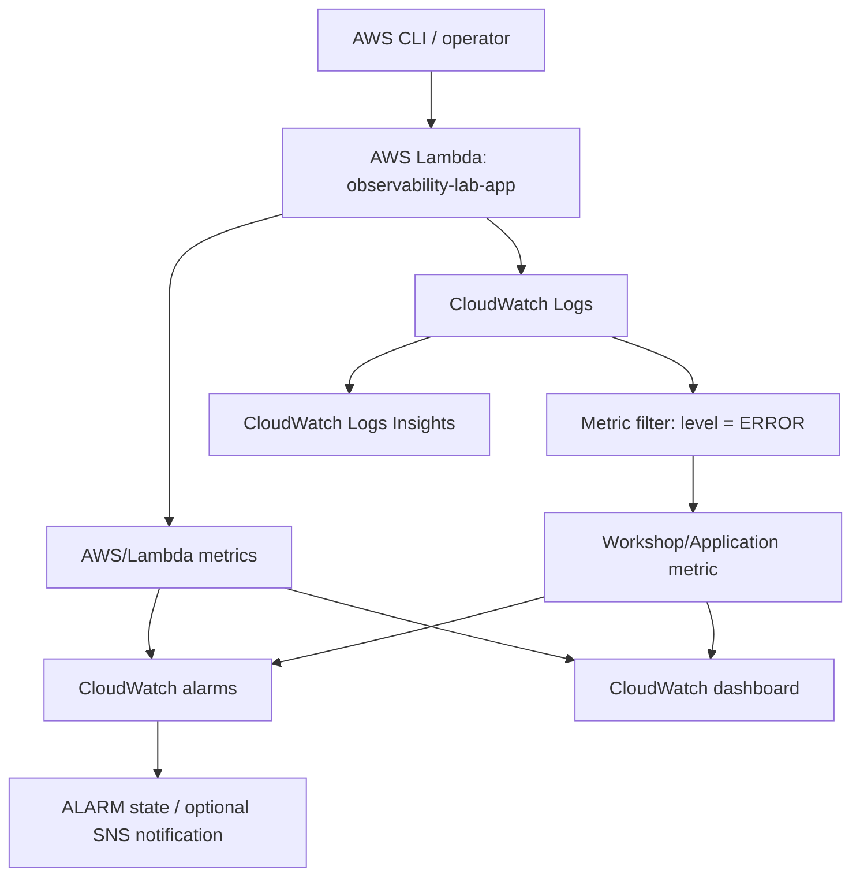

# Creating Dashboards, Alerts, and Practicing Application Error Investigation

An application may continue accepting requests while starting to return errors, slow down, or time out. Waiting for users to report incidents means operations teams detect problems late and struggle to pinpoint root causes. Amazon CloudWatch provides metrics, logs, dashboards, and alarms to observe application health, detect anomalies, and investigate individual requests.

In this hands-on lab, you create a small AWS Lambda function as a sample application. The function has three modes: normal execution, slow execution, and intentional failure. You will invoke the function, read JSON logs, create a metric filter for application errors, set up CloudWatch alarms, and build a dashboard tracking invocations, errors, throttles, duration, and application error counts. Next, you investigate a failed invocation using its request ID and Logs Insights, confirm alarms transition to `ALARM`, and clean up resources.

This lesson belongs to the `CLOUD_PROVIDERS_AWS` module, connecting IAM, serverless compute, CloudWatch, logging, monitoring, and troubleshooting. You will practice within a single Region and sandbox AWS account.

After this lab, you will be able to:

- Create a Lambda function with structured logging and normal/slow/fail scenarios.
- Distinguish Lambda service metrics from application-level metrics.
- Create a CloudWatch Logs metric filter to turn log events into custom metrics.
- Create CloudWatch alarms with thresholds, evaluation periods, and missing-data behavior.
- Build a CloudWatch dashboard displaying health, latency, and error trends.
- Use CloudWatch Logs Insights to find errors and correlate by request ID.
- Read alarm history, metric graphs, and logs to identify root causes.
- Delete lab resources upon completion.

## 1. Architecture and Lab Workflow

You will use a Lambda function invoked directly via the AWS CLI. This focuses on application observability and CloudWatch without provisioning an API Gateway or servers.



Signals used:

| Signal | Source | Purpose |
|---|---|---|
| `Invocations` | `AWS/Lambda` | Number of times the function was invoked |
| `Errors` | `AWS/Lambda` | Number of invocations ending in a function error |
| `Throttles` | `AWS/Lambda` | Number of throttled invocations |
| `Duration` | `AWS/Lambda` | Function execution duration |
| `ApplicationErrorCount` | Log metric filter | Number of log events with level `ERROR` |
| `Request ID`, `errorCode` | CloudWatch Logs | Investigate a specific execution |
| Alarm state | CloudWatch Alarms | Detect and notify when thresholds are breached |

Lambda `Errors` is a service metric: it counts invocations that terminate with an error. `ApplicationErrorCount` is a custom metric produced by a metric filter from logs. The two figures often correlate but are not necessarily equal. For instance, an application might log `ERROR`, handle a fallback, and return success; in that case application errors rise while Lambda `Errors` does not.

## 2. Environment Preparation

You need:

- A sandbox AWS account or authorized practice environment.
- Permissions to create/update/delete Lambda functions and execution roles.
- `iam:PassRole` permission for the role used by Lambda.
- Permissions to read/write CloudWatch Logs, create metric filters, dashboards, and alarms.
- AWS CLI v2 signed in with a valid profile/role, or AWS CloudShell.
- A consistent Region, such as `ap-southeast-1`.

`AdministratorAccess` is not required if an administrator can grant the minimum permissions for this lab. Do not use production accounts or logs containing real user data.

Verify identity and Region:

```bash
aws sts get-caller-identity
aws configure get region
```

If Region is not configured yet, set variables for commands in CloudShell:

```bash
export AWS_REGION=ap-southeast-1
export AWS_DEFAULT_REGION="$AWS_REGION"
export FUNCTION_NAME=observability-lab-app
export DASHBOARD_NAME=observability-lab-dashboard
export LOG_GROUP="/aws/lambda/${FUNCTION_NAME}"
```

`AWS_DEFAULT_REGION` is the Region environment variable used by the AWS CLI; `AWS_REGION` ensures SDKs/app runtimes use the same Region. If using a different Region, substitute it consistently across all steps. Do not mix dashboards, alarms, Lambda functions, and SNS topics across Regions.

## 3. Creating the Sample Lambda Function

Open the AWS Lambda Console, choose the right Region, then:

1. Choose **Create function**.
2. Choose **Author from scratch**.
3. Function name: `observability-lab-app`.
4. Runtime: **Python 3.12**.
5. Architecture: **x86_64**.
6. Execution role: create a new role with basic CloudWatch Logs permissions.
7. Choose **Create function**.

Lambda requires an execution role permitted to create log streams and write log events, typically granted via managed policy `AWSLambdaBasicExecutionRole`. Do not grant S3, DynamoDB, or Administrator permissions to this sample function.

In the **Code** tab, replace `lambda_function.py` with:

```python
import json
import time


def emit_log(level, event_name, request_id, **fields):
    record = {
        "level": level,
        "event": event_name,
        "requestId": request_id,
        **fields,
    }
    print(json.dumps(record, separators=(",", ":")))


def lambda_handler(event, context):
    event = event or {}
    mode = event.get("mode", "normal")
    request_id = context.aws_request_id

    emit_log(
        "INFO",
        "request_started",
        request_id,
        mode=mode,
    )

    if mode == "slow":
        time.sleep(2.5)

    if mode == "fail":
        emit_log(
            "ERROR",
            "simulated_dependency_failure",
            request_id,
            errorCode="SIMULATED_DEPENDENCY_TIMEOUT",
            dependency="inventory-service",
        )
        raise RuntimeError("SIMULATED_DEPENDENCY_TIMEOUT")

    result = {
        "ok": True,
        "mode": mode,
        "requestId": request_id,
    }

    emit_log(
        "INFO",
        "request_completed",
        request_id,
        mode=mode,
    )

    return result
```

Choose **Deploy** to update the code.

Set the function timeout to 10 seconds under **Configuration → General configuration → Edit → Timeout**, or use the CLI:

```bash
aws lambda update-function-configuration \
  --function-name "$FUNCTION_NAME" \
  --timeout 10
```

Lambda's default timeout is 3 seconds; raising it to 10 seconds lets `slow` mode sleep for 2.5 seconds without being affected by cold starts or initialization overhead.
Wait until `LastUpdateStatus` shows `Successful` before invoking the function.

The function logs each event as a single-line JSON object. When `mode=fail`, the function emits a log with `level=ERROR` and then raises an exception. Lambda records that invocation as an error and captures a traceback in logs. When `mode=slow`, the function sleeps 2.5 seconds so you can observe `Duration`.

## 4. Testing the Function and CloudWatch Log Group

Run a normal invocation:

```bash
aws lambda invoke \
  --function-name "$FUNCTION_NAME" \
  --cli-binary-format raw-in-base64-out \
  --payload '{"mode":"normal"}' \
  normal-response.json

cat normal-response.json
```

Expected response contains `ok=true`, `mode=normal`, and `requestId`.

Check the function configuration:

```bash
aws lambda get-function-configuration \
  --function-name "$FUNCTION_NAME" \
  --query '{State:State,Runtime:Runtime,Timeout:Timeout,MemorySize:MemorySize,Role:Role,LastUpdateStatus:LastUpdateStatus}'
```

After the first invocation, Lambda typically creates the log group:

```text
/aws/lambda/observability-lab-app
```

Inspect the log group:

```bash
aws logs describe-log-groups \
  --log-group-name-prefix "$LOG_GROUP" \
  --query 'logGroups[*].{Name:logGroupName,Retention:retentionInDays,StoredBytes:storedBytes}'
```

If the log group does not appear, confirm the function executed and the execution role has `logs:CreateLogGroup`, `logs:CreateLogStream`, and `logs:PutLogEvents`.

## 5. Creating a Metric Filter from Application Logs

A CloudWatch Logs metric filter matches patterns in log events and emits custom metrics when events match. In this lab, every log record with `level=ERROR` increments `ApplicationErrorCount` by 1.

Create the metric filter:

```bash
aws logs put-metric-filter \
  --log-group-name "$LOG_GROUP" \
  --filter-name ApplicationErrors \
  --filter-pattern '{ $.level = "ERROR" }' \
  --metric-transformations \
    metricName=ApplicationErrorCount,metricNamespace=Workshop/Application,metricValue=1,unit=Count
```

Verify the filter:

```bash
aws logs describe-metric-filters \
  --log-group-name "$LOG_GROUP" \
  --filter-name-prefix ApplicationErrors
```

Metric filters only process log events ingested after the filter is created; they do not retroactively scan historical logs. Therefore, you must create the filter before generating errors in the next step.

Never add high-cardinality dimensions such as request ID or user ID to a metric filter. High-cardinality dimensions create large numbers of custom metrics and raise costs. Keep request IDs inside logs for investigation rather than using them as metric dimensions.

## 6. Creating CloudWatch Alarms

You will create two alarms:

- Lambda `Errors`: detects invocations terminating with an exception.
- `ApplicationErrorCount`: detects log events at level `ERROR`.

In CloudWatch, metric data can take a few minutes to appear after an invocation. Alarms may initially sit in `INSUFFICIENT_DATA` until matching metric datapoints arrive.

### 6.1. Alarm for Lambda Errors

```bash
aws cloudwatch put-metric-alarm \
  --alarm-name "${FUNCTION_NAME}-lambda-errors" \
  --namespace AWS/Lambda \
  --metric-name Errors \
  --dimensions Name=FunctionName,Value="$FUNCTION_NAME" \
  --statistic Sum \
  --period 60 \
  --evaluation-periods 1 \
  --datapoints-to-alarm 1 \
  --threshold 1 \
  --comparison-operator GreaterThanOrEqualToThreshold \
  --treat-missing-data notBreaching
```

Parameters explained:
- `period=60`: aggregates metrics in 60-second windows.
- `evaluation-periods=1`: evaluates one period.
- `datapoints-to-alarm=1`: a single breaching datapoint triggers `ALARM`.
- `threshold=1`: one error in the period is enough.
- `treat-missing-data=notBreaching`: when datapoints are absent, treat the period as non-breaching.

This threshold suits a lab so alarms transition quickly. Production systems must set thresholds based on baselines, traffic volume, and severity; a single error might warrant only a warning if the application implements retries/fallbacks.

### 6.2. Alarm for ApplicationErrorCount

```bash
aws cloudwatch put-metric-alarm \
  --alarm-name "${FUNCTION_NAME}-application-errors" \
  --namespace Workshop/Application \
  --metric-name ApplicationErrorCount \
  --statistic Sum \
  --period 60 \
  --evaluation-periods 1 \
  --datapoints-to-alarm 1 \
  --threshold 1 \
  --comparison-operator GreaterThanOrEqualToThreshold \
  --treat-missing-data notBreaching
```

This metric has no dimensions. If you add dimensions later, the alarm must specify the exact matching dimension set.

### 6.3. Checking Alarms

```bash
aws cloudwatch describe-alarms \
  --alarm-names \
    "${FUNCTION_NAME}-lambda-errors" \
    "${FUNCTION_NAME}-application-errors" \
  --query 'MetricAlarms[*].{Name:AlarmName,State:StateValue,Reason:StateReason,Metric:MetricName}'
```

Before errors occur, alarms may be `OK` or `INSUFFICIENT_DATA` depending on metric data. After generating errors, inspect `State` and `Reason`.

### 6.4. (Optional) Sending Notifications via SNS

To receive email when an alarm transitions to `ALARM`, create an SNS topic and subscription:

```bash
export TOPIC_ARN=$(aws sns create-topic \
  --name observability-lab-alerts \
  --query TopicArn --output text)

aws sns subscribe \
  --topic-arn "$TOPIC_ARN" \
  --protocol email \
  --notification-endpoint your-email@example.com
```

Replace the sample email with your address and confirm the subscription in your inbox. Then update the alarm with `--alarm-actions "$TOPIC_ARN"`. When using custom SNS topic policies, ensure CloudWatch is authorized to publish to the topic. You can still practice alarm state transitions without enabling SNS.

Example updating the Lambda Errors alarm to notify the topic (keeping the existing evaluation settings):

```bash
aws cloudwatch put-metric-alarm \
  --alarm-name "${FUNCTION_NAME}-lambda-errors" \
  --namespace AWS/Lambda \
  --metric-name Errors \
  --dimensions Name=FunctionName,Value="$FUNCTION_NAME" \
  --statistic Sum \
  --period 60 \
  --evaluation-periods 1 \
  --datapoints-to-alarm 1 \
  --threshold 1 \
  --comparison-operator GreaterThanOrEqualToThreshold \
  --treat-missing-data notBreaching \
  --alarm-actions "$TOPIC_ARN"
```

## 7. Creating the CloudWatch Dashboard

The dashboard displays three groups of signals:
- Invocation, error, and throttle counts.
- Duration p95.
- Custom application error count.

Create `dashboard.json` in CloudShell using an editor, paste the entire JSON block below, and save it in the current directory:

```json
{
  "widgets": [
    {
      "type": "metric",
      "x": 0,
      "y": 0,
      "width": 12,
      "height": 6,
      "properties": {
        "view": "timeSeries",
        "region": "ap-southeast-1",
        "title": "Lambda invocations, errors and throttles",
        "period": 60,
        "stat": "Sum",
        "metrics": [
          ["AWS/Lambda", "Invocations", "FunctionName", "observability-lab-app"],
          [".", "Errors", ".", "."],
          [".", "Throttles", ".", "."]
        ]
      }
    },
    {
      "type": "metric",
      "x": 12,
      "y": 0,
      "width": 12,
      "height": 6,
      "properties": {
        "view": "timeSeries",
        "region": "ap-southeast-1",
        "title": "Lambda duration p95",
        "period": 60,
        "stat": "p95",
        "metrics": [
          ["AWS/Lambda", "Duration", "FunctionName", "observability-lab-app"]
        ]
      }
    },
    {
      "type": "metric",
      "x": 0,
      "y": 6,
      "width": 12,
      "height": 6,
      "properties": {
        "view": "timeSeries",
        "region": "ap-southeast-1",
        "title": "Application errors from log filter",
        "period": 60,
        "stat": "Sum",
        "metrics": [
          ["Workshop/Application", "ApplicationErrorCount"]
        ]
      }
    }
  ]
}
```

If using another Region or function name, replace `region` and `observability-lab-app` in the JSON.

Publish the dashboard:

```bash
aws cloudwatch put-dashboard \
  --dashboard-name "$DASHBOARD_NAME" \
  --dashboard-body file://dashboard.json
```

Open CloudWatch Console → Dashboards → `observability-lab-dashboard`. Set the time range to 1 hour or 3 hours and refresh the dashboard after generating traffic.

A dashboard is strictly a visualization layer. It does not create alarms or fix errors on its own; alarms are configured separately as in the previous step.

## 8. Generating Normal, Slow, and Error Traffic

The metric filter is active and alarms are created. Now trigger all three scenarios.

### 8.1. Normal Invocation

```bash
aws lambda invoke \
  --function-name "$FUNCTION_NAME" \
  --cli-binary-format raw-in-base64-out \
  --payload '{"mode":"normal"}' \
  normal-response.json

cat normal-response.json
```

Expected:
- Function returns JSON with `ok=true`.
- CloudWatch Logs contains `request_started` and `request_completed`.
- Lambda `Invocations` increases.
- Lambda `Errors` does not increase.

### 8.2. Slow Invocation

```bash
aws lambda invoke \
  --function-name "$FUNCTION_NAME" \
  --cli-binary-format raw-in-base64-out \
  --payload '{"mode":"slow"}' \
  slow-response.json

cat slow-response.json
```

Expected:
- Function still succeeds.
- `Duration` increases by roughly 2.5 seconds plus execution overhead.
- Lambda `Errors` does not increase.
- Dashboard Duration p95 may not visibly shift if invocation count is tiny; check an appropriate period and time range.

### 8.3. Intentionally Triggering an Application Error

```bash
aws lambda invoke \
  --function-name "$FUNCTION_NAME" \
  --cli-binary-format raw-in-base64-out \
  --payload '{"mode":"fail"}' \
  fail-response.json

cat fail-response.json
```

The AWS CLI may return response metadata containing `FunctionError=Unhandled`; the payload file contains error details. The Invoke API itself can still return a successful HTTP status at the Invoke API layer while function execution failed. Always check `FunctionError`, the response payload, and the Lambda `Errors` metric.

The function logs `SIMULATED_DEPENDENCY_TIMEOUT`, then raises an exception. Expected results:
- Lambda `Errors` increases by at least 1.
- The metric filter increments `ApplicationErrorCount`.
- Both alarms transition to `ALARM` once metrics are published and evaluated.
- CloudWatch Logs contains the traceback and JSON error record.

This is an intentionally simulated error that calls no external services and modifies no real data.

## 9. Investigating Errors with CloudWatch Logs Insights

Open CloudWatch Console → Logs → Logs Insights. Select the log group:

```text
/aws/lambda/observability-lab-app
```

Select a time range covering when `mode=fail` was invoked.

### 9.1. Finding All ERROR-Level Logs

```sql
fields @timestamp, level, event, requestId, errorCode, dependency, @message
| filter level = "ERROR"
| sort @timestamp desc
| limit 50
```

### 9.2. Finding Specific Dependency Errors

```sql
fields @timestamp, requestId, errorCode, dependency, @message
| filter errorCode = "SIMULATED_DEPENDENCY_TIMEOUT"
| sort @timestamp desc
```

### 9.3. Counting Errors by Type in 5-Minute Buckets

```sql
fields @timestamp, errorCode
| filter level = "ERROR"
| stats count() as errorCount by errorCode, bin(5m)
| sort bin(5m) desc
```

### 9.4. Correlating a Request

Copy `requestId` from the error output and retrieve all log events for that request:

```sql
fields @timestamp, level, event, requestId, @message
| filter requestId = "REPLACE_WITH_REQUEST_ID"
| sort @timestamp asc
```

Replace the placeholder with the actual request ID. When an application calls multiple services, propagate a correlation ID across services to trace the full request rather than just a single Lambda invocation.

CloudWatch Logs Insights automatically discovers fields in JSON log events. If fields do not appear, check whether log lines are valid single-line JSON; log wrappers or multiline JSON can alter field extraction.

## 10. Reading Alarms and Dashboards to Find Root Causes

When an alarm transitions to `ALARM`:

1. Open CloudWatch → Alarms.
2. Select alarm `observability-lab-app-lambda-errors`.
3. Inspect `State reason` and `History`.
4. View the alarm's metric graph.
5. Correlate timestamps with Lambda invocations and log events.
6. Open the dashboard to compare `Invocations`, `Errors`, `Throttles`, `Duration`, and `ApplicationErrorCount`.
7. Open Logs Insights and trace by request ID.

Example interpretations:

| Observation | Likely Cause | Next Step |
|---|---|---|
| `Errors` rises alongside `ApplicationErrorCount` | Function exception and error log occurred together | Read traceback and `errorCode` |
| `ApplicationErrorCount` rises but Lambda `Errors` does not | App logged `ERROR` but caught the exception/fell back or returned success | Investigate business path and fallback logic |
| Duration p95 rises while `Errors` stays flat | Slow dependency, heavy computation, or cold starts | Locate slow requests and inspect traces/dependency latency |
| `Throttles` rises | Lambda concurrency/quota or reserved concurrency limit | Check concurrency settings and account quotas |
| `Invocations` spikes and `Errors` rises proportionally | Traffic spike or malformed input | Analyze request source, payloads, and error rate |
| Alarm stays in `INSUFFICIENT_DATA` | No datapoints yet or metric not published | Verify time range, dimensions, filter, and invocations |

An error alarm does not identify the root cause by itself. An alarm is the signal to begin investigation; correlate metrics, logs, request IDs, deployments, and dependencies.

## 11. Distinguishing Metric Filters from Lambda Metrics

Metric filters convert log events into metrics. Lambda service metrics are emitted automatically by the Lambda service.

| Characteristic | Lambda `Errors` | `ApplicationErrorCount` |
|---|---|---|
| Source | Lambda service | CloudWatch Logs metric filter |
| Increments when | Invocation ends with an error | Log event matches filter |
| Depends on logs | No | Yes |
| Can count multiple times per invocation | Not under the same invocation semantics | Yes, if the function logs multiple `ERROR` events |
| Used for | Function runtime health | Business/application-specific error signals |

If a function catches an exception, logs `ERROR`, and returns a successful response, Lambda `Errors` does not increment while `ApplicationErrorCount` still does. Conversely, if a function crashes before emitting a structured log, Lambda `Errors` may increment while the metric filter sees no error record. Use both metrics together as complementary signals.

Metric filters process only new logs arriving after filter creation. When modifying a filter pattern, test with new events rather than expecting historical metrics to be recomputed.

## 12. Production Alarm Notifications and Severity

This lab uses a threshold of 1 error/60 seconds for easy observation. Production should consider:
- Error rate rather than raw error count when traffic varies widely.
- Error severity levels.
- Number of breaching datapoints required.
- Evaluation periods and missing-data policies.
- Alarms for Duration p95, throttles, concurrency, or dependency failures.
- SNS, incident management, or ticketing integrations.
- Composite alarms to combine multiple signals and reduce alert noise.

Never create alarms on high-cardinality metrics. Never send an email per individual log event; use alarm aggregation and notification routing.

For Lambda, consider alarms on `Duration` approaching timeout, `Throttles`, `ConcurrentExecutions`, or `AsyncEventAge` depending on invocation mode. For applications behind API Gateway, add `4XX`/`5XX`, `IntegrationLatency`, and `Latency` metrics. For database dependencies, monitor connections, latency, and throttling accordingly.

## 13. Troubleshooting When the Lab Does Not Work

| Symptom | Possible Cause | How to Check |
|---|---|---|
| Lambda writes no logs | Execution role lacks CloudWatch Logs permissions | Check role policy and log group |
| Cannot create function | Missing Lambda create permissions or `iam:PassRole` | Inspect `AccessDenied` message and role ARN |
| Cannot create metric filter | Wrong log group or missing logs permissions | Verify log group exists and Region matches |
| `ApplicationErrorCount` stays 0 | Filter created after log event or pattern mismatch | Trigger a fresh `fail` invocation and inspect JSON log |
| Lambda `Errors` stays 0 | Function caught exception and returned success | Inspect code path and invocation result |
| Alarm stays in `INSUFFICIENT_DATA` | No metrics yet or wrong dimensions | Check metric namespace, name, and dimensions |
| Alarm does not enter `ALARM` | No breaching datapoint or period not finished | Check graph, threshold, and evaluation settings |
| Dashboard is empty | Wrong Region, `FunctionName`, or no metric data yet | Check dimensions and time range |
| Logs Insights misses fields | Log is not single-line JSON | Open raw log event and check formatting |
| SNS does not send emails | Subscription unconfirmed or topic policy blocks | Confirm email subscription and verify topic policy |

Command to check the log group:

```bash
aws logs describe-log-groups \
  --log-group-name-prefix "$LOG_GROUP"
```

Check metric filters:

```bash
aws logs describe-metric-filters \
  --log-group-name "$LOG_GROUP"
```

Check alarm states:

```bash
aws cloudwatch describe-alarms \
  --alarm-name-prefix "$FUNCTION_NAME" \
  --query 'MetricAlarms[*].{Name:AlarmName,State:StateValue,Reason:StateReason}'
```

## 14. Extension Exercises

After completing the basic lab, try the following modifications:

1. Add a `handled-error` mode: log `ERROR` but catch the exception and return a successful response. Observe `ApplicationErrorCount` rising while Lambda `Errors` stays flat.
2. Add `severity` and `service` fields to JSON logs; create a separate metric filter for a specific error category.
3. Create an alarm for Duration p95 approaching the Lambda timeout.
4. Create an SNS topic, confirm email delivery, and attach the notification action to an alarm.
5. Add an `APP_VERSION` environment variable and emit the version in every log record to correlate errors with deployments.
6. Create separate dashboards for `dev`/`staging`/`prod` using metric dimensions or distinct function names.
7. Place an API Gateway HTTP API in front of Lambda and compare Lambda `Errors` with API Gateway `5XX` metrics.

When adding dimensions like `service` or `APP_VERSION`, keep cardinality low. Never use request IDs, emails, or user IDs as metric dimensions.

## 15. Resource Cleanup

Delete resources after practicing to avoid ongoing charges for CloudWatch custom metrics, alarms, log storage, or SNS.

Delete alarms:

```bash
aws cloudwatch delete-alarms \
  --alarm-names \
    "${FUNCTION_NAME}-lambda-errors" \
    "${FUNCTION_NAME}-application-errors"
```

Delete the dashboard:

```bash
aws cloudwatch delete-dashboards \
  --dashboard-names "$DASHBOARD_NAME"
```

Delete the metric filter and Lambda function:

```bash
aws logs delete-metric-filter \
  --log-group-name "$LOG_GROUP" \
  --filter-name ApplicationErrors

aws lambda delete-function \
  --function-name "$FUNCTION_NAME"
```

When logs are no longer needed, delete the log group:

```bash
aws logs delete-log-group \
  --log-group-name "$LOG_GROUP"
```

If you created an SNS topic:
- Delete the topic with `aws sns delete-topic --topic-arn "$TOPIC_ARN"`.
- Deleting the topic also deletes its subscriptions.
- If the execution role was created solely for this lab, you can delete it after detaching `AWSLambdaBasicExecutionRole`; do this only when certain no other functions or workloads use that role.

Already-published metric datapoints may remain subject to CloudWatch retention; deleting the metric filter stops generating new datapoints. Check Billing/Cost Explorer if you want to verify post-lab charges.

## 16. Completion Criteria

You have completed the lab when you can demonstrate:

- [ ] The Lambda function succeeds in `normal` mode.
- [ ] `slow` mode produces noticeably higher `Duration`.
- [ ] `fail` mode produces Lambda `Errors` and an `ERROR`-level JSON log.
- [ ] The metric filter generates `ApplicationErrorCount` from new logs.
- [ ] Both alarms are created with the right namespace, metric, and dimensions.
- [ ] Alarms transition to `ALARM` after a `fail` invocation.
- [ ] The dashboard displays invocations, errors, throttles, duration, and application error count.
- [ ] Logs Insights finds `errorCode` and `requestId`.
- [ ] You can explain the difference between Lambda `Errors` and application log metrics.
- [ ] Lab resources are deleted after completing practice.

## 17. Knowledge Summary

CloudWatch metrics show how applications and services behave over time; logs capture per-event details; dashboards aggregate signals; alarms evaluate metrics against thresholds and evaluation periods to detect anomalies. Together, these four components complement one another in an observability workflow.

In this lab, Lambda service metrics reflect invocation outcomes, while metric filters turn JSON log events into application-specific metrics. Logs Insights helps locate `errorCode`, request IDs, and the sequence of events around a failure. When an alarm transitions to `ALARM`, correlate alarm history, metric graphs, Lambda logs, and request context to isolate root causes.

Production monitoring requires proper baselines, error rates, latency percentiles, missing-data policies, severity tiers, and notification routing. After fixing an issue, verify metrics and business success rates return to normal, then clean up lab resources or update dashboards and runbooks per operational procedures.

## References

- [Amazon CloudWatch dashboards](https://docs.aws.amazon.com/AmazonCloudWatch/latest/monitoring/CloudWatch_Dashboards.html)
- [Using CloudWatch alarms](https://docs.aws.amazon.com/AmazonCloudWatch/latest/monitoring/AlarmThatSendsEmail.html)
- [Creating CloudWatch alarms based on metrics](https://docs.aws.amazon.com/AmazonCloudWatch/latest/monitoring/AlarmThatSendsEmail.html)
- [Creating metrics from log events using filters](https://docs.aws.amazon.com/AmazonCloudWatch/latest/logs/MonitoringLogData.html)
- [CloudWatch Logs filter and pattern syntax](https://docs.aws.amazon.com/AmazonCloudWatch/latest/logs/FilterAndPatternSyntax.html)
- [Analyzing log data with CloudWatch Logs Insights](https://docs.aws.amazon.com/AmazonCloudWatch/latest/logs/AnalyzingLogData.html)
- [AWS Lambda metrics](https://docs.aws.amazon.com/lambda/latest/dg/monitoring-metrics.html)
- [Using CloudWatch Logs with AWS Lambda](https://docs.aws.amazon.com/lambda/latest/dg/monitoring-cloudwatchlogs.html)
- [AWS Lambda execution role](https://docs.aws.amazon.com/lambda/latest/dg/lambda-intro-execution-role.html)
- [Publishing custom metrics](https://docs.aws.amazon.com/AmazonCloudWatch/latest/monitoring/publishingMetrics.html)
- [Amazon SNS email notifications](https://docs.aws.amazon.com/sns/latest/dg/sns-email-notifications.html)
