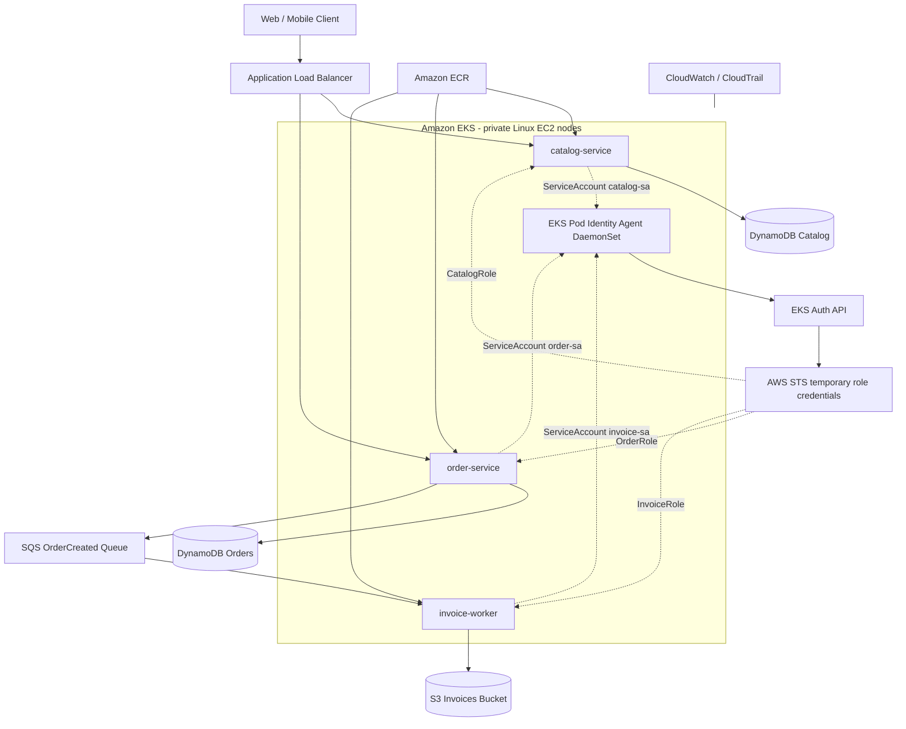
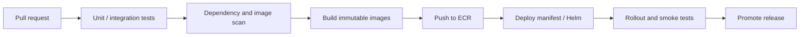

# Deploying Java Microservices on Amazon EKS with Workload Identity

## 1. Capstone Introduction

In this project, you build a small e-commerce platform consisting of Java microservices running on Amazon Elastic Kubernetes Service (Amazon EKS). The services use AWS services to store data, publish events, and save invoices. Each workload receives its own IAM role via a Kubernetes ServiceAccount and EKS Pod Identity.

The most important goal is implementing workload identity properly: a Pod receives only the AWS permissions required for its function, uses automatically refreshed temporary credentials, contains no static access keys, and does not inherit data-plane permissions from the EC2 node role.

This capstone uses **EKS Pod Identity** as the primary deployment flow on a Linux EC2 managed node group. The final section compares **IAM Roles for Service Accounts (IRSA)** so learners know how to handle environments that require OIDC federation or fall outside Pod Identity's constraints.

### Business Context

An online store needs to display a product catalog, accept orders and persist order status, emit events when orders are created, asynchronously process those events to generate JSON invoices stored in Amazon S3, and enable the operations team to deploy, observe, and scale each service independently.

You will deploy three workloads:

| Workload | Responsibility | AWS Access |
|---|---|---|
| `catalog-service` | Read product details | DynamoDB `GetItem`, `Query` on Catalog table |
| `order-service` | Create/read orders, send `OrderCreated` events | DynamoDB `PutItem`, `GetItem` on Orders table; SQS `SendMessage` |
| `invoice-worker` | Receive events and store invoices | SQS receive/delete/visibility; S3 `PutObject` in the invoices prefix |

Each workload has its own Kubernetes ServiceAccount and IAM role. Permissions are separated by function so that if one service is compromised, the blast radius is contained.

## 2. Objectives and Capabilities to Demonstrate

You complete the capstone when you can:

1. Design an EKS cluster with appropriate control plane endpoints, VPC, private subnets, and a managed node group.
2. Distinguish between Kubernetes identity, AWS IAM identity, node roles, and workload roles.
3. Install the EKS Pod Identity Agent and verify the agent is running on Linux EC2 nodes.
4. Create a trust policy for `pods.eks.amazonaws.com` and scope namespace/ServiceAccount access via session tags.
5. Bind an IAM role to a ServiceAccount using an EKS Pod Identity association.
6. Grant least-privilege access to DynamoDB, SQS, and S3 per microservice.
7. Use AWS SDK for Java 2.x with the default credential provider chain.
8. Build container images, push them to Amazon ECR, and deploy Deployments/Services/Ingress on EKS.
9. Prove each Pod assumes its intended IAM role and does not use the node role or static credentials.
10. Run both positive and negative authorization tests (allowed and denied actions).
11. Configure health checks, resource requests/limits, logging, metrics, and rollouts.
12. Operate an asynchronous pipeline with retries, dead-letter queues, and idempotency.

## 3. Overall Architecture



Key paths:

- **Request path:** client → ALB → Kubernetes Service → Pod.
- **Data path:** catalog/order services → DynamoDB; order service → SQS; invoice worker → SQS → S3.
- **Identity path:** ServiceAccount → Pod Identity association → Pod Identity Agent → EKS Auth API → temporary IAM role credentials.
- **Delivery path:** CI pipeline → ECR → EKS Deployment rollout.

The ALB exposes only the HTTP entry points. DynamoDB, SQS, and S3 are called via the AWS SDK from inside Pods; there is no need to expose them to the Internet.

## 4. Project Scope and Assumptions

### In Scope

- Java 21 and Spring Boot 3.x.
- AWS SDK for Java 2.x.
- Amazon EKS on a Linux EC2 managed node group.
- EKS Pod Identity Agent and IAM role associations.
- Amazon ECR, DynamoDB, SQS, S3.
- AWS Load Balancer Controller pre-installed by the platform team, or EKS Auto Mode providing equivalent load balancing capabilities.
- Kubernetes Deployments, Services, Ingress, HPA, and NetworkPolicy.
- CloudWatch/CloudTrail for operations and auditing.

### Out of Scope

- Complete frontend design.
- Real payments or bank integrations.
- Multi-region active-active.
- Mandatory service mesh.
- Building a self-managed Kubernetes control plane.
- Using static AWS access keys, broad node roles, or sharing a single IAM role across all Pods.

### Deployment Assumptions

Select a Region supporting EKS, EKS Pod Identity, DynamoDB, SQS, S3, and required instance types. Example commands use the `AWS_REGION` variable; replace it with your organization-approved Region. Choose a Kubernetes version still within EKS support lifecycle at cluster creation time and align `kubectl`/`eksctl` versions.

## 5. Functional Requirements

### 5.1. Catalog Service

- `GET /api/products/{productId}` reads a single product from the Catalog table.
- `GET /api/products?category=...` queries by partition key or a designed index.
- Must not write or delete catalog items.

### 5.2. Order Service

- `POST /api/orders` accepts order ID, customer ID, items, and total amount.
- Writes the order to the Orders table.
- Sends an `OrderCreated` message to SQS after persisting successfully.
- `GET /api/orders/{orderId}` reads order status.
- Must not write to the S3 invoice prefix or read the Catalog table unless required by business logic.

To prevent duplicate orders on client retries, the API accepts `Idempotency-Key`. Order service stores the key alongside the order ID or uses a conditional write in DynamoDB.

### 5.3. Invoice Worker

- Polls messages from SQS.
- Validates the schema and order ID.
- Generates an invoice JSON payload.
- Writes the object to `s3://<invoice-bucket>/invoices/<orderId>.json`.
- Deletes the message from the queue only after the object is saved successfully.
- On processing failure, retries according to visibility timeout and sends messages exceeding retry limits to the DLQ.

SQS Standard Queues have at-least-once delivery semantics; the worker must handle duplicate messages safely.

## 6. Non-Functional Requirements

| Category | Requirement |
|---|---|
| Identity | Temporary credentials, a dedicated IAM role per workload |
| Authorization | Least privilege; test both allowed and denied actions |
| Availability | At least two compute nodes across multiple AZs where cluster capacity/design permits |
| Security | Nodes in private subnets; restricted API endpoint; hardened images and Pods |
| Reliability | Bounded retries, DLQ, idempotency, and graceful shutdown |
| Observability | Structured logs, metrics, traces, and CloudTrail auditing |
| Scalability | HPA on CPU/memory or custom metrics; bounded node scaling |
| Delivery | Immutable image tags/digests, readiness-gated rollouts, and rollback |
| Cost | Tear down lab resources after completion; cost-effective lab settings for DynamoDB/SQS/S3 |

## 7. Data Design

### 7.1. DynamoDB Catalog Table

- Table name: `Catalog`.
- Partition key: `productId` (String).
- Suggested attributes: `name`, `category`, `price`, `currency`, `active`, `updatedAt`.
- If querying by category is required, add a GSI with partition key `category` and an appropriate sort key.

### 7.2. DynamoDB Orders Table

- Table name: `Orders`.
- Partition key: `orderId` (String).
- Suggested attributes: `customerId`, `items`, `totalAmount`, `currency`, `status`, `createdAt`, `idempotencyKey`.
- Optionally add a GSI on `customerId` and `createdAt` if customer order history queries are needed.

Use DynamoDB on-demand capacity for the lab to simplify capacity planning. For production, evaluate request patterns, hot partitions, consistency, TTL, and backups/PITR.

### 7.3. SQS and S3

- Queue: `order-created`.
- DLQ: `order-created-dlq`.
- Configure redrive policy, retention, visibility timeout, and long polling.
- S3 bucket: `<account>-<region>-commerce-invoices`.
- Output prefix: `invoices/`.
- Enable Block Public Access, encryption, versioning where appropriate, and lifecycle policies.
- Never use a public bucket policy to let the worker write invoices.

## 8. EKS Cluster and Network Design

Create the EKS cluster in a VPC with public and private subnets across at least two Availability Zones. Place the managed node group in private subnets; only an internet-facing ALB sits in public subnets when external Internet access is required.

Recommendations:

- Enable private API endpoint access so node-to-control-plane traffic stays inside the VPC.
- If enabling the public endpoint for administrators, restrict `publicAccessCidrs` to admin/VPN IP ranges.
- Use EKS access entries to grant cluster admin permissions to IAM principals.
- Use security groups to restrict traffic to the cluster endpoint, nodes, ALB, and data services.
- Use NAT Gateways or VPC endpoints according to egress requirements and cost.
- For private nodes, ensure connectivity to ECR, S3, STS/EKS Auth API, and required AWS APIs.
- If private-subnet nodes use Pod Identity Agent without suitable NAT/egress, create an interface VPC endpoint for the EKS Auth API (service name `com.amazonaws.<region>.eks-auth`).
- Never open node security groups to the entire Internet.

EKS Pod Identity Agent needs access to the EKS Auth API. In private subnets, a missing endpoint or route to the EKS Auth API is a common reason Pods fail to obtain credentials.

## 9. Workload Identity: Identity Layers to Distinguish

There are three independent identities:

1. **Operator/CI IAM identity:** who is permitted to create the cluster, deploy manifests, create roles, or manage associations.
2. **Node IAM role:** foundational permissions for EC2 worker nodes, kubelet, image pulls, and node agents. This role must not hold permissions to read Catalog, write Orders, send SQS messages, or write S3 invoices.
3. **Workload IAM role:** AWS permissions the application inside a Pod needs to perform business functions. This role is bound to a Kubernetes ServiceAccount.

A Kubernetes ServiceAccount identifies the workload inside the cluster. An IAM role defines which AWS APIs the workload can call. An EKS Pod Identity association links the two via the combination of cluster + namespace + ServiceAccount.

Never bind the same overly broad role to an entire namespace or cluster. Create separate roles for `catalog-sa`, `order-sa`, and `invoice-sa`.

## 10. Choosing EKS Pod Identity or IRSA

| Criterion | EKS Pod Identity | IRSA |
|---|---|---|
| Mechanism | EKS association + Pod Identity Agent + EKS Auth API | OIDC projected token + STS `AssumeRoleWithWebIdentity` |
| IAM trust configuration | Service principal `pods.eks.amazonaws.com` | Cluster's OIDC provider |
| ServiceAccount annotation | No annotation needed | Role ARN attached via annotation |
| SDK | Container credential provider in default chain | Web identity token provider |
| Agent | Requires agent on EC2 Linux nodes; built into EKS Auto Mode | No Pod Identity Agent required |
| Compatibility | Linux EC2 worker nodes | Supports more compute types, including Fargate |
| Multi-cluster management | Role trust is reusable, scoped via session tags | Trust policy typically tied to each cluster's OIDC provider |

This capstone uses EKS Pod Identity because associations live in the EKS API, role trust policies are reusable across clusters, and the agent fetches credentials centrally via the EKS Auth API.

**Constraint to remember:** EKS Pod Identity does not work for Pods running on Fargate, Windows EC2 nodes, EKS on Outposts, or EKS Anywhere. Choose Linux EC2 worker nodes for this lab. If a workload must run on Fargate, evaluate IRSA.


## 11. How Does EKS Pod Identity Work?

When a Pod uses a ServiceAccount with an EKS Pod Identity association, EKS injects details so the SDK locates the local credential endpoint. Execution flow:

1. The Pod is created in its namespace using the designated ServiceAccount.
2. EKS injects a projected token with audience `pods.eks.amazonaws.com`, along with environment variables pointing to the container credential endpoint.
3. Pod Identity Agent running as a DaemonSet on the node receives requests from the Pod.
4. The agent calls the EKS Auth API using the node role's `eks-auth:AssumeRoleForPodIdentity` permission.
5. The EKS Auth API returns temporary credentials for the IAM role specified in the association.
6. The agent serves credentials to the AWS SDK inside the container; the SDK refreshes them automatically before expiration.

Pod Identity associations are stored in the EKS API rather than as annotations on Kubernetes ServiceAccounts. As a result, `kubectl describe serviceaccount` does not show the role ARN. Inspect associations using the AWS CLI.

Environment variables typically injected into the Pod by EKS:

- `AWS_CONTAINER_CREDENTIALS_FULL_URI`
- `AWS_CONTAINER_AUTHORIZATION_TOKEN_FILE`

Never print token file contents or credential responses to logs. Verify only that the variables exist; never dump tokens.

### 11.1. Credential Provider Chain in Java

AWS SDK for Java 2.x uses a default credentials provider chain. The container credentials provider is part of that chain and retrieves credentials from the Pod Identity Agent.

Credential sources checked earlier in the chain can take precedence. Consequently, leftover `AWS_ACCESS_KEY_ID`, `AWS_SECRET_ACCESS_KEY`, Java system properties, profiles, or web identity configurations inside a container can cause the app to assume the wrong identity.

In EKS:

- Never bake access keys into container images.
- Never create Kubernetes Secrets containing AWS access keys.
- Never set `AWS_ACCESS_KEY_ID`/`AWS_SECRET_ACCESS_KEY`.
- Never mount `~/.aws/credentials` into a Pod.
- Never configure a static credentials provider in Java code.
- Configure only the required Region and resource endpoints.

## 12. Designing IAM Roles per Workload

Use one role per ServiceAccount. The table below defines the project's permission contract:

| IAM Role | ServiceAccount | Resource | Allowed Actions | Not Granted by This Role |
|---|---|---|---|---|
| `commerce-catalog-role` | `catalog-sa` | Catalog table and indexes | `dynamodb:GetItem`, `dynamodb:Query` | `PutItem`, `UpdateItem`, `DeleteItem`; SQS; S3 |
| `commerce-order-role` | `order-sa` | Orders table, `OrderCreated` queue | `dynamodb:GetItem`, `dynamodb:PutItem`, `sqs:SendMessage` | Catalog writes, S3 invoices, SQS receive/delete |
| `commerce-invoice-role` | `invoice-sa` | `OrderCreated` queue, invoice prefix | `sqs:ReceiveMessage`, `DeleteMessage`, `ChangeMessageVisibility`, `GetQueueAttributes`; `s3:PutObject` | DynamoDB; unneeded S3 read/list |

This enforces permission boundaries via granted policies: IAM policies Allow only required actions with no broader Allow attached. You do not need an explicit Deny for every unused action, but you must audit attached policies, permissions boundaries, and SCPs to confirm no extra permissions leak through.

### 12.1. The Node Role Is Not a Workload Role

The node role grants only foundational permissions needed by kubelet, ECR image pulls, and Pod Identity Agent. Typically this includes `AmazonEKSWorkerNodePolicy` and `AmazonEC2ContainerRegistryPullOnly`; VPC CNI permissions should attach to a dedicated add-on role per EKS guidance.

`AmazonEKSWorkerNodePolicy` currently includes `eks-auth:AssumeRoleForPodIdentity` for the agent. If using a custom node policy instead, grant this action with appropriate resources and conditions. The agent does not need a separate workload IAM role.

Never attach `dynamodb:*`, `sqs:*`, or `s3:*` to the node role just to make the app work. If Pod Identity fails, fix the association, trust policy, agent, or SDK; never broaden the node role as a workaround.

## 13. Trust Policy for EKS Pod Identity

A Pod Identity role must trust the `pods.eks.amazonaws.com` service principal with both `sts:AssumeRole` and `sts:TagSession`. Session tags let you restrict the role to a specific namespace and ServiceAccount.

Example trust policy for `commerce-order-role`:

```json
{
  "Version": "2012-10-17",
  "Statement": [
    {
      "Sid": "AllowOrderServicePodIdentity",
      "Effect": "Allow",
      "Principal": {
        "Service": "pods.eks.amazonaws.com"
      },
      "Action": [
        "sts:AssumeRole",
        "sts:TagSession"
      ],
      "Condition": {
        "StringEquals": {
          "aws:RequestTag/kubernetes-namespace": "commerce",
          "aws:RequestTag/kubernetes-service-account": "order-sa"
        }
      }
    }
  ]
}
```

Create corresponding trust policies for `catalog-sa` and `invoice-sa`. The namespace and service-account conditions specify exactly which workload may assume the role. In multi-cluster organizations, you can also add cluster session tag conditions from the current EKS Pod Identity tag set after verifying exact key names in AWS documentation.

Avoid wildcard namespaces or service accounts in production without an explicit justification. The more sensitive the role's permissions, the tighter its trust policy should be.

## 14. Least-Privilege Permission Policies

Replace `ACCOUNT_ID`, `AWS_REGION`, table, queue, and bucket names with real ARNs. Examples use inline policies for readability; production should manage policies via IaC and review them through pull requests.

### 14.1. Catalog Role

```json
{
  "Version": "2012-10-17",
  "Statement": [
    {
      "Sid": "ReadCatalog",
      "Effect": "Allow",
      "Action": [
        "dynamodb:GetItem",
        "dynamodb:Query"
      ],
      "Resource": [
        "arn:aws:dynamodb:AWS_REGION:ACCOUNT_ID:table/Catalog",
        "arn:aws:dynamodb:AWS_REGION:ACCOUNT_ID:table/Catalog/index/*"
      ]
    }
  ]
}
```

If the service only uses `GetItem`, omit `Query` and the index ARN. Never grant `Scan` merely for debugging convenience; design keys and indexes around real access patterns.

### 14.2. Order Role

```json
{
  "Version": "2012-10-17",
  "Statement": [
    {
      "Sid": "WriteAndReadOrders",
      "Effect": "Allow",
      "Action": [
        "dynamodb:GetItem",
        "dynamodb:PutItem"
      ],
      "Resource": "arn:aws:dynamodb:AWS_REGION:ACCOUNT_ID:table/Orders"
    },
    {
      "Sid": "PublishOrderEvents",
      "Effect": "Allow",
      "Action": "sqs:SendMessage",
      "Resource": "arn:aws:sqs:AWS_REGION:ACCOUNT_ID:order-created"
    }
  ]
}
```

If the order API supports status updates, add `dynamodb:UpdateItem` after reviewing access patterns. If using DynamoDB transactions, add only the transaction actions actually required and scope them to the corresponding resources.

### 14.3. Invoice Worker Role

```json
{
  "Version": "2012-10-17",
  "Statement": [
    {
      "Sid": "ConsumeOrderEvents",
      "Effect": "Allow",
      "Action": [
        "sqs:ReceiveMessage",
        "sqs:DeleteMessage",
        "sqs:ChangeMessageVisibility",
        "sqs:GetQueueAttributes"
      ],
      "Resource": "arn:aws:sqs:AWS_REGION:ACCOUNT_ID:order-created"
    },
    {
      "Sid": "WriteInvoiceObjects",
      "Effect": "Allow",
      "Action": "s3:PutObject",
      "Resource": "arn:aws:s3:::INVOICE_BUCKET/invoices/*"
    }
  ]
}
```

If the bucket uses an SSE-KMS customer-managed key, the worker needs appropriate minimal KMS permissions such as `kms:GenerateDataKey` on that key, and the key policy must allow the role. If using S3-managed encryption, do not add unnecessary KMS permissions.

Granting `PutObject` on a specific prefix does not grant `ListBucket`, `GetObject`, or `DeleteObject`. That is the exact behavior desired for a worker that only writes invoices.

## 15. Creating IAM Roles and Pod Identity Associations

Execute these steps using an IAM administrator or a scoped infrastructure pipeline. The deployer needs `eks:CreatePodIdentityAssociation` and `iam:PassRole` for the assigned roles.

### 15.1. Create Roles and Policies

Save the trust documents and permission policies as JSON files. Create the roles:

```bash
aws iam create-role \
  --role-name commerce-catalog-role \
  --assume-role-policy-document file://catalog-trust.json

aws iam put-role-policy \
  --role-name commerce-catalog-role \
  --policy-name catalog-read \
  --policy-document file://catalog-permissions.json

aws iam create-role \
  --role-name commerce-order-role \
  --assume-role-policy-document file://order-trust.json

aws iam put-role-policy \
  --role-name commerce-order-role \
  --policy-name order-access \
  --policy-document file://order-permissions.json

aws iam create-role \
  --role-name commerce-invoice-role \
  --assume-role-policy-document file://invoice-trust.json

aws iam put-role-policy \
  --role-name commerce-invoice-role \
  --policy-name invoice-access \
  --policy-document file://invoice-permissions.json
```

In production, prefer versioned, tagged managed policies via IaC rather than scattered inline policies. Separate permissions for role creation, policy updates, and workload deployment following separation of duties.

### 15.2. Install Pod Identity Agent

For clusters using Linux EC2 managed node groups:

```bash
aws eks create-addon \
  --cluster-name java-commerce \
  --addon-name eks-pod-identity-agent \
  --region "$AWS_REGION"

kubectl get pods -n kube-system | grep 'eks-pod-identity-agent'
```

Ensure the node role includes `eks-auth:AssumeRoleForPodIdentity`. If using the managed `AmazonEKSWorkerNodePolicy`, this permission is already included per current EKS documentation.

EKS Auto Mode includes the Pod Identity Agent natively; do not install the add-on again on Auto Mode clusters. Verify add-on status and agent pods across every node before creating associations.

### 15.3. Create Associations

```bash
aws eks create-pod-identity-association \
  --cluster-name java-commerce \
  --namespace commerce \
  --service-account catalog-sa \
  --role-arn "arn:aws:iam::$ACCOUNT_ID:role/commerce-catalog-role" \
  --region "$AWS_REGION"

aws eks create-pod-identity-association \
  --cluster-name java-commerce \
  --namespace commerce \
  --service-account order-sa \
  --role-arn "arn:aws:iam::$ACCOUNT_ID:role/commerce-order-role" \
  --region "$AWS_REGION"

aws eks create-pod-identity-association \
  --cluster-name java-commerce \
  --namespace commerce \
  --service-account invoice-sa \
  --role-arn "arn:aws:iam::$ACCOUNT_ID:role/commerce-invoice-role" \
  --region "$AWS_REGION"
```

ServiceAccounts must exist in the namespace when Pods start. Create associations before deploying Pods. When changing an association, roll out or recreate Pods so they pick up the new identity configuration.

An IAM role bound directly via a Pod Identity association must reside in the same AWS account as the EKS cluster. If target data lives in another account, use role chaining/target roles following Pod Identity's cross-account pattern; never point an association directly to a role outside the cluster's account.

Verify:

```bash
aws eks list-pod-identity-associations \
  --cluster-name java-commerce \
  --namespace commerce \
  --region "$AWS_REGION"
```


## 16. Integrating AWS SDK for Java 2.x

EKS Pod Identity supplies credentials through the container credential provider. The Java application does not need to know the IAM role ARN, call STS `AssumeRole` manually, or read token files.

AWS SDK for Java 2.x requires version **2.21.30 or later** to support EKS Pod Identity. Use the BOM to keep all SDK modules on the same version.

### 16.1. Maven Dependencies

```xml
<project xmlns="http://maven.apache.org/POM/4.0.0"
         xmlns:xsi="http://www.w3.org/2001/XMLSchema-instance"
         xsi:schemaLocation="http://maven.apache.org/POM/4.0.0 https://maven.apache.org/xsd/maven-4.0.0.xsd">
  <modelVersion>4.0.0</modelVersion>
  <parent>
    <groupId>org.springframework.boot</groupId>
    <artifactId>spring-boot-starter-parent</artifactId>
    <version>3.5.0</version>
    <relativePath/>
  </parent>
  <groupId>com.example</groupId>
  <artifactId>order-service</artifactId>
  <version>1.0.0</version>
  <properties>
    <java.version>21</java.version>
    <maven.compiler.release>21</maven.compiler.release>
  </properties>
  <dependencyManagement>
    <dependencies>
      <dependency>
        <groupId>software.amazon.awssdk</groupId>
        <artifactId>bom</artifactId>
        <version>2.21.30</version>
        <type>pom</type>
        <scope>import</scope>
      </dependency>
    </dependencies>
  </dependencyManagement>
  <dependencies>
    <dependency>
      <groupId>org.springframework.boot</groupId>
      <artifactId>spring-boot-starter-web</artifactId>
    </dependency>
    <dependency>
      <groupId>org.springframework.boot</groupId>
      <artifactId>spring-boot-starter-actuator</artifactId>
    </dependency>
    <dependency>
      <groupId>software.amazon.awssdk</groupId>
      <artifactId>dynamodb</artifactId>
    </dependency>
    <dependency>
      <groupId>software.amazon.awssdk</groupId>
      <artifactId>sqs</artifactId>
    </dependency>
    <dependency>
      <groupId>software.amazon.awssdk</groupId>
      <artifactId>s3</artifactId>
    </dependency>
    <dependency>
      <groupId>software.amazon.awssdk</groupId>
      <artifactId>sts</artifactId>
    </dependency>
  </dependencies>
  <build>
    <plugins>
      <plugin>
        <groupId>org.springframework.boot</groupId>
        <artifactId>spring-boot-maven-plugin</artifactId>
      </plugin>
    </plugins>
  </build>
</project>
```

The version above is the minimum documented by EKS for Java SDK v2; in real projects, select a newer tested 2.x release, pin the version, and update dependencies in a controlled manner.

A complete POM must inherit from the Spring Boot parent/BOM and declare `spring-boot-maven-plugin` to package an executable JAR. The JAR path in the Dockerfile must match the Maven module's artifact name and version.

### 16.2. Initialize AWS Clients

Example Spring configuration:

```java
@Configuration
public class AwsClientConfiguration {
    @Bean
    DynamoDbClient dynamoDbClient(
            @Value("#{systemEnvironment['AWS_REGION']}") String region) {
        return DynamoDbClient.builder()
                .region(Region.of(region))
                .build();
    }

    @Bean
    SqsClient sqsClient(
            @Value("#{systemEnvironment['AWS_REGION']}") String region) {
        return SqsClient.builder()
                .region(Region.of(region))
                .build();
    }

    @Bean
    S3Client s3Client(
            @Value("#{systemEnvironment['AWS_REGION']}") String region) {
        return S3Client.builder()
                .region(Region.of(region))
                .build();
    }
}
```

Do not specify `credentialsProvider` in the builders above. The SDK uses the default credentials provider chain and automatically discovers the Pod Identity container endpoint in EKS. When running locally, developers can use an AWS IAM Identity Center profile or local developer credential source; never bake that profile into production images.

### 16.3. Write Order and Emit Event

Abbreviated example for `order-service`:

```java
public void createOrder(Order order) throws JsonProcessingException {
    Map<String, AttributeValue> item = Map.of(
        "orderId", AttributeValue.fromS(order.id()),
        "customerId", AttributeValue.fromS(order.customerId()),
        "status", AttributeValue.fromS("CREATED"),
        "totalAmount", AttributeValue.fromN(
            order.totalAmount().toPlainString())
    );

    dynamoDb.putItem(PutItemRequest.builder()
        .tableName(ordersTable)
        .item(item)
        .conditionExpression("attribute_not_exists(orderId)")
        .build());

    String event = objectMapper.writeValueAsString(
        new OrderCreated(order.id(), order.customerId()));

    sqs.sendMessage(SendMessageRequest.builder()
        .queueUrl(orderQueueUrl)
        .messageBody(event)
        .build());
}
```

This example focuses on how the SDK obtains credentials. Error handling must separate the two operations: if the DynamoDB write succeeds but `sqs.sendMessage` fails, retrying the request could trigger a conditional-check failure. Production should implement a transactional outbox or workflow reconciliation so events are never lost and duplicate orders are never created.

### 16.4. Write Invoice to S3

```java
public void saveInvoice(String orderId, String json) {
    s3.putObject(
        PutObjectRequest.builder()
            .bucket(invoiceBucket)
            .key("invoices/" + orderId + ".json")
            .contentType("application/json")
            .build(),
        RequestBody.fromString(json, StandardCharsets.UTF_8)
    );
}
```

Invoice worker needs only `s3:PutObject` on the designated prefix. If overwrite protection is required, use object keys with version/run IDs or appropriate conditional requests; never grant `s3:DeleteObject` solely for retries.

### 16.5. Verify Identity with STS

In the lab environment, add an internal diagnostic operation calling `GetCallerIdentity`:

```java
try (StsClient sts = StsClient.builder()
        .region(Region.of(region))
        .build()) {
    GetCallerIdentityResponse identity = sts.getCallerIdentity();
    log.info("AWS identity account={}, arn={}",
        identity.account(), identity.arn());
}
```

`GetCallerIdentity` requires no extra IAM permissions. Never expose this endpoint publicly; log it cleanly at startup or restrict it to an admin-only diagnostic. The returned ARN must match the service's role—such as `commerce-order-role`—rather than the node instance profile.

## 17. Creating the Kubernetes Namespace and ServiceAccounts

Create a dedicated namespace for the application. Enable Pod Security Admission at the `restricted` level if all workloads meet the policy:

```yaml
apiVersion: v1
kind: Namespace
metadata:
  name: commerce
  labels:
    pod-security.kubernetes.io/enforce: restricted
    pod-security.kubernetes.io/audit: restricted
    pod-security.kubernetes.io/warn: restricted
---
apiVersion: v1
kind: ServiceAccount
metadata:
  name: catalog-sa
  namespace: commerce
---
apiVersion: v1
kind: ServiceAccount
metadata:
  name: order-sa
  namespace: commerce
---
apiVersion: v1
kind: ServiceAccount
metadata:
  name: invoice-sa
  namespace: commerce
```

Do not add the `eks.amazonaws.com/role-arn` annotation for EKS Pod Identity. Associations are managed through the EKS API and mapped by cluster + namespace + ServiceAccount.

Never use the `default` ServiceAccount for applications. Every Deployment must explicitly declare `serviceAccountName`.

## 18. Containerizing Java Microservices

Use a multi-stage build so the runtime image does not contain the Maven toolchain or source code.

```dockerfile
FROM maven:3.9-eclipse-temurin-21 AS build
WORKDIR /workspace
COPY pom.xml .
COPY src ./src
RUN mvn -B -DskipTests package

FROM eclipse-temurin:21-jre
WORKDIR /app
COPY --from=build /workspace/target/app.jar /app/app.jar
USER 10001:10001
EXPOSE 8080
ENTRYPOINT ["java", "-XX:MaxRAMPercentage=75", "-jar", "/app/app.jar"]
```

Requirements:

- Pin base images by digest in production.
- Scan images and dependencies for vulnerabilities.
- Run as non-root.
- Never `COPY` credential files or local AWS profiles.
- Never store secrets in Docker build args or image layers.
- Use immutable tags or image digests during deployment.
- Set memory requests/limits based on heap and native memory; `MaxRAMPercentage` helps the JVM size its heap relative to the container memory limit.


## 19. Kubernetes Deployment and Service

Example Deployment for `order-service`. Create matching manifests for `catalog-service` and `invoice-worker`, updating image, ServiceAccount, environment variables, and probes.

```yaml
apiVersion: apps/v1
kind: Deployment
metadata:
  name: order-service
  namespace: commerce
spec:
  replicas: 2
  selector:
    matchLabels:
      app: order-service
  template:
    metadata:
      labels:
        app: order-service
    spec:
      serviceAccountName: order-sa
      securityContext:
        runAsNonRoot: true
        runAsUser: 10001
        runAsGroup: 10001
        seccompProfile:
          type: RuntimeDefault
      containers:
        - name: app
          image: ACCOUNT_ID.dkr.ecr.AWS_REGION.amazonaws.com/order-service:VERSION
          ports:
            - name: http
              containerPort: 8080
          env:
            - name: AWS_REGION
              value: AWS_REGION
            - name: ORDERS_TABLE
              value: Orders
            - name: ORDER_QUEUE_URL
              value: https://sqs.AWS_REGION.amazonaws.com/ACCOUNT_ID/order-created
            - name: MANAGEMENT_ENDPOINT_HEALTH_PROBES_ENABLED
              value: "true"
          resources:
            requests:
              cpu: 250m
              memory: 512Mi
            limits:
              cpu: "1"
              memory: 1Gi
          startupProbe:
            httpGet:
              path: /actuator/health
              port: http
            periodSeconds: 5
            failureThreshold: 30
          readinessProbe:
            httpGet:
              path: /actuator/health/readiness
              port: http
            periodSeconds: 10
          livenessProbe:
            httpGet:
              path: /actuator/health/liveness
              port: http
            periodSeconds: 20
          securityContext:
            allowPrivilegeEscalation: false
            readOnlyRootFilesystem: true
            capabilities:
              drop: ["ALL"]
          volumeMounts:
            - name: tmp
              mountPath: /tmp
      volumes:
        - name: tmp
          emptyDir: {}
---
apiVersion: v1
kind: Service
metadata:
  name: order-service
  namespace: commerce
spec:
  type: ClusterIP
  selector:
    app: order-service
  ports:
    - name: http
      port: 80
      targetPort: http
```

The liveness probe checks whether the process is alive; the readiness probe checks whether the service is ready to receive traffic. Do not tie readiness tightly to every downstream service if a brief dependency hiccup would pull all Pods out of the load balancer.

`invoice-worker` needs no Kubernetes Service or Ingress if it only polls SQS. Size replicas and concurrency to match queue throughput, process idempotently, and bound in-flight message counts.

## 20. Exposing HTTP APIs with ALB Ingress

The AWS Load Balancer Controller provisions an Application Load Balancer when it observes a Kubernetes Ingress. The controller must be installed with its own IAM role to manage ELB resources. Never attach the controller's role to `order-sa` or `catalog-sa`.

Subnets must be tagged so the controller discovers the right subnets for each load balancer type: public subnets typically use `kubernetes.io/role/elb=1`, and private subnets for internal load balancers use `kubernetes.io/role/internal-elb=1`. Verify subnet discovery and controller permissions before creating an Ingress.

Example Ingress:

```yaml
apiVersion: networking.k8s.io/v1
kind: Ingress
metadata:
  name: commerce-api
  namespace: commerce
  annotations:
    alb.ingress.kubernetes.io/scheme: internet-facing
    alb.ingress.kubernetes.io/target-type: ip
    alb.ingress.kubernetes.io/listen-ports: '[{"HTTPS":443}]'
    alb.ingress.kubernetes.io/certificate-arn: arn:aws:acm:AWS_REGION:ACCOUNT_ID:certificate/CERTIFICATE_ID
    alb.ingress.kubernetes.io/ssl-redirect: "443"
spec:
  ingressClassName: alb
  rules:
    - host: api.example.com
      http:
        paths:
          - path: /api/products
            pathType: Prefix
            backend:
              service:
                name: catalog-service
                port:
                  number: 80
          - path: /api/orders
            pathType: Prefix
            backend:
              service:
                name: order-service
                port:
                  number: 80
```

Point DNS `api.example.com` to the ALB DNS name once the controller reconciles the Ingress. Use an ACM certificate matching the domain and expose only necessary routes. If the API is internal-only, choose an `internal` ALB instead of `internet-facing`.


## 21. Building and Pushing Images to Amazon ECR

Create a separate repository per service. Use account, Region, and immutable tags tied to commit SHA or release version.

```bash
aws ecr create-repository --repository-name catalog-service --region "$AWS_REGION"
aws ecr create-repository --repository-name order-service --region "$AWS_REGION"
aws ecr create-repository --repository-name invoice-worker --region "$AWS_REGION"

aws ecr get-login-password --region "$AWS_REGION" |
  docker login --username AWS --password-stdin \
  "$ACCOUNT_ID.dkr.ecr.$AWS_REGION.amazonaws.com"

docker build -t order-service:"$GIT_SHA" ./order-service
docker tag order-service:"$GIT_SHA" \
  "$ACCOUNT_ID.dkr.ecr.$AWS_REGION.amazonaws.com/order-service:$GIT_SHA"
docker push \
  "$ACCOUNT_ID.dkr.ecr.$AWS_REGION.amazonaws.com/order-service:$GIT_SHA"
```

Repeat for `catalog-service` and `invoice-worker`. ECR repository policies should restrict push/pull principals: the node role needs image pull permissions, while only the CI role gets push permissions.

## 22. Deploying to EKS and Verifying Rollouts

Deployment order:

1. Create the namespace and ServiceAccounts.
2. Create IAM roles, permission policies, and trust policies.
3. Install Pod Identity Agent (unless using EKS Auto Mode).
4. Create Pod Identity associations.
5. Provision DynamoDB tables, SQS queue/DLQ, and S3 bucket.
6. Deploy ConfigMaps containing non-secret configuration.
7. Deploy microservices with their assigned ServiceAccounts.
8. Deploy the Ingress once AWS Load Balancer Controller is ready.
9. Verify rollouts, endpoints, target health, and application logs.

Verification commands:

```bash
kubectl get pods -n commerce -o wide
kubectl get serviceaccounts -n commerce
kubectl get deployments -n commerce
kubectl rollout status deployment/catalog-service -n commerce
kubectl rollout status deployment/order-service -n commerce
kubectl rollout status deployment/invoice-worker -n commerce
kubectl get ingress -n commerce
```

When updating an image, use a new tag or new digest. Never overwrite a production tag currently referenced by a Deployment, as doing so hinders auditing and rollbacks.

## 23. CI/CD and Separating Build, Deploy, and Runtime Permissions

Reference pipeline:



Use GitHub Actions OIDC or an equivalent federation mechanism so CI assumes a short-lived IAM role. The CI role should only have permissions to push images to ECR and update workloads per cluster access policy. Never store long-term AWS access keys in repository secrets.

Separate three roles:

- **Infrastructure role:** creates VPC, EKS, IAM roles, Pod Identity associations, and data resources.
- **CI/CD role:** pushes ECR images and updates Kubernetes Deployments/Helm releases.
- **Runtime roles:** catalog/order/invoice roles assigned via Pod Identity.

The CI/CD role is not a runtime role. Runtime roles do not need permission to create EKS clusters, create IAM roles, or push to ECR.


## 24. IRSA: Alternative When Needed

If workloads run on Fargate or in an environment that does not yet support EKS Pod Identity, use IAM Roles for Service Accounts (IRSA) where supported by the platform.

IRSA requires:

1. An EKS cluster with an OIDC issuer.
2. An IAM OIDC provider created in the account.
3. An IAM role trust policy specifying the cluster's OIDC provider as the Federated principal.
4. Trust conditions scoping the audience and subject to the exact ServiceAccount.
5. The Kubernetes ServiceAccount annotated with the IAM role ARN.
6. The AWS SDK using the web identity token provider to call STS `AssumeRoleWithWebIdentity`.

Example IRSA trust policy:

```json
{
  "Version": "2012-10-17",
  "Statement": [
    {
      "Effect": "Allow",
      "Principal": {
        "Federated": "arn:aws:iam::ACCOUNT_ID:oidc-provider/oidc.eks.AWS_REGION.amazonaws.com/id/OIDC_ID"
      },
      "Action": "sts:AssumeRoleWithWebIdentity",
      "Condition": {
        "StringEquals": {
          "oidc.eks.AWS_REGION.amazonaws.com/id/OIDC_ID:aud": "sts.amazonaws.com",
          "oidc.eks.AWS_REGION.amazonaws.com/id/OIDC_ID:sub": "system:serviceaccount:commerce:order-sa"
        }
      }
    }
  ]
}
```

An IRSA ServiceAccount carries the `eks.amazonaws.com/role-arn` annotation. This differs from EKS Pod Identity—do not add that annotation to the ServiceAccounts in the main capstone.

Never configure both IRSA and Pod Identity as competing credential sources on the same workload. The AWS SDK default chain follows a fixed precedence order; a provider checked ahead of container credentials could be selected instead of Pod Identity.

## 25. Testing Workload Identity and Access Permissions

Testing must prove both allowed and denied behaviors. Seeing Pods `Running` or associations listed is not enough to conclude identity works properly.

### 25.1. Verify Associations and Agent

- `aws eks list-pod-identity-associations` returns all three associations with the right cluster, namespace, ServiceAccount, and role ARN.
- The Pod Identity Agent DaemonSet has a `Ready` Pod on every node running application workloads.
- Pods were created after associations were ready.
- Pods contain container credential endpoint variables, and logs contain no tokens.
- AWS SDK for Java v2 version is 2.21.30 or later.
- No static AWS credentials or mounted credential profiles exist in containers.

### 25.2. Verify AWS Principal

From an internal diagnostic operation or a debug Pod using the same ServiceAccount, call STS `GetCallerIdentity`. Confirm the assumed-role ARN contains the expected role name:

| Pod | Expected Role |
|---|---|
| `catalog-service` | `commerce-catalog-role` |
| `order-service` | `commerce-order-role` |
| `invoice-worker` | `commerce-invoice-role` |

If the ARN shows the node instance profile, check the Pod Identity association, SDK version, credential provider chain, and IMDS access.

### 25.3. Positive and Negative Authorization Tests

| Workload | Allowed Test | Denied Test |
|---|---|---|
| `catalog-service` | DynamoDB `GetItem` on `Catalog` | DynamoDB `PutItem` on `Catalog` |
| `order-service` | `PutItem`/`GetItem` on `Orders` and `SendMessage` on queue | `PutObject` on invoice bucket; `ReceiveMessage` on queue |
| `invoice-worker` | `Receive`/`Delete` message and `PutObject` on `invoices` prefix | DynamoDB `GetItem`; S3 `GetObject`/`DeleteObject` |
| Pod using `default` ServiceAccount | No data-plane permissions | Attempts to access `Catalog`, `Orders`, SQS, and S3 must be denied |

Record request IDs, timestamps, AWS principals, and error codes. Never log access tokens, payloads with PII, or full invoice contents.

### 25.4. End-to-End Testing

1. Call `GET` product and verify the catalog response.
2. Call `POST` order with a new `Idempotency-Key`.
3. Verify the order appears in DynamoDB.
4. Verify the `OrderCreated` message arrives in SQS.
5. `invoice-worker` receives the message and creates the object under S3 prefix `invoices/`.
6. Verify the message is deleted only after the object is written successfully.
7. Resend the same event to verify idempotency.
8. Inject a failing event intentionally to verify retries and DLQ routing.
9. Call unauthorized APIs to confirm `AccessDenied`.
10. Inspect CloudTrail to verify assumed roles and API actions.

## 26. Observability and Auditing

### 26.1. Application Signals

Each service needs structured JSON logs and a correlation ID spanning requests, orders, and events. Never log credentials, authorization tokens, payment details, or sensitive customer data.

Metrics to collect:

- HTTP request count, p50/p95/p99 latency, and error rate.
- JVM heap, GC pauses, thread pools, and CPU/memory.
- DynamoDB throttling, consumed capacity, and conditional check failures.
- SQS `ApproximateAgeOfOldestMessage`, visible messages, in-flight messages, and DLQ depth.
- S3 `PutObject` errors and invoice generation duration.
- Pod restarts, readiness failures, HPA desired/current replicas, and node pressure.

### 26.2. CloudWatch and Tracing

Use CloudWatch Container Insights or your organization's standard metrics/logging stack. Use OpenTelemetry/ADOT to instrument Spring Boot and propagate trace context over HTTP and SQS message attributes where appropriate.

Set alarms for HTTP 5xx/error rates above threshold, sustained growth in SQS oldest-message age, non-empty DLQs, Pod restart loops or Deployments short of desired replicas, DynamoDB throttling, and node memory/disk pressure.

### 26.3. CloudTrail

CloudTrail provides auditing for AWS API activity. When investigating workload identity, correlate the role session principal, API action, resource ARN, event time, Region, source IP/network context, `AccessDenied` events, and successful API calls.

Session tags from Pod Identity help distinguish cluster, namespace, and ServiceAccount in supporting logs and authorization contexts. Configure log retention and audit access according to organizational policy.

## 27. Security Hardening

### 27.1. Restrict Node Metadata Access

Pod Identity does not automatically turn containers into a security boundary. If the EC2 node's IMDS is reachable from Pods, workloads could attempt to fetch the node instance-profile credentials. Restrict IMDS access per EKS best practices and configure the node launch template accordingly; test with a Pod that has no Pod Identity assigned.

Pods using `hostNetwork` can always reach IMDS. Avoid `hostNetwork` unless strictly required. Even though the SDK prefers Pod Identity credentials, you must still block unintended access to the node role.

### 27.2. Pod Security

- Run processes as non-root.
- Enable seccomp `RuntimeDefault`.
- Disable privilege escalation.
- Drop unnecessary Linux capabilities.
- Use a read-only root filesystem and mount writable paths only intentionally.
- Avoid privileged containers, `hostPath`, `hostPID`, or `hostNetwork` unless formally reviewed.
- Set CPU/memory requests and limits.
- Use Pod Security Admission or policy-as-code to validate manifests.

### 27.3. Network Isolation

By default, Kubernetes does not block Pod-to-Pod traffic. Use NetworkPolicies to restrict:

- ALB ingress reaches only `catalog`/`order` service ports.
- Only `order-service` can call `catalog-service` if required by the use case.
- `invoice-worker` accepts no traffic from the Internet.
- Only required workloads can reach DNS, the EKS Pod Identity Agent endpoint, and AWS endpoints.
- Egress to DynamoDB/SQS/S3 follows the VPC endpoint/network design.

Security groups control traffic between Pods/nodes and AWS resources; NetworkPolicies control east-west Pod traffic. Choose a CNI/network policy implementation supported by EKS and test enforcement mode before production.

### 27.4. Secrets and Encryption

This capstone requires no database password because it uses DynamoDB. If secrets are added later, store them in AWS Secrets Manager or Systems Manager Parameter Store, grant read access to specific secrets only to the workloads that need them, and rotate them per policy.

- Enable encryption at rest for DynamoDB, SQS, and S3 per requirements.
- Use a customer-managed KMS key when separate key administration is required.
- Enable S3 Block Public Access and restrict bucket policies by principal.
- Use HTTPS on the ALB with an ACM certificate.
- Never log secrets, PII, or full invoice payloads.
- Isolate namespaces, IAM roles, S3 prefixes, and data resources by environment.

## 28. Scaling and Reliability

### 28.1. Horizontal Pod Autoscaler

Example HPA for `order-service`:

```yaml
apiVersion: autoscaling/v2
kind: HorizontalPodAutoscaler
metadata:
  name: order-service
  namespace: commerce
spec:
  scaleTargetRef:
    apiVersion: apps/v1
    kind: Deployment
    name: order-service
  minReplicas: 2
  maxReplicas: 10
  metrics:
    - type: Resource
      resource:
        name: cpu
        target:
          type: Utilization
          averageUtilization: 65
```

HPA requires Metrics Server or a compatible metrics pipeline. For `invoice-worker`, CPU may not reflect queue backlog; production can scale on SQS queue depth using KEDA or custom metrics.

### 28.2. SQS Consumer Reliability

- Use long polling to reduce empty receives.
- Set visibility timeout larger than maximum expected processing duration.
- Extend visibility timeout when processing runs long.
- Call `DeleteMessage` only after S3 `PutObject` succeeds.
- Configure a DLQ and redrive policy.
- Handle duplicate events using deterministic object keys or idempotency records.
- Never retry permanent data errors indefinitely.
- Implement graceful shutdown: stop polling new messages and finish or release in-flight messages before the Pod terminates.

### 28.3. Node Scaling and Disruption

Use managed node groups, Cluster Autoscaler, or Karpenter per organizational standards. Set `PodDisruptionBudget` for API services, along with topology spread constraints or pod anti-affinity to distribute replicas across AZs and nodes.

Never set replica counts above available compute, IP, or subnet capacity. Monitor pending Pods, node capacity, subnet IP exhaustion, and rollout surges.

## 29. Troubleshooting

| Symptom | Possible Cause | Resolution |
|---|---|---|
| Pod receives `AccessDenied` | Permission policy missing action/resource or wrong role bound | Check association, role ARN, IAM policy, resource ARN, and CloudTrail |
| Pod receives node role ARN | Pod Identity association not applied or SDK chose another provider | Check ServiceAccount, association, SDK version, static env/profile/web identity, and IMDS |
| Unable to obtain credentials | Agent not running or node cannot reach EKS Auth API | Check DaemonSet, node role, and EKS Auth VPC endpoint/route |
| Association exists but Pod misses role | Pod created before association or wrong namespace/ServiceAccount | Check Pod spec and roll out/recreate the Pod |
| EKS Pod Identity Agent fails to start | IPv6 localhost disabled or invalid agent config | Inspect agent logs and IPv6 configuration per AWS guidance |
| SDK ignores Pod Identity | SDK too old or static credentials provider configured | Upgrade AWS SDK Java v2 to at least 2.21.30 and remove static providers |
| Fargate workload gets no Pod Identity | Pod Identity does not support Fargate | Use IRSA or move the workload to Linux EC2 nodes |
| ALB is not created | Controller missing permissions, subnet tags, or wrong `ingressClass` | Check controller logs, IAM role, subnet discovery, and annotations |
| ALB target unhealthy | Wrong readiness path/port or security group rules | Check Pod readiness, target group health, and SG rules |
| SQS messages repeat | Worker crashes before `DeleteMessage` or visibility timeout too short | Increase timeout, ensure idempotency, and use DLQ |
| Invoice missing in S3 | Role lacks `PutObject`, wrong bucket/prefix, or missing KMS key policy | Check ARNs, S3 policy, KMS policy, and CloudTrail |
| HPA does not scale | Missing Metrics Server/custom metrics or missing resource requests | Verify metrics API and container resource requests |

Trace identity issues in order: Pod → ServiceAccount → EKS association → IAM trust policy → node agent/node role → EKS Auth API connectivity → SDK credential chain → IAM permission policy. Never "fix" it by attaching `AdministratorAccess` to the node role.

## 30. Cost Management

Cost-generating components:

- EKS cluster control plane and EC2 worker nodes.
- NAT Gateway, load balancers, and data transfer.
- ECR image storage and image scanning.
- DynamoDB read/write requests and storage.
- SQS requests and DLQ retention.
- S3 storage, requests, lifecycle transitions, and KMS requests.
- CloudWatch logs, metrics, dashboards, and tracing.
- Public IPv4 addresses, if used by the architecture.

Optimizations:

- Use DynamoDB on-demand and SQS Standard for labs.
- Size node instances based on requests/limits and measured load.
- Use HPA with sensible min/max replica bounds.
- Clean up old image tags and apply ECR lifecycle policies.
- Use S3 lifecycle rules for invoice archives.
- Limit verbose logging and set log retention.
- Tear down the ALB, NAT Gateway, EKS cluster, and EC2 nodes when the lab is finished and no longer needed.
- Apply cost allocation tags by project, environment, and owner.

Do not delete the cluster or data resources before exporting deliverables and retaining required test evidence.

## 31. Milestone Delivery Plan

| Milestone | Tasks | Output Evidence |
|---|---|---|
| M1 - Foundation | VPC, EKS, private node group, ECR, EKS access | Cluster Ready, nodes Ready, private/public endpoint policy |
| M2 - Identity | Node role, Pod Identity Agent, trust policies, IAM permission roles, associations | Association list, agent Ready, trust/policy JSON |
| M3 - Application | Java catalog/order/invoice services, AWS SDK v2, Dockerfiles | Unit tests, image digests, service source |
| M4 - Deployment | ServiceAccounts, Deployments, Services, Ingress, HPA | Rollouts Ready, ALB targets healthy |
| M5 - Data flow | DynamoDB, SQS/DLQ, S3 invoice prefix | End-to-end order creates invoice |
| M6 - Security tests | Allowed/denied tests, STS identity, CloudTrail | Test report and role ARN evidence |
| M7 - Operations | Logs, metrics, alarms, retries, rollback, cost review | Dashboards, runbooks, and cost estimate |

This sequence verifies identity before depending on live data flows. If M2 is not verified, do not move on by granting broader permissions to the node role.

## 32. Deliverables and Acceptance Criteria

### 32.1. Deliverables

- Architecture diagram and descriptions of request, data, and identity flows.
- Source code for all three Java microservices.
- Maven dependency configurations and Dockerfiles.
- EKS cluster/network configuration as IaC or reproducible configuration.
- Individual IAM trust policies and permission policies per service.
- List of Pod Identity associations.
- Kubernetes namespace, ServiceAccounts, Deployments, Services, Ingress, HPA, and NetworkPolicies.
- ECR image digests.
- DynamoDB/SQS/S3 resource definitions.
- Positive/negative test cases and execution results.
- CloudWatch dashboards/alarms and CloudTrail evidence.
- Troubleshooting, rollback, and cleanup runbooks.
- Cost estimate for the lab or target workload.

### 32.2. Mandatory Acceptance Criteria

- [ ] All three services run on EKS Linux EC2 nodes.
- [ ] Each Pod uses its own dedicated ServiceAccount.
- [ ] All three Pod Identity associations point to the correct IAM roles.
- [ ] Pod Identity Agent is `Ready` on workload nodes.
- [ ] Java AWS SDK version is at least 2.21.30 and uses the default credentials chain.
- [ ] Zero static AWS access keys in images, environment variables, Secrets, or source code.
- [ ] Catalog role reads only the required `Catalog` table/index.
- [ ] Order role reads/writes `Orders` and sends messages only to the target queue.
- [ ] Invoice role polls messages and writes objects only to the designated S3 prefix.
- [ ] Negative tests prove services cannot access out-of-scope resources.
- [ ] Node role contains no business data-plane permissions.
- [ ] Order → SQS → invoice → S3 flow runs end-to-end and is idempotent.
- [ ] ALB exposes only required routes over HTTPS.
- [ ] Logs/metrics, DLQs, and runbooks exist for primary failure modes.

### 32.3. Grading Rubric

| Category | Weight |
|---|---:|
| EKS/VPC/network design and deployment | 15% |
| Workload identity, trust policies, and least privilege | 30% |
| Java microservices and AWS SDK integration | 15% |
| Kubernetes manifests, security, and scaling | 15% |
| End-to-end flow, retries, and idempotency | 10% |
| Observability, test evidence, and runbooks | 10% |
| Cost awareness and handover documentation | 5% |

Critical failures include using static access keys, attaching `AdministratorAccess` to the node role, sharing one broad role across all Pods, or omitting negative authorization tests. These issues must be fixed before the capstone is accepted.

## 33. Official References

### Amazon EKS and Workload Identity

- [Learn how EKS Pod Identity grants Pods access to AWS services](https://docs.aws.amazon.com/eks/latest/userguide/pod-identities.html)
- [Understand how EKS Pod Identity works](https://docs.aws.amazon.com/eks/latest/userguide/pod-id-how-it-works.html)
- [Create an IAM role with the trust policy required by EKS Pod Identity](https://docs.aws.amazon.com/eks/latest/userguide/pod-id-role.html)
- [Set up the Amazon EKS Pod Identity Agent](https://docs.aws.amazon.com/eks/latest/userguide/pod-id-agent-setup.html)
- [Assign an IAM role to a Kubernetes service account with Pod Identity](https://docs.aws.amazon.com/eks/latest/userguide/pod-id-association.html)
- [Use Pod Identity with the AWS SDK](https://docs.aws.amazon.com/eks/latest/userguide/pod-id-minimum-sdk.html)
- [IAM roles for service accounts (IRSA)](https://docs.aws.amazon.com/eks/latest/userguide/iam-roles-for-service-accounts.html)
- [EKS best practices: Identity and Access Management](https://docs.aws.amazon.com/eks/latest/best-practices/identity-and-access-management.html)
- [EKS best practices: Security](https://docs.aws.amazon.com/eks/latest/best-practices/security.html)

### Networking, Load Balancing, and Operations

- [Cluster API server endpoint](https://docs.aws.amazon.com/eks/latest/userguide/cluster-endpoint.html)
- [Route internet traffic with AWS Load Balancer Controller](https://docs.aws.amazon.com/eks/latest/userguide/aws-load-balancer-controller.html)
- [Limit Pod traffic with Kubernetes network policies](https://docs.aws.amazon.com/eks/latest/userguide/cni-network-policy.html)
- [Amazon EKS node IAM role](https://docs.aws.amazon.com/eks/latest/userguide/create-node-role.html)
- [Amazon EKS access entries](https://docs.aws.amazon.com/eks/latest/userguide/access-entries.html)

### Application and AWS Services

- [AWS SDK for Java 2.x developer guide](https://docs.aws.amazon.com/sdk-for-java/latest/developer-guide/home.html)
- [Amazon DynamoDB developer guide](https://docs.aws.amazon.com/amazondynamodb/latest/developerguide/Introduction.html)
- [Amazon SQS developer guide](https://docs.aws.amazon.com/AWSSimpleQueueService/latest/SQSDeveloperGuide/welcome.html)
- [Amazon S3 user guide](https://docs.aws.amazon.com/AmazonS3/latest/userguide/Welcome.html)
- [Amazon ECR user guide](https://docs.aws.amazon.com/AmazonECR/latest/userguide/what-is-ecr.html)
