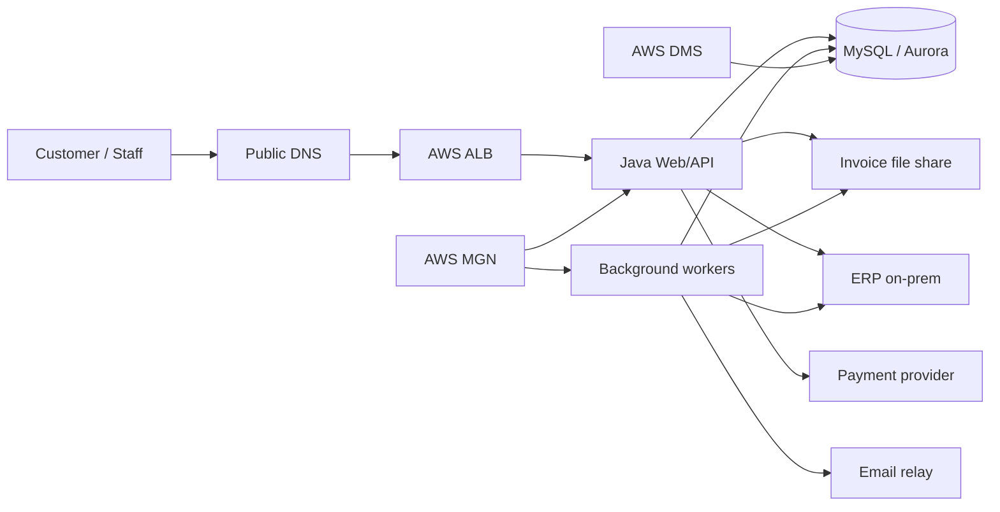
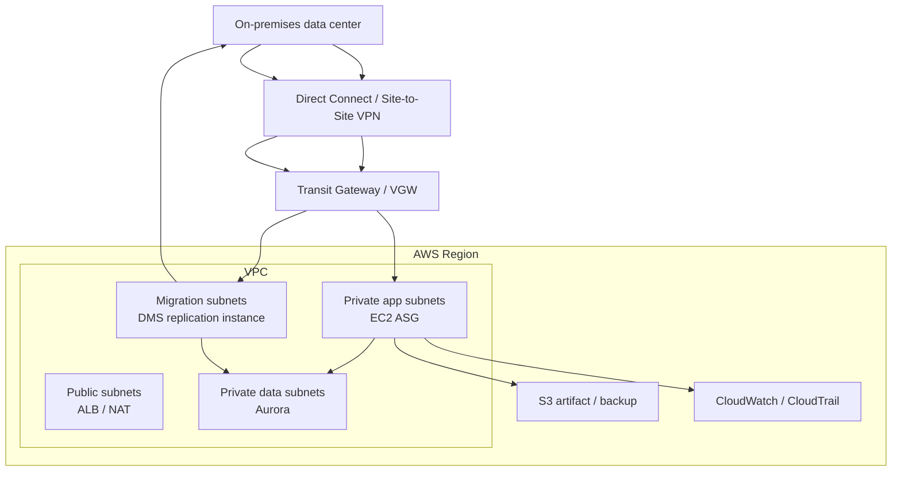
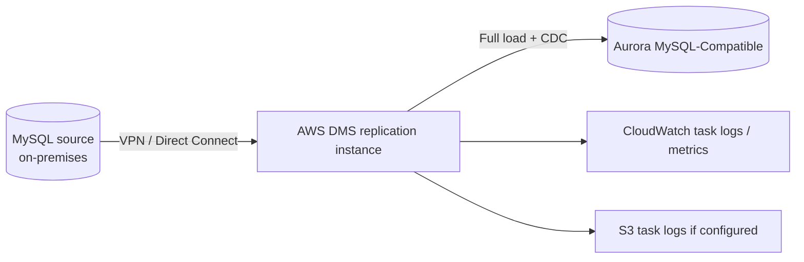

# Migrating Applications and Databases with a Cutover Plan

An enterprise runs a Java application on servers in an on-premises data center. The application handles orders and inventory, relies on a relational database, stores files on shared storage, and integrates with payment, email, and ERP systems. The enterprise wants to move the workload to AWS to improve scalability, increase resilience, and reduce hardware operations overhead. However, migrating both the application and database introduces substantial risks: missing dependencies, network misconfiguration, data inconsistency, replication lag, stale DNS caches, connection pools failing to reconnect, and rollbacks that are no longer trivial once new transactions occur in the target environment.

This capstone asks you to plan and simulate a realistic, deployable migration project. You will analyze the workload, select strategies per component, build a landing zone, migrate application servers using AWS Application Migration Service (AWS MGN; current documentation displays this under the name AWS Transform MGN), migrate the database using AWS Database Migration Service (AWS DMS), validate the target environment, build a minute-by-minute cutover runbook, define go/no-go criteria, and design a rollback strategy accounting for post-cutover target writes.

The AWS Cloud Providers module focuses on selecting services and designing and deploying secure, observable, resilient, and cost-controlled applications. This project uses Amazon VPC, AWS Direct Connect or Site-to-Site VPN, EC2, Application Load Balancer, Auto Scaling, Amazon RDS/Aurora, AWS MGN, AWS DMS, DMS Schema Conversion, IAM, KMS, Secrets Manager, CloudWatch, CloudTrail, Route 53, and S3. The ultimate goal is a verifiable migration plan with clear ownership and unambiguous stop points.

## Expected Outcomes

After completing this capstone, you will be able to:

- Analyze an application portfolio, dependency map, RTO/RPO, SLAs, data volume, and downtime constraints.
- Choose appropriate migration strategies: rehost, replatform, refactor, repurchase, relocate, retain, or retire.
- Design a landing zone covering accounts, VPC, subnets, routing, security, IAM, logging, and encryption.
- Use AWS MGN to replicate servers, launch test instances, validate workloads, and prepare for cutover.
- Select database migration approaches: native tools, AWS DMS full load, CDC, or full load + CDC.
- Use DMS Schema Conversion when changing database engines and assess objects requiring manual remediation.
- Design data validation, CDC latency monitoring, performance tests, and application acceptance tests.
- Create a minute-by-minute cutover runbook covering freeze windows, final sync, traffic switch, and verification.
- Define rollback triggers and distinguish rollback procedures before vs. after target writes occur.
- Prepare a communication plan, RACI, risk register, cost estimate, and decommission checklist.

## Project Context and Assumptions

### Current System

The enterprise runs an order management application with a three-tier architecture:

| Component | Current State | Role |
|---|---|---|
| Web/API tier | 4 Linux VMs running Java 17/Spring Boot behind a reverse proxy | Serve requests, execute business logic |
| Worker tier | 3 Linux VMs running schedulers and background jobs | Send emails, sync ERP, process orders |
| Database | MySQL 8.0 primary + replica | Store orders, customers, inventory, and payment references |
| File storage | 2 TB NFS share | Store PDF invoices and attachments |
| Identity | Active Directory/LDAP | Authenticate staff and service accounts |
| Integration | ERP, payment gateway, email relay | Communicate with external systems |
| Monitoring | On-premises data center monitoring | CPU, memory, logs, and alerts |

### Target State on AWS

| Component | Target Design | Rationale |
|---|---|---|
| Web/API | EC2 Auto Scaling Group in private subnets behind an Application Load Balancer | Maintain application compatibility while enabling scaling and health checks |
| Worker | Dedicated EC2 Auto Scaling Group, optionally scaled by queue depth | Isolate background load from web traffic |
| Database | Amazon Aurora MySQL-Compatible or Amazon RDS for MySQL after compatibility assessment | Managed backups, patching, Multi-AZ/failover, and scalability |
| File storage | Amazon EFS or Amazon S3 depending on access patterns | EFS for shared POSIX access; S3 for object storage |
| Identity | AWS Managed Microsoft AD or AD connector/trust matching existing architecture | Preserve domain integration if required by the app |
| Secrets | AWS Secrets Manager | Store database/API credentials with rotation support |
| Monitoring | Amazon CloudWatch, CloudTrail, and alerting | Centralize logs, metrics, and audits |
| Network | VPC, private/public subnets, VPN or Direct Connect | Secure connectivity to remaining on-premises systems |

This lab assumes a MySQL source and Aurora MySQL-Compatible target to focus on full load + CDC. If you choose a heterogeneous migration such as Oracle to PostgreSQL, you must add DMS Schema Conversion and remediate stored procedures, functions, data types, sequences, collations, and application SQL. Never treat successful DMS data copying as proof that the entire application is compatible.

### Business Constraints

- Target application RTO: maximum 60 minutes during the cutover event.
- Target cutover RPO: zero loss of transactions committed prior to the write freeze.
- Allowed downtime: maximum 45 minutes within the announced maintenance window.
- Architecture must span at least 2 Availability Zones.
- Payment data must never store full card numbers; store only tokens/references from the payment provider.
- The system must retain an audit trail and support reconciliation of order counts, monetary totals, and inventory.
- Never delete or decommission the source system until the business owner signs off on acceptance and the agreed rollback window expires.

These numbers are project assumptions. In a real engagement, replace them with requirements signed off by the business owner, application owner, database owner, and security owner.

## Scope and Success Criteria

### In Scope

- Discovery and classification of server, application, and database dependencies.
- AWS landing zone and network connectivity design.
- Rehosting web/API and worker servers using AWS MGN.
- Migrating MySQL to Aurora MySQL-Compatible using AWS DMS full load + CDC.
- Migrating the file share to EFS or S3 based on verified access patterns.
- Testing application, database, network, performance, failover, and backup/restore.
- Traffic cutover, production monitoring, and maintaining a rollback plan.

### Out of Scope by Default

- Rewriting the entire application into microservices.
- Replacing the ERP, payment gateway, or email provider.
- Altering business workflows simultaneously with the migration.
- Blindly auto-converting all stored procedures or SQL dialects without review.
- Deleting source data immediately after cutover.

### Acceptance Criteria

| Category | Acceptance Criterion |
|---|---|
| Server migration | All wave servers boot cleanly, required services run, and no critical OS/app errors occur |
| Database | Schemas, row counts, critical aggregates, and validation checks meet approved thresholds |
| Replication | DMS CDC latency drops within cutover threshold; zero unprocessed transaction backlog at write cutover |
| Application | Login, order creation, sandbox payments, inventory updates, history queries, and background jobs work |
| Performance | p95 latency and throughput meet SLOs under agreed test load |
| Security | Least-privilege IAM, encryption, secrets, security groups, auditing, and backups are verified |
| Resilience | ALB/ASG scaling, database failover, and backup restores are tested |
| Operations | Dashboards, alarms, runbooks, on-call ownership, and support escalation are ready |
| Cutover | Go/no-go is signed, traffic shifts cleanly, and business owner accepts |

## Selecting a Migration Strategy

You do not have to apply the same strategy to the entire system. Evaluate each application component against business value, technical constraints, licensing, OS, database compatibility, downtime, and cost.

### The 7 Migration Strategies (7 Rs)

| Strategy | Meaning | Project Example |
|---|---|---|
| Rehost | Lift-and-shift to AWS infrastructure largely as-is | Use AWS MGN to move Linux VMs to EC2 |
| Replatform | Targeted adjustments to adopt managed services | Move MySQL to Aurora MySQL-Compatible keeping most SQL intact |
| Refactor / Re-architect | Significant redesign to leverage cloud-native patterns | Split workers into event-driven services; defer from wave 1 if risky |
| Repurchase | Replace the application with another SaaS/COTS product | Replace email relay or CRM when the business case warrants |
| Relocate | Move workloads via infrastructure-compatible relocation | Used when virtualization platforms support direct relocation |
| Retain | Leave components that are not ready to move | Keep ERP on-premises connected over Direct Connect/VPN |
| Retire | Decommission components no longer delivering value | Remove legacy test servers after owner sign-off |

AWS MGN fits server rehosting. AWS DMS handles database data migration, while DMS Schema Conversion converts schemas and code objects for supported engine pairs. These services do not decide business strategy or replace application testing.

### Project Decision Matrix

| Component | Strategy | Tool / Target | Rationale and Conditions |
|---|---|---|---|
| Web/API VMs | Rehost | AWS MGN → EC2 cutover instances; then standardize AMI/launch template for ASG if appropriate | Minimize app changes in the initial move; test fleet onboarding separately |
| Worker VMs | Rehost | AWS MGN → EC2 cutover instances; then standardize worker deployment/scaling | Preserve runtime and schedulers; verify job identity and state before scaling |
| MySQL | Replatform | AWS DMS → Aurora MySQL-Compatible | Validate compatibility, parameters, extensions, SQL, and workload |
| NFS file share | Replatform | AWS DataSync → EFS or S3 | Choose based on POSIX semantics, locking, metadata, and access patterns |
| ERP | Retain | VPN/Direct Connect | Dependency not being replaced within this project scope |
| Email relay | Retain initially, review later | Private/public connectivity as required | Avoid changing multiple external dependencies simultaneously |

**Note on MGN and Auto Scaling:** MGN launches test and cutover instances as standalone EC2 instances; cutover does not automatically register them into an Auto Scaling Group. If the target architecture calls for an ASG, after testing and finalizing configuration create a golden AMI/launch template from the approved image (or package the app cleanly) to launch a new fleet, then re-test bootstrap, identity, licensing, shared storage, and state handling. For stateful servers or servers bound to machine identities, do not force instances into an ASG mechanically.

## Workstream 1 — Discovery and Migration Wave Plan

### Inventory and Dependency Discovery

Collect at minimum:

- Hostname, IP, OS, CPU, memory, disks, filesystems, boot mode, and licenses.
- Application owner, business criticality, maintenance windows, and on-call contacts.
- Running processes/services, ports, protocols, and inbound/outbound dependencies.
- DNS records, certificates, domain membership, service accounts, and secrets.
- Database engine/version, size, transaction rate, peak log generation, LOB sizes, character sets, collations, stored procedures, and replication setup.
- File share size, file count, throughput, locking, POSIX permissions, and hourly change rate.
- Batch schedules, cron jobs, queues, integration endpoints, and external allowlists.
- Backup policies, restore times, RTO/RPO, retention, and regulatory requirements.

You can use AWS Application Discovery Service, AWS Transform discovery capabilities, or existing inventory tools. Automated discovery outputs must be verified by application owners; discovery agents do not fully capture business dependencies or cutover workflows.

### Dependency Map

Example dependency map for the order application:



The dependency map must show connection direction, ports, DNS names, data owners, authentication methods, and latency requirements. If application servers move to AWS while the database stays on-premises, WAN latency can slow queries and cut throughput. If the database moves first while apps stay on-premises, verify network paths, TLS, DNS, and connection pools. Group tightly coupled components into the same migration wave.

### Selecting Migration Waves

| Wave | Components | Goal | Gate to Advance |
|---|---|---|---|
| 0 — Foundation | Accounts, VPC, VPN/DX, IAM, KMS, logging | Build the landing zone | Security/network review passes |
| 1 — Pilot | One web server and a small database copy | Validate MGN/DMS, bootstrap, performance | Functional tests and rollback rehearsal pass |
| 2 — Non-production | Full staging app stack with masked data | End-to-end rehearsal | Test evidence and cutover timing pass |
| 3 — Production cutover | Web/API, workers, database, file storage | Cut over live workload | Go/no-go approved |
| 4 — Stabilization | Monitoring, optimization, cleanup | Stabilize and close migration | Business sign-off and rollback window elapsed |

Never migrate a database-dependent worker before the database endpoint, credentials, firewall rules, and DNS are ready. Organize migration waves by dependencies, not merely server counts.

### Sizing and Capacity Baseline

Measure baselines across at least one business cycle including peak traffic:

- CPU/memory p50, p95, and peak.
- Disk IOPS, throughput, latency, and growth.
- Database QPS, active connections, transaction log generation, and slow queries.
- Network throughput, packet loss, round-trip latency, and egress.
- Application response time, error rates, queue depth, and job durations.
- File share throughput, concurrency, and operation mix.

Do not size EC2/RDS solely from source machine specs. On-premises hardware may be over-provisioned or experience sharp spikes. Use measured workload metrics and run load tests on the target.

## Workstream 2 — AWS Landing Zone and Network Connectivity

### Accounts and Governance

Design accounts and environments to match organizational standards:

- Separate production and non-production by AWS account or OU.
- Centralized logging/security account if an organization landing zone exists.
- SCPs/guardrails preventing disabling CloudTrail, deleting log buckets, or turning off encryption.
- Standard tags: `Application`, `Environment`, `Owner`, `CostCenter`, `MigrationWave`.
- AWS Budgets and Cost Anomaly Detection to track migration spend and parallel-running resources.

### Network Topology

Baseline topology:

| Zone | Subnets | Resources |
|---|---|---|
| Public | 2 AZs | ALB, NAT Gateways if outbound Internet is needed |
| Private application | 2 AZs | EC2 web/API, workers |
| Private data | 2 AZs | Aurora/RDS, caches |
| Migration | Private subnets | DMS replication instance, MGN staging resources |
| Hybrid connectivity | Transit Gateway / VGW | Site-to-Site VPN or Direct Connect to on-premises |



Ensure AWS CIDRs never overlap with on-premises, VPN, partner networks, or peered VPCs. With multiple VPCs/accounts, consider Transit Gateway for centralized routing. Verify route tables, DNS resolution, resolver rules, NACLs, and security groups for every connection flow.

### Security Groups and Firewalls

Example network access rules:

| Source | Destination | Port | Reason |
|---|---|---|---|
| Client networks | ALB | 443 | HTTPS ingress |
| ALB security group | EC2 application security group | 8080/8443 | Forward requests |
| EC2 application security group | Aurora security group | 3306 | MySQL connections |
| DMS replication security group | Source DB | Engine port | Full load/CDC source connectivity |
| DMS replication security group | Target DB | 3306 | Apply changes to Aurora MySQL |
| EC2/workers | On-premises ERP | Port confirmed by ERP owner | Business integration |
| Admins | EC2/managed nodes | SSM endpoints | Administration via Systems Manager |

Allow database ingress only from required application and DMS security groups. When the source database is on-premises, on-premises firewalls must permit traffic from the agreed CIDR or NAT egress. Never open database ports to `0.0.0.0/0`.

### DMS Network Placement

The AWS DMS replication instance runs inside a VPC. Whenever practical, place the replication instance in the same Region and VPC/subnet close to the target database to minimize network latency. Both source and target endpoints must be reachable from the replication instance. For an on-premises source, verify routes over VPN/Direct Connect and firewall allowlists. Endpoint database security groups must permit ingress from the DMS replication instance security group or agreed static network source.

### Encryption and Identity

- TLS for database and application connections.
- KMS encryption for EBS, RDS/Aurora, S3, and log buckets.
- Secrets Manager for database credentials; never hard-code passwords in DMS task JSON, user data, or source control.
- Dedicated IAM roles for MGN, DMS, EC2, automation, and operators.
- CloudTrail management events and log retention per audit policy.
- S3 Block Public Access, bucket policies, and versioning for retained artifacts/backups.

## Workstream 3 — Migrating Application Servers with AWS MGN

AWS Application Migration Service (AWS MGN) rehosts servers by replicating block-level data from source servers into an AWS staging area, then launching test and cutover instances. Current documentation may refer to this as AWS Transform MGN. MGN migrates server state; application owners must still validate hostnames, IPs, domain membership, service startup, licenses, DNS, firewalls, and database connectivity.

### MGN Lifecycle

| Lifecycle State | Meaning | Next Step |
|---|---|---|
| `Not ready` | Initial sync not yet complete | Check agent, network, staging area, and replication progress |
| `Ready for testing` | Initial sync finished; continuous replication running | Launch test instance |
| `Test in progress` | Test instance is launching | Run OS/application acceptance tests |
| `Ready for cutover` | Testing completed and server is ready for cutover | Confirm healthy replication and cutover window |
| `Cutover in progress` | Cutover instance is launching | Validate target instance and application |
| `Cutover complete` | Migration finalized | Archive source and clean up replication resources |

### Preparing Source Servers

Before installing the AWS Replication Agent:

1. Confirm OS, version, and architecture are on MGN's supported list.
2. Inventory CPU, memory, disks, partitions, boot mode, and filesystems.
3. Verify outbound network connectivity to service endpoints and replication servers per MGN docs.
4. Confirm administrator/root privileges to install the agent.
5. Verify antivirus/EDR, firewalls, and proxies do not block the agent.
6. Record hostnames, static IPs, DNS, domain membership, certificates, and license dependencies.
7. Take pre-change backups/snapshots per policy.

### Configuring the Staging Area and Replication

1. Initialize MGN in the target Region.
2. Configure staging subnets, replication instance type, EBS volume types, encryption, and replication settings.
3. Create required IAM/service-linked roles per MGN setup.
4. Install the AWS Replication Agent on source servers.
5. Monitor initial sync until lifecycle reaches `Ready for testing` and data replication status shows `Healthy`.
6. Check lag, throughput, replication servers, and alerts.

Initial sync duration depends on total disk size, data change rate, and network bandwidth. Do not lock in a cutover window until you have measured actual replication metrics. After initial sync, MGN continuously replicates block changes to keep staging volumes current.

### Launching Test Instances

Before production cutover, launch test instances from the replicated state. Perform:

- Verify EC2 instance type, subnet, security groups, IAM instance profile, EBS mapping, and launch settings.
- Verify boot, filesystems, service startup, hostname, network interfaces, and licenses.
- Update application configuration for target DNS and database endpoints if needed.
- Verify ALB target health, API health, worker schedules, and external integrations.
- Check logs, monitoring agents, SSM connectivity, backups, and patch baselines.
- Run performance tests, failover tests, and security scans.
- Log defects and update launch settings or post-launch actions.

You can launch tests multiple times; older test instances and dependent resources are replaced on subsequent test launches. Test instances consume EC2/EBS resources and incur charges, so terminate them when no longer needed. Complete at least one test early enough before cutover to allow fixing discovered issues.

### Launch Settings and Post-Launch Actions

Verify:

- EC2 instance type and CPU architecture.
- Target subnet/AZ, security groups, and private IP strategy.
- EBS volume types, sizes, and encryption.
- IAM instance profile and SSM access.
- Tags, hostname/domain join, and post-launch scripts.
- License activation, machine identity, monitoring, and backup agents.

If source servers depend on fixed MAC/IP addresses, license servers, or hostname allowlists, verify how these map on AWS before cutover. Never assume every license or agent transfers to EC2 without rehosting approval.

### Server Cutover with MGN

During the cutover window:

1. Confirm all source servers are `Ready for cutover` with healthy replication and lag within limits.
2. Stop application services, scheduled jobs, and data-writing processes on source servers.
3. Confirm no further disk or application writes require final sync.
4. Launch cutover instances from MGN.
5. Verify instance launch, OS boot, service startup, networking, and application health.
6. Switch ALB targets, internal DNS, or routing per runbook.
7. Monitor error rates, latency, logs, worker status, and dependency connections.
8. Finalize cutover only after acceptance criteria pass and rollback sign-off is obtained.

Finalizing cutover stops replication and removes replication resources; it completes the MGN lifecycle. Keep source servers recoverable during the agreed rollback window; never archive or delete source servers immediately upon launching targets.

## Workstream 4 — Migrating the Database with AWS DMS

### Homogeneous vs. Heterogeneous Migration

| Scenario | Approach | Tools |
|---|---|---|
| Same database engine, e.g., MySQL → Aurora MySQL-Compatible | Keep schemas/code compatible; migrate data and changes | Native dump/restore or AWS DMS |
| Different database engine, e.g., Oracle → PostgreSQL | Convert schemas/code, fix incompatibilities, then migrate data | DMS Schema Conversion + AWS DMS |
| Small database, long downtime acceptable | Controlled backup/restore | Native database tools |
| Large database, minimal downtime | Initial full load + ongoing CDC, then cutover | AWS DMS full load + CDC |

AWS DMS performs basic schema creation such as tables and primary keys in supported scenarios. Do not assume DMS automatically recreates secondary indexes, foreign keys, users, grants, triggers, or all stored procedures. Prepare the target schema using native tools or DMS Schema Conversion and review every object.

### Database Assessment

Inventory:

- Engine/version, edition, extensions/plugins, and parameter settings.
- Database/schema/table counts, row counts, and data volumes.
- Primary/unique keys, foreign keys, indexes, triggers, and constraints.
- Stored procedures, functions, views, events, sequences, and generated columns.
- Character sets, collations, timezones, date/time precision, and numeric precision.
- LOB/BLOB/CLOB size distribution.
- Transaction rate, log generation rate, peak concurrency, and long-running transactions.
- Users/roles/privileges, authentication plugins, TLS, and network ACLs.
- Backup/restore duration, replication topology, and failover behavior.

### Schema Conversion

For heterogeneous migrations, create a DMS Schema Conversion project:

1. Connect source and target database metadata.
2. Run an assessment report to identify objects that cannot auto-convert.
3. Configure transformation rules for schema/table/object names if needed.
4. Convert schemas and database code objects.
5. Review conversion action items, unsupported data types, SQL dialects, and performance impacts.
6. Remediate SQL, stored procedures, and functions with developers and DBAs.
7. Commit SQL outputs to version control for peer review.
8. Apply schemas to the target after migration owner approval.
9. Run application regression tests against the target.

Never apply converted code directly to production without review. DMS Schema Conversion automates many objects but always produces action items for manual remediation.

### AWS DMS Architecture

Components:

| Component | Role | Project Choice |
|---|---|---|
| Replication subnet group | Defines subnets for the replication instance | Private subnets in migration/data VPC |
| Replication instance or DMS Serverless | Compute executing replication | Choose based on workload, capacity, engine support, and cost model |
| Source endpoint | Connects to source database | On-premises MySQL over VPN/Direct Connect |
| Target endpoint | Connects to target database | Aurora MySQL-Compatible in private subnets |
| Migration task | Full load/CDC, table mappings, and task settings | `full-load-and-cdc` |
| Premigration assessment | Detects issues prior to running | Enable before running tasks and review report |
| Data validation | Compares source and target data | Enable for supported tables/migration paths |



The replication instance must reach both endpoints across routing, DNS, firewalls, and security groups. For an on-premises source, verify bidirectional routing per design, TLS, and firewall allowlists before starting tasks.

### Source and Target Prerequisites

**Source database:**

- Enable binary logging/transaction logging matching engine and DMS CDC requirements.
- Set transaction log retention long enough for DMS to read throughout migration and recovery.
- Grant the DMS user required permissions to read metadata, tables, and logs.
- Confirm the source can handle additional load from full load, CDC readers, and validation queries.
- Check long-running transactions, binlog format, GTID settings, and engine-specific prerequisites per documentation.

**Target database:**

- Provision the Aurora/RDS cluster, subnet group, security groups, parameter group, and KMS encryption.
- Create databases/schemas/tables via schema conversion or DMS target table preparation mode.
- Grant the DMS user insert/update/delete and required permissions to apply changes.
- Review index, foreign key, and trigger strategies so full load and CDC are not slowed unduly.
- Verify instance class, storage, IOPS, connection limits, and failover settings.

### Full Load and CDC

AWS DMS supports three primary migration types:

| Migration Type | Meaning | When to Use |
|---|---|---|
| Full load | Copy existing data from source to target | Downtime is acceptable or source changes minimally |
| CDC only | Read transaction logs and replicate ongoing changes only | Target already holds a consistent baseline |
| Full load + CDC | Copy existing data while capturing and applying ongoing changes | Production databases requiring minimal downtime |

In full load + CDC, DMS loads selected tables while capturing ongoing source changes. Once full load finishes, cached changes apply and CDC continues replicating new transactions. DMS applies committed transactions in transaction groups to preserve transactional consistency within supported boundaries.

CDC is asynchronous replication—not synchronous—and carries no zero-latency SLA. Latency depends on source workload/log generation, networking, replication instance resources, target ingest capacity, LOBs, table/task counts, and settings. Measure on realistic workloads and allow time to drain backlog prior to cutover.

### Table Mappings and Task Settings

Table mappings define selected schemas/tables, include/exclude rules, filters, and transformation rules. Start with an allowlist of schemas/tables to migrate. Never select an entire database if it contains system schemas, staging tables, or unrelated data.

Illustrative table mapping example:

```json
{
  "rules": [
    {
      "rule-type": "selection",
      "rule-id": "1",
      "rule-name": "include-orders-schema",
      "object-locator": {
        "schema-name": "orders",
        "table-name": "%"
      },
      "rule-action": "include"
    },
    {
      "rule-type": "selection",
      "rule-id": "2",
      "rule-name": "exclude-temporary-table",
      "object-locator": {
        "schema-name": "orders",
        "table-name": "tmp_%"
      },
      "rule-action": "exclude"
    }
  ]
}
```

This example illustrates schema/table scoping; verify wildcard syntax and rule ordering against the AWS DMS table mapping reference before running a task.

Task settings to review:

- `TargetTablePrepMode`: `DO_NOTHING`, `DROP_AND_CREATE`, or `TRUNCATE_BEFORE_LOAD` matching target preparation.
- `MaxFullLoadSubTasks`: number of tables/segments loaded in parallel; setting too high can exhaust memory and cause failures.
- `ParallelLoadThreads`: concurrent load threads; balance against source and target capacity.
- LOB mode: limited/full/inline depending on engine and LOB size; limited mode truncates LOBs exceeding the limit.
- `EnableValidation`: compare source and target rows after full load and during CDC where supported.
- Error handling: decide whether to log, suspend a table, or stop the task on data, truncation, or apply errors.
- Logging: enable CloudWatch task logs and control tables as appropriate.

Never select `DROP_AND_CREATE` or `TRUNCATE_BEFORE_LOAD` against a target holding production data without verifying ownership and backups. With `DO_NOTHING`, the target schema must be prepared beforehand.

### Premigration Assessment

Run a premigration assessment before starting the task. Assessments catch unsupported data types, mismatched indexes/primary keys, source/target configurations, and risky task settings. Review the report with the DBA and application owner, resolve findings, and rerun assessments after major changes.

### DMS Data Validation

DMS data validation compares target rows against source rows. Enable validation in task settings for supported migration paths. Monitor table validation states and validation failures; validation adds query load on both source and target, so size and schedule accordingly.

Supplement DMS validation with business-level checks:

- Row counts per table and partition.
- Order totals by date and status.
- Monetary totals by currency and settlement batch.
- Inventory totals by SKU and location.
- Referential integrity and orphan records.
- Hashes/checksums per partition or business key on critical datasets.
- Spot-check LOB/document objects to confirm readability and intact content.
- Verify timezones, decimal precision, collations, and case sensitivity.

Matching row counts alone do not prove data equivalence. DMS validation does not replace business reconciliation and application testing.

### Monitoring DMS

Monitor at least:

| Metric / Signal | Meaning | Response |
|---|---|---|
| `CDCLatencySource` | Lag capturing changes from source | Check source logs, log retention, and capture capacity |
| `CDCLatencyTarget` | Lag applying changes to target | Check target write throughput, indexes, locks, and replication resources |
| `FullLoadThroughputRowsTarget` | Record load rate to target | Tune parallel load and target capacity |
| `CDCIncomingChanges` | Pending changes awaiting apply | Determine whether backlog is growing or draining |
| `CDCChangesMemorySource` / disk | Cached changes on replication instance | Scale capacity or reduce backlog/transaction sizes |
| Table statistics | Load status, loaded rows, and validation | Identify failing or slow tables |
| Task logs | Errors, warnings, and apply behavior | Investigate schema, data, or permission errors |

Never rely on a single metric to declare cutover readiness. Inspect trends, transaction backlogs, task status, table validation, and whether both source and target sustain the load.

### Creating a DMS Task via CLI (Sample)

After provisioning the replication instance and endpoints, create the task via AWS CLI. Substitute environment-specific ARNs and names:

```bash
aws dms create-replication-task \
  --replication-task-identifier orders-mysql-full-load-cdc \
  --source-endpoint-arn SOURCE_ENDPOINT_ARN \
  --target-endpoint-arn TARGET_ENDPOINT_ARN \
  --replication-instance-arn REPLICATION_INSTANCE_ARN \
  --migration-type full-load-and-cdc \
  --table-mappings file://table-mappings.json \
  --replication-task-settings file://task-settings.json \
  --tags Key=Application,Value=orders Key=MigrationWave,Value=production
```

Abbreviated validation configuration example in `task-settings.json`:

```json
{
  "TargetMetadata": {
    "TargetSchema": "",
    "SupportLobs": true,
    "FullLobMode": false,
    "LimitedSizeLobMode": true,
    "LobMaxSize": 64
  },
  "FullLoadSettings": {
    "TargetTablePrepMode": "DO_NOTHING",
    "CreatePkAfterFullLoad": false,
    "MaxFullLoadSubTasks": 8,
    "TransactionConsistencyTimeout": 600
  },
  "ValidationSettings": {
    "EnableValidation": true,
    "ThreadCount": 5,
    "ValidationMode": "ROW_LEVEL",
    "SkipLobColumns": false
  },
  "Logging": {
    "EnableLogging": true
  }
}
```

This is a skeleton example, not a universal configuration for all engines. Verify supported attributes for your source/target versions, LOB policy, and task type. `LobMaxSize` 64 KB is illustrative; never use limited LOB mode if business requirements need full LOBs larger than that threshold.

Start and monitor the task:

```bash
aws dms start-replication-task \
  --replication-task-arn REPLICATION_TASK_ARN \
  --start-replication-task-type start-replication

aws dms describe-replication-tasks \
  --filters Name=replication-task-arn,Values=REPLICATION_TASK_ARN

aws dms describe-table-statistics \
  --replication-task-arn REPLICATION_TASK_ARN
```

If a task fails, read task status, table statistics, CloudWatch logs, and source/target engine logs before restarting or reloading. Restarting or reloading a target can affect already-loaded data; understand `TargetTablePrepMode` and task checkpoints before acting.

## Workstream 5 — File Storage and Application Configuration

### Choosing EFS vs. S3

| Criterion | Amazon EFS | Amazon S3 |
|---|---|---|
| Access model | Shared POSIX filesystem | Object storage over API |
| File locking/rename | Supports NFS filesystem semantics | Not a POSIX filesystem |
| Multi-EC2 mount | Yes | Not mounted with identical semantics; requires app/API or gateway |
| Versioning/lifecycle | Unlike object versioning | Built-in versioning, lifecycle, and storage classes |
| Best fit | Apps needing shared paths, file locks, POSIX permissions | Invoices/archives/objects, backups, and static assets |

If the application relies on file locking, inodes, symlinks, atomic renames, or POSIX ownership, test EFS before migrating. If files are uploaded/downloaded strictly via API and need no shared filesystem, S3 is usually a better fit. AWS DataSync can transfer files from NFS/SMB to EFS or S3; verify metadata, permissions, symlinks, and verification options.

### Updating Connection Strings and Secrets

Never hard-code database hostnames or passwords inside JARs or AMIs. Use environment/configuration management or Secrets Manager. Example application configuration:

```yaml
spring:
  datasource:
    url: jdbc:mysql://${DB_HOST}:3306/orders?useSSL=true&requireSSL=true
    username: ${DB_USERNAME}
    password: ${DB_PASSWORD}
    hikari:
      maximum-pool-size: 30
      connection-timeout: 10000
      validation-timeout: 5000
```

This is an illustrative configuration. JDBC TLS parameters and certificate trust must match your driver and version. Fetch secrets via IAM roles/Secrets Manager integration or secure secret injection; never print secrets to logs. After cutover, update DNS/endpoints and recycle connection pools so no stale connections remain pinned to the source.

### DNS and Endpoint Strategy

- Lower DNS TTL prior to cutover if DNS policy permits, and check resolver/client caching behavior.
- Use a stable application hostname—such as `orders-db.internal.example.com`—pointing to the target endpoint after cutover.
- Never assume every client honors TTL; JVM DNS caches, connection pools, and local resolvers can cache longer.
- Ensure the database endpoint points to the writer/cluster endpoint; never send write traffic to a reader endpoint.
- Prepare certificates/TLS trust, private hosted zones, and resolver rules for hybrid clients.

## Workstream 6 — Testing, Rehearsal, and Cutover Readiness

### Test Strategy

| Test Layer | Scope | Evidence |
|---|---|---|
| Infrastructure | EC2 boot, subnets, routes, SGs, IAM, KMS, SSM | Instance status, flow logs, CloudTrail, SSM managed nodes |
| Database | Logins, schemas, indexes, stored procedures, CDC, failover | DMS validation, query outputs, database logs |
| Application | Login, create order, cancel order, update inventory | Automated test report and business sign-off |
| Integration | ERP, payment sandbox, email, file access | Contract tests, event logs, reconciliation |
| Performance | Load, stress, soak, and peak-hour simulation | p95/p99, throughput, CPU, DB connections |
| Resilience | EC2 replacement, ALB target failure, Aurora failover | Measured RTO, healthy targets, error budget |
| Security | IAM, secrets, encryption, vulnerability scans | Security review, evidence, findings closure |
| Backup/restore | Snapshot/backup restore to an isolated target | Restore duration and integrity report |

### Cutover Rehearsal

Execute at least one staging rehearsal at near-production data volume and traffic. Measure:

- Duration to stop ingestion and enforce write freeze.
- Time for DMS CDC backlog to drain below threshold.
- Time for final validation and business reconciliation.
- Time to switch connection strings, DNS/ALB routing, and restart services.
- Time for health checks to turn healthy.
- Time for smoke tests and business sign-off.
- Rollback duration in both scenarios: before target writes and after target writes.

If total elapsed time exceeds the maintenance window, optimize and re-rehearse or revise the cutover approach. Never substitute slide estimates for measured rehearsal timings.

### Cutover Decision Gates

**Go** only when:

- MGN source servers are tested and in `Ready for cutover`.
- DMS full load is complete; CDC task is running with latency and backlog inside approved thresholds.
- Data validation and business reconciliation pass.
- Target database backups, monitoring, security, and failover are verified.
- Application functional and performance tests pass.
- DNS, ALB, and configuration changes are staged and reviewed.
- On-call engineers, application owner, DBA, network/security, business owner, and incident commander are on the bridge.
- Rollback/fail-forward plans, checkpoints, and decision authority are confirmed.
- No active major incidents, change freezes, or unresolved blocking dependencies exist.

**No-go** if any of the following occur:

- DMS CDC latency rises or fails to drain within the cutover threshold.
- Unexplained table validation failures exist.
- Missing rows, mismatched aggregates, or duplicate transactions appear.
- MGN replication is unhealthy or test servers fail to boot or run the app.
- Target database cannot meet capacity or performance requirements.
- Security/network paths, certificates, or secrets are not working.
- Insufficient on-call staffing or unclear rollback decision authority.
- Remaining maintenance window is insufficient to finish cutover and verification.

## Cutover Plan — Minute-by-Minute Runbook

The example below illustrates an all-at-once cutover runbook. Adjust timestamps based on rehearsal results and approved downtime.

### Choosing All-at-Once vs. Phased Cutover

- **All-at-once:** cut over the entire application and database tier at a single point in time. Fits when the app cannot run split across two environments, has hostname/license conflicts, or cannot tolerate WAN latency between split app and database tiers. Requires thorough performance/regression testing and clear rollback triggers.
- **Phased/canary:** shift a subset of servers or traffic first, observe, and ramp up. Works only when load balancers, application logic, data model, and integrations support split traffic, and remaining on-premises components can reach the datastore at acceptable latency. If app tiers cannot be split or share mutable write state, phased cutover risks consistency bugs.

The runbook below uses all-at-once because web/API, workers, and database are tightly coupled. If choosing phased, document each wave, traffic percentage, data ownership, and rollback path separately.

| Time | Owner | Action | Exit Criteria |
|---|---|---|---|
| T-7 days | Migration lead | Confirm wave, scope, stakeholders, communications, and change ticket | All owner sign-offs |
| T-3 days | DBA/Platform | Confirm MGN tests, DMS CDC health, backups/restores, and alarms | Healthy replication, complete test evidence |
| T-1 day | Application/Network | Lower DNS TTL; verify target endpoints, routes, SGs, certificates, secrets | Pre-cutover checklist PASS |
| T-60 min | Incident commander | Open bridge, roll-call owners, confirm go/no-go status | All owners present and ready |
| T-30 min | Application | Enable maintenance banner; stop schedulers, batch jobs, and new ingestion | Zero new background workload |
| T-20 min | DBA | Freeze application writes on source; confirm zero active app write transactions | Source write freeze verified |
| T-15 min | DBA | Monitor DMS CDC source/target latency and backlog drain | Latency/backlog within approved threshold |
| T-10 min | DBA | Run final validation/reconciliation across critical tables | Data checks PASS |
| T-5 min | Migration lead | Final go/no-go checkpoint and record decision | Go signed; abort prior to switch if failed |
| T0 | Platform/Network | Switch DB/app endpoints, ALB targets, or DNS to AWS | Traffic reaches target |
| T+5 min | Application | Smoke-test login, create order, queries, inventory, and integrations | Critical journeys PASS |
| T+10 min | DBA | Verify database connections, writes, and error logs | Target is writer with zero replication/data errors |
| T+15 min | Business owner | Reconcile test/initial transactions and approve continuation | Business validation PASS |
| T+30 min | Incident commander | Decide continue, fix-forward, or rollback at checkpoint | Decision logged |
| T+60 min | Migration lead | Close cutover window or trigger rollback/escalation | Stable SLOs, handover complete |
| T+24 hours | Operations | Hypercare, review metrics, backups, and unresolved issues | Operations handover |

Under a 45-minute maximum downtime assumption, the application must serve traffic and pass critical smoke tests before T+45. T+60 is the stability/handover checkpoint after service restoration—not permission for 60 minutes of downtime. The 60-minute RTO is the incident recovery ceiling, whereas the 45-minute maintenance downtime target is the cutover commitment made to the business.

### Performing a Clean Data Freeze

A write freeze must block every producer from committing new transactions to the source database. Displaying a maintenance page on the web tier alone is insufficient if workers, schedulers, batch imports, or integrations continue writing. The freeze checklist must include:

- Disable schedulers and background workers.
- Stop consumers/producers processing messages that write to the database.
- Pause inbound integrations or divert them to a durable queue.
- Revoke application write roles or enable a verified maintenance mode.
- Wait for in-flight transactions to finish or roll back per policy.
- Confirm zero active sessions/writes remain aside from required replication/admin sessions.

Never shut down the source database before DMS finishes final CDC catch-up and the DBA confirms status. DMS must read transaction logs to apply trailing changes.

### Final Sync and Validation

After the freeze:

1. Record the freeze timestamp and source database log position/GTID/checkpoint per engine.
2. Verify zero remaining writes from the source application.
3. Monitor the DMS task and CDC latency until the backlog drains.
4. Confirm DMS table statistics show no unresolved errored or suspended tables.
5. Run reconciliation on critical tables: order count, order amount, inventory quantity, payment references.
6. Verify target constraints, indexes, triggers, and permissions.
7. DBA confirms the target is ready to accept writes.

Do not demand that a single sampled latency metric read literally 0 in every case when metric pipelines carry sampling delay; define acceptable thresholds, stabilization duration, and transaction log position verification beforehand. Base the cutover decision on data sync evidence and confirmed zero source writes.

### Traffic Switch

Execute in a consistent sequence:

1. Update application secrets/configuration to point to the target database endpoint.
2. Update ALB target groups, DNS, or service discovery per design.
3. Start web/API instances on AWS and verify target health.
4. Enable workers/consumers in controlled groups once the target database is verified.
5. Re-open ingestion and customer traffic.
6. Monitor database write activity, queues, error rates, latency, and business metrics.

Never allow both source and target to accept independent writes without an intentionally designed and tested consistency/dual-write mechanism. Two independently writable databases quickly cause split-brain and data divergence.

## Rollback and Fail-Forward Strategy

Rolling back a database differs fundamentally from rolling back an application server. Before the target accepts writes, traffic can return to the source if the source remained intact and untouched. Once the target commits new transactions, the source is stale; simply swinging DNS back to the source drops or strands new target transactions.

### Decisions by Time Point

| When Failure Is Detected | Data State | Response |
|---|---|---|
| Before write freeze | Source is still the system of record | Abort cutover; continue running on source |
| After freeze, before target writes | Target caught up; source unchanged | Can abort and reopen source after verifying data/replication |
| After traffic switch, zero target writes | No divergence yet | Can revert routing to source per runbook and force app connection pool resets |
| After target accepts writes | Target holds new data; source is stale | Never roll back via DNS alone; use fail-forward, pre-built reverse replication, pre-designed dual-write, or backup/restore + reconciliation |
| After migration finalized and source retired | Source may no longer allow fast recovery | Recover via tested DR/backup plan; no longer a simple cutback |

### Rollback Triggers

Example criteria triggering a rollback or fix-forward decision:

- Critical business journey failure lasting over 10 minutes.
- HTTP 5xx exceeding 5% over 5 minutes or breaching the agreed error budget.
- Persistent database connection failures, data validation mismatches, or write errors.
- Lost transactions, duplicate orders, or incorrect monetary/inventory amounts.
- Sustained p95 latency breaching SLO after excluding warm-up effects.
- Security incident, data exposure, or anomalous IAM permissions.
- Target fails to meet RTO or lacks sufficient capacity.

Thresholds must be approved by business/application owners and validated during rehearsal. The incident commander holds authority to halt cutover; the DBA is accountable for verifying data state.

### Options After the Target Has Written Data

Select and rehearse at least one approach:

1. **Fail-forward:** keep the target as the system of record, fix the defect on AWS, and continue serving. Often the lowest-risk option once the target has committed writes.
2. **Reverse replication / database failback:** pre-stage a DMS task/architecture replicating from target back to a compatible failback database. Test engine pairs, schemas, DDL, conflicts, and reverse sync capability; never assume a forward task reverses automatically.
3. **Dual-write:** use only when the application is engineered for synchronous writes, idempotency, and partial-failure handling; this is a dedicated architecture, not a last-minute cutover toggle.
4. **Backup/restore and reconciliation:** restore the source or a fresh database from backups/snapshots and reconcile transactions generated during the window; measure restore duration and document reconciliation procedures.

AWS Prescriptive Guidance recommends defining checkpoints, decision makers, and data strategies for rollback; once data has changed, evaluate fail-forward, dual-write, or backup/restore. Never promise zero-data-loss rollback without proving the reverse-sync path.

## Risk Register

| Risk | Impact | Mitigation | Owner |
|---|---|---|---|
| CIDR overlap or misrouted traffic | Loss of app/DMS/source connectivity | IPAM, network review, pre-migration route tests | Network lead |
| Slow MGN initial sync | Missed cutover window | Early pilot, measure change rate, size staging and bandwidth | Migration engineer |
| Source OS/boot incompatibility | Test instance fails to boot | Check support matrix, test launches, fix drivers/boot config | Server owner |
| DMS source logs expire past retention | CDC cannot resume | Extend log retention, monitor tasks, avoid long arbitrary pauses | DBA |
| High DMS target latency | Backlog fails to catch up | Size target, tune indexes/tasks, test transaction rates | DBA |
| Schema conversion misses objects | Application runtime errors | Assessments, code reviews, regression testing | Database/app owner |
| LOB truncation | Corrupted invoices/attachments | Choose appropriate LOB mode/size, validate LOBs, sample-compare | DBA |
| Stale DNS caches | Subset of clients still hits source | Lower TTL, recycle connections, monitor resolvers and routing | Network/app owner |
| Invalid secret/certificate | App fails to connect to DB/ERP | Test secrets, TLS trust, and rotation runbooks | Security/app owner |
| App and workers write both source and target | Split-brain, duplicate/lost transactions | Global write freeze and staged worker restarts | Application owner |
| Rollback after target writes | Data loss/divergence | Fail-forward/reverse replication plan and rehearsal | DBA/incident commander |
| Insufficient target capacity | High latency or throttling | Load tests, headroom sizing, quota checks | Platform owner |
| Parallel-run cost overrun | Budget overrun | Time-box resources, budget alarms, terminate unused test instances | FinOps owner |

## Project Plan and RACI

### Illustrative 6-Week Timeline

| Week | Activities | Deliverable |
|---|---|---|
| 1 | Discovery, inventory, dependency map, 7R assessment | Migration assessment and wave plan |
| 2 | Landing zone, networking, IAM, security, logging | Architecture decision records and network tests |
| 3 | MGN pilot, DMS schema/PoC, sizing | Test instances, DMS PoC, performance baseline |
| 4 | Staging migration, application regression, data validation | Test report and issue remediation |
| 5 | Cutover rehearsal, rollback rehearsal, runbook review | Rehearsal timings and signed go/no-go checklist |
| 6 | Production cutover, hypercare, and handover | Cutover report and operational handover |

This timeline is illustrative only. Large databases, complex schema conversions, or regulatory reviews can require additional weeks or months.

### RACI

| Activity | Migration Lead | App Owner | DBA | Network/Security | Business Owner | Operations |
|---|---|---|---|---|---|---|
| Scope / wave plan | A/R | C | C | C | C | C |
| Landing zone / network | C | C | C | A/R | I | C |
| MGN server migration | A | R | I | C | I | R |
| DMS / schema / data validation | A | C | R | C | I | C |
| Application acceptance | C | R | C | C | A | C |
| Cutover execution | R | R | R | R | A | R |
| Go / no-go | R | C | C | C | A | C |
| Rollback / fail-forward | R | R | R | C | A | R |
| Handover / decommission | A | R | R | C | I | R |

R = Responsible, A = Accountable, C = Consulted, I = Informed. Each activity should have a single ultimately accountable owner per organizational governance.

## Cost Model and FinOps

Migrations involve a parallel-run phase operating both source and AWS target. Estimate costs by workstream:

| Cost Area | Items to Estimate |
|---|---|
| Server replication | MGN staging resources, EBS snapshots/volumes, test/cutover EC2 instances |
| Application target | EC2 On-Demand/Spot where suitable, EBS, ALB, Auto Scaling |
| Database | DMS replication instance/serverless usage, Aurora/RDS instances, storage, I/O, backups |
| Network | Direct Connect ports, VPN, NAT Gateways, data transfer, cross-AZ/cross-Region traffic |
| Storage | S3 artifacts/backups, EFS/FSx, DataSync |
| Observability | CloudWatch Logs ingestion/storage, metrics, alarms, dashboards, CloudTrail data events if enabled |
| Security | KMS requests/key usage, Secrets Manager, security tooling |
| Parallel operation | Source licensing/support plus AWS resources during overlap window |

Apply tags `Application`, `Environment`, `MigrationWave`, `Owner`, and `CostCenter`. Configure AWS Budgets on the migration account/project, alert on schedule overruns, and remind owners to terminate unused test instances and temporary resources. Never delete staging resources until the migration owner confirms finalization and archives evidence.

## Mandatory Capstone Deliverables

Submit a reviewable package:

1. **Migration assessment:** inventory, dependency map, 7R decisions, and wave plan.
2. **Target architecture:** diagrams of VPC, subnets, routing, security groups, ALB/ASG, database, and hybrid links.
3. **Server migration plan:** MGN staging, replication settings, test cases, launch settings, and cutover sequence.
4. **Database migration plan:** source/target engines, schema conversion, DMS endpoints/replication/tasks, table mappings, CDC, and validation.
5. **Application test plan:** functional, integration, performance, security, failover, and backup/restore tests.
6. **Cutover runbook:** timeline, owners, commands/actions, expected outcomes, evidence, and stop conditions.
7. **Rollback/fail-forward plan:** pre- vs. post-target-write procedures, data strategy, and decision authority.
8. **Risk register and RACI:** owners, likelihood, impact, mitigations, and escalation paths.
9. **Cost estimate:** migration overlap, target steady state, data transfer, and cleanup.
10. **Operational handover:** dashboards, alarms, runbooks, backup policies, support contacts, and decommission approvals.

## Team Implementation Assignment

### Part A — Discovery and Architecture

- Draw a dependency map for web/API, workers, database, file storage, and ERP.
- Classify each component using the 7 Rs.
- Identify workloads that can move in waves vs. coupled dependencies that must move together.
- Propose an AWS target architecture spanning at least two AZs.
- Specify all endpoints, DNS names, and ports requiring updates.

### Part B — Server Migration

- Provision the MGN staging area, IAM roles, and networking.
- Install the Replication Agent on source lab servers or use provided sample servers.
- Monitor initial sync through `Ready for testing`.
- Launch test instances and document OS/application acceptance tests.
- Tune launch settings, security groups, IAM, hostnames, and post-launch actions.
- Prepare a per-server cutover checklist.

### Part C — Database Migration

- Choose a homogeneous or heterogeneous engine pair and justify the choice.
- Create source/target endpoints, replication instance/subnet group, and security groups.
- Run a premigration assessment.
- Prepare target schemas and table mappings.
- Create a full-load + CDC task with logging and validation enabled.
- Monitor full load, CDC latency, and table statistics.
- Run business reconciliation for orders, payments, and inventory.

### Part D — Rehearsal and Cutover

- Run a staging rehearsal recording actual timings.
- Author the runbook for ingestion/write freeze, final sync, route switch, and validation.
- Define go/no-go criteria and decision authority.
- Rehearse rollback prior to target writes.
- Design and rehearse a fail-forward/reverse-replication strategy after target writes.
- Submit a cutover report containing timestamps, owners, evidence, and unresolved issues.

### Part E — Handover and Cleanup

- Verify CloudWatch dashboards, alarms, logs, and CloudTrail.
- Verify backup/restore, database failover, and application recovery.
- Transfer ownership to operations/on-call.
- Schedule source archiving/decommissioning after the rollback window closes.
- Confirm zero orphaned replication/test resources or unowned costs remain.

## Migration Troubleshooting

| Symptom | Possible Cause | Resolution |
|---|---|---|
| MGN server stuck in `Not ready` | Initial sync incomplete, agent disconnected, or replication server error | Check replication initiation steps, agent logs, firewalls, routes, and staging capacity |
| MGN initial sync stalled | High disk change rate, insufficient network bandwidth, or agent issue | Measure throughput, check source load/networking, and inspect replication status |
| Test instance fails to boot | Wrong boot mode/driver/filesystem or launch settings | Check console output, boot logs, instance type, and launch settings |
| MGN test boots but app fails | Outdated hostname, IP, license, secrets, or dependencies | Run application checklist and check dependency map |
| DMS endpoint test connection fails | Routing, SG, firewall, DNS, TLS, or credentials | Test from replication instance network; inspect ports and endpoint logs |
| DMS CDC latency climbs | High source log generation, slow target writes, under-sized replication instance | Analyze source/target latency separately; scale/tune and reduce load |
| DMS table suspended | Data conversion, key/index, LOB, or apply error | Read task logs/table stats, fix schema/data, and reload table per runbook |
| DMS validation mismatch | Concurrent source changes, collation, LOBs, or conversion differences | Wait for CDC catch-up, check types/collations, and run business reconciliation |
| Aurora connection refused | Wrong SG, subnet group, endpoint, or cluster failover | Check cluster/writer endpoint, SG ingress, DNS, and connection pools |
| App still writes to source after switch | Workers/schedulers not frozen or stale config cache | Stop producers, check source write activity, and prevent split-brain |
| Clients still hit source after DNS change | Resolver/JVM cache or unexpired TTL | Recycle connections; inspect resolver caches and ALB/DNS routing |
| Rollback detects data divergence | Target accepted writes post-cutover | Halt DNS-only rollback; execute fail-forward or reverse-sync strategy |

## Final Project Checklist

### Pre-Cutover

- [ ] Scope, owners, dependency map, and wave plan are approved.
- [ ] Landing zone, networking, DNS, IAM, KMS, logging, and backups are ready.
- [ ] MGN initial sync is healthy and test instances passed acceptance.
- [ ] DMS premigration assessment reviewed and blocking issues resolved.
- [ ] Full load complete, CDC running, and latency within thresholds.
- [ ] DMS data validation and business reconciliation passed.
- [ ] Application functional, performance, and security tests passed.
- [ ] DNS TTLs, certificates, secrets, connection strings, and integration endpoints prepared.
- [ ] Cutover rehearsal and rollback/fail-forward rehearsals completed.
- [ ] Go/no-go owners, bridge, on-call, and communications confirmed.

### During Cutover

- [ ] Freeze all ingestion, schedulers, workers, and application writes.
- [ ] Confirm zero new business transactions on the source.
- [ ] Wait for DMS CDC final catch-up and check table statistics.
- [ ] Run final validation and reconciliation.
- [ ] DBA confirms target writer is ready.
- [ ] Switch app config and traffic to AWS per runbook.
- [ ] Smoke-test critical journeys and integrations.
- [ ] Business owner validates transactions, inventory, and payment references.
- [ ] Incident commander records continue/fix-forward/rollback decision.

### Post-Cutover

- [ ] Target is the sole system of record for writes.
- [ ] Source write paths locked or switched to read-only per decision.
- [ ] DMS task retained or stopped per approved replication/failback plan.
- [ ] Backups, monitoring, alerting, failover, and restores verified.
- [ ] Hypercare owner monitors error rates, latency, CDC/task errors, and business metrics.
- [ ] Operations receives dashboards, runbooks, credential ownership, and support contacts.
- [ ] Source archived/decommissioned only after the rollback window closes and business signs off.
- [ ] Test instances, temporary resources, and unused migration capacity cleaned up.

## Conclusion

Successfully migrating applications and databases requires coordinating server replication, database replication, networking, identity, application configuration, business validation, and cutover governance. AWS MGN provides block-level server replication and pre-cutover test instances; AWS DMS provides full load and CDC to minimize downtime, while DMS Schema Conversion assesses and converts schemas across supported heterogeneous engine pairs. These tools must operate inside a plan backed by dependency maps, rehearsals, validation, monitoring, and clear ownership.

The most decisive moment in cutover is write authority. Before the target accepts new transactions, returning traffic to the source can be relatively straightforward if the source stayed untouched. Once the target commits writes, the source becomes stale; rollback must handle data via fail-forward, reverse replication, pre-engineered dual-write, or backup/restore with reconciliation. Only when go/no-go criteria, recovery plans, SLOs, and business validation are proven should the migration be declared complete.

## References

- [AWS Transform MGN — Migration workflow](https://docs.aws.amazon.com/mgn/latest/ug/migration-workflow-gs.html)
- [AWS Transform MGN — Launching test instances](https://docs.aws.amazon.com/mgn/latest/ug/launching-test-servers.html)
- [AWS Transform MGN — Launching cutover instances](https://docs.aws.amazon.com/mgn/latest/ug/launch-cutover.html)
- [AWS Transform MGN — Monitor the server in the migration lifecycle](https://docs.aws.amazon.com/mgn/latest/ug/migration-dashboard.html)
- [AWS DMS — Creating a task](https://docs.aws.amazon.com/dms/latest/userguide/CHAP_Tasks.Creating.html)
- [AWS DMS — Best practices](https://docs.aws.amazon.com/dms/latest/userguide/CHAP_BestPractices.html)
- [AWS DMS — Setting up a network for a replication instance](https://docs.aws.amazon.com/dms/latest/userguide/CHAP_ReplicationInstance.VPC.html)
- [AWS DMS — Full-load task settings](https://docs.aws.amazon.com/dms/latest/userguide/CHAP_Tasks.CustomizingTasks.TaskSettings.FullLoad.html)
- [AWS DMS — Creating tasks for ongoing replication using CDC](https://docs.aws.amazon.com/dms/latest/userguide/CHAP_Task.CDC.html)
- [AWS DMS — Data validation](https://docs.aws.amazon.com/dms/latest/userguide/CHAP_Validating.html)
- [AWS DMS — Data validation task settings](https://docs.aws.amazon.com/dms/latest/userguide/CHAP_Tasks.CustomizingTasks.TaskSettings.DataValidation.html)
- [AWS DMS — Troubleshooting latency issues](https://docs.aws.amazon.com/dms/latest/userguide/CHAP_Troubleshooting_Latency.html)
- [AWS DMS — Using DMS Schema Conversion](https://docs.aws.amazon.com/dms/latest/userguide/schema-conversion.html)
- [AWS Prescriptive Guidance — Cutover stage](https://docs.aws.amazon.com/prescriptive-guidance/latest/best-practices-migration-cutover/cutover-stage.html)
- [AWS Prescriptive Guidance — Overview of the cutover phase](https://docs.aws.amazon.com/prescriptive-guidance/latest/best-practices-migration-cutover/overview-cutover-phase.html)
- [AWS Prescriptive Guidance — Best practices for cutting over network traffic to AWS](https://docs.aws.amazon.com/prescriptive-guidance/latest/best-practices-migration-cutover/)
- [AWS DataSync — What is AWS DataSync?](https://docs.aws.amazon.com/datasync/latest/userguide/what-is-datasync.html)
- [AWS Migration Hub](https://docs.aws.amazon.com/migrationhub/latest/ug/whatishub.html)
