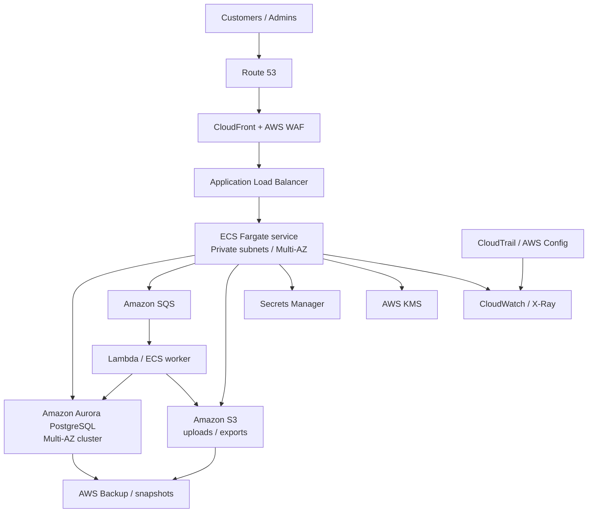
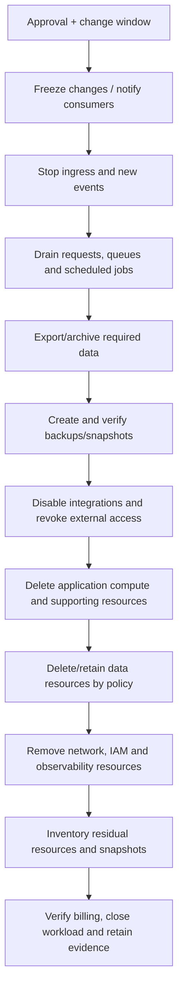

# Well-Architected Review, Operational Handover, and Resource Decommissioning

An AWS workload is ready for production operations only when its architecture has been systematically reviewed, the operations team has the information and access required to support it, and the organization can retire the workload without losing data that must be retained or leaving orphaned resources accruing charges.

This capstone takes you through the end-of-lifecycle stages of an AWS project: defining the workload, running an AWS Well-Architected review, building an improvement plan, preparing operational handover, rehearsing runbooks, and finally decommissioning resources through an approved process. You will use **AWS Well-Architected Tool**, CloudWatch, AWS Backup, AWS CloudFormation, IAM, Resource Groups Tagging API, and the core services covered in this module.

The project uses an e-commerce order processing system as its example. You can apply this same methodology to your own real-world workloads by substituting your business context, architecture diagrams, RTO/RPO targets, risks, and data retention policies.

This capstone belongs to the `CLOUD_PROVIDERS_AWS` module: exploring the AWS ecosystem from Regions/AZs, IAM, VPC, compute, storage, databases, and integration to serverless, while building skills in designing secure, observable, resilient, and cost-controlled applications.

After completing this project, you will be able to:

- Define workload boundaries, business outcomes, owners, accounts, Regions, and dependencies.
- Conduct a review across all six pillars of the AWS Well-Architected Framework.
- Use AWS Well-Architected Tool to record answers, save milestones, and generate reports.
- Analyze High Risk Issues (HRIs) and Medium Risk Issues (MRIs) and prioritize remediation by business impact.
- Build an improvement backlog with owners, effort estimates, due dates, evidence, and acceptance criteria.
- Prepare an operational readiness review and handover documentation pack.
- Author and test runbooks/playbooks for deployments, incidents, backup/restore, failover, and cost reviews.
- Verify SLOs, dashboards, alarms, escalation paths, access, backups, and DR.
- Plan decommissioning, preserve required data, delete resources in a controlled order, and verify residual costs.

## 1. Capstone Context: Retail Orders Workload

An online retail business operates an application that accepts orders, updates inventory, processes payments, and provides order status to customers. The workload runs on AWS, experiences campaign-driven traffic spikes, and requires after-hours operational support.

### 1.1. Business Outcomes

| Goal | Expected Outcome |
|---|---|
| Order intake and processing | Zero loss of confirmed orders |
| Customer experience | Reliable API with acceptable response times |
| Operations | Ability to detect, investigate, and recover from incidents |
| Security | Data and access permissions are properly controlled |
| Continuity | Tested backups and recovery procedures |
| Cost | Clear owner, budget, tagging, and periodic reviews |
| Workload retirement | Ability to archive/delete per policy with zero orphaned resources |

### 1.2. Workload Scope

The workload includes:
- Website/API accepting customer orders.
- Services handling orders and inventory.
- Database storing transaction state.
- Queues handling asynchronous tasks.
- Object storage for images, exports, and archives.
- Monitoring, logging, security, and backups.
- Deployment, incident response, and decommissioning workflows.

Deploying the entire architecture into a live account is not mandatory. You can use diagrams, existing configurations, sample logs/metrics, and the AWS Well-Architected Tool to complete the review. If deploying into a sandbox, provision only necessary resources and tear them down after collecting evidence.

### 1.3. Service Target Assumptions

The numbers below are assumptions for team discussion and sign-off with the business owner; they are not default AWS SLAs.

| Metric | Proposed Target | How Measured |
|---|---:|---|
| Availability | 99.9% per month | Successful requests / eligible requests |
| API latency | p95 under 500 ms for read APIs | ALB/API metrics or tracing |
| Error rate | Under 0.1% during steady windows | 5XX and application errors |
| Order processing lag | p95 under 2 minutes | Age of oldest message / event timestamp |
| RTO | 2 hours | Time from incident start to service restoration |
| RPO | 15 minutes | Maximum acceptable data loss window |
| Backup restore | Passes during drills | Restore test evidence |
| Cost variance | Within approved budget | Actual vs. budget |

RTO is the target duration to restore service; RPO is the maximum acceptable data loss. Both targets require sign-off from the business owner, compliance, and technical owner based on real business impact.

## 2. Reference Architecture

The sample architecture uses managed services to reduce operational toil. Teams must adjust the diagram to match the workload's actual state; never mark a control as implemented without supporting evidence.



### 2.1. Components and Responsibilities

| Component | Role | Review Focus |
|---|---|---|
| Route 53 / CloudFront | DNS and content delivery | DNS failover, cache policies, TLS |
| AWS WAF | Web request filtering | Managed rules, rate limits, logging |
| Application Load Balancer | Route requests to services | Health checks, access logs, TLS |
| ECS Fargate | Run API and worker containers | Task sizing, deployments, autoscaling |
| Aurora PostgreSQL | Store orders/inventory | Multi-AZ, backups, connections, failover |
| SQS | Buffer asynchronous work | DLQs, visibility timeouts, message age, redrive |
| Lambda | Handle lightweight events/workers | Concurrency, retries, idempotency |
| S3 | Uploads, exports, archives | Versioning, encryption, lifecycle, access |
| IAM / Secrets Manager | Identity and secrets | Least privilege, rotation, auditing |
| KMS | Manage encryption keys | Key policies, grants, rotation, deletion |
| CloudWatch / X-Ray | Metrics, logs, traces | SLOs, alarms, retention, correlation |
| CloudTrail / Config | Auditing and configuration history | Account/Region coverage, retention |
| AWS Backup | Backup/restore policies | Coverage, vaults, retention, restore tests |

### 2.2. Data Flow

1. Customers send requests through DNS, CloudFront/WAF, and ALB.
2. ECS API authenticates requests, validates business rules, and writes orders to Aurora.
3. The API publishes messages to SQS for asynchronous processing.
4. Workers handle payment/inventory integrations, update statuses, and store outputs.
5. S3 stores objects such as invoices, exports, or uploaded files.
6. CloudWatch collects metrics/logs; X-Ray traces requests across services.
7. AWS Backup and native database backups protect data per RPO/RTO.
8. CloudTrail and AWS Config supply audit and configuration history evidence.

This flow is an exercise assumption. When reviewing another workload, replace it with the actual flow—including external non-AWS dependencies, SaaS services, on-premises systems, and manual operations.

## 3. Project Deliverables

The team must produce a handover package usable by engineers who did not participate in the original build.

| Deliverable | Minimum Contents | Evidence |
|---|---|---|
| Workload profile | Business context, owners, criticality, accounts/Regions, dependencies | Workload record |
| Architecture pack | Current and target diagrams, data flows, trust boundaries | Diagrams + notes |
| Well-Architected review | Answers, notes, and risks across six pillars | WA Tool report |
| Risk register | HRIs/MRIs, impact, likelihood, owners, remediation | Backlog table |
| Improvement plan | Priority, effort, due dates, success criteria | Roadmap |
| Operations handbook | SLOs, dashboards, alarms, access, runbooks, escalation | Handover pack |
| Backup/DR evidence | Policies, recovery points, restore tests, and RTO/RPO results | Test report |
| Decommission plan | Inventory, retention, approvals, deletion sequence | Signed checklist |
| Closure report | Residual resources, cost verification, lessons learned | Final report |

Never fabricate review metrics or evidence. If a control has not yet been tested, mark it `Not verified` or `Planned` and create an action item.

## 4. Preparing for the Well-Architected Review

An effective review requires the right participants, clear scope, and verifiable evidence.

### 4.1. Participants

- Workload owner: accountable for business outcomes and risk acceptance.
- Solution architect: explains architecture, trade-offs, and design decisions.
- Application owner: describes code, releases, dependencies, and failure modes.
- Platform/cloud engineer: accounts, networking, compute, storage, and IaC.
- Security representative: IAM, encryption, logging, and incident response.
- Operations/SRE: SLOs, alarms, on-call, runbooks, and DR.
- Finance/FinOps: budgets, tagging, cost allocation, and savings opportunities.
- Data/compliance owner: classification, retention, legal holds, and data deletion.

One person may cover multiple roles on small projects, provided accountability for approving risks, operations, and data remains unambiguous.

### 4.2. Gathering Inputs

Before the review, prepare:

- Business purpose, user journeys, and critical business transactions.
- Workload owner, support owner, and escalation contacts.
- AWS accounts, Regions, VPCs, AZs, and external dependencies.
- Architecture diagrams and data-flow diagrams.
- Data classifications, retention policies, and residency constraints.
- Deployment pipelines, IaC repositories, and change workflows.
- Recent metrics, logs, traces, incidents, and postmortems.
- Backup policies, recovery points, and restore test results.
- Cost/budget reports, tags, and usage trends.
- Existing risks, exceptions, and remediation backlogs.

Evidence must include timestamps and sources. An old screenshot does not prove a control still works today.

## 5. Defining the Workload in AWS Well-Architected Tool

AWS Well-Architected Tool (WA Tool) helps document workloads, answer lens questions, surface risks, and track improvements across milestones. The tool structures the review; answers and evidence still require verification by people who understand the workload. Never treat WA Tool as an automated account scanner that certifies an architecture as secure.

### 5.1. Create the Workload

1. Open the AWS Management Console and select **AWS Well-Architected Tool**.
2. Choose **Define workload**.
3. Give it an identifiable name, e.g., `Retail Orders - Production`.
4. Describe the business purpose and workload boundary.
5. Assign the review owner.
6. Choose the appropriate environment, e.g., Production.
7. Select only the AWS Regions actually used.
8. Link account IDs if your organization tracks that scope within the workload.
9. Attach application ARN, architecture diagram, industry, and tags if available.
10. Review the profile and select applicable lenses.
11. Save the workload and begin the review.

Declare only Regions and accounts actually in scope. Never add an unprovisioned standby Region merely to create the appearance of multi-Region resilience.

### 5.2. Define the Boundary

The workload boundary must clarify:
- Which components belong to the workload.
- Which AWS services are used.
- Which external non-AWS systems are dependencies.
- Which team owns each component.
- Which data crosses trust boundaries.
- Which components are out of scope and why.

If an external payment provider processes transactions, the workload must still assess invocation patterns, timeouts, retries, credentials, and failure handling for that dependency.

### 5.3. Conduct the Review

1. Open the created workload.
2. Choose **Start reviewing** or **Continue reviewing**.
3. Select the AWS Well-Architected Framework lens.
4. For each question, read the best practices and check only those currently implemented.
5. If a best practice does not apply, mark Not applicable and document why.
6. Record notes with evidence, documentation links, owners, or limitations.
7. Repeat across all six pillars.
8. Save and exit when splitting the review across sessions.

Never check a best practice solely because an icon appears on an architecture diagram. Having CloudWatch in a diagram does not prove useful alarms, on-call ownership, or rehearsed runbooks exist.

## 6. Reviewing the Six Pillars

The six pillars are Operational Excellence, Security, Reliability, Performance Efficiency, Cost Optimization, and Sustainability. Evaluate every pillar using concrete questions, evidence, risks, and actions.

### 6.1. Operational Excellence

Review questions:
- Does the team understand workload health and business outcomes?
- Are change management, release, and rollback processes in place?
- Are runbooks/playbooks documented, owned, and tested?
- Are incidents detected, triaged, investigated, and followed by postmortems?
- Is there a mechanism to learn from operational events and improve?
- Are staffing, access permissions, and escalation coverage adequate?

Evidence:
- Deployment pipelines, change records, release history.
- CloudWatch dashboards, alarms, and alert routing.
- Runbooks, incident timelines, and postmortems.
- On-call rotas, support plans, and training records.
- Operational readiness checklists.

Example risk: alerts email only one individual who has left the team. Remediation: route alerts through team-owned SNS/on-call integrations, add escalation paths, and test notifications.

### 6.2. Security

Review questions:
- Do identities enforce least privilege, federation, and MFA?
- Does the workload separate roles for task execution vs. application data access?
- Is data encrypted appropriately at rest and in transit?
- Are secrets stored in Secrets Manager/Parameter Store and rotated?
- Are audit logs, threat detection, and incident response in place?
- Is network exposure minimized?
- Are dependencies, container images, and source code scanned?

Evidence:
- IAM role/policy reviews and Access Analyzer findings.
- KMS key policies and encryption configurations.
- Secret rotation settings.
- CloudTrail, AWS Config, and GuardDuty findings.
- Security groups, WAF, and network architecture.
- Container image scans and patching records.

Example risk: task role grants `s3:*` across all buckets. Remediation: scope actions, bucket ARNs, and prefixes; verify the app still works after tightening the policy.

### 6.3. Reliability

Review questions:
- Are single points of failure eliminated?
- Is the workload distributed across multiple AZs appropriately?
- Are backups, restore tests, and a DR strategy in place?
- Are retries, timeouts, queues, and idempotency designed properly?
- Are health checks and automated recovery configured?
- Have failover and capacity failures been tested?

Evidence:
- ECS service desired/running tasks across AZs.
- Aurora failover configuration and event history.
- SQS DLQs, redrive policies, and message age metrics.
- AWS Backup policies, recovery points, and restore tests.
- DR runbooks and RTO/RPO measurements.
- Failure-injection or game-day reports.

Example risk: backup jobs show green, yet no restore has ever been executed. Remediation: run a restore test into an isolated environment, validate data, and measure recovery duration.

### 6.4. Performance Efficiency

Review questions:
- Are compute, storage, and databases sized to the workload?
- Are p50/p95/p99 latencies and saturation measured?
- Are caching, queuing, async processing, or autoscaling used where appropriate?
- Are database queries/indexes and connection pools monitored?
- Have load tests run against realistic traffic profiles and peak events?

Evidence:
- Load test reports and latency percentiles.
- ECS CPU/memory and ALB target response times.
- Aurora CPU, connections, I/O, and Database Insights.
- SQS message age/depth and worker concurrency.
- Cache hit ratios, throughput, and scaling history.

Example risk: synchronous worker processing forces the API to wait on an external payment provider. Remediation: adopt an async workflow, bounded retries, idempotency keys, and explicit order states.

### 6.5. Cost Optimization

Review questions:
- Are owners and cost allocation tags assigned?
- Are budgets, forecasts, and anomaly alerts configured?
- Are non-production resources stopped or deleted when idle?
- Are compute/databases right-sized and storage lifecycles configured?
- Are idle capacity, data transfer, NAT, logs, and backup costs measured?
- Do pricing models match usage patterns?

Evidence:
- Cost Explorer, CUR, or billing exports.
- AWS Budgets and Cost Anomaly Detection.
- Resource tags and cost allocation reports.
- Compute utilization, storage growth, and retention settings.
- Savings Plans/Reserved Instance analyses where applicable.

Example risk: log groups have no retention limit, causing unbounded storage growth. Remediation: configure retention per compliance and investigation needs; archive logs requiring long retention to appropriate storage.

### 6.6. Sustainability

Review questions:
- Are overprovisioning and idle resources avoided?
- Are managed/serverless services used where appropriate?
- Are data lifecycles and storage footprints optimized?
- Are unnecessary data transfers and redundant processing minimized?
- Is utilization tracked to improve resource efficiency?

Evidence:
- Compute utilization and autoscaling policies.
- Storage lifecycle/retention rules.
- Workload scheduling and non-production shutdowns.
- Architecture choices reducing unnecessary data movement.
- Rightsizing records and resource cleanup evidence.

Example risk: development environments run 24/7 despite being used only during business hours. Remediation: schedule stop/start automation with documented exceptions and clear owners.

### 6.7. Review Summary Table

| Pillar | Core Question | Key Evidence | Example Improvement |
|---|---|---|---|
| Operational Excellence | Do we operate consistently and learn from incidents? | Runbooks, alarms, incidents | On-call rotation, runbook drills |
| Security | Are identity, data, and networks protected? | IAM, KMS, CloudTrail | Least privilege, secret rotation |
| Reliability | Does it tolerate faults and recover? | Multi-AZ, backups, restore tests | DR exercises, DLQs |
| Performance Efficiency | Does it handle load efficiently? | Load tests, latency, utilization | Autoscaling, query tuning |
| Cost Optimization | Do costs have owners and align with usage? | Cost Explorer, budgets, tags | Rightsizing, lifecycle policies |
| Sustainability | Are resources used efficiently? | Utilization, storage lifecycle | Schedule idle resources |

## 7. Evidence and Recording Answers

Every Well-Architected answer should link to concrete evidence.

Sample evidence record:

| Field | Example |
|---|---|
| Pillar / question | Reliability — backups and recovery |
| Current practice | Aurora automated backups enabled |
| Evidence | Backup retention setting, recovery point ID |
| Evidence date | 2026-11-20 |
| Owner | Database platform team |
| Gap | No restore test executed in the last 90 days |
| Risk | Cannot prove backups meet RTO/RPO |
| Next action | Run restore test into an isolated VPC |
| Acceptance | Data validation passes; restore duration under RTO |

Distinguish three states:
- **Implemented and verified**: deployed with current test evidence.
- **Implemented, not recently verified**: configured, but evidence is stale or unverified recently.
- **Planned / not implemented**: not yet built; requires an improvement item.

Never mark a difficult practice as Not applicable just to avoid a risk flag. Record clear reasoning, business context, and who approved the exception.

## 8. Saving Milestones and Generating Workload Reports

After completing the initial questionnaire:

1. Open the workload overview.
2. Choose **Save milestone**.
3. Name it clearly, e.g., `Baseline-2026-11-20`.
4. Note the scope, reviewers, and architecture version.
5. Save the milestone.
6. Select the lens and generate the workload report.
7. Archive the report in the project evidence repository per internal policy.

A milestone snapshots workload state at that moment and cannot be edited afterward. After completing remediations or a new review cycle, save a new milestone to compare progress. The workload report captures answers, notes, and risk counts for that review.

## 9. Reading the Improvement Plan and Classifying Risks

AWS WA Tool summarizes risks based on selected best practices. The Improvement Plan highlights:
- **High Risk Issues (HRIs)**.
- **Medium Risk Issues (MRIs)**.
- Recommended improvement items and remediation guidance.

Treat this list as input for team evaluation and prioritization. Never treat tool ordering as the final business decision; factor in impact, exploitability, blast radius, effort, dependencies, and risk acceptance.

### 9.1. Risk Register

Template:

| ID | Pillar | Issue | Impact | Priority | Owner | Target |
|---|---|---|---|---|---|---|
| R-01 | Reliability | No DB backup restore test | Cannot prove RTO/RPO | P0 | DBA | Sprint 1 |
| R-02 | Security | Overly broad task role | Expanded blast radius | P0 | Security | Sprint 1 |
| R-03 | Operational | Missing after-hours escalation | Slow incident detection | P1 | SRE | Sprint 2 |
| R-04 | Cost | Unbounded log retention | Rising storage costs | P2 | Platform | Sprint 2 |
| R-05 | Performance | Synchronous worker calls | Increased API latency | P2 | App team | Sprint 3 |

This is an illustrative example, not an actual workload review result.

### 9.2. Prioritizing by Business Impact

Use an internal scoring model:

- Severity: impact on users, data, security, or operations.
- Likelihood: probability of occurrence.
- Exposure: scope of accounts, resources, or data affected.
- Urgency: time before risk turns into an incident.
- Effort: engineering time, cost, and dependencies to remediate.

Example matrix:

| Priority | Suggested Criteria | Action |
|---|---|---|
| P0 | Risk of data loss, security breach, or missed critical recovery | Address immediately with owner and escalation |
| P1 | Potential major outage or SLA breach | Schedule in the next sprint |
| P2 | Manageable efficiency or cost impact | Plan within the quarter |
| P3 | Minor improvement, low risk | Track in backlog |

P0–P3 is a capstone convention; use your organization's existing severity scheme if one exists.

## 10. Building an Actionable Improvement Plan

Every action item should capture:
- Risk ID and pillar.
- Problem description, evidence, and business impact.
- Proposed change.
- Owner and approver.
- Effort / estimated cost.
- Dependencies and rollback plan.
- Due date.
- Acceptance criteria.
- Post-remediation evidence.
- Residual risk and risk acceptance if any remains.

Examples:

| Action | Owner | Acceptance Criteria | Rollback |
|---|---|---|---|
| Scope task role to S3 prefix | App + Security | Negative test on other prefixes returns `AccessDenied`; valid flow passes | Revert to saved policy version |
| Rehearse Aurora restore | DBA | Database restores, checksum/business validation passes, duration meets RTO | Delete isolated restore after saving evidence |
| Enable DLQ and redrive runbook | Platform | Poison messages isolated, alerts reach right owner | Revert consumer config per change plan |
| Standardize alarms/on-call | SRE | Test alarm reaches escalation channel and is acknowledged | Restore previous routing config |
| Lifecycle rules for archive bucket | Data owner | Expired objects transition per policy while legal holds stay protected | Pause lifecycle rule |

### 10.1. Tracking Progress

- Link action items to your backlog or ticketing system.
- Track status: Not started, In progress, Blocked, Complete, Accepted risk.
- Attach evidence after implementation.
- Re-review corresponding questions in WA Tool.
- Save a new milestone after each wave of remediations.
- Track whether HRIs/MRIs decrease or persist.
- Repeat reviews on organizational cadence and after major architectural changes.

Never mark a risk Complete just because a ticket closed. Require evidence proving the control operates as intended.

## 11. Operational Readiness Review Before Handover

Operational handover transfers responsibility from the build team to the operations team. Before handover, run an Operational Readiness Review (ORR) covering these domains:

| Review Domain | Questions to Answer |
|---|---|
| Ownership | Who are the service owner, technical owner, and business owner? |
| Support | Who is on call, what are support hours, and what is the escalation path? |
| Architecture | Are diagrams, dependencies, and data flows up to date? |
| Deployment | Who deploys, where are approvals, and how do rollbacks work? |
| Observability | Are dashboards, alarms, logs, traces, and SLOs sufficient? |
| Incident | Are playbooks, severities, and communication plans ready? |
| Security | Are IAM, secrets, KMS, auditing, and vulnerability workflows ready? |
| Data | Are backups, restores, retention, classification, and deletion defined? |
| Reliability | Have RTO/RPO, failover, and capacity plans been tested? |
| Cost | Are budgets, tags, anomaly alerts, and cost owners in place? |
| Change | Are maintenance windows, change calendars, and release notes ready? |
| Knowledge | Have runbooks, known issues, and training been handed over? |

Each item receives Pass, Conditional Pass, or Blocked, along with an owner and target date. Conditional Pass items must record the risk, compensating control, deadline, and approver.

## 12. Operational Handover Documentation Pack

Create an operations handbook with the following sections.

### 12.1. Service Overview

- Workload name and business purpose.
- Service owner, support team, and escalation contacts.
- Accounts, Regions, and environments.
- Architecture and data-flow diagrams.
- Critical dependencies and external providers.
- Data classification and retention rules.
- SLOs/SLAs, RTO/RPO, and maintenance windows.
- Known limitations and accepted risks.

### 12.2. Resource Inventory

Each resource must list:
- Resource ARN/ID and service type.
- Account, Region, and AZ.
- Environment, project, owner, and cost center tags.
- Managing IaC stack/module.
- Data classification and retention.
- Upstream/downstream dependencies.
- Backup and deletion policy.
- Operational contact.

### 12.3. Deployment and Rollback

Document clearly:
- Source repository and release branch.
- CI/CD pipeline and required approvals.
- Artifact/image digest tracking.
- Deployment strategy (rolling, blue/green, canary).
- Health checks and smoke tests.
- Rollback triggers and rollback steps.
- Database migration compatibility rules.
- Change records and communication plans.

### 12.4. Access Handover

- IAM Identity Center / federated access.
- Role mapping by job function.
- Audited break-glass procedures.
- Access grant and revocation workflows.
- Secret ownership and rotation schedules.
- KMS key owner and recovery procedures.
- Team member offboarding procedures.
- Never transfer passwords or private keys via email or plaintext documents.

### 12.5. Known Issues and Technical Debt

For each issue record:
- Symptoms.
- Reproduction conditions.
- Impact.
- Tested workaround.
- Root cause if known.
- Owner and target date.
- Consequence if left unresolved.

## 13. Handing Over SLOs, Dashboards, and Alarms

A dashboard is useful only when it answers operational questions. Design dashboards around golden signals and business outcomes.

| Layer | Signal | Suggested Alarm / Condition |
|---|---|---|
| User/API | Availability, 5XX, p95/p99 latency | Error budget burn, latency breaching SLO |
| ALB | Healthy targets, target response time | Low healthy target count or rising 5XX |
| ECS | Running/pending tasks, CPU, memory | Desired vs. running task mismatch |
| SQS | `ApproximateAgeOfOldestMessage`, visible messages | Queue age exceeds processing SLA |
| Lambda | `Errors`, `Throttles`, `Duration`, `ConcurrentExecutions` | Rising errors/throttles or duration near timeout |
| Aurora | CPU, connections, free storage, failover events | Connection saturation, low free storage |
| S3 | 4XX/5XX request metrics, replication status | Access failures or replication lag |
| Security | GuardDuty findings, Config compliance, CloudTrail events | Critical findings or configuration drift |
| Cost | Budget actual/forecast, anomalies | Forecast exceeds budget threshold |

### 13.1. Alarms Must Have Owners and Actions

Every alarm needs:
- Clear name and exact resource dimensions.
- Severity (critical/high/warning).
- Threshold, evaluation period, and missing-data treatment.
- Owner/on-call routing.
- Runbook link.
- Concrete action when firing.
- Resolution criteria and silencing policy.
- Tested notification delivery.

Never create alarms just to boost counts. Unowned or non-actionable alarms create alert fatigue.

### 13.2. Error Budgets

With a 99.9% monthly availability SLO, the error budget is the allowable downtime/errors within that period per the SLI definition. Teams monitor burn rate to catch rapid budget exhaustion. When the budget runs out, review release risk and prioritize reliability work per organizational policy.

## 14. Runbooks and Playbooks

Runbooks document repeatable procedures; playbooks guide investigation and decision-making during incidents. Store both centrally under version control and test them regularly.

Runbook structure template:

1. Purpose and scope.
2. Symptoms / triggers.
3. Severity and business impact.
4. Preconditions and required permissions.
5. Dashboards, logs, and queries to open.
6. Investigation steps.
7. Mitigation and recovery steps.
8. Post-mitigation verification.
9. Rollback / stop conditions.
10. Escalation and communications.
11. Evidence to archive.
12. Owner, reviewer, and last-updated date.

### 14.1. Runbook: Rising API 5XX

1. Open API/ALB/ECS dashboards.
2. Identify start time and affected endpoints/AZs.
3. Check recent deployments and change records.
4. Compare target health, task counts, CPU/memory, and dependency latency.
5. Inspect structured logs and traces using correlation IDs.
6. If caused by a release, execute the tested rollback procedure.
7. If caused by a dependency failure, apply circuit breakers or traffic controls per playbook.
8. Verify 5XX rates and latency return to baseline.
9. Record incident timeline, customer impact, and follow-up actions.

### 14.2. Runbook: Growing SQS Backlog

1. Check `ApproximateAgeOfOldestMessage`, visible messages, and in-flight messages.
2. Check worker desired/running counts, errors, and throttles.
3. Check whether downstream databases or APIs are saturated.
4. Inspect message failure reasons and retry patterns.
5. Scale consumer concurrency only if downstream has headroom.
6. Isolate poison messages into the DLQ per policy.
7. Redrive after fixing root cause using controlled rate limits.
8. Confirm queue age drops and business transactions complete.

### 14.3. Runbook: Aurora Failover or Connection Saturation

1. Check RDS/Aurora events and cluster status.
2. Connect via the cluster endpoint—never hard-code instance IPs.
3. Inspect connection counts, CPU, locks, and database load.
4. Verify application connection pool reconnect and backoff behavior.
5. If needed, throttle concurrency or adjust service scaling within DB limits.
6. Confirm the writer endpoint and transaction health.
7. Run authorized read/write smoke tests.
8. Monitor connection errors, latency, and failover events.

### 14.4. Runbook: Restoring from Backup

1. Confirm the incident, recovery point, and RPO.
2. Obtain approval from the incident commander and data owner.
3. Restore into an isolated environment or approved target.
4. Restrict network and IAM access.
5. Validate schemas, row counts, checksums, and business invariants.
6. Measure restore time against RTO.
7. Plan cutover, DNS/endpoint updates, and consumer pauses.
8. Execute approved cutover.
9. Verify application health and data integrity.
10. Archive evidence and tear down temporary restore environments per policy.

Never rehearse restores by overwriting a live production database.

## 15. Backups, Disaster Recovery, and Recovery Evidence

Backups are valuable only when they restore cleanly and recovered data meets business objectives.

### 15.1. Backup Strategy

- Aurora/RDS automated backups and point-in-time recovery per retention needs.
- AWS Backup plans across supported resource types.
- S3 Versioning and lifecycle rules; replication when DR requires it.
- Backup vault access policies and encryption.
- Cross-account/cross-Region copies if required by the threat model.
- Retention and legal holds per policy.
- Monitoring for backup job failures and recovery point age.

Not every resource is protected identically. Verify coverage per resource type and service-specific backup features.

### 15.2. Restore Tests

Evidence to archive:
- Recovery point ARN/ID.
- Source resource and Region.
- Restore start and completion timestamps.
- Target environment.
- Data validation outcome.
- Measured RTO/RPO.
- Executor and approver.
- Findings and remediation.

AWS Backup supports automated restore testing for supported resource types. For services using native restore/PITR, follow matching workflows and capture equivalent evidence.

### 15.3. DR Strategy

Choose a strategy aligned with RTO/RPO and budget:
- Backup and restore: lower cost, typically longer RTO.
- Pilot light: minimal core footprint maintained in the recovery Region.
- Warm standby: scaled-down copy always running.
- Multi-site active/active: high resilience with greater complexity and cost.

Never claim a workload is multi-Region simply because backups copy to another Region. Real DR requires networking, identity, data replication, deployment capability, DNS/cutover, and drills.

## 16. Change Management and Knowledge Transfer

Before handover:
- Freeze or document in-flight releases.
- Synchronize IaC, runbooks, and resource inventories.
- Record current application and infrastructure versions.
- List pending changes, upcoming maintenance, and known issues.
- Conduct an architecture and data-flow walkthrough.
- Have the receiving team execute a runbook themselves.
- Simulate an alarm/incident drill.
- Verify console/CLI permissions and break-glass access.
- Log open questions, gaps, and owners.

Handover is complete only when the receiving team can locate documentation, access the right scopes, detect incidents, perform basic recovery, and navigate escalations.

## 17. Handover Sign-Off

| Criterion | Handing-Over Team | Receiving Team | Status |
|---|---|---|---|
| Architecture and resource inventory current | Provides | Verifies | Pass/Blocked |
| SLOs, dashboards, and alarms | Configures | Verifies notifications | Pass/Blocked |
| Runbooks/playbooks | Authors and rehearses | Executes dry run | Pass/Blocked |
| Backup and restore evidence | Provides | Reviews RTO/RPO | Pass/Blocked |
| IAM/access | Provisions by role | Verifies permissions | Pass/Blocked |
| Security findings | Logs risks and actions | Accepts/remediates | Pass/Blocked |
| Cost/budget ownership | Provides baseline | Accepts ownership | Pass/Blocked |
| Open issues and accepted risks | Hands over | Confirms owners | Pass/Blocked |
| Support/on-call | Designates | Confirms schedule | Pass/Blocked |

Sign-off requires the workload owner, technical owner, and operations owner. Open risks require formal acceptance by an authorized decision maker; never transfer accountability implicitly simply because a project ended.

## 18. Planning Decommissioning

Decommissioning retires a workload, preserves data requiring retention, and safely tears down resources. It is a change capable of impacting users, compliance, billing, and dependent systems.

Before deleting any resource, confirm:
- Business owner approved the retirement date.
- Zero active users, API clients, or dependent integrations remain.
- Data owner approved archive/deletion and retention rules.
- Legal holds, regulatory retention, and eDiscovery checks cleared.
- Required backups/snapshots are created and verified.
- IaC stacks, resource owners, and dependencies are inventoried.
- DNS records, certificates, secrets, keys, and integrations have retirement plans.
- Billing owner accepts ongoing charges for any retained snapshots/archives.

Never run bulk delete scripts based solely on tags or project names. Tags can be missing, wrong, or shared with another workload.

## 19. Resource Inventory Before Teardown

Combine multiple sources to build the inventory:

- AWS CloudFormation stacks and stack resources.
- AWS Resource Groups Tagging API.
- AWS Resource Explorer and AWS Config inventory if enabled.
- AWS Backup protected resources and recovery points.
- Cost Explorer and billing data to catch resources still generating charges.
- Service consoles/APIs for specialized resources such as RDS snapshots, EBS volumes, NAT Gateways, load balancers, log groups, ECR images, and KMS keys.

Suggested tags:
- `Project=retail-orders`
- `Environment=production`
- `Owner=team-name`
- `CostCenter=CC-1001`
- `DataClass=confidential`
- `ManagedBy=CloudFormation`
- `DecommissionDate=YYYY-MM-DD`

The Tagging API does not list every resource type. Cross-check against CloudFormation, Config, Resource Explorer, and billing.

### 19.1. Safe Read-Only Inventory Commands

List active stacks:

```bash
aws cloudformation list-stacks \
  --stack-status-filter CREATE_COMPLETE UPDATE_COMPLETE UPDATE_ROLLBACK_COMPLETE \
  --query 'StackSummaries[*].{Name:StackName,Status:StackStatus,Updated:LastUpdatedTime}'
```

Inspect resources inside a specific stack:

```bash
aws cloudformation describe-stack-resources \
  --stack-name "$STACK_NAME" \
  --query 'StackResources[*].{LogicalId:LogicalResourceId,Type:ResourceType,PhysicalId:PhysicalResourceId,Status:ResourceStatus}'
```

Find resources carrying a project tag (results depend on resource types supported by the Tagging API):

```bash
aws resourcegroupstaggingapi get-resources \
  --tag-filters Key=Project,Values=retail-orders \
  --resources-per-page 100
```

Check RDS snapshots:

```bash
aws rds describe-db-cluster-snapshots \
  --query 'DBClusterSnapshots[*].{Cluster:DBClusterIdentifier,Snapshot:DBClusterSnapshotIdentifier,Status:Status,Created:SnapshotCreateTime}'
```

These commands are read-only. Run them in the right account and Region; if the workload spans multiple Regions, repeat for every confirmed Region.

## 20. Data Disposition: Archive, Retain, or Delete

Classify data prior to teardown:

| Data Type | Required Decision | Handling |
|---|---|---|
| Order/transaction records | Retention per business/legal policy | Keep in datastore or access-controlled archive |
| Customer personal data | Retention, deletion requests, privacy obligations | Delete/anonymize per policy and legal approval |
| Audit/security logs | Retention per compliance and incident needs | Retain encrypted log archive with access logging |
| Application logs | Retention based on investigative value | Shorten retention or archive what is required |
| S3 uploads/exports | Owner confirms contents and retention | Versioned archive or delete post-approval |
| Database backups/snapshots | RPO, audit, and retention | Retain through retention period, then expire |
| Secrets/certificates | Confirm zero remaining consumers | Revoke/disable, then delete per workflow |
| KMS keys | Check all ciphertext and dependencies | Never schedule deletion while retained data still needs decryption |

An archive is itself a resource needing an owner, encryption, retention period, restore path, and budget. Never retain snapshots indefinitely merely because nobody made a decision.

## 21. Safe Decommissioning Sequence

Follow a strict sequence to prevent new data creation while deleting dependencies.



### 21.1. Freeze and Stop Ingress

- Notify users and integration owners of maintenance/decommissioning.
- Block new order creation or switch to read-only mode per the change plan.
- Disable schedulers, EventBridge rules, webhooks, and obsolete API routes.
- Confirm zero producers continue writing data.
- Record final deployment/version and workload state.

### 21.2. Drain and Complete In-Flight Work

- Wait for in-flight requests to complete.
- Stop accepting new queue messages.
- Wait for consumers to drain backlogs or archive remaining messages per policy.
- Inspect DLQs, retry queues, and scheduled tasks.
- Confirm zero batch jobs remain running.
- Record reconciliation totals proving no data was dropped.

Never delete an SQS queue while messages awaiting processing or audit remain.

### 21.3. Archive and Backup

- Export data in approved schemas and formats.
- Create final database snapshots or recovery points.
- Verify snapshot status is `available`/`completed`.
- Test restore capability in an isolated environment.
- Record manifests, checksums, encryption key ARNs, and retention dates.
- Transfer archive ownership to the data owner.
- Document who is permitted to restore and how access is requested.

### 21.4. Decommission Compute and Integrations

After draining and archiving:
- Scale ECS services to 0 or delete services via IaC.
- Remove unused Lambda functions and event source mappings.
- Delete related scheduled rules, targets, and Step Functions schedules.
- Tear down API routes, ALB target groups, and listeners in dependency order.
- Stop EC2/ASG/ECS capacity and delete after confirming zero dependencies.
- Revoke external webhook and API credentials.
- Remove DNS records and certificates only when zero consumers remain.

### 21.5. Decommission Data and Networking

- Retain or delete Aurora/RDS per retention and snapshot approvals.
- Retain or delete S3 buckets after handling object versions, delete markers, and replication dependencies.
- Handle EBS volumes, snapshots, EFS/FSx, and backup recovery points.
- Remove security groups, ENIs, endpoints, NAT Gateways, load balancers, and VPCs once attachments/dependencies are gone.
- Remove IAM roles/policies after confirming no other workload uses them.
- Disable/revoke credentials and certificates.
- Handle KMS keys via a dedicated workflow—only after confirming zero retained data still depends on the key.

Never delete the VPC or KMS keys first in the sequence. Both are shared dependencies for many resources and deleting them early can strand archives or backups.

## 22. CloudFormation Deletion Policies and Retained Resources

If the workload is managed by CloudFormation, use IaC to delete stacks in dependency order. First review every template resource and its policies:

- `DeletionPolicy: Delete`: deletes the resource when the stack deletes, if supported by the service.
- `DeletionPolicy: Retain`: preserves the physical resource and its data after stack deletion.
- `DeletionPolicy: Snapshot`: takes a final snapshot prior to deletion for supported resource types.
- `UpdateReplacePolicy`: governs the old resource when an update replaces it.

YAML example:

```yaml
Resources:
  OrdersArchiveBucket:
    Type: AWS::S3::Bucket
    DeletionPolicy: Retain
    UpdateReplacePolicy: Retain
    Properties:
      VersioningConfiguration:
        Status: Enabled

  OrdersDatabaseCluster:
    Type: AWS::RDS::DBCluster
    DeletionPolicy: Snapshot
    UpdateReplacePolicy: Snapshot
    Properties:
      # Properties omitted for this capstone example.
      Engine: aurora-postgresql
```

This snippet illustrates policy attributes, not a complete deployable template. For S3, `Retain` keeps the bucket and objects, meaning the resource persists and continues incurring charges. If using `Delete`, the bucket must be emptied properly, including all object versions and delete markers when versioning is enabled. For RDS, retained snapshots incur storage charges and require clear retention and ownership.

### 22.1. Controlled Stack Deletion

Before running delete:
1. Verify account, Region, and stack name.
2. Review all stack resources and dependencies.
3. Confirm data disposition and snapshots.
4. Review `DeletionPolicy` and `UpdateReplacePolicy`.
5. Confirm retained resources have owners and budgets.
6. Obtain formal approval and change record.
7. Notify operations and consumers.

Once approved, delete the stack with:

```bash
aws cloudformation delete-stack \
  --stack-name "$STACK_NAME" \
  --region "$AWS_REGION"
```

This command starts deletion; CloudFormation cannot cancel stack deletion once initiated. Never run it until the approval checklist is complete. Once the stack deletes, resources marked `DeletionPolicy: Retain` remain outside the stack and must be managed independently.

### 22.2. Handling `DELETE_FAILED`

If a stack enters `DELETE_FAILED`:
- Read stack events to identify the failing resource.
- Check dependencies, protection flags, non-empty S3 buckets, and service-specific deletion constraints.
- Never blindly force-delete the entire stack by default.
- If specific resources must be preserved, specify approved logical IDs to retain when retrying deletion.
- After stack deletion finishes, check the Resources tab for any resources marked `DELETE_SKIPPED`.
- Add retained resources to the residual inventory and delete only after separate approval.

## 23. Handling Residual Resources and Post-Teardown Costs

Stack status `DELETE_COMPLETE` does not prove all workload costs have stopped. Independent resources can remain:
- Retained S3 buckets and objects.
- RDS/EBS snapshots.
- AWS Backup recovery points.
- CloudWatch log groups and custom metrics.
- ECR images.
- Elastic IPs, NAT Gateways, and load balancers.
- KMS keys and secrets.
- Data transfer, archives, and cross-Region replication.
- Manually created resources or resources from other stacks.

### 23.1. Residual-Resource Register

| Resource | Status | Owner | Retention / Expiry | Cost Impact | Next Action |
|---|---|---|---|---|---|
| S3 archive bucket | Retained | Data owner | 7 years | Storage/requests | Review lifecycle |
| Aurora final snapshot | Available | DBA | 90 days | Snapshot storage | Delete after retention expires |
| CloudWatch log group | Retained | SRE | 30 days | Log storage | Confirm deletion date |
| KMS key | Enabled/retained | Security | Matches data retention | Key/API charges | Review dependencies |
| ECR repository | Retained | App team | 30 days | Image storage | Delete after rollback window |

### 23.2. Post-Deletion Verification

- Check CloudFormation stack statuses and retained resources.
- Search for remaining resources by project tags.
- Check service consoles/APIs for specialized resources.
- Check AWS Backup vaults and recovery points.
- Check DNS records, certificates, secrets, and IAM references.
- Check CloudWatch log groups, alarms, and dashboards.
- Reconcile Cost Explorer/Billing once usage data updates.
- Maintain a residual register for every retained resource.

Billing data can lag behind resource changes. Schedule a post-teardown billing review to inspect trailing usage and catch orphaned resources.

## 24. Phased Capstone Schedule

| Phase | Activities | Output |
|---|---|---|
| Week 1 — Discover | Workload boundaries, owners, architecture, evidence | Workload profile + diagrams |
| Week 1 — Review | Review six pillars in WA Tool | Baseline milestone + report |
| Week 2 — Prioritize | HRIs/MRIs, impact/effort, owners, targets | Risk register + improvement plan |
| Week 2 — Remediate | Implement 2–3 priority improvements in sandbox | Change evidence + updated answers |
| Week 3 — Handover | ORR, SLOs, dashboards, runbooks, backup/DR | Operations handbook + sign-off |
| Week 4 — Decommission | Archive, drain, delete in dependency order | Teardown record + residual inventory |
| Week 4 — Close | Cost review, lessons learned, final approval | Closure report |

Durations are illustrative. Production or compliance-governed workloads may require additional review and approval cycles.

## 25. Acceptance Criteria

The capstone is considered complete when:

### Well-Architected Review
- [ ] Workload boundaries and business outcomes are confirmed by the owner.
- [ ] Architecture and data-flow diagrams reflect actual state.
- [ ] All six pillars are reviewed.
- [ ] Answers include notes/evidence, and Not applicable items have rationale.
- [ ] Baseline milestone is saved.
- [ ] Workload report is generated.
- [ ] HRIs/MRIs are captured in the risk register.

### Improvement Plan
- [ ] Every risk has impact, owner, and priority.
- [ ] Action items include effort, due dates, and acceptance criteria.
- [ ] At least two remediations are executed, or valid rationale/approval is documented.
- [ ] Post-remediation evidence is archived.
- [ ] A new milestone records progress.

### Operational Handover
- [ ] Service owner, support owner, and escalation paths are confirmed.
- [ ] Dashboards and alarms are tested.
- [ ] Runbooks/playbooks have owners and have been rehearsed.
- [ ] SLOs, RTO/RPO, and support plans are approved.
- [ ] Backup/restore evidence meets targets.
- [ ] IAM access and break-glass procedures are handed over.
- [ ] Open risks are formally accepted or assigned remediation owners.
- [ ] Handover sign-off is complete.

### Decommissioning
- [ ] Business/data owner approved data disposition.
- [ ] Resource inventory and dependency graph are complete.
- [ ] Retained backups/snapshots are verified.
- [ ] Ingress, producers, consumers, and queues are drained.
- [ ] Resources are deleted in IaC/dependency order.
- [ ] Retained resources have owners, retention dates, and cost owners.
- [ ] Residual inventory and billing review are complete.
- [ ] Closure report and evidence are archived.

## 26. Grading Rubric

| Category | Weight | Passing Standard |
|---|---:|---|
| Workload scope and architecture evidence | 10% | Accurate boundaries, dependencies, diagrams |
| Well-Architected review | 25% | All six pillars covered with evidence and risks |
| Improvement plan | 15% | Sound prioritization, owners, and acceptance criteria |
| Operations handover | 20% | Runbooks, SLOs, dashboards, access, sign-off |
| Backup/DR validation | 10% | Restore tests and RTO/RPO evidence |
| Decommissioning / resource cleanup | 15% | Data disposition, IaC deletion, residual inventory |
| Communication and closure report | 5% | Clear documentation, evidence, lessons learned |

High scores do not depend on using the most services. The focus is evidence quality, feasible remediation, operational readiness, and safe resource decommissioning.

## 27. Common Mistakes

| Mistake | Consequence | Right Approach |
|---|---|---|
| Reviewing solely from diagrams | Misses real configurations and processes | Gather evidence and interview owners |
| Checking best practices without verification | Risk scores misrepresent the workload | Record accurate status and notes |
| Treating WA Tool as an auto-scanner | False confidence that the account is audited | Use the tool to document/review; verify each practice |
| Fixing only technical HRIs, ignoring business impact | Poorly prioritized backlog | Assess impact, likelihood, and deadlines |
| Handing over without runbooks | Receiving team depends on original builders | Walk through and rehearse runbooks |
| Having backups without testing restores | Unknown actual RTO/RPO | Run restore tests and save evidence |
| Creating alarms without owners | Alerts go unaddressed | Assign severity, on-call routing, and actions |
| Deleting stacks while forgetting retained resources | Continuing unexpected charges | Maintain residual inventory and billing reviews |
| Deleting S3 before archive/version checks | Data loss or failed stack deletion | Data disposition, version inventory, approvals |
| Deleting KMS keys too early | Archives/backups become undecryptable | Verify dependencies and retention first |
| Manually deleting IaC-managed resources | Drift and hard-to-repeat teardowns | Use IaC, or intentionally retain/import |
| Closing projects with unowned resources | Security and cost risks | Obtain sign-off on residual resources |

## 28. Closure Report Template

Use the following template upon completion:

```text
WORKLOAD:
BUSINESS OWNER:
TECHNICAL OWNER:
AWS ACCOUNTS / REGIONS:
DECOMMISSION DATE:
CHANGE RECORD:

WELL-ARCHITECTED REVIEW
- Baseline milestone:
- Review report:
- HRIs:
- MRIs:
- Risks accepted:
- Remediations completed:

OPERATIONS HANDOVER
- Operations owner:
- SLO / RTO / RPO:
- Dashboard / alarms:
- Runbooks tested:
- Backup / restore evidence:
- Open incidents / known issues:
- Sign-off:

DATA DISPOSITION
- Data archived:
- Data deleted:
- Legal hold / retention:
- Snapshot / recovery point IDs:
- Data owner approval:

RESOURCE TEARDOWN
- IaC stacks:
- Resources deleted:
- Resources retained:
- Residual resource owners:
- KMS / secrets / certificates:
- DNS / integrations:
- Verification date:

COST AND SECURITY
- Cost review:
- Residual monthly cost owner:
- IAM access revoked:
- Audit evidence retained:

FINAL STATUS:
LESSONS LEARNED:
APPROVERS:
```

Never write secrets, passwords, access keys, or sensitive personal data into the closure report.

## 29. Knowledge Summary

The AWS Well-Architected Framework provides six pillars for reviewing workloads consistently. AWS Well-Architected Tool helps define workloads, record answers, save milestones, generate reports, and track improvement plans. Reviews add real value when answers link to evidence and risks are prioritized by business impact.

Operational handover requires far more than an architecture diagram. The receiving team needs ownership, SLOs, dashboards, alarms, runbooks, playbooks, IAM access, backup/DR evidence, support plans, and a list of known risks. A runbook is trustworthy only after being tested by the engineers who will operate it.

Decommissioning must begin with approvals, data disposition, and a resource inventory. Stop ingress, drain workloads, archive data, and verify backups before deleting compute, data, and networking in dependency order. CloudFormation `DeletionPolicy` can retain or snapshot resources, though retained resources and snapshots still incur charges. After teardown, verify residual resources, access revocation, billing, and archive closure evidence.

The capstone is complete when the workload has been reviewed, risks have owners, operations can support it, and the organization can prove resources were retired or retained through an accountable decision.

## References

- [AWS Well-Architected Framework](https://docs.aws.amazon.com/wellarchitected/latest/userguide/waf.html)
- [What is AWS Well-Architected Tool?](https://docs.aws.amazon.com/wellarchitected/latest/userguide/tool.html)
- [Getting started with AWS Well-Architected Tool](https://docs.aws.amazon.com/wellarchitected/latest/userguide/getting-started.html)
- [Tutorial: Document an AWS Well-Architected Tool workload](https://docs.aws.amazon.com/wellarchitected/latest/userguide/tutorial.html)
- [Documenting a workload in AWS WA Tool](https://docs.aws.amazon.com/wellarchitected/latest/userguide/start-workflow-review.html)
- [Improving your workload](https://docs.aws.amazon.com/wellarchitected/latest/userguide/improving-your-workload.html)
- [Milestones in AWS Well-Architected Tool](https://docs.aws.amazon.com/wellarchitected/latest/userguide/milestones.html)
- [Implement and track improvements](https://docs.aws.amazon.com/wellarchitected/latest/userguide/implement-and-track-improvements.html)
- [Operational readiness and change management](https://docs.aws.amazon.com/wellarchitected/latest/operational-excellence-pillar/operational-readiness.html)
- [Develop and test runbooks to perform procedures](https://docs.aws.amazon.com/wellarchitected/latest/framework/ops05-bp01.html)
- [Use runbooks to perform procedures](https://docs.aws.amazon.com/wellarchitected/2025-02-25/framework/ops_ready_to_support_use_runbooks.html)
- [AWS Backup restore testing](https://docs.aws.amazon.com/aws-backup/latest/devguide/restore-testing.html)
- [CloudFormation DeletionPolicy attribute](https://docs.aws.amazon.com/AWSCloudFormation/latest/TemplateReference/aws-attribute-deletionpolicy.html)
- [Delete a CloudFormation stack](https://docs.aws.amazon.com/AWSCloudFormation/latest/UserGuide/cfn-console-delete-stack.html)
- [CloudFormation DeleteStack API](https://docs.aws.amazon.com/AWSCloudFormation/latest/APIReference/API_DeleteStack.html)
- [CloudFormation UpdateReplacePolicy attribute](https://docs.aws.amazon.com/AWSCloudFormation/latest/TemplateReference/aws-attribute-updatereplacepolicy.html)
- [AWS Resource Groups Tagging API](https://docs.aws.amazon.com/resourcegroupstagging/latest/APIReference/Welcome.html)
- [AWS Cost Explorer](https://docs.aws.amazon.com/cost-management/latest/userguide/ce-what-is.html)
