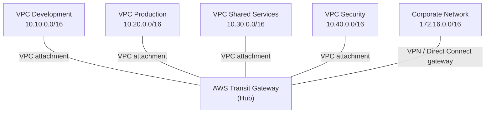
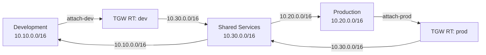
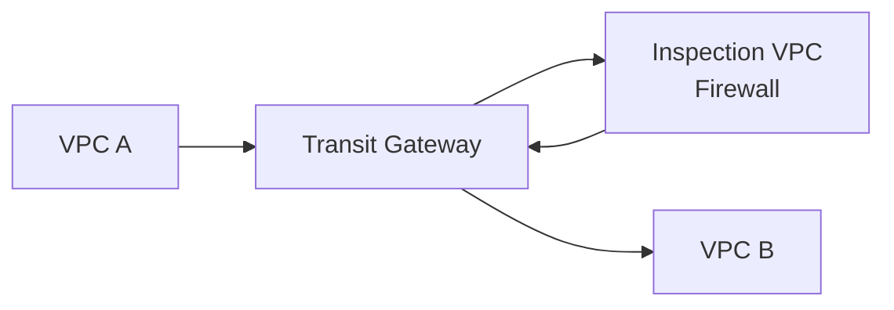

# Transit Gateway and the Hub-and-Spoke Model

When an AWS environment grows from one VPC to multiple VPCs across different accounts, connecting every pair of networks with VPC peering becomes difficult to manage. **AWS Transit Gateway (TGW)** solves this problem with a shared routing transit point: each VPC, VPN connection, or corporate network connects to a **hub**, while the networks at the edges are the **spokes**. Administrators use TGW route tables to control which networks can exchange traffic with one another.

This lesson belongs to the **Advanced Network Connectivity** chapter of the **CLOUD_PROVIDERS_AWS** module. This knowledge helps learners choose network architectures across multiple AWS accounts, deploy multi-tier applications with EC2/ECS/Lambda, protect data on RDS, connect corporate networks, monitor traffic paths, design for resilience, and calculate costs when scaling.

## 1. Learning Objectives

After this lesson, you will be able to:

1. Explain the concepts of **hub-and-spoke**, **transitive routing**, and when it is appropriate to use AWS Transit Gateway.
2. Distinguish between **Transit Gateway**, **TGW attachment**, **TGW route table**, **VPC subnet route table**, and **AWS Resource Access Manager (RAM)**.
3. Analyze the two mechanisms **association** and **propagation**; know which routes are needed for both the forward and return paths of a packet.
4. Design connectivity between development, production, and shared-services VPCs while maintaining network segmentation.
5. State requirements regarding **CIDR**, **Availability Zone**, subnet attachments, IP, DNS, security groups, and network ACLs.
6. Choose how to extend connectivity to on-premises corporate networks via **Site-to-Site VPN** or **Direct Connect gateway**, and to other Regions via **TGW peering**.
7. Inspect basic configurations in the AWS Console/CLI, read attachment states, and diagnose routing errors.
8. Identify operational, security, availability, and cost implications of the hub-and-spoke model.

## 2. Why Do We Need a Network Hub?

Suppose an organization has four VPCs:

| Network | Illustrative CIDR | Purpose |
| --- | --- | --- |
| `vpc-development` | `10.10.0.0/16` | Application development and testing |
| `vpc-production` | `10.20.0.0/16` | Customer-facing production systems |
| `vpc-shared-services` | `10.30.0.0/16` | DNS resolvers, administration, internal services |
| `vpc-security` | `10.40.0.0/16` | Monitoring and security inspection tools |

If you create VPC peering between every pair of networks, the potential number of links is:

\[
N_\text{peering} = \frac{n(n-1)}{2}
\]

With **4 VPCs**, the full mesh count is **6**; with **10 VPCs**, the number is **45**. Not every organization needs to connect every pair of networks, but the number of connections and routes can grow rapidly as the environment expands.

**VPC peering** only connects two VPCs directly and **does not provide transitive routing** through a third VPC: if A peers with B, and B peers with C, A cannot automatically use B as an intermediary to reach C.

**AWS Transit Gateway** provides a hub capable of transiting traffic between multiple attachments according to route tables. A VPC only needs one attachment to the hub within the architecture's scope, rather than maintaining multiple direct peering connections to every other VPC. TGW **can** allow traffic from A to C via the hub if route tables and security layers permit it; it **does not allow all networks to access each other by default**.

### Hub-and-Spoke Diagram



This is a **logical** connectivity model and does not imply that all spokes can traverse one another. Routes originating from each attachment must still be explicitly defined.

## 3. Components of AWS Transit Gateway

### 3.1. Transit Gateway as a Network-Layer Routing Hub

AWS Transit Gateway is a managed AWS networking service that acts as a **central router** to connect VPCs and supported network types. TGW is a **Regional** resource; it can be shared with other accounts via **AWS RAM**. To connect to a TGW in another Region, use **Transit Gateway peering** and configure the corresponding routes.

TGW does not automatically replace:

- **Internet Gateway (IGW):** provides Internet ingress/egress for eligible VPC resources.
- **NAT Gateway:** performs NAT for scenarios that require it.
- **AWS Network Firewall or firewall appliances:** inspect and enforce deep traffic policies.
- **Security Groups and NACLs:** control inbound/outbound traffic at the resource and subnet levels.

**Having a route through TGW** means there is a forwarding path between networks; **being allowed to access an application** depends on security controls, addresses, ports, and service health.

### 3.2. Attachment: The Connector to the Hub

A **Transit Gateway attachment** attaches a network/resource to a TGW. Common types include:

| Attachment | Function | Notes |
| --- | --- | --- |
| **VPC attachment** | Connects a VPC to a TGW | Select attachment subnets per AZ; does not automatically create routes in workload subnets |
| **VPN attachment** | Connects external networks using AWS Site-to-Site VPN | Can use BGP to learn/advertise routes |
| **Direct Connect gateway attachment** | Connects Direct Connect to TGW via a Direct Connect gateway | Requires proper allowed prefixes, permissions/associations, and BGP configuration |
| **TGW peering attachment** | Connects two Transit Gateways, same Region or cross-Region | Requires **static routes** on both sides; does not automatically exchange routes via propagation |
| **Connect attachment** | Connects to SD-WAN appliances via supported mechanisms | Intended for advanced enterprise networking scenarios |

A VPC attachment typically has an ID formatted as `tgw-attach-...`. The **TGW ID** (`tgw-...`) and **attachment ID** are two different objects; therefore, routes in a **VPC route table** point to the **TGW ID**, whereas routes in a **TGW route table** point to the corresponding **attachment**.

### 3.3. Two Levels of Route Tables That Are Easily Confused

| Route table level | When is it used? | Example |
| --- | --- | --- |
| **VPC subnet route table** | The VPC router decides where packets leaving a subnet must go | `10.30.0.0/16 → tgw-...` |
| **Transit Gateway route table** | TGW decides which attachment packets **arriving from an attachment** will exit through | `10.30.0.0/16 → tgw-attach-shared` |

**Important:** VPC route tables and TGW route tables are **two independent configuration layers**. Adding a route in TGW does not automatically add a route in the VPC. Creating an attachment also does not automatically ensure every subnet has a path to the TGW.

## 4. Association and Propagation: The Heart of Network Segmentation

A TGW can have multiple route tables. Each **attachment is associated with at most one TGW route table** at a time; a single TGW route table can be associated with multiple attachments. Conversely, an attachment can **propagate** its network prefixes to **multiple TGW route tables**.

### 4.1. Association Determines How Inbound Packets Entering TGW Are Handled

**Association** answers the question: *When traffic arrives at the TGW from attachment A, which table should TGW look up?*

For example:

- `attach-dev` is **associated** with `tgw-rt-dev`.
- `attach-prod` is **associated** with `tgw-rt-prod`.
- `attach-shared` is **associated** with `tgw-rt-shared`.

When an EC2 instance in `vpc-development` sends a packet to a service in `vpc-shared-services`, TGW looks up **`tgw-rt-dev`**, because the packet entered from `attach-dev`. TGW **does not look up `tgw-rt-shared` for the outbound direction from dev**.

### 4.2. Propagation Supplies Destination Routes to Other Tables

**Propagation** answers the question: *Which attachment networks are inserted into which routing tables?*

For a VPC attachment, propagation typically inserts supported VPC CIDRs into the selected TGW route table. For VPN/Direct Connect with BGP, the table can learn prefixes from the corporate network side as configured.

For example:

- `attach-shared` propagates `10.30.0.0/16` into `tgw-rt-dev` and `tgw-rt-prod`.
- `attach-dev` propagates `10.10.0.0/16` into `tgw-rt-shared`.
- `attach-prod` propagates `10.20.0.0/16` into `tgw-rt-shared`.

As a result, dev can reach shared; prod can reach shared; shared has return routes to dev and prod.

**Propagation does not modify route tables of subnets inside a VPC.** It only creates routes inside the **TGW** table receiving the propagation.

### 4.3. Static Routes, Propagated Routes, and Blackhole Routes

A TGW route table can contain:

- **Static route:** CIDR and target attachment specified by the administrator.
- **Propagated route:** automatically populated via propagation/BGP from attachments using supported mechanisms.
- **Blackhole route:** drops traffic matching the destination to prevent routing to that network.

TGW selects routes based on CIDR specificity and service precedence rules. A **blackhole route** can be used to proactively block a prefix, but you must check whether a more specific route exists and avoid assuming blackhole replaces all firewall/SG policies.

**Do not equate association with propagation.** An attachment can be associated with one table while propagating its own route information to many other tables.

### 4.4. Mechanism Summary Table

| Mechanism | Where configured? | Effect | Typical mistake |
| --- | --- | --- | --- |
| VPC subnet route | VPC → Route tables | Packets from subnet go to TGW | Missing route to destination VPC CIDR |
| Association | Transit Gateway → Route tables | Selects the table to process traffic **entering** from an attachment | Attachment associated with the wrong table |
| Propagation | Transit Gateway → Route tables | Creates routes to the target attachment's CIDR | Target CIDR missing from the required table |
| Static TGW route | Transit Gateway → Route tables | Specifies attachment for a destination prefix | Pointing to wrong attachment or missing symmetric route |
| SG/NACL | Resource/subnet | Allows or blocks protocols, ports, sources/destinations | Routes are right but connection still times out/is denied |

## 5. Design Example: Dev and Prod Share Shared-Services Without Direct Connectivity to Each Other

### 5.1. Business Requirements

An organization wants:

- **Development** to use DNS servers and administrative services in **shared-services**.
- **Production** to use those same shared services.
- Development **must not** have a direct path through TGW to production.
- Shared-services to have proper return paths to both dev and prod.
- SGs in shared-services to still restrict access to only approved services/ports.

Illustrative three VPCs and attachments:

| VPC | CIDR | Attachment (notation) |
| --- | --- | --- |
| Development | `10.10.0.0/16` | `attach-dev` |
| Production | `10.20.0.0/16` | `attach-prod` |
| Shared Services | `10.30.0.0/16` | `attach-shared` |

These CIDRs **do not overlap**. Before creating new VPCs, use a centralized IP plan (such as **Amazon VPC IP Address Manager - IPAM**) to avoid conflicts with existing networks and corporate networks.

### 5.2. TGW Route Table Design

| TGW route table | Associated attachment | Required routes | Intentionally omitted routes |
| --- | --- | --- | --- |
| `tgw-rt-dev` | `attach-dev` | `10.30.0.0/16 → attach-shared` | `10.20.0.0/16 → attach-prod` |
| `tgw-rt-prod` | `attach-prod` | `10.30.0.0/16 → attach-shared` | `10.10.0.0/16 → attach-dev` |
| `tgw-rt-shared` | `attach-shared` | `10.10.0.0/16 → attach-dev`; `10.20.0.0/16 → attach-prod` | Unauthorized networks |

Logical segmentation diagram:



**There is no dev → prod edge in dev's TGW route table.** When development attempts to access an address in `10.20.0.0/16`, TGW finds no matching route in the ingress table `tgw-rt-dev` and therefore does not forward traffic to production.

The model above relies on route tables for segmentation. If shared-services contains a router/appliance capable of **forwarding** traffic from dev to prod at the network/application layer, you must design firewall policies and anti-bypass controls for that path. **Route-table segmentation should not be treated as a substitute for a firewall.**

### 5.3. Corresponding Associations and Propagations

| Attachment | Association | Propagation to tables |
| --- | --- | --- |
| `attach-dev` | `tgw-rt-dev` | `tgw-rt-shared` |
| `attach-prod` | `tgw-rt-prod` | `tgw-rt-shared` |
| `attach-shared` | `tgw-rt-shared` | `tgw-rt-dev`, `tgw-rt-prod` |

This layout highlights **intentional** asymmetry:

- The dev attachment **does not propagate** into prod's table.
- The prod attachment **does not propagate** into dev's table.
- The shared attachment **propagates** to both.

If AWS enables **default route table association** and **default route table propagation** by default when creating a TGW/attachment, verify carefully before onboarding sensitive VPCs onto the hub. The segmentation diagram above requires explicit configuration of associations/propagations rather than assuming a new attachment always lands in the right table.

### 5.4. Route Tables Inside the VPCs

Assume workload subnets need to communicate with shared-services. Effective subnet route tables need:

**Development VPC**

| Destination | Target |
| --- | --- |
| `10.10.0.0/16` | `local` |
| `10.30.0.0/16` | `tgw-...` |

**Production VPC**

| Destination | Target |
| --- | --- |
| `10.20.0.0/16` | `local` |
| `10.30.0.0/16` | `tgw-...` |

**Shared-services VPC**

| Destination | Target |
| --- | --- |
| `10.30.0.0/16` | `local` |
| `10.10.0.0/16` | `tgw-...` |
| `10.20.0.0/16` | `tgw-...` |

These are only the TGW-related routes; if subnets also connect to the Internet or other endpoints, actual tables may contain additional routes. **Subnets used for TGW attachments must also have route tables capable of reaching internal VPC subnets/resources** so traffic arriving from TGW can reach its destination and return.

The same CIDR address can appear in both a **VPC route table** and a **TGW route table**, but with different *targets*. For example, `10.30.0.0/16` in dev's VPC table points to the **TGW ID**, whereas in `tgw-rt-dev` it points to the **shared VPC's attachment**.

## 6. Tracing Packets: Checking Both Forward and Return Paths

Suppose:

- Dev EC2: `10.10.11.15`.
- Shared DNS/service: `10.30.21.53`.
- Sample connection: TCP to port `443` of an administrative service in shared-services.

### Forward path: dev → shared

1. Dev EC2 initiates a connection to `10.30.21.53:443`.
2. Dev EC2's subnet route table has `10.30.0.0/16 → tgw-...`.
3. The packet enters TGW via `attach-dev`.
4. TGW looks up **`tgw-rt-dev`** because the source attachment is associated with this table.
5. The table has `10.30.0.0/16 → attach-shared`.
6. TGW forwards traffic to the shared-services VPC through the corresponding attachment.
7. Shared VPC routes the packet to the destination resource based on VPC/local rules and attachment subnet configuration.
8. Security Groups/NACLs and the service at `10.30.21.53` must allow port 443 from the valid source.

### Return path: shared → dev

1. The shared server sends a response to `10.10.11.15`.
2. The shared subnet route table has `10.10.0.0/16 → tgw-...`.
3. TGW receives the packet from `attach-shared`, so it looks up **`tgw-rt-shared`**.
4. The table has `10.10.0.0/16 → attach-dev`.
5. TGW forwards the packet back to the dev VPC, and the VPC delivers it to the EC2 instance via the local route.
6. Security Groups (stateful) and NACLs (stateless) must allow the appropriate traffic/return path.

**One-way routing is not enough.** If `tgw-rt-shared` lacks a route to dev, the TCP request may reach the destination, but the response will never return. Similarly, if the shared VPC lacks a return route to TGW or a NACL blocks the return port, the connection also fails.

## 7. VPC Attachment and Availability Zone Requirements

### 7.1. Selecting Subnets by AZ

When creating a **VPC attachment**, you must select **at least one subnet**. AWS allows selecting **one subnet in each Availability Zone** included in the attachment. TGW creates a managed network interface in each selected subnet to transit traffic.

For example, the development VPC has workloads in **AZ-A** and **AZ-B**:

| AZ | Subnet for TGW attachment | Workload subnet | Expectation |
| --- | --- | --- | --- |
| AZ-A | `10.10.0.0/28` | `10.10.11.0/24` | AZ-A workloads have a path to TGW when routes match |
| AZ-B | `10.10.0.16/28` | `10.10.12.0/24` | AZ-B workloads have a path to TGW when routes match |

The two `/28` subnets are illustrative only; they must actually reside in the selected AZs and have available IP addresses for the AWS-managed interfaces.

**Easily overlooked point:** resources in an AZ that is not **enabled** in the VPC attachment cannot directly send traffic to TGW through that attachment, even if the subnet route table has a route to TGW. Enable every AZ containing workloads that need connectivity; multiple AZs are commonly used for resilience.

### 7.2. Recommendation for Dedicated Attachment Subnets

AWS recommends creating dedicated subnets for TGW attachments, often using small CIDRs such as `/28`. Benefits:

- Avoids consuming IP addresses from application subnets.
- Separates attachment route tables from workload route tables for easier inspection.
- Makes it easier to observe/adjust subnet associations and NACLs when traffic inspection appliances are present.
- Supports consistent multi-AZ configuration.

Do not confuse **attachment subnets** with **all workload subnets**. TGW can deliver traffic to workloads in other subnets within the same enabled AZ, provided route tables are configured properly. The attachment subnet's route table must allow traffic to continue to target subnets inside the VPC; if the default local route for the VPC CIDR is present, basic behavior is already satisfied.

### 7.3. CIDRs Must Not Overlap

If two VPCs have identical or overlapping CIDRs, TGW **does not support standard routing between those VPCs** for the overlapping prefix. When a new VPC attachment has a CIDR overlapping an existing attachment, the new CIDR may not propagate into TGW route tables.

Therefore:

1. Plan a CIDR map for dev, prod, shared, security VPCs, and on-premises networks.
2. Check both IPv4/IPv6 ranges in advance if using dual-stack.
3. Maintain a single allocation authority via IPAM or centralized network governance.
4. Resolve overlaps through address reallocation or carefully engineered NAT/proxy architectures; **do not** expect adding static routes alone to resolve CIDR overlap.

### 7.4. DNS and Application Connectivity

Having an IP path through TGW does not guarantee domain names resolve to the correct private IPs:

- Private DNS can use **Route 53 Private Hosted Zones**, **Route 53 Resolver inbound/outbound endpoints**, or enterprise DNS systems.
- TGW **does not automatically share** resolution of private hosted zones across VPCs.
- Applications using TLS must verify that hostnames and certificates match the target service.

When issues occur, distinguish **DNS failures** from **IP routing failures** before changing hub configurations.

## 8. Security and Network Segmentation in Hub-and-Spoke

### 8.1. TGW Route Tables Do Not Replace SGs/NACLs

You can design a path to shared-services while restricting server SGs to allow only required ports from approved sources, for example:

| Layer | Illustrative policy |
| --- | --- |
| Dev's TGW route table | Has route to shared CIDR; no route to prod |
| VPC route table | Specifies CIDRs that should route to TGW |
| Shared machine's SG | Allows TCP 443 from authorized dev/prod application IP ranges, or SG reference where supported |
| Subnet NACL | Allows exact communication direction and return traffic as designed |
| IAM | Restricts who can modify TGW attachments, associations, propagations, and routes |
| CloudTrail/monitoring | Tracks unauthorized routing changes |

**Security Group referencing across TGW** can support referencing SGs in **inbound rules** between VPCs attached to the same TGW when enabled on **both the TGW and the relevant VPC attachments**, within AWS-supported limits. Do not assume SG referencing works for outbound rules or traffic traversing TGW peering.

### 8.2. Inspection VPC Model

Some organizations require all traffic between sensitive networks to pass through **AWS Network Firewall** or a firewall appliance deployed in an **inspection VPC**.



However, this diagram only illustrates the **central inspection concept**. A real architecture requires directional route tables, proper NAT/addressing, loop-prevention mechanisms, and **flow symmetry** for stateful appliances.

When using stateful appliances via a VPC attachment, evaluate **appliance mode** to keep each flow's path pinned to the same AZ of the appliance VPC for the lifetime of the flow. Appliance mode is not an option to toggle indiscriminately on every VPC; changing it on a live attachment can disrupt traffic.

### 8.3. Restricting Hub Modification Permissions

If the network hub is shared by multiple accounts, you should:

- Grant TGW/route table management permissions to the central networking team via IAM Identity Center or IAM roles.
- Require approval for changes to associations, propagations, routes, and attachments; document CIDR, account owner, and justification.
- Do not enable `0.0.0.0/0` routes to every attachment by default just because you want "every network to have Internet".
- Use tagging and automated change management when managing many accounts and VPCs.
- Verify **actual segmentation** by testing each direction, rather than just looking at the list of existing attachments.

## 9. Connecting Other Accounts, Corporate Networks, and Other Regions

### 9.1. Sharing TGW via AWS RAM

An organization can place the TGW in a **network account**, then use **AWS Resource Access Manager (AWS RAM)** to share it with application accounts. Shared accounts can create VPC attachments to the TGW subject to permissions and approval settings.

High-level architectural workflow:

1. The networking team creates the TGW in the owning account.
2. Create a resource share for the **Transit Gateway** via AWS RAM, sharing with appropriate AWS accounts/OUs.
3. Check share/attachment acceptance settings for the organization; if auto-accept is not enabled, the TGW owner must **accept the attachment**.
4. Workload accounts create attachments for their VPCs.
5. The networking team associates attachments with the right TGW route tables, enables authorized propagations, and reviews each VPC's routes.
6. Monitor configurations and clarify cost/authorization ownership.

**Sharing a TGW does not mean VPCs automatically connect to one another.** Associations, propagations, VPC routes, and security layers still govern traffic flows.

### 9.2. AWS Site-to-Site VPN

When an enterprise needs to connect an on-premises network to AWS, one option is a **Site-to-Site VPN attachment** to TGW. A common pattern:

- Corporate network has CIDR `172.16.0.0/16`.
- Site-to-Site VPN connects from a customer gateway to TGW.
- Routes are learned via **BGP** or configured statically depending on VPN type and device.
- TGW route tables need routes to `172.16.0.0/16`; the on-premises router needs return routes to AWS VPC CIDRs.
- SGs/NACLs and corporate firewalls permit the exact services.

Therefore, "VPN is up" does not prove machines on both ends can reach each other. Routes, BGP, security, and return paths must be verified.

### 9.3. AWS Direct Connect Gateway

**AWS Direct Connect** provides dedicated connectivity with more predictable operational characteristics for specialized requirements. To connect TGW-attached VPCs to an on-premises environment, the architecture can use a **Direct Connect gateway** and a **transit virtual interface** in an AWS-supported configuration.

Connectivity is not established by clicking a single attach button: you must coordinate the TGW association, allowed prefixes, BGP route advertisement/reception, and corporate network policies. **Backup VPN** and fault-tolerance testing may be needed; do not assume a single physical Direct Connect circuit guarantees high availability.

### 9.4. TGW Peering Between Two Regions

TGW is a Regional resource. If `Region-A` and `Region-B` each have their own VPCs, you can create a **TGW peering attachment** between the two hubs.

Key requirements:

1. Create a peering attachment from the requester TGW to the accepter TGW.
2. Accept the peering request on the receiving side.
3. Create **static routes** in TGW route tables on **both sides** pointing to the peering attachment for authorized CIDRs.
4. Configure VPC subnet routes, return paths, and security in each Region.

TGW peering supports connections across Regions or within the same Region within current service scope. **Peering does not automatically propagate CIDRs from VPCs on the other side**: missing static routes on one side typically causes one-way failures. Factor in inter-Region data transfer fees and check service limits before deploying.

## 10. Comparing Transit Gateway with Other Options

| Criterion | VPC peering | AWS Transit Gateway | AWS PrivateLink |
| --- | --- | --- | --- |
| Primary purpose | Direct network connectivity between **two VPCs** | Centralized connectivity across many networks/VPCs via route tables | Grants access to a **specific service** via endpoints |
| Transitive routing | No | Yes, per route tables and policies | Not a general IP routing model |
| Provider/consumer isolation | Requires managing routes and SGs in both VPCs | Can segment using TGW tables | Strong for exposing services without exposing full CIDRs |
| Administrative scalability | Easy for a few VPCs, complex with many pairs | Suitable for large-scale multi-account/hybrid architectures | Suitable for delivering service-level APIs/endpoints |
| Billing | No separate fee for peering attachments, data transfer still applies | Hourly per attachment, data processing, and data transfer | Hourly per endpoint and data processed, depending on type |
| Requires non-overlapping CIDRs | Yes, for inter-VPC IP paths | Yes, for standard VPC routing | Can support service connectivity across VPCs even with overlapping CIDRs in certain models |

**Choose TGW when** general network routing is needed across many VPCs and hybrid connections, with a central networking team and routing-based segmentation requirements. **Choose VPC peering** when two VPCs need a simple direct path and management overhead is acceptable. **Choose PrivateLink** when the goal is letting applications consume a specific service without opening broad network connectivity between two VPCs.

## 11. Creating and Configuring Transit Gateway via AWS Console

This section outlines the sequence to understand the workflow. **Creating TGW attachments incurs charges** and alters network paths. If you are only studying theory, use the simulation in Section 14; only perform live operations when authorized and budgeted.

### Step 1. Prepare the IP and Segmentation Plan

Document the following:

- Region, TGW-owning account, and each VPC-owning account.
- VPC ID/CIDR, subnet ID/AZ, and effective route tables for workloads and attachment subnets.
- Permitted connections: dev ↔ shared; prod ↔ shared; **dev must not ↔ prod**.
- Planned TGW route table names and association/propagation assignments.
- Constraints regarding IAM permissions, SCPs, SGs/NACLs, costs, and a rollback plan if misconfigured.

### Step 2. Create the Transit Gateway

1. Go to [VPC Console](https://console.aws.amazon.com/vpc/) and select the appropriate **Region**.
2. Choose **Transit Gateways → Create transit gateway**.
3. Set the **Name** tag, choose an ASN, and configure DNS/VPN/route table options according to the approved architecture.
4. Decide whether to use **default route table association** and **default route table propagation**. For the dev/prod segmentation model, control this explicitly.
5. Create the TGW; wait for it to reach the available state before proceeding.

### Step 3. Create VPC Attachments

1. Select **Transit Gateway Attachments → Create transit gateway attachment**.
2. Choose the TGW ID and **Attachment type = VPC**.
3. Select the VPC to attach.
4. Select **one subnet in each AZ** where workloads need TGW connectivity; prefer dedicated attachment subnets.
5. Check options for DNS, IPv6, appliance mode, and security group referencing if required.
6. Create the attachment and monitor its state (and accept step if required).
7. Repeat for the approved VPCs.

**Do not modify production routes** while an attachment is still creating/pending acceptance or before confirming the intended route tables.

### Step 4. Create TGW Route Tables and Attach Associations

1. Open **Transit Gateway Route Tables → Create transit gateway route table**.
2. Create three tables: `tgw-rt-dev`, `tgw-rt-prod`, and `tgw-rt-shared` under the correct TGW.
3. With `tgw-rt-dev`, associate `attach-dev`.
4. With `tgw-rt-prod`, associate `attach-prod`.
5. With `tgw-rt-shared`, associate `attach-shared`.
6. Verify **each attachment appears in exactly one table** and no unintended associations remain in the default table.

### Step 5. Enable Selective Route Propagation

1. In `tgw-rt-dev`, create a propagation from `attach-shared`.
2. In `tgw-rt-prod`, create a propagation from `attach-shared`.
3. In `tgw-rt-shared`, create propagations from `attach-dev` and `attach-prod`.
4. Inspect the **Routes** tab of each table: confirm the CIDRs and target attachments match Section 5.
5. Verify **there is no dev → prod or prod → dev route** in the corresponding source tables.

### Step 6. Update VPC Subnet Route Tables and Test Within Scope

1. Go to **VPC → Route Tables** in each account/VPC.
2. On the subnets needing connectivity, add routes to permitted CIDRs targeting the TGW.
3. Verify return paths in destination subnets and **attachment subnet** route tables.
4. Update SGs/NACLs to allow only required protocols/addresses.
5. Verify using observability tools or a test connection session to an authorized test endpoint.
6. Document the results, owners, and a schedule to review cross-environment access permissions.

## 12. AWS CLI: Inspection Commands and Configuration Examples

Use **AWS CLI v2** with an authorized identity, such as an IAM Identity Center profile. Do not use root access keys. The **describe/search** commands below do not create AWS resources.

### 12.1. Observing Resources and Routing

```bash
# Confirm the active AWS account.
aws sts get-caller-identity --profile training-network

# View Transit Gateways in the Region.
aws ec2 describe-transit-gateways \
  --region ap-southeast-1 \
  --profile training-network

# View attachments and their states (available, pending, deleting...).
aws ec2 describe-transit-gateway-attachments \
  --filters Name=transit-gateway-id,Values=tgw-0123456789abcdef0 \
  --region ap-southeast-1 \
  --profile training-network

# List TGW route tables.
aws ec2 describe-transit-gateway-route-tables \
  --filters Name=transit-gateway-id,Values=tgw-0123456789abcdef0 \
  --region ap-southeast-1 \
  --profile training-network

# View associations and propagations of a TGW route table.
aws ec2 get-transit-gateway-route-table-associations \
  --transit-gateway-route-table-id tgw-rtb-0123456789abcdef0 \
  --region ap-southeast-1 \
  --profile training-network

aws ec2 get-transit-gateway-route-table-propagations \
  --transit-gateway-route-table-id tgw-rtb-0123456789abcdef0 \
  --region ap-southeast-1 \
  --profile training-network

# Search for the route to the shared-services CIDR in a TGW route table.
aws ec2 search-transit-gateway-routes \
  --transit-gateway-route-table-id tgw-rtb-0123456789abcdef0 \
  --filters Name=route-search.exact-match,Values=10.30.0.0/16 \
  --region ap-southeast-1 \
  --profile training-network
```

All IDs are illustrative only and cannot be used verbatim. Different accounts/Regions may see different TGWs or attachments; an account receiving a resource share does not have the same visibility permissions as the TGW-owning account.

### 12.2. Mutating Configuration Syntax Examples — Authorized Sandbox Only

These are **reference examples** to understand the API. Each command can modify infrastructure and incur costs. Only run after verifying IDs, route tables, and blast radius:

```bash
# Create a dedicated TGW route table.
aws ec2 create-transit-gateway-route-table \
  --transit-gateway-id tgw-0123456789abcdef0 \
  --region ap-southeast-1 \
  --profile training-network

# Associate the dev attachment with the dev TGW route table.
aws ec2 associate-transit-gateway-route-table \
  --transit-gateway-route-table-id tgw-rtb-0123456789abcdef0 \
  --transit-gateway-attachment-id tgw-attach-0123456789abcdef0 \
  --region ap-southeast-1 \
  --profile training-network

# Enable propagation for the shared attachment into the dev TGW route table.
aws ec2 enable-transit-gateway-route-table-propagation \
  --transit-gateway-route-table-id tgw-rtb-0123456789abcdef0 \
  --transit-gateway-attachment-id tgw-attach-11111111111111111 \
  --region ap-southeast-1 \
  --profile training-network

# Create a route from the dev workload subnet to the shared-services CIDR.
aws ec2 create-route \
  --route-table-id rtb-0123456789abcdef0 \
  --destination-cidr-block 10.30.0.0/16 \
  --transit-gateway-id tgw-0123456789abcdef0 \
  --region ap-southeast-1 \
  --profile training-network
```

These commands **do not build the complete hub-and-spoke model on their own**: attachments must be available, remaining associations/propagations must be added, return paths configured, and subnets/AZs and SGs/NACLs set up. If a route already exists, `create-route` is not the right update command; inspect the current state and follow change management procedures.

## 13. Monitoring, Operations, and Cost

### 13.1. Telemetry Sources to Monitor

| Tool | Role | When is it useful? |
| --- | --- | --- |
| **Amazon CloudWatch (TGW metrics)** | Tracks traffic volume, no-route/blackhole drops, attachment metrics | Detecting anomalies or drops |
| **Transit Gateway Flow Logs** | Records flow metadata passing through TGW to S3, CloudWatch Logs, or Firehose | Analyzing source/destination paths and causes of lost connectivity |
| **VPC Flow Logs** | Records flow metadata across ENIs/VPCs | Identifying signs of traffic rejected at the VPC layer |
| **AWS CloudTrail** | Logs API activity configuring TGWs, attachments, and routes | Investigating who changed configurations and when |
| **Reachability Analyzer** | Analyzes paths based on supported network configurations | Verifying whether a path to an endpoint exists or not |
| **Billing / Cost Explorer** | Tracks attachment charges, data processing, and data transfer | Assessing costs of multi-VPC/multi-AZ designs |

In the CloudWatch namespace `AWS/TransitGateway`, metrics such as `BytesIn`, `BytesOut`, `BytesDropCountNoRoute`, or `BytesDropCountBlackhole` help guide diagnostics. Non-zero traffic metrics should not be taken as proof that the application is working: DNS, TLS, application, or SG/NACL errors can still occur at other layers.

### 13.2. Cost Implications

AWS Transit Gateway is a paid service. The basic billing model involves:

1. **Number of attachments and duration**: VPC attachments incur hourly charges while attached to a TGW. In shared accounts, the VPC owner may bear the corresponding attachment charges.
2. **Data processing**: charged per GB of data traversing the TGW depending on the chargeable attachment type/traffic direction.
3. **Data transfer**: data transfer fees across AZs/Regions or related connection types may apply in addition to TGW fees.
4. **Companion services**: VPN, Direct Connect, NAT, Network Firewall, CloudWatch Logs, endpoints, and other components have separate pricing.

**Do not quote a fixed number as "the TGW price in every Region".** Pricing varies by Region, attachment type, and features. Use the [AWS Transit Gateway pricing page](https://aws.amazon.com/transit-gateway/pricing/) and [AWS Pricing Calculator](https://calculator.aws/) to model the exact architecture before creation.

A **newly created TGW with an idle attachment transferring no data** can still incur **hourly charges**. Therefore, if experimenting live, plan to clean up attachments and related resources once finished.

### 13.3. Improving Resilience

- Enable attachments in **every AZ hosting workloads** that need to traverse TGW; prefer multiple AZs for high-availability designs.
- Avoid designing an inspection VPC with only a single firewall/appliance or an on-premises connection with only a single physical link.
- Test return paths and forwarding policies when an attachment/VPN tunnel or AZ experiences a failure.
- Plan clear DNS/route/failover configurations; **TGW is the hub**, but application availability also depends on the connections and services at both ends.
- Track route changes and drift with Infrastructure as Code (IaC) where appropriate for your workflow.

## 14. Troubleshooting: Routes Exist, Yet Traffic Still Fails

| Symptom | Possible cause | Priority check |
| --- | --- | --- |
| Dev VPC cannot reach shared | Missing `10.30.0.0/16 → TGW` route in dev subnet route table | Check the **effective** route table of the source subnet |
| VPC has route to TGW but packets drop | Workload is in an AZ not enabled on the VPC attachment, or attachment is not `available` | Check attachment subnets by AZ and state |
| Dev reaches shared but receives no response | Shared's TGW table or shared VPC subnet route lacks return path to dev | Trace packets in **both directions** |
| Dev unexpectedly reaches prod | Associated with wrong table; extra propagation/static route; bypass router present | Check dev ingress table, shared table, and firewalls |
| TGW does not learn new CIDR | Propagation not enabled or CIDR overlaps with another VPC | Check CIDR plan and propagation status |
| On-premises VPN is up but VPC cannot connect | Missing BGP/routes/allowed prefixes or on-prem policy | Check routes at **both ends** of VPN/DX |
| Cross-Region peering is `available` but traffic drops | Static TGW routes not created on both ends | Check TGW route tables on both sides and VPC routes |
| IP connectivity works but hostname does not resolve | Route 53 Resolver/PHZ/DNS forwarding not configured | Check DNS queries, endpoints, and rules |
| Routes are right but service connection still times out | SG/NACL/firewall or application process not listening | Check exact source, destination, port, and logs |
| `BytesDropCountBlackhole` metric increases | Traffic matches a blackhole route | Check routes/intentional segmentation |
| No flow logs | Logging not enabled, wrong scope/destination, or log delivery delay | Check log config, CloudWatch/S3, and costs |

### Systematic Inspection Workflow

1. **Identify source and destination:** account/VPC/subnet/AZ, IP, and protocol/port; verify CIDRs do not overlap.
2. **Read source subnet route table:** is there a route to the destination CIDR pointing to TGW?
3. **Read TGW VPC attachment:** is the attachment `available` and does it have a subnet in the source AZ?
4. **Read source attachment's association:** which **TGW route table** does it use?
5. **Look up destination route in that table:** is the route static/propagated or blackhole; is the target attachment ready?
6. **Read destination VPC routes:** do the attachment subnet and workload subnet have paths delivering packets to the resource?
7. **Trace the return path:** repeat from the destination subnet, the destination's TGW association, and the return route to source.
8. **Check security and name resolution:** SGs/NACLs, firewalls, OS, DNS, certificates, and application.
9. **Use AWS logs/metrics and tools:** CloudWatch drops, TGW Flow Logs, VPC Flow Logs, CloudTrail, Reachability Analyzer according to granted permissions.

**Do not alter production routes by guessing.** Document current routes, additions needed, and impact on other environments before applying changes.

## 15. Hands-On Exercise: Simulating Dev/Prod/Shared Segmentation Without Paid Resources

**Context:** An organization has three VPCs in the same Region:

- `vpc-dev`: `10.10.0.0/16`.
- `vpc-prod`: `10.20.0.0/16`.
- `vpc-shared`: `10.30.0.0/16`.

The hypothetical VPCs are already attached to `tgw-hub`, and each VPC has attachment subnets in the required AZs. Your task is to design the setup so **dev and prod communicate only with shared, with no direct path to each other**.

### Task A. Fill In the Association/Propagation Matrix

Reference table:

| Attachment | Associated with | Propagates to |
| --- | --- | --- |
| `attach-dev` | `tgw-rt-dev` | `tgw-rt-shared` |
| `attach-prod` | `tgw-rt-prod` | `tgw-rt-shared` |
| `attach-shared` | `tgw-rt-shared` | `tgw-rt-dev` and `tgw-rt-prod` |

Explain **why** `attach-dev` is not propagated into `tgw-rt-prod`.

### Task B. Predict Packet Paths

For the configuration in Section 5, determine the outcome **strictly from a routing perspective**:

| Source | Destination | Expected outcome |
| --- | --- | --- |
| Dev `10.10.11.10` | Shared `10.30.21.20` | Path exists via TGW if VPC routes are complete |
| Prod `10.20.11.10` | Shared `10.30.21.20` | Path exists via TGW if VPC routes are complete |
| Dev `10.10.11.10` | Prod `10.20.11.10` | No destination route in `tgw-rt-dev` |
| Shared `10.30.21.20` | Dev `10.10.11.10` | Path exists via `attach-dev` |
| Shared `10.30.21.20` | Prod `10.20.11.10` | Path exists via `attach-prod` |

Explain why **shared → dev** has a route while **dev → prod** does not. List at least two security layers beyond TGW route tables that must be checked.

### Task C. Troubleshoot a Simulated Failure

Suppose the route `10.10.0.0/16 → attach-dev` is deleted from `tgw-rt-shared`, while routes in dev, shared VPC, and `tgw-rt-dev` remain intact.

Answer:

1. Can dev → shared traffic still reach the shared service at the routing layer?
2. At which table is shared → dev return traffic disrupted?
3. What must be verified to restore the return path without creating a dev → prod route?

### Task D. Read-Only Inspection if an AWS Account Is Provided

1. Verify with `aws sts get-caller-identity` that you are in the right account.
2. Use `describe-transit-gateways` and `describe-transit-gateway-attachments` to record IDs/states.
3. Use `get-transit-gateway-route-table-associations` and `get-transit-gateway-route-table-propagations` to build the matrix.
4. Use `search-transit-gateway-routes` to check whether shared's CIDR is present in dev's table.
5. Do not create TGWs, attachments, EC2 instances, VPNs, or NAT Gateways solely for this exercise.

### Result Report Template

```text
Region / Account: ...
Transit Gateway ID: ...
VPC Dev CIDR / Attachment: ...
VPC Prod CIDR / Attachment: ...
VPC Shared CIDR / Attachment: ...
TGW RT Dev: ...
TGW RT Prod: ...
TGW RT Shared: ...
Dev to Shared route: Present / Missing
Prod to Shared route: Present / Missing
Dev to Prod route: Absent / Unexpected
Shared to Dev return route: Present / Missing
Shared to Prod return route: Present / Missing
AZ attachment coverage reviewed: Yes / No
SG/NACL and DNS review: Done / Pending
Owner / Date: ...
```

**Completion criteria:** you can explain the **bidirectional** requirement of network routes, distinguish association from propagation, demonstrate how network segmentation works, and identify points that can cause connectivity failures or incur costs.

## 16. Self-Check Questions

1. Why do many organizations prefer hub-and-spoke over full-mesh pairwise peering when managing 10 VPCs?
2. How many TGW route tables can a TGW attachment associate with at one time? How many tables can it propagate to?
3. Which object does route `10.30.0.0/16` in the dev subnet route table point to? What is the target in `tgw-rt-dev`?
4. If the dev → shared route is correct but responses do not reach dev, name at least three configuration layers to inspect.
5. Why must workload AZs be considered when selecting subnets for a VPC attachment?
6. Does TGW replace security groups or packet-inspecting firewalls?
7. Why is connecting VPCs with overlapping CIDRs an issue for TGW?
8. Do cross-Region peered TGWs automatically learn each other's VPC CIDRs?
9. When an enterprise network connects via Site-to-Site VPN, why is a VPN tunnel being up not sufficient proof that applications work?
10. What factors increase a TGW bill even without launching additional EC2 instances?
11. If both `attach-dev` and `attach-prod` are assigned to a default TGW route table containing all CIDRs, how is the dev/prod segmentation goal affected?
12. Why must private DNS and application rules still be checked even when Reachability Analyzer shows a network path exists?

## 17. Official AWS Documentation

- [What is AWS Transit Gateway?](https://docs.aws.amazon.com/vpc/latest/tgw/what-is-transit-gateway.html).
- [How AWS Transit Gateway works — associations, propagation, route tables](https://docs.aws.amazon.com/vpc/latest/tgw/how-transit-gateways-work.html).
- [Transit gateways — sharing and attachments](https://docs.aws.amazon.com/vpc/latest/tgw/tgw-transit-gateways.html).
- [VPC attachments — AZ, route tables, overlapping CIDRs, appliance mode](https://docs.aws.amazon.com/vpc/latest/tgw/tgw-vpc-attachments.html).
- [Create a VPC attachment](https://docs.aws.amazon.com/vpc/latest/tgw/create-vpc-attachment.html).
- [Transit Gateway route tables](https://docs.aws.amazon.com/vpc/latest/tgw/tgw-route-tables.html).
- [Enable route propagation to a Transit Gateway route table](https://docs.aws.amazon.com/vpc/latest/tgw/enable-tgw-route-propagation.html).
- [Transit Gateway design best practices](https://docs.aws.amazon.com/vpc/latest/tgw/tgw-best-design-practices.html).
- [Transit Gateway peering attachments](https://docs.aws.amazon.com/vpc/latest/tgw/tgw-peering.html).
- [AWS VPC routing for a Transit Gateway](https://docs.aws.amazon.com/vpc/latest/userguide/route-table-options.html#route-tables-tgw).
- [Transit Gateway monitoring and metrics](https://docs.aws.amazon.com/vpc/latest/tgw/transit-gateway-monitoring.html).
- [Transit Gateway Flow Logs](https://docs.aws.amazon.com/vpc/latest/tgw/tgw-flow-logs.html).
- [AWS Transit Gateway pricing](https://aws.amazon.com/transit-gateway/pricing/).

> **Remember:** AWS Transit Gateway creates a **controlled routing hub** for multiple VPCs and hybrid networks. For a connection to work, **subnet routes**, **attachments/AZs**, **TGW associations**, **TGW routes/propagations**, **return paths**, and **security policies** must all be configured properly at the same time.
