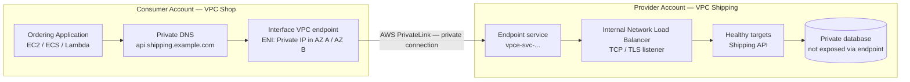
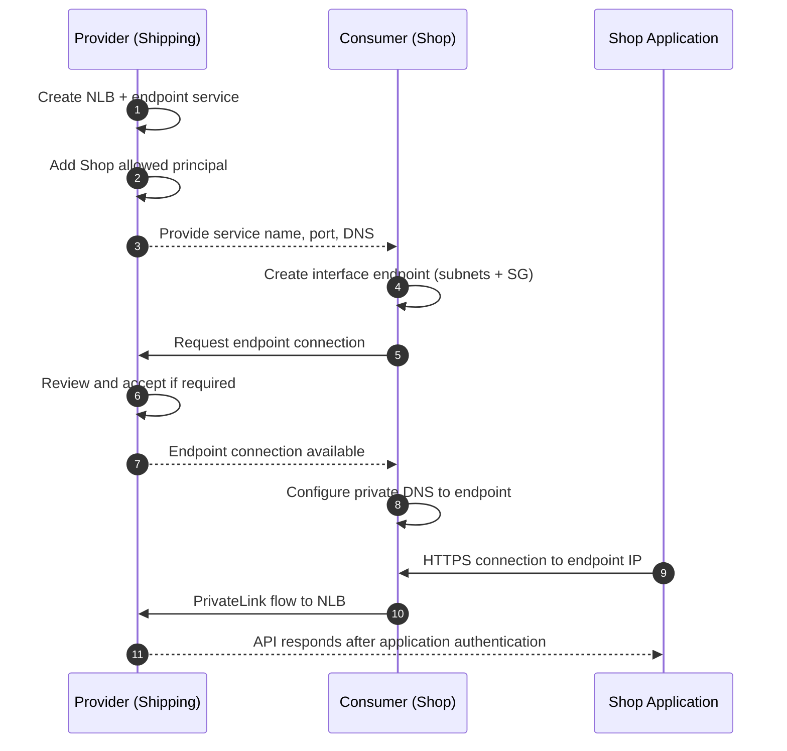
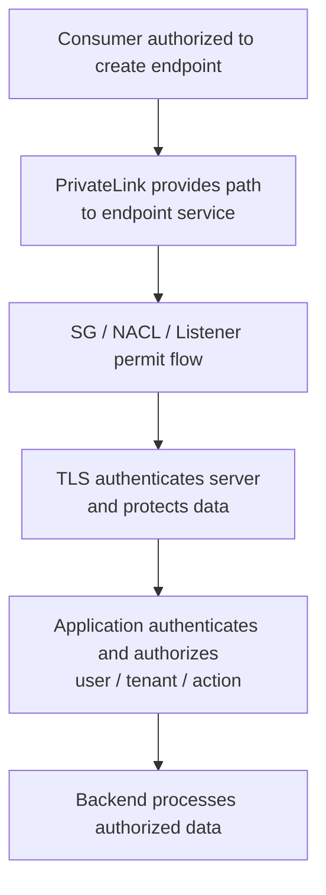
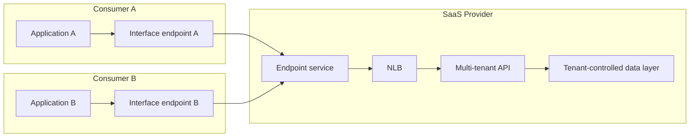
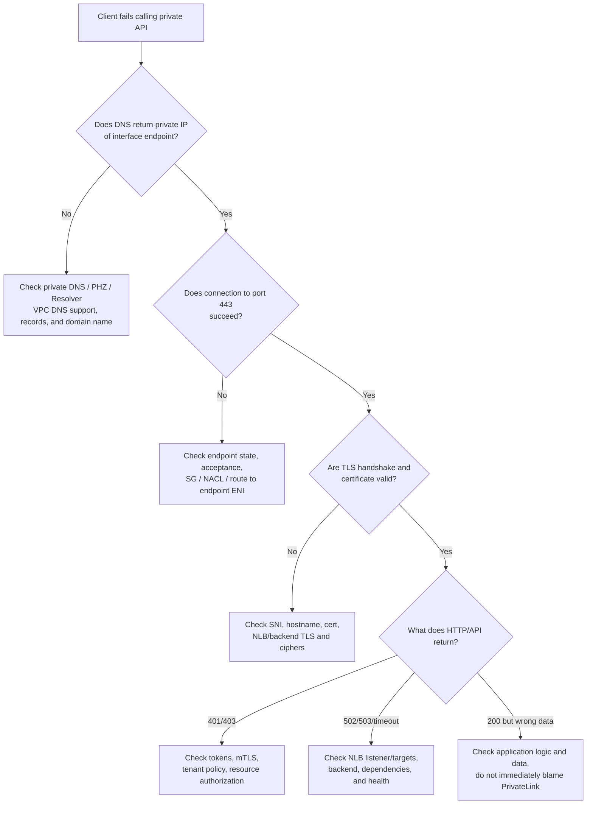

# AWS PrivateLink and Private Service Delivery

In AWS, applications often need to call services located outside their own VPC: an AWS service like Secrets Manager, an internal API operated by another team, or a SaaS service provided from a partner's AWS account. The straightforward approach is to expose the API to the Internet and protect it with TLS, tokens, and firewalls. However, many systems handling sensitive data prefer **not exposing service addresses on the Internet**, while also avoiding broad network connectivity between VPCs.

**AWS PrivateLink** addresses this need by allowing a **consumer** to access a service via **a VPC endpoint's private IP address**. Traffic is routed to the service over the AWS network without requiring an Internet Gateway, NAT Gateway, or direct VPC connectivity between the consumer and provider for this flow. The consumer only sees the access point for the exposed service; it does not automatically gain access to every subnet, instance, or database on the provider side.

This lesson belongs to the **Advanced Network Connectivity** chapter of the **CLOUD_PROVIDERS_AWS** module. Across the journey of learning Region/AZ, IAM, VPC, compute services, storage, databases, integration, serverless, monitoring, recovery, and AWS cost management, PrivateLink is a key option when designing applications that are **secure, scope-restricted, easy to govern, and capable of serving multiple VPCs/accounts**.

## 1. Practical Scenario and Learning Objectives

Suppose an e-commerce system has two parts:

- **Consumer Account** runs the ordering application in VPC `shop-vpc`.
- **Provider Account** operates the shipping fee calculation API in VPC `shipping-vpc`.

The ordering application needs to call the HTTPS API to calculate shipping fees, but does not need access to servers, databases, or other subnets belonging to the Shipping team. The two VPCs may even use overlapping CIDR ranges because they were built independently.

With traditional network connectivity like VPC peering, we must manage routes, CIDRs, and network reachability scope between the two VPCs. With PrivateLink, the provider can **publish a specific service**, while the consumer creates an **interface VPC endpoint** and accesses the service via a private IP.

After this lesson, learners will be able to:

1. Explain the AWS PrivateLink data flow and the boundaries between **consumer**, **endpoint**, **endpoint service**, **Network Load Balancer (NLB)**, and **backend**.
2. Distinguish PrivateLink from VPC peering, AWS Transit Gateway, gateway endpoints, NAT Gateways, and other application connectivity solutions.
3. Design a private service between two AWS accounts: endpoint creation permissions, connection acceptance, endpoint ENIs, security groups, DNS, and TLS.
4. Identify issues related to Availability Zones, availability, observability, costs, quotas, and troubleshooting.
5. Choose when to use PrivateLink for applications calling AWS services, internal APIs, SaaS, or systems separated by team/environment.

## 2. How Does PrivateLink Work?

AWS PrivateLink is a connectivity mechanism to a **service/resource exposed via a VPC endpoint**, rather than a fully routed pair of networks like peering. A typical pattern for self-operated enterprise service delivery includes:

| Component | Where is it located? | Role |
|---|---|---|
| **Service provider** | Provider account/VPC | API owner; decides who is allowed to establish endpoints to the service |
| **Endpoint service** | Provider side | PrivateLink service configuration, linked to an NLB and connection acceptance rules |
| **Network Load Balancer (NLB)** | Provider side | Receives traffic from PrivateLink and forwards it to the application target group |
| **Target group and backend** | Provider side | EC2/ECS/EKS or suitable infrastructure handling actual requests |
| **Service consumer** | Consumer account/VPC | Owner of the calling application; creates the endpoint in its VPC |
| **Interface VPC endpoint** | Consumer side | One or more Elastic Network Interfaces (ENIs) with private IPs in selected subnets |
| **DNS and security** | Both sides | Resolves names to endpoint IPs, controls inbound/outbound flows, and enforces application authentication |

### 2.1. Cross-Account Data Flow Diagram



Logical path of a request:

1. The consumer application calls `https://api.shipping.example.com`.
2. DNS in the consumer VPC returns the private IP of the **interface endpoint ENI**, if an appropriate DNS name is configured.
3. The application initiates a TCP/TLS connection to the endpoint IP. Security groups on the instance/task and the endpoint must allow the required flow.
4. AWS PrivateLink infrastructure routes the flow to the provider's **endpoint service** and then to the **NLB**.
5. The NLB distributes the connection to healthy backends; the backend performs application authentication/authorization and returns the response over the connection.

For this standard pattern, **no peering route to the provider VPC's CIDR is needed**, and backend IPs do not need to be exposed to the consumer. A backend database outside the scope of the endpoint service does not become freely accessible to the consumer.

**Important:** PrivateLink handles **the network transport path to the service**, not authentication, authorization, TLS, or API data controls. An accepted PrivateLink connection does not mean the consumer is authorized to invoke every business function.

### 2.2. Why Can CIDRs Overlap?

In VPC peering or Transit Gateway, IP routing between VPCs depends on unambiguously identifying destination network ranges. Two networks both using `10.0.0.0/16` create a routing conflict when attempting to connect directly.

With PrivateLink, the consumer sends requests to **the endpoint's IP located inside the consumer VPC itself**; AWS forwards the connection to the provider service without advertising the provider's CIDR routes. Therefore, two VPCs can have overlapping CIDRs in many valid PrivateLink architectures. However, if you also combine peering/TGW or other connectivity flows, the CIDR overlap issue must still be resolved separately.

## 3. Distinguishing Types of VPC Endpoints

When referring to a "VPC endpoint", not all endpoints use the same mechanism, pricing, or security model.

| Endpoint type | Primary mechanism | Best-fit scenarios | Things to note |
|---|---|---|---|
| **Interface endpoint** | ENI with private IP in a subnet, connecting via AWS PrivateLink | Accessing supported AWS services, SaaS services, organizational endpoint services | Has security groups, DNS, per-endpoint/AZ hourly and data processing charges |
| **Gateway endpoint** | Special route-table target for supported services | Accessing Amazon S3 or DynamoDB from a VPC via gateway mechanism | Does not create ENIs like interface endpoints; attached to route tables, with routing scope limits |
| **Gateway Load Balancer endpoint** | Traffic-steering point to network inspection services using Gateway Load Balancer | Centralized firewall/inspection appliances, controlled routing flows | Different purpose from standard PrivateLink APIs |
| **Resource endpoints / other resource access forms** | Endpoint mechanism to specific AWS-supported resource types | Connecting to a specific resource without provisioning an NLB yourself | Service/Region availability, limits, and routing depend on supported features |

In this lesson, the **interface endpoint → endpoint service → NLB → application** pattern is the main focus. This is the foundational model for a team or enterprise to **deliver private services to other accounts**.

### 3.1. AWS Service Endpoints vs. Self-Provided Services

Two PrivateLink use cases should be distinguished:

**Case A — Calling an AWS service:** For example, a workload in a private subnet needs to retrieve a secret from AWS Secrets Manager. The consumer creates an interface endpoint for the corresponding AWS service name, such as `com.amazonaws.ap-southeast-1.secretsmanager` in the Singapore Region. AWS is the provider; you primarily configure the endpoint, DNS, security groups, IAM, and an endpoint policy if the service supports it.

**Case B — Providing a private API:** The Shipping team manages the API and creates an endpoint service pointing to an NLB; the Shop team creates an endpoint pointing to the service name provided by Shipping. Here you manage **both sides**, including the NLB, targets, Allowed Principals, connection acceptance, and DNS.

You cannot take an endpoint connected to AWS Secrets Manager and treat it like an NLB you manage. Nor can you assume an AWS service endpoint policy can always be directly applied to authorize functions of a custom-built API.

### 3.2. Serverless Scenarios

AWS Lambda can **call out** to services via an interface endpoint if the Lambda runs inside a VPC and is configured with the appropriate access path. However, to **expose an API backed by Lambda**, an appropriate HTTP API/REST API layer may be required.

For example, an **Amazon API Gateway private REST API** can receive requests from a VPC via an `execute-api` interface endpoint and a conditional resource policy, instead of building a custom NLB solely to invoke a Lambda function. Private API capabilities depend on the **API Gateway API type** and supported configurations; do not assume all API types behave identically.

## 4. Choosing PrivateLink or Another Networking Option?

Before deploying, determine whether the requirement is **accessing a private service** or **connecting multiple networks/resources**.

| Criterion | AWS PrivateLink (interface endpoint) | VPC Peering | AWS Transit Gateway | Public API over HTTPS |
|---|---|---|---|---|
| Scope | Service exposed via an endpoint | Routed connectivity between two VPCs | Hub-based connectivity across many VPCs/on-prem | Public API with an Internet entry point |
| Needs routes to the entire provider VPC? | No in the endpoint service model | Yes, for the relevant CIDRs | Yes, per route tables/attachments | No |
| Overlapping CIDRs | Can be compatible | Not suitable when overlapping routes are needed | Does not automatically resolve CIDR conflicts | Independent of VPC CIDRs |
| Exposure scope | Only the exposed endpoint/service | Multiple destinations routable; requires additional filtering | Segmentable via route tables/policies | Public endpoint; restricted via application/WAF/network |
| Good scenarios | Private SaaS, another team's API, AWS APIs | Two VPCs needing relatively broad network communication | Many VPCs, hybrid systems, hub model | APIs serving broad clients on the Internet |
| Operational overhead | Endpoints, DNS, policies, NLB/targets if self-provided | Routes, CIDRs, SGs, DNS | Attachments, route tables, propagation, segmentation | Public ingress, DNS, application protection |

**Other options worth considering:**

- **AWS VPC Lattice** when many HTTP/HTTPS services across VPCs/accounts need unified service network management, application-layer access policies, and observability. Suitable for service provisioning and discovery at scale; evaluate actual features, costs, and limits.
- **AWS Site-to-Site VPN / Direct Connect** when connecting on-premises systems to AWS. Accessing endpoints over these links can work if routes and DNS to endpoint IPs are properly configured, though PrivateLink itself does not replace physical/tunnel hybrid connectivity.
- **NAT Gateway** when private subnet workloads must call public endpoints and have no suitable private path. PrivateLink can eliminate NAT usage **for services with deployed endpoints**, not all outbound Internet needs of an application.

**Quick rule of thumb:** if the consumer only needs to call **a specific API** and the provider does not want to allow VPC-to-VPC routing, PrivateLink is a strong candidate. If multiple systems need bidirectional IP exchange across many destinations, peering/TGW or another service-network architecture may be a better fit.

## 5. Two Roles in Private Service Delivery

### 5.1. What Does the Provider Own?

The Shipping team owns:

1. The backend API running on EC2/ECS/EKS or other targets supported by NLB via target groups.
2. **Network Load Balancer** (typically `internal` scheme for internal architectures) with listeners forwarding traffic to target groups.
3. **Endpoint service configuration** linked to the NLB's ARN.
4. The list of **Allowed Principals** permitted to create endpoints to the service.
5. The decision on whether to **require acceptance for each endpoint connection**.
6. Optional private DNS name, domain ownership verification, and consumer DNS setup instructions.
7. Monitoring backend/NLB health and incident response when endpoints or targets fail.

### 5.2. What Does the Consumer Own?

The Shop team owns:

1. Its VPC, subnets in appropriate Availability Zones, and private IP addresses for endpoint ENIs.
2. **Interface VPC endpoint** connecting to Shipping's `service name`.
3. **Endpoint security group** restricting permitted sources/ports.
4. DNS so internal API names resolve to the endpoint; TLS certificates and proper client configuration.
5. IAM or authorization workflows for who can create/modify/delete endpoints; application authentication to the Shipping API.
6. Logs, metrics, alerts, and costs for its own endpoints.

### 5.3. Permission to Create an Endpoint and Permission to Use an API Are Two Independent Layers

The provider can allow a consumer account principal to create an endpoint, such as `arn:aws:iam::222233334444:root` (authorizing that account). This **does not mean every user in that account automatically has permission to create an endpoint**: IAM policies and governance in the consumer account still determine who can invoke EC2 APIs to create endpoints.

If the endpoint service requires connection acceptance, the provider must also **accept** the pending endpoint connection. Once the connection is Active/Available, applications must still adhere to the API's own security policies such as JWT, mTLS, appropriate API keys, or enterprise authentication mechanisms.



**Note:** the timing of DNS, acceptance, and endpoint activation steps may vary by deployment workflow; the sequence above only shows key dependencies, not an automated protocol executed by AWS on behalf of administrators.

## 6. VPC, Availability Zone, and IP Design

### 6.1. An Interface Endpoint Is an ENI in a Subnet

When creating an interface endpoint, the consumer selects one or more subnets in the VPC. AWS creates **endpoint network interfaces** in the specified subnets using private IPs from those subnet ranges. An interface endpoint supports selecting subnets per AZ within the scope of the endpoint/service; typically you design with **one subnet in each selected AZ**.

Example:

| Component | AZ A | AZ B |
|---|---|---|
| Consumer VPC | `10.20.0.0/16` | Same VPC |
| Endpoint subnet | `10.20.10.0/24` | `10.20.20.0/24` |
| Illustrative endpoint IP | `10.20.10.50` | `10.20.20.50` |
| Provider backend | NLB/targets in matching AZ | NLB/targets in matching AZ |
| Application | App/task in AZ A | App/task in AZ B |

The illustrative IPs above are for explanation only; actual IPs are allocated by AWS from the subnets upon endpoint creation. Subnets need enough available IPs for the endpoint; subnet/AZ modifications must adhere to service support.

**No route-table entry to the provider VPC is required** for apps in the same VPC to call the endpoint IP. The VPC's `local` route and related networking rules handle routing to the ENI. If clients reside in another VPC or on-premises, there must be **routing reachability to the endpoint IP** along with DNS, SG, and NACL alignment for that topology.

### 6.2. AZ Names Differ Across Accounts

Names like `ap-southeast-1a` can map to different physical AZs in different AWS accounts. When a provider publishes a service from an NLB and the consumer chooses AZs, use the **AZ ID** (for example `apse1-az1`) or the endpoint service's actual availability zone info to align when cross-account consistency is required.

Do not assume that because both accounts see "AZ a" it refers to the same data center. When an NLB/service is not enabled in an AZ, the consumer may not be able to select that AZ's subnet or traffic may not be served as expected.

### 6.3. Designing for Availability

- Enable the NLB across AZs matching consumer needs, with healthy targets according to your HA strategy.
- Create endpoints across multiple AZs to reduce the risk of a single AZ/ENI disruption.
- Configure applications with bounded retries, timeouts, circuit breakers, and idempotent request handling where appropriate.
- Monitor traffic distribution across AZs and configure accurate target group health checks.
- Evaluate **cross-zone load balancing**, cross-AZ traffic, data transfer fees, and failover impact; do not assume adding an AZ keeps the entire path AZ-local.
- If **full-Region** resilience is required, separately design services/endpoints in a backup Region and routing/recovery mechanisms. Multi-AZ endpoints in one Region do not survive a full-Region outage.

The baseline example in this lesson assumes consumer and provider are in the **same Region**. AWS provides cross-Region PrivateLink features in supported scenarios/Regions; if you plan to use them, confirm eligibility, separate configuration, and corresponding charges rather than assuming every endpoint service automatically supports cross-Region connectivity.

## 7. Security Groups, NACLs, and Network Scope

### 7.1. Ports to Open on the Consumer Side

Suppose the Shop application calls the HTTPS API on port 443. Sample setup:

| Location | Traffic direction | Recommendation |
|---|---|---|
| Application security group | Egress | Allow TCP 443 to the endpoint security group/IP per supported model |
| Interface endpoint security group | Ingress | Allow TCP 443 only from trusted application source SGs or CIDRs |
| Subnet NACL | Inbound/outbound | Allow request/response directions with appropriate ephemeral ports (NACLs are stateless) |
| DNS | Outbound/return | Allow application DNS resolution to the configured resolver |

Do not open the endpoint SG to `0.0.0.0/0` just for "easy connectivity". Only allow valid client sources and the ports the service actually listens on. Applications in the same VPC can reference security groups in rules if the topology/API supports it, avoiding hardcoded IP lists.

### 7.2. Securing the Provider NLB and Backend

For a self-managed endpoint service, the provider must verify:

- NLB listeners use the correct port/protocol and target groups are healthy.
- Security groups associated with the NLB (if applicable) along with target and subnet rules; settings regarding **enforcing inbound SG rules on PrivateLink traffic** must be understood before enabling/disabling.
- Backends only receive traffic from intended paths; avoid exposing API ports publicly when unnecessary.
- TLS protocol: encrypt between clients and the TLS termination point (NLB or backend) as designed; protect the leg after termination if required.
- Client authentication: an accepted endpoint connection means **permission to establish the network path**, not end-user identity.

NLBs for PrivateLink have specific source-IP behavior when forwarding to targets: **do not rely on the target's observed source IP as the final consumer identity**. If the backend needs metadata such as the **VPC endpoint ID**, investigate **Proxy Protocol v2** (including TLVs provided by NLB per supported configuration/features) and verify the backend accurately parses and validates that metadata. This serves as supplementary client classification/control, not a replacement for JWT/mTLS or application authorization.

### 7.3. What Security Boundaries Are Created?



Layer B does not automatically perform layers C, D, or E. For example, a SaaS platform needing to distinguish two tenants connecting to the same endpoint service must still validate tenant ID and permissions on every request at the backend. Likewise, using PrivateLink does not automatically encrypt all data at the application layer.

## 8. DNS and TLS for Private Services

### 8.1. AWS-Generated DNS

When a consumer creates an interface endpoint, AWS assigns DNS names to the endpoint (typically a **regional DNS name** and potentially AZ-specific names depending on the case). When resolved from an appropriate location, it resolves to the private IPs of the endpoint ENIs.

Applications can directly use the endpoint's DNS name, but those names are long and hard to change. In practice, most teams prefer calling a meaningful name, such as:

```text
api.shipping.internal.example.com
```

Separate:

1. **The name used by API clients**: a stable business name used in configurations and certificates.
2. **The AWS-assigned endpoint DNS name**: a technical target that can change if the endpoint is replaced.
3. **The DNS resolution path**: private hosted zone, private DNS name on the endpoint service, or other resolver configurations.

### 8.2. Private DNS Name of the Endpoint Service

The provider can configure a **private DNS name** for an endpoint service where supported, requiring **domain ownership verification** per the AWS process. The consumer can enable private DNS on the interface endpoint once the service/name is properly configured and verified.

When active, inside the consumer VPC, the configured private DNS name resolves to the endpoint instead of a public address. Practical configuration must check VPC **DNS support** and **DNS hostnames**, overlapping hosted zones, and corporate resolver rules.

If using a custom name via a **Route 53 private hosted zone**, the consumer can create an appropriate record pointing to the regional endpoint DNS (alias/CNAME depending on record type) and associate the hosted zone with the required VPC. Resolution must be tested from the client source itself: results on an administrative machine outside the VPC can differ completely.

### 8.3. TLS Certificates and Naming

PrivateLink does not automatically issue valid TLS certificates for custom API names. When a client calls `https://api.shipping.internal.example.com`, the certificate presented by the server/NLB must be valid for the name the client verifies.

**Avoid:** a "quick fix" that disables client TLS verification. That removes server authentication and introduces risk even when traffic travels over a private network.

If TLS terminates at the NLB, the provider must manage appropriate certificates/listeners and decide whether to encrypt traffic to the backend. If end-to-end TLS is needed, TCP/TLS traffic can be passed through to the backend for backend termination; the choice depends on certificate requirements, observability, and mutual authentication needs.

### 8.4. DNS for On-Premises or Other VPCs

For clients on-premises or in another VPC to call an endpoint in the consumer VPC, success requires:

- Actual transport/routing reachability to the endpoint IP, such as Direct Connect/VPN/TGW/peering per approved architecture.
- Client DNS returning an address the client can actually reach; Route 53 Resolver inbound/outbound endpoints and conditional forwarding can bridge hybrid DNS systems.
- Security groups, NACLs, firewalls, and network segmentation rules permitting the required flows.

PrivateLink itself is **not a connection path from on-premises into AWS**. It is a private service destination; client sources must still have reachability to the endpoint ENI.

## 9. Workflow to Deploy a Private Service via NLB

This section walks through a two-account exercise:

| Component | Illustrative value |
|---|---|
| Provider account | `111122223333` |
| Consumer account | `222233334444` |
| Region | `ap-southeast-1` |
| Provider VPC | `shipping-vpc` |
| Consumer VPC | `shop-vpc` |
| API | HTTPS port `443`, endpoint `/health` |
| Provider NLB | `shipping-private-nlb` |
| Endpoint service | `vpce-svc-...` |
| Interface endpoint | `vpce-...` |

IDs, ARNs, and names in the commands below are **placeholders**. Replace them with values from your environment; actual AWS resources may incur charges immediately upon creation.

### Step 1 — Prepare the Backend API and NLB

In the provider account:

1. Deploy the Shipping API on appropriate targets (e.g., a multi-AZ ECS service).
2. Have the API return HTTP 200 on `/health` when ready to serve traffic.
3. Create a target group with the matching protocol/port and register targets.
4. Create a **Network Load Balancer** placed in appropriate subnets/AZs, add a TCP or TLS listener on port 443, and forward to the target group.
5. Confirm the target group has **healthy** targets. If terminating TLS at the NLB, attach a valid certificate and verify connectivity between the NLB and backend.

The provider should configure a security group when creating the NLB if SG-based NLB governance is desired; restrictions on adding SGs post-creation depend on how the NLB was provisioned. Also check the **Enforce inbound rules on PrivateLink traffic** setting and target rules to avoid inadvertently blocking traffic arriving from interface endpoints.

**Do not create the endpoint service before the backend is healthy.** An endpoint connection showing `available` only proves the network path is established, not that the API will return HTTP 200.

### Step 2 — Provider Creates the Endpoint Service

In the console: **VPC → Endpoint services → Create endpoint service**. Choose **Network Load Balancer** as the load balancer type, select Shipping's NLB, and enable **Acceptance required** so the provider reviews each endpoint.

Illustrative AWS CLI:

```bash
aws ec2 create-vpc-endpoint-service-configuration \
  --network-load-balancer-arns "<NLB_ARN>" \
  --acceptance-required \
  --region ap-southeast-1
```

The response contains service configuration details, including **ServiceId** and **ServiceName**. A custom PrivateLink service name generally looks like:

```text
com.amazonaws.vpce.ap-southeast-1.vpce-svc-0123456789abcdef0
```

This is the technical name the consumer will use when creating the endpoint. It is **not the API URL**, nor is it the NLB ARN.

### Step 3 — Provider Grants Permission to Consumer Principals

The provider adds the account or principal permitted to request connections:

```bash
aws ec2 modify-vpc-endpoint-service-permissions \
  --service-id "<SERVICE_ID>" \
  --add-allowed-principals "arn:aws:iam::222233334444:root" \
  --region ap-southeast-1
```

Here, `arn:aws:iam::222233334444:root` is a principal format representing the **consumer account** in the endpoint service's allowlist; it does not require applications to use root credentials. In practice, manage the allowed accounts/principals intentionally according to environment and access agreements.

Two authorization steps must be distinguished:

1. **Allowed Principals**: which principals/accounts can discover and request an endpoint to the service.
2. **Acceptance required**: for a new endpoint, the provider still reviews and approves that endpoint's **connection request**.

If a service is configured too permissively without requiring approval, parties outside the intended scope might create more connections than planned. Therefore, for sensitive services, restrict allowed principals and maintain appropriate acceptance/auditing workflows.

### Step 4 — Consumer Creates the Interface Endpoint

In the consumer account, prepare:

- VPC `shop-vpc` and subnets in AZs supported by the service.
- Endpoint security group allowing **TCP 443 ingress from the Shop workload**.
- IAM permissions to create VPC endpoints for the operator/pipeline.
- `ServiceName` supplied by the provider.

Create the endpoint via CLI:

```bash
aws ec2 create-vpc-endpoint \
  --vpc-id "<CONSUMER_VPC_ID>" \
  --vpc-endpoint-type Interface \
  --service-name "<PROVIDER_SERVICE_NAME>" \
  --subnet-ids "<SUBNET_A_ID>" "<SUBNET_B_ID>" \
  --security-group-ids "<ENDPOINT_SECURITY_GROUP_ID>" \
  --no-private-dns-enabled \
  --region ap-southeast-1
```

In this step `--no-private-dns-enabled` is used because the example has not yet configured/verified a private DNS name on the provider service. Private DNS can be configured after connectivity works and TLS certificates are ready.

When the provider requires acceptance, the new endpoint may start in the `pendingAcceptance` state. This is expected behavior, not a network error.

### Step 5 — Provider Reviews and Accepts the Connection

In the provider account, inspect connection requests and accept only endpoints from approved accounts/VPCs:

```bash
aws ec2 describe-vpc-endpoint-connections \
  --service-id "<SERVICE_ID>" \
  --region ap-southeast-1

aws ec2 accept-vpc-endpoint-connections \
  --service-id "<SERVICE_ID>" \
  --vpc-endpoint-ids "<CONSUMER_ENDPOINT_ID>" \
  --region ap-southeast-1
```

In the consumer account, check the endpoint:

```bash
aws ec2 describe-vpc-endpoints \
  --vpc-endpoint-ids "<CONSUMER_ENDPOINT_ID>" \
  --region ap-southeast-1
```

Look for `available` state, `DnsEntries`, and `NetworkInterfaceIds`. If the endpoint is not yet available, do not conclude that the application can connect.

### Step 6 — Configure DNS and Test Connectivity

There are two common options:

- **Use the AWS-assigned endpoint DNS name** for initial network-path testing. With HTTPS, pay attention to the certificate name and SNI: do not arbitrarily use the technical endpoint name as an excuse to bypass TLS hostname verification.
- **Use a provider-verified private DNS name** or a record in the consumer's Route 53 private hosted zone so `api.shipping.internal.example.com` resolves to the interface endpoint. The certificate must match the chosen API name.

From the **consumer workload itself** or a test host in the VPC:

```bash
nslookup api.shipping.internal.example.com
curl -v --connect-timeout 5 https://api.shipping.internal.example.com/health
```

Expected results:

1. DNS returns **private addresses** matching the endpoint.
2. TCP connection to port 443 succeeds.
3. TLS handshake is valid for the API name with a trusted certificate.
4. Backend returns the expected HTTP status/response, such as `200 OK`.

For authenticated APIs, send a valid token or client certificate through an approved test flow. Receiving `401 Unauthorized` or `403 Forbidden` can prove the client reached the API layer but failed authorization; distinguish this from timeouts, DNS failures, and TLS errors.

### Step 7 — Negative Testing and Recording Evidence

Do not test only the happy path. Verify:

- Workloads not permitted in the endpoint SG cannot open connections.
- Accounts outside allowed principals cannot establish endpoints as intended.
- Unaccepted endpoints cannot use the service.
- Clients without valid tokens/application credentials are rejected by the backend.
- Unhealthy targets trigger alerts and clients receive errors according to designed behavior.
- When one AZ fails, the multi-AZ strategy and retries operate as expected.

Record the VPC name, endpoint ID, service ID, DNS name, connection state, port, HTTP/TLS results, CloudWatch metrics, and operational owner.

## 10. Access Control: IAM, Endpoint Policies, and Application Permissions

PrivateLink typically involves **at least three distinct permission layers**:

| Permission layer | Question | Typical tools |
|---|---|---|
| **Infrastructure administration** | Who can create/delete endpoints and change service configurations? | IAM policies, SCPs, IaC approvals, CloudTrail |
| **Connection authorization** | Which accounts/principals can create endpoints; does the provider accept this endpoint? | Allowed Principals, endpoint connection acceptance |
| **API feature usage** | Which clients/tenants can view data or invoke business methods? | JWT/OIDC, mTLS, application authorization, tenant checks |

### 10.1. Consumer Account IAM

Operators need the corresponding EC2 API permissions to create/describe/modify/delete endpoints. These permissions must be granted in IAM and not blocked by SCPs/permissions boundaries. When using IaC, grant permissions to deployment roles with change reviews and full logging.

Do not grant broad endpoint administration permissions to every developer just because their application uses an endpoint. **An application making HTTPS calls through an existing endpoint does not need IAM permissions to create endpoints**; application permissions for the API are still governed by the application layer or target AWS service.

### 10.2. Endpoint Policies When Calling AWS Services

For **interface endpoints pointing to an AWS service that supports endpoint policies**, the consumer can place additional restrictions on allowed actions/resources traversing the endpoint. For example, when using an interface endpoint for Secrets Manager, an endpoint policy can restrict requests to secrets within the required scope.

Illustrative policy, to be used only after checking AWS service limits and system requirements:

```json
{
  "Version": "2012-10-17",
  "Statement": [
    {
      "Sid": "ReadShopDevSecretsOnly",
      "Effect": "Allow",
      "Principal": "*",
      "Action": [
        "secretsmanager:DescribeSecret",
        "secretsmanager:GetSecretValue"
      ],
      "Resource": "arn:aws:secretsmanager:ap-southeast-1:111122223333:secret:shop/dev/*"
    }
  ]
}
```

Meaning: the policy restricts **operations passing through this endpoint**; it does not by itself grant secret read permissions to every principal. Identity policies, resource policies (if any), and KMS key policies must still permit the corresponding request. Actual secret ARNs include an AWS-generated suffix, so verify the ARN pattern matches the intended secrets.

**Do not equate AWS service endpoint policies with custom API policies behind an NLB.** For self-provided application endpoint services, API-level authorization must still be designed in the application/identity gateway according to service capabilities.

### 10.3. Resource Policies and AWS Service Permissions

When calling AWS services via endpoints, some services also support **resource-based policies**. For instance, a bucket policy or API Gateway private REST API resource policy can restrict connection sources by VPC endpoint when the condition key is supported. In scenarios requiring `aws:SourceVpce` to allow requests only through a designated endpoint, carefully verify the exact request context and operational exceptions.

Do not blindly copy the same IAM condition across all services: a condition key only takes effect for supported APIs/actions and contexts.

## 11. Building Private Multi-Tenant SaaS Services

A provider can serve multiple consumer accounts through the same endpoint service, or separate services by tenant/sensitivity level.

### 11.1. Shared Model



**Advantages:** each customer creates an endpoint in their own VPC. The provider does not have to route to all customer networks, does not need non-overlapping CIDR agreements for the service flow, and can restrict which accounts may create endpoints.

**Cautions:** when sharing one endpoint service, all accepted consumers essentially share a network path to the same ingress layer; the provider must isolate data access by tenant at the application layer. Never rely on source IP as the sole tenant identity.

### 11.2. Tenant Isolation Levels

| Design approach | Pros | Trade-offs |
|---|---|---|
| One endpoint service + one multi-tenant API | Minimal configuration, simple operations | Tenant authorization must be airtight; shared resources can suffer noisy-neighbor load impacts |
| One endpoint service per tenant tier | Can separate risk or service tiers | More services/NLBs/configurations and higher cost |
| Dedicated endpoint service per sensitive tenant | Stronger isolation at ingress and service configuration | Significantly increases endpoint services, backends, monitoring, and provisioning workflows |

For payment services or sensitive data APIs, evaluate **network isolation + identity isolation + data isolation + quotas + auditing** holistically. Having distinct endpoint IDs does not guarantee one tenant's data cannot be queried by another.

### 11.3. Revoking Access and Offboarding Customers

When a customer should no longer use the service:

1. Revoke/adjust application permissions, certificates, or tokens per SLA and security procedures.
2. Check connection status and **reject/delete the endpoint connection** using provider permissions if needed.
3. Remove the principal from the allowlist for creating new connections.
4. Inspect DNS/application configs, logs, and any remaining access activity.

**Merely removing a principal from Allowed Principals is not always enough to disable previously accepted endpoint connections.** You need a process to manage existing connections and revoke application credentials.

## 12. Monitoring, Logging, and Operations

PrivateLink spans both infrastructure resources and applications. Monitor at every layer:

| Layer | What to monitor | Appropriate data sources |
|---|---|---|
| Endpoint service | New connections, `pendingAcceptance`/`available`/`rejected` states | EC2 endpoint service/connection APIs, events, and CloudTrail for administrative actions |
| Consumer endpoint | ENIs, subnets/AZs, SGs, endpoint state, DNS entries | EC2 VPC endpoint APIs, VPC configurations, and network monitoring |
| Network | Flow accepts/rejects, ports, sources/destinations from subnet/ENI view | VPC Flow Logs, network troubleshooting |
| NLB | Healthy targets, connection/flow counts, data volume, connection and TLS errors if applicable | Amazon CloudWatch NLB metrics, access logs per supported listener/feature |
| API | HTTP 4xx/5xx, p50/p95/p99 latency, auth failures, request IDs | Application logs, tracing, CloudWatch/OTel |
| Security | Create/delete/modify endpoints, Allowed Principals changes, accept/reject, SG edits | AWS CloudTrail and drift/config detection |
| Cost | Endpoint-hours, data processing, NLB, data transfer | AWS Cost Explorer, Cost and Usage Report, Budgets |

**CloudTrail does not log the HTTP request contents of custom APIs.** It helps audit AWS administrative actions. To investigate business requests, enable logging in the application, gateway/proxy, or appropriate load-balancing layer. Likewise, VPC Flow Logs capture network flow metadata, **not HTTPS request bodies**.

### 12.1. Usable SLI/SLO Metrics

For a Shipping API with a 99.9% monthly availability SLO, operations teams can measure:

- **API Availability**: percentage of valid requests receiving successful responses as defined by business logic.
- **Latency**: p95/p99 total client wait time, distinguishing network handshake, TLS, NLB, and backend processing time.
- **Backend health**: number of healthy targets in each AZ and sudden changes.
- **Error budget**: remaining allowable error duration/requests under the SLO target.
- **Endpoint connection readiness**: time from endpoint creation to becoming available and passing API tests.

**Do not use `NLB HealthyHostCount > 0` alone to claim the API is safe.** Backends may still fail authentication, fail database calls, or return invalid business responses.

### 12.2. Sample Operational Alerts

1. Healthy target count drops to 0 in one or more AZs.
2. 5xx error rate spikes or p95 latency exceeds threshold.
3. An endpoint service receives unusual connection requests or out-of-process changes to Allowed Principals.
4. Data processed spikes abnormally, posing performance/cost risks.
5. Customers lose access following changes to SGs, DNS, certificates, or releases.

Maintain a runbook specifying **what the consumer team handles** (endpoint SG, DNS, client), **what the provider team handles** (NLB, target health, application, acceptance), and coordination responsibilities when only one tenant is affected.

## 13. Costs and Quotas: Private Design Does Not Mean Free

Pricing depends on Region, endpoint type, number of AZs, duration, data processed, and supporting infrastructure. In a typical interface endpoint + endpoint service pattern:

- **The consumer side** typically pays hourly interface endpoint charges per AZ deployed and per-GB data processing charges through the endpoint, per applicable pricing.
- **The provider side** pays for the NLB, load balancer capacity/usage, targets/backends, and related monitoring services.
- **Data transfer**, especially across AZs/Regions or hybrid links, may add charges depending on topology and traffic type.
- **DNS, logs, CloudWatch, NAT, TGW, or Direct Connect** (if used elsewhere in the architecture) must also be accounted for separately.

### 13.1. Relative Estimation Model

One way to estimate for **a single consumer endpoint**:

```text
Approximate monthly cost
  ≈ (Number of AZs with endpoint × Active hours × Endpoint-hour unit price)
    + (GiB of data processed × Data-processing unit price)
    + Related data transfer costs
    + Supporting component costs (if any)
```

This is a **conceptual formula**, not a full invoice. Unit prices, tiers, and allocations can change; always use current AWS Pricing and Cost Explorer when budgeting.

Example of two options under the same load:

| Option | Endpoint on consumer side | Impact |
|---|---|---|
| Single AZ | One endpoint ENI/AZ | Potentially lower per-AZ component cost, but lower availability |
| Two AZs | Two endpoint ENIs across two AZs | Higher per-AZ cost, in exchange for better failover options |

**Do not cut down to one AZ solely based on endpoint fees** if the API is a critical dependency for order processing. Cost comparisons must align with RTO/RPO/SLO requirements and revenue impact during downtime.

### 13.2. Quotas and Limits to Check

- Maximum interface endpoints per VPC/Region under Service Quotas and current limits.
- Number of endpoint services/providers, NLBs, and targets per account/Region.
- Availability Zones offered by the endpoint service; supported IP address types and DNS names.
- Bandwidth/connection limits by specific endpoint type, NLB, and backend.
- Service support for cross-Region/private DNS/specialized networking features, if required.

Multi-tenant designs should plan for **endpoint lifecycle management**: creation, acceptance, modification, detecting stale endpoints, and decommissioning. Do not assume quotas are unlimited simply because endpoint IPs reside inside customer VPCs.

## 14. Layer-by-Layer PrivateLink Troubleshooting

When a client reports "cannot call the API", first identify whether the failure lies in **name resolution**, **connection establishment**, **TLS**, **endpoint connection**, **NLB/backend**, or **application authorization**. Mixing these layers prolongs investigations and tempts overly permissive security group rules.

### 14.1. Diagnostic Decision Tree



### 14.2. Symptom — Cause — Action Table

| Symptom | Likely cause | First check |
|---|---|---|
| Service name not found when creating endpoint | Wrong Region, wrong service name, principal not yet allowed by provider, or unsupported feature | Provider service ID/Region/allowed principals; consumer account permissions |
| Endpoint stuck in `pendingAcceptance` | Provider has not accepted the request | Provider reviews connections list and accepts/rejects |
| Endpoint in `rejected` or `failed` | Connection rejected, service config changed, or service issue | State history, service config, and administrative events |
| Endpoint `available` but TCP times out | Wrong SG, NACL, route to endpoint, port, or backend/NLB | Endpoint ingress SG and client egress SG; check listener |
| DNS returns public IP or no answer | Missing private DNS, hosted zone not associated with VPC, wrong resolver | `nslookup` from workload, VPC DNS settings, PHZ association |
| TCP succeeds but TLS fails | Hostname mismatch with certificate, SNI/cipher config, or improper TLS termination | Certificate SANs, hostname used by client, listener/backend |
| Backend has no healthy targets | Wrong health check port/path, backend SG blocks traffic, app not ready | NLB target group health, application logs, security rules |
| HTTP 401/403 | Application access error, expired token, invalid tenant | Application auth logs and request ID |
| One AZ works, another AZ fails | Endpoint subnet/service AZ mismatch or differing backend/route/health across AZs | AZ IDs, ENI status, NLB-enabled AZs, and target health |
| Provider logs don't show real consumer IP | NLB/PrivateLink changes observed source IP | Use application-layer metadata/identity; consider Proxy Protocol v2 when appropriate |
| Bill spikes after scaling | More endpoints/AZs, data processed, NLB, or cross-AZ transfer | Cost Explorer and per-service data processed |

### 14.3. Practical Investigation Order

1. **Consumer** confirms endpoint ID, ServiceName, and `State=available` via EC2 API.
2. **Consumer** runs `nslookup` from the workload's actual subnet/VPC; compares with the endpoint ENI's DNS name and IP.
3. **Consumer** checks TCP flow to the listener port, endpoint ingress SG, application egress SG, and bidirectional NACLs.
4. **Provider** confirms the endpoint connection is accepted, the endpoint service still points to the right NLB, and the listener/target group has healthy targets.
5. **Both** verify certificates, SNI, and DNS hostnames; never disable TLS verification to "test quickly" and forget to re-enable it.
6. **Application** checks tokens, application logs, and tenant permissions; HTTP 403 differs from a TCP timeout.
7. **Operations** cross-checks CloudWatch, VPC Flow Logs, and CloudTrail, noting the most recent configuration change timestamp.

During troubleshooting, collect **service ID, endpoint ID, VPC/account/Region, AZ ID, endpoint IP, source client, port, hostname, trace/request ID, and timestamp**. This dataset lets provider and consumer collaborate without granting cross-account administrative access.

## 15. Complete Design Scenario: Shop Calling the Shipping API

A company splits workloads into three environments:

| Environment | Consumer | Provider | Recommendation |
|---|---|---|---|
| **Dev** | `shop-dev` | `shipping-dev` or test service | Dedicated endpoint, mock data, capped costs |
| **Staging** | `shop-staging` | `shipping-staging` | Production-like architecture, testing DNS/TLS/authorization and failover |
| **Production** | `shop-prod` | `shipping-prod` | Independent endpoints, services, backends, and permissions; multi-AZ, monitoring, and runbooks |

Critically, **do not reuse production endpoints for dev just to save setup steps**. Each environment must have separate data, application identities, and routes. For example, `shop-dev` must not call Shipping production with test tokens or via an uncontrolled shared service network.

### 15.1. An Actual Request

A customer places an order. The Shop API in the production account calls:

```http
POST /v1/shipping/quote HTTP/1.1
Host: api.shipping.internal.example.com
Authorization: Bearer <application-token>
Content-Type: application/json

{
  "orderId": "ORD-123",
  "destinationProvince": "HCM",
  "weightKg": 2.5
}
```

Path:

1. The Shop service authenticates the user's order request and generates an internal request to Shipping.
2. DNS returns the private IP of the interface endpoint in `shop-prod`.
3. The endpoint's security group accepts HTTPS only from the Shop service's security group.
4. PrivateLink routes the connection through the endpoint service to `shipping-prod`'s NLB.
5. NLB forwards to healthy Shipping API targets; Shipping verifies the token **and** authorization to invoke the `quote` operation.
6. Shipping calculates the fee and returns the result; Shop logs the request ID, timeouts, and latency for investigation if needed.

Along this path, PrivateLink is not responsible for validating business correctness of `weightKg` or user ordering permissions. That responsibility belongs to the application system.

### 15.2. Security and Resilience Design

| Requirement | Solution |
|---|---|
| No direct access to Shipping backend from Internet | Internal NLB, private backends, no unnecessary public ingress |
| Environment-based permission separation | Separate endpoint services and allowed principals for dev/staging/prod |
| Only Shop service can call the API | Endpoint SG restricts sources, mTLS/JWT or appropriate application auth |
| Tenant and data isolation | Authorization in Shipping API, verified tenant ID, not reliant on source IP |
| Single AZ failure | Endpoints and backends span multiple AZs, with proper health checks/timeouts/retries |
| Routing/certificate changes | Deployed via IaC and staged rollout, test DNS/TLS before cutover |
| Regional outage recovery | Backup Region services/endpoints if required by RTO/RPO, with runbooks |
| Unexpected cost spikes | Account-level budgets/anomaly alerts, track data processing and NLB usage |

### 15.3. Architectural Decision

PrivateLink is a strong fit here because Shop only needs the Shipping API and both teams want to preserve VPC/account independence. If the company later needs hundreds of HTTP/HTTPS services communicating across many paths with application-layer policies, evaluate **VPC Lattice** or an appropriate service mesh; if routing entire on-premises subnets is required, consider **Transit Gateway/VPN/Direct Connect**.

Not every system needs PrivateLink. A well-protected public API may be appropriate for Internet partners or direct mobile apps; PrivateLink shines when consumers **already operate inside a VPC/private network and require non-public service access**.

## 16. Common Architectural Mistakes

| Mistake | Why it is risky/ineffective | Right design |
|---|---|---|
| Treating PrivateLink as connectivity between two entire VPCs | Consumer still cannot reach provider IPs/resources outside the published service | Use only for services; for broad network connectivity choose peering/TGW |
| Opening endpoint SG to the entire VPC or everywhere | Expands the set of sources that can call the API | Open only to required application sources and ports |
| Allowing all principals without connection controls | Provider struggles to know which accounts are connecting | Deliberate Allowed Principals, acceptance, and logging |
| Skipping JWT/mTLS because "the network is already private" | Any client with valid network reachability can attempt API calls | Authenticate and authorize inside the application |
| Disabling certificate checks upon TLS errors | Loses server identity assurance | Fix DNS/SNI/certificates accurately |
| Choosing AZs by name `1a` across accounts | AZ names may map differently | Compare AZ IDs/service availability metadata |
| Ignoring per-AZ endpoint costs | Costs grow when creating many endpoints | Budget by endpoint/AZ count and data processing |
| Checking only that endpoint is `available` | Backends can be unhealthy or applications returning errors | Verify DNS → TCP → TLS → API response |
| Dropping to one AZ to save costs without checking SLOs | Loses redundancy at endpoint/backend layers | Design HA around outage impact |
| Sharing production services with dev | Risks data/quota exposure or production disruption | Separate services/accounts/identities per environment |
| Failing to update DNS when replacing endpoints | Applications keep referencing old endpoint IPs/names | Manage records with IaC, verify propagation and TTL |
| Using source IP on backend to identify tenants | PrivateLink/NLB can alter observed source IPs | Use application identity; add endpoint ID metadata when needed |

## 17. Practice Exercises and Self-Check Questions

### Exercise A — Choosing a Connectivity Solution

Select the primary solution best suited for each requirement:

| Requirement | Suggested answer |
|---|---|
| EC2 in private subnet calling Secrets Manager without NAT | **Interface VPC endpoint** for Secrets Manager |
| Shop team VPC privately calling Shipping API in another account, possibly overlapping CIDRs | **PrivateLink endpoint service + interface endpoint** |
| Connecting all VPCs and on-premises systems via a hub | **Transit Gateway** combined with VPN/Direct Connect if needed |
| VPC calling S3 via route-table-attached endpoint mechanism | **Gateway endpoint** for S3 |
| Multiple VPCs sharing dedicated firewall inspection appliances | **Gateway Load Balancer endpoint** in an inspection architecture |
| Lambda application needing invocation via private REST API Gateway | **API Gateway private REST API** via `execute-api` interface endpoint and resource policy |

**Explanation:** "private connectivity" does not always mean the same endpoint type. Required scope, protocol, data, source network, cost, and AWS service support determine the right choice.

### Exercise B — Finding Configuration Errors

The provider created an NLB and endpoint service. The consumer successfully created an endpoint with state `available`. However, when calling `https://api.shipping.internal.example.com/health`, the client times out.

Propose at least five checks in priority order:

1. Does client DNS resolve to the endpoint's private IP inside the consumer VPC?
2. Does the endpoint SG allow port 443 ingress from the client workload; does the client SG allow egress?
3. Do NACLs/firewalls/routes permit connections to the ENI and return traffic?
4. Does the endpoint service/NLB have a port 443 listener and healthy targets?
5. Does the backend SG allow traffic from the NLB under the configured enforcement mode?
6. If TCP succeeds but HTTPS fails, check TLS certificates/SNI and application logs.

**Evaluation:** a strong answer does not open every firewall, but uses evidence step by step to narrow the root cause. When an endpoint is `available`, keep inspecting both network and application layers.

### Exercise C — Designing a Production Environment

The Platform team needs to provide an inventory management API to three internal teams, each with its own AWS account. Requirements: non-public API, two AZs, early fault detection, consumer restrictions, and per-team data confidentiality.

Design:

1. Diagram of endpoint service, NLB, and backend on the provider side; interface endpoints for each consumer.
2. Allowed principals and acceptance policies for each consumer account.
3. Internal DNS, TLS certificates, and authentication for each team.
4. Monitoring system: backend health, latency, 5xx, endpoint connections, permission changes.
5. Cost model distinguishing consumer-side endpoints and provider-side NLB/backend.
6. Plan for when one AZ or an entire Region experiences an outage.

**Self-grading criteria:** accurately separate connection permissions from data permissions, prevent cross-tenant data leakage, ensure dual-AZ coverage at both endpoint and backend layers, include release/recovery strategies, and estimate costs.

## 18. Checklist Before Moving PrivateLink to Production

- [ ] Confirmed the requirement is **single-service** connectivity and selected the right endpoint type.
- [ ] Provider NLB has listeners, target groups, and health checks verified in practice.
- [ ] Endpoint service is attached to the right NLB, with an owner and change workflow.
- [ ] Allowed Principals include only accounts/principals with valid access agreements.
- [ ] Acceptance, rejection, and revocation workflows for endpoint connections are defined.
- [ ] Interface endpoints are in the right VPC/subnets/AZs, with sufficient IPs and state `available`.
- [ ] Aligned AZ IDs across accounts when necessary.
- [ ] Endpoint SG allows only required client sources and ports; NACLs/routes do not block traffic.
- [ ] DNS returns the right endpoint IP from the **application runtime environment**.
- [ ] TLS certificate is valid for the hostname; clients do not disable TLS verification.
- [ ] API authenticates and authorizes users/tenants; does not rely solely on network permissions.
- [ ] Logging/auditing and alerts are in place for endpoint services, NLB, backends, and applications.
- [ ] Tested 401/403, timeout, DNS failure, unhealthy target, and single-AZ failure scenarios.
- [ ] Backend data backup/recovery plan is in place; PrivateLink does not replace DR.
- [ ] Estimated per-AZ endpoint fees, data processing, NLB, and related data transfer costs.
- [ ] IaC/runbooks exist for creating, updating, migrating Regions, replacing endpoints, and decommissioning services.

## 19. Core Takeaways

**AWS PrivateLink lets consumers access services via private IPs inside their VPC without opening routes to the entire provider VPC.** For self-operated APIs, the most common pattern is:

```text
Consumer workload
    -> Interface VPC endpoint (ENI, private IP, security group)
    -> AWS PrivateLink
    -> Provider endpoint service
    -> Network Load Balancer
    -> Healthy application targets
```

A successful design aligns **the right endpoint type, connection creation/acceptance permissions, subnets/AZs, security groups, DNS, TLS, application authentication, health checks, and observability**. These pieces complement one another; an `available` endpoint does not mean the application is secure or functioning properly.

In the **CLOUD_PROVIDERS_AWS** module, PrivateLink knowledge helps learners bring compute services (EC2/ECS/Lambda), APIs, data, and integration components into an AWS architecture with clear access boundaries, straightforward monitoring, recovery plans, and cost control as systems scale across multiple accounts and VPCs.

### AWS Reference Documentation

- [AWS PrivateLink — What is AWS PrivateLink?](https://docs.aws.amazon.com/vpc/latest/privatelink/what-is-privatelink.html)
- [AWS PrivateLink — Access AWS services through AWS PrivateLink](https://docs.aws.amazon.com/vpc/latest/privatelink/interface-endpoints.html)
- [AWS PrivateLink — Create an endpoint service](https://docs.aws.amazon.com/vpc/latest/privatelink/create-endpoint-service.html)
- [AWS PrivateLink — Configure an endpoint service](https://docs.aws.amazon.com/vpc/latest/privatelink/configure-endpoint-service.html)
- [Amazon VPC — VPC endpoints](https://docs.aws.amazon.com/vpc/latest/privatelink/vpc-endpoints.html)
- [Elastic Load Balancing — Network Load Balancers](https://docs.aws.amazon.com/elasticloadbalancing/latest/network/network-load-balancers.html)
- [API Gateway — Private REST APIs](https://docs.aws.amazon.com/apigateway/latest/developerguide/apigateway-private-apis.html)
- [AWS PrivateLink pricing](https://aws.amazon.com/privatelink/pricing/)
