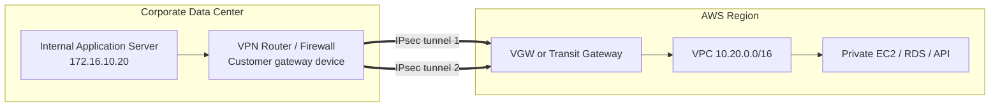
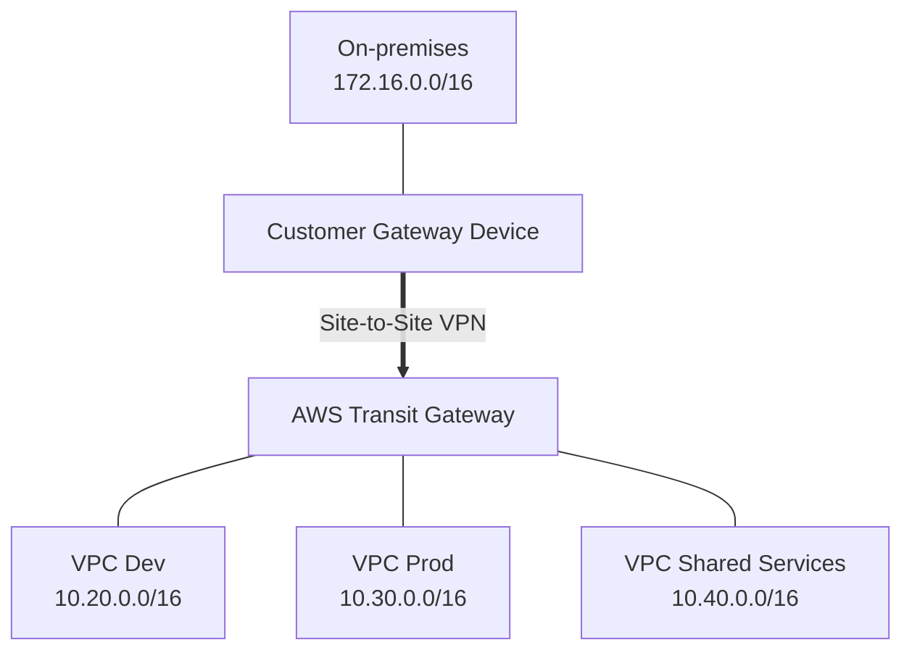
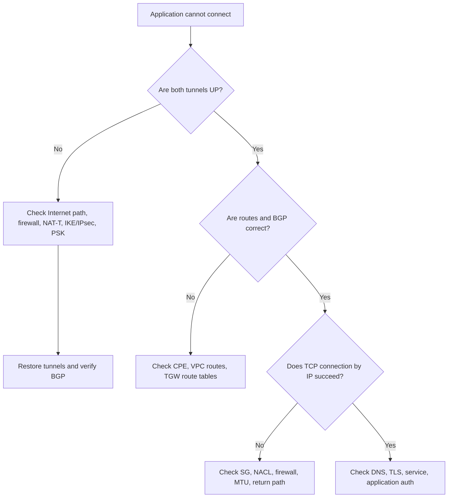

# Site-to-Site VPN and Enterprise Network Connectivity

## 1. Context and Learning Objectives

An enterprise has an inventory management system in its private data center (on-premises) and is gradually migrating web applications to AWS. Applications running on EC2, ECS, or Lambda inside an Amazon VPC need to access the internal database; office staff need to call an API that only has a private IP address inside the VPC. The enterprise does not yet want to expose these services to the Internet and needs an encrypted connection between the corporate network and the AWS network.

**AWS Site-to-Site VPN** is one solution for that requirement: it establishes IPsec tunnels between a VPN device on the corporate side and AWS-managed VPN endpoints, enabling traffic routing between the two networks as configured. This is an essential component of **hybrid networking**, where workloads on AWS coexist with systems in offices or data centers.

This lesson belongs to the **Advanced Network Connectivity** chapter of the **CLOUD_PROVIDERS_AWS** track. When learning about Regions/AZs, IAM, VPC, compute, storage, databases, integration, and serverless, you need to know how to choose connectivity options, route packets accurately, protect data, monitor links, design for resilience, and estimate costs.

After this lesson, you will be able to:

- Explain the AWS Site-to-Site VPN architecture, dual IPsec tunnels, and the roles of the customer gateway, virtual private gateway, or transit gateway.
- Distinguish between **dynamic BGP** routing and **static routes**, as well as the conditions required for both sides' networks to actually communicate.
- Choose between VPN, AWS Direct Connect, and common hybrid connectivity patterns based on practical requirements.
- Describe the workflow for creating a VPN, configuring the corporate device, route tables, and VPC access permissions.
- Design redundancy, monitoring, tunnel troubleshooting, and security/cost controls.

## 2. What Is Site-to-Site VPN and Where Does It Operate?

**Site-to-Site VPN** connects **two networks** together; one end is the corporate network, and the other end is private networks in AWS. Traffic between the two sides is encapsulated and protected by **IPsec** over tunnels (VPN tunnels). Transport typically traverses the public Internet, but the inner IP payload is encrypted; to connect securely, both sides must also verify identity and negotiate cipher suites through **IKE (Internet Key Exchange)**.

This differs from a VPN for an individual remote user. For example, an employee's laptop signing into **AWS Client VPN** is a *client-to-site* model, whereas an office router/firewall connecting the entire `172.16.0.0/16` network to one or more VPCs is a *site-to-site* model.



In the diagram, `172.16.10.20` belongs to the corporate network, and `10.20.0.0/16` is an illustrative VPC network. The two VPN tunnels are two separate IPsec tunnels provided by AWS for **each VPN connection** to increase availability. They cannot inherently replace a failed corporate router or an outage at an Internet service provider.

### 2.1. Components to Distinguish

| Component | Location and role | Key takeaway |
| --- | --- | --- |
| **Customer gateway device (CGW device)** | The enterprise's router/firewall or VPN appliance | Must be configured with IPsec/IKE, routes, and traffic protection matching the VPN parameters provided by AWS |
| **Customer gateway resource (CGW)** | Configuration object in AWS representing the customer side | Declares the external IP address or supported authentication method, plus info such as ASN when using BGP; **not** physical hardware |
| **VPN connection** | AWS object connecting a CGW to an AWS-side gateway | Typically consists of **two IPsec tunnels** with separate parameters |
| **Virtual private gateway (VGW)** | AWS-side VPN gateway attached to **a single VPC** | Suitable for architectures connecting directly to one VPC |
| **Transit Gateway (TGW)** | Routing hub connecting multiple VPCs, VPNs, and other attachments | Suitable for multi-account/multi-VPC enterprise networks; requires configuring TGW route tables and VPC routes |
| **BGP** | Dynamic routing protocol between the corporate device and AWS | Advertises routes and supports failure detection and rerouting when properly configured |
| **VPC route table** | Determines next hop for VPC subnets | Packets from EC2 to on-prem must have a route pointing to VGW/TGW |
| **Security group / NACL** | Controls inbound/outbound traffic at resource or subnet level | A connected VPN does not mean application ports are permitted |

**CGW resource and CGW device are two distinct concepts**: you create the resource in AWS to declare the corporate endpoint, but you still must configure the actual router/firewall on the corporate side. AWS does not automatically modify your device configuration.

### 2.2. Each Connection Has Two IPsec Tunnels

AWS provides two tunnels per Site-to-Site VPN connection, each with its own AWS-side endpoint address and IKE/IPsec parameters. When downloading the vendor configuration from AWS, you typically receive settings to configure **both tunnels**, such as tunnel addresses, authentication details, encryption parameters, and BGP settings (if using dynamic routing).

Both tunnels should be configured and tested from the start. If only one tunnel is configured, the system may experience downtime when AWS performs maintenance or replaces that tunnel endpoint. Which tunnel carries traffic depends on configuration, routes, and device/AWS behavior; do not assume tunnel 1 is permanently the primary path.

> **Tunnels being UP does not mean applications are working.** IPsec can be established while the VPC lacks return routes, a security group blocks TCP, or DNS resolves to the wrong address.

## 3. Connect Enterprise via VGW or Transit Gateway?

### 3.1. Site-to-Site VPN via Virtual Private Gateway

**VGW** is suitable when an enterprise wants to create a VPN connection to **one VPC** and does not have complex routing requirements across multiple VPCs.

```text
On-premises network 172.16.0.0/16
          |
     Firewall / CGW
          ||  IPsec x 2
       AWS VGW
          |
     VPC 10.20.0.0/16
          |
       Private subnet
```

Key steps include creating and attaching a VGW to the target VPC, creating a VPN connection using the CGW and VGW, and ensuring **VPC route tables** have a path back to the on-prem network. You can enable route propagation on relevant route tables when supported, or add static routes per design. The corporate side also needs routes to the VPC CIDR.

VGW is operationally simpler for a single VPC, but with dozens of VPCs across multiple accounts, deploying and managing numerous individual connections can become unwieldy.

### 3.2. Site-to-Site VPN via AWS Transit Gateway

**Transit Gateway** operates as a routing hub. The corporate network creates a VPN attachment to the TGW; VPCs needing the connection also create VPC attachments to the TGW. Connectivity can be shared across multiple accounts according to the organization's governance architecture.



TGW requires **two layers of routing**:

1. **VPC subnet route table:** subnets generating traffic must have routes sending the on-prem CIDR to TGW; for subnets receiving traffic, ensure proper return routes exist.
2. **TGW route table:** the route table **associated** with the ingress attachment must have a route to the destination attachment. Routes can be **propagated** from eligible attachments or defined statically; association and propagation are two separate actions.

For example: a packet from `10.30.1.10` in Production VPC to `172.16.10.20` follows subnet route `172.16.0.0/16 → tgw-...`. TGW then looks up the route to the VPN attachment. In the reverse direction, the corporate device sends a packet to `10.30.0.0/16` over the VPN, TGW routes it to the Production VPC, and security groups/NACLs decide whether application traffic is accepted.

**TGW does not automatically allow all VPCs to communicate with each other.** You can use multiple TGW route tables to isolate `Production`, `Development`, and `Shared Services`, advertise/place only required routes, and enforce additional controls with IAM, security groups, NACLs, and firewalls.

### 3.3. Architecture Selection Table

| Criterion | VPN + VGW | VPN + TGW |
| --- | --- | --- |
| Typical scale | Single VPC or small count | Many VPCs/accounts/OUs, hub-and-spoke networks |
| VPN attachment point | VGW attached to VPC | VPN attachment attached to TGW |
| Primary routing | VPC route tables + gateway routing | VPC route tables + TGW route tables, association/propagation |
| Multi-group segmentation | More limited | More flexible with multiple TGW route tables |
| Operations and cost | Fewer components | Additional attachment/data processing charges and routing management |
| Preferred use case | Proof of concept, single-VPC application | Enterprise-scale hybrid networking |

## 4. IPsec, IKE, and Corporate Device Requirements

### 4.1. Operational Layers

**IKE** negotiates authentication parameters and generates keys for the tunnel; **IPsec** protects IP traffic according to the agreed parameters. AWS supports specific algorithm sets and IKE versions in tunnel options. Depending on the device and security policy, prefer IKEv2 and strong encryption/integrity suites supported by both sides.

Common terms in the downloaded configuration bundle:

| Term | Function | What happens when misconfigured? |
| --- | --- | --- |
| **IKE version** | Security negotiation version | Both ends cannot negotiate a session |
| **Pre-shared key (PSK)** or supported certificate | Tunnel endpoint authentication | Peer authentication fails |
| **Encryption / integrity algorithms** | Confidentiality and integrity verification | IKE/IPsec cannot agree on a common proposal |
| **Diffie-Hellman (DH) group / PFS** | Key exchange and session protection | Security parameters cannot be agreed upon |
| **Inside tunnel IP** | Addresses used inside the tunnel, e.g., for BGP peering | BGP does not establish even if outer tunnel connectivity exists |
| **Outside IP** | Endpoint address the tunnel targets over the external network | Cannot establish if blocked by routing/firewall |
| **DPD (Dead Peer Detection)** | Detects an unresponsive peer | Slow failover or "hung" tunnels when failures occur |

The device configuration downloaded from AWS is a good starting point, but operators must verify it against the actual device's **firmware, capabilities, cipher suites, and NAT setup**. Do not use an outdated algorithm by default simply because a sample config includes it. Tunnel options can be modified within supported limits, though changes can disrupt active sessions while tunnels re-establish.

### 4.2. Protocols and Firewalls on the Internet Path

The corporate device must be able to reach both AWS-side endpoint addresses. Common traffic involved includes **UDP 500** (IKE), **UDP 4500** when using NAT Traversal (NAT-T), and **IPsec ESP (IP protocol 50)** when not encapsulated over NAT-T. The exact ports/protocols to open depend on the network path and tunnel configuration.

**NAT can affect how tunnels establish.** When the corporate firewall sits behind a NAT device, check NAT-T support, UDP 4500 reachability, the external address declared in the CGW resource, and AWS limits for that configuration. An Internet link can browse the web normally while still blocking IKE/IPsec.

### 4.3. CIDRs and Overlapping IP Ranges

Before creating a VPN, map IP addresses at both ends. Example:

| Zone | CIDR | Role |
| --- | --- | --- |
| On-premises | `172.16.0.0/16` | Corporate application servers and legacy systems |
| VPC Production | `10.20.0.0/16` | Production services on AWS |
| VPC Development | `10.30.0.0/16` | Testing services |

These three ranges **do not overlap**. If the office and VPC both use `10.0.0.0/16`, route tables cannot simply decide which destination is local and which lies across the VPN. You must revise IP allocation plans, renumber, or design controlled NAT/address translation. CIDR overlap is an architectural problem and is not solved merely by widening security group permissions.

## 5. Dynamic Routing with BGP and Static Routing

AWS Site-to-Site VPN can use **dynamic routing with BGP** or **static routing** depending on customer gateway capabilities and connection type.

### 5.1. BGP (Border Gateway Protocol)

With BGP, the corporate device and AWS gateway establish a routing session over the **inside tunnel** addresses, then exchange the CIDRs each side permits to advertise. The corporate device needs an appropriate ASN; the AWS gateway also uses an ASN within the gateway's supported configuration range. Advertised network prefixes must be intentionally filtered rather than inadvertently advertising the entire corporate routing table.

Benefits of BGP:

- More flexible updates to advertised networks when architectures have many subnets or sites.
- When one BGP path drops, routes can be withdrawn and traffic shifted to remaining valid paths per gateway, device, and configuration behavior.
- Suitable for multi-tunnel, multi-connection deployments and growing enterprise networks.

**BGP exchanges routes automatically, but does not automatically create every route needed inside AWS.** VPC route tables may still require separate configuration/propagation; with TGW, attachment route table association and propagation are also required.

### 5.2. Static Routes

With **static routing**, the enterprise pre-declares the network ranges allowed over the VPN and maintains corresponding routes on AWS and the CPE device. This is easy to understand in small networks, but when CIDRs change, operators must update routes manually; failure detection or path switching depends on tunnel and device mechanisms.

| Scenario | BGP dynamic routing | Static routing |
| --- | --- | --- |
| Many networks, frequent changes | Usually better suited | Prone to manual updates |
| Corporate device lacks BGP support | Cannot be used on that device | Can be suitable |
| Rerouting when a tunnel fails | Supports BGP route withdrawal and reselection | Requires verifying actual failover behavior |
| Controlling advertised ranges | Filters, prefix policies, ASN, BGP policies | Explicit declaration of each route |
| Operational effort | Requires understanding and monitoring BGP | Simple initially, less flexible at scale |

**Choosing BGP when infrastructure supports it and availability/multi-link needs are high** is generally a good starting point. Before moving to production, test bidirectional routing and behavior when one tunnel is disconnected, rather than only checking that the AWS console shows `UP`.

## 6. Packet Flow Between On-Premises and VPC

Suppose `on-prem 172.16.10.20` needs to call an HTTPS API at `10.20.2.15` in a private subnet of Production VPC.

```text
172.16.10.20:ephemeral -> 10.20.2.15:443
        |
        v
On-prem router: route 10.20.0.0/16 via VPN
        |
        v
IPsec tunnel (active tunnel)
        |
        v
VGW or TGW: select matching VPC attachment / route
        |
        v
VPC private subnet and EC2/API: security group allows HTTPS
        |
        v
Return packet: VPC route 172.16.0.0/16 -> VGW/TGW -> VPN -> on-prem
```

An HTTPS request only succeeds when **both directions** have valid paths:

1. On-prem CPE knows the route to `10.20.0.0/16` via an active tunnel.
2. AWS gateway knows the route to Production VPC; with TGW, proper routes/attachments must exist.
3. VPC subnet route table has a return route `172.16.0.0/16` via VGW/TGW; every subnet needing on-prem communication must have an appropriate route.
4. Destination security group allows TCP 443 from approved sources. **NACLs are stateless**, so strict NACLs must permit both outbound and return traffic, including required ephemeral ports.
5. Corporate firewalls also permit the connection and response; DNS resolves the destination to the right IP.

Do not rely on `ping` as the sole test: ICMP may be legitimately blocked. Test using the actual application port, such as HTTPS/443, a TCP check to the database, or an appropriate connectivity test tool. Record **source, destination, protocol, port, and timestamp** to correlate with logs.

### 6.1. DNS in Hybrid Models

VPN only provides IP network transport; **it does not automatically synchronize DNS** between the enterprise and VPCs. If internal users need to access `api.internal.example` and the name is only defined in a **Route 53 private hosted zone**, you can use a **Route 53 Resolver inbound endpoint** so on-prem DNS forwards matching queries into the VPC. In the reverse direction, workloads in the VPC needing to resolve corporate internal domain names can use a **Resolver outbound endpoint and forwarding rules**.

Account for Resolver endpoint security groups, UDP/TCP 53, bidirectional routes, redundant resolvers, endpoint costs, and preventing DNS forwarding loops. When IP connectivity works and applications only fail by hostname, check DNS before modifying IPsec.

## 7. Workflow to Design and Create a Site-to-Site VPN

### Step 1 — Gather Requirements and Assess Infrastructure

Before creating AWS resources, networking and application teams should align on:

- CIDRs of all on-prem networks, VPCs, and subnets needing communication; identify any address overlaps.
- Whether the CPE device and firmware support IPsec/IKE, BGP, NAT-T, dual tunnels, and the planned cipher suites.
- External IP addresses, reachability for UDP 500/4500 or ESP, and ISP firewall/NAT setup.
- Traffic volume, latency, bandwidth requirements, RTO targets, and independent backup paths.
- Accounts, OUs, Regions, and VPCs to connect; whether VGW or TGW fits that scope.
- Security policies, logging, IAM permissions for VPN administration, maintenance windows, budget, and owners on both ends.

Assumptions for the following example: corporate network `172.16.0.0/16`, VPC `10.20.0.0/16`, external public IPv4 of CPE device `198.51.100.10` (documentation example address), corporate ASN `65010`. AWS IDs in the examples are **placeholders**, not live resources.

### Step 2 — Create the Customer Gateway Resource

In **Amazon VPC Console → Customer gateways**, create an object representing the corporate device with appropriate parameters. For a BGP model using a public IP address, illustrative AWS CLI syntax:

```bash
aws ec2 create-customer-gateway \
  --type ipsec.1 \
  --public-ip 198.51.100.10 \
  --bgp-asn 65010 \
  --region ap-southeast-1
```

The response includes `CustomerGatewayId`, such as `cgw-0123456789abcdef0` (placeholder). Ensure the correct Region and account are selected. In real deployments, external IP/authentication type and connection constraints must match your device/NAT design; do not use the documentation IP above.

### Step 3 — Choose the AWS-Side Gateway and Create the VPN Connection

**If using VGW:** create a virtual private gateway, attach it to the target VPC, then create a VPN connection pointing to the VGW and CGW.

```bash
# Example creating a VGW, then using the returned ID to attach to a VPC
aws ec2 create-vpn-gateway \
  --type ipsec.1 \
  --amazon-side-asn 64512 \
  --region ap-southeast-1

# Replace vgw-... and vpc-... with actual IDs
aws ec2 attach-vpn-gateway \
  --vpn-gateway-id vgw-0123456789abcdef0 \
  --vpc-id vpc-0123456789abcdef0 \
  --region ap-southeast-1

# Create a VPN connection using BGP (StaticRoutesOnly not enabled)
aws ec2 create-vpn-connection \
  --type ipsec.1 \
  --customer-gateway-id cgw-0123456789abcdef0 \
  --vpn-gateway-id vgw-0123456789abcdef0 \
  --options StaticRoutesOnly=false \
  --region ap-southeast-1
```

**If using TGW:** create or select an existing Transit Gateway and create a VPN connection pointing to the TGW; also create necessary VPC attachments and configure associations/propagations on TGW route tables.

```bash
aws ec2 create-vpn-connection \
  --type ipsec.1 \
  --customer-gateway-id cgw-0123456789abcdef0 \
  --transit-gateway-id tgw-0123456789abcdef0 \
  --options StaticRoutesOnly=false \
  --region ap-southeast-1
```

These commands **only illustrate basic components**, not a complete deployment script. Gateways/VPCs/TGWs/attachments must exist in the right account/Region and in a valid state. Verify IAM execution permissions, tunnel parameters, routing, security, and quotas before using in real environments.

### Step 4 — Download Tunnel Configuration and Configure the CPE

On the VPN connection, select **Download configuration** and pick the vendor, model, and software version of your customer gateway device. If no exact template exists, consult general requirements and the device vendor's documentation. Configure **both tunnels**, including peer outside IPs, IKE/IPsec, authentication, BGP neighbors or static routes, and failover mechanisms.

**The configuration file may contain PSKs and sensitive details.** Never commit the file to Git, share it in public chat channels, or print its contents verbatim in terminals/CI logs. Store and rotate PSKs per enterprise secrets management policies; restrict access to VPN configuration files.

### Step 5 — Configure Bidirectional Routes

With VGW, inspect the route tables of subnets needing connectivity and add/enable route propagation to on-prem. With TGW, inspect both **VPC route tables** and **TGW route tables**. On the corporate side, configure routes to VPC CIDRs over the tunnels and filter BGP prefixes appropriately.

Example valid routes for a simple topology:

| Route table location | Destination | Target / next hop |
| --- | --- | --- |
| On-prem CPE | `10.20.0.0/16` | Appropriate VPN tunnel or BGP next hop |
| VPC private subnet | `172.16.0.0/16` | `vgw-...` or `tgw-...` |
| TGW route table (if using TGW) | `172.16.0.0/16` | VPN attachment |
| TGW route table (if using TGW) | `10.20.0.0/16` | Production VPC attachment |

If CIDRs are learned dynamically via BGP/propagation, do not arbitrarily force duplicate static routes. When multiple routes exist to a destination, check **route precedence** and which route is actually selected.

### Step 6 — Open Application Permissions and Test

Ensure security groups, NACLs, and firewalls allow only required traffic: for example `172.16.10.0/24 → 10.20.2.15:443`, rather than opening every port to the entire corporate network. Test connections from actual sources, measure latency/throughput, test tunnel failover, and record behavior during link loss.

Finally, integrate tunnel alerts and operational runbooks into your monitoring system before letting production applications depend on the link.

## 8. Designing for Availability and Resilience

Having two tunnels in a single Site-to-Site VPN connection reduces the risk of losing connectivity due to failure or maintenance on **one tunnel**, but does not eliminate all single points of failure. If both tunnels traverse **one firewall**, **one Internet circuit**, **one power source**, or **one CPE appliance**, those components can still bring down the entire connection.

### 8.1. Redundancy Options by Criticality

| Design tier | Configuration | Remaining risks |
| --- | --- | --- |
| Basic | One VPN connection, both IPsec tunnels configured | A single CPE/ISP can be a single point of failure |
| Better | Two CPE devices or two WAN links with matching VPN connections | Must verify routing, BGP policies, convergence time, and maintain both links |
| Mission-critical enterprise connectivity | Direct Connect as primary, Site-to-Site VPN as backup, or redundant DX/VPN architecture depending on RTO | Higher cost; requires designing route preference and testing failover periodically |
| Multi-VPC | TGW and VPN/DX attachments, HA-designed TGW route tables | Misconfigured association/propagation can cause widespread outages |

**ECMP (Equal-Cost Multi-Path)** can be useful in TGW architectures with eligible VPN attachments and routing, distributing flows across multiple valid paths. Do not assume VGW provides that exact ECMP behavior. Bandwidth aggregation, path selection, symmetry, and per-tunnel limits must be verified against service and hardware specifications.

### 8.2. Bandwidth, Latency, and MTU

- VPN over the Internet is subject to latency fluctuations, packet loss, or jitter from ISPs; do not expect private-leased-line SLAs.
- IPsec encryption and encapsulation add overhead, making the **effective MTU/MSS** smaller than an unencapsulated IP path. When applications hang or drop packets during large transfers, check Path MTU Discovery, required ICMP, MSS clamping, and fragmentation on the CPE.
- Usable throughput depends on current tunnel/connection limits, firewall encryption performance, single-stream vs. multi-stream traffic, TCP windowing, latency, and Internet paths. Do not treat contracted WAN speed as guaranteed application throughput.
- If workloads need consistent throughput or high-volume transfers, evaluate **Direct Connect** or alternative data transfer designs. For some TGW configurations, options like **Accelerated Site-to-Site VPN** may improve network paths when eligible; verify specific support and costs.

### 8.3. Minimum Failover Test Scenarios

1. Verify **both tunnels** are in the expected state, BGP neighbors/routes are active, and applications can communicate.
2. During an approved maintenance window, interrupt **one tunnel** at a time following change procedures. Measure failover duration, failed request count, and recovery time.
3. Test losing one **WAN link** or CPE if designed with independent backup paths; verify routes do not drift onto a less secure path.
4. Restore the original link; verify tunnels, BGP, route preference, and application operation after failback.
5. Compare outage duration against the workload's **RTO/SLO**, updating runbooks and alerts if requirements are not met.

## 9. VPN Monitoring and Troubleshooting

### 9.1. Observability Sources

| Tool | What is observed? | Operational value |
| --- | --- | --- |
| **Amazon CloudWatch VPN metrics** | E.g., `TunnelState`, `TunnelDataIn`, `TunnelDataOut` where supported | Tracks tunnel UP/DOWN status and ingress/egress traffic |
| **Site-to-Site VPN tunnel logs** | IKE negotiation, tunnel establishment, and state details when enabled | Helps pinpoint proposal, authentication, and session setup failures |
| **VPC Flow Logs** | IP flow metadata across monitored interfaces | Helps identify rejected traffic and paths within the VPC, within logging scope |
| **CloudTrail** | API management calls such as create/modify/delete VPN, routes, gateways | Audits configuration changes and who performed them |
| **CPE logs / BGP status** | IKE, IPsec SA, DPD, BGP neighbors, and actual routes | Separates external/AWS issues from routing/application issues |
| **Application telemetry** | Response times, timeouts, TCP/TLS errors, retries | Demonstrates user impact and SLO compliance |

Example AWS CLI command to inspect VPN connection status:

```bash
aws ec2 describe-vpn-connections \
  --vpn-connection-ids vpn-0123456789abcdef0 \
  --query 'VpnConnections[0].VgwTelemetry[*].[OutsideIpAddress,Status,StatusMessage]' \
  --region ap-southeast-1
```

`vpn-0123456789abcdef0` is a placeholder. Telemetry reflects AWS's view of the tunnels; combine it with IPsec/BGP status on the CPE and application traces to pinpoint root causes. Configure CloudWatch alarms with suitable thresholds and evaluation periods to avoid false alarms during brief fluctuations.

### 9.2. Layered Diagnostic Flowchart



### 9.3. Common Symptoms and Causes

| Symptom | What to suspect first | How to verify |
| --- | --- | --- |
| **Both tunnels DOWN** | Wrong public/NAT IP, ISP blocking, UDP 500/4500/ESP, mismatched IKE proposal/PSK | CPE IKE logs, endpoint reachability, tunnel logs |
| **IPsec UP but BGP DOWN** | Wrong ASN, inside tunnel IP, BGP neighbor/peer, route filter | CPE BGP neighbors, AWS tunnel details |
| **BGP UP but EC2 cannot reach on-prem** | Missing VPC/TGW or corporate route, SG/NACL/firewall blocking | VPC route tables, TGW propagation, Flow Logs, CPE routes |
| **Only one direction works** | Return path, asymmetric routing, NAT or stateful firewall unable to track session | Trace both directions on CPE and AWS routes |
| **IP connects, hostname fails** | DNS resolver, split-horizon DNS, or forwarding rules | `nslookup`/`dig`, Resolver logs and endpoints |
| **Small packets work, large packets hang** | MTU/MSS, PMTUD, or fragmentation | Controlled packet capture, MSS/MTU, and ICMP |
| **Losing one tunnel causes prolonged outage** | Second tunnel not configured, wrong BGP failover/route preference/DPD | Test failover and route convergence times |

A solid troubleshooting approach is to **identify the failing layer before changing configurations**. Do not disable NACLs, open entire security groups, or widen BGP routes/scopes just to test quickly in production; those actions can expose unintended access paths.

## 10. Security and Network Segmentation

### 10.1. Transport Encryption Alone Is Not Access Control

IPsec protects traffic inside the tunnel, but **does not define who is permitted to call an application API**. A complete security design includes:

- **Network:** advertise only truly required CIDRs; separate route tables across Production, Development, and Shared Services; use network firewalls where advanced inspection is needed.
- **Resources:** security groups allow only exact sources/ports, NACLs protect subnets as required, avoid uncontrolled `0.0.0.0/0` rules.
- **Identity:** users/applications still require IAM or the service's native authentication; VPN does not replace authorization on S3, RDS, API Gateway, or web applications.
- **Operations:** PSKs/certificates, CPE device administration, firmware updates, permissions to modify VPN/TGW/VPC routes, logging, and change monitoring.

For instance, being able to send a TCP packet over VPN to RDS does not mean an employee has DB credentials or IAM Database Authentication permissions. Network access and application authorization must be controlled independently.

### 10.2. Change Control and Secrets Protection

Grant IAM permissions to create/modify/delete CGWs, VPNs, gateway attachments, or routes only to the responsible networking team. Use approved change workflows with rollback plans; inspect CloudTrail whenever routes or tunnel options change outside scheduled windows.

PSKs and tunnel configurations must be stored securely, access-restricted, and rotated if compromise is suspected or operators change. Never embed PSKs in public documentation, unmasked Terraform outputs, or CI script logs. When using Infrastructure as Code, avoid storing secrets in plaintext in version control or unencrypted/unprotected state files.

## 11. Comparison with Other AWS Connectivity Options

| Option | Connectivity / characteristics | Best suited when | Notes |
| --- | --- | --- | --- |
| **AWS Site-to-Site VPN** | IPsec between corporate network and AWS, typically over Internet | Fast encrypted hybrid connectivity, or as backup | Internet latency and throughput vary; requires compatible CPE |
| **AWS Direct Connect (DX)** | Dedicated private network connection from enterprise/partner into AWS | Need more predictable bandwidth, latency, and transport for enterprise systems | **DX does not automatically encrypt all traffic**; can combine with IPsec or other encryption |
| **Direct Connect + VPN** | DX as network path, VPN providing encryption/backup per design | Need transport control plus encryption or failover | Must define underlay model, route priority, and costs |
| **AWS Client VPN** | VPN for end-user devices | Remote employees accessing authorized resources | Manage user identity, endpoints, sessions, and clients |
| **VPC Peering** | Private connection between two VPCs | Need simple VPC-to-VPC connectivity | Not a direct on-prem link; does not support transitive routing across peering |
| **AWS PrivateLink** | Access a specific service via an interface endpoint | Sharing APIs/services with minimal network surface | Does not provide full network routing like VPN; requires DNS and endpoint planning |
| **AWS Transit Gateway** | Routing hub for multiple VPCs, VPN, and DX attachments | Multi-VPC/multi-account enterprise or requiring segmentation | A routing component; TGW itself is not a VPN tunnel or physical circuit |

To choose, start from *topology*, throughput/latency requirements, CPE capabilities, security standards, availability, cost, and account/VPC scope. **VPN over the Internet** is usually faster to deploy than a dedicated circuit, but the two transports should not be treated as equivalent in performance.

### 11.1. Combining VPN with Direct Connect

In a common pattern, enterprises use **Direct Connect** as the primary link for heavy traffic, and **Site-to-Site VPN** as a backup if DX or an ISP link fails. Certain private-IP VPN designs over DX/TGW are possible under AWS-supported conditions, though those are specialized topologies distinct from public-endpoint VPN over the Internet; review service docs and specific topology requirements before selecting.

Primary/backup paths are only effective when **route preference** is consistent at both ends and tested. BGP policies, prefix-specific routing, and failure detection may be required. If misconfigured, traffic may flow over the backup path while primary is healthy, or fail to switch cleanly during an outage.

## 12. Costs and Operational Capacity

Creating a VPN connection can incur **hourly connection charges** and **AWS data transfer fees** per Regional pricing, along with related costs. Using TGW can also incur **attachment and data processing fees**; Route 53 Resolver endpoints, CloudWatch logs/metrics, and Direct Connect (if used) carry separate charges.

Do not assume "a tunnel with zero traffic is free". An unused VPN connection that has not been deleted can continue accruing hourly charges. When designing multiple sites or redundant VPNs, calculate total cost across circuits, CPE hardware, operations, monitoring, and troubleshooting—not just the VPN service fee.

Practical **quotas** to verify include VPN connections, customer gateways, routes, TGW attachments/route tables (if used), tunnel/throughput limits, and related ceilings. Quota values and increase eligibility vary by resource type, account, Region, and service updates: consult **Service Quotas** and current AWS documentation for live environments.

A practical operational scorecard may include:

| Metric | How to track | Example target (set by enterprise) |
| --- | --- | --- |
| Tunnel availability | CloudWatch `TunnelState`, CPE | Both tunnels configured and monitored |
| Request error rate during failover | Application metrics, synthetic checks | Within approved SLO threshold |
| Hybrid network latency | Real application testing | Within application responsiveness target per path |
| Route/CIDR compliance | Review TGW/VPC route tables and CPE BGP | No unapproved prefixes advertised |
| VPN/TGW cost | AWS Cost Explorer, Budgets, and tagging | Within enterprise networking budget |

## 13. Applied Scenario: Retail Enterprise Connecting to AWS

A retail company runs an ERP system in its data center while e-commerce APIs run on AWS. The company plans to connect 3 VPCs (`development`, `production`, `shared services`) to the ERP without exposing the ERP to the Internet, and needs logs for incident investigation.

**Proposed design:**

1. **Network planning:** on-prem `172.16.0.0/16`, VPC Dev `10.20.0.0/16`, Prod `10.30.0.0/16`, Shared `10.40.0.0/16`. Verify no CIDR overlaps with branch offices or other AWS accounts.
2. **Choose TGW:** create required VPC attachments and a VPN attachment from the CGW; use TGW route tables so only Prod and Shared Services communicate with the ERP. Dev has no automatic path to production.
3. **IPsec/BGP:** configure both tunnels, filter only approved prefixes; use redundant WAN links/CPEs if required by RTO.
4. **Network authorization:** only Production application subnets may call the ERP on application ports; do not advertise all corporate routes into AWS.
5. **DNS:** use Route 53 Resolver so VPC applications resolve internal ERP names; verify queries follow the right path with redundancy.
6. **Monitoring:** CloudWatch tunnel metrics/logs, CPE logs, VPC Flow Logs, and synthetic checks for ERP communication. Set alerts on tunnel loss and application endpoint unresponsiveness.
7. **Performance evaluation:** measure API latency to the ERP and the impact of losing a tunnel. If synchronous dependencies are too tight or traffic grows significantly, consider caching, queues/asynchrony, data migration, or dedicated connectivity rather than merely increasing VPN bandwidth.

This model illustrates how Site-to-Site VPN contributes to **security, monitoring, resilience, and cost** goals. VPN is the network transport layer; overall retail system availability still depends on VPC routing, application services, databases, retry strategies, queues, and data recovery capabilities.

## 14. Self-Check Questions

**Question 1.** A VPN connection shows both tunnels `UP`, yet office staff cannot call the API at `10.20.2.15:443`. Is IPsec definitely broken?

**Hint:** No. Check bidirectional routes, TGW route tables (if used), VPC subnet routes, security groups, NACLs, firewalls, DNS, and the target service. Tunnel `UP` only reflects the VPN transport layer.

**Question 2.** Why configure both tunnels even when applications run fine over tunnel 1?

**Hint:** To provide an alternate path during maintenance or failure on one tunnel. However, both tunnels may share a single CPE/ISP, so redundancy for those components is still needed if high availability is required.

**Question 3.** An enterprise has 20 VPCs across multiple accounts, needs a central connector to on-prem, and wants to isolate Dev/Prod. Should you evaluate VGW or TGW first?

**Hint:** TGW, because it provides a hub model and segmented route tables. You still need to factor in costs, quotas, attachments, security, and operational design.

**Question 4.** BGP neighbor is up, yet the Production subnet cannot connect to on-prem. Why is BGP not enough?

**Hint:** VPC subnet routes and TGW route table associations/propagations may be missing or misconfigured; security groups/firewalls may also block traffic. BGP does not automatically ensure the entire data plane works.

**Question 5.** When large data transfers over VPN hang frequently while small packets succeed, what should be checked?

**Hint:** MTU, MSS, fragmentation, Path MTU Discovery, and required ICMP; also check CPE performance and Internet routing.

**Question 6.** Does Direct Connect automatically eliminate the need for IPsec encryption?

**Hint:** No. Direct Connect provides private network connectivity per service design, but does not encrypt all payloads by default; evaluate VPN over DX or an appropriate encryption layer if transit encryption is required.

## 15. Takeaways

**AWS Site-to-Site VPN** connects enterprise networks to AWS using **two IPsec tunnels** per VPN connection. The **Customer gateway device** on the corporate side and the **CGW resource** in AWS are two distinct objects; on the AWS side you can use **VGW** for a single VPC or **TGW** for multi-VPC/multi-account topologies. **BGP** helps manage dynamic routes and failover, but applications only work when VPC/TGW routing, firewalls, security groups, NACLs, and DNS are all configured properly in **both directions**.

Before moving to production, design redundancy beyond the two tunnels, check MTU and bandwidth, monitor via CloudWatch/CPE, protect IKE secrets, and control routing changes. For systems requiring predictable transport or high throughput, consider **AWS Direct Connect** alongside appropriate VPN encryption/backup options. Secure hybrid networking is the result of **accurate routing + layered security + recovery testing + cost governance**.

### AWS Reference Documentation

- [AWS Site-to-Site VPN — User Guide](https://docs.aws.amazon.com/vpn/latest/s2svpn/VPC_VPN.html)
- [How Site-to-Site VPN works](https://docs.aws.amazon.com/vpn/latest/s2svpn/how_it_works.html)
- [Create an AWS Site-to-Site VPN connection](https://docs.aws.amazon.com/vpn/latest/s2svpn/SetUpVPNConnections.html)
- [AWS Site-to-Site VPN tunnel options](https://docs.aws.amazon.com/vpn/latest/s2svpn/VPNTunnels.html)
- [Amazon VPC Transit Gateways — VPN attachments](https://docs.aws.amazon.com/vpc/latest/tgw/tgw-vpn-attachments.html)
- [Transit Gateway route tables](https://docs.aws.amazon.com/vpc/latest/tgw/tgw-route-tables.html)
- [Monitor your Site-to-Site VPN connection](https://docs.aws.amazon.com/vpn/latest/s2svpn/monitoring-cloudwatch-vpn.html)
- [AWS Direct Connect — User Guide](https://docs.aws.amazon.com/directconnect/latest/UserGuide/Welcome.html)
- [Amazon Route 53 Resolver](https://docs.aws.amazon.com/Route53/latest/DeveloperGuide/resolver.html)
