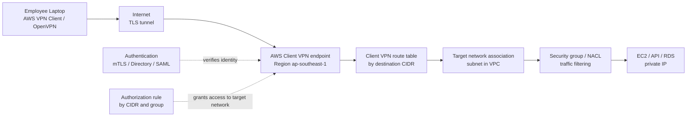
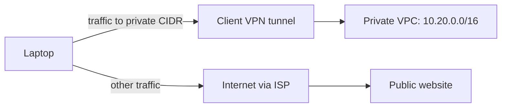
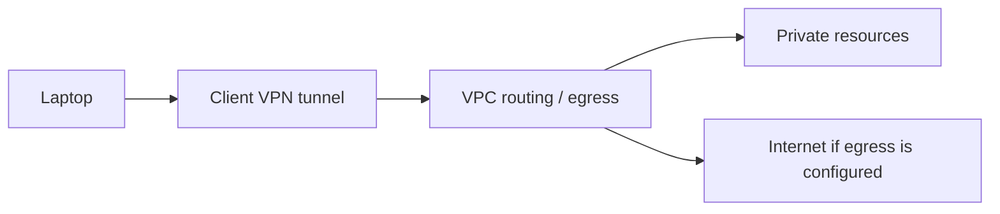
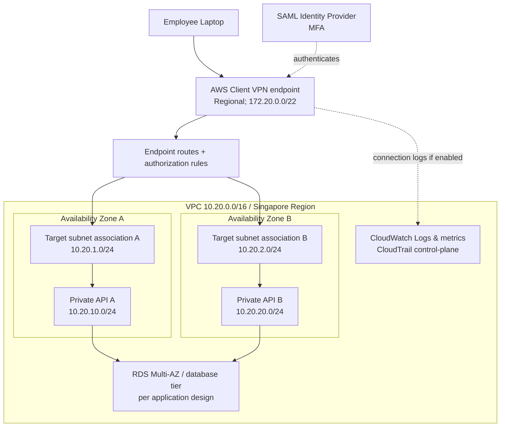
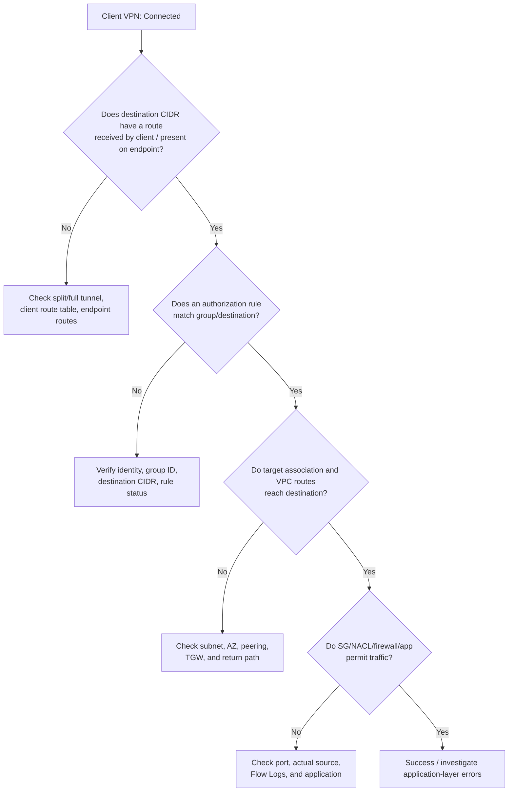

# AWS Client VPN for Remote Access

> **Chapter:** Advanced Network Connectivity  
> **Module:** CLOUD_PROVIDERS_AWS  
> **Objective:** design and operate secure connectivity from external user machines to private resources inside an Amazon VPC; select appropriate authentication, authorization, routing, availability level, and monitoring tools.

## 1. Problem: Accessing AWS Systems While Working Remotely

Suppose an engineering team operates an e-commerce application in the AWS Singapore Region. APIs, EC2 instances, RDS, and administration systems reside in **private subnets** of the VPC without public IPv4 addresses. Employees working from home need to:

- Access internal admin dashboards and SSH/SSM into authorized machines.
- Connect in a controlled manner to database services for work purposes.
- Keep servers/databases on a private network without exposing administrative ports to the Internet.
- Authenticate users, potentially with MFA, and revoke access when an employee leaves the team.
- Differentiate users belonging to **Developer**, **Operations**, and **Database Administrator** groups.
- Record logs for investigation and calculate costs as concurrent users scale.

**AWS Client VPN** is an AWS-managed VPN service for the **client-to-site** model: individual machines use VPN client software to establish a secure tunnel to a **Client VPN endpoint** on AWS. From there, as configured, users can connect to resources inside the VPC and networks connected to the VPC.

It is part of the AWS networking ecosystem, working alongside **VPC, subnets, security groups, route tables, IAM, AWS Directory Service, SAML identity providers, CloudWatch, and CloudTrail**. Understanding these components helps design connectivity that is secure, resilient, and cost-controlled.

### 1.1. Learning Objectives

Learners will be able to:

1. Explain the differences between **AWS Client VPN**, **Site-to-Site VPN**, and other connectivity mechanisms.
2. Identify Client VPN endpoints, client CIDRs, target network associations, routes, authorization rules, and security groups.
3. Distinguish **authentication** from **authorization**.
4. Design **split tunnel** or **full tunnel** connectivity according to requirements.
5. Build a multi-AZ architecture, monitor connections, troubleshoot issues, and forecast costs.
6. Use AWS CLI in read-only mode to inspect configurations before remediation.

## 2. What Is Client VPN and How Does It Differ from Other Network Connections?

AWS Client VPN uses a VPN protocol based on **OpenVPN**, with **TLS** protecting the connection between user machines and the endpoint. Users run the AWS VPN Client or a client compatible with the chosen authentication method. Clients receive the appropriate connection configuration, typically an **`.ovpn`** file.

| Option | Connecting side | Primary use case | How to distinguish |
|---|---|---|---|
| **AWS Client VPN** | Individual user's laptop/machine | Employees remotely accessing private AWS resources | Client establishes a tunnel to an AWS-managed endpoint |
| **AWS Site-to-Site VPN** | Corporate network VPN device/router to AWS | **Network-to-network** connectivity between offices/data centers and VPCs | Suited for fixed networks, rather than per-laptop sessions like Client VPN |
| **AWS Direct Connect** | Dedicated connection between customer network and AWS | Connecting corporate networks to AWS via DX partners/locations | Not encrypted by default like a VPN; can combine with encryption solutions |
| **AWS Systems Manager Session Manager** | Administrator → managed session to supported instances/systems | Controlled shell/port forwarding without opening public SSH | Often a strong choice for administrative access to specific instances; does not replace all internal application traffic |
| **Public endpoint + IAM/WAF/IdP** | Browser/app over the Internet | Exposing suitable applications to authorized users | Web access design that does not require client machines to join the full private network |
| **Self-managed VPN appliance on EC2** | VPN client to self-operated VPN server | Specialized features, protocols, or deep customization needed | Operators handle upgrades, HA, monitoring, and appliance security themselves |

**Not every remote access scenario requires Client VPN.** If only shell access to an EC2 instance is needed, Session Manager can reduce the number of network components to manage. If employee machines need to reach multiple private services by internal addresses, Client VPN is a strong candidate to evaluate.

## 3. AWS Client VPN Architecture

### 3.1. Components in a Single Access Flow



A successful request requires **multiple conditions to hold simultaneously**:

1. The client connects to the endpoint and **authenticates successfully**.
2. The user falls within an **authorization rule** for the destination CIDR.
3. The **Client VPN route table** knows to send traffic to the right target.
4. The **Target network association** is active and has a path to the resource.
5. Routes inside the VPC and downstream networks support both forward and return paths.
6. Security groups, network ACLs, OS firewalls, and the application permit traffic.
7. If accessing by hostname, client DNS must resolve to an address routable through the tunnel.

**A VPN client displaying "Connected" only proves a VPN session exists.** It does not mean every address in the VPC is reachable.

### 3.2. Client VPN Endpoint

The **Client VPN endpoint** is the central configuration resource for remote access:

- Created in an **AWS Region**; associated network components must align with the Region/VPC scope.
- Provides an **endpoint DNS name** for VPN clients to connect to.
- Configures a **client IPv4 CIDR** to assign addresses to clients.
- Has a **server certificate** managed via **AWS Certificate Manager (ACM)**.
- Selects authentication methods, connection options, split tunnel, DNS servers, and connection logging.
- Manages **target network associations**, routes, and authorization rules.
- Can extend connectivity to other networks via appropriate routing mechanisms.

Do not confuse the **Client VPN endpoint DNS name** with internal application DNS. The endpoint name is used to establish the VPN from the Internet, whereas internal names like `db.internal.example` require private DNS resolution once the tunnel is established.

### 3.3. Client IPv4 CIDR

When creating an endpoint, choose an IPv4 block used to **assign addresses to VPN client sessions**. AWS Client VPN requires the client CIDR to be sized between **/12 and /22** per service limits; this CIDR must not duplicate or overlap with networks the endpoint must access. Choose carefully according to service documentation and actual IP allocation plans.

Illustrative example:

| Address range | CIDR | Role |
|---|---|---|
| AWS VPC | `10.20.0.0/16` | Network hosting application resources |
| Public subnet AZ A | `10.20.1.0/24` | Subnet for required public infrastructure |
| Private subnet AZ A | `10.20.10.0/24` | Internal EC2/APIs |
| Private subnet AZ B | `10.20.20.0/24` | Redundant EC2/APIs |
| **Client VPN CIDR** | **`172.20.0.0/22`** | IP pool reserved for VPN clients |

The client CIDR in this example **does not belong to the VPC CIDR**. It is not allocated from the private subnet range hosting EC2 instances. Client address assignment is managed by the service and has limits on usable sessions; do not naively equate the raw IP count of the CIDR to the guaranteed maximum concurrent connections.

**Critical constraint:** an endpoint's client CIDR **cannot be changed directly after creation**. If you choose a CIDR that conflicts with home, office, or on-prem networks that need access, you may have to redesign or create a new endpoint. Verify the entire CIDR plan before deployment.

### 3.4. Target Network Association

For the endpoint to deliver traffic to VPC resources, you must **associate the endpoint with one or more subnets** as target networks. These subnets:

- Belong to the **same VPC** for a given Client VPN endpoint; you cannot directly associate a subnet from another VPC to that same endpoint.
- Reside in different AZs to increase availability; an endpoint supports **one target subnet association per AZ**.
- Upon association, AWS creates/manages network interfaces inside the subnet to serve connections.
- Do not necessarily have to be the subnets containing the final applications; the subnet just needs a routing path to target resources.
- Can have security groups applied to the endpoint/target network association per the AWS model.

To survive a single-AZ failure, select **at least two appropriate AZs**, and verify routes and access permissions on every target subnet association.

### 3.5. Client VPN Route Table vs. VPC Route Table

These are **two separate routing tables**.

| Table | Scope | Question it answers |
|---|---|---|
| **Client VPN endpoint route table** | Path of traffic from VPN clients through the endpoint | "Through which target subnet association should this destination CIDR be sent?" |
| **VPC subnet route table** | Path from subnets inside the VPC | "From a subnet/ENI, which route sends traffic to VPC local, peering, transit gateway, NAT, Internet Gateway...?" |

When associating the first subnet, AWS creates appropriate routes for the VPC network in the Client VPN endpoint route table. For destinations outside the VPC (networks via VPC peering, transit gateway, on-prem links, or Internet), verify and create the corresponding **Client VPN routes**. To provide redundancy across two associations in different AZs, ensure destinations have appropriate routes for both target networks.

**Routes do not grant permissions.** A valid route without an authorization rule will still be denied. Conversely, having an authorization rule without a route or valid path still blocks access.

## 4. User Authentication: Who Can Enter the VPN?

**Authentication** is the step of verifying identity or proving the client possesses an accepted credential. AWS Client VPN supports the following primary options.

### 4.1. Mutual Certificate-Based Authentication (mTLS)

Client and server use certificates to authenticate:

- The endpoint uses a **server certificate** in ACM.
- Clients are issued valid **client certificates/private keys** matching the endpoint's trusted CA mechanism.
- The client proves possession of the private key during the TLS handshake.

Strength: only machines or users with valid certificates can connect, without relying on passwords in a pure certificate model.

Operational considerations: provisioning, safeguarding private keys, certificate rotation, handling expirations, and revocation workflows. Never send private keys over public channels or commit configuration files containing private keys to Git.

When authorization **by employee group** is needed, relying solely on certificates may be less convenient than centralized identity mechanisms. Choose authentication based on how your organization manages user lifecycles.

### 4.2. Active Directory Authentication

AWS Client VPN can integrate with an **Active Directory**-based user directory via AWS-supported configurations, such as AWS Directory Service.

Advantages:

- Employees sign in with organization-managed account credentials.
- Authorization rules can be bound to AD groups.
- Account deactivation workflows can integrate with HR administration.

Ensure Directory Service, network connectivity, and authentication components remain operational. MFA can be deployed through supported integration methods; do not assume enabling AD authentication automatically enables MFA.

### 4.3. Federated Authentication via SAML 2.0

AWS Client VPN can use **SAML-based federated authentication** with a supported identity provider (IdP).

Conceptual flow:

1. Client initiates the VPN connection.
2. Sign-in flow redirects the user to the IdP.
3. The IdP authenticates the user and can enforce MFA, conditional access, and device policies depending on the system.
4. SAML assertions are consumed by AWS Client VPN per federation configuration.
5. After authentication, **authorization rules** decide which networks the user/group may access.

SAML aligns login policies with the company's identity platform. When using group-based rules, verify the exact **group ID/group attribute** received by Client VPN from the IdP; the display name shown in the IdP admin UI is not necessarily the value the endpoint evaluates in authorization rules.

Third-party OpenVPN clients vary in SAML support. Verify compatibility with the login method before selecting client software.

### 4.4. Distinguishing Authentication and Authorization

| Question | Primary mechanism | Example |
|---|---|---|
| Can the user log into Client VPN? | mTLS, AD, or SAML | Employee A enters valid credentials and MFA |
| Which target networks can they access? | **Client VPN authorization rules** | Developer group is allowed to `10.20.10.0/24` |
| Does traffic have a route to that network? | Client VPN route table + VPC/downstream routes | Route to `10.20.10.0/24` via target subnet |
| Does the server accept connections from the VPN flow? | Security group/NACL/firewall/app | API permits TCP 443 from appropriate source/SG |

Successful authentication **does not automatically grant** access to databases, SSH, or applications.

## 5. Authorization Rules: Who Can Reach Which Network?

A Client VPN authorization rule permits users to **reach a destination CIDR**. It can allow:

- **All authenticated users** for a destination.
- **Users belonging to a specified group** when supported by the authentication method and group configuration.

By default, when no matching authorization rule exists, requests to a destination network are **denied**. The permission model here is **allow-based**: grant only the exact CIDRs needed rather than opening the entire network and hoping applications restrict themselves.

### 5.1. Group-Based Authorization Example

Suppose the application has these internal networks:

| Group | Destination network | Purpose |
|---|---|---|
| **Developer** | `10.20.10.0/24` | Call development APIs or internal tools |
| **Operations** | `10.20.10.0/24` and `10.20.20.0/24` | Inspect systems across AZs |
| **DBA** | `10.20.30.0/24` | Connect to databases using database authentication |

When implementing group-based authorization rules, create rules for each CIDR matching actual group IDs. Depending on how CIDRs are organized, separate rules per group may be required.

**Important:** authorization to CIDR `10.20.30.0/24` does not mean DBAs can access every port or every database on that network. **Security groups, firewalls, IAM database authentication, or DB credentials** must still enforce access controls.

### 5.2. Why Avoid Arbitrary `0.0.0.0/0` Rules?

An authorization rule allowing **`0.0.0.0/0`** covers a very broad IPv4 range. It may fit an approved **full-tunnel Internet access** design, but is inappropriate when the goal is solely accessing APIs inside a VPC.

Grant permissions using minimal prefixes and check for overlapping CIDRs. As networks expand, map who truly needs which network before adding rules.

## 6. Split Tunnel vs. Full Tunnel

Once connected to the VPN, the user's machine still has Internet and local home/office connectivity. There are two main strategies to decide traffic paths.

### 6.1. Split Tunnel

With **split tunnel**, only traffic matching VPN routes pushed to the client traverses the tunnel; remaining traffic continues over the machine's regular network connection.

Example:

- `10.20.0.0/16` → Client VPN → VPC.
- `10.80.0.0/16` → Client VPN → network connected via transit gateway, if configured.
- `https://example.com` on the Internet → user's ISP, bypassing the tunnel.



**Pros:** reduces traffic and transfer costs through AWS, minimizes impact on users' browsing speed; ideal when the VPN is only for private resources.

**Cautions:** the device's regular Internet traffic bypasses AWS egress filtering/monitoring. Endpoint protection and user network security policies must still be enforced.

**Operational detail:** in split-tunnel mode, the endpoint pushes eligible routes from its route table to clients upon connection. Route changes can require client sessions to reconnect; notify users if modifying configurations during work hours. If the endpoint contains a **`0.0.0.0/0`** route, split tunnel can still push most/all IPv4 traffic over the VPN, defeating the intended split behavior.

### 6.2. Full Tunnel

With **full tunnel**, all matching IPv4 traffic from the client machine is routed through Client VPN, including public Internet traffic if the system is configured to provide that egress path.



**Pros:** centralizes remote traffic control, applies egress policies, and enforces enterprise-wide monitoring.

**Trade-offs:** Internet paths may see higher latency, increased bandwidth through AWS, and processing/transfer/NAT/firewall charges. If AWS egress fails, users' Internet access can also be disrupted.

**Simply disabling split tunnel is not enough:** for clients to reach the Internet via AWS, you also need a corresponding route in the Client VPN route table, an authorization rule, an egress path from the VPC, and required security groups/NACLs. Egress designs must be tested in practice rather than assuming Internet access works once the VPN says "Connected".

### 6.3. Comparison for Selection

| Criterion | Split tunnel | Full tunnel |
|---|---|---|
| Goal | Access private networks while keeping local Internet | Centralize machine IPv4 traffic through AWS |
| Bandwidth over VPN | Typically lower | Typically higher |
| Public web latency | Follows user's ISP path | Can be higher due to routing via AWS |
| Internet access control | Relies heavily on endpoint/local network security | Can enforce egress controls inside AWS |
| Cost | Usually lower when only accessing internal resources | Must account for extra traffic and egress infrastructure |
| Configuration risks | Missing internal network routes, CIDR conflicts | Missing Internet egress, loss of external web connectivity |

**Recommendation:** for engineering teams needing VPC access while working normally on the Internet, split tunnel is a sensible starting point. Full tunnel is appropriate when explicit egress control is required and centralized egress infrastructure can be operated reliably.

## 7. Design Example: Accessing a Private Application Across Two AZs

Suppose the requirements are:

- Client VPN endpoint in Region `ap-southeast-1`.
- VPC `10.20.0.0/16`, with private application subnets in AZ A and AZ B.
- Client CIDR `172.20.0.0/22`.
- SAML authentication with the corporate IdP, MFA enforced by the IdP.
- Only Operations can access operational tools; Developers only access the development API.
- Split tunnel; do not route public web traffic over the VPN.
- Connectivity retains failover redundancy if one AZ of the target network experiences an outage.

### 7.1. Deployment Diagram



This diagram is a conceptual architecture; routes to target subnets can use target associations in each AZ, and traffic from A does not strictly go only to resources in A. Actual VPC networking and routes determine the path.

### 7.2. Logical Deployment Steps

**Step 1 — Plan CIDRs and resources.** Inspect VPCs, subnets, office/on-prem addresses, and peered or transit-gateway-connected VPCs; choose a non-overlapping client CIDR. Select AZs with available capacity that meet data requirements.

**Step 2 — Prepare authentication.** Configure the server certificate in ACM and choose mTLS, AD, or SAML login. If using SAML, prepare the IdP, group mappings, MFA, and user lifecycle before distributing configs to employees.

**Step 3 — Create the Client VPN endpoint.** Specify client CIDR, server certificate, DNS servers if needed, split/full tunnel, and enable connection logging per policy. Record the endpoint ID and DNS name.

**Step 4 — Associate target subnets.** Associate at least one VPC subnet; for HA requirements, associate subnets in **two different AZs**. Wait for association status to become available. Attach an appropriate security group for endpoint traffic.

**Step 5 — Configure routes.** Ensure the Client VPN route table has routes to `10.20.10.0/24` and `10.20.20.0/24` via valid target associations. Verify VPC subnet route tables and paths to target resources.

**Step 6 — Create authorization rules.** Grant strictly by needed CIDR and group. For example, Developer → dev API; Operations → API and operational tools. Note that rule CIDRs must match the destinations clients need to reach.

**Step 7 — Configure security groups.** Open application ports only from the **Client VPN endpoint security group or actual sources used by AWS** per network config. For RDS, restrict DB ports and require dedicated authentication. Never open SSH/RDS to `0.0.0.0/0` just to make VPN work.

**Step 8 — Client testing.** Distribute `.ovpn` configurations and secure usage instructions. Test authentication, DNS, ping/TCP connectivity to IPs/hostnames, per-group permissions, Internet access (for split/full tunnel), and reconnect behavior on network drops.

**Step 9 — Failure testing.** Simulate an unavailable AZ or target association in a test environment; check whether clients must reconnect, whether remaining target routes suffice, and whether backend applications continue operating.

### 7.3. How Many Authorization Rules Should Be Used?

**There is no "one rule per endpoint" rule.** If multiple groups need different destination ranges, create matching authorization rules per CIDR/group. Specifically:

- A route to `10.20.0.0/16` provides a path, but **does not grant** permissions.
- An Allow rule for `10.20.10.0/24` does not automatically cover `10.20.20.0/24`.
- If using a broad rule like `10.20.0.0/16`, recognize it opens access scope across many subnets; security groups must still block unauthorized services.
- With AD/SAML, ensure group IDs are accurately reflected in user sessions.

### 7.4. Why Is Multi-AZ Needed?

A Client VPN endpoint can have target network associations across multiple AZs; AWS-managed mechanisms reduce dependency on a single AZ. However, **multi-AZ VPN alone is insufficient** if the application or database only exists in the failed AZ.

For a system to survive an AZ failure, verify the entire path: **Client VPN → target association → route → security group → application → database/DNS**. If only a single backend runs in AZ A, users still lose the application even if Client VPN has an endpoint in AZ B.

## 8. DNS, IP Addresses, and Overlapping Networks

### 8.1. Internal Name Resolution

Users want to access `api.internal.example` instead of memorizing `10.20.10.25`. Common requirements:

- The endpoint provides or allows clients to use a **DNS server** capable of resolving internal names.
- That DNS server is reachable through the tunnel and permitted by routes/authorization rules/security groups.
- For **Route 53 private hosted zones**, design how DNS resolvers serve queries from VPN clients; do not assume external clients automatically see every private VPC record.
- Applications may require custom domain DNS and matching TLS certificates.

When troubleshooting, distinguish **DNS failed** from **TCP connection failed**. If IP connections succeed while hostname connections fail, inspect DNS/search domains/resolvers first rather than loosely altering security groups.

### 8.2. Home Network Address Conflicts

An employee's home router assigns `10.20.0.0/24`, while the AWS network they need to reach also uses an identical or overlapping range. The client OS may pick unintended routes, especially in split tunnel mode.

Prevention:

1. Plan VPC/client CIDRs and corporate networks using CIDRs unlikely to collide.
2. Inspect the client's actual OS routing table once connected.
3. For already overlapping networks, evaluate renumbering, DNS/proxies, NAT, or appropriate intermediary architectures rather than merely adding authorization rules.
4. Test from diverse user networks: home, coworking spaces, mobile hotspots, hotels.

### 8.3. Networks Outside the VPC: Peering, Transit Gateway, On-Premises

Client VPN can reach networks **validly connected to the VPC**, such as other VPCs via peering/transit gateway or on-prem networks via Site-to-Site VPN/Direct Connect. In those cases, verify:

- **Client VPN endpoint routes** to remote CIDRs.
- Routes in the **VPC and routing tables at peering/transit gateway/on-prem**.
- Permissions and security groups/firewalls on the target network.
- **Return paths**, the actual source IP observed by the target device, and any NAT rules applied by services/design.
- Name resolution capabilities and DNS scope of the remote network.

Do not assume "because the VPC connects to another network, VPN clients can automatically reach it" without verifying both routes and authorization rules.

## 9. Security: Control Layers Must Work Together

### 9.1. Defense-in-Depth Model

| Layer | Mechanism | What to check |
|---|---|---|
| **Identity** | mTLS, AD, or SAML | Valid credentials/certificates, MFA when required, revocation workflow |
| **Network permissions** | Client VPN authorization rules | Which groups can reach which CIDRs |
| **Routing path** | Client VPN routes, VPC routes | Forward path to destination and return path |
| **Traffic filtering** | Security groups, network ACLs, OS firewalls | Only required ports and sources |
| **Application/data** | IAM, DB auth, TLS, resource policies, secrets | Reaching a host does not mean access to data |
| **Observability** | CloudWatch Logs/metrics, CloudTrail | Who connected, when, config errors, admin changes |
| **User device** | Disk encryption, endpoint management, OS patching | Prevent compromised laptops from becoming entry points into private networks |

The **principle of least privilege** should apply across authorization rules, security groups, and application permissions. For example, grant Developers access to private APIs on TCP 443 rather than granting the entire VPC CIDR and all ports without justification.

### 9.2. Certificates and Credentials

- Server certificates must be monitored for expiration, ACM lifecycle, and client trust.
- Client private keys must be stored and distributed securely when using mTLS. Never place them in public docs or repositories.
- When employees leave or lose devices, execute account deactivation, group permission updates, and certificate revocation/rotation as needed.
- With SAML/MFA, verify IdP policies and session timeouts; do not rely solely on a user having "logged in once".
- Govern IAM permissions for who can **create/modify/delete Client VPN endpoints, authorization rules, routes, and associations**; these are infrastructure admin rights, separate from VPN end-user access.

### 9.3. Avoid Opening the Entire Network via One Rule

A `0.0.0.0/0` destination rule may be necessary for full-tunnel scenarios, but should be paired with appropriate controls. For internal access, permit only the CIDRs genuinely required; segment networks with security groups and application policies.

Never treat Client VPN as "proof of security" to skip authentication checks on databases, web dashboards, or administrative services.

## 10. Observability and Cost Control

### 10.1. Connection Logging, CloudWatch, and CloudTrail

| Data | Tool | Questions it can answer |
|---|---|---|
| **Client VPN connection logs** | CloudWatch Logs when enabled | Who connected/disconnected, when, status info, and connection errors |
| **Client VPN metrics** | Amazon CloudWatch | Active connection counts, service status, and trend charts per published metrics |
| **API management events** | AWS CloudTrail | Who modified endpoints, routes, authorization rules, or target associations |
| **VPC traffic metadata** | VPC Flow Logs when configured | Flows to ENIs/subnets, recorded IPs/ports/ACCEPT-REJECT |
| **Applications and databases** | App logs, RDS logs, CloudWatch | Why a TCP request arrived yet the application rejected it |

Connection logs and Flow Logs are not full packet captures. Nor are they enabled by default in every account. Depending on log type, consider retention periods, ingestion/storage costs, and employee privacy requirements.

**Monitoring tips:** configure alerts for spikes in failed sessions, unusual connection surges, target association issues, and sensitive configuration changes. Use CloudTrail to audit administrative actions when unexpected authorization or route changes occur.

### 10.2. Cost Model

AWS Client VPN typically involves these cost categories to budget for:

1. **Hourly fees per target network association** of an endpoint (number of associations × active duration).
2. **Hourly fees per client connection** (concurrent connections × connected duration).
3. Additional architecture-dependent charges: data transfer, NAT Gateway/transit gateway, CloudWatch Logs, DNS, or other services.

Do not hardcode a fixed USD/hour rate in study notes because **pricing varies by Region and over time**. Check the AWS Client VPN pricing page and related service pricing before deployment.

### 10.3. Billing Thought Experiment

Suppose an endpoint has **two target subnet associations**, running continuously for a 30-day month, with an average of **20 clients** connected 8 hours/day over 22 workdays.

Converted usage for budgeting:

- Target association-hours = `2 × 24 × 30 = 1,440 association-hours`.
- Client connection-hours = `20 × 8 × 22 = 3,520 connection-hours`.

Estimated baseline cost equals **applicable hours × current unit rates**, plus dependencies like data transfer and logging. This is only a calculation model, not a final invoice; billing increments/rounding rules and pricing terms must be verified against the service pricing page.

**Operational consequence:** leaving clients connected all day while idle still increases connection-hours. Manage idle sessions, endpoint count, and association count according to actual needs, while avoiding reducing HA purely for short-term savings.

## 11. Inspecting Configurations with AWS CLI

The commands below are **read-only**, meant to observe existing resources. They require AWS CLI v2, credentials/profile with EC2 Client VPN read permissions, and the appropriate Region. IDs like `cvpn-endpoint-0123456789abcdef0` are samples; replace them with real IDs from your environment.

### 11.1. List Client VPN Endpoints in a Region

```bash
aws ec2 describe-client-vpn-endpoints \
  --region ap-southeast-1 \
  --query "ClientVpnEndpoints[].[ClientVpnEndpointId,Status.Code,ClientCidrBlock,SplitTunnel]" \
  --output table
```

This command confirms endpoint ID, status, client CIDR, and split tunnel setting. Endpoints in other Regions will not appear if querying Singapore only.

### 11.2. View Target Network Associations

```bash
aws ec2 describe-client-vpn-target-networks \
  --region ap-southeast-1 \
  --client-vpn-endpoint-id cvpn-endpoint-0123456789abcdef0 \
  --query "ClientVpnTargetNetworks[].[AssociationId,TargetNetworkId,Status.Code]" \
  --output table
```

Using `TargetNetworkId` (the subnet ID), run a read-only EC2 command to check AZ/VPC:

```bash
aws ec2 describe-subnets \
  --region ap-southeast-1 \
  --subnet-ids subnet-0123456789abcdef0 \
  --query "Subnets[].[SubnetId,VpcId,AvailabilityZone,CidrBlock]" \
  --output table
```

If the endpoint only has associations in one AZ, that is a risk to evaluate when AZ fault tolerance is required.

### 11.3. View Client VPN Endpoint Routes

```bash
aws ec2 describe-client-vpn-routes \
  --region ap-southeast-1 \
  --client-vpn-endpoint-id cvpn-endpoint-0123456789abcdef0 \
  --query "Routes[].[DestinationCidr,TargetSubnet,Status.Code]" \
  --output table
```

Verify routes exist to application CIDRs and across all required target associations. If a route points to an unavailable target, traffic flows may fail.

### 11.4. View Authorization Rules

```bash
aws ec2 describe-client-vpn-authorization-rules \
  --region ap-southeast-1 \
  --client-vpn-endpoint-id cvpn-endpoint-0123456789abcdef0 \
  --query "AuthorizationRules[].[DestinationCidr,AccessAll,Status.Code]" \
  --output table
```

To inspect authorized groups and additional fields, export full JSON:

```bash
aws ec2 describe-client-vpn-authorization-rules \
  --region ap-southeast-1 \
  --client-vpn-endpoint-id cvpn-endpoint-0123456789abcdef0 \
  --output json
```

Output may contain internal configuration details; store/share only according to appropriate access policies.

### 11.5. View Connected Client Sessions

```bash
aws ec2 describe-client-vpn-connections \
  --region ap-southeast-1 \
  --client-vpn-endpoint-id cvpn-endpoint-0123456789abcdef0 \
  --query "Connections[].[ConnectionId,Status.Code,ConnectionEstablishedTime]" \
  --output table
```

You can filter/inspect API-supported fields and correlate them with connection logs. Do not infer from an active session that application traffic is permitted.

### 11.6. Self-Testing Paths Using Client Machine Tools

After connecting from an authorized test machine:

```bash
# Linux: inspect addresses/routes, check path to private IP
ip addr
ip route
ip route get 10.20.10.25

# Test DNS and TCP using available tools
nslookup api.internal.example
curl -v --connect-timeout 5 https://api.internal.example/
```

Depending on OS, use `route print` (Windows), `netstat -rn` (macOS), or equivalent tools. For example, `curl` is only useful if the target actually runs HTTPS; test other TCP ports with appropriate tools. Never use failed ICMP pings as sole proof that the VPN is broken: target resources may disallow ICMP.

## 12. Layered Troubleshooting

### 12.1. VPN Client Cannot Connect

Check from the outside in:

1. Does the user's machine have Internet access and resolve the **endpoint DNS name**?
2. Does the firewall/network at the user's location block the protocol/port configured on the endpoint?
3. Is the client using the right `.ovpn` file and software compatible with the authentication method?
4. Are server/client certificates still valid; are the system clock and trust chain accurate?
5. With AD/SAML, are the account/MFA/IdP working? Is group mapping configured properly?
6. Is the endpoint in the available state; is there an active **target network association**?
7. Do connection logs (if enabled) report a failure reason?

Do not open all firewall ports or disable MFA to test before isolating the root cause.

### 12.2. VPN Connected, Yet Private IPs Are Unreachable

Analyze in order:



Each question corresponds to a distinct configuration component. For example, Client VPN routes may be right while the Developer group lacks an authorization rule, or the authorization rule exists while RDS's security group only permits another security group.

### 12.3. IP Is Reachable, but Hostname Fails

- Check the DNS server assigned to/used by the client after connecting.
- Check whether that DNS server can see the private hosted zone or appropriate upstream resolver.
- Confirm authorization rules/routes/SGs permit traffic to DNS.
- Check DNS suffixes, caches, and client DNS configuration.
- Compare `nslookup` output with the VPN on and off to spot differences.

### 12.4. Only One User Group Cannot Access Resources

- Check authentication type and group ID in the rule.
- Verify group membership from IdP/AD is included properly in the session.
- Check that the rule status is active and targets the right destination CIDR.
- Also check security groups/app-level roles if different groups use different applications.

When one group can join the VPN but cannot access a database, it is usually an **authorization or application-layer issue**, not a full endpoint connectivity failure.

### 12.5. Connectivity Drops Only When an AZ or Target Subnet Fails

- Does the endpoint have at least two target network associations in different AZs?
- Do critical destination routes have appropriate entries for each association?
- When a target changes, do clients reconnect VPN sessions properly?
- Do backends/databases have replicas and health checks in the surviving AZ?
- Are dependencies like NAT, DNS resolvers, or transit gateway attachments concentrated in the failed AZ?

Availability must be **validated through drills**, not merely by having created two subnets.

## 13. Common Misconceptions

| Claim | Accurate explanation |
|---|---|
| "Client VPN Connected means access to the entire VPC." | **False.** Authorization rules, routes, and network filters are still required. |
| "Authentication and authorization are the same." | **False.** Authentication proves identity; authorization specifies which destination CIDRs are accessible. |
| "Having a route to the database means DB permissions are open." | **False.** Routes do not grant permissions; RDS still has security groups and DB authentication. |
| "The target network subnet must host every server being accessed." | **False.** The target is the VPC entry point; routes can carry traffic to other connected networks. |
| "Adding another subnet in the same AZ makes the endpoint AZ-fault-tolerant." | **False.** You need target associations in **different AZs** and end-to-end resilience design. |
| "Client CIDR should match VPC CIDR for easier routing." | **False.** Client CIDR must not overlap with networks that need to be reached. |
| "Enabling split tunnel with a `0.0.0.0/0` default route will definitely send only private traffic." | **False.** A default route can send most IPv4 traffic through the tunnel. |
| "Enabling full tunnel automatically creates Internet egress." | **False.** Valid routes, authorization rules, and egress paths are still required. |
| "SAML enabled guarantees MFA is enforced." | **False.** MFA still depends on IdP policies/configurations. |
| "A single VPN endpoint prevents data loss during a Regional outage." | **False.** Endpoints are Regional resources; recovery in another Region requires cross-Region architecture and data redundancy. |

## 14. Practice Scenarios

### Exercise 1 — Developer Cannot Access the Database

The endpoint uses SAML. A Developer connects to the VPN successfully but cannot reach the DB at `10.20.30.15:5432`. Only the DBA group has an authorization rule for `10.20.30.0/24`.

**Answer:** This is expected behavior if the design requires Developers not to access the DB. Do not add a broad rule just to clear the error; verify actual business permissions needed and preserve group-based access control.

### Exercise 2 — Authorization Rule Exists, Yet the API Times Out

Operations has a rule to `10.20.10.0/24`. AWS CLI shows no route to this prefix in the Client VPN endpoint for the active target association.

**Answer:** Add/fix the appropriate route after approval, and check status, VPC routing, and target health. Authorization rules do not create routing paths.

### Exercise 3 — Employees Lose Internet After Connecting

The company intended to use split tunnel, but the endpoint has a `0.0.0.0/0` route and the AWS network lacks valid Internet egress.

**Answer:** All IPv4 traffic may be routed into the VPN and blackholed at egress. Review the split-tunnel design and push only required internal prefixes; or properly implement full-tunnel egress if that is an intentional requirement.

### Exercise 4 — Failure Occurs Only at One Employee's Home

An employee's laptop uses Wi-Fi network `10.20.10.0/24`; the private API also sits in `10.20.10.0/24`. Others have no issues.

**Answer:** Likely a local network route/CIDR conflict. Inspect `route get`/`route print` to see the actual path; the foundational fix is planning non-overlapping CIDRs.

### Exercise 5 — VPN Has Two AZs, Yet the API Still Goes Down

The endpoint has target associations A/B, but the API and database only have a single instance in AZ A.

**Answer:** The VPN has redundancy, but the workload does not. Design the application, database, DNS/health checks, and dependencies for multi-AZ properly.

### Exercise 6 — Employee Connects by IP, Not by DNS

The client reaches `https://10.20.10.25` successfully, but `https://api.internal.example` fails due to name resolution failure.

**Answer:** First check the DNS server/client resolver, private hosted zone, and routes/permissions to the resolver. If the hostname resolves yet TLS fails, check certificate/SNI and domain names; do not confuse TLS errors with routing errors.

### Exercise 7 — Estimating Monthly Usage

An endpoint has three target subnet associations for 30 days and an average of 10 clients connected 6 hours/day for 20 days.

**Answer:** Association-hours = `3 × 24 × 30 = 2,160`; connection-hours = `10 × 6 × 20 = 1,200`. Multiply by current rates and add companion service costs to build the budget.

### Exercise 8 — Accessing On-Premises Networks via Client VPN

Client VPN enters the VPC cleanly, but cannot reach the corporate office network over an existing Site-to-Site VPN.

**Answer:** Check Client VPN routes to the on-prem CIDR, authorization rules, routes in the VPC/connected appliances, actual source IP and return path, office firewalls, and DNS. A VPC having a Site-to-Site VPN does not automatically grant routes/permissions for Client VPN clients.

## 15. Checklist Before Deploying Client VPN to Production

1. **Access requirements:** clearly identify users, services, CIDRs, protocols, and ports needed.
2. **Network scope:** VPC/Region, non-overlapping client CIDR, target subnets across multiple AZs when HA is required.
3. **Identity:** select mTLS/AD/SAML, appropriate MFA, and provisioning/revocation workflows.
4. **Routing paths:** complete Client VPN routes, VPC routes, return paths, and DNS.
5. **Authorization:** minimal authorization rules by CIDR and group; avoid arbitrary expansion.
6. **Resource security:** security groups/NACLs and application/database authentication remain enforced.
7. **Internet access:** deliberately choose split/full tunnel; test default routes and egress.
8. **Availability:** multi-AZ targets, backends not concentrated in one AZ, tested reconnect/failover.
9. **Observability:** connection logging/metrics/CloudTrail per requirements, retention, and alerting.
10. **Cost:** budget for endpoint association-hours, client connection-hours, transfer, and logs.
11. **Testing:** test per user group and across diverse external networks; document results and support procedures.

AWS Client VPN is not simply "turning on a VPN to enter AWS". It is a system comprising **user identity, authorization policies, routes, VPCs, DNS, security, and operational processes**. When these components are designed consistently, enterprises can support remote work while keeping critical workloads in private subnets, maintaining operational visibility, and controlling costs.

## AWS Reference Documentation

- [What is AWS Client VPN? — AWS Client VPN Administrator Guide](https://docs.aws.amazon.com/vpn/latest/clientvpn-admin/what-is.html)
- [Client VPN endpoints](https://docs.aws.amazon.com/vpn/latest/clientvpn-admin/cvpn-working-endpoints.html)
- [Client VPN target networks](https://docs.aws.amazon.com/vpn/latest/clientvpn-admin/cvpn-working-target.html)
- [Client VPN routes](https://docs.aws.amazon.com/vpn/latest/clientvpn-admin/cvpn-working-routes.html)
- [Client VPN authorization rules](https://docs.aws.amazon.com/vpn/latest/clientvpn-admin/cvpn-working-rule.html)
- [Client authentication for Client VPN](https://docs.aws.amazon.com/vpn/latest/clientvpn-admin/client-authentication.html)
- [Split-tunnel Client VPN](https://docs.aws.amazon.com/vpn/latest/clientvpn-admin/split-tunnel-vpn.html)
- [Client VPN connection logging](https://docs.aws.amazon.com/vpn/latest/clientvpn-admin/cvpn-working-with-connection-logs.html)
- [Client VPN troubleshooting](https://docs.aws.amazon.com/vpn/latest/clientvpn-admin/troubleshooting.html)
- [AWS Client VPN pricing](https://aws.amazon.com/vpn/client-vpn-pricing/)
