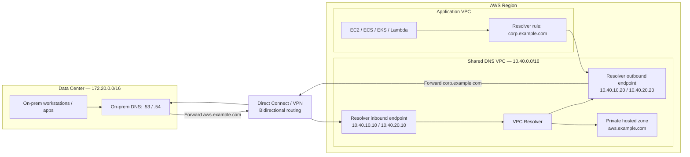

# Route 53 Resolver in Hybrid Networks

An application on Amazon EC2 may have network connectivity to a database server in a corporate data center via AWS Direct Connect or Site-to-Site VPN, yet the application still fails if it cannot resolve the name `db01.corp.example.com`. The reverse is also true: office employees may have a network route to AWS but fail to resolve `api.aws.example.com`, an internal name stored in a **Route 53 private hosted zone**.

**Amazon Route 53 VPC Resolver** (referred to in some docs as *Route 53 Resolver*) solves the **DNS resolution** half of hybrid connectivity. Using **inbound endpoints**, **outbound endpoints**, and **Resolver rules**, organizations can exchange DNS queries in a controlled manner between VPCs and *on-premises* networks.

This lesson belongs to the **Advanced Network Connectivity** chapter of the **CLOUD_PROVIDERS_AWS** module. This knowledge connects with Regions/AZs, IAM, VPCs, DNS, compute services, storage, databases, integration, and serverless; learners will design, test, and operate a hybrid DNS architecture that is secure, observable, resilient, and cost-aware.

## 1. Learning Objectives

After this lesson, you will be able to:

1. Explain the differences between a **DNS resolver**, **authoritative DNS server**, **Route 53 public/private hosted zones**, and **Route 53 VPC Resolver**.
2. Accurately trace query directions through **inbound endpoints** and **outbound endpoints**.
3. Set up **conditional forwarding**, **Resolver forwarding rules**, rule associations with VPCs, and cross-account rule sharing.
4. Build a hybrid DNS diagram over **Direct Connect/VPN**, including routes, security groups, NACLs, and at least two Availability Zones.
5. Analyze rule precedence, private hosted zones, potential DNS loops, `NXDOMAIN`/`SERVFAIL`/timeout errors, and caching limitations.
6. Plan logging, access control, scaling, redundancy, testing, and endpoint costs.

## 2. DNS Review: How Are Domain Names Resolved to IPs?

Consider querying the name `db01.corp.example.com`:

- **Client / stub resolver**: the application or operating system generating the query to find an IP address.
- **Recursive resolver**: the server receiving queries from clients, using cache, applying policies, and querying/forwarding to the appropriate destination.
- **Authoritative DNS server**: the authoritative source answering records for a DNS zone, such as `A`, `AAAA`, `CNAME`, and `SRV` records.
- **Conditional forwarder**: a configuration on a recursive resolver to forward queries for a specific domain to another DNS resolver.
- **TTL (time to live)**: how long caches may retain results; updating a record does not mean every client sees the new result immediately.

For example, an enterprise has two namespaces:

| Namespace | Who manages records? | Example |
|---|---|---|
| `corp.example.com` | Internal DNS in the data center, e.g., Microsoft DNS/BIND | `db01.corp.example.com → 172.20.50.20` |
| `aws.example.com` | Route 53 **private hosted zone** associated with appropriate VPCs | `api.aws.example.com → 10.40.16.25` |

`example.com` is used here for illustration. In real environments, use namespaces owned by your organization with clear administrative ownership policies.

**Key point:** the network transport path and the DNS resolution path are two separate things. A DNS record returning an IP does not prove TCP to that IP works. You still need routes, private connectivity, security groups, NACLs, firewalls, service configurations, and application permissions.

### 2.1. How Does a Private Hosted Zone Differ from a Public Hosted Zone?

- **Public hosted zone**: stores records for a domain's public DNS and is served via public authoritative DNS infrastructure with proper delegation.
- **Private hosted zone (PHZ)**: provides internal records for validly associated VPCs; names in a PHZ are not resolved by public DNS.
- **Route 53 VPC Resolver**: the VPC's resolver service, supporting queries to private hosted zones, internal AWS names, and appropriate DNS resolution. It does not replace the authoritative server of an on-premises zone itself.

Inside a VPC, the Amazon-provided DNS server can be queried at **VPC CIDR + 2**, such as `10.40.0.2` for VPC `10.40.0.0/16`, or `169.254.169.253` as supported by AmazonProvidedDNS.

**Do not send queries from on-premises DNS or a DNS server in another VPC directly to VPC CIDR + 2** as a hybrid networking method. AWS does not support this forwarding pattern and results may be unreliable. Queries from networks outside the VPC into the VPC Resolver require a **Resolver inbound endpoint**. [AWS — Resolving DNS queries between VPCs and your network](https://docs.aws.amazon.com/Route53/latest/DeveloperGuide/resolver-overview-DSN-queries-to-vpc.html).

## 3. Three Core Components of Route 53 Resolver Hybrid DNS

| Component | DNS query direction | Key configuration | Example |
|---|---|---|---|
| **Inbound endpoint** | From DNS servers **outside VPC → VPC Resolver** | VPC, subnets, multiple private IPs, security group; external DNS servers forward to these IPs | Office looks up `api.aws.example.com` |
| **Outbound endpoint** | From **VPC Resolver → DNS servers outside VPC** | VPC, subnets, multiple source IPs, security group; linked to Resolver rules | EC2 looks up `db01.corp.example.com` |
| **Resolver rule** | Decides **which domain** is forwarded and **where** | Domain, rule type, outbound endpoint, target DNS IPs; associated with target VPCs | Forward `corp.example.com` to `172.20.1.53/54` |

The two directions serve different purposes. If only on-premises staff need to query AWS private names, an **inbound endpoint** is usually enough. If only AWS workloads need to query corporate internal DNS, an **outbound endpoint + rule** is typically needed. If both directions are required, deploy both flows.

### 3.1. What Is an Endpoint Really?

A Resolver endpoint consists of IP addresses attached to **elastic network interfaces (ENIs)** in selected subnets. These addresses belong to the VPC network range and are normally accessed over private routes; they are not public DNS services on the Internet.

When creating an endpoint, you select at least **two IP addresses**, ideally placed in **two Availability Zones** for redundancy. One endpoint can serve multiple VPCs in the **same Region** via appropriate association/sharing mechanisms; you do not need a new endpoint for every EC2 instance.

**An endpoint is not a DNS server you operate yourself.** AWS manages the Route 53 Resolver infrastructure; the enterprise is responsible for IPs, SGs, network connectivity, namespaces, Resolver rules, and access permissions.

### 3.2. Newer Inbound Endpoint and Rule Categories

AWS supports two **inbound endpoint categories**:

- **Default inbound endpoint**: the on-premises resolver **forwards queries** to the endpoint IPs.
- **Delegation inbound endpoint**: on-premises DNS **delegates authority** for a subdomain using configured NS/glue records, subject to this feature's conditions.

For Resolver rules, in addition to **Forward** and **System**, current AWS documentation also includes **Delegate**:

- **Forward**: forwards domain-matching queries to specified target DNS resolvers.
- **System**: lets the VPC Resolver handle a specific namespace directly, used to create exceptions to a broader forwarding rule.
- **Delegate**: applies a DNS delegation mechanism based on NS records and rule matching conditions, distinct from pure conditional forwarding.

This lesson focuses on **Default inbound + Forward outbound**, the easiest pattern to grasp for corporate DNS integration. Delegation requires separate NS zone design and authority management.

Reference: [AWS — Forwarding inbound DNS queries](https://docs.aws.amazon.com/Route53/latest/DeveloperGuide/resolver-forwarding-inbound-queries.html) and [AWS — Resolver rule types](https://docs.aws.amazon.com/Route53/latest/DeveloperGuide/resolver-forwarding-outbound-queries-rule-values.html).

## 4. Reference Architecture: AWS Connected to a Data Center

Suppose a company has:

- **On-premises**: network `172.20.0.0/16`, recursive DNS servers `172.20.1.53` and `172.20.1.54`, authoritative zone `corp.example.com`.
- **AWS Region**: a Region chosen based on user/data location, containing a **Shared DNS VPC `10.40.0.0/16`**.
- **Private hosted zone**: `aws.example.com`, associated with the Shared DNS VPC so the inbound endpoint can query it.
- **Application VPCs**: other VPCs where EC2/ECS/EKS/Lambda inside the VPC need to resolve on-premises names.
- **Private connectivity**: Direct Connect or Site-to-Site VPN; may pass through a Virtual Private Gateway or Transit Gateway depending on actual topology.
- **Two AZs**: each AZ holds inbound/outbound endpoint IPs.

The diagram below shows **DNS flows**, not all application traffic paths:



*Arrows represent logical queries/forwarding; DNS responses travel in the reverse direction. In an actual setup, the VPC Resolver in the Application VPC processes the query before selecting the rule; AWS manages transport to the shared outbound endpoint. The diagram is simplified for learning.*

### 4.1. Sample Allocation Table for the Shared DNS VPC

| Component | AZ | Subnet | Sample IP |
|---|---|---|---|
| Inbound IP 1 | A | `10.40.10.0/24` | `10.40.10.10` |
| Inbound IP 2 | B | `10.40.20.0/24` | `10.40.20.10` |
| Outbound IP 1 | A | `10.40.10.0/24` | `10.40.10.20` |
| Outbound IP 2 | B | `10.40.20.0/24` | `10.40.20.20` |
| On-prem DNS target 1 | Data center A | `172.20.0.0/16` | `172.20.1.53` |
| On-prem DNS target 2 | Data center B | `172.20.0.0/16` | `172.20.1.54` |

These IPs are examples only. In practice, check that subnets have sufficient free addresses, no IP conflicts, VPC DNS options enabled, and Endpoint/ENI quotas available. Prefer placing endpoint addresses in two independent AZs; if one subnet or AZ fails, DNS still has a working path via the remaining IP when other network conditions are met.

## 5. Flow 1 — On-Premises Querying AWS DNS (Inbound)

**Requirement:** an application on an office computer needs to access `api.aws.example.com`. Private hosted zone `aws.example.com` contains:

```text
Zone: aws.example.com (private hosted zone)
A    api.aws.example.com   10.40.16.25
```

Assume the PHZ is already **associated** with the Shared DNS VPC hosting the inbound endpoint.

### 5.1. Resolution Sequence

1. The on-premises application asks the corporate recursive DNS resolver: "What is the IP address of `api.aws.example.com`?"
2. The on-premises DNS server sees domain `aws.example.com` matches its **conditional forwarder**.
3. It forwards the request to one of the two **inbound endpoint** IPs: `10.40.10.10` or `10.40.20.10`.
4. The query travels over VPN/Direct Connect, through appropriate routes, firewalls, and security groups, reaching the inbound endpoint.
5. Route 53 VPC Resolver resolves using sources valid for that VPC—here, the associated PHZ `aws.example.com`.
6. The result `A = 10.40.16.25` returns to the on-premises DNS server and then to the application.
7. The application then connects to `10.40.16.25` over a separate **application network path**, via TCP/HTTPS as needed.

**Fault isolation:** if a DNS lookup returns `10.40.16.25` yet API access fails, the DNS portion is likely already working. Proceed to check routes, SGs, ACLs, load balancers, firewalls, and the application rather than immediately modifying Resolver rules.

### 5.2. Conditional Forwarder on On-Premises DNS

**BIND** example (configuration sample only; do not apply directly to production without checking DNS policies):

```conf
zone "aws.example.com" IN {
    type forward;
    forward only;
    forwarders {
        10.40.10.10;
        10.40.20.10;
    };
};
```

Meaning:

- `zone "aws.example.com"`: forwards only for this namespace and names within its scope.
- `forward only`: does not attempt alternative resolution if forwarders fail to respond, per BIND behavior.
- `forwarders`: the two **inbound endpoint** addresses, not VPC CIDR + 2.

On **Windows DNS Server**, the same concept is configured via **Conditional Forwarders**: zone `aws.example.com`, master servers set to the two inbound IPs. Ensure the DNS server has a route to the VPC and organizational policy allows it.

**Do not configure office workstations to point directly at all inbound IPs if you already operate centrally managed recursive DNS servers.** Usually it is better to centralize conditional forwarding on corporate DNS servers to preserve control, caching, logging, and access policies.

### 5.3. PHZ Access Scope

An inbound endpoint resolves within the **context of the VPC where the endpoint was created**. If a record sits in a PHZ associated only with another VPC, the inbound endpoint in the Shared DNS VPC may not see that zone. You must design appropriate **PHZ associations**, or share resolution configurations using AWS-supported features. Network reachability alone does not grant PHZ resolution access.

## 6. Flow 2 — AWS Applications Querying On-Premises DNS (Outbound)

**Requirement:** an EC2 instance in an Application VPC needs to resolve `db01.corp.example.com`; on-premises DNS manages the record:

```text
Zone: corp.example.com (on-premises)
A    db01.corp.example.com   172.20.50.20
```

### 6.1. Required Components

1. **Outbound endpoint** in the Shared DNS VPC, with at least two source IPs across two AZs, e.g., `10.40.10.20` and `10.40.20.20`.
2. **Forwarding rule** for domain `corp.example.com`.
3. **Target IP addresses** of on-premises DNS, e.g., `172.20.1.53` and `172.20.1.54` (DNS port per actual configuration).
4. **Resolver rule association** with the Application VPCs that need to use the rule.
5. **Bidirectional routes and firewalls** from outbound endpoint subnets to on-premises DNS targets.
6. AWS applications using the VPC Resolver via VPC/host DNS settings; if a host uses a custom resolver, ensure queries are forwarded to the appropriate VPC Resolver.

### 6.2. Resolution Sequence

1. An EC2 instance in the Application VPC sends a DNS query for `db01.corp.example.com` to its configured resolver.
2. The VPC Resolver receives the query and checks rules associated with the VPC.
3. The rule `corp.example.com → Forward` matches, so Route 53 Resolver sends the query through the designated **outbound endpoint**.
4. The query originates from one of the outbound endpoint's IPs and routes over Direct Connect/VPN to `172.20.1.53` or `172.20.1.54`.
5. On-premises DNS replies with `172.20.50.20`.
6. The DNS response returns to the VPC Resolver and then to the EC2 instance.
7. The EC2 instance connects to the database IP using application routes and network policies, **not "through the DNS endpoint"**.

### 6.3. Forwarding Rule Specification

| Field | Example value | Role |
|---|---|---|
| Rule type | `Forward` | Forwards matching queries to external DNS |
| Domain name | `corp.example.com` | Namespace to forward, including subdomains per matching logic |
| Outbound endpoint | `rslvr-out-...` | Egress point for queries leaving AWS |
| Target 1 | `172.20.1.53:53` | Recursive/authoritative DNS path in the data center |
| Target 2 | `172.20.1.54:53` | Backup target |
| Rule association | Application VPC A, Application VPC B | VPCs where the rule applies |

After creating an **outbound endpoint**, **if no forwarding rule is created and associated with the VPC, DNS traffic will not be forwarded automatically for that namespace**. AWS can select any eligible target DNS IP; do not treat target order as a strict primary/secondary mechanism. Both targets should be equally reachable and capable of answering the zone. [AWS — Forwarding outbound DNS queries](https://docs.aws.amazon.com/Route53/latest/DeveloperGuide/resolver-forwarding-outbound-queries.html).

## 7. Route Tables, Security Groups, and Firewalls

Resolver endpoints use private IPs inside a VPC; proper bidirectional network connectivity is required.

### 7.1. Routing Paths

In the sample architecture:

- **The on-premises side** must have routes to the inbound endpoint subnets or IPs `10.40.10.10`/`10.40.20.10` over Direct Connect/VPN.
- **The VPC subnets hosting the outbound endpoint** need routes to `172.20.0.0/16` via the right Transit Gateway/VGW or supported network target, plus return routes.
- On-premises routes to AWS applications (`10.40.16.25`) are a **separate** data-path design and must be provisioned as needed.
- Across multiple Regions, endpoints are **Regional resources**; design region-local routing, associations, and redundancy separately.

**Neither a NAT gateway nor an Internet gateway is required** for DNS to traverse VPN/Direct Connect with valid private routing. NAT may appear in other architectures, but is not an inherent part of Route 53 Resolver hybrid DNS.

### 7.2. Endpoint Security Groups

For **standard DNS (Do53: UDP/TCP 53)**, apply least-privilege rules based on known sources/destinations:

| Endpoint | Direction | Protocol/port | Illustrative addresses | Purpose |
|---|---|---|---|---|
| **Inbound** | Inbound | UDP 53, TCP 53 | `172.20.1.53/32`, `172.20.1.54/32` | Allows on-premises DNS to query inbound IPs |
| **Outbound** | Outbound | UDP 53, TCP 53 | `172.20.1.53/32`, `172.20.1.54/32` | Allows outbound IPs to send DNS queries to targets |
| Inbound / outbound | Return | Per stateful SG rules | Corresponding query flows | SG tracks connection state; still verify throughput optimization |

Some **high-performance** examples in AWS docs suggest broader security group patterns or connection-tracking optimizations to reach higher throughput. That is a trade-off to weigh against your threat model; do not blindly open `0.0.0.0/0` for DNS when only two internal resolvers exist.

With **stateless network ACLs**, account for both directions and ephemeral response ports. On **on-premises firewalls**, permit flows from outbound endpoint IPs to DNS servers and from on-premises DNS to inbound endpoints, including responses. If using DoH or custom AWS-supported ports, adjust policies for the chosen protocol.

### 7.3. Additional Security Checks

- Restrict which IAM roles can create/modify/delete endpoints, rules, and associations.
- Share Resolver rules only with authorized accounts/VPCs via **AWS Resource Access Manager (AWS RAM)** or organizational governance.
- With DNS query logging, protect log read access since **DNS names** can reveal internal architecture.
- Consider **Route 53 Resolver DNS Firewall** for DNS traffic passing through the VPC Resolver within feature scope; DNS Firewall filters namespaces, not TCP connections to returned IPs.
- Separate authorized DNS server IPs from general end-user devices; endpoints typically receive queries from corporate DNS servers.
- Distinguish **DNS transport security** from **application security**: traditional DNS over UDP/TCP 53 does not encrypt payloads like application TLS. AWS supports DNS-over-HTTPS (DoH) protocols for certain endpoint/target types; verify availability and policies by version/service.
- Monitor configuration changes (CloudTrail/API events and appropriate governance tools), and evaluate application secrets and data protection under the **Shared Responsibility Model**.

## 8. Resolution Precedence: Rules, Hosted Zones, and Caching

Hybrid DNS is often trickier in **resolution rules** than in creating endpoints.

### 8.1. Longest Matching Domain

Suppose a VPC has:

| Rule | Type | Desired outcome |
|---|---|---|
| `example.com` | Forward | Broad domain queries go to central DNS |
| `corp.example.com` | Forward | Specific subdomain queries go to corporate DNS |
| `aws.example.com` | System | Let VPC Resolver handle the AWS namespace within its scope |

Among domain-matching rules, **the most specific name wins**. A query for `db01.corp.example.com` follows `corp.example.com` rather than `example.com`. A `System` rule can prevent a subdomain from being forwarded by a broader rule, letting the VPC Resolver resolve it via other configurations.

A forwarding rule for a domain generally applies to all its subdomains, so creating a rule for `example.com` can affect more namespaces than intended.

### 8.2. Rules Sharing a Name with a Private Hosted Zone

An important case:

- A VPC has a PHZ `corp.example.com`.
- The VPC is also associated with a **Resolver forwarding rule for the same domain** `corp.example.com`.

According to AWS documentation, **a forwarding rule with an exact domain match takes precedence over a PHZ**. Queries are sent to the rule's target resolvers instead of reading PHZ records. This causes confusion when a team creates PHZ records while also configuring forwarding to on-premises for the same namespace.

When dividing namespaces, prefer clean separation such as:

- AWS authoritative private: `aws.example.com`.
- On-premises authoritative: `corp.example.com`.

When a private hosted zone matches a domain yet **lacks a specific record**, the VPC Resolver may return `NXDOMAIN` instead of automatically falling back to public DNS. Do not expect "try PHZ first, then ask the Internet if missing" behavior without an explicit DNS configuration supporting that pattern.

AWS also offers **Route 53 Profiles** to manage collections of PHZs/rules/logging/firewalls across VPCs; when using Profiles, precedence between profile associations and local configurations becomes more nuanced. Inspect Profile priority, domain specificity, and local overrides when troubleshooting misrouted queries.

Source: [AWS — Considerations for private hosted zones](https://docs.aws.amazon.com/Route53/latest/DeveloperGuide/hosted-zone-private-considerations.html) and [What are Route 53 Profiles?](https://docs.aws.amazon.com/Route53/latest/DeveloperGuide/profiles.html).

### 8.3. Caching and TTL

When a DNS record changes, clients may continue seeing the old IP due to:

- Application or OS caching.
- On-premises DNS caching.
- VPC Resolver caching.
- **Negative caching** of non-existent results per DNS SOA/TTL.

Do not assume "forwarding rules are broken" simply because one host sees stale results. Query **each resolver hop directly** where permitted, and inspect TTLs, logs, and change timestamps.

## 9. Multi-VPC, Multi-Account, and Multi-Region Architectures

### 9.1. Centralized DNS VPC (Hub-and-Spoke)

When a company runs many applications, a **Shared DNS VPC** can host centralized outbound endpoints for the Region. The networking team creates and manages forwarding rules; application teams **associate rules** with Application VPCs.

Example:

```text
Account: networking
  Shared DNS VPC
  ├─ Inbound endpoint (AZ A/B)
  ├─ Outbound endpoint (AZ A/B)
  ├─ Private hosted zones / associations
  └─ Resolver rules: corp.example.com -> 172.20.1.53 / 172.20.1.54

Account: app-a
  VPC app-a -> association with rule corp.example.com

Account: app-b
  VPC app-b -> association with rule corp.example.com
```

Benefits: a single control point for IPs, SGs, hybrid links, namespaces, and logging. Costs, latency, and operational boundaries are also centralized, so HA and ownership must be planned.

AWS allows **sharing Resolver rules across accounts via AWS RAM**, letting VPCs in other accounts associate the same rules under AWS-supported conditions. Sharing a rule does not automatically share all PHZs or create application network routes. Verify AWS Organizations policies, share acceptance, and per-VPC associations.

**Ownership note:** you cannot directly create a Resolver endpoint inside a VPC your current account does not own, outside specific AWS-supported mechanisms; shared designs require coordination with the VPC/account owner.

### 9.2. Do Not Confuse the DNS Path with the Data Path

If an Application VPC uses a Resolver rule pointing to a shared outbound endpoint, **DNS resolution** can leverage AWS-managed cross-VPC mechanics provided by rule association. However, the returned `172.20.50.20` is only the **destination IP**. Connectivity from the application to that IP still requires Transit Gateway/peering/routing/firewalls aligned with the actual topology.

Similarly, PHZ association enables name resolution; it **does not automatically grant access** to RDS or servers behind those records.

### 9.3. Multi-Region Deployments

Resolver endpoints are **regional resources**. If workloads in two Regions need to query on-premises DNS, design resolution, routing, and HA independently in each Region. Do not rely on an endpoint in Region A as an availability guarantee for Region B when cross-Region links fail.

For systems requiring DR, the checklist should include:

- Non-overlapping VPC CIDRs and endpoint IPs in the backup Region.
- PHZs and rule associations present in the target Region/VPC.
- Routes and DNS target connectivity remaining active when the primary Region/AZ fails.
- On-premises DNS servers knowing how to forward to backup endpoints per failover scenarios.
- RTO/RPO of **application services**, data, and DNS caches meeting business targets.

## 10. Avoiding DNS Loops (Forwarding Loops)

A loop occurs when resolvers continuously forward the same query back and forth.

**Misconfiguration example:**

1. AWS has a forwarding rule `corp.example.com → on-premises DNS`.
2. On-premises DNS is also configured with `corp.example.com → AWS inbound endpoint`.
3. A query for `db01.corp.example.com` is sent from AWS to on-premises and sent right back to AWS; neither side handles it authoritatively.

Consequences include timeouts, `SERVFAIL`, surging query counts, bloated logs, and higher DNS bills. In hub-and-spoke setups, carefully avoid **associations that cause an outbound forwarding rule to loop directly or indirectly back into the same VPC's inbound endpoint** for the same namespace.

### 10.1. Loop-Free Design

| Domain | Authoritative source | On AWS | On-premises |
|---|---|---|---|
| `aws.example.com` | PHZ on AWS | VPC Resolver resolves directly from matching zone | Conditional forward to AWS inbound endpoint |
| `corp.example.com` | Internal corporate DNS | Forward rule to outbound endpoint → on-premises DNS | On-premises DNS resolves directly |
| Public `www.example.com` | Public authoritative DNS | Recursive resolution per policy | Recursive resolution per policy |

**Practice:** explicitly document for each zone **one primary authoritative location**, which resolvers forward into it, and which hops could form a loop. Exercise extreme caution with root rules like `.` (forward all domains), as AWS has automatic system rules and internal AWS names requiring special handling.

Source: [AWS — Avoid loop configurations with Resolver endpoints](https://docs.aws.amazon.com/Route53/latest/DeveloperGuide/best-practices-resolver-endpoints.html).

## 11. Designing Availability and Capacity

### 11.1. Multi-Availability Zone Endpoints

To prevent a single AZ from disrupting DNS:

1. Select **at least two endpoint IPs** in **two AZs** with proper subnets and routes.
2. Configure on-premises DNS servers to use **both inbound IPs**, never pointing solely to AZ A.
3. For outbound, specify **at least two target DNS resolvers** capable of answering the zone, ideally across independent infrastructure stacks.
4. Verify redundancy of Direct Connect/VPN, routers, firewalls, BGP, and on-premises DNS.
5. Periodically test losing one IP/link during scheduled windows and verify critical names still resolve.

AWS requires a minimum of two IPs when creating a Resolver endpoint and recommends multi-AZ placement. For high-throughput demands, you can add IPs/ENIs and keep spare ENI capacity to absorb maintenance or traffic spikes.

### 11.2. Throughput and DNS Caching

Do not estimate capacity as "one endpoint = infinite DNS queries". Capacity depends on IP count, endpoint type, protocol, security group connection tracking, and traffic patterns. Check **current AWS quotas** rather than memorizing a fixed QPS figure for every Region and point in time.

Reasonable load-reduction practices:

- Set TTLs proportional to record update frequency.
- Avoid ultra-low TTLs across entire zones when unnecessary.
- Verify recursive caching at on-premises DNS servers and service clients.
- Monitor query volume, errors, and resolution latency by source.
- Add endpoint IPs/ENIs if scale/architecture and quotas call for it.

**Low TTLs** help reduce stale record exposure at the cost of higher query volume, which can increase latency and cost. TTLs do not replace application-layer failover.

Source: [AWS — High availability for Resolver endpoints](https://docs.aws.amazon.com/Route53/latest/DeveloperGuide/best-practices-resolver-endpoint-high-availability.html) and [Resolver endpoint scaling](https://docs.aws.amazon.com/Route53/latest/DeveloperGuide/best-practices-resolver-endpoint-scaling.html).

## 12. DNS Observability and Security

### 12.1. Route 53 Resolver Query Logging

**Resolver query logging** can capture queries/responses within configured scopes, including queries originating from VPCs, passing through inbound endpoints, or forwarded outbound per feature behavior. Logs can include:

- Timestamp and Region/VPC.
- Queried domain (e.g., `api.aws.example.com`).
- Record type `A`, `AAAA`, `CNAME`.
- Response code `NOERROR`, `NXDOMAIN`, `SERVFAIL`.
- Source IP or resource/endpoint details when available.
- Response data and DNS Firewall actions when applied.

Common destinations: **CloudWatch Logs**, **Amazon S3**, **Amazon Data Firehose**. Choose based on query latency, long-term retention, and analysis requirements.

**Important:** Route 53 VPC Resolver caches answers. Query logging may **not record every identical query when responses are served from cache**. Therefore, log line counts do not necessarily equal application resolver calls. Logs are also not packet captures.

### 12.2. Complementary Observability Sources

| Tool | Helps answer | Limitations |
|---|---|---|
| Resolver query logs | What name was queried, response code, and from where | Caching may omit some queries; must be enabled for target VPCs |
| CloudWatch metrics/alarms | Error trends, query volume, operational signals per available metrics | Thresholds must be tuned to actual workloads |
| VPC Flow Logs | Is network traffic flowing from endpoint IPs to DNS targets? | Captures flow metadata, not full DNS payloads |
| CloudTrail | Who modified endpoints/rules/associations per logged API events? | Does not replace Resolver query logging |
| Firewall/VPN/Direct Connect logs | Are routes, ACLs, tunnels, BGP, or sessions failing? | Limited to device/link visibility |

If an on-premises name query returns `SERVFAIL`, inspect on-premises DNS logs as well; you cannot diagnose it from AWS alone.

### 12.3. Resolver DNS Firewall

**Route 53 Resolver DNS Firewall** supports blocking, allowing, or alerting based on domain lists/advanced protections via rules and VPC associations. It helps mitigate suspicious domain queries or DNS tunneling through the Resolver. In hybrid designs, define which VPCs and query flows fall under inspection.

DNS Firewall **does not replace** network firewalls, SGs, IAM, or data protection. If applications use custom DNS resolvers bypassing Route 53 VPC Resolver, evaluate the architecture's DNS path and control coverage.

Source: [Resolver query logging](https://docs.aws.amazon.com/Route53/latest/DeveloperGuide/resolver-query-logs.html) and [Using DNS Firewall to filter outbound DNS traffic](https://docs.aws.amazon.com/Route53/latest/DeveloperGuide/resolver-dns-firewall.html).

## 13. Deployment Roadmap for Infrastructure Teams

The steps below represent a **controlled deployment workflow**, to be adapted to your accounts, Regions, DNS server types, and corporate policies.

### Phase A — Discovery and Design

- Inventory on-premises namespaces, private hosted zones, and authoritative owners.
- Confirm VPC CIDRs, subnets per AZ, Direct Connect/VPN paths, Transit Gateway/VGW, required routes, and IAM scope.
- Document inbound/outbound endpoint IPs, target DNS IPs, and firewall policies.
- Identify which VPCs use which rules, and which PHZs must associate with the inbound endpoint VPC.
- Verify no overlapping forwarding domains cause loops; document TTLs, failover mechanisms, and logging setup.

### Phase B — Inbound Configuration

1. Select the Shared DNS VPC and two subnets in two AZs.
2. Create a **Default inbound endpoint**, choosing appropriate IPs and security groups.
3. Verify the endpoint reaches **Operational** state and is reachable from on-premises for each IP.
4. Associate private hosted zones with the inbound endpoint's VPC as required.
5. Configure conditional forwarders on on-premises DNS for `aws.example.com` pointing to **both inbound IPs**.
6. Test from on-premises DNS with `dig`/`nslookup` and then from real clients.

### Phase C — Outbound Configuration

1. Create an **outbound endpoint** with two IPs across two AZs and egress to DNS targets.
2. Allow SGs/routes/firewalls to `172.20.1.53`, `172.20.1.54`, and return paths.
3. Create a **Resolver Forward rule** for `corp.example.com`, linking the outbound endpoint and target DNS servers.
4. Associate the rule with each Application VPC; across accounts, set up sharing via AWS RAM.
5. Verify VPCs use Amazon-provided Resolver or appropriate DNS forwarders.
6. Test existing names, non-existent names, IPv4/IPv6 records if applicable, and loss of one target.

### Phase D — Operational Hardening

- Enable query logging for target VPCs/Regions; verify retention and log access permissions.
- Configure alarms for usage patterns, errors, endpoint state, and network health.
- Write incident runbooks: on-call owners, escalation paths, rule rollback steps, DNS test commands.
- Document ownership of endpoints/rules/PHZs/namespaces, and codify configs in IaC if used.
- Estimate costs for endpoint IPs, queries, logs, and Direct Connect/VPN/network traffic; monitor billing.

## 14. Read-Only Testing Tools and Examples

### 14.1. Testing DNS from On-Premises

With `dig`, query both inbound IPs directly to separate conditional forwarding issues from endpoint issues:

```bash
# Query the first inbound endpoint IP directly
dig @10.40.10.10 api.aws.example.com A

# Compare with the second inbound endpoint IP
dig @10.40.20.10 api.aws.example.com A

# Query via corporate DNS server to test conditional forwarder
dig @172.20.1.53 api.aws.example.com A
dig @172.20.1.54 api.aws.example.com A
```

These commands only perform DNS queries and create no AWS resources. IPs are illustrative documentation values; substitute approved environment values.

### 14.2. Testing Outbound from Inside a VPC

```bash
# Using the OS/VPC configured resolver
dig db01.corp.example.com A

# Compare directly against on-premises if network access is permitted
dig @172.20.1.53 db01.corp.example.com A

# Query an intentionally non-existent name to check response code
dig not-exist.corp.example.com A
```

If querying on-premises DNS directly succeeds while querying through the VPC Resolver fails, check forwarding rules, VPC associations, and outbound endpoint paths. If all queries to `172.20.1.53` time out, check routes, SGs/NACLs, firewalls, and the DNS server rather than just records.

### 14.3. AWS CLI: Read-Only Resolver Inspection

Requires AWS CLI with an authorized profile and read permissions such as those listed under `route53resolver`. Select the Region where endpoints were created.

```bash
# List Resolver endpoints in the Region
aws route53resolver list-resolver-endpoints \
  --region ap-southeast-1 \
  --profile learning

# List Resolver rules
aws route53resolver list-resolver-rules \
  --region ap-southeast-1 \
  --profile learning

# List rule associations
aws route53resolver list-resolver-rule-associations \
  --region ap-southeast-1 \
  --profile learning

# Check whether DNS support is enabled on a VPC
aws ec2 describe-vpc-attribute \
  --vpc-id vpc-0123456789abcdef0 \
  --attribute enableDnsSupport \
  --region ap-southeast-1 \
  --profile learning
```

VPC ID and Region are examples; replace with your real environment. Commands failing with `AccessDenied` do not mean resources are broken: check IAM permissions. You can also inspect configurations in the AWS Console without write permissions.

### 14.4. Verification Matrix

| Test source | Query | Expected result |
|---|---|---|
| On-prem DNS A | `api.aws.example.com` | Resolves `10.40.16.25` from PHZ via inbound |
| On-prem DNS B | `api.aws.example.com` | Same result; still works if one inbound IP fails |
| Application VPC EC2 | `db01.corp.example.com` | Resolves `172.20.50.20` via forwarding rule/outbound |
| Application VPC EC2 | `www.example.com` | Follows standard public DNS policy, unaffected by `corp.example.com` rule |
| Application VPC EC2 | `not-exist.corp.example.com` | Authoritative-zone-consistent name error, distinct from timeout |

## 15. Hybrid DNS Troubleshooting Workflow

### 15.1. Triage by Symptom

| Symptom | Possible causes | How to verify |
|---|---|---|
| `NXDOMAIN` | Record missing, querying wrong zone/PHZ, namespace overlap, negative cache | Compare authoritative DNS answers, PHZ associations, rule priority, and TTL |
| `SERVFAIL` | Resolver cannot complete lookup; forward target down, loop, authoritative error | Check logs on both sides, rules, target IPs, forwarding chain |
| Timeout | Cannot reach endpoint/target, SG/NACL/firewall/route blocking, DNS process unresponsive | Test each IP individually, UDP/TCP 53, VPC Flow Logs, tunnel/BGP |
| AWS → on-prem works, reverse fails | Missing inbound endpoint/conditional forwarder or PHZ association | Query inbound IPs directly and inspect on-prem DNS server |
| On-prem → AWS works, AWS → on-prem fails | Missing outbound rule/association, route, or egress to target | Inspect outbound endpoint, targets, and rule associations |
| Name resolves to IP, yet application still fails | Data path differs from DNS path, app/auth/port/TLS error | Check path to service IP, SGs, and application logs |
| Record updated, yet host sees old IP | DNS cache/TTL/negative cache | Query each resolver directly, check TTL and change timestamp |
| Intermittent DNS failures | Only one endpoint IP/DNS target healthy, AZ/link issue, or capacity exhaustion | Test each IP individually; inspect network and service metrics |

**Investigate in order:** identify which resolver the client queries → which namespace/rule the resolver selects → which endpoint sends/receives → whether routes/SGs/firewalls permit it → what the authoritative server returns → how caching stores it → whether the resolved IP has a working application path.

### 15.2. Example: Cannot Resolve Private AWS Names from the Office

1. Query `dig @10.40.10.10 api.aws.example.com A` directly.
2. If that fails, try `@10.40.20.10` to isolate a single AZ/IP versus the entire endpoint.
3. If both time out, check VPN/DX, routes, firewalls, and inbound SG for UDP/TCP 53.
4. If it returns `NXDOMAIN`, check PHZ association with the inbound endpoint's VPC, record name, and namespace.
5. If direct queries succeed yet querying `172.20.1.53` fails, check the conditional forwarder or on-premises DNS cache/policy.

### 15.3. Example: EC2 Cannot Resolve On-Premises Database Names

1. Verify EC2 uses the right DNS resolver, the VPC has `enableDnsSupport` enabled, and DHCP option sets do not point to another resolver.
2. Verify the `corp.example.com` forwarding rule is associated with the Application VPC.
3. Verify the outbound endpoint is Operational, target DNS IPs are right, and egress SGs/routes exist from endpoint subnets to `172.20.1.53/54`.
4. Verify on-premises authoritative/recursive DNS answers that domain and permits queries from outbound endpoint IPs.
5. Check rule/PHZ precedence and verify the same namespace isn't forwarded back via an inbound endpoint (loop).

## 16. Costs and Operational Governance

Route 53 Resolver endpoints incur charges tied to **the number of IP addresses in inbound/outbound endpoints** and **the volume of DNS queries processed**, per current Regional pricing. Additional charges may include:

- **Direct Connect/VPN/Transit Gateway** and data transfer across hybrid links.
- **CloudWatch Logs, S3, or Firehose** when DNS query logging is enabled.
- **Resolver DNS Firewall** or other add-on features if used.
- Engineering/admin effort for DNS, private hosted zones, IaC, security, and incident response.

### 16.1. Estimation Model

```text
Hybrid DNS cost per period ≈
    inbound IP count × hourly IP rate × active hours
  + outbound IP count × hourly IP rate × active hours
  + billable queries × tiered/Regional rate
  + query logging / storage
  + related network and integration charges
```

This is an estimation framework, **not a fixed price list**. Review pricing terms, any free/included tiers, and actual query types before finalizing budgets. Notably, **active endpoints with low query volume still incur hourly per-IP charges**. Avoid creating dedicated endpoints for every VPC when Regional rule sharing meets requirements and policies.

### 16.2. Operational Guidelines

- Name endpoints/rules meaningfully, e.g., `shared-dns-inbound-a`, `corp-example-com-forward`.
- Apply organizational tags such as `owner`, `environment`, `cost-center`.
- Maintain a request workflow for adding zones, updating target DNS IPs, and changing PHZ associations.
- Manage with IaC and review blast radius when updating rules shared across many VPCs.
- Periodically test losing an AZ, an on-prem DNS target, or a WAN link.
- Track costs by account and Region; delete unused endpoints/rules after verifying dependencies.

Reference: [Amazon Route 53 Pricing](https://aws.amazon.com/route53/pricing/).

## 17. Self-Assessment Practice

### Exercise A — Designing Bidirectional DNS

A company wants:

1. Office computers to look up `orders.aws.example.com` (private record on AWS).
2. ECS containers in a VPC to look up `sap.corp.example.com` (managed by on-premises DNS).
3. Production apps to continue running without disruption if an AZ hosting a Resolver endpoint fails.
4. Security teams to audit DNS query history within policy scope.

**Task:** diagram inbound and outbound flows; indicate where PHZs, conditional forwarders, forwarding rules, associations, routes, security groups, logging, and redundancy belong.

**Suggested answer:**

| Requirement | Needed components |
|---|---|
| Office → AWS private names | PHZ `aws.example.com` associated with inbound VPC, two inbound IPs, conditional forwarder on on-prem DNS |
| ECS → internal corporate names | Two outbound IPs, Forward rule `corp.example.com` to on-prem DNS, associated with ECS VPC |
| AZ redundancy | Endpoint IPs across two AZs, routes/DNS targets/firewalls operational over surviving paths |
| Observability | Resolver query logging, CloudWatch/CloudTrail/Flow Logs within appropriate scope and log access protection |

### Exercise B — Detecting a Loop

A team sets a forwarding rule `example.com → on-prem DNS`. On-prem DNS also forwards all of `example.com` to the same VPC's inbound endpoint to "prioritize AWS".

**Question:** what failure is likely, and how to fix it?

**Hint:** this creates a **DNS forwarding loop** or unexpected resolution behavior. Separate authoritative zones: e.g., forward only `corp.example.com` from AWS to on-prem and only `aws.example.com` from on-prem to AWS; ensure on-prem resolves its own zone directly.

### Exercise C — Comparing Options

| Option | Assessment |
|---|---|
| Using VPC `10.40.0.2` as a DNS forwarder from on-prem | Not supported by AWS as a hybrid DNS solution; use an inbound endpoint |
| Creating a separate outbound endpoint in every Application VPC | Can work, but may raise costs/complexity; evaluate shared endpoints/rules |
| Using a single inbound IP to save money | Does not meet minimum endpoint requirements and eliminates redundancy |
| Using a Route 53 public hosted zone for private IPs as internal DNS | Inappropriate for private resolution security/scope; consider PHZ |
| Raising TTLs on all records to reduce queries | Can cut traffic but slows updates/failover; choose TTLs per requirements |
| Enabling Resolver query logging expecting to see every cache hit | Incorrect; cache hits can be answered without generating corresponding query log entries |

### Review Questions

1. What is an inbound endpoint used for, and which side must configure the conditional forwarder?
2. Does an outbound endpoint automatically forward all DNS queries to on-premises?
3. A forwarding rule for `corp.example.com` is created but not yet associated with an Application VPC; what happens?
4. Why shouldn't on-premises conditional forwarding point directly to VPC CIDR + 2?
5. Why can connections to an RDS instance still fail after its IP resolves properly?
6. A Resolver rule and a PHZ share the same domain name in a VPC: which takes precedence?
7. When DNS fails intermittently, why check each endpoint IP and DNS target individually?
8. How can a single endpoint serve multiple VPCs in the same Region?
9. What factors typically affect Route 53 Resolver endpoint costs?
10. How do TTL, query logs, and caching relate to one another?

**Answer hints:** (1) receives queries from outside the VPC; external DNS forwards to inbound IPs; (2) no, matching rules and associations are required; (3) that VPC does not use the new forwarding rule; (4) AWS does not support cross-network forwarding to that address; (5) DNS resolution is independent of routing/SG/TLS/app; (6) exact-matching forwarding rule wins; (7) to isolate failing AZ/ENI/target/link; (8) share rules/associations, potentially via AWS RAM; (9) endpoint IP count, queries, and companion logging/network services; (10) cache hits may not produce logs and TTL controls how long responses are cached.

## 18. Pre-Handoff Checklist for Hybrid DNS

- [ ] Every namespace has a clear authoritative owner.
- [ ] Diagrams exist for both **on-prem → inbound** and **AWS → outbound** flows.
- [ ] Endpoint IP ranges, subnets, two AZs, and WAN connectivity are approved.
- [ ] Routes, SGs, NACLs, firewalls, and protocols/ports support bidirectional DNS flows.
- [ ] VPC CIDR + 2 is not used as a forwarding target from on-premises/other VPCs.
- [ ] PHZs are associated with the right VPCs so inbound endpoints can resolve them.
- [ ] Forwarding rules have the right domains, target IPs, and VPC associations.
- [ ] No DNS loops or namespace/rule/PHZ conflicts exist.
- [ ] Two endpoint IPs and multiple DNS targets sit on sufficiently independent infrastructure.
- [ ] Test cases cover `NOERROR`, `NXDOMAIN`, timeouts, caching, and failover.
- [ ] Query logging/metrics/CloudTrail are configured per governance requirements.
- [ ] Owners, runbooks, budgets, and DNS change procedures are documented.

## 19. Summary

**Route 53 VPC Resolver** unifies DNS resolution between AWS networks and corporate networks in hybrid cloud deployments. Key rules to remember:

- **Inbound**: **external** DNS queries names resolvable by the VPC Resolver via endpoint IPs.
- **Outbound**: VPC Resolver **sends queries outward** based on **domain forwarding rules** attached to VPCs and target DNS servers.
- **Private hosted zones**, **Resolver rules**, and **DNS namespace ownership** must be closely coordinated to avoid precedence collisions, `NXDOMAIN`, and loops.
- **DNS resolution**, **network connectivity to the resolved IP**, and **application access permissions** are independent checks.
- **HA, logging, security, and costs** must be designed upfront, especially when endpoints/rules are shared across multiple accounts and applications.

Understanding DNS flows accurately provides the foundation for deploying VPCs, on-premises links, compute services, databases, storage, integration, and serverless workloads that are secure, observable, and resilient.

### Official AWS Reference Documentation

1. [What is Route 53 VPC Resolver?](https://docs.aws.amazon.com/Route53/latest/DeveloperGuide/resolver.html)
2. [Resolving DNS queries between VPCs and your network](https://docs.aws.amazon.com/Route53/latest/DeveloperGuide/resolver-overview-DSN-queries-to-vpc.html)
3. [Forwarding inbound DNS queries to your VPCs](https://docs.aws.amazon.com/Route53/latest/DeveloperGuide/resolver-forwarding-inbound-queries.html)
4. [How DNS resolvers on your network forward DNS queries](https://docs.aws.amazon.com/Route53/latest/DeveloperGuide/resolver-overview-forward-network-to-vpc.html)
5. [Forwarding outbound DNS queries to your network](https://docs.aws.amazon.com/Route53/latest/DeveloperGuide/resolver-forwarding-outbound-queries.html)
6. [Using Resolver rules to control forwarding](https://docs.aws.amazon.com/Route53/latest/DeveloperGuide/resolver-overview-forward-vpc-to-network-using-rules.html)
7. [Private hosted zones and Resolver rules](https://docs.aws.amazon.com/Route53/latest/DeveloperGuide/hosted-zone-private-considerations.html)
8. [Avoid loop configurations with Resolver endpoints](https://docs.aws.amazon.com/Route53/latest/DeveloperGuide/best-practices-resolver-endpoints.html)
9. [High availability for Resolver endpoints](https://docs.aws.amazon.com/Route53/latest/DeveloperGuide/best-practices-resolver-endpoint-high-availability.html)
10. [Resolver query logging](https://docs.aws.amazon.com/Route53/latest/DeveloperGuide/resolver-query-logs.html)
11. [Resolver DNS Firewall](https://docs.aws.amazon.com/Route53/latest/DeveloperGuide/resolver-dns-firewall.html)
12. [Amazon Route 53 Pricing](https://aws.amazon.com/route53/pricing/)
