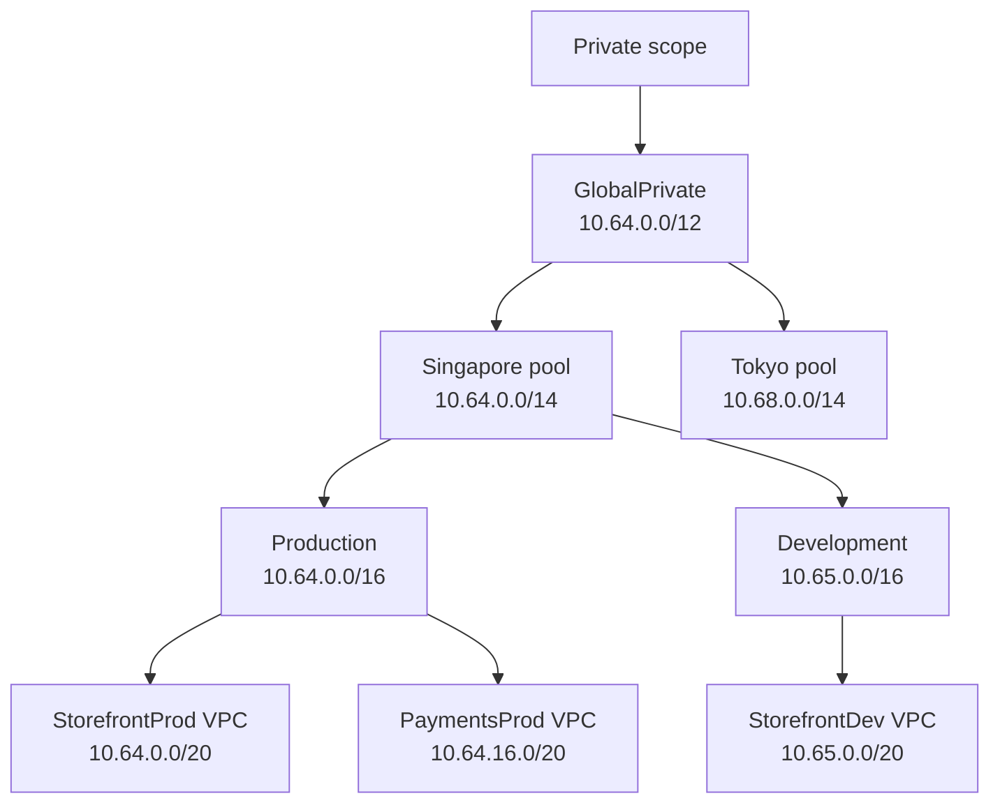

# AWS IPAM and Centralized IP Address Management

## Learning Objectives

After this lesson, you will be able to:

1. Explain why AWS environments spanning multiple VPCs, accounts, Regions, and hybrid links require a centralized CIDR management approach.
2. Describe the components of **Amazon VPC IP Address Manager (IPAM)**: IPAM, home Region, operating Regions, scopes, pools, CIDR provisioning, and allocations.
3. Build an IPv4/IPv6 addressing plan, structure pool hierarchies by Region and environment, and minimize network overlap risks.
4. Distinguish **discovering/monitoring existing CIDRs** from **allocating new CIDRs from a pool**, and explain compliant, noncompliant, unmanaged, and overlapping states.
5. Describe multi-account IPAM governance using **AWS Organizations**, delegated administrator, and pool sharing via **AWS Resource Access Manager (RAM)**.
6. Execute a sample workflow with AWS CLI to create an IPAM, create pools, allocate a network range for a VPC, inspect, and clean up resources in the right order.
7. Evaluate limits, access permissions, availability, monitoring, and costs between IPAM Free Tier and Advanced Tier.

## 1. Why Does IP Address Management Become Difficult as AWS Scales?

Suppose an enterprise starts with a single VPC. An administrator picks CIDR `10.0.0.0/16` and logs it in a spreadsheet. A few months later, multiple teams independently deploy VPCs across two AWS Regions:

| Workload | AWS Region | Team-chosen VPC CIDR |
| --- | --- | --- |
| Storefront Production | Singapore | `10.0.0.0/16` |
| Payments Production | Singapore | `10.1.0.0/16` |
| Analytics Development | Tokyo | `10.0.0.0/16` |
| Data center systems | On-premises | `10.1.128.0/17` |

Each VPC can still operate on its own. However, when the company wants to connect VPCs via **VPC peering**, **AWS Transit Gateway**, or link back to the data center via **Site-to-Site VPN/Direct Connect**, overlapping addresses block routing: the network can no longer unambiguously identify the path to a destination address.

For example, `10.1.128.0/17` lies **inside** `10.1.0.0/16`. If you design interconnected routing without resolving overlapping ranges, determining paths between Payments and the data center creates conflicts. NAT workarounds or separate routing domains can solve individual cases, but add operational complexity.

**Amazon VPC IP Address Manager (IPAM)** is an Amazon VPC capability that lets you **plan, manage, monitor, and track IP address usage history** across your AWS environment. Instead of letting each team pick CIDRs ad hoc, the organization creates **IPAM pools** and allocates CIDRs to VPCs according to defined rules.

IPAM supports two distinct needs:

- **Proactive management:** pre-define ranges used per Region/environment; new VPCs request CIDRs from shared pools.
- **Current-state observability:** discover CIDRs of existing AWS resources, visualize utilization, overlaps, and compliance against pool rules.

IPAM **does not replace** VPCs, route tables, Transit Gateway, VPN, Direct Connect, DNS, firewalls, or IAM. It manages **addressing** metadata and lifecycle; actual paths and access permissions are still governed by networking and security components.

## 2. Quick Review of CIDR and Overlap Challenges

Network addresses are represented using **Classless Inter-Domain Routing (CIDR)**, consisting of a network address and a prefix length. For IPv4, the **smaller** the prefix length, the **larger** the range:

| CIDR | IPv4 addresses in block | Example usage |
| --- | ---: | --- |
| `10.64.0.0/12` | 1,048,576 | Top-level space allocated for a large business unit. |
| `10.64.0.0/14` | 262,144 | Address space reserved for one Region. |
| `10.64.0.0/16` | 65,536 | Pool for production. |
| `10.64.0.0/20` | 4,096 | VPC CIDR allocated from a pool. |
| `10.64.0.0/24` | 256 | A subnet inside a VPC, if planned accordingly. |

These counts represent **total addresses in the CIDR**, not the number of addresses assignable to EC2 instances. For instance, each IPv4 subnet in a VPC reserves several addresses for AWS; VPC CIDR planning must account for subnet splitting, AZs, and growth.

The three **RFC 1918** ranges commonly used for private IPv4 networks are `10.0.0.0/8`, `172.16.0.0/12`, and `192.168.0.0/16`. When designing enterprise-wide addressing, factor in addresses in data centers, branch offices, VPN appliances, partner networks, and other cloud infrastructures that may connect in the future.

### When Do Two CIDRs Overlap?

Example:

- `10.64.0.0/20` covers `10.64.0.0` through `10.64.15.255`.
- `10.64.8.0/21` covers `10.64.8.0` through `10.64.15.255`, which **falls within the /20**, meaning they **overlap**.
- `10.64.16.0/20` covers `10.64.16.0` through `10.64.31.255`, so it **does not overlap** with `10.64.0.0/20`.

Two disconnected VPCs can use the same CIDR; however, if they need to connect later, re-IPing numerous subnets, applications, and security rules is costly. IPAM helps detect and prevent uncoordinated range selection.

**IPv6** is also managed by IPAM via IPv6 CIDRs; do not use IPv4 address-count math for IPv6 planning. IPv6 ranges have their own allocation sources and rules, including Amazon-provided IPv6, BYOIPv6, and private IPv6 GUA where supported.

## 3. Core Components of Amazon VPC IPAM

### 3.1. IPAM Instance, Home Region, and Operating Regions

When creating an IPAM, you choose a **home Region**: where the IPAM is created and centralized management settings are viewed. An IPAM has one or more **operating Regions**: the Regions where IPAM is permitted to discover, monitor, and manage CIDRs according to the active tier/features.

For example, an IPAM is placed in `ap-southeast-1` (Singapore) with operating Regions declared as `ap-southeast-1` and `ap-northeast-1` (Tokyo). IPAM can observe resources in the selected Regions **if accounts, permissions, and tier support it**.

Key takeaways:

- **Home Region** owns the IPAM configuration; it does not have to be the Region hosting every VPC.
- **Operating Regions** define the monitoring/management scope; omitting a Region can keep VPCs in that Region out of the inventory.
- A **regional IPAM pool** has a `locale` attribute specifying the Region where the pool's addresses can be allocated.
- IPAM replicates necessary metadata between operating Regions and the home Region per service mechanics. During deployment, review data policies, permissions, and IPAM configuration.

### 3.2. Scope: Partitioning Address Spaces

A **Scope** is the top-level container of address space within an IPAM. When creating an IPAM, AWS automatically creates a **default private scope** and a **default public scope**.

| Scope type | Typical purpose |
| --- | --- |
| **Private scope** | Manages IP space used for private networks not advertised to the Internet. |
| **Public scope** | Manages address space publicly advertisable from AWS; exceptions apply regarding BYOIPv6 advertisability. |
| **Additional private scope** | Separates independent network domains so the same CIDR can be reused without treating them as one routing space, per supported features/tier. |

For example, a company has two completely isolated systems both using `10.20.0.0/16`. They can be tracked in **different private scopes** if the design calls for it. However, two identical CIDR spaces **do not magically route across each other** just by separating scopes.

> **A Scope is an address management domain—not a VPC, subnet, route table, or automatic security boundary.**

### 3.3. Pool: Hierarchical Allocation

An **IPAM pool** holds one or more CIDRs for allocation. A pool can have **child pools**; a child pool draws a portion of address space from its parent pool. Pools can be structured by Region, environment, application, or connectivity domain.

An **Allocation** is a CIDR block reserved from a pool for use by **a resource**, **a child pool**, or an appropriate manual **reservation**.

**Provision** is the action of **adding a CIDR into a pool** so the pool has space to allocate from. **Allocate** is the action of **taking a portion of a CIDR from a pool** and assigning it to a resource or reservation. These two verbs are not synonymous.

| Term | Question answered | Example |
| --- | --- | --- |
| `Provision pool CIDR` | Which ranges is this pool authorized to manage? | Provision `10.64.0.0/14` into the Singapore pool. |
| `Allocate CIDR` | Which resource/child pool holds a slice of that range? | VPC `StorefrontProd` receives `10.64.0.0/20`. |
| `Release allocation` | Does a manually reserved range still need to be held? | Release an unused reservation. |
| `Deprovision pool CIDR` | Can a range be removed from the pool? | Withdraw `10.65.0.0/16` from the pool after deleting dependent allocations. |

You cannot deprovision a CIDR containing active allocations. Lifecycle cleanup must handle dependencies first before returning space to the parent.

### 3.4. Resource Discovery and History

**Resource discovery** allows IPAM to find and track resources and their addresses within authorized scope. AWS creates a default resource discovery when creating an IPAM. Additional shared resource discoveries can be integrated for multi-organization or external-account governance scenarios.

IPAM capabilities include:

- Viewing CIDRs currently used by VPCs and supported resource types.
- Showing overlapping addresses, used ranges, and available ranges within a scope.
- Searching address or CIDR usage history over time.
- Analyzing whether resources comply with pool **allocation rules**.

**Discovering an existing VPC does not mean IPAM allocated its CIDR.** A VPC with a manually assigned CIDR still appears in inventory as `Unmanaged`. Only when pools and appropriate import/management mechanisms are configured is the resource treated as a managed allocation under the corresponding rules.

## 4. Designing a Pool Tree for a Multi-Region Company

Suppose a company decides to reserve `10.64.0.0/12` for AWS workloads after confirming it does not collide with on-premises links, existing VPCs, or partner networks. An appropriate IPAM tree:

```text
IPAM (home Region: ap-southeast-1)
└── Default private scope
    └── GlobalPrivate pool: 10.64.0.0/12
        ├── Singapore pool (locale ap-southeast-1): 10.64.0.0/14
        │   ├── Production pool: 10.64.0.0/16
        │   │   ├── VPC StorefrontProd: 10.64.0.0/20
        │   │   └── VPC PaymentsProd:  10.64.16.0/20
        │   └── Development pool: 10.65.0.0/16
        │       └── VPC StorefrontDev: 10.65.0.0/20
        ├── Tokyo pool (locale ap-northeast-1): 10.68.0.0/14
        │   ├── Production pool: 10.68.0.0/16
        │   └── Development pool: 10.69.0.0/16
        └── Reserved for later: 10.72.0.0/13
```

In this example:

- `10.64.0.0/12` spans `10.64.0.0` to `10.79.255.255`.
- Singapore uses `10.64.0.0/14`; Tokyo uses `10.68.0.0/14`. The two ranges **do not overlap**.
- VPCs `10.64.0.0/20` and `10.64.16.0/20` do not overlap.
- `10.72.0.0/13` is a **proposed address budget set aside for future use**, not automatically a reservation in IPAM. Only creating a pool/manual allocation records such state.



**Why choose a Region → environment hierarchy?** Region is a key operational boundary for VPCs; production and dev environments have different lifecycles and approval requirements. However, if an enterprise primarily connects by **routing/security domain** or business unit, a more fitting pool structure can be chosen. The goal is a tree that is easy to understand, simple to allocate from, leaves room for growth, and avoids unintended CIDR duplication.

### Estimating a Pool's Capacity

A `/16` pool holds **16 `/20` blocks** when divided evenly, because `2^(20-16) = 16`. This is theoretical capacity by CIDR size, before subtracting ranges provisioned to child pools, reserved, or already occupied.

Before choosing `/20` for a VPC, forecast the number of subnets per AZ, needs for separating public/private/database tiers, AWS-reserved addresses per subnet, and growth of nodes, pods, ENIs, and VPC-connected serverless resources. Do not size a VPC solely based on current EC2 instance counts.

## 5. Allocation Rules and Compliance Enforcement

On each pool, IPAM supports configuring **allocation rules** to standardize allocations:

- **Minimum netmask length:** smallest acceptable prefix length, meaning the **largest** CIDR size.
- **Maximum netmask length:** largest acceptable prefix length, meaning the **smallest** CIDR size.
- **Default netmask length:** default size when requesting an allocation without specifying one.
- **Allocation resource tags:** mandatory tags on resources managed from the pool, such as `Environment=Production`.
- **Locale:** the Region where the pool allocates addresses for resources.
- **Auto-import:** imports discovered CIDRs falling within the pool's range when supported conditions are met.

For example, pool `Production-SG` can require prefixes from `/18` to `/22`, default `/20`, and tag `Environment=Production`. A VPC allocated `/20` that maintains the required tag is evaluated as **compliant** if other conditions are valid. If the tag changes or the CIDR no longer satisfies the rules, IPAM may mark it **noncompliant**.

**Two important notes:**

1. Allocation rules on a pool apply to **managed resources in that pool**. Do not assume every parent pool rule automatically propagates to every VPC in grandchild pools; verify settings on the exact allocating pool.
2. Auto-import and discovery involve propagation delays and conditions; they are not an instant synchronous blocker against every manual CIDR created outside a pool. Standardize VPC creation pipelines to use IPAM and restrict `ec2:CreateVpc`/`ec2:AssociateVpcCidrBlock` permissions where appropriate.

### IPAM Inspection States

| State | Practical meaning | Remediation approach |
| --- | --- | --- |
| **Compliant** | Resource is managed and satisfies allocation rules. | Continue monitoring changes and utilization. |
| **Noncompliant** | Resource is managed but violates one or more rules: netmask, tags, locale... | Identify the violated rule; adjust resource, tags, or pool design per workflow. |
| **Unmanaged** | CIDR is tracked but is not a managed allocation from a pool. | Plan onboarding into IPAM or document an exception. |
| **Overlapping** | CIDR partially/fully overlaps another resource or allocation in the **same scope**. | Review topology and routing domains; separate risky overlaps from intentionally isolated networks. |
| **Ignored** | Resource is excluded from evaluation via ignore mechanisms. | Use only with clear justification; avoid masking address management issues. |

**IPAM compliance evaluation does not alter route tables.** A `Compliant` VPC can still lose connectivity due to misconfigured routes, Security Groups, NACLs, DNS, TGW, VPN, or service endpoints. Likewise, IPAM reporting an overlap is a signal to analyze architecture, not proof that all active connections are broken.

## 6. AWS Organizations Integration: Multi-Account IPAM Governance

Enterprises with many AWS accounts commonly adopt:

```text
AWS Organizations
├── Management account
│   └── Designates IPAM delegated administrator
├── NetworkServices account (delegated IPAM administrator)
│   ├── IPAM / scopes / pools
│   ├── Monitors CIDRs across the Organization
│   └── Shares pools via AWS RAM
├── StorefrontProd account
│   └── Creates VPCs from shared pools
├── PaymentsProd account
│   └── Creates VPCs from shared pools
└── AnalyticsDev account
    └── Creates VPCs from shared pools
```

A **Delegated administrator** is a **member account** designated by the management account to administer IPAM functionality. When properly integrated with Organizations, IPAM can observe resource CIDRs across member accounts in selected operating Regions regardless of OU placement. This mechanism uses IPAM's **service-linked IAM role** in member accounts via service integration.

### Role Separation Workflow

1. **Management account:** enables IPAM integration with AWS Organizations and designates a member account (e.g., `NetworkServices`) as the IPAM administrator.
2. **NetworkServices:** creates the IPAM in the home Region, selects operating Regions, scopes/pools, and allocation rules; monitors address inventory.
3. **NetworkServices:** shares appropriate pools with accounts/OUs via **AWS RAM**; shares only the pools each application team needs.
4. **Member account:** uses granted IAM permissions to create VPCs from shared pools instead of entering manual CIDRs.
5. **Operations team:** reviews overlaps, compliance, quotas, growth, and lifecycle of allocated ranges.

**Crucial detail when enabling IPAM integration:** AWS requires using the **IPAM console** or the `ec2:EnableIpamOrganizationAdminAccount` API. Merely enabling trusted access from the AWS Organizations console or calling `organizations:RegisterDelegatedAdministrator` alone may fail to create the `AWSServiceRoleForIPAM` role properly, preventing multi-account discovery and management from working as expected.

In member accounts, the service-linked role serves the **AWS IPAM service**; it does not grant users in `NetworkServices` automatic administrative access to all EC2, VPC, or IAM resources in every account. Operator actions still require appropriate IAM permissions, subject to SCPs and organizational security processes.

### Why Is AWS RAM Still Needed?

IPAM **seeing** member account CIDRs does not mean all accounts **can allocate CIDRs from every pool**. To allow another account to use a pool for VPC creation, the IPAM administrator must share the pool via **AWS Resource Access Manager** and authorize the target principals.

Items to verify:

- IPAM is integrated with AWS Organizations.
- AWS RAM has resource sharing within Organizations enabled.
- The pool's resource share is created in the **IPAM home Region**, even if the pool's locale is another Region.
- IAM principals have permission to use the pool; target accounts/OUs are principals of the share.
- Pool rules for netmask, tags, and locale permit the requested allocation.

An IPAM pool share is **sharing permission to use CIDR ranges**. It **does not** connect two VPCs, merge accounts, or pre-create Transit Gateway routes.

### What If There Are Accounts Outside the Same Organization?

IPAM can integrate **shared resource discoveries** with external accounts outside the Organization using separate procedures. Carefully govern the scope of shared data, account owner permissions, and monitoring regions; do not assume external accounts are automatically discovered and authorized like member accounts.

## 7. Free Tier, Advanced Tier, and Costs

IPAM offers a **Free Tier** and an **Advanced Tier** with different feature scopes.

| Criterion | Free Tier | Advanced Tier |
| --- | --- | --- |
| Goal | Get started with capabilities AWS provides at no charge. | Comprehensive address governance in large multi-Region/multi-account environments as needed. |
| Multi-Region | Multiple operating Regions can be selected, but **Public IP insights** is the feature operating across Regions in Free Tier; other features are limited to the home Region. | Supports IPAM features across operating Regions per service terms. |
| Scopes/pools, multi-account sharing, and advanced features | Limited depending on feature; check current support matrix. | Suited for private pool models, scope partitioning, and sharing requiring advanced capabilities. |
| Pricing | Within published free tier scope/features. | Billed by **active IP addresses managed by IPAM × hours**, per current unit rate/tier. |

For Advanced Tier, do not estimate cost by **multiplying total addresses in the entire CIDR pool by the unit rate**. AWS bills by **active IP address-hours** per IPAM's billing definition. Use the AWS Pricing Calculator, the Amazon VPC/IPAM pricing page, and actual usage metrics to estimate.

To track IPAM costs, use **AWS Cost Explorer** filtered by usage types related to `IPAddressManager`; you can break down by Region, account, and time range. If using cost allocation by resource-owning account, check supported **metering mode** settings.

**Do not assume Free Tier suffices for an IPAM managing all private CIDRs across multiple Regions.** For the Organizations + Singapore + Tokyo scenario, verify feature coverage in the pricing documentation and typically evaluate Advanced Tier.

## 8. AWS CLI Lab: Creating IPAM and Allocating a CIDR for a VPC

This example focuses on **creating resources in a single test IPAM account**; if your organization already has a delegated administrator, use that account's profile. All IDs and profile names below are **hypothetical**. Actual commands create real resources and can incur charges, especially when selecting Advanced Tier.

**Assumptions:**

- Home Region: `ap-southeast-1`.
- Operating Regions: Singapore and Tokyo.
- Overall private IPv4: `10.64.0.0/12`, verified not to overlap with corporate networks.
- Singapore pool: `10.64.0.0/14`.
- Singapore Development pool: `10.65.0.0/16`.
- Development VPC will request a `/20` CIDR from the pool.

For readability in the examples:

- `--profile ipam-admin` represents an IAM role authorized to manage IPAM.
- `--profile org-management` is a role in the Organizations management account, used only in the delegated step.
- Commands use multiline Bash syntax; in PowerShell, adjust line continuations or run on a single line.

### 8.1. Verify Identity and Enable Delegated IPAM Admin (Organizations Only)

```bash
aws sts get-caller-identity --profile org-management

# Run from the management account, designating a MEMBER account as IPAM admin
aws ec2 enable-ipam-organization-admin-account \
  --delegated-admin-account-id 222233334444 \
  --region ap-southeast-1 \
  --profile org-management
```

Account `222233334444` must be a **member account**, not the management account. Skip this step if an IPAM delegated administrator is already configured. If practicing IPAM in a single account only, skip the delegated admin step and use your authorized account in all remaining steps.

Verify identity after switching profiles:

```bash
aws sts get-caller-identity --profile ipam-admin
```

### 8.2. Create the IPAM

```bash
aws ec2 create-ipam \
  --description "ExampleCommerce central IPAM" \
  --tier advanced \
  --operating-regions RegionName=ap-southeast-1 RegionName=ap-northeast-1 \
  --region ap-southeast-1 \
  --profile ipam-admin
```

Record the returned `IpamId`, e.g., `ipam-0123456789abcdef0`. Creation may not finish immediately. Inspect the IPAM and find the default private scope:

```bash
aws ec2 describe-ipams \
  --ipam-ids ipam-0123456789abcdef0 \
  --region ap-southeast-1 \
  --profile ipam-admin
```

From `Ipams`, retrieve `PrivateDefaultScopeId`, e.g., `ipam-scope-01111111111111111`. Replace example IDs with your actual IDs in all subsequent commands.

### 8.3. Create the Top-Level Pool and Provision a CIDR

```bash
aws ec2 create-ipam-pool \
  --ipam-scope-id ipam-scope-01111111111111111 \
  --address-family ipv4 \
  --description "Global private IPv4 address space" \
  --region ap-southeast-1 \
  --profile ipam-admin
```

Record the `IpamPoolId`, e.g., `ipam-pool-02222222222222222`. Wait for the pool to reach `create-complete`:

```bash
aws ec2 describe-ipam-pools \
  --ipam-pool-ids ipam-pool-02222222222222222 \
  --query 'IpamPools[0].State' \
  --region ap-southeast-1 \
  --profile ipam-admin
```

Provision the IPv4 space:

```bash
aws ec2 provision-ipam-pool-cidr \
  --ipam-pool-id ipam-pool-02222222222222222 \
  --cidr 10.64.0.0/12 \
  --region ap-southeast-1 \
  --profile ipam-admin
```

Verify CIDR `10.64.0.0/12` reaches state `provisioned`:

```bash
aws ec2 get-ipam-pool-cidrs \
  --ipam-pool-id ipam-pool-02222222222222222 \
  --region ap-southeast-1 \
  --profile ipam-admin
```

### 8.4. Create the Regional Pool and Development Pool

The Singapore pool draws a slice from the top-level pool:

```bash
aws ec2 create-ipam-pool \
  --ipam-scope-id ipam-scope-01111111111111111 \
  --source-ipam-pool-id ipam-pool-02222222222222222 \
  --locale ap-southeast-1 \
  --address-family ipv4 \
  --description "Singapore IPv4 pool" \
  --region ap-southeast-1 \
  --profile ipam-admin
```

Suppose the new pool is `ipam-pool-03333333333333333`. Wait for `create-complete`, then:

```bash
aws ec2 provision-ipam-pool-cidr \
  --ipam-pool-id ipam-pool-03333333333333333 \
  --cidr 10.64.0.0/14 \
  --region ap-southeast-1 \
  --profile ipam-admin
```

Wait for state `provisioned` before creating the child pool, then create the Development pool:

```bash
aws ec2 create-ipam-pool \
  --ipam-scope-id ipam-scope-01111111111111111 \
  --source-ipam-pool-id ipam-pool-03333333333333333 \
  --locale ap-southeast-1 \
  --address-family ipv4 \
  --description "Singapore development IPv4 pool" \
  --region ap-southeast-1 \
  --profile ipam-admin
```

Suppose the Development pool ID is `ipam-pool-04444444444444444`. After creation completes, provision `10.65.0.0/16`:

```bash
aws ec2 provision-ipam-pool-cidr \
  --ipam-pool-id ipam-pool-04444444444444444 \
  --cidr 10.65.0.0/16 \
  --region ap-southeast-1 \
  --profile ipam-admin

aws ec2 get-ipam-pool-cidrs \
  --ipam-pool-id ipam-pool-04444444444444444 \
  --region ap-southeast-1 \
  --profile ipam-admin
```

Thus, the address range flows from **top-level pool → Singapore pool → Development pool**. Each provision into a child pool carves out a portion from the parent pool according to IPAM state.

### 8.5. Create a VPC Using an IPAM-Allocated CIDR

Once the Development pool is ready, create the VPC in Singapore:

```bash
aws ec2 create-vpc \
  --ipv4-ipam-pool-id ipam-pool-04444444444444444 \
  --ipv4-netmask-length 20 \
  --tag-specifications 'ResourceType=vpc,Tags=[{Key=Name,Value=StorefrontDev},{Key=Environment,Value=Development}]' \
  --region ap-southeast-1 \
  --profile ipam-admin
```

The output returns `VpcId` and `CidrBlock`; the actual CIDR is **an available `/20` from the pool**. It may be `10.65.0.0/20`, though you should never hardcode expectations of which block AWS picks when a pool already holds other allocations.

View allocations:

```bash
aws ec2 get-ipam-pool-allocations \
  --ipam-pool-id ipam-pool-04444444444444444 \
  --region ap-southeast-1 \
  --profile ipam-admin
```

Expected output shows an allocation with `ResourceType=vpc`, `ResourceId` matching the new VPC, and `Cidr` equal to the `/20` block AWS assigned.

**Note on creating VPCs from shared pools:** if an IPAM pool is shared via RAM, the member account runs the VPC creation command using the **member account's** profile and must have permission to use the pool; `--region` must match `locale`. The scenario above uses one profile solely to illustrate the creation/allocation mechanics.

### 8.6. Manual Reservations and Cleanup

To **reserve** a CIDR in advance for a system whose VPC is not yet deployed, IPAM supports creating a **manual allocation** (distinct from automatic VPC allocation):

```bash
# Reserve a /20 block from the Development pool in advance
aws ec2 allocate-ipam-pool-cidr \
  --ipam-pool-id ipam-pool-04444444444444444 \
  --netmask-length 20 \
  --region ap-southeast-1 \
  --profile ipam-admin
```

This returns an `IpamPoolAllocationId` and the reserved CIDR. Record the ID to release it when the reservation is no longer needed; **do not** assume a reservation automatically creates a VPC.

When finishing the exercise, delete resources in dependency order:

1. Delete resources inside the test VPC and delete the VPC; IPAM updates the resource allocation per service lifecycle.
2. Release unused **manual allocations** via the corresponding API after verifying the exact allocation ID.
3. Only after zero dependent allocations remain, **deprovision** the CIDR from the Development pool and then delete the Development pool.
4. Continue deprovisioning/deleting the Singapore pool, then the top-level pool.
5. Finally, delete the test IPAM if no other resource discoveries or dependent components remain.

Example cleanup commands **once you have confirmed** the exact resources and zero remaining dependencies:

```bash
# Example after the VPC has been deleted and no child allocations remain
aws ec2 deprovision-ipam-pool-cidr \
  --ipam-pool-id ipam-pool-04444444444444444 \
  --cidr 10.65.0.0/16 \
  --region ap-southeast-1 \
  --profile ipam-admin

aws ec2 delete-ipam-pool \
  --ipam-pool-id ipam-pool-04444444444444444 \
  --region ap-southeast-1 \
  --profile ipam-admin
```

Never run cleanup commands just because an ID looks like the example. If working in a shared corporate IPAM, never delete pools/roots/IPAMs to "clean up a lab"; work in an isolated test environment and verify ownership.

## 9. Sharing Pools with Member Accounts via AWS RAM

Once IPAM is integrated with Organizations and pools are provisioned for `Production`/`Development`, the delegated administrator can share pools with appropriate OUs or accounts:

1. Open AWS VPC IPAM in the **home Region** and select the pool with appropriate CIDRs and rules.
2. Choose **Create resource share** to open AWS RAM.
3. Select resource type `IPAM pools` and target principals, such as the OU containing Development workloads.
4. Use an appropriate RAM permission, typically `AWSRAMDefaultPermissionsIpamPool` for viewing/allocating/releasing within supported scope.
5. Ensure AWS RAM **sharing within Organizations** is enabled and member IAM principals have permissions to create VPCs/receive CIDRs.
6. From a member account, create a VPC selecting **IPAM-allocated IPv4 CIDR** and the shared pool.

With shared pools, resource owners continue managing VPCs, subnets, routes, and security groups inside their accounts. The IPAM administrator governs the address supply and monitors utilization; this is a **separation of duties** to maintain in multi-account architectures.

**Do not share root/top-level pools with every member account** when each team only needs a slice of addresses. Share leaf pools already bound to a specific Region, environment, and allocation rules.

## 10. Monitoring CIDRs, Utilization, and History

IPAM can be used for ongoing operations:

### 10.1. Detecting Overlaps

Suppose a new VPC has `10.64.8.0/21` in a scope containing VPC `10.64.0.0/20`. As analyzed earlier, these two ranges overlap. IPAM lets you locate the associated resource, account, Region, and CIDR so the networking team can resolve it per procedure.

**Do not immediately re-IP a production VPC upon seeing an alert.** First determine whether the two VPCs actually need mutual routing, the degree of dependency, and whether suitable connectivity workarounds exist. If re-IPing is required, build a migration plan covering subnets, ENIs, DNS, routes, firewalls, and applications.

### 10.2. Searching Addresses and Allocation History

The IPAM console includes features such as **Search IP history** and viewing **Resources** by scope/pool. You can find when a CIDR was used, the corresponding resource/account, and changes within supported feature scope.

Via CLI:

```bash
# List CIDRs of resources managed/monitored by IPAM in a scope
aws ec2 get-ipam-resource-cidrs \
  --ipam-scope-id ipam-scope-01111111111111111 \
  --region ap-southeast-1 \
  --profile ipam-admin

# View allocations from a specific pool
aws ec2 get-ipam-pool-allocations \
  --ipam-pool-id ipam-pool-04444444444444444 \
  --region ap-southeast-1 \
  --profile ipam-admin
```

These outputs differ because **resource discovery** and **pool allocations** are not the exact same list. Run commands in the right Region and verify profile permissions.

### 10.3. Operational Metrics to Track

| Observed metric | Decision supported |
| --- | --- |
| Available CIDRs by pool and Region | When to provision more pool CIDRs or expand space reserved for a Region. |
| Actual allocation count and CIDR sizes | Whether a pool is becoming fragmented or over-allocating overly wide blocks. |
| `Unmanaged` resources | Which resources bypassed the centralized allocation workflow. |
| `Overlapping` CIDRs in the same scope | Areas to inspect before configuring TGW, VPN, Direct Connect, or peering. |
| `Noncompliant` resources | Which tags, CIDR sizes, or locales violate policy. |
| Operating Regions and monitored accounts | Whether any new Region/account lacks IPAM coverage. |
| Active IP address-hours | Actual Advanced Tier cost and growth trend. |

IPAM data complements **AWS Config**, **CloudTrail**, AWS Organizations, and infrastructure governance dashboards. IPAM does not replace network flow logs from **VPC Flow Logs** or latency/bandwidth telemetry.

## 11. Access Permissions, Security, and Change Governance

### 11.1. Establishing Appropriate Permission Boundaries

A role-separation model:

| Role | Required actions | Necessary restrictions |
| --- | --- | --- |
| **Network Architect** | Proposes address segmentation, pools, Regions, security domains. | Does not directly alter production without change control. |
| **IPAM Administrator** | Manages scopes/pools, allocation rules, RAM shares, resource inventory. | Operates only from the delegated member account; task-scoped IAM. |
| **Application Platform Engineer** | Creates VPCs from shared pools; manages application subnets/resources. | Cannot modify global pools or manage VPCs in other accounts. |
| **Security/Auditor** | Reviews compliance, changes, and usage history. | Uses read-only permissions where appropriate. |

Protect address allocation/release actions and RAM share modifications using IAM, SCPs, and approval workflows. A mistake modifying a pool or releasing an active CIDR can disrupt VPC expansion plans, not just reporting metrics.

### 11.2. Choosing Scopes Responsibly

If creating **two private scopes** containing the same CIDR, the networking team must ensure they represent **truly isolated** domains. If you ever decide to connect the two domains later, the overlap problem will still surface at the routing layer. Misusing multiple scopes can mask enterprise-wide overlap checks.

### 11.3. Synchronizing with Non-AWS Infrastructure

When an enterprise operates data centers or other clouds, maintain a **cross-cloud CIDR registry**: used ranges, reserved ranges, owners, purpose, routing domain, and connection status. IPAM can manually record/allocate planned ranges, but do not assume IPAM automatically discovers external routers/appliances or configures BGP for Direct Connect.

To apply network changes across multiple accounts, combine **Infrastructure as Code** (such as CloudFormation or Terraform) with IPAM pools and CIDR review gates. IPAM governs the allocated address space; IaC tools provision VPC/route/TGW resources per design.

## 12. Common Troubleshooting

| Symptom | Possible cause | How to check |
| --- | --- | --- |
| Account's VPC missing in IPAM | IPAM not integrated with Organizations, missing role, resource discovery gap, or Region not an operating Region. | Inspect Organization settings, delegated admin, operating Regions, resource discovery, and resource state. |
| Cannot allocate CIDR for VPC | Pool exhausted, invalid prefix, locale mismatch with Region, missing RAM share/IAM, or pool not `provisioned`. | Inspect pool hierarchy, CIDRs, rules, `State`, and VPC-creating account permissions. |
| Child pool `create-complete` yet `create-vpc` fails | CIDR not provisioned into child pool or missing valid allocation source. | Run `get-ipam-pool-cidrs` and `get-ipam-pool-allocations`. |
| VPC marked `Noncompliant` | Tags changed, netmask violates rule, or resource locale mismatch. | Resource → Compliance status → allocation rules on the exact pool. |
| IPAM sees legacy VPC with no allocation | Resource is `Unmanaged`, only tracked via discovery. | Check whether VPC was created via IPAM pool or meets auto-import rules. |
| `AccessDenied` creating VPC from shared pool | RAM share missing target principal, AWS RAM org sharing disabled, or IAM/SCP blocking. | Check share in home Region and member account profile permissions. |
| Overlap reported yet systems still run | VPCs are not interconnected, or overlap sits in isolated domains. | Inspect topology, routes, TGW attachments, peering, and future connectivity plans. |
| Cannot delete pool/IPAM | Remaining allocations, provisioned CIDRs, child pools, or resource dependencies. | Delete in order: VPC/reservations → child pools → parent pools → IPAM. |
| Advanced Tier cost rising fast | Many managed active IPs or newly added accounts/Regions outside budget. | Cost Explorer `IPAddressManager`; check metering mode and resource discovery scope. |

**Troubleshooting principle:** never fix allocation errors by stripping away all allocation rules or granting everyone Administrator rights. Pinpoint the exact failing layer: **account/Region → scope → pool → provision → allocation → IAM/RAM → resource**.

## 13. Design Case Study

**Context:** A company operates 40 VPCs across 15 AWS accounts in Singapore and Tokyo. Several VPCs share overlapping `10.0.0.0/16` ranges; the data center uses `10.100.0.0/16`. The company plans to deploy Transit Gateway to connect critical VPCs and Site-to-Site VPN back to the data center.

Requirements for the new architecture:

1. Allocate no further overlapping ranges for VPCs that will be interconnected.
2. Production/dev accounts receive CIDRs automatically when creating VPCs.
3. The Network team manages pools; application teams only manage their own VPCs.
4. Reporting exists for used CIDRs, free space, overlaps, noncompliant resources, and costs.
5. Ability to onboard additional Regions in the future.

### One Proposed Solution

**Current-state assessment:** inventory CIDRs across VPCs, subnets, on-premises, and links; identify ranges that must stay fixed versus ranges to migrate. Do not treat overlapping CIDRs as broken if those networks will never connect, but log the future risk.

**Select target addressing:** after checking the full inventory, reserve a dedicated block such as `10.64.0.0/12` for new AWS VPCs, avoiding `10.100.0.0/16` used in the data center. Subdivide by Region and environment as shown in Section 4.

**Centralized governance:** the management account designates `NetworkServices` as delegated IPAM administrator; that account creates the IPAM, selects Singapore/Tokyo as operating Regions, and shares leaf pools via AWS RAM to the right accounts/OUs. VPC provisioning workflows require selecting a shared pool and valid CIDR size.

**Resolving legacy overlaps:** IPAM discovery builds inventory and flags alerts, but **does not automatically renumber active CIDRs**. Plan per-VPC migrations checking routes/TGW/DNS/security groups and rollback plans. Only interconnect networks after confirming routing paths are designed cleanly.

**Monitoring outcomes:** review `Unmanaged`, `Overlapping`, `Noncompliant`, remaining pool space, and IPAM usage costs monthly. When adding a new Region, register the operating Region, add pools with the right locale, share with members, and test provisioning.

### Self-Check

- Explain why an **Unmanaged** CIDR still appears inside IPAM.
- Explain why IPAM cannot replace Transit Gateway route tables.
- Calculate the maximum `/20` blocks obtainable from a `/16` pool with no prior allocations.
- Describe the difference between an account having **permission to view CIDRs** versus **permission to allocate CIDRs**.
- Propose a way to detect a new VPC created with a manual CIDR outside organizational pools.

## 14. Common Mistakes

**Mistake 1: "IPAM creates network connectivity between VPCs."**  
Incorrect. IPAM manages addresses; interconnection still requires designing TGW, peering, VPN, Direct Connect, routes, DNS, and security policies.

**Mistake 2: "Creating an IPAM automatically assigns clean CIDRs to all existing VPCs."**  
Incorrect. IPAM can discover existing VPCs, but automatic allocation occurs when VPCs are created from pools or managed via supported workflows.

**Mistake 3: "Provisioning a CIDR into a pool creates a VPC."**  
Incorrect. Provisioning adds address space to a pool; allocating assigns addresses to a resource or reservation. Creating a VPC is a separate operation.

**Mistake 4: "Enabling a delegated IPAM admin lets every account use every pool."**  
Incorrect. AWS RAM shares, IAM permissions, and matching allocation rules are still required.

**Mistake 5: "Multiple operating Regions means all Free Tier features work cross-Region."**  
Incorrect. Free Tier has limits; Public IP insights works across operating Regions, whereas many other features operate only in the home Region.

**Mistake 6: "If IPAM reports no overlaps, systems can route to one another."**  
Incorrect. Discovery scope may exclude certain Regions/accounts or external networks; even non-overlapping CIDRs may fail to connect due to routes, firewalls, VPNs, or DNS.

**Mistake 7: "Two different private scopes using the same CIDR can connect directly."**  
Incorrect. Scopes are management domains; connecting two networks with identical addresses still triggers routing conflicts.

**Mistake 8: "IPAM Advanced Tier costs equal the total theoretical addresses in a pool."**  
Incorrect. AWS bills based on managed active IP address-hours per current pricing definitions and unit rates.

## 15. Self-Check Questions

**Question 1.** How does IPAM differ from a route table?  
**Answer:** IPAM manages/monitors addresses and CIDRs; route tables decide the next hop for packets. A VPC with an IPAM-allocated CIDR still requires routes and proper network connectivity.

**Question 2.** You have a parent pool `10.64.0.0/14` and want to dedicate `10.65.0.0/16` for Development. What operation is this?  
**Answer:** Create a child pool and **provision** `10.65.0.0/16` into the child pool; from there, smaller CIDRs can be **allocated** to Development VPCs.

**Question 3.** Why does `10.64.8.0/21` overlap `10.64.0.0/20`?  
**Answer:** Because the `/21` falls within the address range already covered by the `/20` (`10.64.0.0` to `10.64.15.255`).

**Question 4.** An existing VPC is discovered by IPAM but was not created from a pool—what state may it show?  
**Answer:** `Unmanaged`, though its CIDR can still be tracked to detect overlaps.

**Question 5.** Is designating an IPAM delegated administrator via the Organizations `RegisterDelegatedAdministrator` API enough?  
**Answer:** Not according to AWS's documented IPAM integration workflow. You must use the IPAM console or `ec2:EnableIpamOrganizationAdminAccount` so the service-linked role is configured properly.

**Question 6.** Why must sharing an IPAM pool via AWS RAM be performed in the home Region?  
**Answer:** Because IPAM pool resource sharing in AWS RAM is managed in the IPAM's home Region, even if the pool's locale is a different Region.

**Question 7.** If a `/16` pool is divided evenly into `/20` VPCs, what is the maximum number of blocks?  
**Answer:** `2^(20 - 16) = 16` `/20` blocks, before accounting for other allocations/reservations.

**Question 8.** A company has two isolated VPCs with identical CIDRs. Will IPAM resolve the conflict automatically when connecting them via TGW?  
**Answer:** No. You must plan new CIDR ranges, migrate, or use an appropriate networking solution; IPAM only helps detect and track it.

## Official AWS Documentation

- [Amazon VPC IPAM — What is IPAM?](https://docs.aws.amazon.com/vpc/latest/ipam/what-it-is-ipam.html)
- [How IPAM works: scopes, pools and allocations](https://docs.aws.amazon.com/vpc/latest/ipam/how-it-works-ipam.html)
- [Create an IPAM and configure operating Regions](https://docs.aws.amazon.com/vpc/latest/ipam/create-ipam.html)
- [Integrate IPAM with AWS Organizations](https://docs.aws.amazon.com/vpc/latest/ipam/enable-integ-ipam.html)
- [Share an IPAM pool using AWS RAM](https://docs.aws.amazon.com/vpc/latest/ipam/share-pool-ipam.html)
- [Create a top-level IPv4 pool and allocation rules](https://docs.aws.amazon.com/vpc/latest/ipam/create-top-ipam.html)
- [Allocate CIDRs from an IPAM pool](https://docs.aws.amazon.com/vpc/latest/ipam/allocate-cidrs-ipam.html)
- [Monitor CIDR usage and compliance](https://docs.aws.amazon.com/vpc/latest/ipam/monitor-cidr-compliance-ipam.html)
- [Get started with IPAM using AWS CLI](https://docs.aws.amazon.com/vpc/latest/ipam/getting-started-with-ipam-using-the-aws-cli.html)
- [IPAM pricing and Cost Explorer](https://docs.aws.amazon.com/vpc/latest/ipam/pricing-ipam.html)
- [AWS CLI — enable-ipam-organization-admin-account](https://docs.aws.amazon.com/cli/latest/reference/ec2/enable-ipam-organization-admin-account.html)

**Remember:** AWS IPAM manages **who uses which CIDR**, **which CIDRs are free**, and **which ranges are permitted for new VPCs**. Combining **scopes → pools → allocations**, operating Regions, Organizations delegated administrator, and AWS RAM delivers consistent address planning across accounts/Regions. IPAM lays the foundation for secure, scalable, and cost-controlled AWS networking, while actual routing, security, and connectivity must still be engineered separately.
