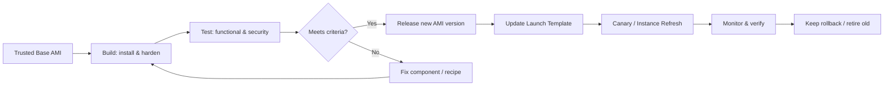
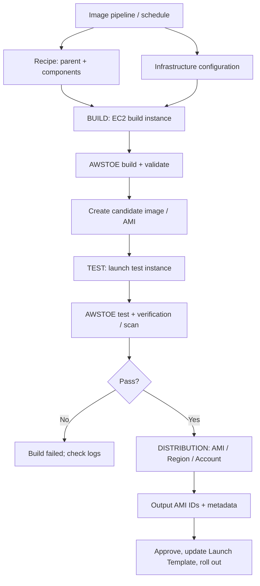
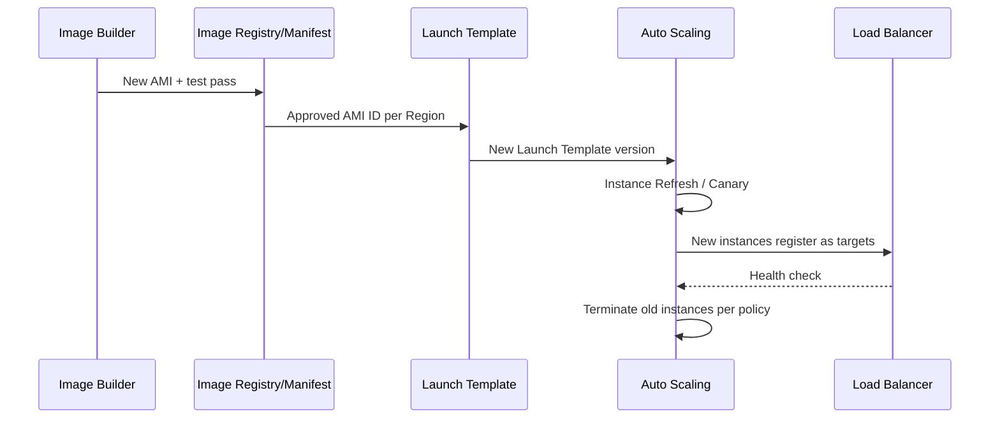

# AMI, EC2 Image Builder, and Image Management on AWS

> **Chapter:** EC2 Instances  
> **Module:** `CLOUD_PROVIDERS_AWS`  
> **Scope:** Building, selecting, testing, distributing, and managing the lifecycle of Amazon Machine Images (AMIs) for EC2 instances, aiming for consistent, secure, observable, resilient, and cost-controlled deployments.

## Learning Objectives

After this lesson, learners will be able to:

1. Explain what an AMI is, what gets written into an AMI, and distinguish **AMI**, **EC2 instance**, **EBS snapshot**, **Launch Template**, and **User Data**.
2. Select an appropriate AMI based on Region, CPU architecture, operating system, publisher source, access permissions, security requirements, and operational support.
3. Manually create an AMI from an EBS-backed EC2 instance, identifying data consistency risks and sharing permissions.
4. Design an **EC2 Image Builder** pipeline including image recipe, components, infrastructure configuration, distribution configuration, and build/test/distribution workflows.
5. Organize **golden images**, release versions, replace instances with new images, and prepare rollback plans.
6. Manage the image lifecycle: vulnerability scanning, build monitoring, deprecating, disabling, deregistering, cleaning up snapshots, and optimizing costs.

## 1. What Is an AMI and What Role Does It Play?

An **Amazon Machine Image (AMI)** is the software configuration template that Amazon EC2 uses to launch an **instance**. When creating a new EC2 instance, you must select a suitable AMI. The AMI defines the operating system, software, and configuration baked into the image; an instance launched from the AMI then has its own lifecycle, state, and data.

For example, a Java application team might create a standard AMI containing:

- An updated Amazon Linux 2023 operating system.
- Amazon Corretto 21 and approved system libraries.
- Appropriate monitoring or logging agents.
- Baseline security settings, system accounts, and server configuration.
- Startup checks and application compatibility validations.

When scaling an Auto Scaling group, new EC2 instances launched from this AMI start from an identical foundation. This reduces configuration drift across machines and shortens part of the startup setup work.

### 1.1 How AMIs, Snapshots, Instances, and Launch Templates Differ

| Concept | Function | Key Takeaway |
|---|---|---|
| **AMI** | EC2 launch template containing metadata and references to required disk data | Has an ID formatted `ami-...`, used when launching new instances |
| **EBS snapshot** | Point-in-time copy of EBS volume data; EBS snapshots are incremental at the storage layer | **EBS-backed** AMIs typically reference one or more snapshots |
| **EC2 instance** | Running or stopped virtual machine with its own network interfaces and state | Instances created from an AMI **do not automatically receive changes** when a new AMI is released |
| **Launch Template** | Launch parameter template: AMI ID, instance type, security groups, IAM instance profile, user data... | Launch Template versioning helps control rollouts |
| **User Data** | Data/scripts supplied at instance launch, typically processed by cloud-init on Linux | Suitable for environment-specific configuration; does not replace a full image build |
| **EC2 Image Builder image** | Resource and output of a build run in Image Builder | Has its own ARN; when outputting an AMI, it produces **AMI IDs** used by EC2 |

A common source of confusion: an **AMI ID** (e.g., `ami-0123456789abcdef0`) is **different** from an EC2 Image Builder resource ARN (e.g., `arn:aws:imagebuilder:ap-southeast-1:123456789012:image/java-base/1.0.0/1`). One build result can be distributed into multiple distinct AMI IDs across Regions and Accounts.

### 1.2 What Is Typically Stored in an EBS-Backed AMI

For an EBS-backed AMI, EC2 creates snapshots for the root EBS volume and eligible attached EBS volumes during image creation. The AMI also holds metadata such as root device, block device mappings, architecture, virtualization type, boot mode, name, description, and launch permissions.

**Do not treat an AMI as a full snapshot of all live running state:**

- **RAM**, open TCP connections, and running processes do not resume as live runtime state when a new instance boots.
- Data on **instance store** is not preserved as part of an EBS-backed AMI.
- Security groups, subnets, private/public IP addresses, IAM instance profiles, and most networking choices are determined at instance launch time.
- Anything written to disk can end up in the image, including tokens, keys, logs, temporary files, or sensitive data if the builder does not clean them beforehand.

Frequently changing user data (orders, uploads, sessions) should live on appropriate storage services such as RDS, DynamoDB, S3, or EFS as required; dynamic operational data **should not** be baked into a base AMI.

### 1.3 AMIs Are Regional and Have Compatibility Constraints

An AMI is a **Regional** resource. An AMI ID in `ap-southeast-1` cannot be used directly to launch EC2 in `ap-northeast-1`; you must copy the AMI or distribute a version to the target Region. When copied, the destination AMI receives its **own ID**.

Beyond Region, check:

- **CPU architecture:** `x86_64` (many Intel/AMD instances) vs. `arm64` (AWS Graviton); binaries/runtimes must be compatible.
- **Operating system and boot:** Linux/Windows, UEFI/Legacy BIOS depending on the AMI and instance type combination.
- **Virtualization and devices:** most modern AMIs use HVM; verify ENA, drivers, NVMe, and OS requirements.
- **Licensing and access permissions:** community AMIs, Marketplace, private AMIs, and AWS-managed AMIs have different usage rules.
- **EBS/KMS encryption:** when sharing or copying across Accounts/Regions, KMS keys and key usage permissions must be properly configured.

Do not use a “latest AMI” reference blindly. A newer AMI can change the kernel, packages, or runtime and alter application behavior. In production, record the **AMI ID + version + test results** of the approved release.

## 2. Choosing a Safe Base AMI

You can start from:

1. **AWS-provided AMIs**, such as Amazon Linux or Windows published by AWS.
2. **AMIs from trusted vendors** with clear patch management, support, and licensing processes.
3. **Internal AMIs (golden images)** built and tested by your organization from an approved base image.
4. **Marketplace AMIs**, which require checking the publisher, software fees, terms of use, and trust level.

### 2.1 Base AMI Selection Checklist

| Question | Why It Matters |
|---|---|
| Who is the **owner/publisher**? | Avoid selecting spoofed or unmaintained images |
| Is the AMI in the right **Region**? | Avoid `InvalidAMIID.NotFound` errors |
| Do the OS and architecture match the instance type? | Avoid boot failures or running binaries for the wrong architecture |
| How recently has the image been patched? | Shrink the exposure window for known vulnerabilities |
| Do you have launch/share/copy rights under the license? | Avoid permission errors and license violations |
| Is the root volume encrypted? | Meet data requirements and KMS workflows |
| Is there a lifecycle and image replacement plan? | Avoid running stale AMIs indefinitely |

You can use AWS Systems Manager public parameters for certain AWS-published AMIs to look up base images by architecture/version. However, **dynamically referencing** the latest version can cause two deployments to use different base AMIs. Your pipeline should record the exact selected AMI, recipe version, and test results for reproducibility.

### 2.2 Golden Images and Immutable Infrastructure Principles

A **golden image** is a standardized AMI built and approved for reuse. When patches or runtime updates are needed, the best workflow is **build new AMI → test → deploy new instances → shift traffic → retire old instances**.



This operating model is called **immutable infrastructure**: minimize manual edits to long-lived production servers. It does not mean all data is immutable; persistent data is kept separate from the instance.

## 3. Creating an AMI Manually with EC2

### 3.1 When Is It Appropriate?

Manual AMI creation fits learning exercises, one-off special images, or rarely changing setups. When you need weekly repeatability, multi-environment rollouts, or verifiable build history, **EC2 Image Builder** usually automates the process far better.

General workflow:

1. Select a source EC2 instance in the right Account/Region with the desired configuration installed.
2. Clean up secrets, caches, unnecessary temporary files, and identifiers that should regenerate when new instances boot.
3. Bring the application/filesystem to a consistent state; for actively written databases, use proper backup/snapshot mechanisms rather than just imaging the machine.
4. Create the AMI; by default EC2 reboots the instance during image creation to support consistency.
5. Wait for the AMI to transition to `available` and test launching an instance from the new AMI.
6. Verify OS, application startup, encryption, networking, permissions, and logs before approval.

### 3.2 AWS CLI Example for Creating an AMI

> **Infrastructure-modifying example:** The commands below are for illustration only. Replace `i-0123456789abcdef0` with your instance, and confirm the Region/Account and consistency plan before executing.

```bash
# Check current AWS identity
aws sts get-caller-identity

# Inspect source instance and base AMI
aws ec2 describe-instances \
  --region ap-southeast-1 \
  --instance-ids i-0123456789abcdef0 \
  --query 'Reservations[].Instances[].{Instance:InstanceId,Image:ImageId,State:State.Name,AZ:Placement.AvailabilityZone}'

# Create a new EBS-backed AMI; reboot is allowed by default
aws ec2 create-image \
  --region ap-southeast-1 \
  --instance-id i-0123456789abcdef0 \
  --name "java-base-2026-11-20-v1" \
  --description "Base image for Java application; tested before release"
```

The final command returns an `ImageId` (for example `ami-0123456789abcdef0`). To wait until the image is ready:

```bash
aws ec2 wait image-available \
  --region ap-southeast-1 \
  --image-ids ami-0123456789abcdef0
```

After creation, **you must test by launching a new instance**. The `available` state indicates that the AMI is usable from EC2's perspective, not that the application has passed testing.

### 3.3 Why Be Careful with `--no-reboot`?

`create-image` offers the `--no-reboot` option to skip rebooting the source instance. This can reduce disruption, but **it does not guarantee consistency across multiple volumes or actively writing applications**. The OS and databases may still hold uncommitted data in caches/buffers.

If you must image a live system, consider freezing the filesystem, flushing buffers, pausing writes, checkpointing, or using application-aware backups. Only use `--no-reboot` when you have verified an appropriate consistency mechanism. Even a reboot does not replace a properly designed database backup.

## 4. What Problem Does EC2 Image Builder Solve?

**EC2 Image Builder** is an AWS service that automates building, customizing, testing, and distributing images. It supports both **AMIs** for EC2 and **container images** for ECR; this lesson focuses on AMIs.

If you build images by SSHing in and manually installing packages, you easily run into:

- Each team member running a different set of commands, making builds hard to reproduce.
- Missed patches or skipped service checks after changing the base image.
- Not knowing which image is running in production or which resources still depend on it.
- Manually copying AMIs to other Regions or Accounts.
- Accumulating stale snapshots and AMIs, causing unnecessary costs and security exposure.

Image Builder turns the process into versioned, repeatable configuration. It uses EC2 instances in your account to build/test; using the Image Builder service to create AMIs carries no separate service fee per AWS published pricing, though **EC2, EBS snapshots, S3 logs, Inspector, data transfer, and integrated services** may still incur charges.

## 5. Components of an Image Builder Pipeline

| Component | Role | Example |
|---|---|---|
| **Base image / parent image** | Starting source image | Amazon Linux 2023 x86_64 |
| **Image recipe** | Specifies parent image, components, block devices, and build settings | `java-base` version `1.0.0` |
| **Component** | AWSTOE document describing build/validate/test steps | Install Corretto 21, verify `java -version` |
| **Infrastructure configuration** | Instance type, subnet, security group, instance profile, and build/test environment settings | Builder EC2 placed in a subnet with repository access |
| **Distribution configuration** | How outputs are distributed to Regions/Accounts, AMI naming, and output settings | Distribute to `ap-southeast-1` and `ap-northeast-1` |
| **Image pipeline** | Combines recipe, infrastructure, distribution, schedule/triggers, and workflow | Scheduled pipeline run |
| **Image Builder image** | Output of a build run with an ARN and output AMI info | One build outputs one or more AMI IDs |
| **Lifecycle policy** | Rules to deprecate/disable/delete outdated images and optionally handle outputs | Retain a few latest stable versions |

**Recipes are immutable resources.** Once a recipe version is created, you cannot edit its contents in place; to change the parent image, components, or recipe settings, create a **new recipe version**. Distinguish the **recipe** version from the individual **image builds** produced using that recipe.

Infrastructure configuration is a separate resource referenced by the pipeline. Changes to this configuration apply to subsequent builds and do not modify already-created AMIs.

### 5.1 Default Flow: Build → Test → Distribution



- **Build:** Image Builder launches a build instance, executes installation/configuration steps, and creates a candidate image.
- **Test:** Uses an instance to verify that the new image boots and meets requirements; security/vulnerability checks can also be added.
- **Distribution:** Copies or shares outputs according to Region/Account configuration, metadata, and related integrations.

AWS also provides **managed/custom workflows**, including options for time optimization and scan integration. For production to receive compliant images, clearly define pass/fail criteria; a **successful build** does not automatically mean the production application works properly.

### 5.2 Distinguishing `image recipe` and `container recipe`

| Recipe Type | Output | Intended Target |
|---|---|---|
| **Image recipe** | Amazon Machine Image (AMI) | Launching EC2 instances from an AMI |
| **Container recipe** | Container image | Storing container images in Amazon ECR |

A pipeline serving EC2 instances running Java via AMIs does not need ECR configuration if containers are not used. Conversely, a container image cannot be placed directly into a Launch Template's AMI ID field.

## 6. Components and AWS Task Orchestrator and Executor (AWSTOE)

A **Component** defines configuration and test actions via a YAML document in **AWSTOE** format. A component can contain these phases:

- `build`: install packages, create directories, configure the OS.
- `validate`: verify on the build environment before creating the candidate image.
- `test`: verify on an environment booted from the new image during the test stage.

In Image Builder, the `build`/`validate` phases belong to the build stage; the `test` phase executes in the test stage according to component rules. Do not pass state from a build phase to a test phase as if they ran in the same live session; write independent, self-verifying tests.

### 6.1 Example Component Installing Corretto 21 on Amazon Linux 2023

The example below illustrates a **component document**, not a pipeline configuration file. Packages and commands apply to the corresponding Amazon Linux 2023 environment; verify the specific repository/base image when executing.

```yaml
name: InstallCorretto21
description: Install and validate Java 21 on Amazon Linux 2023
schemaVersion: 1.0

phases:
  - name: build
    steps:
      - name: InstallJava
        action: ExecuteBash
        inputs:
          commands:
            - dnf -y install java-21-amazon-corretto-headless

  - name: validate
    steps:
      - name: VerifyJavaInstalled
        action: ExecuteBash
        inputs:
          commands:
            - java -version
            - rpm -q java-21-amazon-corretto-headless
```

The following test component can be managed **separately** and attached to the test section of the image recipe:

```yaml
name: TestJava21
description: Verify that the image can run Java after launch
schemaVersion: 1.0

phases:
  - name: test
    steps:
      - name: VerifyJavaRuntime
        action: ExecuteBash
        inputs:
          commands:
            - java -version
            - test -x "$(command -v java)"
```

These steps are minimal checks. For real applications, tests should also verify approved package versions, file permissions, system services, startup performance, and dependency connectivity. You can use AWS-provided **managed components** or version-controlled **custom components**.

### 6.2 What Makes a Good Component?

**Idempotent:** repeated runs in a matching environment do not cause duplicate configuration or unnecessary errors. For instance, use `mkdir -p` for directories and the OS package manager for packages.

**Version-managed:** pin package/recipe/component versions when reproducibility is needed. To pull in new patches, run a new build/test and record changed dependencies.

**Explicit failure conditions:** if a check fails, the pipeline must fail; avoid swallowing errors with `|| true` when failures affect image quality.

**No embedded secrets:** never put access keys, passwords, private keys, or tokens directly inside YAML, scripts, AMIs, or logs. Use IAM roles and an appropriate secrets management service at **runtime** whenever possible. If a build step strictly requires short-lived credentials, control issuance, logging, data cleanup, and post-build image access.

**Separate build-time from runtime:** stable runtime/software installation can be baked into the image; environment-specific settings like DB endpoints, feature flags, secrets, and internal DNS should be supplied at deploy/boot time via an appropriate configuration mechanism.

## 7. Designing a Secure Infrastructure Configuration

Image Builder launches EC2 build/test instances in your account. Design these elements carefully:

1. **IAM instance profile:** grant only the SSM, logging, artifact retrieval, or repository access permissions truly needed. Do not grant account-wide admin rights to build machines.
2. **Subnet/security group:** build instances need routes to package repositories, SSM endpoints, and relevant APIs. If placed in a private subnet, use a NAT Gateway or appropriate VPC endpoints depending on service support.
3. **Instance type and capacity:** provide enough CPU/RAM/disk to install and test; verify EC2/vCPU quotas and AMI architecture requirements.
4. **Logging:** send logs to Amazon S3/CloudWatch as designed, secure the bucket, enable encryption, and set reasonable retention.
5. **EBS encryption/KMS:** ensure snapshots and output AMIs meet encryption requirements; account for cross-account permissions during distribution.
6. **Operations:** control build runtime, handle build failures, ensure cleanup, and limit build/test instance costs.

For privileged pipelines, evaluate the **software supply chain**: package sources, artifact hashes/signatures, outbound restrictions, script permissions, and verified artifacts. A build script pulling content from an unverified URL can compromise the entire golden image.

### 7.1 Example Required Connectivity Paths

```text
Image Builder pipeline
      |
      v
EC2 build instance in private subnet
      |-- Systems Manager / AWS services via appropriate VPC endpoints
      |-- Package repository via NAT / appropriate private path
      |-- S3 artifact or log bucket per policy
      |-- EBS volume and KMS to create snapshot/output
      |
      v
Candidate AMI -> EC2 test instance -> AMI distribution
```

Do not assume every VPC endpoint, service API, or repository supports private networking identically. Verify DNS, route tables, NACLs, security groups, IAM, bucket policies, and key policies at every hop.

## 8. Distributing AMIs to Other Regions and Accounts

AMIs are Regional resources. When a product deploys across multiple Regions, a single build can produce **multiple output AMIs**, each with a different ID. The distribution configuration defines target destinations, naming/tags, and related attributes.

Example release architecture:

| Environment | Account | Region | Illustrative AMI ID | Role |
|---|---|---|---|---|
| Build | `111122223333` | `ap-southeast-1` | `ami-01111111111111111` | Build and test releases |
| Production Singapore | `444455556666` | `ap-southeast-1` | `ami-02222222222222222` | App instances in Singapore |
| Disaster recovery Tokyo | `777788889999` | `ap-northeast-1` | `ami-03333333333333333` | Standby in another Region |

The Account/AMI IDs above **are hypothetical examples only**. Consistent OS configuration does not mean identical IDs. Maintain a **release manifest** such as:

```json
{
  "imageVersion": "java-base/1.0.0-build.12",
  "recipeVersion": "1.0.0",
  "architecture": "x86_64",
  "approved": true,
  "outputAmiIds": {
    "ap-southeast-1": "ami-01111111111111111",
    "ap-northeast-1": "ami-03333333333333333"
  }
}
```

The manifest in the example is an illustrative record only, not an AWS API schema.

### 8.1 KMS and Sharing Encrypted AMIs

When an image relies on encrypted EBS snapshots:

- Specify an appropriate **customer managed KMS key** to share the image with other accounts.
- If the snapshot uses the default AWS managed key, you **cannot share that AMI across accounts through normal sharing**; you must copy/re-encrypt it using a customer managed key through an appropriate workflow.
- The receiving account must have permission to use the relevant KMS key, in addition to AMI launch permissions and EC2/EBS permissions.
- Copying to another Region requires accounting for the key in the destination Region and its encryption/lifecycle rules.

Do not enable public AMI sharing unless there is a clear requirement and you have reviewed data classification, licensing, policies, and block public access controls. For internal applications, restrict sharing to trusted Accounts/OUs.

## 9. From Tested AMI to Production EC2

**Creating an AMI with Image Builder does not automatically replace running EC2 instances.** Existing instances continue using the data/OS from when they launched plus subsequent runtime changes. To apply a new image to a live application, you need a **new-instance rollout** plan.

### 9.1 Release Workflow with Launch Templates and Auto Scaling

1. Run build/test and vulnerability scanning; approve only releases that meet criteria.
2. Identify the **AMI ID for the target Region/Account** from the manifest.
3. Create a new **Launch Template** version referencing the AMI ID along with instance type, IAM role, user data, and network settings.
4. Validate on a canary/staging group first.
5. Set the new Launch Template version on the Auto Scaling group and use **Instance Refresh** or a controlled replacement strategy, paired with health checks and concurrency limits.
6. Monitor latency, error rates, CPU/RAM, logs, load balancer healthy targets, and business behavior.
7. If issues arise, roll back to the known-good Launch Template/AMI ID and **replace the affected instances**. Merely changing the template configuration does not automatically revert instances already created.



When applications manage sessions or local stateful data, design state transitions (stateless design, external session store, connection draining, DB migrations) before replacing instances.

### 9.2 AMIs and Other Architectural Layers

| Layer | Role |
|---|---|
| AMI | OS and baseline software configuration |
| Launch Template/ASG | Launches and replaces instances with updated configurations |
| IAM | Permissions for EC2 instances and the build process |
| VPC/SG/NACL | Network routing and access control |
| S3/RDS/DynamoDB/EFS | Durable data and shared storage |
| CloudWatch/CloudTrail | Operational observability, change tracking, and API audit history |
| AWS Budgets/Cost Explorer | Tracking build, storage, and operating costs |

The value of a golden image lies in **repeatability and control** across the entire replacement cycle, not merely creating one new AMI.

## 10. Managing the AMI Lifecycle

Over time, an account can accumulate dozens or hundreds of images. Distinguish between **deprecate**, **disable**, and **deregister**.

| State / Action | What Happens | Running Instances | EBS Snapshots |
|---|---|---|---|
| **Available** | Image is usable according to permissions and configuration | Unchanged | Continue to exist |
| **Deprecate** | AMI is marked outdated; typically hidden from default search listings | Not stopped/deleted | **Still exist** and still incur storage charges |
| **Disable** | New EC2 instances cannot be launched from the AMI until re-enabled | Not stopped/deleted | **Still exist** |
| **Deregister** | Deregisters the AMI; it can no longer launch new instances | Does not delete created instances | **Not deleted by default**; linked snapshots may be optionally deleted if appropriate |

**Deprecate is not delete.** With a deprecated AMI, callers who have the ID and appropriate permissions can still launch instances where AWS allows; Launch Templates/ASGs may continue referencing it. When you need to block launches from an old image, consider disabling it or updating permissions per policy.

**Deregistering does not terminate running instances** launched from that AMI. Meanwhile, if unused snapshots remain, storage charges continue. Depending on the API and conditions, you may optionally delete snapshots associated with the AMI during deregistration; snapshots shared with other AMIs cannot always be deleted.

### 10.1 Image Builder Lifecycle Policies

EC2 Image Builder provides **lifecycle policies** to manage images by age or retention count. A policy can:

- **Deprecate** images past their intended lifespan.
- **Disable** images to restrict launching new instances from outdated builds.
- **Delete** image resources and, if configured, act on corresponding output AMIs/snapshots/containers.
- Apply exclusion rules by tags, Regions, shared accounts, or retention exceptions.

Important: lifecycle actions on an **Image Builder image resource** do not automatically apply to **all output AMIs/snapshots** unless the relevant options are enabled. Policies also do not automatically trace every downstream dependency such as Launch Templates or Auto Scaling groups; **you must verify whether an image is still referenced** before deleting it.

Example internal retention guideline (illustrative policy only, not AWS defaults):

- Keep 2–3 approved production releases for rollback.
- Mark older releases deprecated after an agreed timeframe.
- Disable releases no longer permitted for use.
- Deregister and delete snapshots only when certain no deployments or recovery needs depend on them.

Image Builder lifecycle policies run on a managed service schedule; do not assume deletion occurs at the exact instant an image reaches the age threshold.

### 10.2 How Does Amazon Data Lifecycle Manager Differ from Image Builder?

**Amazon Data Lifecycle Manager (DLM)** automates the creation, retention, copying, and deprecation/deregistration of EBS-backed AMIs and snapshots via policy. It is useful when the primary goal is snapshot/AMI lifecycle management from existing instances.

**EC2 Image Builder** focuses on building new images from recipes, running components and tests, and distributing and managing their lifecycle. Both tools can complement each other, but they do not fully replace one another. Do not treat DLM as a solution for installing runtimes, hardening, and testing software without another process.

## 11. Quality, Security, and Vulnerability Testing

An image may boot cleanly yet still be unfit for production. Establish **quality gates**:

| Check Category | Examples | Action on Failure |
|---|---|---|
| **Boot** | Instance runs and passes EC2 status checks | Block release |
| **Runtime** | Java 21 properly installed, services permitted to run | Block release |
| **Functional smoke test** | HTTP health check, exercising a simple business flow | Block release |
| **Security** | Patches, forbidden packages, SSH settings, file permissions, no leaked secrets | Block release based on severity and policy |
| **Vulnerability** | OS/package CVEs via Amazon Inspector or organizational tools | Assess severity and time-bound exceptions |
| **Compatibility** | x86_64/arm64, agents, monitoring tools, native libraries | Block release if target workload is incompatible |
| **Operational** | Verified logs, metrics, startup time, cleanup | Fix before rollout if observability is missing |

Amazon Inspector supports configured AMI/workload scanning modes and can integrate into Image Builder workflows. **Scanning must be enabled and configured properly**—verify coverage and support; do not assume Image Builder eliminates all CVEs by default. Scanning may incur Inspector charges.

**Critical security rule:** never bake access keys or application secrets into an AMI. When launching EC2, assign an IAM instance profile with least privilege; retrieve secrets at runtime from an appropriate managed source. Before sharing an AMI, scrub shell history, logs, cached credentials, SSH host keys, and source-specific metadata per OS guidance.

## 12. Pipeline Monitoring and Troubleshooting

### 12.1 What Should You Observe?

- **Pipeline status and image build history:** which builds passed/failed, and which recipe/parent/component versions were used.
- **Component logs/AWSTOE logs:** which command failed, exit codes, and build/validate/test stage details.
- **Image Builder and EC2 API events:** for auditing via AWS CloudTrail as configured.
- **S3/CloudWatch logs, EventBridge/SNS:** record results and send notifications on new builds or failures when integrations are configured.
- **AMI distribution:** whether outputs appear in the expected Regions/Accounts and satisfy launch/KMS permissions.
- **Costs:** build/test EC2 instances, snapshots, S3 logs, Inspector, and NAT Gateway/data transfer when downloading packages.

### 12.2 Common Errors

| Symptom | Causes to Check | Resolution |
|---|---|---|
| Build instance cannot reach SSM or repositories | Subnet lacks NAT/VPC endpoints, misconfigured DNS, routes, security groups/NACLs | Check build infrastructure and connectivity to each destination |
| `ExecuteBash` component fails | Wrong OS package manager command, missing package, permissions, or YAML syntax error | Check AWSTOE logs, verify base OS, and test in an equivalent environment |
| Build passes but test fails | Service does not auto-start, test runs on a fresh instance, incomplete configuration | Separate build-time vs. runtime causes; inspect boot logs |
| Cannot launch the new AMI | Wrong Region, instance architecture/boot mismatch, launch permissions, KMS, or license | Read the actual EC2 error, compare AMI attributes and policies |
| Copy/distribution to another Account fails | Missing AMI share permissions, customer managed KMS key, or destination Account permissions | Check distribution config, key policy, and snapshot conditions |
| Production still runs the old image | Launch Template version not updated / ASG not refreshed | Check referenced template version and perform a controlled rollout |
| EC2 keeps running after AMI deregistration | Deregistration only prevents launching new instances | Manage instance lifecycles independently |
| AMI deleted yet EBS bill stays high | Snapshots not deleted, snapshots still used by another AMI, or other volumes/data remain | Inventory EBS snapshots, volumes, and retention policies |
| Pipeline keeps accumulating old AMIs | Missing lifecycle policy or policy does not affect output resources | Check lifecycle rules, execution logs, exclusions, and output options |

### 12.3 Response Strategy When a Build Fails

1. Confirm Account/Region, pipeline ARN, and image build version.
2. Identify the failing stage: **build, test, or distribution**.
3. Read logs for that stage; locate the first meaningful error code rather than only the final summary message.
4. If infrastructure-related, check EC2 quotas, instance profile, networking, KMS, S3, and build instance launch capability.
5. If component-related, update the source/component version and re-run tests; preserve logs for investigation.
6. If distribution-related, verify permissions and Region/Account/KMS; the AMI in the build Region may have succeeded even if distribution failed.
7. Promote only approved versions to production; maintain a rollback path.

## 13. Hands-On AWS CLI: Inventorying Images and Pipelines

**Prerequisites:** AWS CLI v2 configured with appropriate permissions. The commands in this section are **read-only**; they do not create, modify, or delete resources. Examples use Region `ap-southeast-1` and illustrative IDs.

### 13.1 Check Account Identity and List Owned AMIs

```bash
aws sts get-caller-identity

aws ec2 describe-images \
  --owners self \
  --region ap-southeast-1 \
  --query 'Images[].{Id:ImageId,Name:Name,Created:CreationDate,State:State,Architecture:Architecture}' \
  --output table
```

If the list is long, add filters such as `Name=name,Values=...` or tags to narrow by project. Use `--owners self` when inventorying AMIs owned by your account rather than all AMIs shared by AWS or third parties.

### 13.2 Inspect Metadata for a Specific AMI

```bash
aws ec2 describe-images \
  --image-ids ami-0123456789abcdef0 \
  --region ap-southeast-1 \
  --query 'Images[].{Id:ImageId,Name:Name,Owner:OwnerId,Architecture:Architecture,Root:RootDeviceType,SnapshotMappings:BlockDeviceMappings}' \
  --output json
```

Querying a specific AMI ID helps verify images that are deprecated yet still usable under permissions; status and visibility depend on AWS policies and caller context.

### 13.3 List Image Builder Pipelines and Recipes

```bash
aws imagebuilder list-image-pipelines \
  --region ap-southeast-1 \
  --query 'imagePipelineList[].{Name:name,Arn:arn,Status:status}' \
  --output table

aws imagebuilder list-image-recipes \
  --region ap-southeast-1 \
  --query 'imageRecipeSummaryList[].{Name:name,Version:version,Arn:arn}' \
  --output table
```

If a real pipeline exists, take its ARN from the output and inspect details:

```bash
aws imagebuilder get-image-pipeline \
  --image-pipeline-arn arn:aws:imagebuilder:ap-southeast-1:123456789012:image-pipeline/java-base \
  --region ap-southeast-1
```

The Account ID and pipeline name in the command are hypothetical; replace them with your actual output. Note that `get-image-pipeline` returns the configuration, not whether the latest build succeeded.

### 13.4 List Pipeline Build Results

```bash
aws imagebuilder list-image-pipeline-images \
  --image-pipeline-arn arn:aws:imagebuilder:ap-southeast-1:123456789012:image-pipeline/java-base \
  --region ap-southeast-1 \
  --query 'imageSummaryList[].{Arn:arn,Version:version,Status:state.status,Created:dateCreated}' \
  --output table
```

Then run `get-image` with the **actual image build version ARN** to inspect output resources, including Regional AMI IDs if the build succeeded and outputs were produced. Do not mistakenly pass the pipeline ARN as the image build version ARN parameter.

### 13.5 List Lifecycle Policies

```bash
aws imagebuilder list-lifecycle-policies \
  --region ap-southeast-1 \
  --output json
```

Use the output to determine whether policies are enabled and which resources are in scope. To verify cleanup, inspect both lifecycle execution history and actual output AMIs/snapshots.

## 14. Comprehensive Example: Java Golden Image for an Ordering System

Suppose a team is deploying `orders-api` on EC2 Auto Scaling in Singapore, with a DR plan in Tokyo. The goal is to standardize the Java runtime, reduce drift errors, and roll out periodic patches.

### 14.1 Proposed Design

| Component | Decision | Rationale |
|---|---|---|
| Base AMI | Amazon Linux 2023, `x86_64` or `arm64` matching the instance type | Maintained OS environment |
| Recipe | `orders-java-base` with explicit version | Easy traceability |
| Build component | Install Corretto 21, configure time, logging agent, OS hardening | Machine consistency |
| Test component | Verify Java, boot, sample health endpoint | Catch issues before production |
| Infrastructure | EC2 build/test in dedicated VPC, least-privilege IAM role | Isolation, logging, access control |
| Distribution | Copy to target Regions/Accounts, handle KMS | Multi-Region deployment |
| Release | Regional AMI ID manifest, update Launch Template | Controlled production rollout |
| Monitoring | Image Builder logs + EC2 health + app + cost | Distinguish build/deploy issues and spot cost spikes |

Suppose application artifacts change faster than OS patches. There are two options:

- **Bake the application artifact into the AMI:** the image contains both app and runtime. Easy to deploy consistently, but every new app release requires building/testing a new AMI.
- **Bake only the runtime, fetch the application artifact at deploy time:** reduces image build frequency when the app updates, but requires artifact download mechanisms plus version, integrity, and observability guarantees. With this approach, never let EC2 blindly fetch an unapproved “latest” artifact.

The organization must choose the approach that fits release velocity, security constraints, startup time, and rollback workflows.

### 14.2 Example Security Patch Rollout

1. Vendor publishes an OS/Java patch; the infrastructure team creates a new recipe/component version if needed.
2. Image Builder produces a candidate AMI, running installation, validation, tests, and scans per policy.
3. Build/test results are saved; output AMIs in Singapore/Tokyo are recorded in the manifest.
4. Dev/staging validates against sample traffic, migrations, and downstream services.
5. Run a canary on a small portion of the ASG; observe error/success rates.
6. Roll out to the remainder; retain the previous AMI for rollback.
7. Mark older images deprecated and clean them up per policy **after** no Launch Templates/ASGs or recovery needs depend on them.

### 14.3 Decisions That Reduce Risk

- Separate **build** and **production** Accounts when scale/compliance warrants it.
- Pin dependencies or control versions; avoid pulling arbitrary packages from unverified URLs.
- Never package secrets or customer data inside images.
- Ensure target images match x86_64/arm64, drivers, and licensing.
- Design rollback tests, health checks, and automated instance replacement.
- Monitor snapshot/build/test EC2/Inspector costs and review lifecycle policies periodically.

## 15. Self-Check Questions and Exercises

**Question 1 — Resource Distinction.** When launching an EC2 instance from an AMI, which data comes from the AMI, and which parameters are typically determined by the Launch Template/VPC at launch time? Should database passwords be put into an AMI?

**Question 2 — Region.** An AMI has been tested in `ap-southeast-1`. Can the exact same AMI ID be used to launch EC2 in `ap-northeast-1`? During distribution, what else is needed if the AMI is encrypted with a customer managed KMS key?

**Question 3 — Build Cycle.** Order these components: image recipe, component, infrastructure configuration, distribution configuration, pipeline; distinguish when `build`, `validate`, and `test` run.

**Question 4 — Replacing Production Images.** Image Builder successfully creates a new AMI, yet the ASG still runs the old one. Which deployment steps are missing? If a rollback only switches the Launch Template back to the old ID, do already-replaced instances revert automatically?

**Question 5 — Cleanup.** An AMI is deprecated and later deregistered. Why can EBS snapshot charges still accrue? Can snapshots be deleted immediately without checking dependencies?

**Question 6 — Security.** A build pipeline has a component that downloads a script from an external URL, runs as root, and writes tokens to logs. List at least three risk-mitigation measures.

<details>
<summary>Answer Hints</summary>

1. The AMI stores OS/disk configuration; the Launch Template/EC2 launch determines instance type, IAM role, subnet, security groups, and many runtime parameters. Never store passwords in an AMI.
2. No; AMIs are Regional, so a copy/distribution and destination AMI ID are required. Verify the KMS key, key policy, and permissions in the target Account/Region.
3. The recipe selects the parent image and components; infrastructure configuration provisions the build environment; the pipeline orchestrates runs; distribution configuration defines outputs. `build`/`validate` run in the build stage, while `test` runs in the test stage.
4. You need to update the Launch Template/ASG and replace instances (Instance Refresh or equivalent). Changing the template does not alter data on already-running instances.
5. Deregistering does not delete all associated snapshots by default; shared snapshots also need verification. Do not delete before checking dependencies or retention rules.
6. Pin/verify script checksums/signatures, use a least-privilege IAM role, enforce network egress controls, manage secrets securely, never log tokens, scan/test images, and review components by version.

</details>

## 16. Pre-Production AMI Checklist

- [ ] Confirmed Account, Region, CPU architecture, AMI owner, licensing, and encryption mechanism.
- [ ] Base AMI and recipe/components have clear, traceable versions.
- [ ] No secrets or sensitive data stored in AMIs, scripts, or logs.
- [ ] Pipeline includes build, validate, test steps, pass/fail criteria, and investigation logs.
- [ ] Image passed patching, security baseline, and vulnerability checks per policy.
- [ ] Output AMI IDs/KMS permissions verified in each target Region/Account.
- [ ] Launch Template versioning and ASG/Instance Refresh controlled; canary and rollback ready.
- [ ] Stateful data decoupled from the EC2 instance lifecycle; health checks/monitoring in place.
- [ ] Lifecycle policy accounts for dependencies, retention, and snapshot cleanup.
- [ ] Costs for build/test EC2, EBS snapshots, S3 logs, Inspector, and data transfer are monitored.

## Official AWS Documentation

- [Amazon EC2 — Amazon EC2 AMI lifecycle](https://docs.aws.amazon.com/AWSEC2/latest/UserGuide/ami-lifecycle.html)
- [Amazon EC2 — Create an Amazon EBS-backed AMI](https://docs.aws.amazon.com/AWSEC2/latest/UserGuide/creating-an-ami-ebs.html)
- [Amazon EC2 — Copy an AMI](https://docs.aws.amazon.com/AWSEC2/latest/UserGuide/CopyingAMIs.html)
- [Amazon EC2 — Deprecate an AMI](https://docs.aws.amazon.com/AWSEC2/latest/UserGuide/ami-deprecate.html)
- [Amazon EC2 — Deregister an AMI](https://docs.aws.amazon.com/AWSEC2/latest/UserGuide/deregister-ami.html)
- [EC2 Image Builder — What is Image Builder?](https://docs.aws.amazon.com/imagebuilder/latest/userguide/what-is-image-builder.html)
- [EC2 Image Builder — Image recipes](https://docs.aws.amazon.com/imagebuilder/latest/userguide/manage-recipes.html)
- [EC2 Image Builder — Components and AWSTOE](https://docs.aws.amazon.com/imagebuilder/latest/userguide/manage-components.html)
- [EC2 Image Builder — Build, test and distribution workflows](https://docs.aws.amazon.com/imagebuilder/latest/userguide/manage-image-workflows.html)
- [EC2 Image Builder — Infrastructure configurations](https://docs.aws.amazon.com/imagebuilder/latest/userguide/manage-infra-config.html)
- [EC2 Image Builder — Distribution configurations](https://docs.aws.amazon.com/imagebuilder/latest/userguide/manage-distribution-settings.html)
- [EC2 Image Builder — Lifecycle policies](https://docs.aws.amazon.com/imagebuilder/latest/userguide/manage-image-lifecycles.html)
- [EC2 Image Builder — Security best practices](https://docs.aws.amazon.com/imagebuilder/latest/userguide/security-best-practices.html)

**Key Takeaway:** An AMI is a **launch template**, Image Builder is a **repeatable process for creating and testing images**, and image management is the **cycle of releasing, deploying, retiring, and cleaning up resources**. Only by combining all three can operations teams keep EC2 fleets consistent, secure, recoverable, and cost-controlled.
