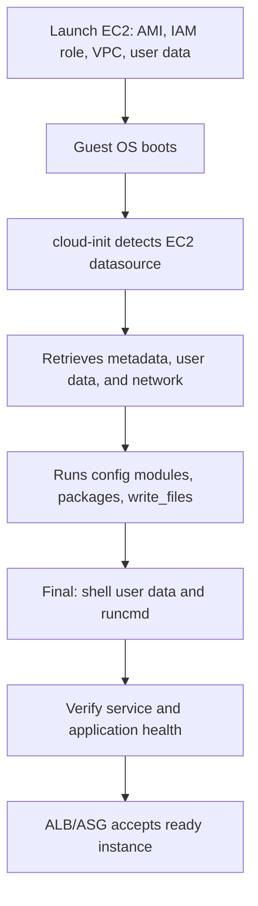

# Initializing Instances with User Data and cloud-init

> **Chapter:** EC2 Instances · **Module:** `CLOUD_PROVIDERS_AWS`

## 1. Why Automate EC2 Initialization?

A Java application on Amazon EC2 requires several steps after choosing an Amazon Machine Image (AMI), selecting an instance type, and clicking **Launch instance**: installing a runtime or web server, pulling the right artifact version, generating configuration files, setting up services, writing logs, and verifying that the application is ready. If operations engineers must SSH into each machine to perform these tasks, it is very hard to repeat accurately when Auto Scaling adds instances, replaces unhealthy machines, or recovers from an Availability Zone (AZ) outage.

**EC2 user data** lets you pass configuration data at launch time. On Linux AMIs equipped with **cloud-init**, user data is typically a shell script or YAML configuration that automatically prepares the OS and application during boot. This reduces manual effort, keeps environments consistent, and enables scaling via Launch Templates/Auto Scaling Groups (ASGs).

Within the `CLOUD_PROVIDERS_AWS` module, EC2 initialization brings together **Region/AZ, IAM instance roles, VPC subnets, compute, S3/Secrets Manager, CloudWatch monitoring, recovery, and cost control**. A script finishing successfully still does not prove the system can serve requests: the app may lack network routes, have wrong IAM permissions, fail to connect to the database, or fail load balancer health checks.

After this lesson, learners will be able to:

1. Distinguish user data, cloud-init, AMIs, Launch Templates, and post-boot automation.
2. Describe cloud-init boot stages, execution frequency, and the impact of reboot/stop-start.
3. Write Bash and `#cloud-config` user data for Amazon Linux 2023.
4. Launch and inspect EC2 instances via Console/AWS CLI, understanding size limits and Base64 encoding.
5. Read logs, identify boot failures, and apply controlled recovery procedures.
6. Design secure, repeatable bootstraps suited for private VPCs, ASGs, and budgets.

## 2. Components and Responsibilities

### 2.1. EC2 User Data

**User data** is an EC2 instance attribute that accepts a payload at launch. This data can carry shell commands, cloud-init directives, environment parameters, or artifact URLs. EC2 stores and exposes the payload; **EC2 does not arbitrarily interpret commands on its own**. An agent inside the guest OS such as cloud-init (Linux) or EC2Launch (Windows) is required to process it.

The EC2 user data limit is **16 KiB of raw data before Base64 encoding**. When calling the EC2 API directly, the payload must be Base64-encoded; the EC2 Console or AWS CLI `run-instances --user-data` can encode plain text for you. Therefore, never embed an entire project, binary files, or overly large scripts; store artifacts in a controlled repository and download them via an IAM role, or build an AMI with dependencies pre-packaged.

### 2.2. Cloud-init

**Cloud-init** is a multi-cloud Linux initialization toolkit that handles:

- Detecting the EC2 datasource and metadata, configuring networking and hostname.
- Creating users, SSH authorized keys, files, and filesystem permissions.
- Updating or installing packages, invoking scripts, and configuring services.
- Tracking execution status and writing logs for troubleshooting.

**Amazon Linux 2023 (AL2023)** ships an AWS-customized build of cloud-init; do not assume every Linux AMI or enterprise-built AMI shares identical modules and syntax with AL2023. If using Ubuntu, RHEL, or custom images, consult that image's documentation. **Windows EC2** has its own agents and user data syntax; the Bash examples in this lesson are for Linux only.

### 2.3. Comparison with Other Deployment Tools

| Tool | Primary Responsibility | Use Case |
| --- | --- | --- |
| **AMI** | Pre-packaged OS and baseline software image. | Launch machines from a tested base image. |
| **User data + cloud-init** | Environment-specific initial setup at instance boot. | Create files, install a few packages, configure the app, fetch artifacts. |
| **Launch Template** | Stores versioned launch config: AMI, instance type, SG, user data, IAM instance profile. | Launch instances consistently; integrate with ASG. |
| **Auto Scaling Group** | Maintains instance count, scales out, or replaces failed machines. | Each new instance must complete bootstrap autonomously. |
| **AWS Systems Manager** | Operations, remote command execution, patch/configuration management on running hosts. | Investigate and update without public SSH. |
| **CloudFormation / CDK / Terraform** | Infrastructure as code covering EC2, IAM, VPC, SG, ASG. | Repeat infrastructure provisioning with code review and version control. |
| **EC2 Image Builder / Packer** | Builds AMIs containing dependencies and application components. | Reduce boot time and improve consistency when scaling. |

The standard production pattern is **tested AMI + lean user data + versioned Launch Template + ASG + health checks**. User data acts only as a bootstrap mechanism, not a full application lifecycle management system.

## 3. Execution Lifecycle During EC2 Boot



Cloud-init divides the boot process into stages:

| Stage | Typical Tasks | Significance |
| --- | --- | --- |
| **Detect** | Identifies platform and decides whether to run cloud-init. | The AMI must support the EC2 datasource. |
| **Local** | Locates datasource, prepares baseline network configuration. | Avoid accessing repositories before networking is ready. |
| **Network** | Processes network config and user data, runs early-stage modules. | Fetches metadata from IMDS according to image configuration. |
| **Config** | Runs cloud-config modules; `runcmd` generates script contents. | Does not mean `runcmd` has finished executing yet. |
| **Final** | Completes package installation and executes shell scripts/`scripts-user`. | Often the longest step if installing packages or downloading artifacts. |

**Key detail:** `runcmd` writes a script to run later; the `scripts-user` module executes it during the **Final stage**. Exact module ordering and frequency can vary depending on cloud-init version, OS, and `cloud.cfg`.

### 3.1. First Boot, Reboot, and Stop/Start

- By default, user data shell scripts and most instance-configuration cloud-init modules run **only on the instance's first boot**.
- **Rebooting or stopping/starting** the same instance normally **does not re-run** default user data shell scripts.
- For **EBS-backed EC2**, you can stop an instance and modify its user data; however, editing the attribute alone **does not** make cloud-init re-run the new script on the next start by default.
- **A new instance** launched by an ASG to replace an old one has a new instance ID and will fetch/process user data from the selected Launch Template.
- Cloud-init modules have frequencies such as **once-per-instance**, **once**, and **always**. Tasks that must run on every boot should use an appropriate mechanism—typically a **systemd service**—rather than expecting user data to re-run automatically.

Commands like `cloud-init clean` clear prior execution state before a reboot, or `cloud-init single` runs an individual module. These actions can re-trigger initialization scripts and overwrite configuration; **use them only in controlled test environments**, never indiscriminately in production or on golden AMIs.

### 3.2. EC2 `running` Does Not Mean the Application Is Ready

When EC2 reports state `running`, cloud-init may still be downloading packages. When `cloud-init status` reports completion, the web server may be up while the Java app still fails to connect to RDS or pass its health endpoint. Distinguish four states:

1. **Instance state/system status:** EC2 and the OS are running.
2. **Bootstrap completion:** cloud-init/modules finished without fatal errors.
3. **Application readiness:** service, dependencies, and `/health` endpoint respond properly.
4. **Traffic readiness:** ALB target group marks the target healthy; ASG grace period/warmup matches bootstrap duration.

## 4. Preparing for Amazon Linux 2023 Labs

This lesson uses **Amazon Linux 2023 (AL2023)** AMIs, DNF (`dnf`), systemd, and cloud-init. Do not copy `amazon-linux-extras` commands meant for Amazon Linux 2 onto AL2023.

| Factor | Requirement | Impact If Missing |
| --- | --- | --- |
| AMI | AL2023 in the right Region/CPU architecture; includes cloud-init. | Payload ignored or package names differ. |
| Subnet | Required outbound path: public IP + IGW, private + NAT, or appropriate internal endpoints/repos. | `dnf` or artifact downloads fail due to unreachable sources. |
| DNS | VPC DNS and application resolvers working. | Repo/S3/API domains fail to resolve. |
| SG/NACL | Allow required egress; web server ingress only from allowed sources. | Bootstrap cannot pull packages or external tests cannot reach the server. |
| IAM instance profile | Attach least-privilege role if bootstrap calls AWS APIs. | `AccessDenied` errors; never hardcode static access keys. |
| Root EBS volume | Enough space for installing packages, writing files/logs. | `No space left on device` mid-installation. |
| Admin channel | Session Manager or secured SSH; IMDSv2 per security standard. | Difficult to inspect logs and diagnose boot failures. |

**Note on private subnets:** If an instance has no Internet egress, package installation and artifact downloads must use private repositories/endpoints supported by the AMI and VPC configuration, or pre-bake dependencies into an AMI. A VPC endpoint for one AWS service does not substitute for arbitrary URLs/package repositories. When creating lab resources, tag owner, environment, and purpose, and plan to stop or terminate billable resources.

### 4.1. Entering User Data in the EC2 Console

1. Choose a Region and open **EC2 → Instances → Launch instances**.
2. Select an AL2023 AMI, suitable instance type, VPC/subnet, security group, and management access.
3. Attach an **IAM instance profile** if the script needs S3, Secrets Manager, or other AWS APIs.
4. Expand **Advanced details → User data** and paste the **entire** shell script or cloud-config.
5. If pasting plain text, let the Console perform **Base64 encoding**; check “already base64 encoded” only when the input is genuinely already encoded.
6. Launch, watch EC2 state, wait for cloud-init to finish, and verify the application. Clean up lab resources when finished.

## 5. Approach 1: Shell Script User Data

A Linux shell script starts with `#!/bin/bash` so cloud-init recognizes and runs it. By default, EC2 user data shell scripts execute as **root** without an interactive terminal. Therefore, you do not need `sudo` inside the script and must use non-interactive flags like `dnf install -y`. Created files will generally be owned by root unless ownership is explicitly changed.

### 5.1. Example: Installing Apache HTTP Server on AL2023

```bash
#!/bin/bash
set -Eeuo pipefail

# Separate log for diagnostics; do not write secrets to logs.
exec > >(tee -a /var/log/bootstrap-web.log) 2>&1
trap 'echo "Bootstrap failed at line $LINENO" >&2' ERR

echo "Starting EC2 bootstrap"
dnf install -y httpd

install -d -m 0755 /var/www/html
cat > /var/www/html/index.html <<'HTML'
<!doctype html>
<html lang="en">
<head><meta charset="UTF-8"><title>EC2 bootstrap</title></head>
<body><h1>EC2 was initialized with user data</h1></body>
</html>
HTML
chmod 0644 /var/www/html/index.html

systemctl enable --now httpd
curl --fail --silent --show-error --max-time 10 http://127.0.0.1/ > /dev/null
echo "Bootstrap completed successfully"
```

**Explanation:**

- `set -Eeuo pipefail` catches many errors early; commands allowed to fail must be handled explicitly so they do not abort the script unexpectedly.
- `exec > >(tee ...) 2>&1` captures stdout/stderr to a dedicated log; `cloud-init-output.log` can also contain user data output.
- `dnf install -y httpd` requires repository access, network/DNS, and disk space; this is a common failure point for EC2 instances in private subnets.
- `systemctl enable --now httpd` enables startup at boot and starts the service immediately.
- `curl --fail` verifies the page locally; Internet reachability also depends on IP/IGW/ALB/SG.

Do not run long-lived production applications as root just because user data runs as root. For Spring Boot, create a low-privilege service account and a **systemd unit with `User=appuser`**, letting systemd manage the process lifecycle.

### 5.2. Post-Boot Verification

Connect via AWS Systems Manager Session Manager or a secured management channel, then run:

```bash
sudo cloud-init status --long
sudo systemctl status httpd --no-pager
sudo test -f /var/www/html/index.html
curl --fail --silent --show-error http://127.0.0.1/
sudo tail -n 100 /var/log/bootstrap-web.log
sudo tail -n 100 /var/log/cloud-init-output.log
```

Labs may use an EC2 public IP and an SG opening TCP 80 **only from authorized test sources**. Production should consider an **internet-facing HTTPS ALB** in public subnets, with EC2 in private subnets accepting traffic solely from the ALB's security group.

## 6. Approach 2: Declarative `#cloud-config`

Cloud-config is YAML starting with the line **`#cloud-config`**. It declares standard steps instead of writing everything as shell commands. On AL2023, an equivalent example:

```yaml
#cloud-config
package_update: true
packages:
  - httpd

write_files:
  - path: /var/www/html/index.html
    owner: root:root
    permissions: '0644'
    content: |
      <!doctype html>
      <html lang="en">
      <head><meta charset="UTF-8"><title>cloud-init</title></head>
      <body><h1>Hello from cloud-config</h1></body>
      </html>

runcmd:
  - [systemctl, enable, --now, httpd]
  - [curl, --fail, --silent, --show-error, --max-time, '10', 'http://127.0.0.1/']
```

| Directive | Effect | What to Watch |
| --- | --- | --- |
| `#cloud-config` | Header identifying the format. | Must be on the first line; not every YAML file counts as cloud-config. |
| `package_update` | Updates repository metadata. | Depends on network/package source reachability. |
| `packages` | Installs OS packages. | Package names and versions depend on the AMI. |
| `write_files` | Creates files with owner and permissions. | `'0644'` should be a quoted string to preserve the octal mode value. |
| `runcmd` | Declares final-stage commands. | The `scripts-user` module runs the script in the Final stage. |

YAML is sensitive to indentation, colons (`:`), `#` comments, and quoting. Values containing special characters should be quoted; complex commands can use a block scalar `|` or list form `[command, arg1, ...]`. The `write_files` module creates files before `runcmd` executes, but do not assume every module across all distros shares identical ordering. For complex ordering dependencies, check the module reference and test on the exact target AMI.

### 6.1. Comparing the Two Approaches

| Criterion | Bash User Data | Cloud-config |
| --- | --- | --- |
| Expression style | Sequential imperative commands. | Declarative directives for cloud-init modules. |
| Conditionals, retries, loops | Flexible, but you must guard everything yourself. | Can use `runcmd` or call external scripts. |
| Common package/file setup | Write `dnf`, `mkdir`, `chmod` manually. | Use `packages` and `write_files`. |
| Debugging | Shell logs, exit codes, `set -Eeuo pipefail`. | Check YAML syntax, cloud-init logs, and module status. |
| Risks | Non-idempotent tasks, leaking secrets via shell/logs. | Malformed YAML, misunderstanding module frequency and ordering. |

When bootstrap requires substantial business logic, consider placing a **versioned, checksum-verified script in a trusted repository**, keeping user data purely as the entry point. Never blindly fetch unverified code and execute it as root.

## 7. Passing User Data via AWS CLI and Launch Templates

### 7.1. AWS CLI: Launching EC2 with a Bootstrap File

On a machine with **AWS CLI v2** installed and appropriate EC2 permissions, the following launch example uses a local `bootstrap.sh` containing the Bash user data from section 5:

```bash
aws sts get-caller-identity

aws ec2 run-instances \
  --region ap-southeast-1 \
  --image-id ami-xxxxxxxxxxxxxxxxx \
  --instance-type t3.small \
  --count 1 \
  --subnet-id subnet-xxxxxxxxxxxxxxxxx \
  --security-group-ids sg-xxxxxxxxxxxxxxxxx \
  --iam-instance-profile Name=EC2BootstrapRole \
  --metadata-options HttpTokens=required \
  --user-data file://bootstrap.sh \
  --tag-specifications 'ResourceType=instance,Tags=[{Key=Name,Value=bootstrap-lab},{Key=Environment,Value=lab}]'
```

**This is an illustrative command**, not for verbatim execution: the AMI ID, subnet ID, SG ID, instance profile, and filename must exist in the target Region and account. Some configurations may also require parameters such as key pair, block device mappings, or network options. Launching EC2 and associated resources can incur charges immediately.

With `run-instances --user-data file://bootstrap.sh`, the **AWS CLI automatically Base64-encodes the payload**. Do not manually pre-encode it when passing it this way, or the instance will receive double-encoded data that cloud-init cannot parse. However, when calling the **EC2 API/SDK** directly or configuring **Launch Template/UserData** in formats requiring a Base64 string, follow that tool's contract (for example, CloudFormation commonly uses `Fn::Base64`).

### 7.2. Inspecting Instance Details After Launch

```bash
aws ec2 describe-instances \
  --region ap-southeast-1 \
  --filters Name=tag:Name,Values=bootstrap-lab \
  --query 'Reservations[].Instances[].{Id:InstanceId,State:State.Name,AZ:Placement.AvailabilityZone,PrivateIP:PrivateIpAddress,PublicIP:PublicIpAddress}' \
  --output table
```

This command only verifies the EC2 instance and networking; `State=running` **does not prove user data succeeded**. To inspect an instance's user data value, an account with appropriate administrative permissions can use the EC2 console or the `DescribeInstanceAttribute` API (`userData` attribute). The API returns it Base64-encoded in the response field; **do not paste that content into logs or public tickets** since user data can expose sensitive infrastructure details.

### 7.3. Launch Templates and Auto Scaling Groups

For repeatable instance creation, user data is typically stored in an **EC2 Launch Template**. Editing a Launch Template creates a **new version** without automatically altering user data on running instances. An Auto Scaling Group can reference a specific version or configured default/latest version, and new instances launch from the active ASG configuration.

Safe rollout workflow:

1. Pin specific versions for the AMI, artifacts, and user data; store changes in reviewed IaC/repositories.
2. Create a new Launch Template version, verifying the IAM profile, subnet, SG, EBS, metadata options, and user data.
3. Launch a test instance or use a staging ASG; verify cloud-init, application health, security, and costs.
4. Update the ASG to the target version, and use **Instance Refresh** or an appropriate rollout mechanism when replacing old instances too.
5. Set a **health check grace period** and warmup aligned with bootstrap duration; monitor target health and error rates.
6. Maintain a plan to revert to the previous **Launch Template version**, replace faulty instances, and keep stateful data decoupled from EC2 machines.

An ASG with “seemingly working” user data can still enter a replacement loop if `cloud-init` takes too long, opens the wrong port, or the backend fails ALB health checks. Increase the grace period only after identifying the root cause; do not mask bootstrap failures by extending health checks indefinitely.

### 7.4. MIME Multi-Part: Combining Bash and cloud-config

Normally a user data payload begins with **one content type**. When you need to combine `#cloud-config` and a shell script in the same payload, you can use **MIME multipart** with appropriate content types:

```text
Content-Type: multipart/mixed; boundary="EC2-BOUNDARY"
MIME-Version: 1.0

--EC2-BOUNDARY
Content-Type: text/cloud-config; charset="us-ascii"
MIME-Version: 1.0
Content-Transfer-Encoding: 7bit

#cloud-config
write_files:
  - path: /opt/bootstrap-origin.txt
    content: "Created from cloud-config"

--EC2-BOUNDARY
Content-Type: text/x-shellscript; charset="us-ascii"
MIME-Version: 1.0
Content-Transfer-Encoding: 7bit

#!/bin/bash
set -Eeuo pipefail
echo "Shell script part ran" > /var/log/bootstrap-part.log

--EC2-BOUNDARY--
```

This is an example of **combining independent parts**, without assuming side-effect ordering across modules that execute in different stages. MIME must have properly formatted boundaries, headers, and blank lines; since the payload is still bounded by the 16 KiB raw limit, use it only when clearly needed. Note that the `#cloud-config` line at the top of the `text/cloud-config` part is separate from the MIME header at the start of the payload.

## 8. Securing User Data: No Embedded Secrets, Use IAM Roles and IMDSv2

### 8.1. Why Secrets Must Not Be Embedded

EC2 user data **is not a secrets store**. Users with appropriate permissions can view the user data attribute via EC2 management APIs; code running inside the instance can read user data from the **Instance Metadata Service** depending on configuration and local access. AWS documentation warns that user data is not protected by metadata authentication/encryption on its own, and scripts can also remain stored inside cloud-init directories after first boot.

**Never write** database passwords, private keys, AWS access keys, session tokens, payment API keys, private certificates, or customer data into user data. **Base64 is merely an encoding representation, not encryption.** Avoid `echo`, `set -x`, or verbose log outputs that could accidentally leak secrets.

Instead:

1. Attach an **IAM role** to EC2 via an **instance profile** with only the permissions needed to read required artifacts/secret configs.
2. Store secrets in **AWS Secrets Manager** or **Systems Manager Parameter Store SecureString**, encrypted with KMS as required.
3. Fetch secrets only when needed, minimizing lifetime in memory, files, and logs; never pass secrets in command-line arguments visible in process listings.
4. Use encryption at rest, TLS, proper file permissions, and dedicated service accounts; audit API activity with CloudTrail.
5. Revoke/rotate secrets and review IAM policies during environment changes or offboarding.

Example IAM policy **allowing the EC2 role only to download one specific S3 artifact** (bucket/key are illustrative):

```json
{
  "Version": "2012-10-17",
  "Statement": [
    {
      "Sid": "DownloadVersionedJar",
      "Effect": "Allow",
      "Action": "s3:GetObject",
      "Resource": "arn:aws:s3:::example-app-artifacts/releases/app-1.0.0.jar"
    }
  ]
}
```

If the object uses SSE-KMS with a customer-managed key, the role may also need `kms:Decrypt` on that key and must satisfy the key policy. Having IAM permissions **is not enough** if a bucket policy, VPC endpoint policy, or SCP has an explicit deny. Never add `s3:*` on `*` just to get past an `AccessDenied` error.

### 8.2. IMDSv2

**Instance Metadata Service v2 (IMDSv2)** requires obtaining a session token via HTTP PUT before accessing metadata. You can enforce token requirement at launch with:

```text
--metadata-options HttpTokens=required
```

Example reading only the instance ID **from inside EC2** to verify IMDSv2 works:

```bash
TOKEN=$(curl --fail --silent --show-error --max-time 2 \
  -X PUT "http://169.254.169.254/latest/api/token" \
  -H "X-aws-ec2-metadata-token-ttl-seconds: 21600")

curl --fail --silent --show-error --max-time 2 \
  -H "X-aws-ec2-metadata-token: $TOKEN" \
  "http://169.254.169.254/latest/meta-data/instance-id"
```

Tokens are not static user data to embed beforehand. IMDSv2 mitigates certain unintended metadata access vectors, but **it does not make a compromised instance completely safe**. Keep the IAM role least-privilege, patch the OS, and restrict who/what processes can access the instance. If containerized apps need metadata, evaluate hop limits and access paths according to architecture; avoid loosening metadata settings arbitrarily to “fix” permission errors.

### 8.3. Security Groups and Private VPCs

Example of Spring Boot running in a private EC2 subnet with no public IPv4 needed:

- An ALB in public subnets terminates HTTPS from the Internet; the EC2 security group allows TCP 8080 only from the **ALB security group**.
- EC2 calls Amazon S3 via an **S3 gateway endpoint** or managed egress; downloading packages from repositories still requires an appropriate network path.
- Connects to RDS over private IP/DB endpoint, with the RDS SG allowing TCP 5432 only from the application SG; no Internet Gateway/NAT is used for intra-VPC traffic.
- EC2 ships logs/metrics via the CloudWatch agent and appropriate endpoints/egress, using an IAM role with only the required write permissions.
- Never open SSH 22 from `0.0.0.0/0` just to inspect bootstrap errors; use Session Manager whenever possible.

Check **route tables, DNS, security groups, NACLs, VPC endpoint policies, IAM, and repository networking**. A user data script with broken networking cannot fix itself by running `dnf` or adding `sudo`.

## 9. Starting a Java Application with systemd: Design Pattern

A Spring Boot JAR should be **built, tested, and pre-stored** in an artifact repository before launching EC2. User data fetches the pinned artifact version, creates an app user, and registers a systemd service. Avoid starting the app with `java -jar ... &` inside user data and expecting cloud-init to manage the process forever.

The Bash template below is **conditionally illustrative**: it requires an AL2023 AMI, a matching Corretto package, an IAM role permitted to read the object, network access to repos/S3 (via NAT/endpoints), and a JAR actually listening on TCP 8080 with `/actuator/health` returning HTTP 2xx. If your app has no Actuator endpoint, replace the health path with your actual endpoint:

```bash
#!/bin/bash
set -Eeuo pipefail
exec > >(tee -a /var/log/bootstrap-java.log) 2>&1
trap 'echo "Java bootstrap failed at line $LINENO" >&2' ERR

# Verify the supported package name and version in your Region/AMI.
dnf install -y java-21-amazon-corretto-headless
id appuser >/dev/null 2>&1 || \
  useradd --system --no-create-home --shell /sbin/nologin appuser

install -d -o appuser -g appuser -m 0755 /opt/app

# AWS CLI must be pre-installed in the AMI; the role must allow reading this exact object.
aws s3 cp \
  s3://example-app-artifacts/releases/app-1.0.0.jar \
  /opt/app/app.jar
chown appuser:appuser /opt/app/app.jar
chmod 0644 /opt/app/app.jar

cat > /etc/systemd/system/app.service <<'UNIT'
[Unit]
Description=Spring Boot application
After=network-online.target
Wants=network-online.target

[Service]
Type=simple
User=appuser
Group=appuser
WorkingDirectory=/opt/app
ExecStart=/usr/bin/java -jar /opt/app/app.jar
Restart=on-failure
RestartSec=5
Environment=SPRING_PROFILES_ACTIVE=prod

[Install]
WantedBy=multi-user.target
UNIT

systemctl daemon-reload
systemctl enable --now app.service

ready=false
for attempt in 1 2 3 4 5 6 7 8 9 10 11 12; do
  if curl --fail --silent --show-error --max-time 3 \
    http://127.0.0.1:8080/actuator/health >/dev/null 2>&1; then
    ready=true
    break
  fi
  sleep 5
done

if [ "$ready" != "true" ]; then
  echo "Application health check did not pass" >&2
  exit 1
fi
echo "Java bootstrap completed"
```

**Design analysis:**

- `appuser` is a non-login application account; never run the application as root.
- `systemd` manages process restarts after crashes and reboots automatically, **without re-running the entire user data on reboot**.
- `s3://.../app-1.0.0.jar` uses a pinned version instead of an unpredictable `latest`; production should add checksum/signature verification and release policies.
- Directories/files have explicit ownership and permissions; configurations, certificates, and secrets should be supplied via secure mechanisms rather than hardcoded in scripts.
- The local health loop waits up to roughly one minute before failing, refusing to equate “Java process started” with “ready to serve traffic.”
- Boot can fail if AWS CLI is missing from the AMI, `GetObject` is denied, endpoints/NAT are missing, disk space runs out, or the JAR is incompatible. Preflight prerequisites before running in production.

In real environments, configure Java `-Xms/-Xmx` based on instance RAM, JVM flags, DB endpoints, and standard logging. **Database migrations** may need separate orchestration to prevent multiple ASG instances from running migrations concurrently.

## 10. Inspecting and Troubleshooting cloud-init

When user data does not produce the expected result, first separate the questions: **was the payload received; could cloud-init parse it; did the commands run; or did the app start but fail to connect?**

### 10.1. Key Signals

| Source | Content | How to Inspect |
| --- | --- | --- |
| `cloud-init status` | cloud-init execution status and recorded errors. | `sudo cloud-init status --long` |
| `/var/log/cloud-init.log` | Detailed logs of cloud-init stages/modules. | `sudo less /var/log/cloud-init.log` |
| `/var/log/cloud-init-output.log` | stdout/stderr of user scripts and modules. | `sudo tail -n 200 /var/log/cloud-init-output.log` |
| `journalctl` | Status of related systemd units. | `sudo journalctl -u cloud-final.service -b --no-pager` |
| `cloud-init analyze` | Boot timing breakdown and slow modules. | `sudo cloud-init analyze blame` |
| `systemctl` | Whether the service is actually active or failed. | `sudo systemctl status app.service --no-pager` |
| `EC2 Console → Get system log` | Partial boot/console output from EC2's perspective. | Useful when unable to access the instance; not guaranteed to contain all cloud-init logs. |

Common read-only diagnostic sequence after logging into the instance:

```bash
sudo cloud-init status --long
sudo tail -n 200 /var/log/cloud-init.log
sudo tail -n 200 /var/log/cloud-init-output.log
sudo journalctl -u cloud-final.service -b --no-pager
sudo cloud-init analyze blame
sudo systemctl --failed
```

If an external check needs to **wait for cloud-init to complete**, use:

```bash
sudo cloud-init status --wait
```

**Never place `cloud-init status --wait` inside user data currently being executed by cloud-init**: the script would wait for its own Final stage to finish and risk deadlocking. Use `--wait` from an outside process (such as a post-boot test command) or use proper systemd dependencies.

### 10.2. Root-Cause Isolation Steps

1. **Verify the instance and AMI:** Region, instance ID, OS, and whether cloud-init is installed/enabled.
2. **Inspect the payload:** `#!/bin/bash` or `#cloud-config` header, size limits, line endings, encoding, YAML indentation, and Base64 handling.
3. **Locate the failing stage:** does `cloud-init.log` report datasource/YAML/module errors or does `cloud-init-output.log` show command failures?
4. **Check networking and IAM:** route tables, IGW/NAT/VPC endpoints, DNS, SG/NACL, attached instance role, and `AccessDenied` on AWS APIs.
5. **Check dependencies and OS:** DNF repos, package names, CPU architecture, Java version, disk space, memory, file permissions.
6. **Check service and readiness:** `journalctl -u app.service`, TCP listeners, local HTTP health, ALB target health, DB connectivity, and application logs.
7. **Fix with version control:** update bootstrap in the repository, test on a fresh instance, and create a new Launch Template version before rolling out.

### 10.3. Common Failure Modes

| Symptom | Possible Cause | Resolution |
| --- | --- | --- |
| User data does not run, no script logs. | Missing shebang/header; double-encoded payload; AMI lacks cloud-init or module disabled. | Check AMI/user data config and `cloud-init.log`. |
| `cloud-config` does not create files. | Bad YAML indentation, unsupported module key, invalid path/mode. | Validate schema for your cloud-init version and check `write_files` module logs. |
| `dnf` fails or times out. | Missing route/DNS/egress, unavailable repo, out of disk space. | Check networking, DNS, DNF logs, and EBS usage. |
| `aws s3 cp` returns `AccessDenied`. | Missing instance profile/role, missing `s3:GetObject`, denied by bucket/endpoint/KMS policy. | Check identity, resource ARN, and all policy layers; grant least privilege. |
| `systemctl start` fails. | Broken unit file, missing binary/JAR, port already in use, wrong permissions or config. | Check `systemctl status`, `journalctl -u app.service`, paths, and user. |
| EC2 `running` but ALB target unhealthy. | App not listening yet, wrong health path/port, missing SG rule, slow bootstrap. | Test local curl, target group settings, SGs, and warmup duration. |
| Script does not re-run after reboot. | Default user data executes only on first boot. | Use systemd for persistent services; configure per-boot execution only when explicitly needed. |
| Edited user data and started instance, no config change. | Updating the attribute does not re-trigger once-per-instance modules. | Launch a new EC2 instance with versioned user data/AMI or apply changes via a proper management tool. |
| ASG continuously replaces EC2 instances. | Health check triggers too early or bootstrap/app is genuinely failing. | Analyze cloud-init/app logs, set an appropriate grace period, and fix the underlying cause. |
| Bootstrap succeeds yet EC2 still lacks Internet access. | Misconfigured routes/SG/NACL/DNS, public IP, or NAT/endpoints. | Inspect the VPC path; scripts cannot bypass network controls. |

### 10.4. Pre-Launch Syntax Checks

For shell scripts, check Bash syntax from a Linux machine or compatible dev environment:

```bash
bash -n bootstrap.sh
```

For cloud-config, use the CLI of a **compatible cloud-init version** (when supported by the installed build):

```bash
cloud-init schema --config-file cloud-config.yml
```

Syntax validation **does not replace** integration testing: YAML can be syntactically valid while packages do not exist, IAM policies deny access, private networks lack egress, or services fail to start. Perform smoke tests on the **exact AMI and a production-like VPC configuration**.

## 11. Repeatability, Re-Run Safety, and Change Management

**Idempotency** means re-running a task (under designed conditions) does not create duplicates or corrupt state. Even though user data runs only on first boot by default, the logic may run again during rebuilds, new instance launches, or AMI restores; the more consistent the script, the better your resilience.

### 11.1. Patterns and Anti-Patterns

| Action | Error-Prone Approach | Better Approach |
| --- | --- | --- |
| Installing packages | Pulling unpinned latest versions on every boot. | Use tested AMI/repo/package versions; consider image baking. |
| Writing config | Repeating `echo ... >> config` appends duplicate lines. | Write full config from versioned files; update cleanly with hash comparison. |
| Creating users | `useradd appuser` fails if the user already exists. | Check existence first or use cloud-init's `users` module. |
| Fetching artifacts | Pointing to `latest.jar` which can shift unexpectedly. | Use immutable release IDs, checksums/signatures, and scoped S3 permissions. |
| Starting services | Running the app in background directly from script without supervision. | Use systemd, health checks, and bounded retries. |
| Schema migrations | All ASG instances running migrations simultaneously. | Orchestrate migrations in a separate step with lock/version control. |
| Error handling | Ignoring exit codes and reporting success. | Use `set -Eeuo pipefail` with explicit handling; verify postconditions. |

Never write a “success” marker before all checks pass. If using marker files, write them atomically and only after verification. An even better pattern in replacement-based architectures is **launching from a standardized image/version and routing traffic only after health checks pass**, rather than patching long-lived servers in place.

### 11.2. Golden AMIs and cloud-init State

When creating an AMI from an EC2 instance that previously ran user data, cloud-init files or state under `/var/lib/cloud/` may persist in the image. User data scripts may remain stored under the instance directory and should be reviewed carefully before imaging to avoid baking unintended data. Image baking workflows should:

1. Avoid writing credentials/secrets into user data or temporary files.
2. Audit everything included in the AMI snapshot, including logs, caches, and script-generated files.
3. Prepare cloud-init state for **new** instances according to AMI build docs and installed software.
4. Test launching an instance from the new AMI to verify bootstrap, SSH/SSM, networking, and user data.

Use `cloud-init clean --logs` (or equivalent flags) only after understanding its effects and inside tested AMI build pipelines; this deletes cloud-init state/logs and causes modules to run again on next boot. Never use it as an “auto-fix” in production.

### 11.3. User Data Does Not Replace Long-Term Maintenance

User data is suited for preparing **new instances**. Afterward, configuration can be updated through:

- **Immutable deployment:** build a new AMI, update the Launch Template version, and replace instances via ASG Instance Refresh.
- **AWS Systems Manager:** Patch Manager/State Manager/Run Command per organizational policy for appropriate changes.
- **Configuration management:** Ansible or equivalent tooling with auditing and rollback workflows.
- **Containerized applications:** consider ECS/EKS where appropriate, using EC2 as compute beneath an orchestration layer.

Choose a model based on application type, acceptable boot time, team size, security requirements, recovery capabilities, and cost.

## 12. Monitoring, Resilience, and Bootstrap Costs

### 12.1. Observe All Three Layers

- **EC2:** status checks, CPU, network, disk, instance state, and infrastructure AWS Health events.
- **Cloud-init/OS:** execution duration, exit status, logs, systemd units, EBS space, DNF errors.
- **Application:** error rates, latency, HTTP readiness, database connection counts, ALB target health, CloudWatch metrics/logs.

Keeping bootstrap logs only on the instance only helps while the machine is alive; if an ASG terminates a failed instance, local logs may be lost with the root EBS volume. For production, consider the **CloudWatch Agent** or centralized log shipping once networking, agents, and IAM are configured. Do not collect secrets in logs and set appropriate retention.

### 12.2. Designing Recovery When Bootstrap Fails

If AZ A suffers an outage, an ASG launching instances in AZ B can provision machines from the same Launch Template. However, bootstrapping in AZ B can still fail if private subnets depend on a zonal NAT in AZ A or if artifact storage is only reachable in one place. Therefore:

1. Distribute compute across two or more appropriate AZs and select available subnets.
2. Design resilient outbound egress (appropriate redundant NATs/Regional NAT or private endpoints).
3. Ensure artifact repositories and required APIs are highly available; avoid depending on laptops or manually managed servers.
4. Store stateful data outside EC2; ensure apps reconnect after RDS failovers.
5. Test from **fresh** instances in each AZ, measure launch-to-healthy duration, and set realistic warmup values.
6. Apply consistent IAM instance profiles and policies across replacement instances.

### 12.3. Cost Categories

| Cost Source | Why It Applies | Cost Control |
| --- | --- | --- |
| **EC2 compute** | Instances incur compute charges based on state and type; slow bootstraps waste unready time. | Build lean AMIs, minimize heavy build/install work at boot. |
| **EBS** | Root EBS, snapshots, or data volumes can continue incurring charges under their own lifecycle. | Clean up labs and unused snapshots/volumes; right-size volumes. |
| **Public IPv4** | AWS bills public IPv4 addresses under current pricing policy. | Avoid assigning unnecessary public IPs to backend instances. |
| **NAT Gateway / data transfer** | Pulling dependencies and artifacts through NAT incurs hourly and per-GB charges, plus possible cross-AZ fees. | Use VPC endpoints where appropriate, cache/bake dependencies, route within AZ. |
| **CloudWatch Logs/metrics** | Bootstrap and app logs are ingested, stored, and queried. | Choose balanced retention and log verbosity; never log secrets. |
| **ALB/ASG** | ALB has its own charges; ASG orchestrates EC2, where instance count, EBS, and traffic drive cost. | Align with capacity/SLO targets; set min/max/schedules to actual demand. |

**Operational lesson:** Every ASG instance replacement can execute user data again on a **new instance**. If your script downloads gigabytes of artifacts or runs full updates every time, you pay higher network costs and lengthen recovery time. Investing in standardized AMIs and release artifacts usually pays off in both reliability and budget.

## 13. Hands-On Exercises and Assessment Scenarios

### Exercise 1 — Initializing a Web Server from a Fresh AMI

**Requirements:** Using an Amazon Linux 2023 EC2 instance in an authorized lab account, enter the shell user data from section 5 and verify:

1. EC2 is `running` and cloud-init has finished.
2. `/var/www/html/index.html` exists with the configured content.
3. The `httpd` service is `active (running)` and enabled on boot.
4. `curl http://127.0.0.1/` returns a successful HTTP response.
5. `/var/log/cloud-init-output.log` and `/var/log/bootstrap-web.log` have no unhandled errors.
6. Reboot the lab instance, confirm `httpd` auto-starts, and verify that **the user data script does not re-run by default**.

**Deliverable:** save screenshots or sanitized text (with sensitive info removed) of cloud-init status, HTTP output, and a short explanation of the difference between `systemd` and user data. Afterward, terminate the instance and verify no billable resources remain.

### Exercise 2 — Comparing Bash and cloud-config

Create two user data versions from sections 5 and 6 using the same AMI, subnet, and security group. Fill in the table:

| Criterion | Bash | Cloud-config |
| --- | --- | --- |
| How `httpd` is installed | Fill in the command. | Fill in the key. |
| How the HTML file is created | Fill in the command. | Fill in the key. |
| Where the health check runs | State order and timing. | State module/stage. |
| How to inspect errors | List log names and commands. | List log names and commands. |
| Reboot behavior | State what re-runs. | State what re-runs. |

**Question:** Why can bad indentation in a cloud-config snippet leave the machine running without creating the web page? In which stage does `runcmd` actually execute?

### Exercise 3 — Private Subnet Fails to Download Packages

A Java backend launches from a Launch Template in `private-app-a`. `dnf install` in user data times out; EC2 still reports the machine as `running`, and the ALB target is unhealthy. The instance has no public IPv4 address.

Analyze systematically:

1. Which routes, DNS settings, SG/NACL rules, NATs, VPC endpoints, and package repositories must be checked?
2. How does information in `cloud-init.log` differ from `cloud-init-output.log`?
3. If network egress is restricted by policy, does an architecture with **Java pre-baked into the AMI + S3 artifacts via an endpoint** solve every dependency? List any remaining conditions.
4. Should you adjust the ASG grace period before or after finding why the script failed? Why?
5. How can you test bootstrapping in both AZs without modifying production directly?

### Exercise 4 — Protecting Credentials

An existing script contains:

```bash
#!/bin/bash
export DB_PASSWORD='hard-coded-example-password'
echo "DB password is: $DB_PASSWORD"
java -jar /opt/app/app.jar
```

Identify at least **five issues** across user data, logging, process management, rotation, IAM, and application execution privileges. Redesign it into a model using an IAM instance profile + Secrets Manager/Parameter Store, a `systemd` service running as a low-privilege user, and no secrets written to stdout/stderr. Describe how to revoke access if the machine is suspected of compromise.

### Exercise 5 — Deploying Through Auto Scaling

An ASG runs EC2 instances across two AZs behind an ALB health check. A new user data version pulls a JAR from S3. Describe how to create a new Launch Template version, test an instance in staging, run an Instance Refresh, monitor health checks, and roll back if the JAR is defective. Explain why **updating user data in a Launch Template does not automatically update running EC2 instances**, and why running schema migrations from every new instance is risky.

### Self-Check Questions

1. Why does EC2 `running` not prove user data succeeded?
2. Does the **16 KiB** limit apply to raw data or Base64-encoded data? When does the AWS CLI encode it for you?
3. How do the roles of `#!/bin/bash` and `#cloud-config` differ?
4. In which stage is `runcmd` parsed/declared, and in which stage does it execute?
5. Why does rebooting EC2 normally not re-run user data scripts?
6. How can a Java application keep starting after reboots without re-running the entire bootstrap?
7. Why should you never put database passwords or access keys in user data even after Base64 encoding?
8. Why are instance profiles and IAM roles better than static access keys in scripts?
9. How do you distinguish package repository errors, IAM `AccessDenied` errors, and application health failures?
10. Which cost items can increase if an ASG repeatedly launches new instances and re-installs dependencies?
11. When should you use a golden AMI instead of installing all software from scratch on every boot?
12. Should `cloud-init status --wait` be called from inside the running user data script itself? Why or why not?

## 14. Official Reference Documentation

The following documentation serves as an operational reference. Console UIs, AMIs, cloud-init modules, and AWS policies evolve; during deployment, check the exact versions used in your Region:

- [Amazon EC2 — Run commands on your Linux instance at launch (user data)](https://docs.aws.amazon.com/AWSEC2/latest/UserGuide/user-data.html)
- [Amazon Linux 2023 — Customized cloud-init](https://docs.aws.amazon.com/linux/al2023/ug/cloud-init.html)
- [cloud-init — Boot stages](https://docs.cloud-init.io/en/latest/explanation/boot.html)
- [cloud-init — Module reference (`packages`, `write_files`, `runcmd`, `scripts-user`)](https://docs.cloud-init.io/en/latest/reference/modules.html)
- [cloud-init — CLI commands](https://docs.cloud-init.io/en/latest/reference/cli.html)
- [Amazon EC2 — Instance metadata and user data](https://docs.aws.amazon.com/AWSEC2/latest/UserGuide/ec2-instance-metadata.html)
- [Amazon EC2 — Configure instance metadata options](https://docs.aws.amazon.com/AWSEC2/latest/UserGuide/configuring-instance-metadata-options.html)
- [Amazon EC2 — IAM roles for EC2 instances](https://docs.aws.amazon.com/AWSEC2/latest/UserGuide/iam-roles-for-amazon-ec2.html)
- [Amazon EC2 — Launch Templates](https://docs.aws.amazon.com/AWSEC2/latest/UserGuide/ec2-launch-templates.html)
- [Amazon EC2 Auto Scaling — Instance refresh](https://docs.aws.amazon.com/autoscaling/ec2/userguide/instance-refresh-overview.html)
- [AWS Systems Manager — Session Manager](https://docs.aws.amazon.com/systems-manager/latest/userguide/session-manager.html)
- [Amazon VPC — VPC endpoints](https://docs.aws.amazon.com/vpc/latest/privatelink/vpc-endpoints.html)
- [AWS Secrets Manager — User Guide](https://docs.aws.amazon.com/secretsmanager/latest/userguide/intro.html)
- [Amazon CloudWatch Agent — Collect metrics, logs and traces](https://docs.aws.amazon.com/AmazonCloudWatch/latest/monitoring/Install-CloudWatch-Agent.html)

**Key takeaway:** User data is the initialization input for an instance, cloud-init executes configuration across boot stages, and **systemd + health checks + IAM + VPC + monitoring** determine whether the application runs reliably and securely. For production, standardize AMIs and artifacts, deploy via Launch Templates/ASG, test on fresh instances, monitor booting, and keep secrets out of user data.
