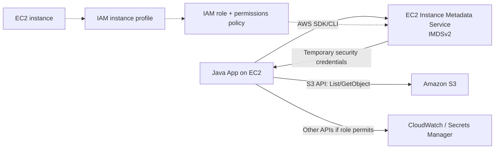
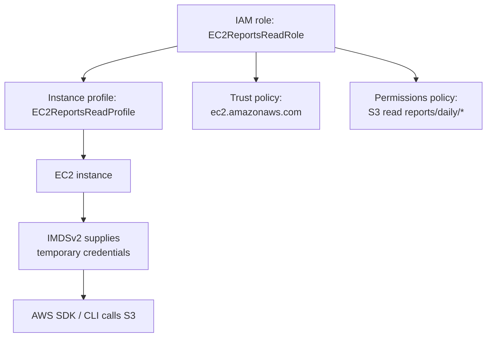
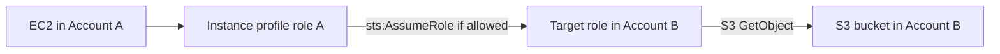
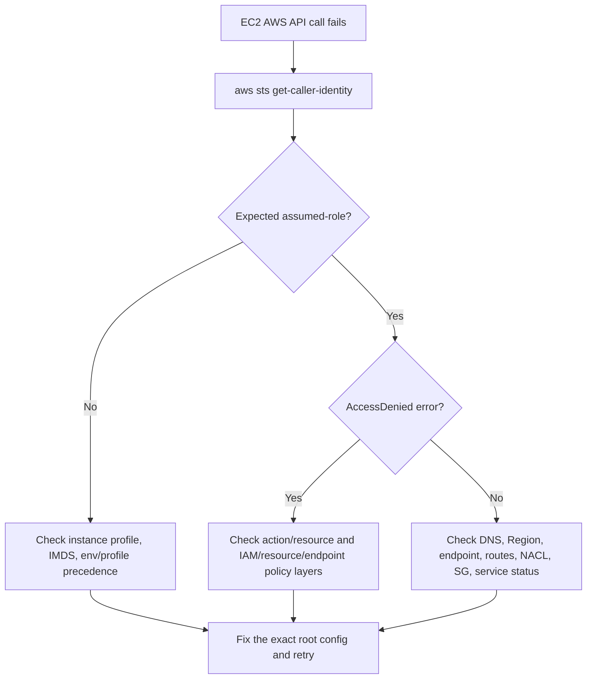

# Instance Profiles and Accessing AWS Services from EC2

> **Module:** CLOUD_PROVIDERS_AWS  
> **Chapter:** EC2 Instances  
> **Topic:** IAM roles, instance profiles, temporary security credentials, the Instance Metadata Service, and how applications on Amazon EC2 call AWS services.

## 1. Context: An EC2 Application Needs to Call AWS APIs

Suppose a team deploys a Java/Spring Boot application on **Amazon EC2** inside a VPC. The application handles HTTP requests, reads report files from **Amazon S3**, persists data in **Amazon RDS**, sends logs to **Amazon CloudWatch**, and may read connection secrets from **AWS Secrets Manager**.

To call an AWS API, the application needs an **AWS-recognized identity** and **permission to perform that action**. If a developer pastes an IAM user's access key into `application.yml` or a long-lived environment variable, those credentials can leak through source code, logs, machine images, or handoffs.

The recommended approach for applications running directly on EC2 is to **attach an IAM role to the instance via an instance profile**. AWS delivers **temporary security credentials** to the instance; the AWS CLI and AWS SDKs automatically discover and refresh those credentials.



This diagram is a conceptual model: the SDK uses internal metadata to obtain credentials; requests to S3 or other services still traverse the network and are evaluated by IAM/resource policies.

After this lesson, you will be able to:

1. Distinguish **IAM role**, **instance profile**, and **role session credentials**.
2. Author a least-privilege policy allowing EC2 to read a specific folder in S3.
3. Attach or replace an instance profile at EC2 launch or on a running instance.
4. Explain the **EC2 → IMDSv2 → temporary credentials → AWS SDK/API** flow.
5. Verify the actual active role using the AWS CLI and AWS SDK for Java 2.x.
6. Diagnose missing credentials, missing permissions, network connectivity issues, and Region misconfigurations.
7. Apply appropriate security, operational, and cost-control practices.

## 2. Distinguishing Three Frequently Confused Concepts

| Concept | What Is It? | Role |
|---|---|---|
| **IAM role** | An IAM identity with a **trust policy** and **permissions policies**. | Allows a trusted principal to assume a defined set of AWS permissions. |
| **Instance profile** | An IAM resource used to **pass a role into EC2**. | Configuration bridge between an IAM role and an EC2 instance. |
| **Temporary security credentials** | Time-bound `AccessKeyId`, `SecretAccessKey`, `SessionToken`. | Authenticates API requests for the role session; issued and rotated automatically by AWS. |

The role name and instance profile name **can be identical, yet they are not the same resource**. When you create a role in the IAM Console using the **EC2** use case, AWS typically creates a linked instance profile with the same name. When working via the IAM API or CLI, you usually have to **create the profile and add the role to the profile** separately.

An instance profile holds **at most one IAM role at a time**; each EC2 instance can have at most **one instance profile** attached at a time. To change permissions, you can update the role's policies or switch the association to an appropriate instance profile following change management procedures.

### 2.1. An IAM Role Is Not an IAM User

An IAM user can hold long-term access keys if an administrator creates them. An IAM role does not use a fixed long-term access key for workloads; a **role session** uses temporary credentials.

| Criterion | IAM User Access Key Stored in App | EC2 Instance Role |
|---|---|---|
| Credential lifetime | Typically long-lived until rotated/deleted. | Temporary, automatically refreshed. |
| Delivery to application | Must inject keys into where the app runs. | EC2 delivers via IAM role and metadata mechanisms. |
| Risk of secret leak on commit | High if mishandled. | Eliminates the need to store keys in code/config. |
| Revoking access | Delete/deactivate key or update policy. | Change role policy, association, and manage active sessions. |
| Resource-level scoping | Yes. | Yes; apply least privilege. |
| Recommendation for EC2 | Avoid using as workload identity. | Standard, appropriate pattern. |

**Note:** Using an IAM role does not render credentials harmless. If an attacker gains command execution on EC2 and can query instance metadata, they can steal the role's active credentials. Protect the host, restrict role permissions, and enforce IMDSv2.

### 2.2. How Do Trust Policies and Permissions Policies Differ?

A **trust policy** answers: “Which service or principal may *assume* this role?” For EC2, the trusted principal is the `ec2.amazonaws.com` service.

```json
{
  "Version": "2012-10-17",
  "Statement": [
    {
      "Sid": "AllowEc2ToAssumeRole",
      "Effect": "Allow",
      "Principal": {
        "Service": "ec2.amazonaws.com"
      },
      "Action": "sts:AssumeRole"
    }
  ]
}
```

A **permissions policy** answers: “Once using the role, which APIs can the application call, and on which resources?” For example, allowing `s3:GetObject` on one bucket prefix.

The trust policy above **does not grant S3 access by itself**. Conversely, attaching an S3-allow policy to a role while trusting the wrong principal also prevents EC2 from using the role as intended.

### 2.3. Instance Profile in Practice

Illustrative example resources:

```text
AWS Account: 123456789012
IAM Role:           EC2ReportsReadRole
Instance Profile:   EC2ReportsReadProfile
EC2 Instance:       i-0123456789abcdef0
S3 Bucket:          learning-reports-demo-123456789012
S3 Prefix:          reports/daily/
Region:             ap-southeast-1
```

The values above are **examples** and must be replaced with real identifiers from an environment you own. With the same role, instance profiles can be configured per governance needs; use clear, descriptive names reflecting role and scope.



## 3. Where Do Credentials on EC2 Come From?

When an EC2 instance has an instance profile attached with a valid role, AWS infrastructure supplies the role's temporary credentials through the **Instance Metadata Service (IMDS)**. IMDS is typically reachable at the link-local IPv4 address `169.254.169.254` from inside the instance. Some environments also support an IPv6 IMDS address depending on configuration.

Usage flow:

1. The application calls the AWS SDK or AWS CLI **without specifying access keys manually**.
2. The credential provider chain searches supported credential sources in priority order.
3. If no higher-priority source is present, the EC2 instance profile credentials provider queries **IMDS**.
4. The SDK receives the temporary credentials and signs requests using AWS Signature Version 4.
5. AWS evaluates the role session's IAM permissions and any relevant resource policies.
6. As credentials approach expiration, the SDK automatically refreshes them; no IAM user key rotation scripts are required.

**Important:** The SDK and CLI **do not always pick the EC2 role**. If `AWS_ACCESS_KEY_ID`/`AWS_SECRET_ACCESS_KEY` environment variables, a local profile configuration, or a higher-priority credential provider is present, the application can end up using a **different identity**. This is a common cause of “I attached the role, yet it's still using the wrong account.”

### 3.1. AWS Instance Metadata Service: IMDSv1 and IMDSv2

**IMDSv2** requires a session-oriented token:

1. The workload sends an HTTP `PUT` to `/latest/api/token` to request a token.
2. IMDS returns a token valid for the client-requested TTL, up to the AWS maximum.
3. Subsequent metadata requests pass the `X-aws-ec2-metadata-token` header.
4. The SDK retrieves metadata/credentials via the supported mechanism and handles refreshes.

IMDSv2 strengthens defenses against certain **server-side request forgery (SSRF)** scenarios and misconfigured proxies. It is a defense-in-depth layer, **not a substitute for application and OS security**.

Key metadata options:

| Option | Meaning | Recommendation |
|---|---|---|
| `HttpEndpoint` | Enables or disables the metadata endpoint. | Enable when apps need role credentials; disable if certain metadata is unneeded. |
| `HttpTokens` | `required` enforces IMDSv2; `optional` still allows IMDSv1. | Prefer `required` for IMDSv2-compatible workloads. |
| `HttpPutResponseHopLimit` | Hop limit for IMDSv2 token responses. | Keep as low as the architecture allows; check container networking before adjusting. |
| Metadata tags | Allows or disallows querying instance tags via metadata. | Enable only if needed and after reviewing exposed data. |

If running containers **directly on EC2**, the hop limit setting can affect whether metadata reaches containers. With **ECS**, usually grant permissions via a **task role**; with **EKS**, consider **EKS Pod Identity/IRSA** per pod. Avoid putting broad permissions on the instance role where every container on the host inherits them.

### 3.2. What Do Temporary Credentials Contain?

AWS APIs require the triple:

```text
AccessKeyId
SecretAccessKey
SessionToken
```

along with an `Expiration` timestamp. Never store these values in documentation, logs, tickets, AMI scripts, or chat channels. **You do not need to read or print raw credentials** just to confirm the role works; running `aws sts get-caller-identity` suffices to verify the active identity.

## 4. Designing Least Privilege for EC2 Reading Amazon S3

Suppose the application only needs to list and read reports under this prefix:

```text
s3://learning-reports-demo-123456789012/reports/daily/
```

The application **does not** need permissions to create/delete buckets, overwrite reports, read all buckets, or administer IAM.

Sample permissions policy attached to `EC2ReportsReadRole`:

```json
{
  "Version": "2012-10-17",
  "Statement": [
    {
      "Sid": "ListOnlyDailyReports",
      "Effect": "Allow",
      "Action": "s3:ListBucket",
      "Resource": "arn:aws:s3:::learning-reports-demo-123456789012",
      "Condition": {
        "StringLike": {
          "s3:prefix": [
            "reports/daily/",
            "reports/daily/*"
          ]
        }
      }
    },
    {
      "Sid": "ReadOnlyDailyReportObjects",
      "Effect": "Allow",
      "Action": [
        "s3:GetObject"
      ],
      "Resource": "arn:aws:s3:::learning-reports-demo-123456789012/reports/daily/*"
    }
  ]
}
```

Policy breakdown:

- `s3:ListBucket` applies to the **bucket ARN**, not object ARNs.
- `s3:GetObject` applies to **object ARNs**, scoped here strictly to `reports/daily/*`.
- Neither `s3:PutObject` nor `s3:DeleteObject` is included, so this policy grants no write/delete rights.
- The `s3:prefix` condition restricts which prefixes can be **listed**, and does not replace the object-ARN scope on `GetObject`.
- If objects are encrypted with **SSE-KMS** using a customer managed key, the role may also need `kms:Decrypt` and matching key policy access; the S3 policy above **is not enough** on its own.
- Bucket policies, VPC endpoint policies, permissions boundaries, SCPs, or explicit denies can still block requests even when the identity policy has `Allow`.

Therefore, “the role has S3 permissions” is only step one. Effective permissions are evaluated by AWS across **all applicable policy layers**, following the rule that explicit deny overrides allow.

### 4.1. Do Not Confuse AWS API Permissions with SSH or OS Permissions

An EC2 IAM role **does not automatically** grant OS users `root`/`sudo` privileges or permit SSH access to the instance. It grants permissions for **applications on the instance to call AWS APIs**. Conversely, someone who logs into EC2 via SSH or Session Manager **does not automatically receive account-admin IAM permissions**, though they can access the instance role's credentials if the host environment is not properly isolated.

Never attach `AdministratorAccess` to an instance role as a “quick fix” for an S3 permission error. Broad privileges greatly expand blast radius if the workload or host is compromised.

### 4.2. When Multiple Services Are Needed

A single role can include policies for several services as long as permissions stay scoped to actual responsibilities:

| Need | Common IAM Actions | Suggested Scope |
|---|---|---|
| Read S3 reports | `s3:ListBucket`, `s3:GetObject` | One specific bucket and prefix. |
| Read a secret | `secretsmanager:GetSecretValue` | Specific secret ARN; add KMS permission if required. |
| Read DynamoDB | `dynamodb:GetItem`, `dynamodb:Query` | Required tables/indexes. |
| Ship app logs to CloudWatch Logs | `logs:CreateLogStream`, `logs:PutLogEvents` | Appropriate log group/log streams. |
| Connect to RDS via IAM DB Auth | `rds-db:connect` | Matching DB user resource ARN; DB must enable/configure IAM auth. |

**Distinction:** An EC2 IAM role does not grant PostgreSQL/MySQL login via ordinary username/password. Only when **IAM DB authentication** or a corresponding integration is enabled and configured does a policy like `rds-db:connect` participate in database authentication.

## 5. Creating an IAM Role and Instance Profile in the AWS Console

### 5.1. Creating the IAM Role for EC2

1. Open **IAM Console → Roles → Create role**.
2. Under **Trusted entity type**, choose **AWS service**; under use case, choose **EC2**.
3. Confirm the trust policy specifies `ec2.amazonaws.com`.
4. Attach least-privilege permissions policies for the workload. For a lab, you can create a **customer managed policy** following the S3 example in section 4 and attach it.
5. Give the role a clear name such as `EC2ReportsReadRole`, review the details, and choose **Create role**.
6. Re-open the role summary to confirm **Trust relationships** and **Permissions** are accurate.

IAM is an account-level global service (though regional service/endpoint behaviors can vary). S3 bucket, role, and account ARNs must be well-formed; readable policy names make permission audits much easier.

### 5.2. Attaching a Role When Launching an EC2 Instance

1. Go to **EC2 Console → Instances → Launch instances**.
2. Select an appropriate AMI, instance type, SSH/Session Manager access, VPC, subnet, storage, and security group.
3. Expand **Advanced details → IAM instance profile**.
4. Select the instance profile linked to `EC2ReportsReadRole`.
5. Check **Metadata version/IMDSv2** settings; prefer requiring IMDSv2 if the workload supports it.
6. Launch the instance and verify **Running** state and passing instance status checks.
7. From inside the instance, use the AWS CLI to verify identity and S3 access per section 7.

Remember that selecting an **IAM instance profile** is distinct from **security groups**. Security groups control network traffic; instance profiles supply IAM identity.

### 5.3. Attaching or Changing a Role on a Running EC2 Instance

You do not always have to recreate the instance. In the EC2 Console:

1. Select **Instances → target instance**.
2. Choose **Actions → Security → Modify IAM role**.
3. Pick the IAM role/profile shown in the dropdown.
4. Click **Update IAM role** and verify on the instance.
5. Verify from inside the instance using `aws sts get-caller-identity` and a valid S3 call.

In Production, assess whether switching from an old role to a new role will break applications relying on other permissions. Permissions and associations can also exhibit **propagation delay**; do not conclude the configuration is broken based on checks within the first few seconds.

## 6. Configuring with AWS CLI (For Operators)

This example exposes the separate resources so you understand why the CLI has **two names**: `role-name` and `instance-profile-name`. Run only in an account/sandbox you manage, using an identity with appropriate IAM/EC2 permissions.

### 6.1. Preparing Trust and Permissions Policies

Save the trust policy JSON to a file you manage, such as `ec2-trust.json`:

```json
{
  "Version": "2012-10-17",
  "Statement": [
    {
      "Effect": "Allow",
      "Principal": { "Service": "ec2.amazonaws.com" },
      "Action": "sts:AssumeRole"
    }
  ]
}
```

Save the permissions policy JSON from section 4 into `s3-read-policy.json`. These are two **illustrative files in a learner's lab environment**, not extra files shipped in the course module.

### 6.2. Creating the Role and Profile

```bash
# Create the role and trust policy.
aws iam create-role \
  --role-name EC2ReportsReadRole \
  --assume-role-policy-document file://ec2-trust.json

# Attach the prepared inline permissions policy.
aws iam put-role-policy \
  --role-name EC2ReportsReadRole \
  --policy-name ReadDailyReports \
  --policy-document file://s3-read-policy.json

# Create a separate instance profile.
aws iam create-instance-profile \
  --instance-profile-name EC2ReportsReadProfile

# Add the IAM role to the instance profile.
aws iam add-role-to-instance-profile \
  --instance-profile-name EC2ReportsReadProfile \
  --role-name EC2ReportsReadRole
```

An IAM profile **holds one role at a time**. Role membership changes in a profile or EC2 associations may take a moment to propagate; do not repeatedly re-run create commands just because results do not appear instantaneously.

Read-only verification:

```bash
aws iam get-role --role-name EC2ReportsReadRole

aws iam get-instance-profile \
  --instance-profile-name EC2ReportsReadProfile
```

### 6.3. Associating a Profile with an Existing Instance

When the instance **has no profile yet**:

```bash
aws ec2 associate-iam-instance-profile \
  --instance-id i-0123456789abcdef0 \
  --iam-instance-profile Name=EC2ReportsReadProfile \
  --region ap-southeast-1
```

To inspect the association:

```bash
aws ec2 describe-iam-instance-profile-associations \
  --filters Name=instance-id,Values=i-0123456789abcdef0 \
  --region ap-southeast-1
```

If the instance **already has a profile**, you cannot attach a second one with `associate-iam-instance-profile`. To switch roles, use `replace-iam-instance-profile-association` with the **existing association ID**, or use the Console.

For example, using the association ID returned by `describe-iam-instance-profile-associations`:

```bash
aws ec2 replace-iam-instance-profile-association \
  --association-id iip-assoc-0123456789abcdef0 \
  --iam-instance-profile Name=EC2ReportsReadProfile \
  --region ap-southeast-1
```

The IDs shown are placeholders. Perform replacements in Production under a change plan.

### 6.4. Permissions Needed by the Person Attaching the Profile

Operators assigning roles to EC2 need appropriate EC2 permissions such as `ec2:RunInstances`, `ec2:AssociateIamInstanceProfile`, or `ec2:ReplaceIamInstanceProfileAssociation`, and typically **`iam:PassRole` on the role passed to EC2**. Some Console workflows also require read permissions like `iam:GetRole` or `iam:ListInstanceProfiles`.

**`iam:PassRole` is not an STS call made by the application**. It is an IAM control governing **who may pass a role to an AWS service**, preventing users with EC2 launch/modify permissions from attaching overly privileged roles.

Example policy restricting `PassRole`:

```json
{
  "Version": "2012-10-17",
  "Statement": [
    {
      "Sid": "PassOnlyEC2ReportsReadRole",
      "Effect": "Allow",
      "Action": "iam:PassRole",
      "Resource": "arn:aws:iam::123456789012:role/EC2ReportsReadRole",
      "Condition": {
        "StringEquals": {
          "iam:PassedToService": "ec2.amazonaws.com"
        }
      }
    }
  ]
}
```

This is only part of the permissions needed by a deployer; it does not replace other EC2/IAM permissions required by the Console/API.

## 7. Verifying Inside the EC2 Instance

Assume the instance runs Amazon Linux, has the AWS CLI installed, and you have shell access via SSH or **AWS Systems Manager Session Manager**.

### 7.1. Checking Credential Source and Role Session ARN

```bash
# Inspect credential sources detected by AWS CLI.
aws configure list

# Verify the actual identity used to call AWS.
aws sts get-caller-identity
```

Expected output of `get-caller-identity` when the instance role is active:

```json
{
  "UserId": "AROAXAMPLE:i-0123456789abcdef0",
  "Account": "123456789012",
  "Arn": "arn:aws:sts::123456789012:assumed-role/EC2ReportsReadRole/i-0123456789abcdef0"
}
```

This is an **illustrative example**; the actual `UserId` string and session name will differ. What matters is:

- `Account` matches the intended account.
- `Arn` has the form `assumed-role/EC2ReportsReadRole/...`.
- `aws configure list` does not show credentials coming from another IAM user/profile/environment variable you forgot to clear.

**Do not** run `aws configure` to enter manual access keys on EC2. Nor should you save `AccessKeyId/SecretAccessKey/SessionToken` into `~/.aws/credentials` when the application can use a role.

### 7.2. Testing S3 with a Read-Only Command

```bash
aws s3api list-objects-v2 \
  --bucket learning-reports-demo-123456789012 \
  --prefix reports/daily/ \
  --max-items 10 \
  --region ap-southeast-1
```

If the policy allows the action and the bucket is reachable, the command returns a list of objects (or an empty result if none exist). It succeeds **without writing any keys to the machine**.

To test reading an object, use an actual object key under the allowed prefix:

```bash
aws s3api head-object \
  --bucket learning-reports-demo-123456789012 \
  --key reports/daily/example.csv \
  --region ap-southeast-1
```

Note: `HeadObject` is generally authorized by `s3:GetObject`, though a `404`/`403` response also depends on whether the object exists and whether list permissions exist. Test against an existing key to accurately evaluate permissions.

### 7.3. Checking IMDSv2 Without Printing Credentials

Run the following commands only **from inside EC2** with appropriate permissions. The metadata endpoint is link-local HTTP; do not run this from a personal laptop expecting to query a remote instance.

```bash
# Request an IMDSv2 token with a 60-second TTL, stored in a shell variable.
TOKEN=$(curl --silent --show-error --fail -X PUT \
  "http://169.254.169.254/latest/api/token" \
  -H "X-aws-ec2-metadata-token-ttl-seconds: 60")

# Read instance profile metadata; do not query credentials content.
curl --silent --show-error --fail \
  -H "X-aws-ec2-metadata-token: $TOKEN" \
  "http://169.254.169.254/latest/meta-data/iam/info"

unset TOKEN
```

Metadata output may include `InstanceProfileArn`, `InstanceProfileId`, and status details. If `iam/info` is unavailable, check whether a profile is attached, whether the metadata endpoint is enabled, IMDSv2/hop limits, firewalls/proxies, and container networking.

**Do not** read `/latest/meta-data/iam/security-credentials/<role-name>` just to “check”: that path returns actual secrets and session tokens. The SDK/CLI handles retrieval and automatic refresh; humans should verify identity via STS.

### 7.4. Checking Metadata Options from the Admin Side

```bash
aws ec2 describe-instances \
  --instance-ids i-0123456789abcdef0 \
  --query 'Reservations[].Instances[].{InstanceId:InstanceId,IamInstanceProfile:IamInstanceProfile.Arn,MetadataOptions:MetadataOptions}' \
  --region ap-southeast-1
```

When IMDSv2 needs to be enforced on an existing instance, an administrator can run:

```bash
aws ec2 modify-instance-metadata-options \
  --instance-id i-0123456789abcdef0 \
  --http-tokens required \
  --http-endpoint enabled \
  --region ap-southeast-1
```

This is a **configuration-modifying** action. Before applying in Production, verify that the AMI, AWS CLI, agents, and all metadata-consuming apps support IMDSv2; otherwise, older software may lose the ability to fetch credentials.

## 8. Java/Spring Boot Applications Using AWS SDK for Java 2.x

### 8.1. Default Credentials Provider Chain

AWS SDK for Java 2.x provides **`DefaultCredentialsProvider`**, which searches credentials across multiple sources—Java system properties, environment variables, web identity tokens, shared config/credentials files, container credentials, and finally **EC2 instance profile credentials via IMDS**.

Consequently, the Java code below **does not need** `accessKeyId` or `secretAccessKey` in source code:

```java
import software.amazon.awssdk.auth.credentials.DefaultCredentialsProvider;
import software.amazon.awssdk.regions.Region;
import software.amazon.awssdk.services.s3.S3Client;
import software.amazon.awssdk.services.s3.model.ListObjectsV2Request;
import software.amazon.awssdk.services.s3.model.ListObjectsV2Response;

public final class DailyReportsReader {
    public static void main(String[] args) {
        try (S3Client s3 = S3Client.builder()
                .region(Region.AP_SOUTHEAST_1)
                .credentialsProvider(DefaultCredentialsProvider.create())
                .build()) {

            ListObjectsV2Request request = ListObjectsV2Request.builder()
                .bucket("learning-reports-demo-123456789012")
                .prefix("reports/daily/")
                .maxKeys(10)
                .build();

            ListObjectsV2Response response = s3.listObjectsV2(request);
            response.contents().forEach(object ->
                System.out.println(object.key() + " (" + object.size() + " bytes)")
            );
        }
    }
}
```

To compile, add the `software.amazon.awssdk:s3` dependency and use the project-managed AWS SDK for Java **2.x** BOM. This code uses the AWS SDK v2 API, not SDK v1. When running on EC2 with the proper role attached and no overriding credentials, the SDK retrieves temporary credentials automatically from IMDS.

**Production application configuration** should externalize bucket name, prefix, and Region—for example via environment variables or Spring Boot configuration. Never place access keys inside `application.properties`, `application.yml`, or Docker images.

### 8.2. The Same Code Can Run Locally and on EC2

| Environment | Recommended Credential Source | Requires Java Code Changes? |
|---|---|---|
| Developer laptop | IAM Identity Center (SSO) or authorized profile. | No; configure a valid profile. |
| EC2 | Instance profile role via IMDSv2. | No. |
| AWS Lambda | Service-provided execution role. | Usually no. |
| Amazon ECS | ECS task role. | Usually no. |
| Amazon EKS | Pod Identity or appropriate IAM roles for service accounts. | Usually no. |

This is the key benefit of the **default credentials provider chain**: application code depends on a standard credentials interface, while the runtime environment supplies the appropriate identity.

### 8.3. Sample Spring Boot Configuration

For Java/Spring Boot applications, configuration normally needs only **non-secret** settings, while identity is supplied by infrastructure:

```yaml
app:
  reports:
    bucket: learning-reports-demo-123456789012
    prefix: reports/daily/
aws:
  region: ap-southeast-1
```

This is purely illustrative application YAML; property names depend on how developers map `@ConfigurationProperties`. **It does not mean Spring Boot or the AWS SDK automatically reads `aws.region` from this file**. Developers must wire that value into `S3Client.builder().region(...)` or use a standard Region configuration mechanism designed for the app.

## 9. Accessing Other Services and Network Architecture

IAM governs **who** can call an API and **which actions** are allowed; the VPC determines **whether the network path can reach the service**. An instance role with valid `s3:GetObject` permissions can still fail if the VPC/subnet lacks a valid path to the S3 endpoint, DNS fails, or an endpoint policy denies access.

### 9.1. EC2 in a Private Subnet Accessing S3

Two familiar patterns exist:

- **NAT gateway** (or appropriate outbound path) allowing private subnet instances to reach public endpoints when routes, SGs/NACLs, and DNS permit.
- **Gateway VPC endpoint for S3** routing S3 traffic over AWS's internal network in supported Regions/configurations, with matching route tables and endpoint policies.

A Gateway VPC endpoint for S3 typically has no hourly or per-GB endpoint-processing fee **for the gateway endpoint itself**, though S3 usage and data may still incur standard S3 charges; a NAT gateway has its own pricing structure. Do not assume all AWS APIs use the same gateway endpoint model; many services use **interface VPC endpoints** (AWS PrivateLink) with different billing.

### 9.2. Scenario: Accessing AWS Secrets Manager

Suppose Spring Boot needs to read secret `prod/course-db`. The EC2 role can be granted:

```json
{
  "Version": "2012-10-17",
  "Statement": [
    {
      "Sid": "ReadDatabaseSecret",
      "Effect": "Allow",
      "Action": "secretsmanager:GetSecretValue",
      "Resource": "arn:aws:secretsmanager:ap-southeast-1:123456789012:secret:prod/course-db-*"
    }
  ]
}
```

The ARN above is illustrative; real secret ARNs include an AWS-generated suffix. If the secret is encrypted with a customer managed KMS key, evaluate `kms:Decrypt` and the key policy. The application still needs a network path to the Secrets Manager endpoint (via NAT or an interface VPC endpoint).

Never log secret values in application logs, HTTP responses, or exception stack traces. An IAM role is only one part of a complete secret-protection design.

### 9.3. Cross-Account Access from EC2

If a role in **Account A** needs to read an S3 bucket or resource owned by **Account B**, in addition to the EC2 role's identity-based policy, you must configure **Account B's resource policy** or a **cross-account `AssumeRole` flow via AWS STS**, plus KMS policies if applicable.

Example:



The target role in B must have a **trust policy** trusting the source role in A, and the source role needs `sts:AssumeRole` permission on the target role. After obtaining temporary credentials for the target role, the application uses them to access resources allowed by the target role's policy. For third-party integrations, an **external ID** condition may also be needed to mitigate *confused deputy* risks. Never share Account B access keys with an application in Account A.

## 10. Common Errors and Troubleshooting

| Symptom | Possible Cause | Appropriate Diagnostic Step |
|---|---|---|
| `Unable to load credentials from any of the providers in the chain` | No profile attached, metadata endpoint disabled, legacy SDK/CLI lacking IMDSv2 support, or app cannot reach metadata. | Check association, IMDS options, SDK/CLI versions, and network/container environment. |
| `sts get-caller-identity` returns an IAM user instead of the EC2 role | Environment variables, credentials file, or another profile takes precedence. | Run `aws configure list`, check credential sources and app launch environment. |
| `AccessDenied` on `s3:ListBucket` | Role lacks list permission, `s3:prefix` mismatch, or SCP/bucket/endpoint policy deny. | Verify bucket ARN, prefix, IAM policies, and explicit denies. |
| `AccessDenied` on `s3:GetObject` | Role lacks object ARN permission, bucket policy denies, or KMS decrypt needed. | Check object key/prefix, S3 policies, and KMS key policy. |
| `iam:PassRole` denied during launch/associate | Deployer is not permitted to pass that role to EC2. | Check operator permissions and the `iam:PassedToService` condition. |
| Role has permission yet CLI fails with network/timeout | Private subnet lacks NAT/VPC endpoint, DNS broken, SG/NACL/route blocks traffic. | Check route tables, endpoints, DNS, Network ACLs, and service connectivity. |
| IAM config just changed yet app still fails for a few minutes | IAM or association still propagating; SDK caching temporary session or metadata unrefreshed. | Re-check profile/role and credential source after a reasonable wait; do not “fix” by granting admin. |
| Role not visible in IAM instance profile selector | Role has no instance profile, name differs, or missing read permissions. | Check `get-instance-profile`, role association, and Console permissions. |
| S3 reports Region/endpoint mismatch | SDK client configured with wrong Region for bucket and endpoint. | Confirm bucket Region and `S3Client` configuration. |
| `aws sts get-caller-identity` succeeds yet API call fails | Valid identity, but lacks API permission or network path to the service. | Identify failing API, resource ARN, policies, and connectivity. |

### 10.1. Ordered Troubleshooting Workflow



An effective approach separates **authentication/credential-source errors**, **authorization errors**, **network errors**, and **business-logic errors**. For example, adding more S3 permissions will not fix a DNS lookup failure; adding a NAT route will not fix an `AccessDenied` caused by a bucket policy.

### 10.2. Quick Read-Only Commands

```bash
# On EC2: active identity.
aws sts get-caller-identity

# On EC2: credential source per CLI.
aws configure list

# From admin environment: which role is in the profile?
aws iam get-instance-profile \
  --instance-profile-name EC2ReportsReadProfile

# From admin environment: which profile is attached to the instance?
aws ec2 describe-iam-instance-profile-associations \
  --filters Name=instance-id,Values=i-0123456789abcdef0 \
  --region ap-southeast-1
```

Avoid running `env` or `printenv` and pasting full output into tickets or debugging tools, because environment variables may contain secrets. Extract only the **non-sensitive** variables needed for diagnosis.

## 11. Security and Operations for Instance Profiles

### 11.1. Principles to Apply

1. **Enforce IMDSv2 where compatible.** Verify AMIs, SDKs/CLIs, agents, and containers before changing settings.
2. **Never hardcode long-term credentials.** Use EC2 IAM roles for workloads; use Identity Center/appropriate roles for operators.
3. **Grant only necessary AWS API permissions.** Use dedicated policies for S3, secrets, logs, and databases; avoid `s3:*`, `*:*`, and `*` resources whenever scope can be narrowed.
4. **Restrict `iam:PassRole` for deployers.** An IAM user permitted to launch EC2 should not be able to attach arbitrary high-privilege roles.
5. **Patch software and control host access.** An IAM role can still be abused if the underlying host is compromised.
6. **Separate duties when multiple apps share a host.** On EC2 running multiple services/containers, an overly broad instance role creates a large blast radius. Separate instances or use workload-scoped role mechanisms.
7. **Monitor AWS CloudTrail.** Track IAM role/profile modifications, `PassRole` calls, and API actions executed by assumed roles. For S3 object-level auditing, enable **CloudTrail data events** if needed; be mindful of costs.
8. **Establish a revocation process.** When access is no longer needed, update permissions policies, change associations, or disable/delete roles per process. Account for already-issued temporary credentials and their remaining lifetime; do not assume removing trust/association instantly invalidates existing sessions.
9. **Restrict network destinations and egress.** Use security groups, routes, VPC endpoint policies, and encryption alongside IAM.
10. **Test in sandbox before Production.** Confirm the application has sufficient—and only sufficient—permissions and keeps working across policy or role updates.

### 11.2. Monitoring and Recovery

For services needing fast recovery, pair instance profiles with:

- **Launch templates** and **Auto Scaling groups**: replacement instances launch with standardized profiles and metadata options.
- **Systems Manager Session Manager**: controlled operational access when the SSM Agent, role, and required endpoints/connectivity are in place.
- **CloudWatch**: metrics, logs, and alarms for applications and EC2.
- **CloudTrail**: audit IAM/EC2 changes; enable data events when object-level visibility is required.
- **Infrastructure as Code**: declare roles, policies, instance profiles, and launch templates to reduce manual setup and detect drift.

When a failed instance is replaced, verify that the new instance **actually receives the right profile** and works under IMDSv2. Keeping AMIs free of static access keys makes recovery and scaling much safer.

### 11.3. About Costs

Attaching an IAM role/instance profile does not itself incur a per-attachment IAM fee. However, **the services called by the application still bill according to their own pricing**:

| Component | What to Watch |
|---|---|
| EC2 | Running hours, instance type, EBS, and related charges. |
| S3 | Storage, requests, retrieval, and data transfer depending on configuration. |
| NAT gateway | Can incur hourly and per-GB data processing charges if used. |
| VPC interface endpoints | Have hourly and per-GB pricing; different from S3 gateway endpoints. |
| CloudWatch / CloudTrail | Ingestion, retention, queries, and certain event types can incur fees. |
| Secrets Manager / KMS | Resource and API usage fees apply depending on usage. |

Least-privilege permissions also help **limit unexpected charges from unintended API calls**, though IAM policies are not hard budget caps. Configure AWS Budgets, control billing access, and monitor Cost Explorer.

## 12. Capstone Lab: EC2 Reading S3 Reports

**Context:** A team runs a Java/Spring Boot course-management app on EC2 in a private subnet in `ap-southeast-1`. The app reads files in `s3://learning-reports-demo-123456789012/reports/daily/` and ships logs to CloudWatch. The team wants to eliminate AWS access keys inside the application.

**Tasks:**

1. Draw a diagram including the IAM role, instance profile, EC2, IMDSv2, AWS SDK, VPC endpoint/NAT, and S3.
2. Write a **trust policy** allowing only the EC2 service to assume the role.
3. Write a **permissions policy** scoping `ListBucket` by prefix and `GetObject` strictly to `reports/daily/*`. Grant no Put/Delete rights.
4. Use the IAM Console to create `EC2ReportsReadRole`; verify the created/attached profile or create the profile via CLI if applicable.
5. Attach the profile to an existing sandbox instance and verify the ARN with `aws sts get-caller-identity`.
6. Configure IMDSv2 to require tokens if compatible, and inspect profile metadata via the `iam/info` endpoint **without printing credentials**.
7. Run the S3 read CLI command and the Java SDK v2 sample using `DefaultCredentialsProvider`; describe the actual credential source and result.
8. In sandbox, simulate removing `s3:ListBucket` from the role: record the error and identify which IAM layer needs fixing. Restore the configuration afterward.
9. Identify the private-subnet EC2 path to S3 and evaluate when to use a gateway endpoint instead of NAT.
10. Describe how to configure a launch template/Auto Scaling so replacement instances retain the profile, and how to audit S3 permission usage if required.

**Completion criteria:** No access keys embedded in code/config; role trusts EC2 properly; permissions contain only needed actions/resources; profile is attached to the instance; STS shows the expected assumed role; CLI and SDK read the allowed prefix; learner distinguishes permission errors from network errors.

### 12.1. Self-Check Questions

**1. Are an instance profile and an IAM role the same resource?**  
No. An instance profile is the resource that lets EC2 use an IAM role, whereas the role holds the trust policy and permissions policies.

**2. Why might the Java SDK still use an IAM user even after a role is attached to EC2?**  
Because the credential provider chain checks certain other credential sources before IMDS, such as environment variables or credentials files.

**3. Why use `aws sts get-caller-identity` instead of printing metadata from security-credentials?**  
Because STS confirms the active identity without exposing secret keys or session tokens.

**4. Does IMDSv2 guarantee an application cannot be exploited to steal role credentials?**  
No. IMDSv2 reduces certain risks, but it does not replace patching application vulnerabilities, hardening the host, and enforcing least privilege.

**5. Does the Java application's policy need `iam:PassRole` to call S3?**  
No. `iam:PassRole` is normally required by **the person or service attaching a role to EC2**, not by the application reading S3 objects.

**6. If the S3 bucket lives in another account, is `s3:GetObject` on the EC2 role sufficient?**  
Not necessarily. You also need an appropriate cross-account resource policy or `AssumeRole` setup, plus any applicable KMS/endpoint conditions.

**7. If EC2 in a private subnet cannot reach S3, should you immediately broaden the role's permissions?**  
No. First separate IAM `AccessDenied` from network failures: routes, DNS, NAT/VPC endpoints, endpoint policies, and Region.

**8. What recovery advantage comes from attaching profiles at launch time?**  
Launch templates and Auto Scaling can spin up replacement instances with consistent IAM and metadata configurations, avoiding manual key distribution.

## 13. Official AWS Documentation

The following references support building EC2 applications and adapting as Console/API interfaces evolve:

- [Amazon EC2 — IAM roles for Amazon EC2](https://docs.aws.amazon.com/AWSEC2/latest/UserGuide/iam-roles-for-amazon-ec2.html)
- [IAM — Using instance profiles](https://docs.aws.amazon.com/IAM/latest/UserGuide/id_roles_use_switch-role-ec2_instance-profiles.html)
- [Amazon EC2 — Attach or replace an IAM role for an instance](https://docs.aws.amazon.com/AWSEC2/latest/UserGuide/replace-iam-role.html)
- [Amazon EC2 — Configure the Instance Metadata Service](https://docs.aws.amazon.com/AWSEC2/latest/UserGuide/configuring-instance-metadata-service.html)
- [Amazon EC2 — Configure IMDS options for existing instances](https://docs.aws.amazon.com/AWSEC2/latest/UserGuide/configuring-IMDS-existing-instances.html)
- [Amazon EC2 — Retrieve security credentials from instance metadata](https://docs.aws.amazon.com/AWSEC2/latest/UserGuide/instance-metadata-security-credentials.html)
- [IAM — Granting a user permissions to pass a role to an AWS service](https://docs.aws.amazon.com/IAM/latest/UserGuide/id_roles_use_passrole.html)
- [AWS SDK for Java 2.x — Default credentials provider chain](https://docs.aws.amazon.com/sdk-for-java/latest/developer-guide/credentials-chain.html)
- [Amazon S3 — Policy actions, resources, and condition keys](https://docs.aws.amazon.com/AmazonS3/latest/userguide/using-with-s3-policy-actions.html)
- [Amazon VPC — Gateway endpoints for Amazon S3](https://docs.aws.amazon.com/vpc/latest/privatelink/vpc-endpoints-s3.html)
- [AWS IAM — Temporary security credentials in IAM](https://docs.aws.amazon.com/IAM/latest/UserGuide/id_credentials_temp.html)
- [AWS CloudTrail — Logging data events](https://docs.aws.amazon.com/awscloudtrail/latest/userguide/logging-data-events-with-cloudtrail.html)

> **Key takeaway:** For applications running on EC2, grant permissions using an **IAM role**, attach the role to the instance via an **instance profile**, rely on AWS-issued **temporary credentials**, and let the **SDK/CLI manage retrieval and refresh automatically**. Combine least privilege, IMDSv2, proper VPC routing, monitoring, and revocation procedures to run applications securely, resiliently, and cost-effectively.
