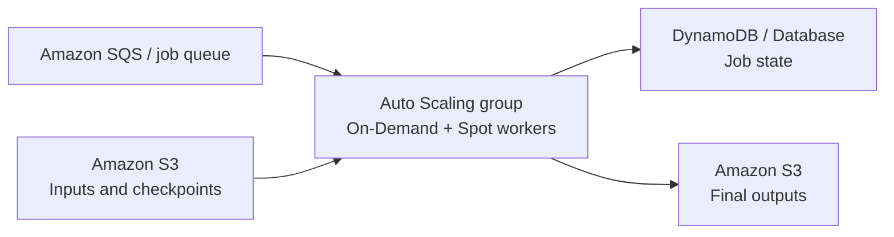

# On-Demand, Spot, and Selecting Compute Capacity

## 1. The EC2 Capacity Selection Problem

An e-commerce application sees steady traffic during business hours, surges sharply during sales campaigns, and must keep checkout available continuously. Meanwhile, the company runs product image generation, log analysis, and automated testing jobs; those jobs can be re-run if a server is interrupted. If everything runs on Amazon EC2 using a single compute purchasing option, the system either **pays more than necessary** or **fails to meet availability requirements**.

Amazon EC2 offers multiple **instance types** and **capacity purchase options**. The two foundational options to master are:

- **On-Demand Instances:** consume EC2 capacity as needed without long-term usage commitments; suited for workloads that must run continuously or cannot tolerate interruptions.
- **Spot Instances:** consume spare EC2 capacity at potentially substantial discounts, in exchange for AWS being able to reclaim capacity when needed or when your maximum price condition is no longer met.

This lesson belongs to the **EC2 Instances** chapter of the **CLOUD_PROVIDERS_AWS** track. Compute capacity must be chosen alongside **Regions/AZs, VPC, IAM, EBS, databases, monitoring, recovery, and cost control**, because a cheap EC2 hourly rate can still become expensive if it causes data loss, API outages, or repeated job retries.

After studying this lesson, you will be able to distinguish On-Demand and Spot, assess workload interruption tolerance, choose suitable instance families/sizes/Regions, combine capacity via Auto Scaling, design Spot interruption handling, and estimate related cost components.

## 2. Three Distinct Decisions When Deploying EC2

When selecting EC2, separate **resource type**, **billing model**, and **capacity assurance**:

| Decision | Question to Answer | Examples |
| --- | --- | --- |
| **Instance type and size** | How many vCPUs, RAM, GPUs, bandwidth, storage, and what CPU architecture does the app need? | `m6i.large`, `c7g.xlarge`, GPU instances |
| **Purchase option** | Pay On-Demand rates or accept Spot interruptions to cut cost? Commit to usage for discounts? | On-Demand, Spot, Savings Plans, Reserved Instances |
| **Capacity availability** | When launching, is enough capacity available in the target AZ/instance type? Must capacity be reserved ahead of time? | On-Demand Capacity Reservation, Zonal Reserved Instance, Capacity Blocks where supported |

**Cost discounts** and **capacity reservations** are separate goals. For instance, a **Savings Plan** typically reduces bills for eligible compute usage but **does not reserve** a specific EC2 instance in an AZ. Conversely, an **On-Demand Capacity Reservation** holds launch capacity in a matching AZ, but reserved capacity can incur charges even while unused.

```text
Application Requirements
    |
    +-- Performance: vCPU / RAM / GPU / network / storage -> Choose instance type
    |
    +-- Interruption-tolerant? ------------------------+-> On-Demand vs. Spot
    |                                                  |
    +-- Long-term predictable usage? ------------------+-> Savings Plans / RI
    |
    +-- Guaranteed capacity in specific AZ/time? ------> Capacity Reservation
    |
    +-- Time-varying load? ----------------------------> Auto Scaling
```

## 3. On-Demand Instances: Flexible with Minimal Commitments

**On-Demand** lets you launch, run, stop, or terminate EC2 instances as needed. You pay under On-Demand pricing rules based on OS, instance type, Region, and instance state. You do not need a one- or three-year commitment just to start running an instance.

### 3.1. When Is On-Demand Suitable?

- Web/API servers with **high availability requirements**, especially the minimum baseline capacity that must always serve users.
- Systems with variable demand, unknown duration, or insufficient historical data to commit long-term spend.
- *Stateful* workloads that are hard to checkpoint or rerun, such as certain transaction processors or legacy apps storing state locally.
- Test environments or urgent tasks needing machines immediately for short periods where flexibility outweighs discounts.
- The **baseline capacity** of an Auto Scaling group, which can later be discounted via Savings Plans or Reserved Instances.

For example, an API system requires at least two EC2 instances running across two Availability Zones to avoid single-AZ dependency. You can use On-Demand for those two baseline instances and Spot only for extra scale-out instances during peaks, provided the application handles losing those extra instances cleanly.

### 3.2. Misconceptions About On-Demand

**On-Demand does not guarantee reserved capacity.** If an AZ lacks capacity for the chosen instance type, an On-Demand launch can still fail with *InsufficientInstanceCapacity*. Use multiple AZs/instance types or Capacity Reservations when guaranteed launch-time capacity is mandatory.

**On-Demand is not always cheap.** Idle or oversized instances still generate significant bills. Beyond compute, costs can accrue from **EBS volumes, snapshots, data transfer, public IPv4 addresses, Load Balancers, and supporting services**. When EC2 stops, compute charges typically pause per instance/OS billing rules, yet EBS volumes and remaining resources keep incurring charges.

**On-Demand does not eliminate infrastructure failures.** Hardware can fail, an AZ can experience disruption, applications can crash, and operators can accidentally terminate machines. High availability comes from Auto Scaling, load balancing, multi-AZ deployment, backups, and recovery workflows—not from a single purchase option.

## 4. Spot Instances: Lowering Costs with Spare Capacity

**Spot Instances** use AWS's unused EC2 capacity. Spot prices fluctuate over time based on capacity supply and demand; savings can be substantial compared to On-Demand for the same instance type and Region. However, **AWS can interrupt Spot Instances** when reclaiming capacity or when your configured maximum price condition is no longer met. Consequently, Spot fits **fault-tolerant, interruptible** workloads.

### 4.1. How Can Spot Be Interrupted?

When a Spot Instance is interrupted, the action can be **terminate**, **stop**, or **hibernate**, depending on configuration and support. `Terminate` is the common default in many launch flows. `Stop` preserves resources like EBS per configuration rules, while `hibernate` saves RAM state to EBS to resume later, though it requires compatible instance/AMI/root volume settings and carries specific constraints.

AWS issues a **Spot Instance interruption notice** typically around **two minutes before** a Spot Instance is *terminated* or *stopped*. For *hibernate*, the process can begin immediately without the two-minute warning window. Moreover, applications **must not assume they will always receive a full two minutes** to clean up, since hardware failures or other events can halt processes abruptly.

Spot Instances can also receive a **rebalance recommendation** when AWS detects an elevated risk of interruption. This signal may arrive ahead of an interruption notice, though it is **not guaranteed**. When running inside an EC2 Auto Scaling group with **Capacity Rebalancing** enabled, the group can proactively find and launch a replacement instance before the existing Spot instance is interrupted.

### 4.2. Workloads That Should and Should Not Use Spot

| Workload Category | Spot Suitability | Design Requirements |
| --- | --- | --- |
| Batch image/video processing or ETL jobs | **Highly suitable** | Break into small tasks, checkpoint state, retry, idempotency |
| CI/CD builds/tests, batch simulations | **Suitable** | Ability to re-run jobs if an executor disappears |
| SQS queue worker consumers | **Suitable** | Message visibility timeouts, retries, dead-letter queues, deduplication |
| **Stateless** Web/API behind Auto Scaling | **Can be suitable** | On-Demand baseline, load balancer, multi-AZ, draining, healthy capacity |
| Checkpointed ML training | **Can be suitable** | Persist models/checkpoints durably, account for rerun overhead |
| Primary database storing state on host | **Usually unsuitable** | Hard to tolerate instance loss and requires strict data consistency |
| Single server of a mission-critical app | **Unsuitable** | Any interruption causes immediate downtime |
| Jobs with hard completion deadlines | **Unsuitable if relying solely on Spot** | Needs stable capacity or fallback options |

Spot can serve part of a web/API tier if **serving users does not depend on any individual Spot Instance staying alive**. An API holding session state solely in one host's RAM must refactor its architecture (e.g., moving sessions to a shared store) before increasing Spot share.

### 4.3. Spot Price, Max Price, and Capacity Availability

Spot pricing is not a fixed rate locked for the instance's lifetime. You can view historical Spot prices by instance type, Region/AZ, and OS platform; historical data **is not** a promise of future pricing or capacity. You can set a **maximum price** on a Spot request, though AWS generally recommends **not setting max price too low**, as doing so increases interruption risk when prices move; the default max price normally tracks the corresponding On-Demand rate.

Important caveat: an instance type showing a low Spot price **does not mean** sufficient Spot capacity is available to launch. Allocation depends on each **Spot capacity pool** (typically tied to instance type and Availability Zone). Relying on a single instance type in a single AZ can fail at scale even when console prices look very attractive.

## 5. Comparing On-Demand, Spot, and Related Options

| Option | Purpose | Spot Reclamation Risk | Commitment / Reservation | Suitable Examples |
| --- | --- | --- | --- | --- |
| **On-Demand** | Flexibility, pay-as-you-go | Not subject to Spot reclamation | No long-term commitment; does not reserve capacity | Baseline APIs, non-interruptible apps |
| **Spot** | Lower cost via spare capacity | **Yes**; can be terminated/stopped/hibernated | No continuous capacity guarantee | Batch, CI, stateless workers |
| **Compute Savings Plans** | Discounts on eligible EC2 and certain other compute usage | Depends on discounted usage type; does not turn On-Demand into Spot | Commit to **hourly spend** for 1 or 3 years; no capacity reservation | Compute workloads with steady baseline usage |
| **EC2 Instance Savings Plans** | Discounts on EC2 within committed family and Region | Does not introduce Spot reclamation | Commit to hourly spend; no capacity reservation | Steady EC2 demand per family/Region |
| **Reserved Instances (RI)** | Discounts on matching usage | Not Spot | Term commitment; **Zonal RI** also reserves matching AZ capacity, **Regional RI** does not | Steady EC2 usage matching RI terms |
| **On-Demand Capacity Reservation** | Reserves capacity for a specific instance config in an AZ | Not Spot | Capacity reservation; bills even if reserved capacity goes unused | Events needing guaranteed machines on time |

**Savings Plans and Reserved Instances are fundamentally commitment/discount models**, separate from whether a workload tolerates Spot interruptions. You can apply commitment discounts to steady-state On-Demand baselines while keeping Spot for elastic spikes. Discount eligibility, service scope, and Capacity Reservation behaviors have specific rules; review actual product terms and contracts.

### 5.1. Capacity Reservations Do Not Equal Cost Savings

An **On-Demand Capacity Reservation** holds capacity for exact attributes such as instance type, platform, tenancy, and AZ. If reserved capacity is not consumed by matching instances, you can still be billed for the reserved capacity per billing rules. Governance policies should specify when to cancel reservations to prevent waste.

Specialized GPU/ML workloads can use **EC2 Capacity Blocks for ML** where supported; this reserves capacity for a scheduled time window under service-specific terms and should not be conflated with Spot or assumed available for every instance type.

## 6. Choose the Right Instance Type Before Comparing Prices

Many “On-Demand vs. Spot?” decisions go wrong if the initial instance is oversized or mismatched to the workload. EC2 organizes **instance families** optimized for different profiles:

| Group | Example Families | Characteristics and Typical Workloads |
| --- | --- | --- |
| General purpose | `M`, `T` | Balanced CPU/RAM; web apps, business services; `T` uses CPU credits |
| Compute optimized | `C` | CPU-intensive tasks like encoding, builds, computation |
| Memory optimized | `R`, `X` | Caches, in-memory analytics, certain databases |
| Storage optimized | `I`, `D`, `H` (by generation/availability) | High I/O loads or specialized local storage needs |
| Accelerated computing | `G`, `P`, `Inf`, `Trn` | GPUs, inference, training, and specialized accelerators |

Family letters are only **a starting hint**, not a substitute for checking per-type specs. Verify generation, vCPU count, memory, EBS performance, network bandwidth, CPU architecture, Region/AZ availability, and software compatibility. For example, an x86_64 AMI and x86-compiled binaries will not run directly on **AWS Graviton (Arm64)** instances; you must choose matching AMIs, container images, and dependencies for the target architecture.

### 6.1. Data-Driven Right-Sizing

A sound sizing workflow:

1. Gather real metrics: CPU, RAM (via CloudWatch Agent or equivalent), network, EBS throughput/IOPS, request latency, queue depth, and business metrics.
2. Distinguish **average utilization** from **peak hours** and daily/weekly variance. Never downsize solely because average CPU is low if RAM or network peaks approach limits.
3. Shortlist a few instance types with suitable CPU/RAM ratios, matching architecture/AMI, and multi-AZ availability; benchmark under representative load.
4. Re-measure SLOs, cost per transaction or per job, scaling behavior, and impact when an instance disappears.
5. Scale instance count via Auto Scaling rather than always scaling instance size up. For apps that resist horizontal scaling, vertical sizing or architectural refactoring may be needed.

**T-series instances** use CPU credits; in Unlimited mode, sustained CPU above baseline can incur surplus charges under service terms. If an app runs sustained high CPU, choosing T-series merely for a low list price can be suboptimal compared to an appropriate compute or general-purpose family.

### 6.2. Inspecting Instance Types and Offerings via CLI

Example **read-only** commands using your configured account and Region:

```bash
# Compare specs across several instance types; pricing is not returned by this API
aws ec2 describe-instance-types \
  --instance-types m6i.large m6a.large m5.large \
  --region ap-southeast-1 \
  --query 'InstanceTypes[*].[InstanceType,VCpuInfo.DefaultVCpus,MemoryInfo.SizeInMiB]' \
  --output table

# Check which types AWS offers in each AZ of the Region
aws ec2 describe-instance-type-offerings \
  --location-type availability-zone \
  --filters Name=instance-type,Values=m6i.large,m6a.large,m5.large \
  --region ap-southeast-1 \
  --output table
```

**Being offered in an AZ does not guarantee immediate live capacity**, especially for Spot. These queries also do not compute instance, EBS, IPv4, or data transfer pricing; use pricing pages, Cost Explorer, Billing, and real deployment results for cost modeling.

## 7. Selecting Capacity Based on Workload Requirements

Before deciding on a Spot ratio, classify workloads by *criticality*, *recoverability*, and *elasticity*:

| Criterion | Questions to Ask the App Team | Consequence for Choosing Spot |
| --- | --- | --- |
| **Statefulness** | Is user/process state stored on the machine? | If yes, externalize state to durable services or use On-Demand |
| **Retryability** | Can an interrupted job be safely retried? | If not idempotent, Spot raises data corruption risks |
| **Completion deadlines** | Is there a hard deadline or can jobs wait for capacity? | Hard deadlines need On-Demand or appropriate fallback capacity |
| **Horizontal scalability** | Can you add/remove many small instances? | Horizontal scaling makes type and AZ diversification easier |
| **Baseline demand** | What minimum load must always stay up? | Keep baseline on On-Demand, use Spot above baseline |
| **SLO/RTO targets** | How does losing one worker affect APIs or data? | Requires load balancers, retries, queues, and multi-AZ design |
| **AZ affinity** | Must compute sit in the same subnet/AZ as a DB or appliance? | Fewer AZs mean fewer Spot capacity pools |

### 7.1. Practical Decision Rules

**Prefer On-Demand** when resources must stay stable even during Spot shortages, cannot restart safely, or act as a single link in a critical path. **Prefer Spot** for interruptible, retryable workers that can span multiple pools and preserve results safely.

**Combine both** for stateless web/APIs, event-driven processors, or deadline-sensitive batches: keep the baseline on On-Demand, distribute extra scale onto Spot, and enable On-Demand fallback when Spot capacity is unavailable. Never lock in a fixed Spot percentage before defining SLOs and acceptable interruption rates.

## 8. Designing Applications to Tolerate Spot Interruptions

### 8.1. Decoupling State from Instance Lifecycles

Treat every Spot Instance as a resource that **can disappear at any moment**. Never store the sole copy of data on a Spot Instance's local filesystem or **instance store**; instance store does not survive instance termination. For EBS, understand `DeleteOnTermination`, snapshot policies, and termination behavior. Even with persistent EBS volumes, spinning up a replacement requires an automated volume re-attachment or data recovery workflow.

Common architecture pattern:



Workers pull tasks from the queue, process chunks, and write checkpoints to S3/DynamoDB. If a Spot Instance is terminated, a replacement worker picks up the task and resumes or safely retries.

**Idempotency** is essential: a message may be delivered more than once due to timeouts/retries. If a job processes payments or mutates data, enforce idempotency keys, transactions/conditional writes, or deduplication—never rely solely on a queue “usually” delivering once.

### 8.2. Handling Short Spot Interruption Signals

A handling workflow upon receiving an **interruption warning**:

1. Receive the signal via **Amazon EventBridge** or **EC2 Instance Metadata Service (IMDS)** depending on your integration.
2. Stop accepting new work; put the worker into *draining* state or deregister from load balancer targets.
3. Persist checkpoints and job status durably; extend/reset queue message visibility as appropriate.
4. Finish or hand off in-flight requests within the remaining time window.
5. Let Auto Scaling or orchestration launch a replacement instance; verify output integrity after restart.

**Do not rely on a single shutdown script** to guarantee zero loss: signals can arrive late, checkpoint writes can fail, and Spot hibernation skips the stop/terminate warning window. Jobs should checkpoint periodically rather than waiting until the last moment.

Reading Spot interruption notices from **IMDSv2** inside an illustrative EC2 instance:

```bash
# Run inside an EC2 instance; do not run from a normal laptop
TOKEN=$(curl -fsS -X PUT \
  'http://169.254.169.254/latest/api/token' \
  -H 'X-aws-ec2-metadata-token-ttl-seconds: 60')

# If no interruption action is pending, the endpoint typically returns HTTP 404
curl -fsS \
  -H "X-aws-ec2-metadata-token: $TOKEN" \
  'http://169.254.169.254/latest/meta-data/spot/instance-action'
```

This command only **reads metadata** to inspect status—it is not a complete handler. Real applications should use an agent/SDK or EventBridge, handle HTTP 404s and timeouts, throttle polling, and test interruption behavior. Avoid enabling IMDSv1 for convenience; on modern EC2 instances enforce IMDSv2 and metadata access controls.

### 8.3. Capacity Rebalancing and Proactive Replacement

When running Spot via **EC2 Auto Scaling**, enable **Capacity Rebalancing** so the group can launch replacement instances upon receiving a **rebalance recommendation**, before the older instance is actually interrupted. Ensure the group spans diverse capacity pools and implements appropriate **instance termination lifecycle** hooks when draining connections.

Capacity Rebalancing **does not guarantee fresh Spot capacity is always available**, nor does it guarantee zero interruption. If Spot losses drop capacity below SLO minimums, ensure a sufficient On-Demand baseline or explicit fallback strategy.

## 9. Combining On-Demand and Spot with EC2 Auto Scaling

An **EC2 Auto Scaling group (ASG)** manages instance counts via `min`, `desired`, `max`, and scaling policies. With a **mixed instances policy**, an ASG can combine multiple instance types and split capacity between On-Demand and Spot by ratio.

```text
                   Application Load Balancer
                            |
              +-------------+-------------+
              |                           |
          AZ A / subnet                AZ B / subnet
       +----------------+            +----------------+
       | On-Demand      |            | On-Demand      |
       | Spot           |            | Spot           |
       +----------------+            +----------------+
              \                           /
               +---- EC2 Auto Scaling ----+
                     mixed capacity
```

The goal is keeping a **highly reliable baseline** while using Spot for load-driven elasticity. Diversify AZs and instance types; if one pool lacks Spot capacity, the ASG can select another pool according to its allocation strategy and configured overrides.

### 9.1. Key Parameters

| Parameter | Role | Illustrative Example |
| --- | --- | --- |
| `MinSize` | Minimum instance floor for the ASG | `2` |
| `DesiredCapacity` | Target instance/capacity count at that moment | `6` |
| `MaxSize` | Upper scaling limit of the group | `12` |
| `OnDemandBaseCapacity` | Baseline capacity fulfilled with On-Demand first | `2` |
| `OnDemandPercentageAboveBaseCapacity` | Percentage of capacity **above base** using On-Demand | `50` |
| `SpotAllocationStrategy` | How Spot capacity pools are selected | `price-capacity-optimized` |
| `CapacityRebalance` | Proactively replace Spot on rebalance recommendation | `true` |

In a simple unweighted example, `DesiredCapacity=6`, `OnDemandBaseCapacity=2`, and `OnDemandPercentageAboveBaseCapacity=50` targets **4 On-Demand + 2 Spot**: two On-Demand base instances, plus the four above-base instances split 50/50 between On-Demand and Spot. Actual counts can differ temporarily during scaling transitions, capacity constraints, instance selection, or weighted capacity setups.

### 9.2. Example Mixed Instances Policy

Assume a **launch template** configured with a compatible x86_64 AMI, IAM instance profile, security group, user data, and EBS. Example file `mixed-instances-policy.json`:

```json
{
  "LaunchTemplate": {
    "LaunchTemplateSpecification": {
      "LaunchTemplateId": "lt-0123456789abcdef0",
      "Version": "$Latest"
    },
    "Overrides": [
      { "InstanceType": "m6i.large" },
      { "InstanceType": "m6a.large" },
      { "InstanceType": "m5.large" }
    ]
  },
  "InstancesDistribution": {
    "OnDemandBaseCapacity": 2,
    "OnDemandPercentageAboveBaseCapacity": 50,
    "SpotAllocationStrategy": "price-capacity-optimized"
  }
}
```

The example types are all x86_64 with comparable CPU/RAM profiles; **never mix in Arm64/GPU/instances requiring a different AMI** without verifying compatibility. AWS may not offer every type in every AZ/Region. `lt-...` is a placeholder; this file is a **configuration snippet** requiring a real launch template.

After picking two subnets in different AZs and creating an Application Load Balancer target group, the AWS CLI syntax to create the group looks like:

```bash
aws autoscaling create-auto-scaling-group \
  --auto-scaling-group-name shop-api-asg \
  --min-size 2 \
  --max-size 12 \
  --desired-capacity 6 \
  --vpc-zone-identifier 'subnet-11111111111111111,subnet-22222222222222222' \
  --mixed-instances-policy file://mixed-instances-policy.json \
  --target-group-arns 'arn:aws:elasticloadbalancing:ap-southeast-1:123456789012:targetgroup/shop-api/0000000000000000' \
  --health-check-type ELB \
  --capacity-rebalance \
  --region ap-southeast-1
```

**Do not run the example verbatim**: the launch template, subnets, target group ARN, and account ID must be replaced with real resources. The command also requires IAM permissions and sufficient EC2/Auto Scaling quotas. Before deploying, verify subnet AZs, AMI architecture, instance profile, target group health checks, auto-start readiness, and managed secret retrieval.

### 9.3. Choosing a Spot Allocation Strategy

- **`price-capacity-optimized`:** picks Spot pools balancing both price and capacity availability; a strong default for many modern workloads.
- **`capacity-optimized`:** prioritizes pools with the deepest available capacity to lower interruption risk, accepting higher variance in price.
- **`lowest-price`:** prioritizes lowest price; can concentrate instances in pools more prone to interruption and may not yield the lowest total cost once retries are included.
- **Diversification:** provide multiple equivalent instance types across multiple AZs; avoid locking onto one option merely because its spot price looks lowest right now.

Supported strategies vary across EC2 Fleet, Spot Fleet, and Auto Scaling, as well as request types. Do not copy parameters from a Spot Fleet example directly into an ASG without checking the API. For ASG mixed instances policies, verify valid strategy names and **test actual provisioning** in your target Region.

## 10. Estimating Real Spot Costs and Efficiency

Consider a web system needing an average of **10 instances** running continuously for 30 days. Suppose On-Demand costs **\$0.10/hour** and observed Spot averages a **hypothetical \$0.04/hour**. These are **hypothetical numbers for practicing the methodology**, not published rates for a specific Region/instance type.

| Scenario | Calculation for 720 Hours | Hypothetical Compute Cost |
| --- | --- | ---: |
| 10 On-Demand | `10 × 720 × 0.10` | **\$720.00** |
| 10 Spot | `10 × 720 × 0.04` | **\$288.00** |
| 4 On-Demand + 6 Spot | `(4 × 720 × 0.10) + (6 × 720 × 0.04)` | **\$460.80** |

Under ideal conditions, the mixed scenario saves `720 − 460.80 = $259.20`, or **36% of EC2 compute cost** compared to all On-Demand. However, this math **omits**:

- Periods where Spot fails to allocate enough capacity, queueing delays, or On-Demand fallback usage.
- Rework caused by Spot interruptions, failed jobs, bandwidth, and leftover EBS volumes/snapshots.
- Load balancers, cross-AZ/Internet data transfer, logs, public IPv4 addresses, and auxiliary services.
- Existing Savings Plans/RIs covering On-Demand usage, which alter marginal cost comparisons.
- Time-varying Spot prices and hourly Auto Scaling instance count changes.

A better metric is **cost per useful outcome**: USD per 1,000 successful requests, USD per 1,000 completed images, or USD per effective compute-hour of batch work, alongside **latency and error-rate SLOs**. If a cheap Spot price causes a job to retry three times, compute bill savings may mask higher total cost.

## 11. Quotas, Regions/AZs, and Capacity Shortage Risks

You cannot scale infinitely just by raising `DesiredCapacity`. AWS enforces EC2 vCPU **Service Quotas** by instance category, typically separating On-Demand and Spot usage scopes. Beyond quotas, each **Region/AZ and capacity pool** has finite physical availability at request time.

Three distinct failure modes:

| Symptom | Common Cause | Resolution |
| --- | --- | --- |
| `VcpuLimitExceeded` or similar quota error | Exceeded applicable quota for the instance category/purchase type | Check Service Quotas in the exact account/Region; request quota increases where supported |
| `InsufficientInstanceCapacity` | AZ/type lacks physical capacity at launch time | Add AZs, try alternate instance types, retry later, or use an appropriate Capacity Reservation |
| Spot requests unfulfilled or frequently interrupted | Insufficient Spot capacity in selected pools | Diversify types/AZs, use suitable allocation strategies, reduce reliance on a single Spot pool |

**Increasing a quota does not create physical capacity immediately.** Conversely, an instance type with ample physical capacity will still be blocked if your account quota is too low. For major launches, verify both layers early—and assess whether the workload truly requires a specific size/AZ or can stay flexible.

### 11.1. Example: Checking Spot Price History and Quotas

```bash
# View a sample of Spot price history in the selected Region;
# historical prices do not guarantee future capacity.
aws ec2 describe-spot-price-history \
  --instance-types m6i.large \
  --product-descriptions 'Linux/UNIX' \
  --max-results 10 \
  --region ap-southeast-1

# List applicable/adjustable EC2 quotas in the Region
aws service-quotas list-service-quotas \
  --service-code ec2 \
  --region ap-southeast-1
```

Pricing, quotas, and instance type support must always be checked against your live environment; never treat hypothetical examples from a lesson as production defaults.

## 12. Monitoring, Security, and Instance Lifecycle

### 12.1. Monitoring Capacity and Interruptions

Systems using Spot must monitor both **whether the service is healthy** and **whether capacity can be replaced cleanly**:

| Signal | Appropriate Tool | Purpose |
| --- | --- | --- |
| ASG desired/in-service capacity, launch failures | EC2 Auto Scaling metrics, scaling activities | Detect failure to maintain target capacity |
| CPU, network, disk, and memory (with agent) | Amazon CloudWatch / CloudWatch Agent | Right-sizing, scaling policies, bottleneck hunting |
| Spot interruption warnings | EventBridge / EC2 metadata | Drain, checkpoint, and hand off jobs |
| EC2 rebalance recommendations | EventBridge / EC2 metadata, ASG Capacity Rebalancing | Proactively replace at-risk instances |
| Job retries, queue wait times | Application metrics, SQS/worker telemetry | Measure Spot impact on business throughput |
| API errors, latency, unhealthy target rate | Load Balancer, application monitoring | Track SLOs during Spot reclamation events |
| Spend and anomalies | Cost Explorer, AWS Budgets, cost analytics | Verify real savings and catch orphaned resources |

No single threshold fits every workload. For instance, an alarm that an ASG is severely short of capacity during peak production traffic takes priority over a single batch Spot worker being replaced cleanly without hurting progress.

### 12.2. IAM, Networking, and Data Still Require Protection

- **Least-privilege IAM roles** instead of embedding access keys in user data, AMIs, or source code. Protect the Instance Metadata Service with IMDSv2 and restrict metadata access paths.
- **Security groups/NACLs and VPC routes** govern network paths between EC2, Load Balancers, databases, and other services; choosing On-Demand vs. Spot does not change those requirements.
- **EBS encryption, secrets management, backups/snapshots**, and data access controls must be designed independently. EBS volumes can persist after stop/termination depending on configuration; watch for orphaned volumes and storage bills.
- On Spot workers, **never treat local disk as the sole source of truth**. For stateful workloads, assess whether the architecture fits Spot or should move state to managed services.
- **CloudTrail** audits AWS API control-plane actions; application logs and health metrics remain essential for understanding why jobs failed or instances were replaced.

### 12.3. Stop, Terminate, and Hidden Costs

When an EC2 instance **stops**, RAM state is normally lost, while EBS root volumes can persist per configuration. When **terminated**, the instance ends permanently and EBS volumes with `DeleteOnTermination=true` are typically deleted; retained volumes and snapshots keep accruing charges. Spot `stop`/`hibernate` behavior carries special rules and **should not be relied on as a sole persistence mechanism**.

Auto Scaling launches fresh instances when old ones disappear; data, bootstrap config, application artifacts, and credentials must rely on **automated recreation** via AMIs/launch templates, user data, IaC, image registries, and secrets services rather than manual host tweaks.

## 13. Three Real-World Decision Scenarios

### Scenario A — E-Commerce API with Traffic Spikes

An application runs behind an Application Load Balancer, handles stateless requests, uses Multi-AZ RDS, and stores sessions in a shared store. Traffic is low at night and surges several-fold during promotions.

**Sound design:** keep an On-Demand baseline covering minimum load and resilience during Spot dips; use ASG mixed instances to add Spot for traffic spikes. Spread across multiple AZs, enable Capacity Rebalancing, and configure ALB draining/health checks. Once baseline demand has remained steady for months, evaluate Compute or EC2 Instance Savings Plans to discount the On-Demand portion. Measure error rates and latency when an AZ or Spot pool loses capacity.

### Scenario B — Processing 2 Million Images Every Night

Each job pulls an image from S3, builds a thumbnail, and writes the result back to S3. Work parallelizes cleanly, each image has a unique ID, and interrupted jobs can safely restart.

**Sound design:** favor Spot workers in an ASG or Spot-capable batch platform pulling from SQS, with checkpointing/completion markers and deduplication. Allow diverse instance types/AZs and track failed jobs and queue lag. As deadlines near or Spot tightens, mix in On-Demand to protect completion targets. **Do not optimize solely for hourly Spot price**; measure total runtime and retry overhead.

### Scenario C — Legacy Database Running on a Single EC2 Instance

An accounting system keeps state on one EC2 instance writing to an attached volume, with no automated failover or safe instance-rebuilding pipeline. Even though Spot is cheap, an interruption causes downtime and data-consistency risk.

**Sound design:** keep this workload on On-Demand for now while building backups, restore drills, and HA. Evaluate managed database services if requirements allow. Once usage is steady, consider Savings Plans/RIs or Capacity Reservations as needed—never move a primary database directly onto Spot just for a lower hourly rate.

## 14. Pre-Production Checklist

1. **Define SLOs/RTO and data durability:** can the workload lose an instance at any moment; does all critical data reside in durable storage?
2. **Right-size:** measure CPU, RAM, storage/network, AMI/CPU architecture compatibility, and AZ availability.
3. **Separate baseline and burst:** how much minimum capacity uses On-Demand; what is the Spot cap; what is the fallback when Spot runs dry?
4. **Diversify capacity pools:** multiple instance types and AZs with equivalent app characteristics; avoid single-pool dependence.
5. **Automated replacement:** ASG or orchestrator can launch fresh instances and wire them into load balancers/queues with zero manual steps.
6. **Spot handling:** interruption/rebalance monitoring, draining, checkpointing, retries, and idempotency; test simulated instance loss.
7. **Quotas and capacity:** verify vCPU limits, instance offerings, reservation needs, and quota-increase lead times.
8. **Security:** IAM roles, IMDSv2, VPC security, EBS encryption, secrets management, and CloudTrail.
9. **Total cost:** include EBS, IPs, ALB, networking, backups, retries, Savings Plans/RIs, and On-Demand baseline costs.
10. **Monitoring:** track ASG health/capacity, Spot interruptions, SLOs, job retry counts, cost per transaction, and response plans.

## 15. Self-Check Questions

**Question 1.** Should a zero-downtime API run 100% on Spot simply because its hourly price is lower than On-Demand?

**Hint:** No, not without an interruption-resilient architecture. Keep an On-Demand baseline and add Spot when stateless, multi-AZ, Auto Scaled, and equipped with draining/recovery.

**Question 2.** Does purchasing a Compute Savings Plan guarantee `m6i.large` capacity is always available in `ap-southeast-1a` during peak hours?

**Hint:** No. Savings Plans are spend commitments/discounts, not Capacity Reservations. If guaranteed AZ capacity for an exact configuration is required, evaluate Capacity Reservations.

**Question 3.** Does a two-minute Spot termination notice guarantee a job always gets two full minutes to save data?

**Hint:** No. Checkpoint periodically and design retries/idempotency. Notices may leave insufficient shutdown time, especially for hibernation or sudden failures.

**Question 4.** An ASG uses two Spot instance types in a single AZ and repeatedly fails to get capacity. What is the highest-impact improvement?

**Hint:** Expand the list of equivalent instance types across multiple AZs, use `price-capacity-optimized` or another fitting strategy, and blend in On-Demand where needed to protect SLOs.

**Question 5.** An SQS Spot worker is interrupted mid-order. Why is idempotency essential?

**Hint:** Messages can be redelivered. Without idempotency, retries can record duplicate orders, send repeat notifications, or double-charge transactions.

**Question 6.** AWS returns `VcpuLimitExceeded` while the Console shows low Spot prices in an AZ. Can you fix this just by waiting for Spot prices to drop?

**Hint:** No. That is a quota error; inspect Service Quotas and vCPU usage. Spot prices do not raise account quotas.

## 16. Key Takeaways

**On-Demand** fits workloads needing flexibility without Spot reclamation, though it neither reserves capacity automatically nor replaces HA design. **Spot** substantially cuts costs for interruptible workloads, provided you engineer checkpointing, retries, idempotency, capacity diversification, and automated replacement. **Savings Plans/Reserved Instances** optimize spend on steady baselines, while **Capacity Reservations** address holding guaranteed capacity when needed.

In real architectures, strong outcomes come from combining **the right instance type + the right purchase option + Auto Scaling + multi-AZ design + monitoring and data protection**. Evaluate decisions by **cost per SLO-compliant application outcome**, not merely comparing hourly rates between On-Demand and Spot.

### AWS Reference Documentation

- [Amazon EC2 On-Demand Instances](https://docs.aws.amazon.com/AWSEC2/latest/UserGuide/ec2-on-demand-instances.html)
- [Amazon EC2 Spot Instances](https://docs.aws.amazon.com/AWSEC2/latest/UserGuide/using-spot-instances.html)
- [Spot Instance interruption notices](https://docs.aws.amazon.com/AWSEC2/latest/UserGuide/spot-instance-termination-notices.html)
- [Amazon EC2 instance types](https://docs.aws.amazon.com/AWSEC2/latest/UserGuide/instance-types.html)
- [Mixed instances groups in EC2 Auto Scaling](https://docs.aws.amazon.com/autoscaling/ec2/userguide/ec2-auto-scaling-mixed-instances-groups.html)
- [Capacity Rebalancing for EC2 Auto Scaling](https://docs.aws.amazon.com/autoscaling/ec2/userguide/ec2-auto-scaling-capacity-rebalancing.html)
- [EC2 Auto Scaling Spot allocation strategies](https://docs.aws.amazon.com/autoscaling/ec2/userguide/allocation-strategies.html)
- [Amazon EC2 Reserved Instances](https://docs.aws.amazon.com/AWSEC2/latest/UserGuide/ec2-reserved-instances.html)
- [Savings Plans overview](https://docs.aws.amazon.com/savingsplans/latest/userguide/what-is-savings-plans.html)
- [Amazon EC2 On-Demand Capacity Reservations](https://docs.aws.amazon.com/AWSEC2/latest/UserGuide/ec2-capacity-reservations.html)
- [Amazon EC2 Service Quotas](https://docs.aws.amazon.com/AWSEC2/latest/UserGuide/ec2-resource-limits.html)
