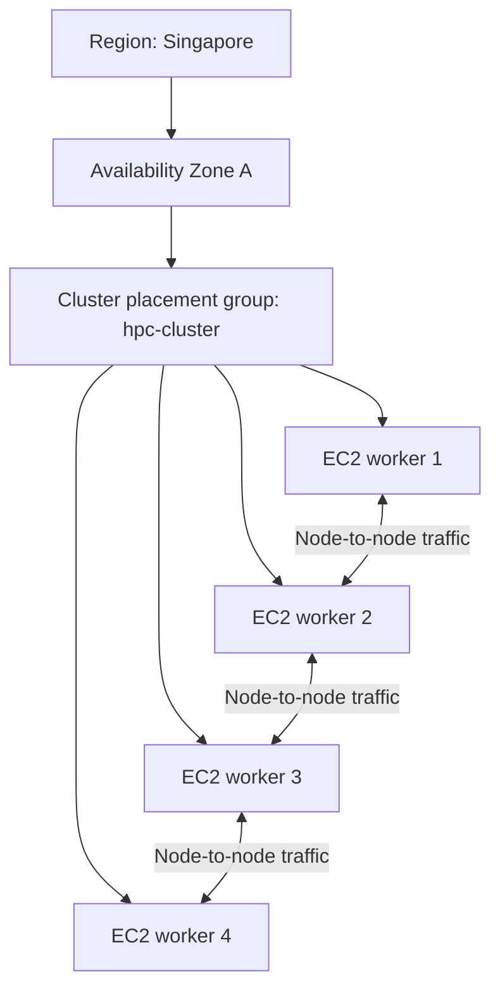
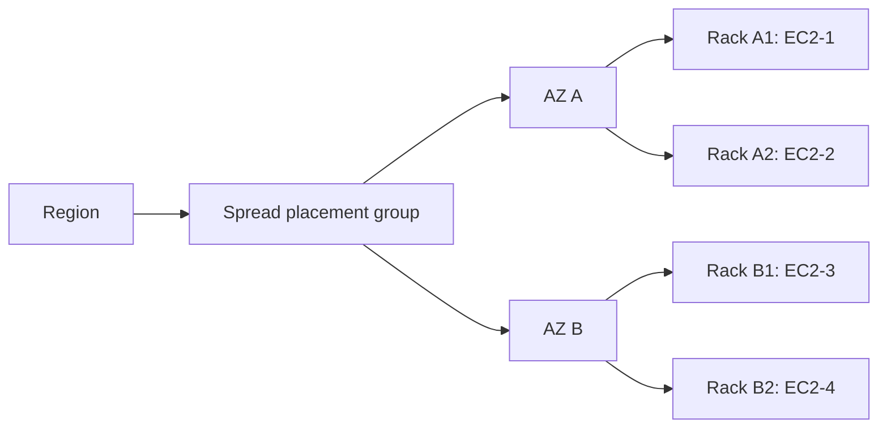
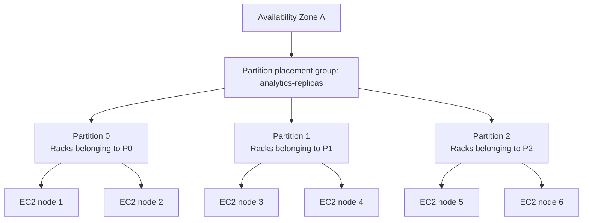
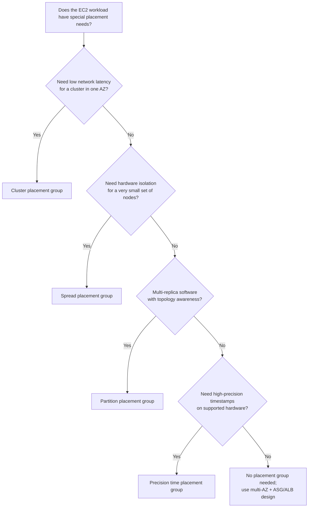
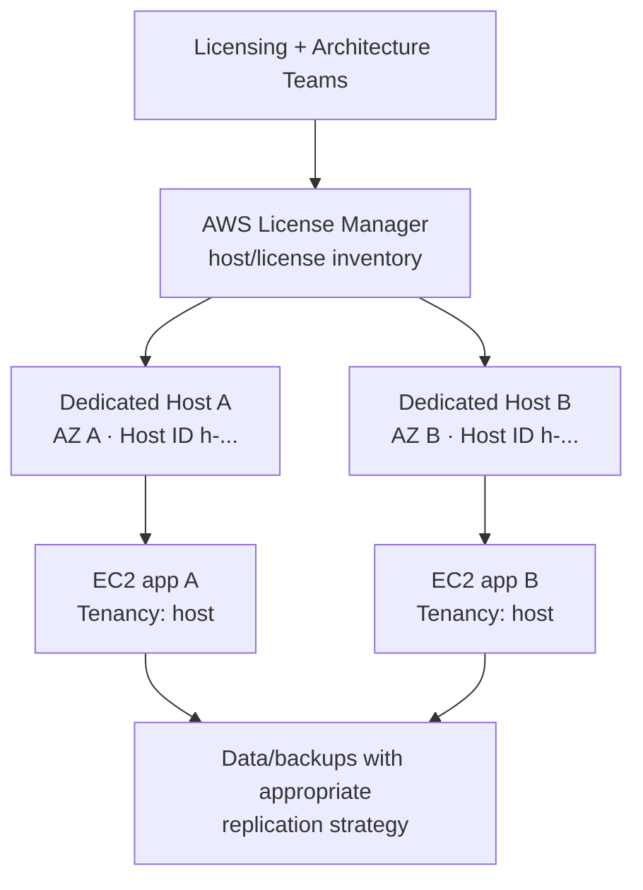

# Placement Groups, Tenancy, and Dedicated Hosts in Amazon EC2

> **Chapter:** EC2 Instances  
> **Module:** CLOUD_PROVIDERS_AWS  
> **Goal:** understand how EC2 instances are placed on AWS physical infrastructure, choose server sharing levels, and meet latency, redundancy, software licensing, and cost-optimization requirements.

## 1. Why Distinguish Placement Groups and Tenancy?

When deploying servers on Amazon EC2, choosing the **instance type**, **AMI**, **subnet**, and **security group** determines only part of the configuration. Two other factors also shape the architecture:

- **Placement group:** instructs AWS to place EC2 instances *close together or separated apart* on physical infrastructure to achieve networking goals, reduce simultaneous hardware failures, or support high-precision time synchronization.
- **Tenancy:** specifies whether EC2 runs on physical hardware shared with other customers, hardware dedicated to a single account, or a dedicated physical server you control via a **Dedicated Host**.

Examples in the AWS Singapore Region:

1. A scientific computing cluster whose EC2 instances constantly exchange data needs **low latency and high bandwidth**.
2. Two critical control-plane machines need to avoid failing together if **a single rack** suffers a fault.
3. A Kafka/Cassandra cluster with many nodes needs **replicas split across independent rack groups**.
4. An enterprise has software licenses bound to **physical core counts, sockets, or physical servers**, needing host IDs and placement visibility.
5. A standard web API simply needs **Auto Scaling across multiple Availability Zones (AZs)** and has no special physical hardware requirements.

These five scenarios should not use the same EC2 configuration. This lesson explains **how to choose the right mechanism for each goal**, along with the limits and costs to verify.

### 1.1. Three Location Layers to Remember

| Layer | Function | Example |
|---|---|---|
| **Region** | AWS geographic deployment area, operational scope for EC2 resources | `ap-southeast-1` — Singapore |
| **Availability Zone** | Fault-isolation boundary within a Region | `ap-southeast-1a`, `ap-southeast-1b` per account |
| **Physical infrastructure/rack/host** | Actual server location inside an AZ | Managed by AWS; users do not normally select racks by ID |

A **placement group** sets a relative placement policy among instances. A **Dedicated Host** gives control over a dedicated physical server. Neither creates a new AZ, and dedicated tenancy does not automatically make a system tolerant of an AZ failure.

## 2. What Is a Placement Group?

An **Amazon EC2 placement group** is a logical grouping with a **placement strategy** that influences how AWS places instances. It is not a subnet, VPC, security group, Auto Scaling group, or a fleet of physical servers you own.

A placement group:

- Is a **Region**-scoped resource; the chosen strategy governs how one or more AZs are used.
- Can be referenced at EC2 launch time to place instances according to the strategy.
- An EC2 instance can belong to **only one placement group at a time**.
- Is optional; not every EC2 workload needs a placement group.
- Creating a placement group **carries no separate fee**; EC2 instances, reserved capacity, and data transfer still bill normally.
- Has constraints on instance types, AZs, node counts, and hardware availability; verify before deploying.

AWS documentation currently describes **four strategies**:

| Strategy | Primary Goal | Placement Pattern | Typical Use Cases |
|---|---|---|---|
| **Cluster** | Low network latency, high inter-node bandwidth | Packs instances inside **one AZ**, on closely connected networking | HPC, parallel computing, node-to-node network-intensive apps |
| **Spread** | Prevent critical instances from failing together due to shared hardware | Places each instance on an independent rack (rack-level in a Region) | A small number of critical nodes needing hardware separation |
| **Partition** | Isolate node/replica groups across distinct rack sets | Divides EC2 instances into **partitions**; each partition uses separate racks | Kafka, Cassandra, HDFS, HBase, topology-aware distributed systems |
| **Precision time** | Higher-accuracy time sync and timestamps | Places on hardware supporting high-precision time sources | Trading, latency measurement, apps needing precise timestamps |

**Naming warning:** “cluster” in a placement group is only a **physical/network placement strategy**. It does not automatically install Kubernetes, MPI, Hadoop, replication, or health checks.

## 3. Cluster Placement Group: Optimizing Inter-Node Communication

### 3.1. How It Works

A **cluster placement group** packs EC2 instances into a single AZ within infrastructure offering high-bandwidth network connectivity. The goal is minimizing latency and maximizing throughput among instances exchanging heavy traffic.



Unlike EC2 instances spread across a Region, instances in a cluster placement group run within **a single AZ**. AWS aims to provide a networking topology suited for fast inter-instance traffic, though **actual throughput and latency remain bounded by instance type, network interfaces, traffic patterns, and application behavior**.

### 3.2. When Should You Use It?

- **High Performance Computing (HPC):** parallel jobs constantly exchanging messages between nodes.
- Large analytics, simulation, or distributed workloads **sensitive to node-to-node latency**.
- Workloads optimizing east-west traffic among EC2 instances inside the same AZ.

**Do not use by default for ordinary web APIs.** If your primary goal is surviving an AZ outage, a cluster placement group does not satisfy that requirement because it is confined to **one AZ**.

### 3.3. Limits and Trade-Offs

- A cluster placement group **does not span multiple AZs**.
- Not every instance family/type is supported; for example, certain **burstable** types are excluded from the cluster strategy. Check the current supported list before choosing configurations.
- When adding instances to an existing cluster, AWS may return **insufficient capacity** if matching hardware is unavailable in that exact location.
- Mixing multiple instance types makes finding capacity harder; AWS recommends using uniform instance types where practical.
- Clusters improve the likelihood of high-performance networking, yet nodes still share AZ-level risk and other shared dependencies.
- Creating a placement group **does not automatically reserve EC2 capacity**. For some workloads, an **On-Demand Capacity Reservation** targeted into a cluster placement group can reserve capacity; verify eligibility.

**Example:** an HPC system runs 16 nodes in AZ A. The team needs lower latency than usual so they choose a cluster group; operations must simultaneously implement **data checkpointing** to EBS/S3 or durable storage to recover if AZ A becomes unavailable.

## 4. Spread Placement Group: Reducing Correlated Hardware Failures

### 4.1. How It Works

With a **spread placement group**, AWS places each EC2 instance on an **independent rack** at the rack level within an AWS Region. Each rack has independent power and networking in AWS's infrastructure design, reducing the risk of multiple instances failing simultaneously due to one rack fault.



Separating racks does not isolate every failure mode: software bugs, bad configs, application errors, or a full AZ outage can still impact multiple nodes. To survive AZ failures, combine spread placement with distribution across **multiple AZs** where supported.

### 4.2. When Should You Use It?

- A small set of machines with **independent, critical roles**.
- Coordinator/control nodes where simultaneous hardware failure would have severe impact.
- Small instance counts requiring stronger rack separation than default placement.

### 4.3. Limits to Remember

- A **rack-level spread placement group** can span multiple AZs within the same Region.
- In an AWS Region, the limit is **7 running instances per AZ** for a rack-level spread placement group.
- For example, across 3 AZs you can in principle place up to 21 running instances in one spread placement group, provided capacity and other limits allow.
- When not enough distinct racks are available, launching/starting instances can fail.
- **Spread placement groups do not support Dedicated Instances** under current AWS limits.
- You can create multiple spread placement groups if you need more nodes, though **there is no rack-separation guarantee across two independent groups**.

> **Distinction needed:** AWS Outposts offers a host-level spread option with its own limits. In this lesson, the primary focus is **rack-level spread in an AWS Region**.

## 5. Partition Placement Group: Isolating Replica Groups

### 5.1. How Does a Partition Differ from an AZ?

With a **partition placement group**, AWS divides EC2 instances into multiple **logical partitions**. Each partition uses a separate set of racks; two partitions in the same placement group never share the same rack. However, **each partition can hold multiple EC2 instances**.



Key differences:

- **AZ:** large infrastructure boundary within a Region, spanning one or more isolated data centers/facilities.
- **Partition:** isolated rack group so distributed software avoids placing replicas on the same hardware.
- **Spread:** aims for each individual instance to sit on separate hardware/racks, rather than grouping multiple instances per partition.

A partition placement group **can span multiple AZs in a Region**. Each AZ allows up to **7 partitions** per group; instance count is not capped at 7 like spread, and instead follows standard quotas/capacity.

### 5.2. Application Scenarios

A Cassandra cluster stores three replicas of each record. If replicas sit on the same rack, one rack failure can knock out multiple replicas simultaneously. Partition placement groups let the application inspect each node's partition and schedule replicas onto different partitions.

The same reasoning applies to:

- HDFS and HBase distributing blocks/replicas across infrastructure failure domains.
- Kafka distributing brokers/replicas according to physical topology.
- Self-managed distributed databases deployed on EC2.

**Placement groups do not configure replicas for your software.** You must configure Kafka/Cassandra/HDFS to read node partition/AZ metadata and place data accordingly.

### 5.3. Limits

- Maximum **7 partitions per AZ**.
- AWS tries to balance instances fairly evenly, yet **does not guarantee equal node counts** across partitions.
- When isolated rack hardware for a partition is exhausted, launches/starts can fail.
- When using **Dedicated Instances**, partition placement groups are capped at **2 partitions** per AWS documentation.
- Standard Capacity Reservations **do not guarantee capacity within specific partitions** of a partition placement group; validate launch and recovery plans realistically.

## 6. Precision Time Placement Group: Time Accuracy

AWS also offers **precision time placement groups**, focused on accessing high-precision time synchronization sources on supported hardware.

It fits when:

- High-confidence timestamps are needed to measure transaction or network latency.
- Time coordination is required in financial, telemetry, or specialized logging applications.
- Workloads run on **instance families/generations listed as supported by AWS**.

**Do not confuse with cluster placement groups:** precision time targets accurate clock sync, not packing machines closest together to minimize network latency. AWS enforces Regional, instance-type, and capacity requirements; consult **Amazon Time Sync Service** documentation and current supported instance lists. If eligible hardware is unavailable, launch/start can fail.

For an ordinary web API needing consistent logs, standard EC2 time synchronization is usually sufficient; a precision time placement group is generally unnecessary.

## 7. Comparing and Choosing a Placement Strategy

| Question | Cluster | Spread | Partition | Precision Time |
|---|---|---|---|---|
| Primary goal | Network latency/throughput | Reduce simultaneous hardware faults for **individual instances** | Separate racks by **node/replica groups** | High-accuracy clock synchronization |
| Number of AZs | **One AZ** | Multiple AZs in one Region | Multiple AZs in one Region | Per service support conditions |
| Scale fit | Tightly coupled chatty clusters | Small set of critical instances | Large multi-node distributed workloads | Specialized instances needing precise timestamps |
| Packing/separation | Packed close together | One instance per rack | One partition per distinct rack set | Hardware supporting precision time source |
| Risks | Shared AZ fault domain, harder capacity expansion | 7 instances/AZ cap and rack limits | Needs partition-aware software, rack availability | Limited instance types/hardware |
| Common examples | HPC, MPI | Small HA control nodes | Kafka, Cassandra, HDFS | High-precision time measurement |

### 7.1. Decision Flowchart



A workload needing both high-performance HPC and multi-AZ redundancy cannot be solved by placing **the same cluster placement group** across two AZs. Decouple intra-AZ performance from AZ-failure recovery via data architecture, checkpoints, multiple clusters, or other strategies.

## 8. What Is Tenancy in EC2?

**Tenancy** defines how EC2 shares **physical hardware** with other AWS customers. For EC2 inside a VPC, the main values are:

| Instance Tenancy | Meaning | Physical Host Control |
|---|---|---|
| `default` | Instance runs on shared hardware; other AWS accounts may share the physical server | Cannot pick a specific host |
| `dedicated` | **Dedicated Instance:** runs on hardware dedicated to your account, isolated from other customers' instances | Cannot select host ID or bind host affinity |
| `host` | EC2 runs on an allocated **Dedicated Host**, allowing host/affinity targeting and hardware visibility | Exposes host ID, physical attributes, and per-host capacity control |

**Tenancy does not equal network security:** `default` EC2 still has AWS virtualization isolation, security groups, IAM, and VPC networking. Switching to `dedicated` does not automatically encrypt data, protect a web app from authorization bugs, or create private network paths.

Tenancy is also **not** the three billing models (On-Demand, Reserved Instances, Spot). Billing and capacity reservations can interact with tenancy, yet tenancy is a separate dimension.

### 8.1. VPC Tenancy vs. Instance Tenancy

A VPC has an **instance tenancy** attribute:

- VPC tenancy **`default`**: new instances default to `default`; specialized tenancy can be chosen when instance types and services allow.
- VPC tenancy **`dedicated`**: instances in the VPC run as Dedicated Instances by default; options for other tenancies are constrained by VPC and instance rules.
- **`host` is an instance tenancy**, not a tenancy value used when creating a VPC.

Important configuration rules:

- You can change a VPC from **`dedicated` → `default`** via API/CLI where supported; existing instances **do not automatically change tenancy** along with the VPC.
- You cannot change a VPC from **`default` → `dedicated`** after creation. If a VPC must default to dedicated from the start, set it at VPC creation time.
- You can change tenancy on certain **stopped EC2 instances** via API, though eligibility depends on OS, instance type, licensing, and AWS rules; not every transition path is supported.

**Design lesson:** if only a few EC2 instances must run dedicated, consider setting dedicated tenancy on those specific instances inside a `default` VPC rather than forcing the entire VPC to `dedicated`. Always check compliance requirements and service compatibility.

## 9. How Dedicated Instances Differ from Dedicated Hosts

Both options involve single-tenant hardware, yet their level of control differs.

| Criterion | Dedicated Instance (`dedicated`) | Dedicated Host (`host`) |
|---|---|---|
| Management unit | EC2 instance | Physical server with a host ID |
| Hardware | Dedicated to a single AWS account | Dedicated physical server allocated to you; capacity can be shared with other accounts when sharing is configured |
| User sees sockets/cores/host ID | Not in a host-management sense | Exposes details needed for license tracking |
| Target a specific host | No | Can target a host ID or use auto-placement |
| Host affinity | No | Supported |
| Base billing | Per instance usage plus applicable dedicated fees/rules | Per **allocated host duration**, even if not filled with instances |
| Socket/core/host BYOL | More limited | Broadly supported per license terms |
| Reserved capacity | Matching Reserved Instance / Capacity Reservation options | Dedicated Hosts are allocated and offer Dedicated Host Reservations for discounts (not identical to EC2 Capacity Reservations) |
| Use cases | Physical isolation from other accounts without picking servers | Host-bound licenses, socket/core audits, host ID/affinity, and placement control |

**Important caveat:** Dedicated Instances may share a physical host with other instances belonging to the **same AWS account**, including non-Dedicated instances, as documented by AWS. “Dedicated” means isolated from **other customer accounts**, not that only a single VM exists on the server.

With Dedicated Hosts, owners can **share host capacity** with other AWS accounts via supported AWS Resource Access Manager workflows. Thus, do not assume a “dedicated host” can be used by only one AWS account when an organization intentionally enables sharing.

### 9.1. When Are Dedicated Instances Enough?

- Requirement to run on hardware not shared with other AWS customer accounts.
- No need to report socket/core counts or target a specific host ID.
- No software license bound strictly to a single physical host.
- Want standard EC2 operational semantics with isolated tenancy.

Drawbacks: no specific host control, no host affinity, limited BYOL support; compare costs against both `default` and Dedicated Hosts.

### 9.2. When Should You Use Dedicated Hosts?

- Application/OS licenses tied to **physical cores, sockets, VMs, or physical servers** where vendor terms allow BYOL in the cloud.
- Need **host IDs**, hardware topology details, and visibility into instances running on the server.
- Need to bind a workload to run or restart on a specific host using **host affinity**.
- Need to pack compatible instances onto one physical server to control utilization and licensing.

**Never assume all on-premises licenses are valid on Dedicated Hosts.** Software terms from Microsoft, Oracle, database/OS vendors, and other providers vary by contract, licensing program, and time. Work with your licensing team to validate contracts against **AWS License Manager** and vendor documentation before deploying.

## 10. Dedicated Hosts: Allocation, Placement, and Lifecycle

### 10.1. What Kind of Resource Is a Dedicated Host?

A Dedicated Host is allocated by AWS within **one AZ** and has:

- A **Host ID** formatted `h-...`.
- An AZ and state (available, released, maintenance/fault states).
- Supported instance types/configurations and remaining slot capacity.
- Socket and physical core counts for license management.
- Configurable **auto-placement**, **host affinity**, **host recovery**, and **host maintenance** options where supported.
- Usage charges based on the **allocated host**, not merely the number of running EC2 instances.

**Dedicated Hosts belong to a single AZ**; you cannot move one host ID to another AZ. If an app must survive an AZ outage, allocate redundant capacity in a **second AZ**.

### 10.2. Auto-Placement: Manual Host Selection or EC2 Choice?

- **Auto-placement off:** the Dedicated Host accepts only launches explicitly **targeting its host ID**. AWS documents this as the default for newly allocated hosts.
- **Auto-placement on:** instances launched with tenancy `host` can be placed by EC2 onto any compatible Dedicated Host with capacity without specifying a host ID.
- **No host with sufficient capacity:** instance launch/start fails even when regular shared EC2 capacity is plentiful in the Region.

Check **instance family, instance size, host compatibility, AZ, AMI/OS, license constraints**, and quotas when selecting hosts. Some Dedicated Hosts support multiple instance sizes within a compatible family depending on physical layout; do not assume every size mixes freely.

### 10.3. Host Affinity: Binding Instance-to-Host Relationships

**Host affinity** governs whether an instance preserves its relationship with a Dedicated Host across stop/start:

- `host`: instance has affinity to its Dedicated Host; when restarted, EC2 attempts to run it on that bound host per service rules.
- `default`: no permanent host binding; on start, AWS may choose another compatible host per placement rules, though it may prefer the previous host on a best-effort basis.

Keeping affinity helps when licensing terms or workloads require host consistency. However, if that host fails or runs out of capacity, affinity can complicate recovery/restarts; design host recovery and operational plans accordingly.

### 10.4. Dedicated Host Recovery and Maintenance

AWS provides **host recovery** and **host maintenance** mechanisms for eligible setups:

| Capability | Purpose | Key Details |
|---|---|---|
| **Host recovery** | Recover from certain unexpected hardware/availability faults | AWS can allocate a replacement host in the **same AZ** and migrate eligible instances; host ID may change |
| **Host maintenance** | Handle degraded hosts or planned maintenance | Depending on instance, AWS uses live migration or maintenance requiring reboot on a replacement host |
| **Application-level multi-AZ design** | Survive full AZ unavailability | Keep standby workloads/data in **another AZ**; same-AZ host recovery does not cover AZ loss |

Host recovery **is not a data backup mechanism**. Some scenarios are excluded from automatic recovery: hosts scheduled for retirement, stopped instances, certain instance-store configurations, and unsupported cases. Check specific host/instance documentation and test recovery workflows.

For example, if a host in AZ A suffers a hardware fault: when host recovery applies, EC2 can recover eligible instances onto a new host **still inside AZ A**, preserving instance ID, private IP, and EBS attachments per AWS behavior. Yet if **all of AZ A** goes down, you must fail over to AZ B or another Region.

### 10.5. AWS License Manager and Host Resource Groups

**AWS License Manager** helps track licenses and manage **host resource groups** for Dedicated Hosts:

- Manage host lifecycles, with optional automatic host allocation and release where supported.
- Define license usage rules and alert on violations when configured.
- Associate license constraints with compatible workloads or AMIs per supported license types.
- Coordinate capacity/host demand as applications scale.

License Manager supports operations, yet **does not replace legal verification of software contracts**. How host resource groups, host recovery, and host maintenance interact has specific rules; review current AWS docs before toggling settings in production.

## 11. Can Placement Groups and Dedicated Hosts Be Combined Directly?

**Do not treat placement groups as a way to pick a Dedicated Host's rack.** AWS currently specifies that **you cannot launch Dedicated Hosts inside placement groups**. If a workload requires `host` tenancy, design around Dedicated Host **host IDs, AZs, affinity, licensing, and recovery**. Never plan as if AWS will satisfy both a cluster group and a specific physical host simultaneously.

Keep these separate:

1. **Placement groups** influence EC2 placement via cluster, spread, partition, or precision time strategies.
2. **Tenancy `host`** places EC2 on Dedicated Hosts with their own host selection and lifecycle rules.
3. **Tenancy `dedicated`** launches Dedicated Instances; it does not grant ownership/control of a Dedicated Host.
4. **AZ** remains the critical fault boundary. Preventing outage from an AZ loss requires distributing apps and data across another AZ, regardless of placement or tenancy.

Verify this architectural constraint upfront before designing workloads that want both host-based licensing and cluster placement groups.

## 12. Costs: What Are You Paying For?

### 12.1. Placement Groups and Operational Costs

AWS **charges nothing merely to create a placement group**. Costs come from EC2 instances, storage, data transfer, capacity reservations, and supporting services. For example:

- Cluster groups often call for higher-networking instance types → higher instance cost.
- Using **capacity reservations** to mitigate launch failure risk → potential charges for unused reserved capacity.
- Partition/spread architectures need multiple nodes for replicas → paying for multiple EC2 instances and replicated storage.
- Multi-AZ architectures can incur **cross-AZ data transfer** charges per AWS pricing.

Do not evaluate placement groups by the \$0 creation price; evaluate total workload cost and capacity risk.

### 12.2. Default vs. Dedicated Instance vs. Dedicated Host

| Cost Factor | Default | Dedicated Instance | Dedicated Host |
|---|---|---|---|
| Typical billing basis | Instance usage per purchasing model | Instance usage with dedicated tenancy and applicable pricing rules | Duration the host is **allocated**, even when underutilized |
| Waste risk | Idle EC2 / oversized instances | Underutilized dedicated instances | Underpopulated hosts, low utilization, idle slots |
| Optimization levers | Right-sizing, Auto Scaling, suitable Savings Plans/RI/Spot | Selecting exact dedicated instance counts and pricing plans | Maximizing host slot packing, schedules, host reservations, valid BYOL |
| Additional costs | EBS, IPv4, data transfer... | Similar, plus tenancy charges | Similar, plus host/license constraints |

Under AWS's model, an **On-Demand Dedicated Host** bills for as long as the host is allocated (AWS bills per second with a 60-second minimum), **not by the number of instances placed on it**. Thus, an empty allocated host still incurs charges. Rates vary by host family, Region, purchasing option, and time.

**Dedicated Host Reservations** offer term-commitment discounts, yet they **are not** standard EC2 On-Demand Capacity Reservations. Distinguish the two concepts before purchasing commitments.

### 12.3. Example Host Utilization Calculation

Suppose a Dedicated Host has capacity for 8 instances of the same size for a workload, yet normally runs only 2 instances.

- Simple capacity utilization = \(2/8 = 25\%\).
- If packed with 6 compatible instances, utilization rises to \(6/8 = 75\%\).
- Under per-host billing, the host charge does not drop when only 2 instances run; empty capacity drives up cost per workload unit.

This is a **simulated example**. Some hosts support multiple instance sizes within the same family; actual slot counts depend on host configuration and AWS limits rather than always being 8 identical slots. Verify exact host specifications.

## 13. Architecture Patterns: Choosing Placement by Technical Requirement

### 13.1. Latency-Sensitive HPC Compute Cluster

**Requirement:** 8 EC2 workers processing in parallel with heavy data exchange, able to restart jobs if an AZ fails.

**Reasonable choice:**

- Use a **cluster placement group** in one AZ.
- Select instance types with strong networking, uniform if possible.
- Use EBS/S3/supported storage to save checkpoints and key outputs.
- Monitor latency and throughput, and plan capacity before scaling.

**Trade-off:** strong network performance, yet unprotected against an AZ outage by the placement group alone. Continuing after an AZ failure requires a plan to restart jobs in another AZ/infrastructure.

### 13.2. Three Critical Coordinator Nodes

**Requirement:** three instances with independent roles, minimizing simultaneous rack failures and continuing operation if one node fails.

**Choice:**

- Use a **spread placement group** to isolate underlying rack hardware across instances.
- Distribute nodes across multiple AZs if the application and HA goals permit.
- Configure software-level leader election/quorum and health checks.
- Account for the 7 running instances/AZ limit and capacity availability.

**Trade-off:** Spread does not create quorum, replace failed nodes, or back up configuration. An application needing 2/3 quorum must implement quorum logic itself.

### 13.3. Kafka/Cassandra with Replicas

**Requirement:** many brokers/nodes and replicas, minimizing the chance that one rack fault takes down multiple replicas.

**Choice:**

- Use a **partition placement group**, picking partition count to fit the architecture.
- Pass partition metadata to the topology-aware software so replicas span partitions.
- Optionally combine with multi-AZ placement; set replication factor/placement to match fault-tolerance targets.
- Monitor rebalancing, disk usage, and replication traffic.

**Trade-off:** partitions do not force the app to separate replicas; if the software ignores partition metadata, availability will not improve as intended.

### 13.4. Applications with Physical-Host-Bound Licenses

**Requirement:** enterprise application licensed by host/socket/core requiring host ID reporting.



**Choice:**

- Analyze licenses and BYOL eligibility with the vendor.
- Allocate compatible Dedicated Hosts in required AZs.
- Launch EC2 instances with **`host`** tenancy, setting auto-placement/affinity explicitly.
- Use License Manager where suitable; monitor host recovery and maintenance.
- Provision standby hosts, app nodes, and data in another AZ when HA is required.

**Trade-off:** you pay for allocated hosts even when spare capacity sits idle; evaluate HA and multi-host licensing costs carefully.

### 13.5. Standard Web API Needing AZ Fault Tolerance

**Requirement:** customer-facing API with variable traffic, no HPC or dedicated hardware constraints.

**Choice:** EC2 `default` tenancy, Auto Scaling group across multiple AZs, Application Load Balancer, Multi-AZ managed database or suitable data tier, IAM, and CloudWatch monitoring.

In this case, **placement groups and Dedicated Hosts are typically unnecessary**. Prioritize stateless app design, health checks, autoscaling, safe deployments, and cost control.

## 14. Read-Only Observation Practice with AWS CLI

The examples below **are read-only queries** that do not create, move, or delete EC2 instances or hosts. They require AWS CLI v2, credentials/profiles with appropriate `ec2:Describe*` permissions, and the exact Region. IDs shown are placeholders.

### 14.1. List Placement Groups

```bash
aws ec2 describe-placement-groups \
  --region ap-southeast-1 \
  --query "PlacementGroups[].[GroupName,Strategy,State,PartitionCount]" \
  --output table
```

Output shows group names, strategies, and states. `PartitionCount` is meaningful only for the partition strategy; for others it may be empty or irrelevant.

### 14.2. Inspect EC2 Placement and Tenancy

```bash
aws ec2 describe-instances \
  --region ap-southeast-1 \
  --query "Reservations[].Instances[].[InstanceId,InstanceType,Placement.AvailabilityZone,Placement.GroupName,Placement.PartitionNumber,Placement.Tenancy,Placement.HostId,State.Name]" \
  --output table
```

From the output, inspect:

- `Placement.AvailabilityZone`: which AZ the instance runs in.
- `Placement.GroupName`: placement group name, if assigned.
- `Placement.PartitionNumber`: partition index if using partition placement.
- `Placement.Tenancy`: `default`, `dedicated`, or `host`.
- `Placement.HostId`: host ID when running on a Dedicated Host.

Do not conclude from an empty `GroupName` that an instance shares a host with another; it merely indicates no placement group was declared.

### 14.3. Inspect VPC Tenancy

```bash
aws ec2 describe-vpcs \
  --region ap-southeast-1 \
  --query "Vpcs[].[VpcId,CidrBlock,InstanceTenancy]" \
  --output table
```

Even when a VPC's `InstanceTenancy` is `default`, individual instances inside it can still have `dedicated` or `host` tenancy. Always inspect **EC2 `Placement.Tenancy`** for each instance's actual setting.

### 14.4. Observe Dedicated Hosts

```bash
aws ec2 describe-hosts \
  --region ap-southeast-1 \
  --query "Hosts[].{HostId:HostId,AZ:AvailabilityZone,State:State,AutoPlacement:AutoPlacement,Recovery:HostRecovery,Maintenance:HostMaintenance,InstanceType:HostProperties.InstanceType}" \
  --output json
```

Depending on host type and API response, some fields may vary. You need permission to read the account's Dedicated Hosts. To see which EC2 instances currently sit on a host, inspect `Instances` in the full output:

```bash
aws ec2 describe-hosts \
  --region ap-southeast-1 \
  --output json
```

Host details are valuable for license audits and utilization checks; share them only within authorized audiences.

### 14.5. Check Availability by AZ (Does Not Guarantee Capacity)

```bash
aws ec2 describe-instance-type-offerings \
  --region ap-southeast-1 \
  --location-type availability-zone \
  --filters Name=instance-type,Values=c7i.large \
  --query "InstanceTypeOfferings[].[Location,InstanceType]" \
  --output table
```

**Note:** an instance type being *offered* in an AZ does not guarantee enough capacity to launch—especially when needing hardware matching cluster, spread, or partition placement.

### 14.6. Configuration Commands to Run Only in Authorized Labs

You can further study these resource-modifying commands (do not execute during read-only inspection):

- `aws ec2 create-placement-group` — creates a group with a supported strategy.
- `aws ec2 modify-instance-placement` — modifies placement/tenancy where supported; usually requires stopping the instance first.
- `aws ec2 allocate-hosts` — allocates Dedicated Hosts, **which can immediately begin incurring charges**.
- `aws ec2 modify-hosts` — adjusts certain host attributes.
- `aws ec2 release-hosts` — releases eligible hosts, impacting capacity/licensing.

Never run these commands in production without assessing downtime, license terms, and recovery paths.

## 15. Changing Placement or Tenancy on Existing Instances

### 15.1. Moving an Instance Into or Out of a Placement Group

For existing EC2 instances, AWS supports **changing placement group while the instance is stopped**, subject to strategy and instance-type eligibility.

Safe design workflow:

1. Verify the app has replicas/backups and a maintenance window if needed.
2. Confirm instance type, AZ, tenancy, and target placement group are compatible.
3. Stop the instance cleanly; **instance store** data does not survive stop and must be backed up beforehand.
4. Call the API/CLI to change the placement group, then start the instance.
5. Verify health, routes, ENIs, application behavior, and `Placement.GroupName`.

Even when modifying placement succeeds, starting the instance can still **fail due to insufficient capacity**. In critical environments, prepare rollback steps and bound downtime.

### 15.2. Changing Tenancy Is Not Arbitrary

Switching `default ↔ dedicated ↔ host` is not universally available. AWS imposes restrictions by OS, licensing, instance state, and instance type; certain T3 host-tenancy transitions have specific limits as well. Changing a VPC's tenancy does not automatically alter existing instances.

**Recommendation:** pick tenancy in the initial design, verifying BYOL rules and costs before deploying AMIs/launch templates. Change tenancy only with a tested migration plan and fallback path.

## 16. IAM, Monitoring, and Operations

### 16.1. IAM Permissions

Control administrative actions with least privilege:

- `ec2:CreatePlacementGroup`, `ec2:DeletePlacementGroup`, `ec2:ModifyInstancePlacement`.
- `ec2:AllocateHosts`, `ec2:ModifyHosts`, `ec2:ReleaseHosts`.
- `ec2:RunInstances`, `ec2:StartInstances`, `ec2:StopInstances`.
- Required `Describe*` permissions for observability and reporting.

A developer permitted to launch EC2 instances should not necessarily be permitted to allocate Dedicated Hosts or alter tenancy; those actions affect billing and compliance boundaries. Enforce limits via IAM identity policies, SCPs, and permissions boundaries.

### 16.2. Observability Tools

| Objective | Tool |
|---|---|
| Who created/deleted placement groups or modified hosts | **AWS CloudTrail** management API events |
| EC2 state and instance health | **Amazon CloudWatch**, EC2 status checks |
| Host maintenance/retirement alerts | **AWS Health Dashboard**, EventBridge/appropriate notifications |
| Dedicated Host billing and utilization | **Cost Explorer**, CUR/Data Exports, EC2 console/CLI |
| License tracking and host allocation | **AWS License Manager** |
| Inspecting current placement/hosts | `describe-placement-groups`, `describe-instances`, `describe-hosts` |

**Host recovery does not replace backups.** For self-managed databases on EC2, maintain EBS snapshot/backup strategies, replication, restore procedures, and RPO/RTO drills.

### 16.3. Symptom-Based Troubleshooting

| Symptom | Possible Cause | How to Verify |
|---|---|---|
| Launch into cluster fails | Insufficient matching capacity in one AZ | Check AZ, instance type, placement strategy, and API error message |
| 8th instance in spread/AZ fails to start | Exceeded the 7 running instances/AZ limit | Count running instances per AZ/group |
| Partition group lacks capacity | Insufficient isolated racks remaining | Check partition count, AZ, instance states, and launch errors |
| EC2 cannot land on a Dedicated Host | Incompatible host, wrong AZ, auto-placement off, or full capacity | Inspect Host ID, `HostProperties`, `State`, `AutoPlacement` |
| Dedicated Instance cannot target a host ID | Dedicated Instances lack targeted host placement | Use Dedicated Hosts when host targeting is required |
| Empty host still incurs charges | Dedicated Host remains allocated | Check `describe-hosts` state and Cost Explorer |
| Service outage on AZ failure despite cluster group | Cluster is confined to one AZ | Build standby apps/data in another AZ |
| Changed placement group yet start fails | Insufficient capacity at target placement | Read API error, evaluate rollback or alternate AZ/type |
| License audit sees no sockets/cores | Using Dedicated Instances instead of Dedicated Hosts | Check tenancy and Host ID |
| Host recovery did not trigger | Unsupported config/instance, scheduled retirement, or exclusions | Check Health events, `HostRecovery`, and AWS docs |

## 17. Applied Thought Exercises

### Exercise 1 — Cluster and HA

An HPC cluster runs 12 EC2 instances in a **cluster placement group** in AZ A. The admin thinks the system automatically survives an AZ failure because “EC2 is a Regional service.” What is the correct conclusion?

**Answer:** A cluster placement group resides within **a single AZ** and does not protect against an AZ outage. You need checkpoints, replicas, or the ability to relaunch workloads in another AZ/Region as required.

### Exercise 2 — Four Coordinator Nodes

Four critical instances do not need heavy inter-node bandwidth, yet must minimize simultaneous rack failures. Which placement should be evaluated?

**Answer:** **Spread placement group**, respecting the 7-instance-per-AZ limit and spanning multiple AZs where appropriate; the software itself must still implement failover/quorum.

### Exercise 3 — Twenty-Four Kafka Brokers

A system has 24 brokers and wants replica groups hardware-separated using topology metadata. Is spread better than partition?

**Answer:** A **partition placement group** usually fits large distributed workloads better, since spread caps at 7 running instances per AZ per group; partition allows many instances across independent rack partitions. The application must be configured for replica awareness.

### Exercise 4 — Socket-Based BYOL

Software requires licensing by physical server sockets and auditing host IDs. Is a Dedicated Instance sufficient?

**Answer:** Usually a **Dedicated Host** is more appropriate because it exposes sockets/cores/host IDs and supports host affinity. Always confirm exact license terms with the vendor.

### Exercise 5 — Host with Zero EC2 Instances

A Dedicated Host stays allocated all month with zero instances running. Can charges still accrue?

**Answer:** **Yes.** Dedicated Hosts are billed by allocated duration. Running zero EC2 instances does not stop host billing.

### Exercise 6 — Default VPC Yet Dedicated EC2

A VPC has `InstanceTenancy: default`, while an EC2 instance inside it has `Placement.Tenancy: dedicated`. Is that a contradiction?

**Answer:** **No.** A `default` tenancy VPC allows eligible instances to specify dedicated tenancy individually; inspect both configuration levels.

### Exercise 7 — Spread Across Multiple Groups

You create two spread placement groups of three instances each in the same AZ. Are all six instances guaranteed to sit on six distinct racks?

**Answer:** **No.** AWS provides rack-separation guarantees **within each group**, not across two independent groups.

### Exercise 8 — Partitions and Replicas

A partition group has three partitions, yet all replicas of a dataset were placed in partition 0. Can the placement group save the data if partition 0's racks fail?

**Answer:** No. The application must read partition metadata to spread replicas across separate partitions/racks; the placement group only supplies the underlying infrastructure separation.

### Exercise 9 — Dedicated Host Recovery

Host H1 in AZ A fails; host recovery provisions H2 also in AZ A. Does this count as an AZ A outage recovery solution?

**Answer:** No. Same-AZ host recovery addresses certain **host** failures, not an architecture surviving loss of the AZ itself.

### Exercise 10 — Precision Time

A timestamp-measurement app needs a highly accurate clock source. Should you choose Cluster because it “packs machines close together,” or evaluate Precision Time?

**Answer:** Evaluate a **Precision time placement group** and supported instance types; cluster optimizes node-to-node networking rather than providing high-precision time sources.

## 18. Pre-Deployment Checklist

1. **Goal:** clarify whether you need network performance, rack-fault isolation, replica awareness, precision timestamps, or dedicated physical hosts.
2. **Location:** choose Region/AZ, recognizing single-AZ limits of cluster placement and Dedicated Hosts.
3. **Placement:** apply cluster/spread/partition/precision time to matching workloads; never create groups just because it “sounds safer.”
4. **Tenancy:** select `default`, `dedicated`, or `host` based on real requirements; verify both VPC tenancy and instance tenancy.
5. **Capacity:** check instance families/types, AZs, quotas, support, and post-failure relaunch plans.
6. **HA:** define which fault domains to survive (host, rack, AZ, Region), build replicas/backups, and rehearse failover.
7. **Licensing:** verify BYOL with vendors and AWS License Manager, host affinity, and contract core/socket limits.
8. **Cost:** estimate EC2, Dedicated Instances, Dedicated Host allocation time, unused capacity, data transfer, and commitments.
9. **Access control:** restrict host allocation and placement changes via IAM/SCPs and audit with CloudTrail.
10. **Observability:** monitor EC2 health, AWS Health events, host recovery, host utilization, and billing.
11. **Changes:** verify stop/start requirements and capacity risks when altering placement; prepare rollback plans.
12. **Verification:** confirm actual settings via `describe-instances`, `describe-placement-groups`, and `describe-hosts`.

**Technical conclusion:** placement groups answer **“how should EC2 instances be arranged relative to each other?”**; tenancy answers **“is physical hardware dedicated?”**; Dedicated Hosts add **“which physical server can I manage and audit?”**. Combining this understanding with IAM, VPC, storage, databases, monitoring, and cost control enables infrastructure choices grounded in application requirements rather than guesswork.

## AWS Reference Documentation

- [Placement groups for your Amazon EC2 instances](https://docs.aws.amazon.com/AWSEC2/latest/UserGuide/placement-groups.html)
- [Placement strategies: Cluster, Spread, Partition, Precision time](https://docs.aws.amazon.com/AWSEC2/latest/UserGuide/placement-strategies.html)
- [Create an EC2 placement group](https://docs.aws.amazon.com/AWSEC2/latest/UserGuide/create-placement-group.html)
- [Change the placement for an EC2 instance](https://docs.aws.amazon.com/AWSEC2/latest/UserGuide/change-instance-placement-group.html)
- [Amazon EC2 Dedicated Instances](https://docs.aws.amazon.com/AWSEC2/latest/UserGuide/dedicated-instance.html)
- [Amazon EC2 Dedicated Hosts](https://docs.aws.amazon.com/AWSEC2/latest/UserGuide/dedicated-hosts-overview.html)
- [Dedicated Host auto-placement and host affinity](https://docs.aws.amazon.com/AWSEC2/latest/UserGuide/dedicated-hosts-understanding.html)
- [Dedicated Host recovery](https://docs.aws.amazon.com/AWSEC2/latest/UserGuide/dedicated-hosts-recovery-basics.html)
- [Dedicated Host maintenance](https://docs.aws.amazon.com/AWSEC2/latest/UserGuide/dedicated-hosts-maintenance.html)
- [Dedicated Host pricing and billing](https://docs.aws.amazon.com/AWSEC2/latest/UserGuide/dedicated-hosts-billing.html)
- [Change the instance tenancy of a VPC](https://docs.aws.amazon.com/AWSEC2/latest/UserGuide/change-tenancy-vpc.html)
- [Amazon EC2 billing and purchasing options](https://docs.aws.amazon.com/AWSEC2/latest/UserGuide/instance-purchasing-options.html)
- [Amazon Time Sync Service](https://docs.aws.amazon.com/AWSEC2/latest/UserGuide/configure-ec2-ntp.html)
