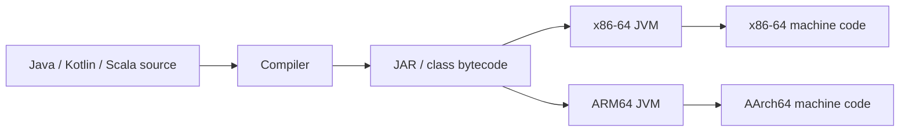
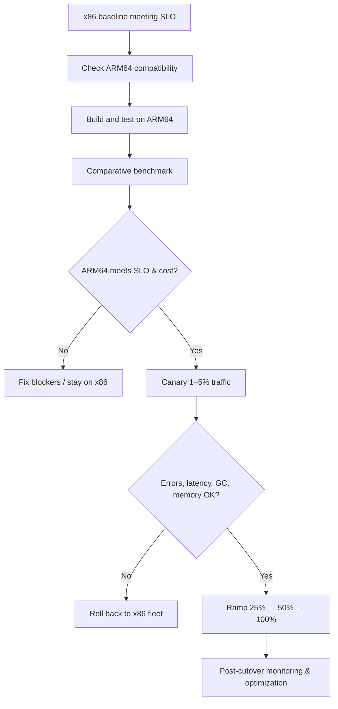

# Graviton and Choosing ARM Architecture for Java Workloads

A team running a Java application on Amazon EC2 `m7i.large` (x86-64 architecture) wants to test `m8g.large` (AWS Graviton/ARM64) to improve price-performance. Can they simply avoid recompiling? For **pure Java** applications, the exact same `.jar` file can often run on both architectures because the JVM executes bytecode. Yet the AMI, JVM, native libraries, monitoring agents, Docker images, deployment configuration, and latency requirements still need compatibility checks.

This topic belongs to the **EC2 Instances** chapter of the **CLOUD_PROVIDERS_AWS** module. Building on AWS Regions/AZs, IAM, VPC, and EC2 fundamentals, learners will understand how to evaluate **AWS Graviton**, pick suitable instance families for **Java workloads**, safely migrate to **ARM64**, monitor performance/reliability, and prove cost savings with real measurements. These principles also apply when Java runs on ECS, EKS, or Lambda on ARM64.

## 1. Learning Objectives

After this lesson, you will be able to:

1. Explain what Graviton is; distinguish **x86-64/amd64** from **ARM64/AArch64** and their impact on the JVM.
2. Identify the **T4g, M\*g, C\*g, and R\*g** families and select among them based on CPU, RAM, I/O, networking, and load shape, accounting for newer generations and Regional availability.
3. Build a **compatibility matrix** covering JDK, Linux AMI, Java dependencies, JNI/JNA, agents, containers, and build tools.
4. Migrate a Java application from x86 to Graviton following **assess → build/test → benchmark → canary → scale → rollback**.
5. Benchmark fairly using **throughput, p95/p99 latency, GC, RSS, CPU, and cost/request** under realistic SLO conditions.
6. Design deployments with least-privilege IAM, secure VPCs, multi-AZ resilience, CloudWatch monitoring, and operational/recovery plans.

## 2. What Is AWS Graviton?

**AWS Graviton** is a family of processors designed by AWS for compute services such as **Amazon EC2**, built on the **Arm 64-bit (AArch64)** instruction set. Its aim is strong performance and energy efficiency, often yielding better **price-performance** across many workload categories.

### 2.1. Distinguishing Terminology

| Term | Meaning | Where You Encounter It |
|---|---|---|
| **x86-64**, **x86_64**, **amd64** | Common 64-bit architecture for Intel/AMD CPUs | x86 AMIs, Docker platform `linux/amd64`, native libraries |
| **ARM64**, **arm64**, **AArch64** | 64-bit Arm architecture used by Graviton | arm64 AMIs, Docker platform `linux/arm64`, Linux arch name `aarch64` |
| **AWS Graviton** | AWS CPU line implementing Arm 64-bit | EC2 `m8g`, `c8g`, `r8g`, and other generations |
| **JVM** | Java Virtual Machine executing bytecode and managing runtime | Amazon Corretto/OpenJDK builds for arm64 |
| **JIT compiler** | JVM component compiling hot paths to machine code | Generated machine code is tailored to the target CPU |
| **JNI/JNA** | Mechanisms for Java to call native code or OS libraries | Loading `.so` files, compression, TLS, image processing, native DB drivers |

Graviton **does not** natively run an ordinary Linux x86-64 executable. It requires architecture-matched binaries, a compatible runtime, or supported emulation. For **Java bytecode**, an arm64 JVM can often execute bytecode compiled on an x86 machine; that portability does not extend automatically to bundled native code.

### 2.2. Graviton Generations in the 2026 Landscape

| CPU Line | Representative Instances | Selection Notes |
|---|---|---|
| **Graviton2** | `t4g`, `m6g`, `c6g`, `r6g` | Fits many workloads with ARM64 ecosystem support; T4g uses CPU credits |
| **Graviton3 / Graviton3E** | `m7g`, `c7g`, `r7g`, `c7gn`, `hpc7g` | Newer generation with variants targeting specialized compute/networking |
| **Graviton4** | `m8g`, `c8g`, `r8g`, `x8g`, `i8g` | Strong choice for general-purpose, compute, memory, or storage workloads |
| **Graviton5** | `m9g/m9gd`, `c9g/c9gd`, `r9g/r9gd` | Families announced/released in 2026; availability depends on Region, size, and timing |

**Do not choose merely by highest generation number.** `m9g` may not yet be available in your target Region or AZ, while `m8g` or `c8g` may meet SLOs at lower cost. Instance types with **`d`** after `g` include **local NVMe instance store**; this storage is tied to the instance lifecycle and does not replace durable EBS or databases.

**Marketing figures**, such as “up to X% better price-performance,” reflect specific benchmark conditions and do not guarantee your Java application will see that exact ratio. Measure against your own workload and target Region.

Current references: [AWS Graviton technical guide](https://aws.github.io/graviton/); [Amazon EC2 instance type release history](https://docs.aws.amazon.com/ec2/latest/instancetypes/doc-history.html).

## 3. Why Is Java a Strong Candidate for ARM64?

Java executes in two main stages:



Most logic inside a `.jar` consists of **CPU-architecture-neutral bytecode**. If an application uses standard Java APIs and a supported ARM64 JDK, testing it on Graviton is often feasible without heavy Java source edits.

However, **“compile once, run anywhere” does not guarantee every dependency and environment is portable**. Each application must verify:

- An **ARM64 JDK/JRE** build and Java version compatible with the source bytecode.
- **Linux distro, kernel, AMI**, and OS packages.
- Native `.so`/binary files and how dependencies select architecture classifiers.
- Java agents/APM, profilers, TLS providers, compression, embedded databases, or JIT/native-image toolchains.
- Container base images and image manifests containing `linux/arm64`.
- Build commands, shell scripts, CI/CD runners, IaC, and launch templates.
- Differences in CPU, memory, GC, and I/O behavior under production load.

For example, pure Java code powering a Spring Boot REST API usually migrates easily. Another app on the same framework that invokes a native video encoder shipped only for x86-64 may need a library replacement or to remain on x86 until an ARM64 build exists.

## 4. Choosing an EC2 Graviton Family by Workload Shape

Common families optimize different resource ratios. Do not pick “an equivalent ARM size” without knowing your current application's bottlenecks.

| Instance Family | Goal | Suitable Java Workloads | What to Verify |
|---|---|---|---|
| **T4g** | Burstable general purpose | Small web services, test environments, APIs with low average CPU and brief spikes | **CPU credits**, burst behavior above baseline, credit fees under selected mode |
| **M6g/M7g/M8g/M9g** | Balanced CPU and RAM | Spring Boot APIs, Java microservices, medium batch jobs, business services | CPU:RAM ratio, networking, EBS bandwidth, generation/Region availability |
| **C6g/C7g/C8g/C9g** | Compute optimized | CPU-bound parsing, serialization, Java batch, encryption, calculation | GC/heap behavior, core utilization, compute throughput and latency |
| **R6g/R7g/R8g/R9g** | Memory optimized | JVM caching, large memory footprints, analytics, heap/off-heap-heavy services | RSS, GC pauses, native memory, RAM-driven cost |
| **`*gd` variants / I-series** | Local storage / storage optimized | Scratch space, local caches, workloads needing fast NVMe | **Instance store data is ephemeral** across lifecycle events; needs replication/durable tier |
| **Network/HPC-specialized lines** | Network/HPC throughput | Network-intensive or scientific Java workloads | EFA/driver/toolchain support, network tier, and Regional availability |

### 4.1. Choosing Among M, C, and R

Suppose a Java API currently runs on x86 with:

- p95 CPU at peak load around 85%, RAM consistently below 40%, and steady GC: **benchmark the C family**.
- Moderate CPU and balanced RAM usage with heavy REST/gRPC traffic: **M** is a practical starting point.
- 24 GiB heap, large off-heap/caches, and modest CPU: prioritize testing **R** to avoid memory starvation.
- Low CPU most of the time, bursting for only a few minutes: **T4g** may be worth testing, provided you account for CPU credits and baseline.

**Critical caveat:** not every family shares the exact same memory-to-vCPU ratio, EBS throughput, network bandwidth, disk options, or auxiliary features. Compare exact specs in [EC2 Instance Types](https://aws.amazon.com/ec2/instance-types/) and the [Instance Types Guide](https://docs.aws.amazon.com/ec2/latest/instancetypes/instance-types.html).

### 4.2. Graviton and x86 vCPUs Are Not Always Equivalent

Per AWS documentation, **each Graviton vCPU corresponds to one physical core** with no Simultaneous Multithreading (SMT). By contrast, many x86 instances use hyperthreading, mapping two vCPUs onto one physical core.

Thus, “both instances have 8 vCPUs” **does not guarantee** the same physical core count, throughput, or per-request processing speed. Benchmarks should measure **maximum sustained load meeting SLOs** and **cost per unit of work**, rather than looking solely at CPU percentage or microbenchmarks.

## 5. Checking Compatibility of the Java Stack

This is the single most important step before provisioning new resources.

### 5.1. Compatibility Matrix

| Layer | Verification Question | Record to Keep |
|---|---|---|
| **AMI / OS** | Do Amazon Linux 2023, Ubuntu, RHEL, or your distro have an `arm64` AMI? Do kernel/drivers support the instance generation? | AMI ID per Region/architecture, supported OS version |
| **JVM** | Is there an `aarch64` Corretto/OpenJDK build for Java 17/21/25 or your active version? | JDK vendor, version, architecture, special JVM flags |
| **Framework** | Do Spring Boot, Quarkus, Micronaut, Kafka clients, and dependencies run on ARM64? | Versions, release notes, integration test results |
| **Native/JNI/JNA** | Are there x86-only `.so` files, native codecs, compression, or TLS engines? | Artifact name, classifier, ARM64 version or alternative |
| **Java agents** | Do APM, profiler, security, and monitoring agents support Linux arm64? | Official vendor support matrix |
| **Build / CI** | Do compilers, Maven/Gradle plugins, codegen, Testcontainers, or scripts assume `x86_64`? | Runner architecture, native build steps, test matrix |
| **Containers** | Do all base images and final images support `linux/arm64`? What about sidecar/init containers? | Manifest list and digests for both `amd64`/`arm64` |
| **Runtime / infra** | Do launch templates, Auto Scaling, ECS/EKS scheduling, AMIs, taints, configs, and telemetry support it? | Deployment and rollback design |
| **Licensing / support** | Does the ISV license and support running on ARM64? | Formal support confirmation; risk list |

**AWS documentation recommends** using a modern JDK—at minimum Java 11 and preferably **Java 17 or newer**—to benefit from Graviton-specific optimizations. Java 8 can run on ARM64, yet **is not the best default choice for new applications**. Confirm LTS versions against organizational and framework support policies.

Source: [Java on AWS Graviton](https://aws.github.io/graviton/java.html).

### 5.2. Java Dependencies Requiring Extra Attention

| Category | Why Issues Can Occur | Approach |
|---|---|---|
| **Netty native transport / TLS** | OS/CPU-specific native artifact classifiers | Upgrade to a version supporting `linux-aarch_64` if needed and test live |
| **RocksDB JNI / LMDB** | Bundles native binaries inside Java artifacts | Verify ARM64 `.so` inside, or rebuild from source cleanly |
| **snappy, zstd, lz4, compression JNI** | Compression libs shipping native code | Use arm64-capable artifact versions; check pure-Java fallbacks if supported |
| **JNA/JNR** | Loads OS libraries over FFI | Check ABI, structs, and matching native packages |
| **Image/video/PDF libraries** | May invoke ffmpeg, font renderers, or OS binaries | Install matching AArch64 packages and test real payloads |
| **Machine learning inference** | JNI or native engines like ONNX Runtime/TensorFlow | Verify ARM64 engine builds and acceleration support |
| **APM/security instrumentation** | Agents relying on native profilers/eBPF/binaries | Check vendor support matrix; test metrics/traces/profiles |
| **GraalVM native-image** | Produces platform-specific native executables rather than bytecode | Build and test ARM64 executables on a compatible toolchain |

This list highlights **areas to inspect**, not a claim that these libraries fail on ARM64. Many modern releases fully support AArch64. Always check your **exact pinned version**.

### 5.3. Inspection Commands on Linux

```bash
# CPU/OS architecture:
uname -m
# Typically shows "aarch64" on arm64 Linux machines; "x86_64" on x86.

# Check active JVM:
java -version
java -XshowSettings:properties -version 2>&1 | grep -E 'os.arch|java.vm.name|java.version'

# Inspect native library when present:
file /path/to/libnative.so
readelf -h /path/to/libnative.so | grep Machine

# List JAR contents to look for notable native artifacts/classifiers:
jar tf target/app.jar | grep -E 'aarch64|arm64|x86_64|amd64|\.so$'
```

These commands are solely for **inspection**. An empty `grep` output **does not prove an application has zero native dependencies**: libraries can be loaded from OS packages, container layers, external directories outside the JAR, or downloaded at runtime. Supplement with dependency trees, SBOMs, and functional tests on ARM64.

### 5.4. Building a “Blocker” List

For any component lacking an ARM64 release or vendor support:

1. Identify which feature actually uses that component and prioritize by impact.
2. Look for an **ARM64 release** or newer API-compatible version.
3. Evaluate swapping libraries, using a pure-Java alternative, or compiling native code from source via a trusted build pipeline.
4. Test throughput, latency, memory, output correctness, and upgradeability.
5. If no safe resolution exists yet, keep that workload on **x86** and migrate other services first.

**Do not use x86 emulation as a default production strategy just to “make it run”**; emulation carries performance penalties, complexity, and support risks. Emulation may help for preliminary CI checks, while production benchmarks must run on **native ARM64**.

## 6. AMIs and Moving EC2 from x86 to ARM64

A common mistake is stopping an x86 instance and changing its type directly from `m7i.large` to `m8g.large`.

**You cannot switch architectures this way.** An Amazon Machine Image (**AMI**) is tied to a processor architecture. EC2 permits changing instance types only when compatible with the current AMI's architecture. To move from x86 to Graviton, you generally must **launch a new EC2 instance from an ARM64 AMI**, apply equivalent app configuration, and shift traffic/data intentionally.

Source: [EC2 — Compatibility for changing instance type](https://docs.aws.amazon.com/AWSEC2/latest/UserGuide/resize-limitations.html).

### 6.1. Two Deployment Strategies

| Strategy | Description | Pros / Cons |
|---|---|---|
| **Blue/green** | Spin up a separate ARM64 fleet with a new AMI/launch template, test, then shift traffic gradually | Clean rollback, easy x86 vs. ARM comparison; uses extra capacity during transition |
| **Rolling / instance refresh** | Replace fleet in batches using a new ARM64 launch template/AMI | Uses ASG orchestration and health checks; must manage capacity, swap time, and rollback steps |

For Java services with strict SLAs, **blue/green or an isolated canary group** is usually easier to evaluate and roll back. An Auto Scaling group referencing an **x86 AMI** cannot simply mix ARM instance types into the same template; provide matching launch templates/AMIs per architecture and verify mixed configuration support.

### 6.2. Preparing an ARM64 AMI

- Select a **supported ARM64 AMI** such as Amazon Linux 2023 ARM64, Ubuntu arm64, or your organization's standard golden image.
- Install an `aarch64` JDK/JRE and compatible agents; pin versions for reproducibility.
- Configure **IAM instance profile**, SSM Agent, logging, TLS, secrets management, and patching.
- Use **EBS** for durable data and stateful components as needed; account for instance store lifecycles.
- Configure VPC security, SGs, subnets, load balancers, listeners, target groups, and health checks.
- Use Infrastructure as Code (Terraform/CloudFormation/CDK) to prevent configuration drift.

A stateful application with EBS volumes or local state should not be cut over casually by “copying a live directory.” Plan backups/snapshots, quiescing, data consistency, and synchronization before replacing hosts.

### 6.3. Read-Only AWS CLI Verification Commands

```bash
# Check whether the instance type supports arm64 architecture.
# Substitute Region/type per your actually permitted catalog.
aws ec2 describe-instance-types \
  --instance-types m8g.large \
  --region ap-southeast-1 \
  --query 'InstanceTypes[].{Type:InstanceType,Arch:ProcessorInfo.SupportedArchitectures,MemoryMiB:MemoryInfo.SizeInMiB,VCPU:VCpuInfo.DefaultVCpus}' \
  --output table

# Check which architecture an AMI uses (adjust AMI ID per Region).
aws ec2 describe-images \
  --image-ids ami-0123456789abcdef0 \
  --region ap-southeast-1 \
  --query 'Images[].{Name:Name,Arch:Architecture,State:State}' \
  --output table
```

`ami-0123456789abcdef0` here is an **illustrative placeholder** and may not exist. These commands create no resources and require appropriate EC2 read permissions. **Instance types unavailable in a Region/AZ** or invalid AMI IDs will return errors; verify availability before deciding.

## 7. Building and Packaging Java for ARM64

### 7.1. Pure Java JARs Rarely Need Cross-Compilation

Example with Maven:

```bash
# Build and run tests with the project's matching JDK version
./mvnw --batch-mode clean verify

# Package once tests pass
./mvnw --batch-mode -DskipTests package

# Check JVM metadata when testing on an ARM64 host
java -XshowSettings:properties -version 2>&1 | grep os.arch
```

A JAR containing pure Java bytecode built on x86 can run under an ARM64 JVM. However, **if the build compiles native code, bundles architecture classifiers, builds a native-image, or relies on OS binaries**, the build must be tested/run for ARM64 accordingly. `-DskipTests` here only illustrates packaging after tests already passed—never skip tests in release pipelines.

### 7.2. Multi-Architecture Docker Images

For containerized Java, the JAR can often be shared, while **the base image containing the JVM must match the target architecture**. A multi-architecture (*multi-platform*) image bundles matching layers and a manifest so runtimes pick the right platform.

Example Dockerfile for **a Maven project** with `pom.xml` and `src`:

```dockerfile
# Build stage uses the builder architecture's JDK.
FROM --platform=$BUILDPLATFORM eclipse-temurin:21-jdk AS build
WORKDIR /src
COPY pom.xml .
COPY src ./src
RUN apt-get update \
  && apt-get install -y --no-install-recommends maven \
  && rm -rf /var/lib/apt/lists/*
RUN mvn --batch-mode -DskipTests package

# Runtime stage uses the target platform selected by BuildKit.
FROM eclipse-temurin:21-jre
WORKDIR /app
COPY --from=build /src/target/app.jar /app/app.jar
USER 10001
EXPOSE 8080
ENTRYPOINT ["java", "-jar", "/app/app.jar"]
```

**Conditions for this example:** the Maven artifact must be named `app.jar`; adjust for your actual `artifactId/version` or `finalName`. Official base images, package managers, and Java versions evolve; verify the chosen image publishes both `amd64` and `arm64` variants, that `USER 10001` permissions and writable paths work, and production requirements are met. This is an illustrative snippet, **not a complete production Dockerfile**.

**Critical boundary:** `FROM --platform=$BUILDPLATFORM` builds using the build host's JVM; this works only when the build emits a **portable** artifact. If dependencies compile native code, build under `TARGETPLATFORM` or run CI on native ARM64 runners. Merely switching the runtime image's `FROM` does not convert an `x86_64` native library into `aarch64`.

### 7.3. Building and Inspecting Multi-Arch Images

```bash
# BuildKit/buildx: build multi-arch image and push to an authorized registry.
# Replace registry/repository/tag for your environment and run only when authorized.
docker buildx build \
  --platform linux/amd64,linux/arm64 \
  --tag registry.example.com/team/java-api:1.0.0 \
  --push .

# Inspect only the manifest of the pushed image:
docker buildx imagetools inspect registry.example.com/team/java-api:1.0.0

# Verify host and JVM architecture inside the container when running on ARM:
uname -m
java -XshowSettings:properties -version 2>&1 | grep os.arch
```

When building multi-arch images on x86 hosts, ARM64 steps can run under **QEMU emulation** or native builders. **Benchmark numbers measured under emulation do not reflect real Graviton performance**; use real ARM64 EC2 instances or native ARM64 runners for performance testing.

Registries, Dockerfiles, `USER` settings, and dependency scanning must be verified before deployment. When using ECR, inspect architecture manifests and image/tag lifecycle rules, and pin **immutable digests** in release pipelines.

### 7.4. Running ARM64 on ECS and EKS

- On **Amazon ECS**, task definitions can specify `runtimePlatform.cpuArchitecture = ARM64` and `operatingSystemFamily = LINUX`; tasks and images must match capacity providers/OSes. When using Fargate, verify platform and task-size requirements.
- On **Amazon EKS**, a cluster can mix **x86 and ARM worker nodes**. Use `kubernetes.io/arch`, `nodeSelector`, or node affinity to schedule pods accurately; every container (including init/sidecars) must ship a matching image architecture.
- On **EC2 Auto Scaling**, maintain a dedicated ARM64 launch template/AMI and manage rollouts via ASG or compatible tooling.

Illustrative ECS snippet (**excerpt only** of a task definition):

```json
{
  "runtimePlatform": {
    "operatingSystemFamily": "LINUX",
    "cpuArchitecture": "ARM64"
  }
}
```

Kubernetes snippet scheduling a pod onto ARM64 nodes:

```yaml
spec:
  nodeSelector:
    kubernetes.io/arch: arm64
```

In mixed-architecture clusters, the scheduler can place pods on incompatible nodes if selectors/affinity are missing or images lack the target platform. Never treat architecture labels as security boundaries; they are scheduling constraints.

Sources: [ECS — Specifying ARM architecture](https://docs.aws.amazon.com/AmazonECS/latest/developerguide/ecs-arm-specifying.html), [ECS RuntimePlatform](https://docs.aws.amazon.com/AmazonECS/latest/APIReference/API_RuntimePlatform.html).

## 8. Running Java Performance Benchmarks Properly

Moving to Graviton can yield strong gains, yet **production decisions must rest on reproducible measurements**.

### 8.1. Define SLOs Before Benchmarking

Example SLOs for a payment API:

- At 1,200 requests/second, **p95 latency ≤ 150 ms**.
- **p99 latency ≤ 300 ms**.
- **Error rate below 0.1%** in steady state.
- Zero correctness errors or major regressions during warm-up, rolling deploys, and scale-out.

Use **realistic test data and traffic mixes**, matching read/write ratios, payload sizes, cache hit rates, DB connections, TLS, and peak bursts.

### 8.2. Fair Benchmarking Process

1. **x86 baseline:** record app version, JDK, instance type, Region/AZ, EBS, networking, heap, GC, traffic, and cost.
2. **Hold comparable settings constant:** use identical app code, functional behavior, data sources, and test scenarios; avoid changing JDK/framework versions and CPU architecture in the same run if isolating CPU differences.
3. **Native ARM64:** run on Graviton EC2 with native AMI/JDK/agents/dependencies—never benchmark under QEMU.
4. **JVM warm-up:** wait for JIT compilation, caches/connection pools, and GC to stabilize; document warm-up and measurement durations.
5. **Load sweep:** ramp concurrency or RPS until hitting SLO limits or resource saturation; do not test only one light load level.
6. **Repeatability:** execute multiple runs under identical conditions, report variance, and investigate anomalous runs.
7. **Operational stress tests:** rolling restarts, autoscaling, network blips, AZ failover, DB throttling, and traffic bursts.
8. **Decide by SLO + total cost:** among candidates meeting SLOs, choose the better total cost/operability profile and retain rollback readiness.

### 8.3. Metrics to Collect

| Category | Metrics | Significance |
|---|---|---|
| Application | RPS, transactions/s, batch throughput | Business processing capacity |
| Latency | p50/p95/p99 and max, timeouts | User experience and tail latency |
| Quality | Error rate, correctness checks, retries | Prevent trading correctness for speed |
| CPU | CPU utilization, steal if any, cycles, saturation | Actual compute headroom vs. limits |
| JVM | Heap used, GC pause/count, allocation rate | Separate app CPU work from GC overhead |
| Memory | RSS, native/direct buffers, OOMs, page faults | Off-heap memory consumes RAM too |
| I/O / network | EBS latency/IOPS, network throughput, DB time | Spot non-CPU bottlenecks |
| Deployment | Startup time, ready time, scale-out time | Speed of replacing pods/instances |
| Cost | Hourly rate, instance-hours, cost/1M requests or cost/job | Economic efficiency comparison |

For the JVM, **Java Flight Recorder (JFR)**, `jcmd`, Java metrics (Micrometer/OpenTelemetry), and **CloudWatch** help pinpoint GC behavior, lock contention, thread states, allocations, and request latency. Enable profiling strictly within overhead and data-governance limits.

### 8.4. Answering “Why Is ARM Faster or Slower?”

Classify findings by bottleneck:

- **CPU-bound, many threads:** can benefit from physical cores and Graviton architecture; still measure at high load.
- **Lock contention / synchronized hot paths:** JIT code generation, JVM versions, and lock behavior can shift timing.
- **GC-bound:** heap sizing, collector choice, allocation rate, RAM pressure, and JDK version may dominate.
- **Network-bound:** DB round-trips, third-party APIs, or connection limits can mask CPU gains.
- **I/O-bound:** EBS/instance bandwidth caps can dictate throughput even when CPU is idle.
- **Native dependency-bound:** unoptimized ARM64 crypto/compression libs can underperform expectations.

**Microbenchmarks** (such as JMH) help analyze single functions/hot paths, yet **cannot replace** full-system benchmarks against real SLOs.

## 9. Cost Analysis and Price-Performance

“Lower hourly rate” alone does not prove lower **TCO**. A cheaper instance that processes fewer orders or violates SLOs can cost more overall.

### 9.1. Practical Cost Formulas

```text
cost_per_million_requests =
  total_cost_for_measurement_window
  / (successful_requests_in_window / 1,000,000)

effective_cost =
    compute instances
  + EBS / storage / snapshots
  + network / load balancer / data transfer
  + monitoring / logging / security
  + operations and migration costs (when evaluating TCO)
```

For long-running baseline workloads, factor in **On-Demand/Savings Plans/Reserved Instances/Spot** per commitment level and interruption tolerance. For **T4g**, account for CPU credits and Unlimited mode if enabled. When comparing costs, use **actual pricing in the same Region and equivalent purchase model**, reflecting real account discounts/commitments.

### 9.2. Hypothetical Comparison Table

These numbers **illustrate the formula, not actual AWS prices**:

| Metric | x86 Candidate A | Graviton Candidate B |
|---|---:|---:|
| Hypothetical compute cost/hour | \$0.40 | \$0.32 |
| Steady throughput meeting SLO | 1,500 req/s | 1,600 req/s |
| Successful requests/hour | 5,400,000 | 5,760,000 |
| Cost/1M requests (compute only) | ~\$0.0741 | ~\$0.0556 |

Under those assumptions, compute cost per million requests drops by roughly **25%**. That conclusion holds only for those **hypothetical benchmark assumptions**; if networking, EBS, or observability differ, recompute total cost.

To make real decisions, compare **total cost while meeting identical SLOs at forecasted traffic**, rather than relying on marketing tables or promotional prices.

### 9.3. Commonly Overlooked Budget Items

- Migration days require running **both fleets** (x86 and ARM64) concurrently.
- AMI snapshots, EBS volumes, and logs can keep accruing charges after EC2 instances are terminated.
- Load Balancers, NAT Gateways, public IPv4 addresses, and cross-AZ/cross-Region transfer bill separately.
- Existing **Savings Plans/RIs** can affect effective unit cost and commitment coverage.
- Workloads with per-CPU, per-core, or per-OS software/agent licensing.
- Prices, promotions, instance sizes, and Free Tier rules change by Region and over time.

**Never assume “Graviton is X% cheaper for every Java app.”** Real savings materialize only when the app is compatible, meets SLOs, and lowers total operating cost.

## 10. JVM Configuration on Graviton: Evidence-Based Tuning

After moving the JVM to ARM64, **start with the supported JDK's default settings**. Tune flags only when profiling exposes a clear bottleneck.

### 10.1. JDK Versions and GC

- Prefer a **maintained JDK with arm64 support** (such as Corretto/OpenJDK builds), tracking minor security updates.
- **Java 17/21/25** are common LTS choices depending on policy, framework, and vendor support. Legacy Java 8/11 can run, though lifecycle and optimization limits must be understood.
- The default **G1 GC** in modern JDKs is a sensible starting point; consider ZGC or other collectors only when justified and supported by your JDK.
- Distinguish **heap** from native memory: thread stacks, direct buffers, metaspace, JIT code cache, and agents.

Illustrative flags to demonstrate sizing concepts only:

```bash
java \
  -XX:InitialRAMPercentage=20 \
  -XX:MaxRAMPercentage=65 \
  -XX:+UseG1GC \
  -jar app.jar
```

These percentages **are not universal defaults**: reserve headroom for non-heap memory, OS processes, and container limits. If previously using explicit `-Xmx` or custom GC flags, test interactions before adding new flags; never blindly copy rumored “Graviton tuning flags.”

### 10.2. Inspecting Flags and Runtime Environment

```bash
# What does the JVM support and what is enabled?
java -XX:+PrintFlagsFinal -version > jvm-flags.txt

# On systems with JDK tools and appropriate permissions:
jcmd -l
jcmd <PID> VM.command_line
jcmd <PID> VM.flags

# Capture a time-bounded JFR recording; only when authorized
# jcmd <PID> JFR.start name=arm-eval settings=profile duration=60s filename=/tmp/arm-eval.jfr
```

`jcmd` requires matching process permissions and can output files/profiles containing sensitive data. Never run JFR casually in production without approved measurement and data-handling procedures.

### 10.3. AArch64 and Compiler Optimizations

The HotSpot JIT automatically generates tuned AArch64 machine code. Native application libraries need compatible compilers/toolchains. For compute-heavy SIMD routines, instruction sets and tuning capabilities differ across Graviton generations; specialized compiler flags should follow guidance for your exact CPU generation and toolchain.

Tune only after identifying a **proven bottleneck**, and version-control measurements/commits for clean rollback. Microbenchmark optimizations do not always improve whole-application p99 latency.

## 11. Canary Rollouts, Rollback, and Resilience

A solid migration workflow ensures ARM64 **never disrupts production** if an incompatibility surfaces.

### 11.1. Rollout Pattern



*Canary percentages are illustrative; adjust to match traffic volume, business risk, and deployment tooling.*

When running x86 and ARM side by side:

- **ALB target groups** and health checks can shift weighted traffic between the two fleets.
- **Stateless** services with externalized sessions are far easier to roll back.
- For **database schema changes**, maintain backward compatibility across both x86 and ARM builds; rolling back app code does not automatically revert DB schemas.
- Deploy across **multiple AZs**, monitor EC2/ALB/ASG status, and preserve minimum capacity while replacing instances.
- Use **SSM Session Manager** or approved admin paths; never open public SSH to all IPs just to debug a migration.

### 11.2. Stop and Rollback Conditions

Pre-define triggers before starting traffic shifts:

| Signal | Example Trigger | Action |
|---|---|---|
| Rising error rate | 5xx or business errors exceed baseline/SLO | Halt canary expansion, shift traffic back to stable fleet |
| p95/p99 violation | Tail latency exceeds threshold across measurement windows | Drain traffic off ARM, analyze CPU/GC/DB |
| JVM crash / native error | `SIGILL`, `UnsatisfiedLinkError`, segmentation fault | Isolate native dependency, stay on x86 until fixed |
| Memory leak | Sustained growth in RSS or native memory | Pause rollout, inspect heap/off-heap/agents |
| AZ capacity shortage | Unable to launch enough ARM instances in target AZ | Pick alternate instance size/family or retain existing fleet |
| Missed cost target | Cost/request rises or commitments are negatively impacted | Re-evaluate sizing and allocation plans |

**Do not immediately delete all x86 capacity the moment a canary turns green.** Keep a long enough observation window to cover nightly batch jobs, scheduled deploys, major GC cycles, and peak traffic days.

## 12. Security and Operational Architecture

Graviton changes the CPU, **not the AWS Shared Responsibility Model**.

### 12.1. Layers to Control

| Layer | Required Actions |
|---|---|
| **IAM** | Least-privilege instance profiles; never embed static access keys in AMIs/JARs |
| **VPC / subnets** | Use private subnets where appropriate, open only required SG ports, manage NAT/VPC endpoints |
| **OS / patching** | Maintain ARM64 AMIs, kernels, OpenSSL/glibc, JDKs, agents, and native packages |
| **Data security** | EBS/KMS encryption, TLS, secrets from Secrets Manager/SSM Parameter Store with scoped permissions |
| **Supply chain** | Verify base image architecture, signatures/digests, SBOMs, CVE scanning, and native lib provenance |
| **Observability** | CloudWatch, structured logs, traces, JFR when appropriate, ASG/ALB health, cost alerts |
| **Resilience** | Multi-AZ, Auto Scaling, backups/snapshots, RTO/RPO targets, and restore drills |

For example, a Java service on `c8g.large` accesses S3 and RDS via IAM roles/SGs just like on x86. However, **SSM Agent, log collectors, and security agents** must have supported ARM64 builds—otherwise the app may run while operations loses expected visibility or controls.

### 12.2. Post-Migration Monitoring Criteria

- EC2/ASG: healthy instance counts, launch failures, CPU, memory agent metrics, network/EBS throttling.
- JVM: GC pauses, CPU time, heap/off-heap, class loading, thread pools, exception rates.
- Application: p95/p99, RPS, error budget burn, timeouts, DB connection pools.
- Deployment: startup duration, connection draining, health checks, rolling replacements.
- Cost: Cost Explorer/Budgets, account tags, compute and networking spend.
- Security: AMI/JDK CVEs, CloudTrail/Config/Security Hub per organizational standards.

## 13. Practical Migration Workflow for a Spring Boot API

**Hypothetical context:** a team runs a Spring Boot API on x86 EC2 behind an ALB, connecting to RDS in private subnets, storing static files in S3, and shipping logs to CloudWatch. They want to test Graviton with zero user disruption.

### Phase A — Information Gathering

Complete an inventory table:

| Item | Current State Example | What to Verify for ARM64 |
|---|---|---|
| Code / framework | Spring Boot + Java 21 | Dependency tree, integration tests |
| Runtime | Corretto 21 x86 | Corretto 21 AArch64 and patch level |
| Artifact | `app.jar` | Any native `.so` files or platform classifiers? |
| Image | x86 Golden AMI | ARM64 Golden AMI with matching patch policy |
| Deployment | EC2 ASG, ALB | Dedicated ARM64 ASG/launch template and rollback |
| Dependencies | RDS, S3, Redis | Connectivity, TLS, serialization, performance |
| Telemetry | APM agent + CloudWatch | ARM64 APM support and metric parity |
| SLO | p95 150 ms, error rate 0.1% | Benchmark and canary against identical metrics |

### Phase B — Compatibility Assessment

1. Confirm ARM64 JVM/JDK matching minor version, kernel, and AMI.
2. Audit native dependencies (e.g., Netty/OpenSSL if used), APM agents, and binary tools.
3. Run `mvn verify` in an ARM64 environment; test database queries and all API contracts.
4. Verify app startup, HTTPS/DB connections, serializers, logging, traces, signal handling, and shutdown.
5. Document blockers, owners, and acceptance criteria.

### Phase C — Benchmarking

- Run load tests with the same datasets, warm-up, and measurement duration as the baseline.
- Keep JDK/framework versions, heap settings, and network/data conditions equivalent first before trying separate tunings.
- Test at least one M candidate, plus C/R if CPU/RAM profiles suggest a better fit.
- Record SLO-compliant throughput, p95/p99, GC, CPU, RAM, and cost/request.

### Phase D — Deployment

1. Create the new ARM64 AMI/launch template in private subnets with standard IAM roles.
2. Spin up a separate fleet/ASG and verify health checks before routing traffic.
3. Start a small canary, watching logs and metrics side by side with the x86 baseline.
4. Ramp traffic across defined observation windows.
5. Keep the x86 fleet ready for rollback throughout the validation period.
6. After stabilization, right-size instances, update savings commitments, and clean up unneeded resources.

### Phase E — Learning from Results

If Graviton misses SLOs, pinpoint the exact reason:

- Is the instance size short on RAM or strictly CPU?
- Is an unoptimized native dependency or outdated JVM version responsible?
- Is there an independent DB/cache/network bottleneck?
- Was warm-up/JIT insufficient or the workload profile inaccurate?
- Did the cost model include all EBS/networking/logging/commitment impacts?

Staying on x86 is also a valid engineering decision if ARM64 does not meet business requirements.

## 14. Special Scenarios

### 14.1. T4g Uses CPU Credits

The **T4g** family is designed for burstable loads. Java apps with sustained high CPU (batch processing, indexing, compression) can hit baseline caps or accumulate credit charges depending on mode. Never pick T4g solely for a lower On-Demand table rate; analyze **CPU credit balance, surplus credits**, average CPU, and real usage patterns.

### 14.2. EC2 + Lambda Sharing a Java Workload

AWS Lambda offers an **`arm64`** option for supported runtimes; it is not an EC2 instance type switch. If one codebase deploys to both EC2 and Lambda, test artifacts, layers, and native dependencies for each runtime architecture independently. Compare Lambda costs using requests, duration, memory, and concurrency—never extrapolate from EC2 hourly rates.

### 14.3. EKS with Java Sidecars and DaemonSets

ARM64 support in the main application image **is not enough**. Pods with `initContainers`, sidecars, service mesh proxies, log agents, or CSI/network plugins shipping native binaries must also support AArch64. Before migrating node groups, audit every container image and DaemonSet scheduled onto ARM nodes.

### 14.4. Legacy Java That Cannot Be Upgraded

A Java 8 application bundled with closed-source C/C++ native libraries may be difficult to port to ARM64. Isolate it as a standalone service on x86 while moving newer/independent Java services to Graviton first. If an ISV supports only x86, prioritize legal and operational supportability rather than forcing a migration purely for cost savings.

### 14.5. Automated Assessment Tooling (2026)

AWS announced **Graviton readiness** assessment and remediation support for Java in **AWS Transform continuous modernization** (generally available from October 29, 2026 per announcement). Such tooling can scan repositories for ARM64 issues and assist with controlled edits. Automated changes must still be **reviewed, built, and tested on ARM64** before deployment.

For large estates, this is an optional accelerator—not a prerequisite for adopting Graviton, and not a substitute for SLO benchmarking.

Reference: [AWS DevOps Blog — Graviton support for Java in AWS Transform continuous modernization](https://aws.amazon.com/blogs/devops/aws-graviton-support-for-java-in-aws-transform-continuous-modernization/).

## 15. Practice Exercises and Review Questions

### Exercise A — Shortlisting Graviton Candidates

An organization runs four Java workloads:

| Workload | Profile | Proposed Test Candidate | What to Verify |
|---|---|---|---|
| **A:** Spring Boot REST API | 400–2,000 RPS, balanced CPU and RAM | **M** | p99 latency, GC, startup, native dependencies |
| **B:** Batch PDF/JSON processing | 90% CPU, low RAM, scheduled | **C** | Throughput/job, native renderers, I/O |
| **C:** In-memory Java cache | Large heap, moderate CPU | **R** | Memory headroom, GC, native/off-heap |
| **D:** Java 8 + vendor x86-only agent | Depends on closed-source binary | **Hold off for now** | Vendor ARM support or replace agent/library |

This is a **benchmarking shortlist**, not a final instance recommendation prior to measurement.

### Exercise B — Spot the Flaws in This Migration Plan

A team proposes:

1. Snapshot the x86 instance, stop EC2, and change the type to `c8g.large`.
2. Keep the x86 AMI because Java is portable.
3. Keep the `linux/amd64` Docker image across the fleet.
4. Benchmark on an x86 laptop using QEMU.
5. Delete the x86 fleet as soon as the app boots.

**Task:** identify at least four issues.

**Hints:** (1) AMI architecture must match instance architecture; (2) must build/use an ARM64 AMI/instance; (3) runtime container images must support `linux/arm64`; (4) QEMU does not represent Graviton performance; (5) booting successfully does not prove SLOs/cost/correctness, and a rollback path must remain.

### Exercise C — Cost per Unit of Work Calculation

Two hypothetical candidates:

- **X:** \$0.50/hour, processes 5,000 jobs/hour, meets SLO.
- **A:** \$0.42/hour, processes 4,700 jobs/hour, meets SLO.

Compute the compute cost per **1,000 jobs**:

```text
X: 0.50 / 5000 * 1000 = 0.1000 USD / 1,000 jobs
A: 0.42 / 4700 * 1000 ≈ 0.0894 USD / 1,000 jobs
```

Under identical test conditions, **A is roughly 10.6% cheaper per 1,000 jobs** despite lower raw throughput. Final decisions also factor in total batch completion time, capacity availability, I/O charges, and operations.

### Exercise D — Preparing a Multi-Arch CI Matrix

Describe a pipeline covering:

1. Static/dependency audit for ARM64 and vulnerability scanning.
2. Building JARs and running integration tests on both x86 and ARM64.
3. Multi-arch container image builds (if containerized).
4. Verifying image manifests and signatures/digests.
5. Comparative SLO benchmarking on native Graviton.
6. Canary rollout with automatic rollback if errors exceed thresholds.

**Completion criteria:** a release demonstrates **binary compatibility**, **functional correctness**, and **performance/cost acceptance**.

### Self-Check Questions

1. Why is Java bytecode usually portable while JNI libraries may not be?
2. Where do `x86_64` and `aarch64` typically appear in a pipeline?
3. Can you stop an x86 instance and pick Graviton as its new type while keeping the x86 AMI?
4. When an API has high CPU and low RAM usage, should you test C or R first?
5. Why shouldn't you compare raw CPU utilization percentages alone between ARM and x86?
6. Which metrics matter for measuring “price-performance” under SLOs?
7. Why must the JVM warm up before measuring load?
8. If a JAR is built on x86, must it always be rebuilt on ARM?
9. Why do multi-arch container setups require checking sidecars and agents?
10. Which cost/capacity behavior distinguishes T4g from M/C?
11. Why is running x86 and ARM in parallel during rollout helpful?
12. If hourly price is lower yet latency doubles, should you migrate?

**Suggested answers:** (1) bytecode is compiled by the JVM at runtime, whereas native binaries are bound to ISA/ABI; (2) AMIs/OS, container images, binary metadata; (3) no; (4) C, then benchmark; (5) SMT and core architectures differ; (6) SLO-compliant throughput, p95/p99, error rate, and total cost/unit; (7) unstabilized JIT/caches/GC skew measurements; (8) no, if the artifact is pure Java with compatible JDK/dependencies; (9) every container and agent carries its own native dependencies; (10) CPU credits; (11) enables canarying, rollback, and A/B comparison; (12) only if SLOs are still satisfied and full cost/risk analysis supports it.

## 16. Pre-Production Graviton Checklist

- [ ] Documented **SLOs**, x86 baseline, and current total cost.
- [ ] Selected a Graviton instance matching CPU/RAM/network/I/O needs and verified Region/AZ availability.
- [ ] Selected a compatible **ARM64 AMI** and ARM64 JDK with a patching workflow.
- [ ] Audited native dependencies, APM agents, OS tools, and vendor licensing.
- [ ] Provisioned ARM64 CI runners or equivalent ARM64 build/test environments.
- [ ] Verified Docker images, init/sidecar containers, and DaemonSets support `linux/arm64` where applicable.
- [ ] Benchmarked on **native Graviton** with proper warm-up, realistic load, and repeated runs.
- [ ] Confirmed throughput, p95/p99, error rate, GC, and memory meet targets.
- [ ] Calculated cost/request or cost/job from live pricing and measured throughput.
- [ ] Configured IAM, SGs, EBS, secrets, logging, CloudWatch, and SSM.
- [ ] Designed multi-AZ placement, Auto Scaling capacity, and recovery procedures.
- [ ] Set up canary/blue-green health checks, stop triggers, and rollback paths.
- [ ] Evaluated impacts on Savings Plans/RI commitments, networking fees, and parallel-fleet run time.
- [ ] Prepared runbooks and designated post-cutover incident owners.

## 17. Conclusion

**Graviton is a compelling ARM64 option for Java workloads** thanks to modern JVMs, the Linux ecosystem, and broad EC2 instance choices. For pure Java, migration is often straightforward; the key areas to audit carefully are **native dependencies, AMIs, container images, Java agents, and CI/CD pipelines**.

The most important rule is to **prove correctness, SLO compliance, and lower cost per unit of work under real-world conditions**. Choose M/C/R/T by workload profile, run a supported JDK, benchmark on real Graviton hardware, and roll out via canary with rollback ready. Combined with IAM, VPC, CloudWatch, multi-AZ resilience, and cost governance, this approach helps teams run Java on AWS securely, observably, and scalably.

### Official Reference Documentation

1. [AWS Graviton — Getting started](https://aws.amazon.com/ec2/graviton/getting-started/)
2. [AWS Graviton technical guide](https://aws.github.io/graviton/)
3. [AWS Graviton — Java](https://aws.github.io/graviton/java.html)
4. [Transitioning workloads to Graviton](https://aws.github.io/graviton/transition-guide.html)
5. [EC2 instance type families](https://aws.amazon.com/ec2/instance-types/)
6. [EC2 instance types — document history](https://docs.aws.amazon.com/ec2/latest/instancetypes/doc-history.html)
7. [EC2 — Compatibility for changing the instance type](https://docs.aws.amazon.com/AWSEC2/latest/UserGuide/resize-limitations.html)
8. [ECS — ARM architecture task definition](https://docs.aws.amazon.com/AmazonECS/latest/developerguide/ecs-arm-specifying.html)
9. [AWS Transform — Graviton support for Java (2026)](https://aws.amazon.com/blogs/devops/aws-graviton-support-for-java-in-aws-transform-continuous-modernization/)
10. [AWS EC2 Pricing](https://aws.amazon.com/ec2/pricing/)
11. [AWS Well-Architected Framework](https://docs.aws.amazon.com/wellarchitected/latest/framework/welcome.html)
