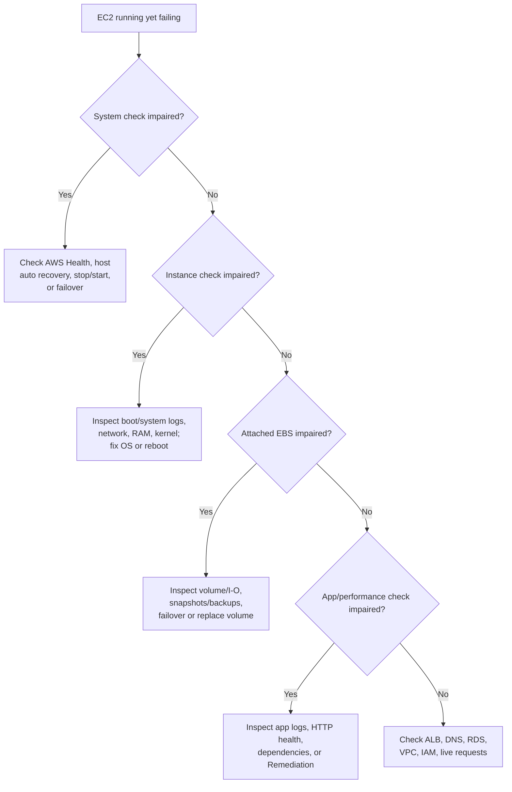
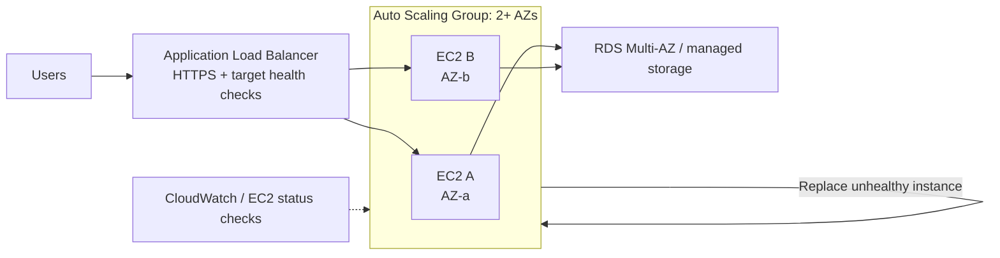

# EC2 Status Checks and Instance Recovery

## Learning Objectives

After this lesson, you will be able to:

1. Distinguish Amazon EC2 **lifecycle state** (instance state) from **health state** (status check).
2. Explain the five current status check types: **system**, **instance**, **attached EBS**, **application**, and **performance**, along with their applicability limits.
3. Inspect statuses via the EC2 console, AWS CLI, and CloudWatch; accurately interpret `ok`, `impaired`, `initializing`, `insufficient-data`, and `not-applicable`.
4. Choose among **reboot**, **stop/start**, **automatic recovery**, **instance replacement**, or **failover** based on failure origin and data requirements.
5. Configure CloudWatch alarms for infrastructure faults, understand automatic recovery prerequisites, and avoid risky recovery actions.
6. Write a runbook for handling an unreachable EC2 instance, integrating logs, Amazon EBS, Auto Scaling, load balancing, backups, and application monitoring.

## 1. Why Can a `running` EC2 Instance Still Fail?

Suppose a company deploys an e-commerce API on an EC2 instance inside a private subnet. The AWS console shows the instance in the `running` state, yet customers receive HTTP 503 errors. Several causes are possible:

- AWS's underlying physical host is experiencing a hardware, power, or network fault.
- The OS inside EC2 is hung, out of memory, hit a kernel panic, or has broken network config.
- An EBS volume attached to the instance is experiencing I/O issues.
- The machine and OS are healthy, yet the API service stopped or stopped answering requests.
- An accelerated-computing workload hit a GPU hardware fault while the machine itself remains reachable.

**Instance state** describes only the virtual machine's lifecycle—such as `pending`, `running`, `stopping`, `stopped`, `shutting-down`, and `terminated`. It **does not prove** the application inside is ready to serve.

**EC2 status checks** are periodic checks performed by AWS to detect issues with underlying infrastructure, instance reachability/OS responsiveness, and related components. Combining status checks with CloudWatch, AWS Health, and application checks pinpoints which layer failed before you choose a recovery action.

Across AWS infrastructure, IAM, VPC, compute, storage, and monitoring, this skill is essential: **recover the exact failing layer**, minimize downtime, and avoid losing data or making unnecessary configuration changes.

## 2. Distinguishing Instance State and Status Checks

| Attribute | Instance State | EC2 Status Check |
| --- | --- | --- |
| Primary question | Which lifecycle stage is the machine in? | Are the machine, infrastructure, or monitored functions healthy? |
| Example values | `running`, `stopped`, `pending`, `terminated`. | `ok`, `impaired`, `initializing`, `insufficient-data`, `not-applicable`. |
| Data source | EC2 `DescribeInstances`. | EC2 `DescribeInstanceStatus` and CloudWatch metrics. |
| Meaning of “running” | The instance has entered the running state. | **Does not guarantee** the OS, EBS, API, or overall workload is healthy. |
| Meaning of “ok” | Not a lifecycle value. | The corresponding checks passed; **does not guarantee** all end-user application flows succeed. |

Example:

```text
Instance state = running
System status = ok
Instance status = ok
Attached EBS status = ok
Application status = impaired
=> Underlying infrastructure passed checks, yet the HTTP application failed.
```

Never look solely at EC2's green checkmarks and conclude the business system is healthy. An API also depends on ALBs, DNS, RDS, Redis, secrets, IAM roles, and external network paths.

## 3. Five Types of EC2 Status Checks

AWS currently defines **five types** of checks. **System**, **instance**, and **attached EBS** checks run periodically for running instances; the attached EBS status check metric is emitted on **Nitro instances**. **Performance** applies only to supported accelerated instance types. **Application** is an opt-in feature configured per monitored instance.

Checks run on roughly a **one-minute** cadence. When a check fails, its corresponding metric increments; values in CloudWatch appear as `0` (pass) or `1` (fail). Statuses may temporarily show `initializing` right after boot or `insufficient-data` when telemetry is missing.

| Check Type | What It Monitors | Typical Failure Causes | CloudWatch Metric |
| --- | --- | --- | --- |
| **System** | Underlying AWS infrastructure: host, power, physical network hardware. | Host failure, infrastructure network or power loss. | `StatusCheckFailed_System` |
| **Instance** | Instance operability at the guest OS and guest networking level; EC2 checks NIC responsiveness. | Boot/kernel failure, bad network config, OOM, corrupted filesystem. | `StatusCheckFailed_Instance` |
| **Attached EBS** | Whether attached EBS volumes can communicate and complete I/O. | Volume/storage subsystem or host↔EBS path issue. | `StatusCheckFailed_AttachedEBS` |
| **Application** | Whether the app responds to HTTP/HTTPS on a configured endpoint. | Dead process, closed port, HTTP errors, hung application. | `StatusCheckFailed_Application` |
| **Performance** | Hardware health impacting performance on certain accelerated instances. | GPU/accelerator faults where the host may remain reachable. | `StatusCheckFailed_Performance` |

**System status checks** and **instance status checks** observe different layers, yet they are not completely independent: when host infrastructure fails, the instance status check can fail as well.

### 3.1. System Status Check: AWS-Side Infrastructure

The system check detects faults in the **systems supporting EC2**, such as power, networking, or physical host hardware unavailability. If the machine uses an **EBS-backed root volume**, AWS can attempt **automatic recovery** onto another host; a manual alternative is **stop/start**, which normally lands on a new physical host.

If the system check fails, do not assume you need to edit Linux configuration files inside the machine. First inspect AWS Health, EC2 scheduled events, auto-recovery status, and whether traffic can fail over to another AZ/instance.

### 3.2. Instance Status Check: Guest OS or Configuration

The instance check verifies each instance's operability via network responsiveness—commonly described as ARP checks against the network interface. Failures can stem from:

- Kernel panic or boot failure after an OS update.
- Misconfigured network interfaces, OS routing tables, or local host firewall.
- Exhausted RAM leaving the OS unresponsive.
- Corrupted filesystem failing to mount a critical partition.
- Missing or incompatible ENA/NVMe drivers after changing instance type or AMI.

**Automatic recovery for system check failures is not a tool for fixing instance checks.** When only the instance check is `impaired`, inspect console/boot logs, OS state, and configuration; a reboot may clear transient issues, but will not fix persistent configuration bugs.

### 3.3. Attached EBS Status Check: Storage Path Failures

This check indicates that one or more **attached Amazon EBS volumes** cannot complete normal I/O. It may involve the EBS subsystem, the physical host, or connectivity between EC2 and EBS. The `StatusCheckFailed_AttachedEBS` metric is currently available only on **Nitro-based instances**.

For example, an API may still respond while disk writes stall or time out; do not inspect CPU alone. Cross-check per-volume EBS metrics, OS I/O errors, attachment status, and failover needs. Depending on the fault, remediation may mean waiting for AWS mitigation, replacing the volume from backups/snapshots, or performing a stop/start if the host is at fault and downtime is permitted.

This status check **is not** an application-level data consistency check for data inside EBS. Maintain separate backups, restore drills, and database/filesystem integrity checks.

### 3.4. Application Status Check: Service Availability

The application check is an **opt-in** feature. You configure an HTTP/HTTPS path, port, and expected success HTTP status codes, then associate the check with an instance. The service uses managed networking inside the VPC to probe the endpoint; results can trigger alarms or feed Auto Scaling health checks when configured appropriately.

For example, `GET /health/ready` should return success only when the app is ready to serve traffic. If the API deadlocks while the OS network stack remains alive, system and instance checks can stay `ok` while the application check turns `impaired`.

Applications typically also need **ALB target group health checks**, HTTP error metrics, latency tracking, logs, and synthetic monitoring. These signals do not fully substitute for one another; an in-VPC check can pass while real Internet users fail due to DNS, CloudFront, or upstream routing.

### 3.5. Performance Status Check: Accelerators

On supported accelerated instance types, the performance check detects hardware degradation that impacts performance **without** taking the entire machine offline. `DescribeInstanceStatus` may return `PerformanceStatus.Remediation`, such as recommending a `reboot`.

Not seeing a performance status on a standard instance **does not mean** the instance is broken: this check applies only to supported configurations.

## 4. Interpreting Results Properly: `impaired` Does Not Always Mean “Down”

| Value | Meaning | How to Handle |
| --- | --- | --- |
| `ok` | Check passed during its evaluation window. | Keep monitoring the app and downstream dependencies. |
| `impaired` | Check failed. | Identify **which check type** failed before taking recovery action. |
| `initializing` | Check is initializing, typical right after launch/reboot. | Continue watching and verify normal startup duration. |
| `insufficient-data` | Not enough data yet to determine status. | Inspect metric gaps, monitoring config, and instance state. |
| `not-applicable` | Check does not apply to this instance/feature setup. | Do not treat as an error if the feature is unsupported or disabled. |

**Never** configure a disruptive CloudWatch alarm action when metrics are missing. For alarms with EC2 actions, AWS recommends treating `INSUFFICIENT_DATA` as **missing data**, not as an error that triggers reboot/stop/recover.

### Diagnostic Decision Flow



This diagram orders investigation by signal, **without** ruling out multiple simultaneous failures. For example, a system check failure can cause the instance check to turn impaired as well.

## 5. Viewing Status Checks in the AWS Console and CLI

### 5.1. AWS Management Console

Go to **EC2 → Instances → select instance → Status and alarms** to view health checks and linked alarms. Depending on the instance and enabled features, you will see System, Instance, Attached EBS, Application, and Performance sections.

Also review:

- **Instance state** in the instances list.
- **Monitoring/CloudWatch metrics** across the incident window.
- **Scheduled events** for maintenance, reboots, stops, or retirements.
- **AWS Health Dashboard** to identify infrastructure events, recovery notices, or maintenance schedules.
- **Volume attachments** for EBS, ALB target health, and application logs when symptoms relate.

### 5.2. Basic Read-Only Commands

The commands below are **read-only**. `i-0123456789abcdef0` and `ap-southeast-1` are illustrative; use an AWS CLI session authenticated with an IAM role holding required `ec2:Describe*` and CloudWatch permissions.

```bash
aws sts get-caller-identity

aws ec2 describe-instances \
  --instance-ids i-0123456789abcdef0 \
  --region ap-southeast-1 \
  --query 'Reservations[].Instances[].{Id:InstanceId,State:State.Name,Type:InstanceType,Root:RootDeviceType,AZ:Placement.AvailabilityZone,PublicIp:PublicIpAddress}'
```

View status checks for one instance:

```bash
aws ec2 describe-instance-status \
  --instance-ids i-0123456789abcdef0 \
  --include-all-instances \
  --region ap-southeast-1 \
  --query 'InstanceStatuses[].{Id:InstanceId,State:InstanceState.Name,System:SystemStatus.Status,Guest:InstanceStatus.Status,EBS:AttachedEbsStatus.Status,Application:ApplicationStatus.Status,Performance:PerformanceStatus.Status,Events:Events}'
```

**Why pass `--include-all-instances`?** By default, `describe-instance-status` returns only `running` instances. Adding this flag includes stopped instances too, even though active status checks do not run while stopped.

To inspect full details and impairment timestamps, omit `--query`:

```bash
aws ec2 describe-instance-status \
  --instance-ids i-0123456789abcdef0 \
  --include-all-instances \
  --region ap-southeast-1
```

Partial illustrative output:

```json
{
  "InstanceStatuses": [
    {
      "InstanceId": "i-0123456789abcdef0",
      "InstanceState": {"Name": "running"},
      "SystemStatus": {"Status": "ok"},
      "InstanceStatus": {"Status": "impaired"},
      "AttachedEbsStatus": {"Status": "ok"}
    }
  ]
}
```

This is a **hypothetical abbreviated output**. It points toward investigating the OS/guest layer rather than proving the exact root cause from one `impaired` line alone.

List instances currently impaired by instance check or system check:

```bash
aws ec2 describe-instance-status \
  --filters Name=instance-status.status,Values=impaired \
  --region ap-southeast-1

aws ec2 describe-instance-status \
  --filters Name=system-status.status,Values=impaired \
  --region ap-southeast-1
```

The two filters can return different lists. In large environments, paginate and scan across all managed accounts and Regions.

### 5.3. Querying Scheduled Events

```bash
aws ec2 describe-instance-status \
  --instance-ids i-0123456789abcdef0 \
  --include-all-instances \
  --query 'InstanceStatuses[].{Id:InstanceId,Events:Events}' \
  --region ap-southeast-1
```

A **scheduled event** reports upcoming maintenance or lifecycle events affecting an instance; it is **distinct** from a status check. A scheduled reboot or retirement may require instance replacement, backups, and operator notification even while all health checks currently report `ok`.

## 6. EC2 Recovery Options and Their Impact

Choose recovery based on root cause and stored data types. The table below reflects **standard EC2 behavior**; verify exceptions by instance type, root volume, Elastic IP, recovery feature, and workload configuration.

| Remediation | Typically Used When | Keeps Instance ID? | Data / Addresses to Watch |
| --- | --- | --- | --- |
| **Reboot instance** | Guest OS/agent temporarily wedged, needs OS restart. | Yes. | Preserves EBS and instance store data; RAM lost, OS uptime resets; usually stays on same host; may need to remount instance store per OS setup. |
| **Stop → Start** | Need to switch physical host, resize instance type, or resolve system check error on EBS-backed instance. | Yes. | EBS stays if not deleted; **instance store data is lost**; auto-assigned public IPv4 usually changes on start; EIP and private IP stay per config. |
| **Automatic instance recovery** | **System status check** fails due to host/infrastructure on supported instances. | Yes. | Preserves AZ, attached EBS, private/public/EIP; RAM lost. With **CloudWatch action recovery**, instance store data is lost. |
| **Replace instance** via ASG/AMI | Instance fails to recover reliably, app is stateless, or need fresh config/host. | No. | New instance gets a new ID/IP; restore state from EBS, database, backups, or external systems. |
| **Failover** to another instance/AZ | Need service continuity when fault persists or exceeds one host. | N/A for new resources. | Requires pre-tested ALB, Auto Scaling, data replication, and RTO/RPO drills. |

### 6.1. Reboot

`aws ec2 reboot-instances` is equivalent to an OS-level reboot at the EC2 layer. If a fault stems from a stuck process, kernel module, or transient state, rebooting may resolve it. **Avoid** repeated reboots when the root cause is a corrupted filesystem or incompatible driver.

With instance store, reboot **usually preserves ephemeral volume contents**, though the OS may need to remount the volume after boot. Rebooting loses any RAM state not flushed to durable storage.

### 6.2. Stop/Start

For **EBS-backed root** instances, stop/start usually migrates the instance to a different physical host and resolves host-level faults. Stopping can completely wipe data on instance store. Therefore, verify application data, databases, and recoverability before stopping.

Notes:

- An EC2 instance with an **instance-store root volume** generally **cannot be stopped** via EBS-backed stop semantics; replace it instead when needed.
- **Auto-assigned public IPv4** addresses can change after stop/start; **Elastic IPs** preserve static public IPs when properly associated.
- Instance ID, primary ENI private IPv4, and EBS attachments are normally preserved.
- While stopped, compute charges usually pause, yet EBS, snapshots, Elastic IPs/public IPv4, and supporting resources may keep incurring charges.
- If the instance belongs to an Auto Scaling group, manually stopping it can cause the ASG to mark it unhealthy and **replace it** instead of waiting for you to start it again.

### 6.3. Recover

**Instance recovery** attempts to migrate a host-impacted EC2 instance onto a healthy host while **preserving instance identity** and most network/resource attachments:

- Preserves **instance ID**, **Availability Zone**, active private/public/EIP addresses, instance metadata, and attached EBS volumes.
- **RAM is lost**, OS reboots, and uptime counters reset.
- With **CloudWatch action-based recovery**, instance store data is lost; **simplified automatic recovery** does not support instances with instance store volumes.

Recovery can fail if no matching capacity exists, the instance type is unsupported, a scheduled maintenance event is active, or another restriction applies. Do not treat it as a guarantee of recovery in every case.

### 6.4. Replacement and Failover

For web/API tiers, design **stateless instances**: AMIs or user data/launch templates recreate hosts, while durable data lives in RDS, S3, appropriate EBS, or managed services. Auto Scaling groups replace unhealthy instances automatically while ALBs route users to healthy targets.

If a workload is **stateful** (such as a self-managed database on EC2), replacement requires snapshots/backups, replication, consistency checks, and restore procedures. Health checks + reboot alone cannot satisfy RPO/RTO requirements.

## 7. Automatic Instance Recovery: Distinguishing Two Mechanisms

AWS offers two automatic recovery mechanisms for eligible instances:

| Aspect | Simplified Automatic Recovery | CloudWatch Action-Based Recovery |
| --- | --- | --- |
| How it is enabled | **Enabled by default** when launching **supported instances**; can be toggled. | Must create a **CloudWatch alarm** with the `recover` action. |
| Typical trigger | Infrastructure **system status check** failure. | CloudWatch alarm on `StatusCheckFailed_System`. |
| Threshold tuning | Managed primarily by AWS. | Configurable period, threshold, evaluation periods, and SNS notifications. |
| Result notification | AWS Health event; can integrate with AWS User Notifications/EventBridge. | AWS Health event plus configured CloudWatch/SNS integrations. |
| Metal / instance store | Stricter limits: does not support bare metal or instances with instance store volumes. | Can support bare metal and certain instance store types; instance store data is **lost** on recovery. |
| Applies to all instances? | No. | No; check instance type eligibility and conditions first. |

Both mechanisms target **system check failures**; neither fixes application code bugs, database deadlocks, memory leaks, or failing app health endpoints.

### 7.1. Eligibility and Limits

Before configuring, review AWS docs for instance type, root/instance store, tenancy, networking, and lifecycle limits. Cases generally **excluded** from CloudWatch action-based recovery include:

- Instances running on **Dedicated Hosts** (which use Dedicated Host Auto Recovery).
- Instances using an **Elastic Fabric Adapter (EFA)**.
- Instances belonging to an **Auto Scaling group**.
- Instances undergoing **scheduled maintenance**.

The instance must also be `running`, replacement hardware capacity must be available, and no other service restrictions may block it. **Lack of capacity** is a real reason recovery can fail even when the alarm triggers properly.

List instance types supporting recovery (results vary by Region):

```bash
aws ec2 describe-instance-types \
  --filters Name=auto-recovery-supported,Values=true \
  --query 'InstanceTypes[].InstanceType' \
  --region ap-southeast-1 \
  --output table
```

Do not assume every size or variant in the same family shares identical support; verify the **exact instance type** and published AWS limits.

### 7.2. Checking Simplified Recovery Configuration

```bash
aws ec2 describe-instances \
  --instance-ids i-0123456789abcdef0 \
  --query 'Reservations[].Instances[].{Id:InstanceId,AutoRecovery:MaintenanceOptions.AutoRecovery}' \
  --region ap-southeast-1
```

`default` means AWS applies its default behavior; on **supported instances**, simplified automatic recovery is enabled. `disabled` turns it off. Do not change this setting in production without reviewing your HA plan.

Example syntax to **re-enable** default behavior once approved:

```bash
aws ec2 modify-instance-maintenance-options \
  --instance-id i-0123456789abcdef0 \
  --auto-recovery default \
  --region ap-southeast-1
```

This modifies live configuration; **never** run it on production-assigned instances just to test lesson commands.

### 7.3. Where Are Recovery Results Recorded?

Example AWS Health events:

- Simplified: `AWS_EC2_SIMPLIFIED_AUTO_RECOVERY_SUCCESS` or `AWS_EC2_SIMPLIFIED_AUTO_RECOVERY_FAILURE`.
- CloudWatch action-based: `AWS_EC2_INSTANCE_AUTO_RECOVERY_SUCCESS` or `AWS_EC2_INSTANCE_AUTO_RECOVERY_FAILURE`.

After receiving an event, confirm that instance status and **application functionality** have both returned to normal. Infrastructure-level recovery succeeding does not guarantee app processes, queue consumers, mounts, or connection pools resumed cleanly.

## 8. Configuring a CloudWatch Alarm to Recover on System Check Failure

### 8.1. Choosing the Right Metric

The metric for CloudWatch action-based instance recovery is:

```text
Namespace: AWS/EC2
MetricName: StatusCheckFailed_System
Dimension:  InstanceId = i-0123456789abcdef0
Values:     0 = passed; 1 = system check failed
```

Do not use `CPUUtilization` or `StatusCheckFailed_Instance` as the condition for **recovering from a host fault** in this pattern. They reflect other signals and can trigger the wrong action.

### 8.2. AWS CLI Example Creating a Recovery Alarm

The example below targets a **standalone** instance (not in an Auto Scaling group) after confirming instance type eligibility. It **creates a CloudWatch alarm with a live action**, so run only in an authorized environment.

```bash
aws cloudwatch put-metric-alarm \
  --alarm-name "recover-system-i-0123456789abcdef0" \
  --alarm-description "Recover EC2 on repeated system status failures" \
  --namespace AWS/EC2 \
  --metric-name StatusCheckFailed_System \
  --dimensions Name=InstanceId,Value=i-0123456789abcdef0 \
  --statistic Maximum \
  --period 60 \
  --evaluation-periods 2 \
  --datapoints-to-alarm 2 \
  --threshold 1 \
  --comparison-operator GreaterThanOrEqualToThreshold \
  --treat-missing-data missing \
  --alarm-actions arn:aws:automate:ap-southeast-1:ec2:recover \
  --region ap-southeast-1
```

Parameter breakdown:

- `--period 60`: uses a one-minute period matching status check cadence.
- `--evaluation-periods 2` and `--datapoints-to-alarm 2`: requires two consecutive failing evaluations; adjust to operational policy.
- `--threshold 1` with `GreaterThanOrEqualToThreshold`: triggers when the metric equals 1.
- `--treat-missing-data missing`: avoids treating missing data as a failure that triggers recovery.
- `--alarm-actions`: the **recover** action ARN for EC2 in the matching Region.

In enterprise setups, pair this with **SNS notifications** or EventBridge and a fallback runbook if automatic recovery fails; publish alerts only to authorized topics with assigned owners. The account creating the alarm needs appropriate CloudWatch/IAM permissions; using EC2 alarm actions for the first time may require permission to create the service-linked role.

Verify the alarm after creation:

```bash
aws cloudwatch describe-alarms \
  --alarm-names "recover-system-i-0123456789abcdef0" \
  --region ap-southeast-1
```

**Never use `set-alarm-state` to test an alarm wired to recover/reboot/terminate on a live machine.** For critical systems, validate configuration and rehearse recovery in an isolated environment following operational procedures.

### 8.3. Why Can an Alarm Fire Properly Yet Recovery Still Fail?

Causes include insufficient AZ capacity, an ineligible instance, an active AWS Health maintenance/service event, recovery attempt limits, or unresolved underlying infrastructure issues. AWS Health reports success/failure for the corresponding mechanism. When automatic recovery cannot proceed, fall back to manual recovery or failover.

## 9. Auto Scaling, Load Balancers, and Service-Level Recovery

A production API should rarely stake its entire availability on recovering **one** instance. A stronger architecture for most web applications is:



**EC2 Auto Scaling** monitors instance health in the group. Depending on configured health checks, an ASG detects system/instance check failures and launches replacements to maintain desired capacity. You can also enable **ELB health checks** and supported application checks to cover application health.

Key takeaways:

1. **CloudWatch action-based recovery does not support instances in an Auto Scaling group.** For ASG workloads, favor **replacing instances and restoring serving capacity** via the group/launch template—do not force recover actions onto ASG-managed instances.
2. **ALB target health checks** determine whether traffic continues routing to a target. They are separate from EC2 system status checks.
3. **Health check grace period** prevents the ASG from terminating new instances prematurely during boot; setting it too long delays real failure detection.
4. If instances hold unbacked state on local disks, automatic replacement wipes that state. Stateless design or proper external state management is essential.
5. **Multi-AZ** mitigates single-AZ failures, yet does not eliminate shared misconfigurations, buggy releases, or data corruption. Keep rollback and backup-restore plans ready.

### Comparison by Architecture

| System | Typically Preferred Mechanism |
| --- | --- |
| Standalone EBS-backed EC2 running a specialized app that cannot be replaced instantly | Simplified automatic recovery or CloudWatch action-based recovery for **system checks**, paired with backups/runbooks. |
| Stateless web/API with ALB and multi-AZ ASG | ALB/ASG health checks, replacing unhealthy instances from launch templates. |
| Self-managed database on EC2 | EBS + DB monitoring, backups, replication, and dedicated failover—not mere reboots. |
| GPU batch computing | Monitor performance checks and follow `Remediation`, paired with data/task checkpointing. |

## 10. Diagnostic Runbook When an Instance Loses Connectivity

### Step 1 — Assess Impact

Record `InstanceId`, account, Region, AZ, timestamp, running services, affected customers, and data at risk. Distinguish:

- **Lost SSH/RDP** while the API is still serving?
- **API 5xx** while the instance check stays `ok`?
- **Everything unreachable** with the system check `impaired`?
- **Stalled I/O** with the EBS status check `impaired`?

Never jump straight to stop/start just because an SSH attempt timed out. SSH failures often trace to Security Groups, NACLs, routes, bastions/VPNs, IAM, or local admin tooling.

### Step 2 — Gather Evidence Before Acting

```bash
aws ec2 describe-instance-status \
  --instance-ids i-0123456789abcdef0 \
  --include-all-instances \
  --region ap-southeast-1

aws ec2 get-console-output \
  --instance-id i-0123456789abcdef0 \
  --latest \
  --region ap-southeast-1
```

Depending on OS/AMI, check **Get system log**, **Get instance screenshot**, or **EC2 Serial Console** where instance type, permissions, and configuration allow. On Linux, console output can expose kernel panics, mount errors, or network startup failures; output may not refresh continuously.

If you can connect via **AWS Systems Manager Session Manager** (requiring the agent, IAM role, and connectivity to SSM endpoints), inspect internal host state:

```bash
# On Linux EC2, commands inside guest OS
uptime
free -h
df -h
ip addr
ip route
sudo journalctl -b -p err --no-pager
sudo systemctl --failed
```

These commands are **diagnostic**. On Windows EC2, inspect Windows Event Viewer, EC2Launch logs, Windows services, and performance counters accordingly.

### Step 3 — Classify the Fault and Act

| Finding | Logical Next Step |
| --- | --- |
| System impaired; AWS Health reports host failure | Check simplified/CloudWatch recovery; watch outcome; if it fails, plan stop/start or failover per storage type. |
| Instance impaired, system ok | Investigate boot/kernel/network/RAM/filesystem. Reboot after preserving needed info; if unimproved, repair config via recovery workflow. |
| Attached EBS impaired | Inspect EBS CloudWatch metrics/volume status; avoid writes that worsen risk; verify backups and plan volume replacement/restore. |
| Application impaired while system/instance ok | Inspect processes, ports, app logs, deploy config, DB/queue/API links; roll back or replace instance per workload. |
| Performance impaired | Read `PerformanceStatus.Remediation` and apply recommended remediation after evaluating active jobs. |
| Scheduled retirement/reboot present | Prepare maintenance, take snapshots/backups, replace instance, or act within the agreed window. |

### Step 4 — Verify After Recovery

After any reboot, stop/start, recovery, or replacement, verify every item:

- Instance state is `running` and relevant status checks report `ok`.
- API/app returns healthy on `/health/ready`; ALB and external traffic flow cleanly.
- EBS volumes, mounts, data, encryption settings, and filesystems are intact.
- IAM instance profile, DNS, private/public/EIP addresses, VPC routes, and Security Groups remain accurate.
- Logs/metrics are flowing again and queues/tasks have resumed normal processing.
- No recurring errors; incident details are documented for root-cause analysis.

## 11. Real-World Handling Examples

### Scenario A — `SystemStatus=impaired` on an EBS-Backed EC2

**Symptom:** EC2 is `running` yet `SystemStatus=impaired`; CloudWatch `StatusCheckFailed_System=1`. AWS Health logs a host issue.

**Handling:** verify auto recovery is enabled and the instance type is eligible; monitor outcome events. If recovery fails and the workload tolerates brief downtime, perform a controlled stop/start (checking data, public IPv4, and app dependencies). For HA architectures, fail over to avoid waiting on one instance.

### Scenario B — `InstanceStatus=impaired` After a Kernel Upgrade

**Symptom:** System check `ok`, Instance check `impaired`, console log shows a kernel panic or broken network config.

**Handling:** inspect console/serial logs; roll back the kernel or restore the boot volume from a snapshot/AMI per procedure. Rebooting alone will simply loop the failure if the image/config remains broken. **Do not** expect system auto recovery to fix a bad kernel.

### Scenario C — EBS Fails to Complete I/O

**Symptom:** API times out on disk writes; `StatusCheckFailed_AttachedEBS=1` on a Nitro instance.

**Handling:** check I/O metrics and volume status, block-device logs, backups/snapshots, and replication. For critical data, follow recovery aligned with RPO. Stop/start can fix a host-side path issue, but does not replace EBS inspection or data restoration.

### Scenario D — ALB Reports Target Unhealthy While All EC2 Checks Are `ok`

**Symptom:** EC2 system/instance checks report `ok`; ALB health check receives HTTP 500 on `/health/ready`.

**Handling:** inspect processes, listening ports, SGs between ALB and instance, application logs, and database connectivity. With an ASG, enabling ELB health checks replaces unhealthy instances automatically. If a bad release caused it, **rolling back** helps far more than mass reboots.

### Scenario E — GPU Reports Performance Status Impaired

**Symptom:** ML workload continues running at degraded throughput; performance check is impaired and `Remediation` suggests `reboot`.

**Handling:** save checkpoints, assess active tasks and data impact, then execute the EC2-recommended remediation. Monitor post-reboot performance; replace the instance if faults recur.

## 12. Alerting and Operational Design

### Metrics to Combine

| Component | Example Metrics / Sources | What It Detects |
| --- | --- | --- |
| EC2 host | `StatusCheckFailed_System` | Underlying AWS host/system fault. |
| EC2 guest | `StatusCheckFailed_Instance` | Unresponsive instance or guest OS/network fault. |
| EBS | `StatusCheckFailed_AttachedEBS`, EBS volume metrics | I/O path and volume health. |
| Application | `StatusCheckFailed_Application`, ALB target health, HTTP 5xx, latency | Whether the app and serving path are healthy. |
| Accelerated computing | `StatusCheckFailed_Performance` and `Remediation` | Accelerator hardware degradation. |
| OS | CloudWatch Agent memory/disk, kernel logs | RAM exhaustion, full disks, crashed processes; basic EC2 metrics **do not measure full guest RAM/disk by default**. |
| AWS services | AWS Health, EventBridge | Maintenance events, automatic recovery success/failure. |
| External probes | CloudWatch Synthetics or external monitoring | End-to-end user path and availability. |

### Avoiding Alert Fatigue and False Triggers

1. Choose **CloudWatch period**, evaluation periods, and missing-data handling thoughtfully; a single failed probe during boot rarely indicates a sustained outage.
2. Separate **informational alerts** from **automated action alerts** triggering reboot/recover/stop/terminate.
3. Prevent auto-recovery actions from conflicting with Auto Scaling or deployment tooling.
4. Tag `Environment`, `Service`, and `Owner`; route alerts by impact severity.
5. Attach runbooks, on-call contacts, and change history for faster triage.
6. Review costs of CloudWatch metrics, alarms, log retention, SNS, and backups; never strip essential monitoring just for minor savings relative to downtime risk.

### Security and Permissions

Read-only status viewers can be granted `ec2:DescribeInstanceStatus`, `ec2:DescribeInstances`, and CloudWatch metric read access. Alarm creators need appropriate CloudWatch permissions and potentially `iam:CreateServiceLinkedRole`; operators executing reboot/stop/start need corresponding EC2 permissions governed by SCPs/permissions boundaries.

Never use the root user to handle incidents. Use least-privilege roles, MFA, IAM Identity Center, and audit actions via AWS CloudTrail. In production, stop/start, instance resizing, volume replacement, or route edits should follow change control and rollback procedures.

## 13. Safe Hands-On Exercise

Goal: observe status checks and prepare recovery for **one test EC2 instance** without intentionally breaking hosts, storage, or data.

### Part A — Observation

1. Select an EBS-backed EC2 instance in your practice account/Region.
2. Record instance state, instance type, AZ, and root device type.
3. Open `Status and alarms` and read System, Instance, Attached EBS, and Application/Performance if applicable.
4. Run `describe-instance-status` per section 5, noting timestamps and each value.
5. In CloudWatch, inspect `StatusCheckFailed_System` and `StatusCheckFailed_Instance` over a recent time window.
6. Cross-check against a test application's health endpoint (if present).

### Part B — Designing the Response

Given two hypothetical scenarios:

- **Scenario 1:** `SystemStatus=impaired` persists while the application serves customers.
- **Scenario 2:** `SystemStatus=ok`, `InstanceStatus=ok`, yet the ALB target is unhealthy due to HTTP 503.

Write down the **read-only diagnostic commands**, data at risk to protect, who gets notified, and the recommended recovery sequence. Only in an **isolated lab**, practice creating a notification alarm; if testing a recover action, confirm instance type eligibility and understand all stated impacts first.

### Part C — Verification

Write a post-recovery verification checklist covering: status checks, app health, EBS, IP/DNS, logs, RDS, and user traffic. Explain why status checks returning to `ok` is not enough on its own to close an incident.

## 14. Common Misconceptions

**Myth 1: “EC2 `running` means the web server is definitely healthy.”** False. The VM can be running while the app returns errors; you need application/ALB health checks and end-to-end monitoring.

**Myth 2: “System status check and instance status check are the same thing.”** False. One monitors AWS infrastructure; the other monitors guest-level health and responsiveness.

**Myth 3: “Automatic recovery fixes every EC2 error.”** False. Recovery primarily targets **system status failures** on eligible instances—it does not fix buggy code, kernel configs, or business logic.

**Myth 4: “Reboot is always equivalent to stop/start.”** False. Reboot generally keeps the host and instance store data; stop/start can change physical hosts, wipe instance store, and change auto-assigned public IPv4 addresses.

**Myth 5: “Recover preserves all RAM and instance store data.”** False. RAM is lost; CloudWatch action-based recovery loses instance store data. Simplified recovery does not support instances with instance store.

**Myth 6: “Creating a CloudWatch recover alarm for an ASG instance is standard practice.”** False. CloudWatch action recovery does not support ASG instances; ASGs replace unhealthy instances via their own health checks.

**Myth 7: “Attached EBS status `ok` guarantees the database lost no data.”** False. The check only assesses I/O reachability; you still need backups and data integrity checks.

**Myth 8: “A `not-applicable` status check means the machine is broken.”** False. Some checks apply only to Nitro instances, accelerated instances, or opt-in configurations.

**Myth 9: “Alarms in `INSUFFICIENT_DATA` should trigger stop/recover automatically.”** False. Missing data must be handled carefully to avoid unnecessary disruptive actions.

## 15. Self-Check Questions

**Question 1.** EC2 is `running`, `SystemStatus=impaired`, `InstanceStatus=impaired`. Where do you investigate first?

**Answer:** Prioritize **infrastructure/system** faults and AWS Health, since a system failure can cascade into an instance check failure. Inspect automatic recovery, capacity, and stop/start/failover options.

**Question 2.** EC2 is `running`, System/Instance are `ok`, yet the API returns HTTP 500. Which checks help more?

**Answer:** Application status checks, ALB target health, HTTP 5xx/latency metrics, logs, and app dependencies. System/instance checks do not verify business APIs end to end.

**Question 3.** When stopping and starting an EBS-backed EC2 without an EIP, what can change?

**Answer:** Auto-assigned public IPv4 can change, the physical host usually changes, and RAM/instance store are lost; instance ID, private IP, and EBS volumes are normally preserved.

**Question 4.** Which metric should trigger CloudWatch action-based recovery for a host fault?

**Answer:** `AWS/EC2:StatusCheckFailed_System` with dimension `InstanceId`.

**Question 5.** Should you enable CloudWatch recover actions on EC2 instances managed by an Auto Scaling group?

**Answer:** No. That mechanism does not support ASG-managed EC2 instances; rely on Auto Scaling/ALB health checks and replacement.

**Question 6.** Why verify backups before stopping/starting an instance that uses instance store?

**Answer:** Instance store data is lost on stop; any important state there must be protected or moved beforehand.

**Question 7.** Is the Attached EBS check metric present on all EC2 instances?

**Answer:** No. `StatusCheckFailed_AttachedEBS` currently applies to **Nitro instances**; check both instance type and separate EBS volume metrics.

**Question 8.** The performance check returns `Remediation=reboot`. What should you do?

**Answer:** Inspect the running accelerated workload, save/checkpoint data, execute a controlled reboot per recommendation, and re-evaluate performance and status afterward.

**Question 9.** A CloudWatch alarm just transitioned to `INSUFFICIENT_DATA`. Is that sufficient evidence of a host failure?

**Answer:** No. It indicates missing data; inspect metrics, EC2 status, AWS Health, and app monitoring. Do not trigger recovery actions on missing data by default.

**Question 10.** An instance completed automatic recovery successfully, yet the API still throws 503. Is the incident over?

**Answer:** No. Confirm that the application, volume mounts, database connections, ALB target health, and real user-facing metrics are all back to normal.

## Official AWS Reference Documentation

- [Amazon EC2 — Status checks for instances](https://docs.aws.amazon.com/AWSEC2/latest/UserGuide/monitoring-system-instance-status-check.html)
- [Amazon EC2 — View status checks](https://docs.aws.amazon.com/AWSEC2/latest/UserGuide/viewing_status.html)
- [Amazon EC2 — Monitor instance status and scheduled events](https://docs.aws.amazon.com/AWSEC2/latest/UserGuide/monitoring-instances-status-check.html)
- [Amazon EC2 — Troubleshoot failed status checks](https://docs.aws.amazon.com/AWSEC2/latest/UserGuide/TroubleshootingInstances.html)
- [Amazon EC2 — Automatic instance recovery](https://docs.aws.amazon.com/AWSEC2/latest/UserGuide/ec2-instance-recover.html)
- [Amazon EC2 — Configure simplified automatic recovery](https://docs.aws.amazon.com/AWSEC2/latest/UserGuide/instance-configuration-recovery.html)
- [Amazon EC2 — CloudWatch action based recovery](https://docs.aws.amazon.com/AWSEC2/latest/UserGuide/cloudwatch-recovery.html)
- [Amazon EC2 — Create alarms for stop/reboot/recover](https://docs.aws.amazon.com/AWSEC2/latest/UserGuide/UsingAlarmActions.html)
- [Amazon EC2 — Application status checks](https://docs.aws.amazon.com/AWSEC2/latest/UserGuide/application-status-checks.html)
- [Amazon EC2 Auto Scaling — Health checks overview](https://docs.aws.amazon.com/autoscaling/ec2/userguide/health-checks-overview.html)
- [AWS CLI — describe-instance-status](https://docs.aws.amazon.com/cli/latest/reference/ec2/describe-instance-status.html)
- [Amazon EBS — Monitor volume status](https://docs.aws.amazon.com/ebs/latest/userguide/monitoring-volume-status.html)

**Key takeaway:** To recover EC2 properly, first identify **what state the machine is in**, **which check failed**, and **which data must be protected**. Use automatic recovery for supported host faults, inspect the OS when instance checks fail, handle EBS according to your storage strategy, and rely on ALB/Auto Scaling plus backups to protect availability across the **entire application**.
