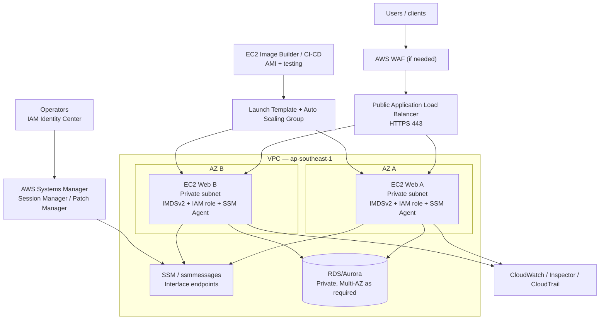
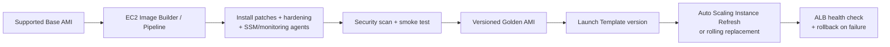
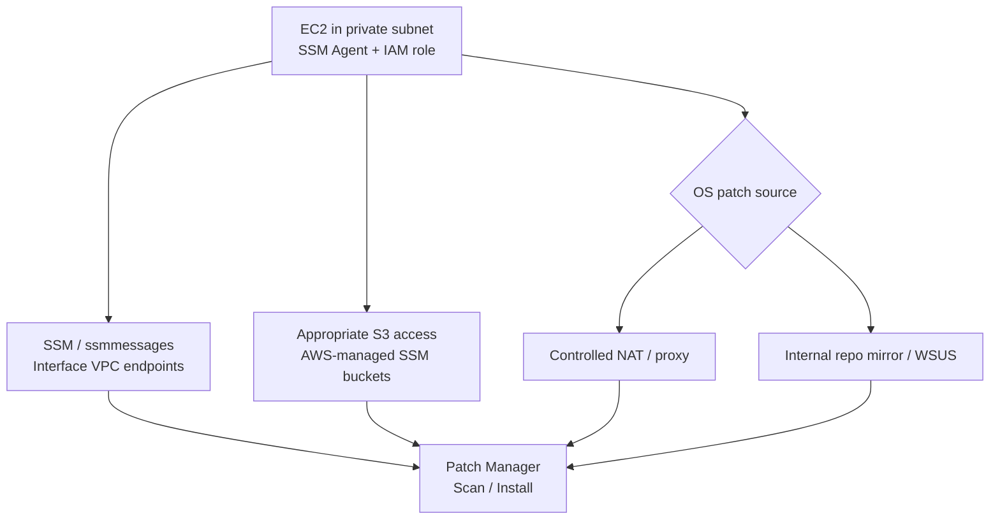
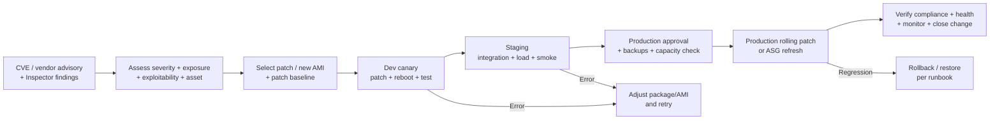
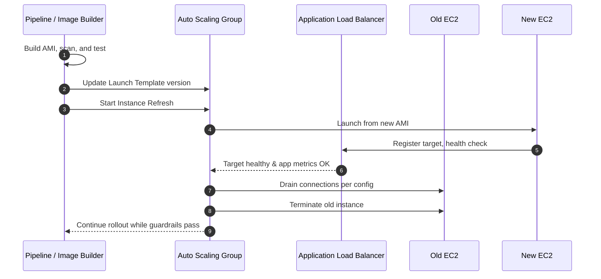
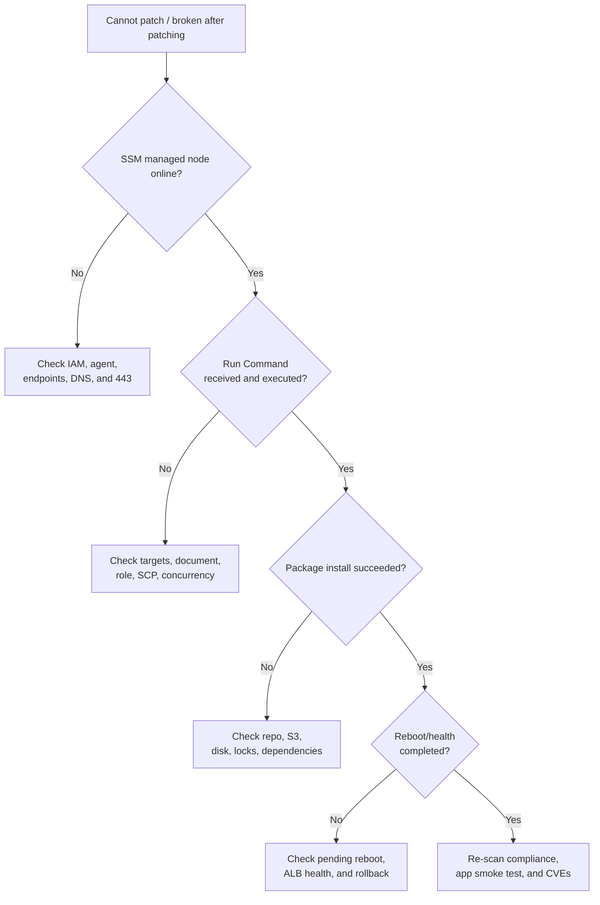

# Secure Server Configuration and Patch Management on Amazon EC2

An Amazon Elastic Compute Cloud (**Amazon EC2**) server can be provisioned in minutes, yet **launching successfully does not mean operating securely**. If an EC2 instance exposes SSH/RDP to the Internet, runs applications under privileged accounts, uses an outdated AMI, stores access keys in config files, or skips patching, a single small vulnerability can compromise both the application and its data.

This lesson belongs to the **EC2 Instances** chapter of the **CLOUD_PROVIDERS_AWS** module. Within the AWS ecosystem—spanning Regions/Availability Zones (AZs), IAM, VPC, compute, storage, databases, integration, and serverless—EC2 must be protected at both the **cloud infrastructure layer** and the **OS and application layers inside the machine**. The goal is building a repeatable security baseline, managing servers through AWS Systems Manager, executing scheduled patch management, monitoring compliance, and maintaining recovery paths when updates cause regressions.

## 1. Objectives and Scope of EC2 Protection

After this lesson, learners will be able to:

1. Distinguish AWS's security responsibilities from those of the customer running EC2.
2. Choose trusted AMIs and configure networking, instance profiles, IMDSv2, EBS encryption, and login access under least privilege.
3. Harden Linux/Windows according to a tested baseline managed with Infrastructure as Code (IaC).
4. Use AWS Systems Manager (SSM) to administer instances without exposing SSH/RDP directly to the Internet in supported scenarios.
5. Design a patching strategy with **Patch Manager, patch baselines, scan/install cycles, and dev → staging → production promotion rings**.
6. Choose between **in-place patching** and **replacing instances via a new AMI** in Auto Scaling Groups; evaluate reboot impact and recoverability.
7. Monitor patch compliance, detect vulnerabilities, account for costs, and troubleshoot common failures.

### 1.1. Shared Responsibility Model

AWS is responsible for security **of** the cloud: data centers, physical hardware, and AWS-managed virtualization layers. For standard EC2, customers remain responsible for security **in** the cloud: the guest OS, software packages, applications, IAM/SG configuration, data, encryption, and access governance.

| Layer | Primary AWS Responsibility | Customer Responsibility |
|---|---|---|
| Data centers, physical, underlying infrastructure | Protect hardware and AWS-managed service layers | Choose Regions/AZs for compliance and resilience needs |
| EC2 VM and guest OS | Provide instance/AMI execution and service documentation | Choose trusted AMIs, patch OS, lock down configs, manage users |
| VPC networking | Provide VPC, SGs, NACLs, and networking services | Design subnets, ingress/egress, admin sources, and DNS |
| AWS API permissions | Operate IAM/STS | Author narrow roles, control PassRole/AssumeRole, protect IMDS |
| Storage | Provide Amazon EBS, KMS, and snapshot capabilities | Enable encryption, design key policies, backups, data retention |
| Applications | Operate underlying AWS services used | Protect secrets, patch runtimes/dependencies, test and observe |

This split reflects the **self-managed EC2 model**. With higher-level managed services like AWS Lambda or Amazon RDS, OS patching responsibilities shift; do not mechanically apply EC2 guest-OS policies to every service.

### 1.2. Four Common Risk Sources

| Risk | Example | Core Mitigation |
|---|---|---|
| **Overexposed network surface** | Port 22/3389 or DB admin ports open to `0.0.0.0/0` | Private subnets, tight SGs, Session Manager |
| **Over-privileged identity** | EC2 role has `AdministratorAccess` or stores long-lived IAM keys | Least-privilege IAM instance profiles, STS temporary credentials |
| **Unpatched machines** | OS, kernel, OpenSSL, web server, or runtime carrying known CVEs | Patch policies, testing, AMI updates, compliance tracking |
| **Missing detection/recovery** | Patches trigger fleet-wide reboots, app breaks with no alerts or backups | Multi-AZ, rolling rollouts, health checks, CloudWatch, restore drills |

## 2. EC2 Architecture with Layered Defenses

Suppose an e-commerce app serves HTTP/HTTPS: Internet users hit an **Application Load Balancer (ALB)**; EC2 instances run the web API in **private subnets** across two AZs; critical data lives in a managed database. Administrators operate EC2 via Systems Manager.



This diagram shows the **logical flow**. PrivateLink interface endpoints require matching subnets, SGs, and private DNS; downloading OS patches also depends on **connectivity to package repositories and required AWS-managed S3 buckets**—do not assume creating an SSM endpoint alone allows downloading every OS package.

### Principles to Embed from Initial Design

- **The load balancer is the public entry point**, while application EC2 instances generally do not need public IPs.
- **EC2 security groups accept app ports only from the ALB SG**; admin access needs no Internet-facing SSH/RDP when Session Manager meets operational needs.
- **Use IAM roles via instance profiles**, never baking IAM keys into AMIs or user data.
- **Enforce IMDSv2 (`required`)** to block tokenless metadata access; test SDKs/agents before tightening.
- **Encrypt EBS, maintain backups, and keep secrets out** of AMIs/repositories.
- **Provision via Launch Templates/IaC** so new and replacement instances share the exact same baseline.
- **Spread apps across multiple AZs** and avoid updating/rebooting all instances simultaneously.

## 3. Configuring from Trusted AMIs and Machine Lifecycles

### 3.1. Choosing a Trusted AMI

An **Amazon Machine Image (AMI)** defines the base OS and baseline configuration. Prioritize:

1. Official AWS AMIs, trusted OS vendor images, or tested internal **golden AMIs**.
2. Operating systems still receiving security maintenance; avoid end-of-life OS releases, runtimes, or repositories.
3. Explicit versions with build-source and timestamp traceability; avoid uncontrolled “latest” references in production.
4. AMIs scanned for vulnerabilities, stripped of unnecessary packages, and configured with logging and monitoring agents.
5. A release workflow to publish new AMIs each patch cycle, support rollback, and retire obsolete AMIs.

An AMI patched today **becomes stale** as new CVEs emerge; long-term security cannot rely solely on picking a good AMI at initial launch.

### 3.2. Golden AMIs and Immutable Infrastructure

In an **immutable** model, avoid manual edits on running EC2 instances. Instead:



For stateless apps, replacing instances from a new AMI is often cleaner to control than patching long-lived hosts in place. Externalize **state** (sessions, uploads, business data) to RDS, S3, or shared storage. Data stored solely on **instance store** is lost on stop/terminate; root EBS data can also be deleted on terminate per volume attributes. Design backups/storage before adopting a replacement strategy.

For stateful hosts or legacy setups that are hard to recreate, **in-place patching** still has a place—paired with snapshots/backups, maintenance windows, and verified rollback procedures.

### 3.3. Launch Templates as the Standard Configuration Source

A Launch Template should clearly define: AMI ID/version, instance type, IAM instance profile, security groups, networking, root volume encryption, metadata options, and minimal bootstrap user data.

| Component | Recommended Baseline Choice | Rationale |
|---|---|---|
| AMI | Approved, versioned AMI | Trace patches and rebuild consistently |
| Instance profile | Workload role + required SSM permissions | Temporary credentials and admin access without static keys |
| Security group | ALB SG → app port only; minimal required egress | Shrink network attack surface |
| Public IP | Do not assign to app instances in private subnets | Limit direct exposure |
| EBS | Encrypt root and data volumes with appropriate keys | Protect stored data and snapshots |
| Metadata | `HttpTokens=required`, matching hop limit | Enforce IMDSv2 |
| User data | Lean bootstrap, zero hardcoded secrets | Prevent credential leaks in config |
| Tags | `Application`, `Environment`, `Owner`, `PatchRing` | Target selection, auditing, and cost allocation |

In multi-account environments, separate dev, staging, and production EC2 fleets across appropriate accounts or IAM boundaries. Never grant dev admin roles permission to alter production Launch Templates or AMIs.

## 4. Network Isolation: Subnets, SGs, NACLs, and Admin Access

### 4.1. VPC and Subnets

A **public subnet** has an appropriate route to an Internet Gateway. A **private subnet** lacks such a direct route; private instances use a NAT Gateway or VPC endpoints to reach external/AWS services per policy.

For a web API behind an ALB:

| Component | Placement | Sample Ingress | Sample Egress |
|---|---|---|---|
| ALB | Public subnets across at least two AZs | 443 from allowed client sources | Port 8080 to web EC2 SG |
| EC2 app | Private subnets across two AZs | 8080 strictly from ALB SG | 443 to required AWS services, DB port to DB SG |
| Database | Private/isolated subnets per design | DB port strictly from EC2 app SG | Per DB engine and valid needs |
| SSM interface endpoints | Private subnets | 443 from EC2 app SG | Per managed endpoint connectivity |

**Security groups are stateful:** return traffic for allowed connections passes automatically. **Network ACLs are stateless:** you must permit inbound, outbound, and ephemeral port ranges explicitly. Never apply overly broad NACL deny rules without tracing live traffic paths.

### 4.2. Avoiding Public SSH/RDP Whenever Unnecessary

Avoid rules such as:

```text
Inbound TCP/22    0.0.0.0/0    (SSH)
Inbound TCP/3389  0.0.0.0/0    (RDP)
```

When Systems Manager Session Manager meets shell/PowerShell needs, administer servers over an IAM-authenticated, logged channel with zero Internet-facing admin ports. When SSH/RDP is genuinely mandatory, restrict source IPs, use short-lived keys/certificates, enforce MFA at the access layer, log sessions, and time-bound access. Never treat merely changing the SSH port number as a primary security control.

**Example inspecting a security group via AWS CLI:**

```bash
aws ec2 describe-security-groups \
  --group-ids sg-0123456789abcdef0 \
  --region ap-southeast-1
```

Inspect ingress, egress, CIDR vs. SG sources, IPv4/IPv6, ports, and stale rules. Never check only IPv4 while overlooking `::/0` IPv6 rules.

### 4.3. Managing Egress and Patch Download Paths

Servers downloading OS patches typically contact Linux vendor repositories or Windows Update/WSUS; SSM Agent needs SSM endpoints and relevant AWS-managed S3 buckets. Blocking all egress entirely can leave a server **serving traffic yet unable to patch**.

Infrastructure choices depend on repository type:

- Controlled NAT Gateway/proxy when reaching public package repositories.
- VPC endpoints for AWS Systems Manager, plus S3 endpoints where needed for AWS-managed buckets.
- Internal repository mirrors, private package registries, or WSUS when the organization controls patch sources and timing.

Egress design must balance **least privilege, patchability, and availability**. Do not leave unrestricted Internet egress open indefinitely just because nobody inventoried which repositories servers actually use.

## 5. IAM: Operator Permissions vs. EC2 Instance Permissions

### 5.1. Distinguishing the Two Principals

An **administrator principal** calls AWS APIs to view/launch instances, start Session Manager sessions, send Run Commands, or schedule patching. The **EC2 principal** is the IAM role used by apps and the SSM Agent on the instance via its instance profile.

| Principal | What They Need | What Should Not Be Granted by Default |
|---|---|---|
| Developer | View EC2 state, dev apps, and dev logs | Edit production policies or assume admin roles |
| SRE/Platform | Operate and patch servers within assigned scope | Account-wide unconditional `iam:*` or `ec2:*` |
| Security | Audit configuration, compliance, alerts | Shared long-lived API keys |
| EC2 application role | Read only the secrets/buckets/queues the app needs | `AdministratorAccess` or access to other projects' data |
| SSM/patch orchestration role | Run approved SSM documents on scoped targets on schedule | Ad-hoc interactive shells on all prod EC2 without justification |

**Never store AWS access keys in source code, AMIs, user data, or unmanaged environment variables.** Use IAM roles and temporary credentials via STS/IMDS, and periodically prune unused permissions.

### 5.2. Instance Profiles and SSM

For an EC2 instance to register as an **SSM managed node**, it needs a compatible SSM Agent, proper permissions, and connectivity to required AWS endpoints. Two common ways to grant permissions:

1. **Systems Manager Default Host Management Configuration** at the account/Region level where supported. AWS recommends evaluating this for centralized fleet management where applicable.
2. **IAM instance profile** attaching a role with minimal SSM permissions; the AWS managed policy `AmazonSSMManagedInstanceCore` is a standard baseline. Add CloudWatch Logs/S3 permissions only for features actually used.

When one EC2 role serves both the application and SSM, avoid dumping everything into one broad policy. Split statements by function, scope resources tightly to the app, and govern `iam:PassRole` for instance creators.

Example identity policy **allowing only reading objects under one S3 prefix** for the app (not the SSM permissions):

```json
{
  "Version": "2012-10-17",
  "Statement": [
    {
      "Sid": "ReadProductImages",
      "Effect": "Allow",
      "Action": "s3:GetObject",
      "Resource": "arn:aws:s3:::shop-prod-assets/products/*"
    }
  ]
}
```

If the app needs `ListBucket`, add a separate bucket-ARN statement with a prefix condition; the policy above **does not grant bucket listing**. Bucket policies, KMS key policies, and explicit denies can still block access. The bucket name is illustrative only.

### 5.3. Session Manager Instead of Direct Shell Exposure

**AWS Systems Manager Session Manager** lets authorized operators open management sessions without public bastions or inbound SSH where supported. It integrates with IAM Identity Center, CloudTrail, and optional session logging to CloudWatch Logs/S3.

**Note:** CloudTrail records session-related AWS API calls, but does not automatically capture shell keystrokes/contents. Configure **session logging** separately and understand limitations for tunneled or end-to-end encrypted sessions.

To configure safely, still restrict `ssm:StartSession`, scope target instances, restrict allowed session documents, control who can edit Session Manager preferences, and govern who can invoke Run Command/Automation instead.

## 6. Protecting the EC2 Instance Metadata Service (IMDS)

The **Instance Metadata Service (IMDS)** exposes instance metadata and can provide temporary credentials for the attached instance role. Its usual IPv4 endpoint is `169.254.169.254`. If an app suffers server-side request forgery (SSRF) or a malicious process reaches IMDS, credentials can be abused within the role's permissions.

**IMDSv2** uses session tokens obtained via HTTP PUT before calling metadata endpoints. AWS recommends requiring IMDSv2 wherever possible to raise defense in depth.

### 6.1. IMDSv2 Access Pattern from Inside the Host

```bash
TOKEN=$(curl -sS -X PUT \
  "http://169.254.169.254/latest/api/token" \
  -H "X-aws-ec2-metadata-token-ttl-seconds: 21600")

curl -sS \
  -H "X-aws-ec2-metadata-token: $TOKEN" \
  "http://169.254.169.254/latest/meta-data/instance-id"
```

This example reads only the **instance ID** to illustrate the protocol; never print role credentials or log tokens. If the OS/workload lacks metadata access or IMDS is disabled, the request will fail.

### 6.2. Enforcing IMDSv2 on Existing Instances

Once you confirm apps/agents use IMDSv2-capable SDKs and `MetadataNoToken` indicates no active IMDSv1 dependencies, apply:

```bash
aws ec2 modify-instance-metadata-options \
  --instance-id i-0123456789abcdef0 \
  --http-endpoint enabled \
  --http-tokens required \
  --http-put-response-hop-limit 1 \
  --region ap-southeast-1
```

A hop limit of `1` is an illustrative baseline for standard hosts. For **container** hosts, AWS commonly recommends hop limit `2` so token responses traverse container networking layers. If nothing on the instance needs metadata, you may evaluate disabling IMDS, after verifying no instance role or agent depends on it.

### 6.3. What Else to Check Beyond IMDSv2?

- Keep instance profiles least-privilege; IMDSv2 **does not make an over-privileged role safe**.
- Never write temporary credentials into application logs, crash dumps, or debug responses.
- Restrict metadata access from untrusted processes/containers and apply guest-OS egress filters where appropriate.
- Enforce account defaults, Launch Templates, and guardrails so new instances never revert to optional IMDSv1.
- Track `HttpTokens`, `HttpEndpoint`, and metadata option changes via inventory/Config.

## 7. Encryption, Secrets, and Data Backups on EC2

### 7.1. Amazon EBS and AWS KMS

**Amazon EBS** stores block data for most EC2 instances. Enable **EBS encryption by default** per account/Region and verify both root and data volumes are encrypted. Choose AWS managed or customer managed KMS keys based on access control, rotation, and audit needs.

| Component | Required Action | Watch Out For |
|---|---|---|
| Root EBS volume | Encrypt and size/type appropriately for workload | `DeleteOnTermination` policy, backups, and AMI lifecycle |
| Data EBS volume | Encrypt and restrict attach/detach/snapshot rights | EBS is single-AZ; recovery/migration needs a plan |
| EBS snapshots | Encrypt with appropriate key, manage retention, test restores | Snapshots are only part of DR and incur storage fees |
| KMS keys | Separate key admin permissions from cryptographic usage | Disabling/deleting a key renders encrypted data unreadable |
| Application secrets | AWS Secrets Manager / SSM Parameter Store SecureString | Never hardcode secrets in AMIs or user data |
| Logs | Proper access controls, encryption, and retention | Avoid logging PII, tokens, or secrets |

**EBS encryption protects data at rest**; it does not block a running process on EC2 (with OS file permissions) from reading files. Combine IAM, OS permissions, process isolation, and app controls.

### 7.2. Caution with User Data and AMIs

User data typically bootstraps packages, configures agents, and starts services. Never put passwords, API tokens, or private keys inside user data, since authorized users can view metadata/configuration and bootstrap logs persist on disk.

When runtime secrets are needed, let the instance role query Secrets Manager/Parameter Store with least privilege and hold secrets strictly in memory or protected locations per app requirements. Implement rotation and handle expired secrets cleanly.

Before sharing or promoting a golden AMI, verify it contains no shell history, private keys, duplicated SSH host identities, tokens, logs with sensitive data, or build-environment artifacts.

### 7.3. Backups and Recoverability

Patch management always pairs with rollback. Before major patches or risky OS upgrades, take EBS snapshots/AMIs or trigger AWS Backup per policy; however, **crash-consistent snapshots do not replace application-consistent backups** (especially for databases running directly on EC2).

Practice **real restores** in an isolated environment and verify:

- **RPO:** how much data loss is acceptable?
- **RTO:** how fast must service resume?
- Do backups include all required volumes, KMS keys, IAM permissions, app configs, and dependencies?
- Can data integrity and service health be verified after restore?

A green EBS snapshot alone does not prove application/transaction consistency or that an instance will boot cleanly after restore.

## 8. Hardening the OS and Services Inside EC2

### 8.1. OS Baseline Principles

Hardenings must be versioned, tested, and applied consistently across Amazon Linux 2023, Ubuntu, RHEL, or Windows Server. Reference **CIS Benchmarks** or internal standards, tailoring controls to your app and policies instead of blindly toggling settings that break workloads.

| Layer | Linux EC2 | Windows Server EC2 |
|---|---|---|
| Users and privileges | Disable direct root SSH login, govern sudo, remove stale users | Restrict local Administrators, manage service accounts |
| Authentication | SSH keys/certs if SSH is truly required; prefer Session Manager | Session Manager or restricted RDP, logon controls |
| Services | Remove/disable unused daemons and ports | Disable unneeded roles/features/services |
| OS firewall | `nftables`/`firewalld`/`ufw` where appropriate | Windows Defender Firewall |
| Logs | `journald`/`syslog`/`auditd`, ship logs centrally | Windows Event Logs, Defender/agents, central logging |
| OS security controls | SELinux/AppArmor per distro/app | Defender, policies, and security baselines |
| Filesystem | Tight file permissions, restrict execute bits on sensitive paths where safe | NTFS ACLs, service account permissions |
| Patching | DNF/YUM/APT per OS/version | Windows Update/WSUS/Systems Manager |

Never lock yourself out of login or SSM control with an untested firewall/sudo change before preparing recovery access; test hardening in dev before rolling to production.

### 8.2. Basic Inspection Commands on Amazon Linux 2023

```bash
# Check release version and kernel
cat /etc/os-release
uname -r

# Check listening services
sudo ss -tulpn

# Check available patches (dnf may return a special exit code when updates exist)
sudo dnf check-update

# Check installed package list
rpm -qa

# Check management agent status if present
sudo systemctl status amazon-ssm-agent
```

These commands are for **inspection/inventory** and make no changes. On Amazon Linux 2023, use DNF and respect the distro's versioned repositories; use APT on Ubuntu and Windows Update tools on Windows. Avoid copying `yum update`, `dnf upgrade`, or `apt upgrade` commands blindly across OSes without checking versions, kernels, and dependencies.

### 8.3. Avoiding “Lockdown” Configs That Break Operations

Hardening settings that often require tuning:

- Blocking all outbound HTTPS can break SSM Agent, CloudWatch Agent, and patch repositories.
- Mounting filesystems `noexec` too broadly can break installers or agents.
- Changing sysctl/SELinux policies without testing can stop apps from binding ports or reading files.
- Deleting default users/roles without understanding the AMI can break Session Manager or cloud-init.

Solve this with IaC/automation, baseline scanning, **canary instances**, and readiness testing before fleet rollout.

## 9. AWS Systems Manager: The Patch Management Platform

**AWS Systems Manager Patch Manager** scans patch status and installs approved patches on eligible **managed nodes**, including EC2 instances running supported Linux and Windows Server distributions. Patch Manager operates per account/Region and also supports centralized **Quick Setup patch policies** across multiple accounts/Regions when prerequisites are met.

Key concepts to distinguish:

| Concept | Meaning | Operational Role |
|---|---|---|
| **SSM Agent** | On-host agent communicating with Systems Manager | Receives commands, reports status, executes operations |
| **Managed node** | Host registered with Systems Manager with valid ID/status | Target for scanning and patching |
| **Patch baseline** | Rules defining approved/rejected patches and auto-approval delays | Defines what counts as “missing an approved patch” |
| **Patch policy** | Quick Setup config defining scope, baselines, and scan/install schedules | AWS-recommended approach for fleet-wide patching |
| **Maintenance window** | Scheduled window for maintenance tasks against targets | Option for orchestrating Run Command tasks on schedule |
| **AWS-RunPatchBaseline** | SSM document executing `Scan` or `Install` | Execution mechanism for patching managed nodes |
| **Patch compliance** | Evaluation of node state against the assigned baseline | Compliance reporting; noncompliant nodes require action |

### 9.1. Prerequisites for EC2 to Become a Managed Node

Before running Patch Manager, verify:

1. **OS and version** appear on Patch Manager's supported list.
2. **Compatible SSM Agent is installed and running**. Many popular AMIs bundle it, yet verify the actual version—do not assume every custom AMI includes it.
3. Instance has permissions via **Default Host Management Configuration** or an **IAM instance profile**. With instance profiles, `AmazonSSMManagedInstanceCore` is the standard baseline.
4. Host can reach required Systems Manager endpoints via controlled Internet egress or VPC endpoints.
5. Host can fetch **metadata/resources from AWS-managed S3 buckets** required by Patch Manager/SSM and reach **OS patch repositories**.
6. Compatible Python/package manager versions and dependencies exist; the local OS execution context has sufficient privileges.

A common mistake is seeing an instance in the EC2 console and assuming it is already an **SSM managed node**. An instance existing in EC2 does not guarantee the SSM Agent can communicate or authenticate.

### 9.2. SSM Connectivity in Private Subnets

When not using NAT/public Internet, evaluate interface VPC endpoints such as:

- `com.amazonaws.<region>.ssm`
- `com.amazonaws.<region>.ssmmessages`
- `com.amazonaws.<region>.ec2messages` **if required/supported by the Region and agent configuration**.

SSM Agent behavior and endpoint support vary across Regions, especially newer Regions; check current connectivity docs for your Region. Enable private DNS and allow instances to reach TCP 443 on the endpoint SGs.

**However, SSM endpoints alone are not enough to download patches.** AWS docs also note access requirements for certain AWS-managed Amazon S3 buckets and OS software repositories. Linux packages usually come from configured OS repos (public or internal mirrors). Windows relies on Windows Update/WSUS and related endpoints. An S3 VPC endpoint does not automatically replace network paths to arbitrary third-party repositories.



This diagram illustrates concurrent dependencies—not that repository package payloads flow through Systems Manager itself.

### 9.3. Inspecting Managed Nodes

In your active account/Region:

```bash
aws ssm describe-instance-information \
  --region ap-southeast-1
```

Inspect instance IDs, ping/registration status, platform, and SSM Agent version. Use tags and scoping to manage large fleets. If an EC2 instance is missing, troubleshoot **agent health, instance permissions, DNS, endpoints/egress, and system clock** before touching patch baselines.

## 10. Patch Baselines: Policy for “Which Patches Apply”

A **patch baseline** defines rules for approved patches per OS. Both **AWS-managed predefined baselines** and **custom baselines** exist to match organizational policy.

A baseline can specify:

- Target OS / product family.
- Update classifications (e.g., Security and Critical per OS metadata), severities, and rules **within supported OS scopes**.
- Number of wait days before **auto-approval**.
- Explicit lists of approved or rejected packages when manual overrides are needed.
- Compliance evaluation rules for each managed node against the active baseline.

> **Understand accurately:** “Compliant” means the machine satisfies **the rules of the applied baseline at scan time**. It does not mean the OS/application has zero CVEs, zero vulnerable packages outside scan scope, or cannot be exploited.

### 10.1. Do Not Auto-Approve Every Patch Immediately in Production

Example across three environments:

| Environment | Illustrative Approval Policy | Goal |
|---|---|---|
| **Dev** | Daily scans; install patches early on canary instances | Catch compatibility regressions early |
| **Staging** | Install after dev validation; run representative data/tests | Catch integration and migration issues |
| **Production** | Approved by risk tier and maintenance window; fast-track flow for critical CVEs | Balance security with availability |

Specific day delays must reflect **organizational policy**, driven by severity, exploitability, asset exposure, and SLOs. Never assume “critical” patches must always wait a fixed number of days; actively exploited CVEs may require out-of-band emergency patching.

### 10.2. Patch Baselines vs. Vulnerability Scanning

| Capability | Patch Manager | Amazon Inspector / Vulnerability Scanning |
|---|---|---|
| Goal | Identify and install baseline-approved patches | Detect exploitable software/CVEs and prioritize risk |
| Basis | OS package/patch metadata and baseline rules | Package inventory, CVE feeds, and reachability findings |
| Output | Patch compliance and installation state | Vulnerability findings, alerts, severity rankings |
| Primary action | `Scan` / `Install` patches | Investigate, upgrade packages/images, or mitigate |
| Limitation | Does not cover all app/custom binary CVEs | Does not confirm OS patch compliance workflows alone |

A secure system combines **patching + vulnerability management + configuration hardening** rather than relying solely on compliance status.

## 11. Configuring Patch Policies with Systems Manager Quick Setup

AWS recommends **Quick Setup patch policies** where appropriate to schedule centralized patching, including across AWS Organizations multi-account/multi-Region estates.

### 11.1. High-Level Setup Workflow

1. Open **AWS Systems Manager → Quick Setup → Patch policy** in the appropriate management account/Region.
2. Select **scope**: single account, accounts/OUs, or Regions per governance and Organizations permissions.
3. Choose baselines per OS; create custom baselines if defaults do not meet security requirements.
4. Configure the **Scan schedule** and **Install schedule**. Scans can run more frequently than installs.
5. Select targets and patching/reboot options, plus concurrency/error thresholds where offered in the configuration.
6. Separate dev, staging, and production into schedules/policies aligned with promotion workflows.
7. Monitor policy deployment status, compliance reports, and remediate managed nodes that fail to apply configuration.

**Key distinction:** Quick Setup patch policies **do not require patch groups**. This differs from traditional Maintenance Window + patch baseline setups.

### 11.2. When to Use Maintenance Windows or Run Command?

| Approach | Fits Best When | Watch Out For |
|---|---|---|
| **Quick Setup patch policy** | Multi-account/multi-Region fleets needing unified scan/install schedules | AWS-recommended; monitor actual policy application on targets |
| **Maintenance Window + `AWS-RunPatchBaseline`** | Need strict maintenance windows, tag targeting, and controlled task orchestration | Set concurrency, error thresholds, and service role permissions |
| **Ad-hoc Run Command** | Diagnostics, test runs, or narrow emergency patching | Requires approval and tight target scoping |
| **EC2 Image Builder + rolling replacement** | Stateless EC2 fleets rebuildable from golden AMIs | Roll Launch Template/ASG versions cleanly and check health |

Maintenance Windows can run `AWS-RunPatchBaseline` on schedule. When using legacy `PatchGroup` / `Patch Group` tags, check tag formatting rules and baseline associations. Do not confuse an arbitrary canary tag like `PatchRing` with Patch Manager's dedicated **patch group** tag.

## 12. Scan and Install Operations with `AWS-RunPatchBaseline`

**`AWS-RunPatchBaseline`** takes an `Operation` parameter:

- **`Scan`**: checks whether the host is missing approved patches and reports compliance. **Does not install packages and does not proactively reboot**.
- **`Install`**: installs missing approved patches, updates compliance, and **may reboot** depending on `RebootOption` and install state.

### 12.1. Example: Scanning EC2 Instances Tagged `Environment=dev`

Assuming managed nodes exist tagged `Environment=dev` and the caller holds SSM Run Command permissions in `ap-southeast-1`:

```bash
aws ssm send-command \
  --document-name "AWS-RunPatchBaseline" \
  --targets "Key=tag:Environment,Values=dev" \
  --parameters '{"Operation":["Scan"]}' \
  --comment "Scan patch compliance for dev" \
  --max-concurrency "10%" \
  --max-errors "1" \
  --region ap-southeast-1
```

This returns a **`CommandId`**—it does not guarantee every target has finished scanning yet. Query invocation status and per-instance results using that command ID:

```bash
aws ssm list-command-invocations \
  --command-id "<COMMAND_ID>" \
  --details \
  --region ap-southeast-1
```

Inspect command status and output per instance alongside Systems Manager Compliance. Offline or unregistered nodes **will not execute** even though the API accepted the command.

### 12.2. Example: Installing Patches in a Canary Environment

Run only after confirming exact targets and approving reboot impact:

```bash
aws ssm send-command \
  --document-name "AWS-RunPatchBaseline" \
  --targets "Key=tag:PatchRing,Values=dev-canary" \
  --parameters '{"Operation":["Install"],"RebootOption":["RebootIfNeeded"]}' \
  --comment "Install approved patches on dev canary" \
  --max-concurrency "1" \
  --max-errors "0" \
  --region ap-southeast-1
```

Notes:

1. `PatchRing=dev-canary` only serves as a **target selector** here; it does not assign a different patch baseline.
2. `RebootIfNeeded` can reboot machines; ensure front-end services have health checks and spare capacity.
3. `--max-concurrency 1` limits simultaneous execution to one managed node **within the command**—it does not provide HA if the app only has one instance.
4. `--max-errors 0` stops dispatching to additional targets once an error is hit per Run Command rules; already-running invocations do not necessarily halt instantaneously.
5. With `NoReboot`, **machines do not reboot during the patch run**, yet may still **require a reboot afterward** for kernel/system library updates to take effect. Track pending-reboot state and schedule restarts separately.

**Never run an `Install` command across all of production via `Environment=prod`** without ring segmentation, concurrency limits, health checks, and rollback readiness.

### 12.3. Scoping IAM for Run Command Execution

Users or pipelines holding `ssm:SendCommand` can cause massive impact if allowed to run arbitrary shell documents across all production EC2 instances. Restrict:

- Allowed documents (e.g., specific approved patch documents).
- Allowed targets by account, instance ARN/trusted managed tags, and environment.
- Approver roles, operational schedules, and CloudTrail auditing.
- Permissions to edit patch-targeting tags: if a developer can set `PatchRing=dev-canary` on a prod instance, tag boundaries lose all protection.

Run Command can also write output to CloudWatch Logs/S3 per configuration; match log access permissions and retention to data sensitivity.

## 13. Designing a Release-Aligned Patching Schedule

Patching is an **infrastructure release process**. It requires owners, remediation SLAs, test environments, rollback strategies, and completion criteria.

### 13.1. Recommended Pipeline



Suggested patch rings:

| Ring | Targets | Timing | Promotion Gate |
|---|---|---|---|
| **0 — lab/canary** | 1–2 representative instances, no prod data | Earliest after baseline approval | Reboot, agents, app, CPU/memory/IO OK |
| **1 — dev** | Dev workloads | After canary | Unit/integration tests and service connectivity OK |
| **2 — staging** | Production-like environment | After dev | E2E, migrations, background jobs, SLO-like checks OK |
| **3 — production canary** | Small protected production slice | Maintenance window or emergency runbook | ALB health, business transactions, alerts OK |
| **4 — production fleet** | Remaining instances | Rolling by AZ/capacity | Error budget intact and patch compliance target met |

For actively exploited CVEs, shorten wait times, prioritize isolation/privilege reduction/network blocks, and build updated golden AMIs faster. Still require **impact assessment and minimum smoke checks**—“emergency” does not mean rebooting all of production at once.

### 13.2. Pre-Patch Checklist

Document preflight checks clearly:

1. **Asset inventory**: instance ID, AMI, OS version, owner, workload, SGs, AZ, tags, and ASG vs. standalone status.
2. **Patch scope**: CVEs, packages, current/target versions, kernel/runtime compatibility, and repositories.
3. **Backup/rollback**: snapshots/AMIs/restore points created and verified commensurate with risk.
4. **Capacity**: if an EC2 instance goes offline, can ALB/services still handle load; are quotas/capacity adequate for rolling restarts?
5. **Dependencies**: DBs, DNS, load balancers, secrets, EFS/volumes, network endpoints, and coupled components.
6. **Monitoring**: dashboards, alerts, error budgets, on-call owners, and escalation contacts.
7. **Approval**: maintenance window, targets, concurrency, stop conditions, and rollback decision owner.

### 13.3. Post-Patch Verification

Consider patching complete only when:

- Both SSM patch command status and per-node execution succeed (not merely API submission).
- Target OS/package versions and kernel are active; instances rebooted where patches required reboot.
- SSM Agent, CloudWatch Agent, application services, and ALB target health returned to normal.
- Smoke tests/API transactions pass; latency, 5xx, queue backlog, and CPU/memory/IO show no regressions.
- Inspector findings, patch compliance, and exception backlogs reflect the updated state.
- Change record captures evidence, AMI/snapshot IDs, any errors, and follow-up actions.

If packages installed yet the running kernel remains the older version, treat the change as **incomplete** until a reboot or verified live-patching step completes.

## 14. OS-Specific Patch Management

### 14.1. Amazon Linux 2023

Amazon Linux 2023 uses **DNF** and versioned repositories; update workflows must align with the repo/AMI versions controlled by the platform team.

```bash
# Check OS version and available update list
cat /etc/os-release
sudo dnf check-update

# Example installing updates per system repository policy
# Run only within an approved maintenance window
sudo dnf upgrade -y

# Check active kernel after completion/reboot if needed
uname -r
```

This illustrates manual admin steps on one test host. Across fleets, prefer Patch Manager or fresh AMI builds to prevent drift. `dnf check-update` returns a non-zero exit code when updates are available; do not treat every non-zero code as a broken system.

### 14.2. Ubuntu Server

Ubuntu uses APT:

```bash
sudo apt-get update
apt list --upgradable

# Illustrate installing patches during a maintenance window
sudo apt-get upgrade -y

# Common pending-reboot signal on Ubuntu/Debian
test -f /var/run/reboot-required && echo "Reboot may be required"
```

`apt-get upgrade` follows specific dependency rules; some updates require `full-upgrade` or release upgrades under separate procedures. Never run major OS upgrades as routine patches without testing compatibility and rollback.

### 14.3. Windows Server

For Windows EC2, coordinate:

- Windows Update or WSUS/repositories per corporate policy.
- AWS Systems Manager Patch Manager and Windows Server baselines for supported OS versions.
- Roles/features/services affected by patches; test .NET, IIS, PowerShell, and drivers/agents.
- Pending-reboot status and updates taking effect only after restart.

Sample observation commands:

```powershell
# Inspect OS and build
Get-ComputerInfo | Select-Object WindowsProductName, WindowsVersion, OsBuildNumber

# Inspect recorded hotfix history (not the complete update picture)
Get-HotFix | Sort-Object InstalledOn -Descending | Select-Object -First 15

# Illustrative application service status
Get-Service -Name W3SVC -ErrorAction SilentlyContinue
```

`Get-HotFix` is not a comprehensive scanner for every update or CVE. Use Windows Update/Patch Manager and inventory tools to confirm compliance.

### 14.4. OS Packages Are Not the Whole Application

OS Patch Manager **does not necessarily update** every runtime or manually installed component: Java JDKs, Node.js, containerized apps, binaries in `/opt`, vendor agents, or app-bundled libraries.

For example, a Java web API on EC2 may span:

- OS packages updated by DNF/APT.
- JDK packages or standalone JDK distributions.
- Maven/Gradle dependencies packaged inside the application artifact.
- Container base OS layers and app libraries if EC2 acts as a container host.

Each layer needs its own inventory, scanner, and **release path**. Never assume an app has zero CVEs just because Patch Manager marks the EC2 OS compliant.

## 15. Two Patching Strategies: In-Place Updates vs. Instance Replacement

### 15.1. In-Place Patching

**In-place patching** applies updates on existing machines via SSM Patch Manager or OS package managers. It fits workloads that are hard to replace, hold local state, or require managing individual hosts.

**Pros:** preserves instance IDs, private IPs, runtime configs, and existing operational hooks. **Risks:** package versions can drift across hosts, stale dependencies accumulate, reboots disrupt traffic, and rolling back partial OS updates is difficult.

Recommended flow:

1. Scan, snapshot current versions, and verify app health.
2. Take backups/snapshots or restore points and verify recovery paths.
3. Drain/remove the host from traffic if required by the service.
4. Install patches, reboot as needed, and confirm kernel/package versions updated.
5. Run health checks and smoke tests before returning the host to traffic.
6. Proceed to the next machine once healthy; avoid patching everything simultaneously by default.

### 15.2. Immutable AMI + Auto Scaling Instance Refresh

For stateless web services in an **Auto Scaling Group (ASG)**, an effective pattern is:

1. Use **EC2 Image Builder** or an equivalent pipeline to build a patched golden AMI.
2. Validate the AMI in dev/staging: boot, SSM Agent, CloudWatch Agent, app startup, networking, and CVE scan.
3. Create a **new Launch Template version** referencing the approved AMI ID.
4. Update the ASG to the target Launch Template version and trigger **Instance Refresh** or a controlled rolling deployment.
5. Set minimum healthy percentage/capacity, instance warmup, and thresholds aligned with SLOs; watch ALB target registration/health.
6. Pause/cancel rollout or revert to the prior Launch Template/AMI if health or business metrics breach thresholds.



This is a logical sequence. Exact ASG replacement, health check, warmup, and draining/termination behaviors depend on ASG settings. If temporarily scaling up extra instances to avoid capacity dips, verify EC2 quotas, subnet IPs, instance availability, and extra cost.

### 15.3. Comparing Before Choosing

| Criterion | In-Place Patch | Immutable AMI / Replacement |
|---|---|---|
| Best fit | Specialized, stateful hosts hard to rebuild | Stateless apps, ASGs, mature IaC |
| Fleet consistency | Depends on per-host state and patch timing | Fresh instances share the exact same AMI version |
| Drift risk | Relatively high if manual changes occur | Lower when AMIs/IaC are tightly governed |
| Service interruption | Needs reboots/draining depending on patch | Can roll cleanly onto healthy new instances |
| Rollback | Complex across altered OS/packages | Revert to known-good AMI/Launch Template if data is compatible |
| Cost | Fewer temporary instances when done sequentially | Image build/test overhead and rollout capacity |
| Prerequisites | Update/backup/restore runbooks | Image pipeline, health checks, deploy/ASG automation |

For workloads storing state on EC2, **externalize and protect state first**; never choose replacement merely because console clicks look simpler.

## 16. Monitoring Security Posture and Patch Compliance

### 16.1. Data Sources to Combine

| Objective | Tool or Data Source | Example Checks |
|---|---|---|
| AWS API config events | AWS CloudTrail | Who modified SGs, Launch Templates, instance profiles, metadata options |
| Missing patches | Systems Manager Patch Manager / Compliance | Noncompliant managed nodes, failed patch commands |
| OS/package CVEs | Amazon Inspector (when supported and enabled properly) | High/critical CVE findings |
| Resource misconfigurations | AWS Config / relevant rules | Unencrypted EBS, open SGs, IMDSv2 not enforced |
| EC2 health | CloudWatch EC2 status checks, metrics | Instance/system status check failures, CPU/network |
| OS and application | CloudWatch Agent, central logs, OpenTelemetry | Memory/disk usage, service restarts, app errors |
| Post-update health | ALB target health, 5xx, latency, business transactions | Patched host returning invalid responses |
| Backups and DR | AWS Backup jobs/reports, restore drills | Recoverable restore points meeting RTO/RPO |

**Limitation note:** default CloudWatch EC2 metrics exclude full guest memory and filesystem disk usage; install/configure CloudWatch Agent or equivalent telemetry. AWS Config, Inspector, and CloudTrail each have their own collection scope, permissions, and pricing; turning a service on does not guarantee every host reports data if agents, integrations, or Regions/accounts are unconfigured.

### 16.2. Sample Operational Alerts

- A new instance with `HttpTokens=optional` appears in production.
- An app EC2 SG opens TCP/22 or TCP/3389 to `0.0.0.0/0` or `::/0`.
- A production EC2 instance drops offline as an SSM managed node or runs an outdated SSM Agent.
- **Noncompliant managed nodes** exceed environment thresholds or miss remediation SLAs.
- A patch command fails or repeated reboots push ALB healthy targets below safe capacity.
- Amazon Inspector reports an actively exploited/critical finding on an Internet-facing workload.
- Near-full disks prevent the package manager from downloading/installing patches; CPU/memory/5xx spike post-reboot.

Every alert needs an **owner, threshold, notification channel, and runbook**. Detecting noncompliant machines without an owner and remediation deadline merely creates dashboard noise.

### 16.3. What Should Compliance Reports Show?

A weekly EC2 compliance report can include:

| Field | Meaning |
|---|---|
| Account / Region / Environment | Identifies administrative scope and ownership |
| InstanceId / AMI ID / OS | Identifies host and baseline version |
| Managed state / SSM Agent version | Confirms manageability and patchability |
| Patch baseline/policy | Shows the standard applied to the host |
| Last scan / last install / reboot status | Confirms data freshness and whether patches took effect |
| Missing/failed patches | Quantifies outstanding remediation work |
| Inspector finding severity | Distinguishes exploit risk from baseline compliance |
| Exception expiry / owner | Tracks hosts temporarily deferred for business constraints |

**`Not Applicable`, `NonCompliant`, and missing-data entries must be investigated individually**; never treat absence from a report as proof of safety.

## 17. Recovery Runbook After a Faulty Patch

No patching workflow is safe unless operators know what to do when a patch breaks an API, prevents kernel boot, or breaks SSM Agent connectivity.

### 17.1. Scenario 1: Newly Patched Machine Becomes Unhealthy

Suppose an ASG EC2 instance fails after a kernel update:

1. **Detect:** ALB targets go unhealthy, EC2 status checks fail, or app 5xx spikes.
2. **Contain:** halt further patch distribution or Instance Refresh once failure thresholds trigger; protect remaining healthy hosts.
3. **Preserve service:** ensure the ALB routes strictly to healthy targets, lean on spare capacity, and scale out from the known-good AMI if needed.
4. **Recover host:** for immutable rollouts, revert to the prior Launch Template version/AMI and replace broken instances. For in-place patching, boot via recovery paths, restore volume/snapshot, or rebuild fresh—never assume package downgrades are always safe.
5. **Verify:** confirm API/DB connectivity, logs, metrics, data integrity, and SSM Agent health.
6. **Post-mortem:** log the offending package/kernel, notify security, update baselines/AMIs, and set remediation timelines for remaining CVEs.

### 17.2. Scenario 2: Patch Works for the OS Yet Breaks the Application

For instance, a TLS library update prevents a Java app from connecting to the database. Rolling back the application binary alone may not fix an OS library change. Re-test the full chain **JDK → TLS library → DB client/driver → database** in staging and evaluate dependency isolation.

If database migrations or data edits shipped alongside the patch, keep changes decoupled enough to isolate root causes and pick safe rollbacks. Never revert an OS snapshot containing data without accounting for valid database transactions committed in the meantime.

### 17.3. Scenario 3: Lost Access via SSM

If a patch breaks SSM Agent or networking, you may need to:

- Inspect instance/system status, SGs/NACLs, endpoints, IAM profiles, and role permissions via AWS APIs.
- Use EC2 Serial Console or AWS-supported recovery procedures **if the instance/platform/account is configured for them**.
- Launch a rescue instance and attach the EBS volume to inspect/repair offline where technically permitted, accounting for AZ, encryption, KMS keys, and filesystems.
- Rebuild cleanly from a known-good AMI and reattach/restore data per runbook rather than nursing an unstable host indefinitely.

All rescue operations require IAM permissions, change control, and data protection. Having backups is not enough—know **who is authorized to use them and how long restoration takes**.

## 18. Comprehensive Scenario: Patching a Production E-Commerce Fleet

A Shop API architecture includes:

- Public HTTPS ALB across two AZs.
- ASG with at least two Java EC2 instances in private subnets, managed by a Launch Template.
- RDS/Aurora for orders, S3 for product images, SQS for async tasks.
- Dedicated IAM role reading strictly the app's S3 objects, SQS queues, and secrets.
- CloudWatch, Inspector, and Systems Manager tracking metrics, CVEs, and patch compliance.

### 18.1. Baseline Security Requirements

| Item | Expected Configuration |
|---|---|
| AMI | Tested Amazon Linux 2023 Golden AMI with build ID |
| IMDS | IMDSv2 required with workload-appropriate hop limit |
| SSH | No TCP/22 from Internet; administer via Session Manager |
| App SG | ALB → port 8080 only; outbound to DB/SQS/S3/SSM/repos as needed |
| EBS | Encrypted root volume, policy-driven snapshots/backups |
| IAM role | Only required AWS API permissions; zero static access keys |
| Agents | SSM Agent and CloudWatch Agent running properly |
| OS | Unneeded services disabled; audit baseline applied |
| Availability | Two AZs, target health checks, ASG headroom, and rollback plan |
| Release | Image Builder → AMI → Launch Template version → ASG Instance Refresh |

### 18.2. Scenario: Critical CVE Announced in an OS Library

Security reports a critical CVE with a fix for the OpenSSL package used on EC2. Recommended workflow:

1. **Triage:** check OS/package versions, affected instance scope, whether the app calls the vulnerable library, and Internet exploit paths.
2. **Interim mitigation:** if needed, tighten ingress/egress or block known exploit paths without causing unplanned downtime.
3. **Build:** update the golden AMI via Image Builder, recording build ID, scan results, and package changes.
4. **Dev:** replace canary EC2 with the new AMI; test boot, IMDSv2, SSM Agent, S3/SQS/DB connections, and smoke tests.
5. **Staging:** deploy the exact AMI version and run the full “place order → simulated payment → emit event → record order” flow.
6. **Production canary:** spin up a small batch of new instances; confirm ALB target health, p95 latency, and order success rates across an adequate traffic window.
7. **Rolling:** refresh remaining instances with SLO-safe healthy percentages/warmup, maintaining headroom if an AZ is impacted.
8. **Post-check:** verify package/library and kernel versions; refresh Inspector findings and compliance; archive change evidence.

If the app bundles a JDK or private library shipping its own OpenSSL copy, audit the **application/container artifacts** separately. Patching OS packages does not update libraries embedded inside app bundles.

### 18.3. Verifying Business Impact

A smoke test suite should validate both technical health and business outcomes:

```text
Infrastructure:
  - EC2 status checks passed
  - SSM managed node online
  - ALB targets healthy >= minimum threshold
  - Able to fetch secrets and connect to database

Application:
  - GET /health returns valid status
  - POST /orders (test fixture) succeeds
  - SQS events processed properly
  - No abnormal spikes in 5xx, latency, or queue backlog

Security:
  - IMDSv2 required
  - SGs expose no public SSH/RDP
  - OS/package patch levels match target
  - No new critical findings introduced
```

Patch verification does not end at SSM reporting `Success`; it ends when **the system serves traffic cleanly and proof of active patches is recorded**.

## 19. Controlling Costs During EC2 Hardening and Patching

Security controls add tasks and resources while reducing incident risk. Estimate costs for each choice:

| Component | Cost / Trade-off to Estimate | Appropriate Optimization |
|---|---|---|
| EC2 instance hours | Running hosts and spare capacity during rolling updates | Right-sizing, ASGs, scheduled dev shutdowns where safe |
| EBS / snapshots / backups | Volumes, snapshot retention, and restores | Clean lifecycle policies, audit which backups are still needed |
| NAT Gateway / VPC endpoints | Hourly and per-GB traffic fees by type | Pick SSM/repo connectivity paths by topology and total cost |
| CloudWatch logs/metrics | Ingestion, retention, custom metrics | Ship essential logs, tune retention and sampling |
| Inspector / Config / Security Hub | Feature- and scope-based billing | Enable per security policy and monitor budgets |
| EC2 Image Builder | Build/test compute, storage, and pipelines | Schedule builds per cadence; reuse image recipes |
| Rolling patches | Temporary surge capacity and testing effort | Maintain HA without leaving surge capacity up indefinitely |

**Never assume Patch Manager, Session Manager, or any Systems Manager feature is completely free across your entire architecture.** Charges can arise from advanced tiers/features, non-EC2 managed nodes, log storage, VPC connectivity, and supporting resources; always verify current pricing by Region, resource type, and usage tier.

AWS Budgets and Cost Anomaly Detection detect unexpected spend, yet alerts **do not automatically halt billing**. Tagging `Environment`, `Owner`, `Application`, and `PatchRing` alongside account separation speeds up cost attribution and issue triage.

## 20. Troubleshooting Common Issues

| Symptom | Possible Cause | Where to Check |
|---|---|---|
| EC2 running yet missing from SSM managed nodes | SSM Agent stopped/outdated, missing IAM permissions, or blocked endpoint path | Agent service/logs, instance profile, DNS/HTTPS endpoints, Region |
| Session Manager fails to connect | Wrong user/instance IAM permissions, agent offline, endpoint SG blocks 443 | `ssm:StartSession`, agent status, endpoint/private DNS |
| SSM Patch Manager command reports `Failed` | Unreachable repository, missing S3 access, disk full, package lock/dependency error | Run Command output, package manager logs, egress/path |
| Patch `Scan` works yet `Install` fails | Baseline selects incompatible package, missing local install privilege, or repo download fails | Baseline snapshot, package dependencies, root/Admin access |
| Host stays `NonCompliant` after install | Remaining missing patches, repo error, pending reboot, new baseline, or stale report | Re-scan, pending reboot, install output, and baseline |
| Patches installed yet old kernel still active | Not rebooted yet or bootloader picked previous kernel | `uname -r`, reboot plan, boot logs |
| App fails to come up after ASG instance replacement | AMI missing agent/runtime, user data failed, wrong SG/role/secret | System/cloud-init logs, ALB health, instance profile, AMI test |
| Switching to IMDSv2 required breaks app | Legacy SDK/script/agent calling IMDSv1 | `MetadataNoToken` metric, upgrade SDK, test beforehand |
| Container fails to retrieve IMDSv2 token | Metadata hop limit too low for container network namespace | Inspect container networking and hop limit per AWS guidance |
| EC2 cannot download patches despite SSM VPC endpoint | SSM endpoint covers only management channel; repo/S3 path missing | Check repository URLs, proxy/NAT/mirrors, required S3 buckets |
| Patch causes 5xx/latency | Library/JDK incompatibility, reboot, slow startup, or lost capacity | Rolling metrics, app logs, health checks, and rollback |
| Inspector still flags CVE after patching | Stale inventory, another package holds the CVE, or fix not applied | Live package version, refresh scan, embedded app libraries |

### Ordered Investigation Flow



Never “fix” errors by blindly opening ports 22/3389 or unrestricted Internet egress. Gather evidence at each layer and apply the narrowest accurate fix.

## 21. Guided Hands-On Exercises

### Exercise A — Auditing Configuration and Finding Risks

A production web API EC2 instance has:

```text
AMI:               End-of-life Ubuntu release
Subnet:            public, with public IP assigned
Security Group:    TCP/22 from 0.0.0.0/0; TCP/8080 from 0.0.0.0/0
IAM Instance Role: AdministratorAccess
EBS:               unencrypted root volume
Metadata Options:  HttpTokens=optional
SSM Agent:         Offline
Patch history:     Unknown last patch date
```

**Task:** identify at least six risks and prioritize remediation order.

**Suggested solution approach:**

1. Reduce Internet exposure: move EC2 behind an ALB in private subnets if architecture permits, restricting SGs strictly to required sources/ports.
2. Remove unnecessary admin permissions from the instance role, scoping strictly to resources the app uses.
3. Migrate to a supported OS/AMI, update packages/runtimes, and test compatibility.
4. Configure SSM Agent/role/networking for Systems Manager administration; restrict or close public SSH once the alternate admin path is verified.
5. Enforce IMDSv2 (`required`) after verifying SDKs/agents and monitoring `MetadataNoToken` first.
6. Encrypt EBS via new volume/snapshot/AMI creation or migration; never assume enabling default encryption retroactively encrypts existing volumes.
7. Establish patch baselines, scan/install schedules, backups, monitoring, and restore drills.

**Evaluation criteria:** specify both **immediate risk reductions** and **long-term architectural fixes**, rather than superficial answers like “enable a firewall” or “run updates.”

### Exercise B — Designing a Patch Schedule for 24 EC2 Instances

A system has 24 EC2 instances: 8 dev, 4 staging, 12 production. Production spans two AZs and processes continuous orders.

**Task:** propose patch rings, canary criteria, concurrency, and rollback triggers.

Reference design:

| Ring | Targets | How to Test | Stop Trigger |
|---|---|---|---|
| Dev canary | 1 of 8 dev machines | Patch/reboot, API smoke test, package versions | Agent or API unhealthy |
| Remaining dev | 7 dev machines | Integration tests / CI regression | Rising error rate, patch failure |
| Staging | 4 machines | E2E, DB/SQS dependencies, representative load test | Broken business flow or errors above threshold |
| Prod canary | 1–2 machines via approved deploy flow | ALB target health, 5xx, p95 latency | SLO breached |
| Remaining prod | Rolling by AZ/capacity | Maintain healthy targets and monitor each wave | Capacity or business metrics drop below threshold |

Simultaneous patch concurrency **cannot be guessed solely from “12 production machines.”** Base it on live load, SLOs, ASG capacity, healthy target counts, and surviving a single-AZ loss. If the app needs at least 10/12 healthy hosts, concurrency must be tighter than if 4/12 can handle peak load.

### Exercise C — Why Did Patch Manager Fail?

An Amazon Linux 2023 EC2 instance in a private subnet has:

- SSM Agent running; Systems Manager shows the managed node online.
- IAM instance profile with SSM permissions.
- VPC endpoints for `ssm` and `ssmmessages`.
- No NAT/proxy and no configured internal repository mirror.
- Patch Scan succeeds or returns status, yet Install fails to download packages.

**Question:** what is the likely root cause?

**Hint:** a working SSM management channel **does not mean** the machine can reach OS package repositories or required AWS-managed S3 buckets. Inspect `AWS-RunPatchBaseline` output, repository URLs, S3 bucket/network requirements, DNS, proxies, and firewalls before widening IAM to admin.

### Exercise D — Lab Account Procedural Practice

Execute only on test resources you are authorized to manage:

1. Launch EC2 using a supported AMI, encrypted root EBS, IMDSv2 required, and a scoped IAM role.
2. Verify registration in Systems Manager managed nodes.
3. Apply `Environment=lab` and `PatchRing=lab-canary` tags governed by pipelines or authorized operators.
4. Run `AWS-RunPatchBaseline` with `Operation=Scan` and inspect CommandId and compliance.
5. Take a snapshot/backup before running scheduled `Operation=Install` with controlled concurrency and reboot behavior.
6. Verify OS/package versions, SSM Agent, and app health post-update; run Scan again.
7. Record duration, before/after versions, associated costs, and restore procedures.

**Deliverables:** VPC/SG diagram, instance metadata settings, least-privilege IAM role policy, SSM command logs, before/after patch compliance, test app verification, and backup/restore evidence. Never include access keys, tokens, or sensitive data in submissions.

## 22. Secure EC2 Operations Checklist

### Initial Configuration

- [ ] AMI comes from a trusted source, OS/runtime remain supported, and version/build ID are recorded.
- [ ] Launch Template/IaC explicitly sets networking, IAM instance profile, EBS encryption, and IMDSv2.
- [ ] App EC2 resides in private subnets where appropriate; public ingress enters via ALB/WAF.
- [ ] SGs open only required ports and sources; both IPv4 and IPv6 rules audited.
- [ ] Public SSH/RDP restricted or eliminated; SSM management path tested.
- [ ] IAM role enforces least privilege with no static access keys or unnecessary `AdministratorAccess`.
- [ ] IMDSv2 is required; hop limit matches workload/container topology and active SDKs.
- [ ] Root/data EBS volumes encrypted; KMS permissions and snapshot lifecycles governed.
- [ ] Zero secrets in AMIs/user data; runtime retrieval and rotation configured per workload.
- [ ] OS services, local users, sudo/administrators, audit logs, and host firewalls match baseline.

### Patch Management

- [ ] SSM Agent online at a supported version; host registered as a managed node.
- [ ] Proper SSM permissions granted via Default Host Management Configuration or instance profile.
- [ ] Host can reach SSM endpoints, required S3 buckets, and OS patch repositories.
- [ ] Patch baseline matches OS and risk profile; never assume compliant equals zero CVEs.
- [ ] Quick Setup patch policy or approved Maintenance Window/Run Command workflow in place.
- [ ] Scan/Install schedules, dev/staging/prod rings, and emergency CVE workflow defined.
- [ ] Canary gates, concurrency/error thresholds, spare capacity, and reboot windows configured.
- [ ] Backups, rollback/restore procedures, and post-patch service health checks verified.
- [ ] Hosts rebooted when required; running kernel/packages match approved versions.
- [ ] Inventory tracks OS, runtimes, app/container dependencies outside OS patch scope.

### Monitoring and Continuous Improvement

- [ ] Track patch compliance, disconnected managed nodes, and failed patch commands.
- [ ] Combine Amazon Inspector, AWS Config, CloudTrail, CloudWatch, and app logs within scope.
- [ ] Assign owners/SLAs for noncompliant hosts, time-bound exceptions, and documented risk sign-off.
- [ ] Dashboards/alerts cover ALB target health, 5xx, latency, disk, memory, and restarts.
- [ ] Process exists to release updated AMIs/Launch Templates, retire stale AMIs, and detect drift.
- [ ] Periodic host and data restore drills measure real RTO/RPO.
- [ ] Cost reports track EC2, EBS, VPC endpoints/NAT, logs, and security tools per account/environment.

## 23. Core Takeaways

**Secure EC2 operations are the product of simultaneous defense-in-depth layers**—from AMI selection, private networking, IAM roles, IMDSv2, EBS encryption, and OS hardening to observability and recovery. Operationally, **patch management is a tested release process**, not merely running a package install command.

A sound workflow for most workloads:

```text
Inventory + vulnerability assessment
    -> Assess risk and choose patch baseline
    -> Build new AMI or Scan/Install via SSM
    -> Canary in dev, validate in staging
    -> Production rolling rollout with spare capacity and health checks
    -> Reboot when needed + verify active patches
    -> Update compliance, audit records, and runbooks
```

Within **CLOUD_PROVIDERS_AWS**, these practices enable engineers not just to launch EC2 instances, but to integrate IAM, VPC, KMS/EBS, Systems Manager, CloudWatch, and automation so applications **shrink their attack surface, stay patchable, remain observable, recover cleanly, and control costs** as they scale.

### AWS Reference Documentation

- [AWS Shared Responsibility Model](https://aws.amazon.com/compliance/shared-responsibility-model/)
- [Amazon EC2 — Security best practices](https://docs.aws.amazon.com/AWSEC2/latest/UserGuide/ec2-security.html)
- [Amazon EC2 — Configure instance metadata options](https://docs.aws.amazon.com/AWSEC2/latest/UserGuide/configuring-instance-metadata-options.html)
- [Amazon EC2 — Require IMDSv2 for existing instances](https://docs.aws.amazon.com/AWSEC2/latest/UserGuide/configuring-IMDS-existing-instances.html)
- [AWS Systems Manager — Step 2: Verify/add permissions for Session Manager](https://docs.aws.amazon.com/systems-manager/latest/userguide/session-manager-getting-started-instance-profile.html)
- [AWS Systems Manager — Configure instance permissions](https://docs.aws.amazon.com/systems-manager/latest/userguide/setup-instance-permissions.html)
- [AWS Systems Manager — Patch Manager](https://docs.aws.amazon.com/systems-manager/latest/userguide/patch-manager.html)
- [AWS Systems Manager — Patch Manager prerequisites](https://docs.aws.amazon.com/systems-manager/latest/userguide/patch-manager-prerequisites.html)
- [AWS Systems Manager — Patch policy configurations](https://docs.aws.amazon.com/systems-manager/latest/userguide/patch-manager-policies.html)
- [AWS Systems Manager — AWS-RunPatchBaseline document](https://docs.aws.amazon.com/systems-manager/latest/userguide/patch-manager-aws-runpatchbaseline.html)
- [AWS Systems Manager — Patching schedules using maintenance windows](https://docs.aws.amazon.com/systems-manager/latest/userguide/sysman-patch-scheduletasks.html)
- [EC2 Image Builder — Patch management](https://docs.aws.amazon.com/imagebuilder/latest/userguide/security-patch-management.html)
- [EC2 Image Builder — Overview](https://docs.aws.amazon.com/imagebuilder/latest/userguide/what-is-image-builder.html)
