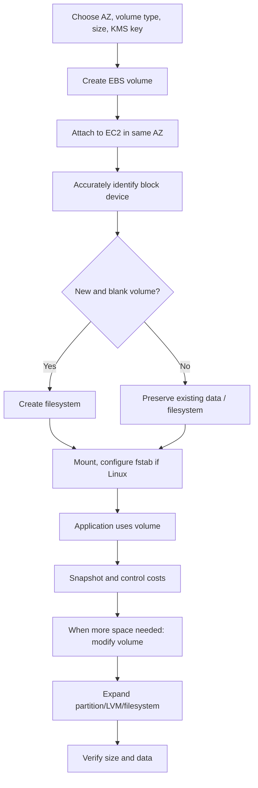
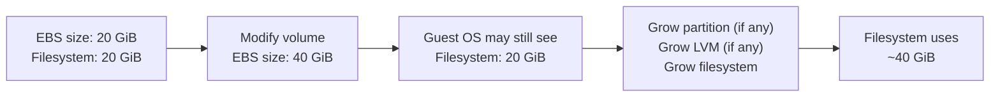
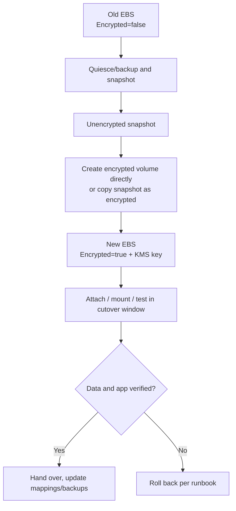
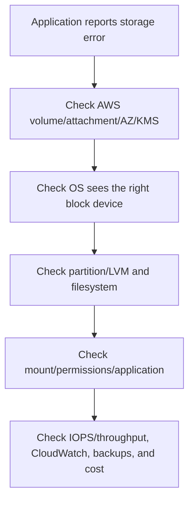

# Attaching, Expanding, and Encrypting EBS Volumes

**Amazon Elastic Block Store (Amazon EBS)** provides durable block storage drives for **Amazon EC2** virtual machines. An EBS volume can hold an operating system, application data, logs, or self-managed database data files. Unlike increasing the size of a normal folder, operating EBS involves **three layers that must work together**: the volume resource in AWS, the block device/partition inside the operating system, and the mounted filesystem used by the application.

This lesson belongs to the **Block and File Storage** chapter of the **CLOUD_PROVIDERS_AWS** module. It connects Region/Availability Zone infrastructure, IAM/KMS, EC2 compute, storage, databases, monitoring, data recovery, and cost control. The focus is on **attaching volumes properly, expanding without corrupting data, and encrypting securely**.

## 1. Learning Objectives

After this lesson, you will be able to:

1. Explain EBS volumes, snapshots, attachments, root volumes, data volumes, and Availability Zone scope.
2. Choose an appropriate EBS type among `gp3`, `gp2`, `io2`, and HDD types when matching requirements apply.
3. Create and attach a volume to an EC2 instance in the same AZ; accurately identify the disk in Linux or Windows.
4. Initialize a filesystem on a **new blank drive**, mount it, and configure persistent mounting across reboots without overwriting drives containing data.
5. Expand capacity in AWS and then expand the **partition/filesystem** inside the operating system.
6. Explain EBS encryption with AWS KMS, encryption by default, KMS key selection, and limitations when changing encryption state.
7. Describe the workflow for converting an **unencrypted volume → encrypted volume** via snapshots and controlled cutover.
8. Verify operations, monitor performance/capacity, back up, and estimate operational costs.

## 2. Where Does EBS Fit in AWS Architecture?

EBS is **block storage**: the operating system sees a block device and can create partitions/filesystems or add it to Logical Volume Manager (LVM). EBS is commonly used with EC2 and differs from **Amazon EFS**, which is a shared file storage service accessed via NFS.

| Technology | Storage type | Key characteristics | Examples |
| --- | --- | --- | --- |
| **Amazon EBS** | Block | Volume resides in one AZ, typically attached to one EC2; OS manages the filesystem | Boot drives, app data, self-managed PostgreSQL |
| **Amazon EFS** | File | Managed filesystem; multiple EC2 instances can mount via NFS in supported architectures | Shared directory across multiple machines |
| **Amazon S3** | Object | Object access via API, not a traditional block drive | Backups, images, logs, static data |
| **EC2 instance store** | Host-attached local block | Ephemeral data that can be lost when an instance stops/terminates or host changes | Cache, regenerable data |

An EBS volume is created in **one specific Availability Zone (AZ)**. An EC2 instance and EBS volume must reside in the **same AZ** to attach directly. EBS replicates data within that AZ for durability, yet **is not** a volume that automatically mounts on EC2 instances in other AZs. When recovery in another AZ is needed, you can create a new volume from an **EBS snapshot** in the target AZ within the same Region.

A **snapshot** stores a volume's block data state on AWS-managed infrastructure and can serve as a source to create new volumes. Snapshots and volumes are separate resources: deleting a volume does not automatically delete its snapshots, and snapshot backups do not inherently provide application consistency if an app is actively writing.

### 2.1. Key Volume Attributes

| Attribute | Example | Meaning |
| --- | --- | --- |
| **Volume ID** | `vol-0123456789abcdef0` | Resource identifier for the volume in AWS |
| **Availability Zone** | `ap-southeast-1a` | AZ hosting the volume; must match the EC2 instance's AZ to attach |
| **Volume type** | `gp3` | Governs pricing, IOPS, throughput, and workload suitability |
| **Size** | `20 GiB` | Allocated EBS block capacity |
| **State** | `creating`, `available`, `in-use` | Creation and attachment state |
| **Encrypted** | `true` or `false` | Encryption status set at volume creation time |
| **KMS key ID** | AWS KMS Key/ARN | Key used to protect the volume's data encryption key |
| **Attachment** | Instance ID, device name | Which EC2 instance the volume is connected to |
| **Delete on termination** | `true` or `false` | Rule governing whether the volume deletes when EC2 terminates, per block device mapping |

**Commonly confused metrics:** the AWS EC2 Console shows **EBS volume size**, Linux `lsblk` shows the block device size, and `df -hT` shows mounted filesystem space and usage. These values can **differ right after an expansion** until you resize the partition/filesystem.

### 2.2. Root Volumes and Data Volumes

- **Root volume** holds the operating system and boot filesystem for an EBS-backed EC2 AMI. Losing the root volume can prevent the instance from booting.
- **Data volume** is an additional volume for directories like `/data`, `/var/lib/postgresql`, or `D:` on Windows. Separating data volumes allows independent management of lifecycle, backups, and capacity apart from the OS drive.
- **Delete on termination** is typically enabled for root volumes and may differ for data volumes depending on launch/attachment configuration. Always inspect block device mappings before terminating EC2 instances.
- Certain **io1/io2** volumes support **EBS Multi-Attach** on supported instances within the **same AZ**, but this is **not** a default file-sharing feature. Systems must use write coordination and a suitable clustered filesystem; multiple instances writing concurrently to a regular filesystem can corrupt data.

## 3. Choosing the Right EBS Type and Capacity

| Volume type | Key characteristics | Example workloads | Notes |
| --- | --- | --- | --- |
| **`gp3` — General Purpose SSD** | Provisions capacity, IOPS, and throughput independently within service limits | Boot, web apps, general-purpose databases | Usually the right starting choice for many workloads |
| **`gp2` — General Purpose SSD** | Performance scales with volume size per `gp2` rules | Legacy systems currently using gp2 | Consider migrating to gp3 after measuring performance |
| **`io2` — Provisioned IOPS SSD** | High IOPS and durability engineered for demanding workloads | I/O-intensive databases requiring low latency/high durability | Watch instance caps and provisioned IOPS costs |
| **`st1` — Throughput Optimized HDD** | Optimized for sequential throughput | Large datasets scanned sequentially | Unsuitable for small random I/O; cannot be a boot volume |
| **`sc1` — Cold HDD** | Cost-optimized for infrequently accessed data | Low-activity storage | Cannot be a boot volume |

With `gp3`, baseline performance typically includes **3,000 IOPS and 125 MiB/s throughput**; when workloads demand more, administrators can provision higher performance within volume type and instance limits. Compare **real-world requirements** against EC2 instance capabilities and AWS limits rather than boosting IOPS on paper alone.

### 3.1. Choosing Initial Size

Suppose an application needs:

- Current data: 12 GiB.
- Growth over one operating cycle: 4 GiB.
- Logs, indexes, and application headroom: 6 GiB.

Estimated minimum capacity: `12 + 4 + 6 = 22 GiB`. You can select an appropriately larger volume for growth headroom and set filesystem usage alarms.

Note: **EBS bills for provisioned capacity**, even when `df` shows most of the drive is empty. EBS allows **increasing** volume size, but does not allow **directly shrinking volume size** via Elastic Volumes. To shrink capacity, create a smaller volume and migrate data according to a plan.

## 4. End-to-End Deployment Flow



**Highest-risk mistake for data loss:** running format operations (such as `mkfs.ext4`, `mkfs.xfs`, or **Initialize Disk** on Windows) on a **volume that already contains data**. Only format once you have verified it is truly a new blank disk with no data to preserve.

## 5. Creating and Attaching an EBS Volume in the AWS Console

### 5.1. Pre-Action Preparation

Make sure you know:

1. The **Account ID and Region** in use.
2. The target EC2's **Instance ID and AZ**.
3. Whether the volume is created blank or restored from a **snapshot**.
4. Policies for volume type, size, maximum cost, and **encryption by default**.
5. IAM permissions such as `ec2:CreateVolume`, `ec2:AttachVolume`, `ec2:DescribeVolumes`, and KMS key usage permissions if encrypting with a customer managed key.
6. Appropriate backups/snapshots if working with existing data.

If you do not have a sandbox or instance assigned yet, complete the simulated exercises at the end of the lesson; **you do not need to create billable resources** to understand the workflow.

### 5.2. Create a Blank Volume

1. Open the [Amazon EC2 Console](https://console.aws.amazon.com/ec2/) and select the **correct Region**.
2. Go to **Elastic Block Store → Volumes → Create volume**.
3. Choose `gp3` (or an appropriate type) and an illustrative size of `20 GiB`.
4. Select the **exact Availability Zone matching the EC2 instance** you will attach to.
5. Under **Encryption**, enable encryption if not enabled by default and select a KMS key per organizational policy.
6. Add clear tags, e.g. `Name=training-data`, `Environment=lab`, `Owner=team-cloud`.
7. Double-check type, size, AZ, and KMS key, then choose **Create volume**.
8. Wait for the volume to reach the **`available`** state.

If the account/Region has **EBS encryption by default** enabled, new volumes are automatically encrypted using that Region's default key. Verify which key is used so you do not inadvertently depend on a KMS key outside your team's administrative control.

### 5.3. Attach the Volume to EC2

1. Under **Volumes**, select the newly created volume.
2. Choose **Actions → Attach volume**.
3. Select the **Instance ID** of the EC2 instance in the same AZ.
4. Pick an unused device name (on Linux you may specify `/dev/sdf`); confirm with **Attach volume**.
5. Verify the volume transitions from `available` to `in-use` and shows attachment to the right instance.

**The device name you choose in the AWS Console does not necessarily match the name Linux displays.** On many Nitro-based EC2 instances, EBS volumes appear as `/dev/nvme*n1`; NVMe enumeration order can change after reboots or additional attachments. Therefore, never assume "the second drive is definitely `/dev/nvme1n1`" during data-destructive operations.

**An EBS volume and EC2 instance must be in the same AZ.** If they are in different AZs, the solution is to take a **snapshot**, restore it into a new volume in the target AZ, and attach that new volume; you cannot "move AZs" in place by editing a volume field.

## 6. Linux: Identifying Volumes, Creating Filesystems, and Mounting

This section assumes a Linux EC2 instance has a **brand-new, unformatted EBS data volume** attached. The device name `/dev/nvme1n1` is merely an example on Nitro; learners must substitute their verified device.

### 6.1. Read-Only Safety Checks Before Writing

On the EC2 instance, run **read-only** commands:

```bash
# Show disks, partitions, sizes, filesystems, and mount points.
lsblk -o NAME,SIZE,TYPE,FSTYPE,MOUNTPOINTS,UUID

# View filesystems actually mounted at mount points.
df -hT

# List filesystem signatures/UUIDs across disks.
sudo blkid

# Read signature on the VERIFIED TARGET DEVICE.
sudo file -s /dev/nvme1n1
```

When inspecting EBS devices on Nitro, match the **Volume ID** against the NVMe serial number and/or stable device paths provided by the OS. On Amazon Linux, `ebsnvme-id` helps map an NVMe device to its AWS Volume ID. Do not confuse it with an NVMe **instance store** drive if the machine has both storage types.

**Stop before formatting** if:

- `lsblk -f` or `blkid` reports existing `ext4`, `xfs`, `ntfs`, LVM metadata, or signs of data;
- the device is already mounted;
- you have not confirmed the Volume ID ↔ Linux device mapping;
- the volume was created from a snapshot or previously used.

### 6.2. Create a Filesystem on a New, Blank Data Volume

Once you have verified the volume is **completely blank** and safe to write to, for example using **XFS directly on the whole block device** (no partition):

```bash
# RUN ONLY ON A VERIFIED NEW BLANK VOLUME.
sudo mkfs.xfs /dev/nvme1n1

# Create mount directory.
sudo mkdir -p /data

# Mount volume.
sudo mount /dev/nvme1n1 /data

# Verify.
findmnt /data
df -hT /data
sudo blkid /dev/nvme1n1
```

You can also use `ext4` via `sudo mkfs.ext4 /dev/nvme1n1` if the workload requires it; subsequent resize commands must then follow `ext4`. **Never run two filesystem creation commands sequentially on the same device.**

Some organizations mandate a partition table (GPT) or LVM. In that case, follow OS partition/LVM creation procedures; those steps produce devices like `/dev/nvme1n1p1`, and you should not run `mkfs` directly on the raw disk if you chose a partitioned layout.

### 6.3. Persistent Mount Across Reboots Using UUID

Mounting by device name can fail if NVMe ordering shifts. Use the **UUID** from `blkid`, then add an entry to `/etc/fstab` with an editor using the exact value:

```fstab
# Illustrative example: replace UUID with actual value from blkid.
UUID=aaaaaaaa-bbbb-cccc-dddd-eeeeeeeeeeee /data xfs defaults,nofail 0 0
```

After saving:

```bash
# Test /etc/fstab syntax and mountability.
sudo mount -a
findmnt /data
df -hT /data
```

Depending on the OS, also run `findmnt --verify` or the appropriate validation tool and back up `/etc/fstab` before editing. The `nofail` option reduces the risk of boot hangs if the volume is unavailable, but **can allow applications to start while `/data` is unmounted** if dependency checks are missing. For critical data, services must check mount readiness before writing.

### 6.4. Attaching a Volume That Already Has Data

If the volume was restored from a snapshot or moved from another EC2 instance, **do not format it**. Instead:

1. Inspect the existing filesystem with `lsblk -f`/`blkid`.
2. Check application state, file ownership, and filesystem integrity.
3. Mount to a safe path; avoid mounting over directories containing data unless you understand mount shadowing behavior.
4. Use the real UUID in `fstab` if automatic mounting is desired.
5. Verify the application can read the data and back up before making further changes.

## 7. Windows: Initializing a New Disk and Assigning a Drive Letter

On Windows EC2, after attaching a volume in AWS, open **Disk Management** (`diskmgmt.msc`) or PowerShell to locate the new drive.

Procedure for a **new drive with no data**:

1. Verify disk number, size, and status via Disk Management or `Get-Disk`.
2. Only when the new disk is truly `RAW`/uninitialized and confirmed as the right disk, run **Initialize Disk** (usually GPT).
3. Create a volume/partition, format as **NTFS** (or ReFS where appropriate), and assign a drive letter such as `D:`.
4. Confirm the drive appears in File Explorer with the expected size and that service accounts have required NTFS permissions.

**Read-only** PowerShell inspection examples on Windows EC2:

```powershell
Get-Disk | Select-Object Number,FriendlyName,Size,PartitionStyle,OperationalStatus
Get-Partition | Select-Object DiskNumber,PartitionNumber,DriveLetter,Size
Get-Volume | Select-Object DriveLetter,FileSystem,Size,SizeRemaining
```

If the disk was created from a snapshot or previously held data, it likely already has a partition/filesystem; in that case **do not Initialize Disk or Format**. Match the disk against the AWS Volume ID and device info before making changes.

## 8. Expanding EBS: Two Steps Across Two Different Layers

Suppose an EBS volume starts at **20 GiB** and the application has nearly filled it. You want to expand it to **40 GiB**.

**Step 1 — AWS:** modify the EBS volume size from 20 GiB to 40 GiB using **Elastic Volumes**.

**Step 2 — Guest OS:** if the volume has partitions and a filesystem, expand them so the filesystem can use all 40 GiB. If LVM is used, also extend the physical volume/logical volume per your topology.



**Increasing EBS size in AWS does not automatically grow the filesystem.** Conversely, running filesystem grow commands before EBS/partition space is expanded will not create any new space.

### 8.1. Precautions Before Expanding

- Create a **consistent snapshot/backup** if the data is valuable, with a rollback plan.
- Check limits on volume type, EC2 instance, IOPS/throughput, and actual target capacity.
- Verify your instance/OS supports online modification; on many modern instances you can modify while `in-use`, though some legacy setups require detaching data volumes or stopping root volumes per AWS docs.
- You cannot directly shrink volume size using `Modify volume`.
- Do not submit consecutive volume modification requests while an earlier modification is still in progress; AWS enforces cooldowns and modification rules.
- When migrating from `gp2` to `gp3`, compare current IOPS/throughput against post-migration gp3 values; do not assume every configuration yields identical performance.

### 8.2. Expanding via the Console

1. Go to **EC2 Console → Elastic Block Store → Volumes**.
2. Select the exact volume ID, verifying attachments and tags.
3. Choose **Actions → Modify volume**.
4. Change **Size** from `20 GiB` to `40 GiB`; keep or modify volume type/IOPS/throughput only with specific justification.
5. Confirm cost impact and choose **Modify**.
6. Monitor **Modification state**: `modifying` → `optimizing` → `completed`.
7. Once in `optimizing` or `completed`, verify the OS sees the new block device size; proceed to expand the partition/filesystem.

The `optimizing` state usually allows starting filesystem expansion while background volume performance optimization continues. Do not rely on fixed wait times; verify actual state from the API/Console.

### 8.3. Equivalent AWS CLI Commands

Read-only status check and resize commands (substitute your real IDs/Region/profile):

```bash
# READ-ONLY: check type, size, AZ, encryption, and volume state.
aws ec2 describe-volumes \
  --volume-ids vol-0123456789abcdef0 \
  --query "Volumes[].{Id:VolumeId,Size:Size,Type:VolumeType,AZ:AvailabilityZone,Encrypted:Encrypted,State:State}" \
  --region ap-southeast-1 --profile training

# MODIFIES RESOURCE: expand volume to 40 GiB.
aws ec2 modify-volume \
  --volume-id vol-0123456789abcdef0 \
  --size 40 \
  --region ap-southeast-1 --profile training

# READ-ONLY: track volume modification progress.
aws ec2 describe-volumes-modifications \
  --volume-ids vol-0123456789abcdef0 \
  --region ap-southeast-1 --profile training
```

Do not run operations with illustrative Volume IDs. `modify-volume` increases storage costs according to the new capacity.

## 9. Linux: Extending Partitions and Filesystems

The following examples continue with the **20 → 40 GiB volume**. Before running commands, positively verify **Volume ID → block device → partition → filesystem → mount point**.

### 9.1. Inspect Layout Before Modifying

```bash
lsblk -o NAME,SIZE,TYPE,FSTYPE,MOUNTPOINTS,UUID
df -hT
findmnt /data
```

There are two common topologies:

| Topology | Example | Need `growpart`? |
| --- | --- | --- |
| Filesystem directly on volume | `/dev/nvme1n1` → XFS → `/data` | **No** partition to grow |
| Partitioned volume | `/dev/nvme1n1` → `/dev/nvme1n1p1` → ext4 → `/data` | **Yes**, if the partition does not yet span the new space |

If using LVM such as `/dev/mapper/vg-data`, use `pvresize`, `lvextend`, and filesystem extension matching the LVM layout; **do not** blindly apply commands meant for simple layouts.

### 9.2. Case A: XFS Directly on the Volume

If an **XFS** filesystem is mounted at `/data` without partitions, once the AWS volume reaches `optimizing`/`completed`:

```bash
# Confirm device is larger while filesystem is not yet expanded.
lsblk -o NAME,SIZE,TYPE,FSTYPE,MOUNTPOINTS
df -hT /data

# RUN ONLY if /data is definitely XFS on the newly expanded volume.
sudo xfs_growfs -d /data

# Verify filesystem size.
df -hT /data
```

`xfs_growfs` takes the **mount point** of a mounted XFS filesystem. Never run it on ext4.

### 9.3. Case B: ext4 on Partition 1

Suppose `lsblk` shows `/dev/nvme1n1` is now **40 GiB**, while partition `/dev/nvme1n1p1` and ext4 remain **20 GiB**:

```bash
# Verify topology first.
lsblk -o NAME,SIZE,TYPE,FSTYPE,MOUNTPOINTS

# Grow partition 1 on the exact disk.
sudo growpart /dev/nvme1n1 1

# Confirm partition now spans the added space.
lsblk -o NAME,SIZE,TYPE,FSTYPE,MOUNTPOINTS

# Grow ext4 inside the verified partition.
sudo resize2fs /dev/nvme1n1p1

# Verify filesystem size.
df -hT /data
```

**Syntax note:** `growpart /dev/nvme1n1 1` has a space between the **disk** name and **partition** number. On Xen instances, names may be `/dev/xvdf` and `/dev/xvdf1`; substitute actual device names.

If the filesystem is **XFS on a partition**, after `growpart` run `sudo xfs_growfs -d /data`, **not** `resize2fs`. If the partition is already full-sized while the filesystem is still smaller, skip `growpart`.

### 9.4. Root Volumes and LVM Cases

A Linux root volume may mount at `/` on a device like `/dev/nvme0n1p1`. For XFS, the grow command may be `sudo xfs_growfs -d /`; for ext4, `sudo resize2fs /dev/nvme0n1p1` after extending the partition. **Never guess** that the root partition is partition 1 on every AMI; check `lsblk` and `findmnt /`.

With **LVM**, the typical expansion order is:

1. Expand the EBS volume in AWS.
2. Expand the partition holding LVM if applicable (`growpart` on the exact disk/partition).
3. Expand the physical volume (`pvresize`).
4. Expand the logical volume (`lvextend`) as planned.
5. Expand ext4/XFS using the right device/mount point or supported integrated flag.

Multi-PV LVM setups, internal snapshots, or LUKS encryption may require extra steps; inspect the full layout before choosing commands and ensure proper backups.

## 10. Windows: Extend Volume After Size Change

Once AWS has expanded the EBS volume:

1. Log in to the Windows EC2 instance with an authorized identity.
2. Open **Disk Management** or **Server Manager** to identify the exact disk/partition.
3. Run **Rescan Disks** if the OS does not yet show the new capacity.
4. Confirm **unallocated space** sits adjacent so the partition can be extended.
5. Run **Extend Volume** on the supported NTFS/ReFS volume; confirm the new size and application access.
6. If Extend Volume is grayed out, inspect partition layout, filesystem limits, and appropriate tools rather than deleting partitions.

Read-only PowerShell example:

```powershell
Get-Disk | Select-Object Number,FriendlyName,Size,PartitionStyle
Get-Partition | Select-Object DiskNumber,PartitionNumber,DriveLetter,Size
Get-Volume | Select-Object DriveLetter,FileSystem,Size,SizeRemaining

# After confirming the exact extendable disk/partition:
Get-PartitionSupportedSize -DiskNumber 1 -PartitionNumber 1
```

Actual resize example **only after verifying the target drive**:

```powershell
# ASSUMES disk 1 / partition 1 is the exact data volume.
# Replace numbers with verified values.
$limits = Get-PartitionSupportedSize -DiskNumber 1 -PartitionNumber 1
Resize-Partition -DiskNumber 1 -PartitionNumber 1 -Size $limits.SizeMax
```

Expanding EBS is not "Initialize Disk"; never reformat a drive just because Windows newly detects unallocated space. If the volume is encrypted with EBS/KMS, expanding the Windows filesystem does not alter AWS encryption status.

## 11. EBS Encryption with AWS KMS

### 11.1. What Does Encryption Protect?

**EBS encryption** uses **AWS Key Management Service (AWS KMS)** to manage the data encryption keys for EBS. When you create an encrypted volume, EBS encrypts data at rest on the volume, snapshots created from it, and data in transit between EC2 and the volume per service design. Because EBS encryption operates inside AWS infrastructure, Linux/Windows sees a normal block device when authorized.

EBS encryption **does not replace**:

- IAM permissions and KMS key policies.
- Application authentication, Security Groups/NACLs, and OS-level data access controls.
- TLS for application network connections.
- Backups/snapshots, restore testing, and ransomware detection controls.

A running instance authorized to access an encrypted volume can still read plaintext data at the OS layer. Enabling encryption alone does not mitigate host-level compromise inside the machine.

### 11.2. AWS Managed Key vs. Customer Managed Key

| Option | Suitable purpose | Notes |
| --- | --- | --- |
| **AWS managed key `aws/ebs`** | EBS key management using AWS defaults | AWS manages primary lifecycle; suits many single-account needs |
| **Customer managed KMS key** | Requires custom key policies/grants, granular access control, auditing, cross-account sharing | Must manage key lifecycle, KMS costs, permissions, and recovery procedures |
| **EBS encryption by default** | Ensures new volumes and snapshot copies in a Region are encrypted | Configured **per account and Region**; does not retroactively change existing volumes |

When sharing an **encrypted snapshot to another account**, you generally need a **customer managed KMS key** with proper policies/permissions; the AWS managed key `aws/ebs` cannot be shared cross-account like a customer managed key.

The KMS key used for EBS must be a supported symmetric key. If the key is disabled, pending deletion, or denies access via policy, creating/attaching/starting encrypted resources can fail. **Never disable or delete a key while data or backups still depend on it.**

### 11.3. Regional Encryption by Default

In the EC2 Console, the **EBS encryption** section under account/Region settings lets you inspect and manage **encryption by default**.

Read-only AWS CLI commands:

```bash
aws ec2 get-ebs-encryption-by-default \
  --region ap-southeast-1 \
  --profile training

aws ec2 get-ebs-default-kms-key-id \
  --region ap-southeast-1 \
  --profile training

aws ec2 describe-volumes \
  --volume-ids vol-0123456789abcdef0 \
  --query "Volumes[].{Id:VolumeId,Encrypted:Encrypted,KmsKeyId:KmsKeyId}" \
  --region ap-southeast-1 \
  --profile training
```

When encryption by default is enabled, new volumes and snapshot copies are encrypted per Regional settings. This setting **does not retroactively encrypt** existing unencrypted volumes or snapshots, nor does it disable encryption on already-encrypted volumes.

### 11.4. You Cannot Toggle Encryption or Change KMS Keys In-Place on Existing Volumes

An important limitation:

- **You cannot directly convert** a volume from `Encrypted=false` to `Encrypted=true` via `modify-volume`.
- **You cannot decrypt** an encrypted volume or encrypted snapshot by unchecking a box.
- **You cannot swap KMS keys in-place** on an existing volume/snapshot. To switch keys, copy the snapshot under the new key or migrate data to a new volume.

**Elastic Volumes modifies size/type/IOPS/throughput within supported limits; it is not used to change encryption state or rekey in place.**

## 12. Migrating an Unencrypted Volume to an Encrypted Volume

### 12.1. Snapshot-Based Approach

Suppose `vol-old` holds application data with `Encrypted=false`. High-level safe procedure:

1. **Inventory dependencies:** volume ID, instance, AZ, mount point, filesystem, data, service permissions, and backups.
2. **Establish a consistent point:** flush/quiesce application data or pause writes per system guidelines, especially for databases.
3. **Create a snapshot** of the old volume. This snapshot inherits the encryption state of the source volume; if the source is unencrypted, the initial snapshot is also unencrypted.
4. **Create a new encrypted volume from that snapshot**, setting `Encrypted=true` and choosing the target KMS key in the intended attachment AZ. Alternatively, **copy the snapshot with encryption/KMS key** first, then create the volume from the encrypted snapshot.
5. **Controlled cutover:** stop application writes so live state does not diverge from the snapshot; detach/unmount the old volume per runbook, then attach/mount the new volume.
6. **Verify:** New volume shows `Encrypted=true`, correct KMS key, intact filesystem and data, and healthy application behavior.
7. **Rollback plan:** retain the old snapshot/volume for an appropriate window until verification completes; then clean up with formal approval.

**The snapshot in Step 3 is a point-in-time capture.** If the application keeps writing after the snapshot starts and you cut over to a volume restored from that older snapshot, newer changes will **be missing from the new volume**. Plan downtime, RPO, and synchronization—or take a final snapshot after halting writes before cutover.

### Encryption Migration Diagram



### 12.2. Illustrative AWS CLI Commands

**The commands below create snapshots/volumes and may incur charges.** They are reference examples for authorized environments, not an automated script safe to run blindly in production.

```bash
# Step 1: create snapshot after quiescing the application.
aws ec2 create-snapshot \
  --volume-id vol-0123456789abcdef0 \
  --description "migration-to-encrypted-volume" \
  --region ap-southeast-1 --profile training

# Step 2: once snapshot is ready, create a new EBS volume with encryption enforced.
# Replace snapshot ID with the ID returned in Step 1.
aws ec2 create-volume \
  --snapshot-id snap-0123456789abcdef0 \
  --availability-zone ap-southeast-1a \
  --volume-type gp3 \
  --encrypted \
  --region ap-southeast-1 --profile training

# Read-only: confirm new volume is encrypted and available.
aws ec2 describe-volumes \
  --volume-ids vol-0fedcba9876543210 \
  --query "Volumes[].{Id:VolumeId,AZ:AvailabilityZone,State:State,Encrypted:Encrypted,KmsKeyId:KmsKeyId}" \
  --region ap-southeast-1 --profile training
```

The `create-volume` example uses the Region's **default KMS key**. When a specific customer managed key is required, pass `--kms-key-id` with an authorized key ARN. AWS validates KMS permissions asynchronously in the background, so monitor volume status even after the create command returns. For a volume **created from a snapshot**, existing data and filesystem are restored; **do not reformat**.

### 12.3. Changing KMS Keys

To move an encrypted volume from KMS key A to KMS key B:

1. Take a consistent snapshot of the volume.
2. **Copy the snapshot**, enabling encryption and specifying **KMS key B** for the copy.
3. Create a new volume from the snapshot copy encrypted with key B.
4. Cut the application over to the new volume, verifying the KMS key and access.
5. Retire key A only after confirming no volumes, snapshots, or backups still rely on key A.

Copying a snapshot with a new key can create a **full copy** and incur extra snapshot costs. Automatic KMS key rotation and changing a volume's KMS key are distinct concepts; you do **not** need to replace volumes just because KMS rotates key material under the same key per supported policy.

## 13. Snapshots, Consistency, and Recoverability

### 13.1. Snapshots Do Not Automatically Guarantee Application Consistency

EBS snapshots are **block-level** captures. If an application or database is actively writing, a snapshot may be crash-consistent rather than **application-consistent**. For critical data:

- Use the application's or database's flush/checkpoint/quiesce mechanisms.
- When multiple EBS volumes form one dataset, consider consistent **multi-volume snapshots** within supported instance capabilities.
- Record snapshot timestamps and application state.
- Test restores in an isolated environment to verify integrity and boot/startup health.
- Configure retention, backup schedules, encryption rules, and access permissions with **AWS Backup** or an appropriate snapshot workflow.

Snapshots can restore volumes in **another AZ within the same Region**, supporting AZ-failure recovery plans. For cross-Region recovery, plan **cross-Region snapshot copies**, destination KMS key management, and copy/transfer costs.

### 13.2. Incremental Snapshots

EBS snapshots are incremental: after the first snapshot, subsequent snapshots generally store only changed blocks per service mechanics. Consequently:

- Provisioned volume size does not equal stored snapshot size.
- Deleting one snapshot may not free the full volume size in GB if blocks remain referenced by other snapshots.
- Monitor total snapshot spend and retention policies.
- Volumes restored from snapshots may undergo an **initialization phase** as blocks load, causing higher initial I/O latency; acceleration features like FSR carry separate costs.

### 13.3. Do Not Conflate Backups with High Availability

EBS resides in a single AZ. Applications requiring **multi-AZ high availability** typically need application/database-level replication or a managed HA service, such as Amazon RDS Multi-AZ for supported databases. Snapshots enable **post-incident recovery**, not an already-running replica in another AZ.

## 14. Safely Detaching EBS Volumes and Data Lifecycle

Before **detaching** a data volume from EC2:

1. Confirm the application is no longer writing or has drained traffic and closed files.
2. Take a snapshot if data preservation is required.
3. On Linux, **unmount** the filesystem with `umount` after ensuring no processes hold open files; on Windows, take the disk offline/dismount properly.
4. Remove or update `/etc/fstab` and service configs referencing the mount point.
5. Choose **Detach volume** in the Console and wait for the `available` state.
6. Choose **Delete volume** only after confirming data/backups are no longer needed and deletion is authorized.

Use **Force Detach** only when truly needed for a stuck volume after assessing filesystem corruption risk from unflushed caches. It is not a routine detach method.

When terminating EC2 instances, check the **DeleteOnTermination** flag on every mapping. Unattached volumes left in the `available` state continue **accruing storage charges**. Also, snapshots are not automatically deleted when a volume is deleted; apply retention policies and ownership tags to prevent orphaned resources.

## 15. Monitoring Capacity, Performance, and Cost

### 15.1. Distinguishing Three Metric Categories

| What to monitor | Tools | Notes |
| --- | --- | --- |
| **Free filesystem space** | `df -hT`, `Get-Volume`, CloudWatch Agent | EBS metrics do not report guest filesystem % used |
| **Volume performance** | CloudWatch EBS metrics such as `VolumeReadOps`, `VolumeWriteOps`, `VolumeReadBytes`, `VolumeWriteBytes`, queue/latency metrics | Evaluate alongside instance caps and workload type |
| **Volume state/config** | EC2 Volumes, `describe-volumes`, `describe-volumes-modifications`, CloudTrail | Detect size/type/encryption changes or unattached volumes |

The CloudWatch Agent can collect guest OS metrics like `disk_used_percent`. Set alarms for low free space, abnormal I/O, or missed backups. A high-performing EBS volume can still run out of space if an app fills logs rapidly.

### 15.2. What Comprises EBS Costs?

- **Provisioned storage (GiB/month)** by volume type, including unused allocated space.
- **Additional provisioned IOPS/throughput** on volume types billed separately for performance tiers.
- **Snapshots (stored capacity)** and related backup/copy/restore features.
- **KMS customer managed keys** and KMS API request charges where applicable.
- **Data transfer / cross-Region / add-on services**, depending on topology.

Illustrative scenario: expanding a `gp3` volume from **20 GiB to 40 GiB** adds **20 GiB** of provisioned capacity. Added cost depends on the **Regional `gp3` rate**, duration, and any extra parameters; never apply a single hardcoded USD rate across all Regions. Use [EBS pricing](https://aws.amazon.com/ebs/pricing/) and the [AWS Pricing Calculator](https://calculator.aws/) for estimates.

### 15.3. Periodic Operations Checklist

- Filesystem free space is sufficient and alarms are active.
- Volume names/tags identify owner, environment, workload, and lifecycle plan.
- Volumes holding sensitive data have compliant encryption enabled.
- KMS keys have proper policies and active state, with no single-person dependency.
- Snapshots/backups run on schedule and **restores have been tested**.
- `DeleteOnTermination` settings and `available` volumes are reviewed regularly.
- Provisioned IOPS/throughput are neither massively over-allocated nor starved relative to observed metrics.
- Recovery plans exist for instance failures or AZ evacuations.

## 16. Common Troubleshooting Cases

| Symptom | Possible cause | Safe check |
| --- | --- | --- |
| Cannot attach volume | EC2 and volume in different AZs, volume already in-use, attachment limit reached | Check AZ, state, volume type, and instance limits |
| Attach succeeds but Linux lacks `/dev/sdf` | Nitro renamed device to NVMe; device view not refreshed | Use `lsblk`, Volume ID/NVMe serial, and `ebsnvme-id` |
| Mount reports `unknown filesystem` | Blank unformatted disk, wrong partition, or corrupted FS | Inspect `lsblk -f`/`blkid` first; never format before verifying |
| Reboot loses `/data` mount | Missing or wrong UUID in `/etc/fstab` | Check `blkid`, `fstab`, `mount -a`, service dependencies |
| AWS shows 40 GiB yet `df` still shows 20 GiB | Partition/filesystem not grown | Check `lsblk` then run `growpart`/`resize2fs`/`xfs_growfs` per layout |
| `growpart` outputs `NOCHANGE` | Partition already spans disk or EBS new size not yet visible | Inspect `lsblk` and modification state; do not create new partitions |
| `resize2fs` reports `Bad magic number` | Target is not ext4 or wrong device selected | Check `df -hT`, `lsblk -f`; use `xfs_growfs` for XFS |
| `xfs_growfs` says not a mounted XFS filesystem | Wrong mount point or filesystem type | Check with `findmnt` and `df -hT` |
| Cannot create/attach encrypted volume | Missing KMS permissions, wrong/disabled/cross-Region key | Inspect key policy, IAM grants, key state, CloudTrail |
| Enabled encryption by default yet old volumes remain unencrypted | Default does not apply retroactively | Snapshot and create new encrypted volume |
| EBS metrics look normal yet app reports disk full | EBS metrics differ from guest disk usage | Use CloudWatch Agent / `df` / `Get-Volume` |
| Bill rises despite stopped/terminated EC2 | `available` volumes or snapshots remain | Check Volumes, Snapshots, provisioned storage, and retention |

### Layered Diagnostic Workflow



Start with **non-destructive read-only inspection**; run state-changing commands only after confirming the exact volume ID, filesystem topology, and a solid recovery plan.

## 17. Guided Hands-On Lab

**Scenario:** a Java application running on Linux EC2 needs an encrypted data volume. Initial planned size is 20 GiB, later expanding to 40 GiB. Since learners might not yet have an AWS sandbox, the exercise has two tiers: **paper design** and **live execution when authorized**.

### Part A. Design Without Creating Billable Resources

Complete the table:

| Criterion | Your plan |
| --- | --- |
| EC2 instance and AZ | E.g. `i-...` in `ap-southeast-1a` |
| Volume type | `gp3`, explain why |
| Initial size | 20 GiB |
| Expanded size | 40 GiB |
| Encryption state | `Encrypted=true` |
| KMS key | `aws/ebs` or customer managed key per requirements |
| Linux mount point | `/data` |
| Filesystem | XFS or ext4; pick one |
| Pre-expansion backup | Application-consistent snapshot if real data exists |
| Monitoring | Disk usage + EBS IOPS/throughput |
| Costs to estimate | GiB/month, snapshots, added IOPS/throughput, KMS |

Answer: if you chose **XFS directly on the disk**, how do the filesystem expansion steps differ from **ext4 on a partition**?

### Part B. Read-Only AWS Inspection

If an instructor-provided account and resources are available, use the AWS CLI with an authorized profile:

```bash
aws sts get-caller-identity --profile training

aws ec2 describe-instances \
  --instance-ids i-0123456789abcdef0 \
  --query "Reservations[].Instances[].{Id:InstanceId,AZ:Placement.AvailabilityZone,State:State.Name}" \
  --region ap-southeast-1 --profile training

aws ec2 describe-volumes \
  --volume-ids vol-0123456789abcdef0 \
  --query "Volumes[].{Id:VolumeId,AZ:AvailabilityZone,Size:Size,Type:VolumeType,Encrypted:Encrypted,State:State,Key:KmsKeyId}" \
  --region ap-southeast-1 --profile training
```

Verify whether EC2 and EBS are in the **same AZ**, whether the volume is **encrypted**, and whether the size matches expectations. **No write commands are needed** in Part B.

### Part C. Live Execution (If Sandbox and Permissions Are Available)

1. Confirm budget and resource cleanup mechanisms.
2. Create an **encrypted 20 GiB gp3 data volume** in the same AZ as the EC2 instance.
3. Attach it to EC2; use `lsblk`/`blkid`/NVMe Volume ID to identify the device.
4. Only after confirming the volume is **blank**, create the filesystem and mount it at `/data`.
5. Write a **non-secret** test file in `/data` and read it back to verify.
6. If permitted to expand, take a protective snapshot, modify EBS size to 40 GiB, and run `lsblk` and `df` to demonstrate the two distinct size layers.
7. Run the expansion command matching your chosen filesystem; verify the test file remains intact and `df` reflects the increased capacity.
8. Audit encryption/KMS key, snapshots, and costs; clean up per sandbox policy without deleting shared resources.

### Lab Report Template

```text
Account / Region: ...
EC2 ID / AZ: ...
EBS volume ID / AZ: ...
Volume type / size before / after: ...
Encrypted: Yes / No
KMS key type: AWS managed / Customer managed
Guest OS: Linux / Windows
Device mapping verified: Yes / No
Partition/LVM layout: ...
Filesystem / mount point: ...
Filesystem size before / after: ...
Pre-change snapshot: Yes / No / N/A
Data integrity test: Pass / Fail / Not tested
Estimated storage and snapshot cost: ...
Cleanup owner and date: ...
```

**Completion criteria:** learners demonstrate that the volume matches the AZ, attaches to the right EC2, is positively identified prior to writing, distinguishes EBS expansion from filesystem expansion, applies compliant encryption/KMS, and includes a backup/cost-control plan.

## 18. Self-Check Questions

1. Why can't an EBS volume in AZ-A attach directly to an EC2 instance in AZ-B? How do snapshots help move data across AZs?
2. Why might a device name like `/dev/sdf` in the AWS Console not appear identically inside a Nitro EC2 instance?
3. When does `mkfs.xfs` become the single most dangerous command in the entire lab?
4. Explain the difference between `lsblk` and `df -hT` right after EBS expands from 20 GiB to 40 GiB before filesystem expansion.
5. For XFS mounted at `/data`, which command expands the filesystem? For ext4 on `/dev/nvme1n1p1`, which partition step is required?
6. Why can't you fulfill "shrink a 100 GiB EBS volume down to 50 GiB" using `modify-volume --size 50`?
7. A volume has `Encrypted=false`. Does enabling encryption by default in that Region immediately encrypt the volume?
8. What steps are required to change the KMS key of an encrypted volume? What is the risk of deleting the old key too early?
9. Why does taking a snapshot while PostgreSQL is actively writing not automatically guarantee an application-consistent backup?
10. What must be checked before detaching a data volume while an application is still writing logs?
11. Does EBS still incur charges if a volume is detached from EC2 and sitting in the `available` state?
12. When an EBS volume is large enough yet the application still reports out-of-space errors, what should you inspect across partitions/LVM/filesystems?

## 19. Official AWS Documentation

- [Amazon EBS: overview](https://docs.aws.amazon.com/ebs/latest/userguide/what-is-ebs.html).
- [Amazon EBS volume types](https://docs.aws.amazon.com/ebs/latest/userguide/ebs-volume-types.html).
- [Create an Amazon EBS volume](https://docs.aws.amazon.com/ebs/latest/userguide/ebs-creating-volume.html).
- [Attach an EBS volume to an EC2 instance](https://docs.aws.amazon.com/ebs/latest/userguide/ebs-attaching-volume.html).
- [Device naming on Amazon EC2](https://docs.aws.amazon.com/AWSEC2/latest/UserGuide/device_naming.html).
- [Make an EBS volume available for use (Linux)](https://docs.aws.amazon.com/ebs/latest/userguide/ebs-using-volumes.html).
- [Modify EBS volume using Elastic Volumes](https://docs.aws.amazon.com/ebs/latest/userguide/ebs-modify-volume.html).
- [Request an EBS volume modification](https://docs.aws.amazon.com/ebs/latest/userguide/requesting-ebs-volume-modifications.html).
- [Extend Linux file system after EBS resize](https://docs.aws.amazon.com/ebs/latest/userguide/recognize-expanded-volume-linux.html).
- [Extend Windows file system after EBS resize](https://docs.aws.amazon.com/ebs/latest/userguide/recognize-expanded-volume-windows.html).
- [Amazon EBS encryption](https://docs.aws.amazon.com/ebs/latest/userguide/ebs-encryption.html).
- [Enable EBS encryption by default](https://docs.aws.amazon.com/ebs/latest/userguide/encryption-by-default.html).
- [EBS encryption examples and conversion](https://docs.aws.amazon.com/ebs/latest/userguide/encryption-examples.html).
- [How Amazon EBS uses AWS KMS](https://docs.aws.amazon.com/kms/latest/developerguide/services-ebs.html).
- [Create Amazon EBS snapshots](https://docs.aws.amazon.com/ebs/latest/userguide/ebs-creating-snapshot.html).
- [Detach an EBS volume safely](https://docs.aws.amazon.com/ebs/latest/userguide/ebs-detaching-volume.html).
- [Amazon EBS pricing](https://aws.amazon.com/ebs/pricing/).

> **Key Takeaway:** **Expanding EBS** is an AWS resource change; **extending a partition/filesystem** is an OS-level change; **EBS encryption** must be decided at volume creation or applied via a snapshot-to-new-volume workflow. Across all three operations, verify the exact **volume ID, AZ, data state, KMS permissions, and recovery plan** before making changes.
