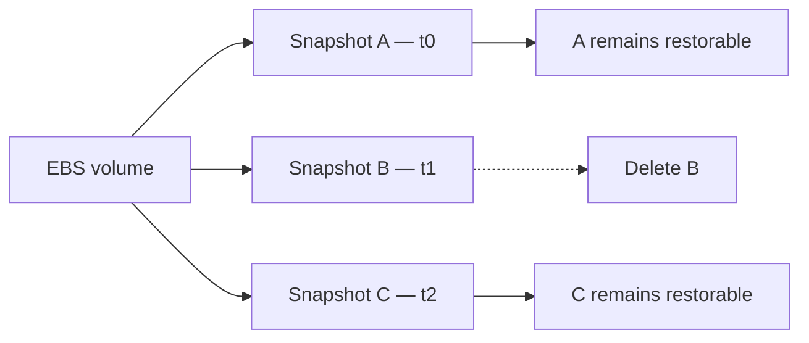
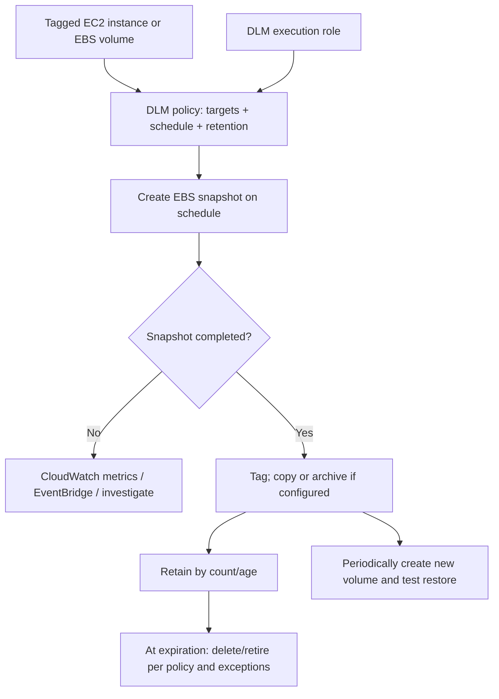
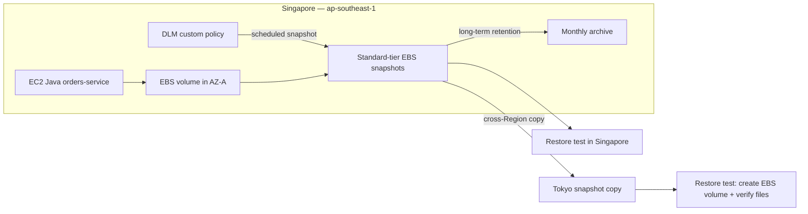

# EBS Snapshots and Amazon Data Lifecycle Manager

> **Chapter:** Block and File Storage  
> **Module:** `CLOUD_PROVIDERS_AWS`  
> **Scope:** Backing up, restoring, and managing the lifecycle of Amazon EBS snapshots in AWS; designing automated policies with Amazon Data Lifecycle Manager (DLM), integrating IAM, KMS, EC2, VPC, monitoring, resilience, and cost optimization.

## Learning Objectives

After this lesson, learners will be able to:

1. Explain what an EBS snapshot is, why standard-tier snapshots store data using an **incremental** model, and how snapshots differ from EBS volumes, AMIs, or application-level backups.
2. Create, inspect, copy, and **restore EBS volumes from snapshots** with the right Region, Availability Zone, and KMS permissions.
3. Distinguish **crash-consistent**, **multi-volume crash-consistent**, and **application-consistent** snapshots; propose solutions to protect actively writing databases.
4. Design **Amazon Data Lifecycle Manager** policies (default or custom) with target tags, schedules, retention, copies, archives, and IAM controls.
5. Explain lifecycle limitations: snapshot archive, Recycle Bin, Snapshot Lock, tag/policy changes, snapshots created by external actors, and data dependencies.
6. Build restore-testing workflows, track failures, control RPO/RTO, and avoid accidental deletion or retaining unnecessary snapshots.
7. Choose the right solution among **EBS snapshots + DLM**, **AWS Backup**, and application-aware backups.

## 1. Why Do We Need Snapshots for Amazon EBS?

**Amazon Elastic Block Store (EBS)** provides durable **block storage** for EC2. The operating system sees an EBS volume as a block storage device that can be partitioned, formatted, and mounted. EBS volumes are tied to one **Availability Zone (AZ)** under the service's attachment rules.

When a Java application running on EC2 writes logs, application files, or local data to EBS, data must not depend solely on a single live volume. Operational mistakes, logical data corruption, accidental volume deletion, deployment failures, or environment migrations can all occur.

An **EBS snapshot** is a point-in-time copy of the data on an EBS volume. Snapshots serve several needs:

- Restoring data/volumes to a point in time prior to an incident.
- Creating a new volume from backed-up data within the same Region.
- Copying snapshots to another Region to prepare for disaster recovery.
- Sharing or copying snapshots to another account under IAM/KMS controls.
- Building EBS-backed AMIs or restoring subsets of system components where appropriate.
- Automating creation frequency and retention periods via Data Lifecycle Manager.

**Snapshots are not automatically a complete backup strategy.** They require clear creation schedules, retention rules, access permissions, restore-testing procedures, copy locations, and business targets. Organizations must also protect data and state outside EBS, such as RDS, DynamoDB, S3, EFS, and external services.

### 1.1 How Do EBS Volumes, Snapshots, AMIs, and Backups Differ?

| Resource | Nature | How can it be used directly? | Notes |
|---|---|---|---|
| **EBS volume** | Active block storage device in an AZ | Attach to an eligible EC2, format/mount, and read/write | Typically single-AZ; create a new volume from a snapshot when recovery is needed |
| **EBS snapshot** | Point-in-time capture of a volume | Create new volumes, copy, or back an image workflow | Region-scoped; cannot be mounted directly like a drive |
| **EBS-backed AMI** | EC2 launch template referencing one or more snapshots plus launch metadata | Used to launch new EC2 instances | An AMI is not a live capture of RAM/processes/network runtime |
| **Application-aware backup** | Copy respecting DB/app consistency rules, transactions, and logs | Restore via DB/app mechanisms | Often paired with snapshots to hit RPO/RTO targets |
| **AWS Backup recovery point** | Copy managed by AWS Backup under a backup plan | Restore via AWS Backup workflows | Lifecycle, vaults, and permissions may differ from DLM |

For an EC2 instance storing uploaded files on EBS, snapshots can help recover the volume. For a PostgreSQL database stored on EBS, block storage snapshots **do not automatically replace** backup/WAL design or native database backup mechanisms.

## 2. How Do Snapshots Store Data?

### 2.1 Standard-Tier EBS Snapshots Are Incremental

In the **standard tier**, EBS snapshots are stored using an **incremental** mechanism:

- The first snapshot captures the blocks needed to restore data at that point in time.
- Subsequent snapshots normally add only **blocks that have changed** since the previous snapshot.
- Every snapshot still represents an **independent logical restore point** for the volume. When creating a new volume from any snapshot, users receive the full data state as of when that snapshot was taken.
- AWS manages shared block references internally. Operators do not have to manually restore the first snapshot and sequentially "apply" each later snapshot.

Illustration:

```text
100 GiB Volume — at times t0, t1, t2

t0: Snapshot A  → baseline of blocks currently in use
t1: Snapshot B  → adds blocks changed relative to A
t2: Snapshot C  → adds blocks changed relative to B

Restoring from C:
AWS creates a volume with the complete data as of t2,
without requiring the operator to manually restore A then B.
```

Do not equate **provisioned volume size** directly with snapshot billing. Standard-tier snapshot storage charges primarily depend on the stored snapshot data and referenced blocks, alongside copy/restore, archive transition, and optional feature fees if used. Always check Regional pricing tables.

### 2.2 Does Deleting a Mid-Chain Snapshot Break Later Snapshots?

In the standard-tier model, **no**. When you delete a snapshot, EBS preserves any blocks still needed by other snapshots. Remaining snapshots continue to restore the complete logical state as of their creation timestamps.

Example:



This diagram illustrates restorability, **not internal block layout**. Deleting snapshot B does not necessarily free GB equal to B's logical size immediately, because blocks still required by A or C are retained.

### 2.3 Where Are Snapshots Stored?

AWS stores EBS snapshots on **service-managed Amazon S3 infrastructure**, not inside an S3 bucket you can browse in the S3 Console or `aws s3 ls`. Snapshots are **Region-scoped**, and snapshot data is durably stored across multiple AZs within that Region.

Distinguish clearly:

- An EBS volume is a **single-AZ** resource.
- A snapshot is a **Region-scoped** resource.
- To recover in another AZ **within the same Region**, create a new volume from the snapshot and select the target AZ.
- To recover in **another Region**, you must copy the snapshot to the target Region before creating volumes there.
- Region scope differs from account isolation: to protect against compromise or loss of the source Account, consider owning separate copies in another Account with appropriate protections.

### 2.4 Is Snapshot Creation Synchronous?

Creating a snapshot is **asynchronous**. The create call may return a snapshot ID promptly while the snapshot remains `pending` and block transfers are still finishing. Changed data volume, throughput, and infrastructure conditions affect completion duration.

A snapshot preserves the data written to the volume as of the moment the snapshot was initiated; subsequent volume writes do not enter that older restore point. However, data still sitting in OS/application memory buffers and not yet flushed to block storage may be absent from the snapshot.

Verify `State=completed` before marking a restore point usable in your recovery workflow.

## 3. Consistency: The Most Critical Factor When Backing Up Active Writes

Snapshots operate at the block layer; understanding consistency levels prevents restoring a volume whose files or transactions are in an invalid state.

### 3.1 Crash-Consistent Snapshots

**Crash-consistent** means the data resembles a system losing power abruptly at the moment of capture: blocks already written to the device are reflected per snapshot guarantees, whereas unflushed data in cache may be missing.

Upon recovery, filesystem journaling or database crash recovery can replay what is on disk according to its mechanisms, yet there is no guarantee every application recovers cleanly or every multi-step business action stays consistent.

**Example:** A Java app writes a JSON file while updating a local DB table. If a snapshot triggers between the two operations, recovery might show the updated file without the DB update—or vice versa—unless the application enforces transactional consistency.

### 3.2 Multi-Volume Crash-Consistent Snapshots

When an EC2 instance uses multiple EBS volumes (for instance `/dev/xvdf` for data and `/dev/xvdg` for transaction logs), taking **separate per-volume snapshots** at different instants can produce an out-of-sync backup set.

AWS supports **multi-volume snapshots** for volumes attached to a single EC2 instance. This creates a set of snapshots that are **crash-consistent at the exact same point in time** across related volumes without stopping the instance just for crash consistency.

This **does not automatically make** the snapshots application-consistent: databases still need recovery logic or application synchronization. When restoring, you must use **all snapshots from the same coordinated set** and recreate the matching block device mapping/volume layout.

### 3.3 Application-Consistent Snapshots

**Application-consistent** backups require coordinating with the application so files and transactions are in a valid state. A common workflow:

1. Instruct the application to throttle or pause writes; flush buffers.
2. For databases, invoke checkpoint, quiesce, freeze, backup mode, or vendor-supported operations.
3. Trigger the snapshot or multi-volume snapshot.
4. Thaw/unfreeze writes and resume normal operations.
5. Poll snapshot completion, log results, and test restores.

DLM **custom policies** can run **pre/post scripts** via AWS Systems Manager (SSM) for supported scenarios. A script exiting cleanly is not enough to prove recoverability; you must execute real restore tests.

| Consistency level | Achieved via | Suitable when | What must be verified |
|---|---|---|---|
| Crash-consistent | Standard EBS snapshot | Files or workloads that tolerate crash recovery | Data flushed to disk, application recovery behavior |
| Multi-volume crash-consistent | Simultaneous snapshot across multiple EBS volumes on EC2 | Apps splitting state across multiple volumes | Matching snapshot set and volume mapping |
| Application-consistent | Pre/post scripts, DB/app tools, appropriate backups | Transactional DBs or strict integrity workloads | Restorability, logs, RPO/RTO, and data validation |

**Rule of thumb:** For business-critical databases, snapshots are usually **one layer of defense**, paired with native DB backup/restore tools. Never declare a snapshot sufficient merely because the API returned `completed`.

## 4. Creating and Restoring EBS Snapshots via AWS CLI

The commands below use **AWS CLI v2** and illustrative resource IDs. `describe` commands are read-only; `create-snapshot`, `copy-snapshot`, `create-volume`, and `attach-volume` **create/modify infrastructure**, so run them only on authorized resources under approved change workflows.

### 4.1 Verify Caller Identity, Region, and EBS Volume

```bash
aws sts get-caller-identity

aws ec2 describe-volumes \
  --volume-ids vol-0123456789abcdef0 \
  --region ap-southeast-1 \
  --query 'Volumes[].{Id:VolumeId,AZ:AvailabilityZone,State:State,SizeGiB:Size,Encrypted:Encrypted,KmsKeyId:KmsKeyId,Attachments:Attachments}' \
  --output json
```

This returns the volume ID, AZ, size, state, and encryption metadata (where applicable). Verify **Account + Region** before any snapshot/restore action.

### 4.2 Take a Manual Snapshot

```bash
aws ec2 create-snapshot \
  --volume-id vol-0123456789abcdef0 \
  --description "orders-data-manual-2026-11-20" \
  --region ap-southeast-1 \
  --tag-specifications 'ResourceType=snapshot,Tags=[{Key=App,Value=Orders},{Key=BackupSource,Value=Manual}]'
```

The command typically returns an ID like `snap-0123456789abcdef0`. Substitute real IDs and tag values for your environment.

Monitor status:

```bash
aws ec2 describe-snapshots \
  --snapshot-ids snap-0123456789abcdef0 \
  --region ap-southeast-1 \
  --query 'Snapshots[].{Id:SnapshotId,State:State,Progress:Progress,Start:StartTime,VolumeId:VolumeId,SizeGiB:VolumeSize}' \
  --output table

aws ec2 wait snapshot-completed \
  --snapshot-ids snap-0123456789abcdef0 \
  --region ap-southeast-1
```

`snapshot-completed` is an AWS CLI waiter: it polls for a default number of attempts and exits with an error if it times out. Do not equate a waiter timeout with a failed snapshot; run `describe-snapshots` to check the latest state.

### 4.3 Create a New Volume from a Snapshot

Suppose you need to recover data into AZ `ap-southeast-1b`:

```bash
aws ec2 create-volume \
  --snapshot-id snap-0123456789abcdef0 \
  --availability-zone ap-southeast-1b \
  --volume-type gp3 \
  --region ap-southeast-1 \
  --tag-specifications 'ResourceType=volume,Tags=[{Key=App,Value=Orders},{Key=Purpose,Value=RestoreTest}]'
```

Next steps:

1. Wait for the volume to reach `available`.
2. Choose an EC2 instance in the **same AZ** as the volume and verify attachment permissions/capacity.
3. Attach the volume to the instance.
4. Identify the actual device in the OS, **mount** the existing filesystem, and verify data; do not format, as formatting destroys recovered data.
5. Verify ACLs/UID/GID, file contents, checksums, or business validation tests.
6. Once testing completes, detach the volume and clean up test resources per policy.

**Performance note:** A volume created from a snapshot may need to **initialize** blocks on first read, resulting in higher initial latency. For systems requiring short RTO and immediate post-restore performance, consider **Fast Snapshot Restore** in the target AZ or **Provisioned Rate for Volume Initialization** where applicable, factoring in extra cost.

### 4.4 Copy a Snapshot to Another Region

To copy a snapshot to Region `ap-northeast-1`:

```bash
aws ec2 copy-snapshot \
  --source-region ap-southeast-1 \
  --source-snapshot-id snap-0123456789abcdef0 \
  --region ap-northeast-1 \
  --description "orders-data-dr-copy"
```

The command returns a **new snapshot ID in the destination Region**. For encrypted snapshots, specify/authorize an appropriate KMS key in the destination Region and verify related policies. Never reference the source Region's snapshot ID as if it existed in the destination Region.

### 4.5 How to Prevent Accidental Deletion

Deleting a snapshot can be irreversible without configured protections. **Never** base deletion scripts solely on snapshot name or creation date. Before deleting, verify ownership, tags/policies, recoverability, AMI dependencies, compliance retention rules, and existence of DR copies.

For snapshots needing strong protection, consider **EBS Recycle Bin** and **EBS Snapshot Lock** per policy; these are distinct mechanisms and do not replace restore testing.

## 5. Snapshot Encryption and Data Sharing

### 5.1 EBS Encryption and KMS

An EBS snapshot created from an encrypted volume stays encrypted, generally using the source volume's AWS KMS key per supported service behavior. A snapshot from an unencrypted volume is **unencrypted**; to obtain an encrypted version, copy the snapshot while enabling encryption with an appropriate KMS key.

For production backups, consider:

- Enabling **EBS encryption by default** per Account/Region.
- Using a **customer managed KMS key** when cross-Account sharing/copying and explicit key policy control are required.
- Restricting IAM permissions so only designated backup/restore roles can create, copy, or use snapshots.
- Monitoring KMS key lifecycles: losing key access or disabling/deleting a key can render encrypted snapshot data unrecoverable.

### 5.2 Cross-Account and Cross-Region

Snapshot read permissions, KMS key permissions, and permission to create volumes from snapshots are separate layers. When sharing snapshots:

- Share only with explicitly authorized **Account IDs**.
- **Unencrypted** snapshots can be shared via appropriate permissions.
- Snapshots encrypted with a **customer managed KMS key** can be shared when both snapshot permissions and KMS permissions are configured.
- Snapshots encrypted with the **AWS managed default key** cannot be shared cross-account directly; copy and re-encrypt them with a customer managed key first.
- Copying to another Region produces a new snapshot in that target Region and may require a KMS key in that Region.

To protect against losing access to the source account, merely granting **share** access to a DR Account is not an independent copy: the target Account should **copy it into a snapshot it owns** per policy. Amazon DLM can coordinate sharing and **cross-account copy event policies** for supported flows.

### 5.3 Do Not Overlook Sensitive Data

Snapshots can contain application data, logs, credentials, tokens written to disk, or personal data. Snapshot tags and descriptions are not encryption. Apply least-privilege IAM, KMS, sharing policies, retention limits, and CloudTrail auditing as required.

## 6. What Is Amazon Data Lifecycle Manager (DLM)?

**Amazon Data Lifecycle Manager** automates the creation, retention, copying, and deletion of supported backup resources—primarily **EBS snapshots** and **EBS-backed AMIs**—based on policies. DLM answers:

> "Which volumes/instances need backups, when should they be created, how many copies or how long should they be kept, should they be copied/archived, and what happens upon expiration?"

DLM manages the **lifecycle of EBS/AMIs**; it is not an all-in-one backup tool for every AWS service, nor does it replace application data restore testing.

Core concepts:

| Component | Meaning |
|---|---|
| **Policy** | Defines backup type, targets, schedules, retention, and additional actions |
| **Target resources** | EBS volumes or EC2 instances eligible for the policy type |
| **Target tags** | Key/value pairs on source resources so custom policies select the right targets |
| **Schedule** | Creation cadence/timing and retention rules |
| **Retention** | Limit by **count** or **age** depending on policy type |
| **Execution role** | IAM role assumed by DLM to call required APIs |
| **Additional actions** | Tagging snapshots, cross-Region copies, archiving, FSR, pre/post scripts, etc., depending on policy type |
| **Policy state** | Typically `ENABLED`, `DISABLED`, or `ERROR`; monitor actual state |

### 6.1 DLM Does Not Automatically Manage Every Snapshot in the Account

For a **custom policy**, DLM targets source resources matching its tags and manages only snapshots created by that policy. Snapshots created manually, by AWS Backup, or by other policies **do not automatically enter the lifecycle** of a newly created custom policy.

DLM attaches system tags to track snapshots it creates, such as:

```text
aws:dlm:lifecycle-policy-id
aws:dlm:lifecycle-schedule-name
dlm:managed
```

When auditing retention or investigating billing, identify which **policy/schedule** owns each snapshot. Never write cleanup automation assuming all snapshots sharing a `VolumeId` belong to one policy.

### 6.2 DLM Flow Diagram



This diagram shows the conceptual flow; actual archive/copy actions, execution order, and completion rules depend on policy/schedule type. **Scheduled DLM snapshots do not guarantee the application was backed up with the needed consistency level.**

## 7. Default Policies vs. Custom Policies: Which to Choose?

AWS provides two main categories of DLM policies:

### 7.1 Default Policies

A **Default EBS snapshot policy** targets volumes lacking recent backups in the Region, using service-defined mechanics and exclusion options. A **Default EBS-backed AMI policy** works analogously for instances. DLM allows one default policy per resource type in each Account/Region.

Default policies establish a **baseline safety net** for unprotected resources, though they have limitations on schedules, retention, and advanced actions compared to custom policies. In particular, "having a default policy" does not replace a recovery plan for apps with strict RPO/RTO targets.

### 7.2 Custom Policies

A **Custom EBS snapshot policy** selects EBS volumes or EC2 instances with specified tags, configures multiple schedules, sets age- or count-based retention, and adds advanced actions like copies, archiving, FSR, and pre/post scripts.

A **Custom EBS-backed AMI policy** targets instances to manage EBS-backed AMI lifecycles rather than individual volume snapshots alone.

A **Cross-account copy event policy** automates copying shared snapshots into a target Account as copies owned by that target Account.

| Criterion | Default policy | Custom EBS snapshot policy |
|---|---|---|
| Goal | Basic backup coverage for resources without recent backups | Explicitly target workloads via tags, volumes, or instances |
| Schedule control | Limited to default options | Multiple schedules across supported intervals |
| Retention | By **age** within default bounds | By **age or count**, per schedule |
| Application-consistent | No custom-style pre/post scripts | Supports SSM pre/post scripts |
| Archive / FSR | Lacks custom advanced options | Configurable when prerequisites are met |
| Cross-Region copy | Supported default settings | Configurable per policy type |
| Cross-account sharing | Not like custom policies | Supported per policy type capabilities |
| Best fit | Baseline for environments without specialized rules | Production workloads needing strict targeting, RPO, and retention |

AWS documentation may update quotas and features per policy type. When deploying, cross-check the **Default policies vs custom policies** page for your Region and date.

### 7.3 Target Tags: Power and Pitfalls

Suppose an organization uses:

```text
Backup=Daily
Environment=Production
Application=Orders
```

You can design a custom policy targeting volumes tagged `Backup=Daily`. Keep in mind:

- **Tag keys/values are case-sensitive.**
- Tagging an **instance** does not automatically apply that tag to its **volumes**, and vice versa. The policy's `VOLUME`/`INSTANCE` resource type dictates which resource is scanned.
- A new volume missing the target tag is silently skipped.
- Removing a target tag or renaming a schedule can cause DLM to **stop managing previously created snapshots** per AWS rules. Maintain an "orphaned snapshot" inventory check before and after policy edits.
- Overlapping policies matching the same resource can create redundant snapshots and inflate costs if scopes are not reviewed.

To reduce human error, standardize tags via IaC, Service Control Policies/Tag Policies where appropriate, and audit continuously with AWS Config or internal checks.

## 8. Designing Schedules and Retention Around RPO/RTO

### 8.1 What Are RPO and RTO?

**Recovery Point Objective (RPO)**: maximum acceptable data loss measured in time. A 24-hour RPO means the business tolerates restoring from a backup point no older than 24 hours per business requirements and validated recovery assumptions.

**Recovery Time Objective (RTO)**: maximum acceptable service recovery duration.

| Scenario | Illustrative target | Design implication |
|---|---|---|
| Rarely changing config files | 24-hour RPO, few-hour RTO | Daily snapshots, periodic restore drills |
| Stateless app servers, data in RDS/S3 | Flexible EC2 image/volume RPO | Prefer IaC/golden AMIs, back up data at target services |
| Actively writing transactional DB on EBS | Minutes or lower RPO | Standalone DLM snapshots are usually insufficient; need DB backup/log shipping/PITR |
| System requiring recovery in another Region | DR-plan RPO/RTO | Cross-Region copies, KMS permissions, standby capacity, and restore drills |

Values in this table are **illustrative only**, not DLM or AWS SLAs.

**A "every 24 hours" schedule does not automatically guarantee an exact 24-hour RPO.** Scheduling windows, snapshot completion duration, service throughput, and cross-Region copy delays all introduce lag. Measure true RPO from the **latest completed, verified, and restorable backup**.

### 8.2 Count-Based vs. Age-Based Retention

**Count-based:** retain `N` snapshots per schedule. For example, keep the 14 most recent successful daily snapshots of a volume.

**Age-based:** retain snapshots by age, e.g., 30 days. Do not assume an exact fixed snapshot count; run cadence and skipped/failed runs affect the actual count.

One custom policy can include multiple schedules (e.g., daily/weekly/monthly) within service limits, each with its own retention creating layered backups:

```text
Orders EBS volume  ──> Daily: retain 14 copies
                   ├─> Weekly: retain 8 copies
                   └─> Monthly: retain 12 copies, optionally archive

(*) Example business policy, not an AWS default.
```

There is no single retention formula for all systems. Design around data criticality, disaster recovery, compliance, and budget.

### 8.3 Crucial Retention Exceptions

DLM has several nuances operators easily overlook:

1. When a **source volume is deleted** or **source instance is terminated**, some policies retain the last snapshot; rules differ between default/custom and count/age schedules. Check policy type and docs before assuming everything auto-deletes.
2. When a **policy is disabled/deleted** or enters `ERROR`, retention can **stop cleaning up** snapshots, leaving old copies accruing charges.
3. When **target tags** or **schedule names change**, older snapshots may lose policy lifecycle management.
4. **Default policies** offer an *extended deletion* option in supported cases; this does not apply uniformly to custom policies.
5. Snapshots in **Recycle Bin** or manually archived follow different lifecycle/cleanup rules than active standard-tier DLM snapshots.
6. In custom policies, switching between **count-based** and **age-based retention** is not always an in-place edit; sometimes you must create a new policy.

This is why you must **inspect cost dashboards and snapshot inventories** after every lifecycle policy change.

## 9. Custom Policy Example: Daily Volume Snapshots

Suppose Account `123456789012` in `ap-southeast-1` has an EBS data volume tagged:

```text
Application=Orders
Environment=Production
Backup=Daily
```

Internal goal: snapshot **daily**, retain the **14 latest copies**, and copy source tags for traceability. This is a **count-based** policy without archive, FSR, cross-Region copy, or application-consistent scripts enabled yet.

### 9.1 Simulated Configuration in JSON

```json
{
  "PolicyType": "EBS_SNAPSHOT_MANAGEMENT",
  "ResourceTypes": ["VOLUME"],
  "TargetTags": [
    {"Key": "Backup", "Value": "Daily"}
  ],
  "Schedules": [
    {
      "Name": "Daily-14",
      "CopyTags": true,
      "CreateRule": {
        "Interval": 24,
        "IntervalUnit": "HOURS",
        "Times": ["02:00"]
      },
      "RetainRule": {
        "Count": 14
      },
      "TagsToAdd": [
        {"Key": "ManagedFor", "Value": "Orders"}
      ]
    }
  ]
}
```

The JSON above illustrates the **PolicyDetails** payload of a standard custom policy per the DLM API. In the AWS CLI, creating a policy typically passes this via `--policy-details file://policy-details.json`. The example file is hypothetical for lab use, **not auto-generated by this article**.

**Production review checklist:**

- `Times` are in **UTC**, and DLM execution occurs within a scheduled window rather than an exact-to-the-second SLA.
- `RetainRule.Count=14` caps retained snapshots per schedule; failed runs do not guarantee 14 valid restore points.
- Targeting **volumes** via `Backup=Daily` does not automatically back up multi-volume apps/DBs together.
- To coordinate multiple volumes on one EC2 instance, consider an **INSTANCE**-target policy and matching consistency design.
- This example omits cross-Region copies, cross-Account copies, KMS, and specialized retention rules; add them intentionally per RPO/RTO.

### 9.2 Illustrative AWS CLI Policy Creation Command

> **The command below creates new infrastructure and requires proper IAM permissions.** Before running for real, create `policy-details.json` from the template, validate schema against your current AWS CLI, and verify the IAM execution role.

```bash
aws dlm create-lifecycle-policy \
  --region ap-southeast-1 \
  --state ENABLED \
  --description "Daily snapshots for tagged Orders EBS volumes" \
  --execution-role-arn arn:aws:iam::123456789012:role/AWSDataLifecycleManagerDefaultRole \
  --policy-details file://policy-details.json
```

DLM needs an **IAM execution role** authorized to call the required EC2/EBS APIs and trusted by the DLM service. The `AWSDataLifecycleManagerDefaultRole` shown must actually exist with valid permissions/trust policy; never assume a default role name exists in every account.

### 9.3 How Does an Instance-Target Policy Differ?

When targeting **INSTANCE** resources, a DLM snapshot policy creates coordinated snapshot sets across EBS volumes attached to each matching instance per run. Configurations can exclude root/data volumes and attach pre/post scripts.

**Example:** EC2 `orders-db` has root volume `vol-root` and data volume `vol-data`. If coordinated recovery between both volumes is needed, an instance-target multi-volume snapshot policy is far better than two independent volume-target policies. However, application quiescing or native DB backup tools are still required for **application consistency**.

### 9.4 Timeline, Tags, and Retention Walkthrough

Assuming the daily schedule succeeds continuously:

| Day | New snapshot | Retention state |
|---|---|---|
| Day 1 | S1 | Retain S1 |
| Day 2 | S2 | Retain S1–S2 |
| ... | ... | ... |
| Day 14 | S14 | Retain 14 copies per policy |
| Day 15 | S15 | Policy retires the oldest copy per count retention |

This is an idealized model: deletion/retention runs asynchronously and can be affected by policy state, failed backups, Recycle Bin, archiving, or dependencies. Never build business workflows assuming a snapshot disappears instantaneously at the exact cutoff minute.

## 10. EBS Snapshot Archive: When Should You Use It?

The **Snapshot Archive tier** serves infrequently accessed, long-term retention data. Contrast it with the standard tier:

| Attribute | Standard tier | Archive tier |
|---|---|---|
| Storage model | Incremental, sharing changed blocks | Converted to a **full** snapshot upon archiving |
| Direct volume creation | Allowed from completed snapshots | **No**; must restore to standard tier first |
| Retrieval time | Suitable for immediate recovery | Can take **up to 72 hours** to restore from archive |
| Minimum billing duration | Standard ongoing storage | **90-day minimum** archive billing period |
| Suitable candidates | Daily/weekly backups needing fast recovery | Monthly/quarterly/yearly compliance/long-term snapshots |
| Cost optimization | Efficient when incremental changes are small | Must weigh full snapshot size, restore fees, and minimum duration |

When archiving an incremental snapshot, AWS converts it into a **full snapshot**. Consequently, archiving snapshots too frequently can cost *more* than keeping incremental snapshots in the standard tier. Never decide based solely on per-GB/month list rates.

### 10.1 Restoring an Archived Snapshot

1. Locate the snapshot in the archive tier.
2. Request **restore snapshot to standard tier** (temporary or permanent as needed).
3. Wait for restoration to complete; this can take up to 72 hours depending on size/conditions.
4. Create an EBS volume from the restored standard-tier snapshot.
5. Attach/mount/verify data; then manage the restored snapshot and retention per procedure.

**RTO impact:** If a service requires recovery within 1 hour, never rely **solely** on the archive tier for your newest backup. Keep recent standard-tier snapshots for fast recovery and reserve archive tier for long-term copies.

### 10.2 Considerations for DLM Archive Policies

Custom DLM policies support archiving snapshots under supported rules. When designing:

- Verify schedule/retention compatibility with the archive tier.
- DLM archives snapshots in the **source Region**; snapshot archiving and cross-Region copying follow separate rules—do not assume remote copies are automatically archived too.
- If you **manually archive** a policy-managed snapshot, DLM may stop managing deletion while it resides in the archive tier.
- When disabling a policy, archived snapshots may need separate cleanup workflows.
- Enable archiving only when retention and RTO genuinely match retrieval delays and the full-snapshot billing model.

## 11. Reducing Restore Time: FSR and Volume Initialization

When creating a volume from a snapshot, EBS hydrates uninitialized blocks on demand via **volume initialization**. The first read of an uninitialized block can incur higher latency.

AWS provides options:

**Fast Snapshot Restore (FSR):** enabled per specific **snapshot + Availability Zone** pair. Volumes created from that snapshot in an FSR-enabled AZ are fully initialized upon creation when activation state and volume creation credits are satisfied. FSR bills **by enabled duration**, so restrict it to critical snapshots/AZs.

**Provisioned Rate for Volume Initialization:** specifies a target initialization rate when creating a volume from a snapshot (where supported). Helps make block hydration duration predictable, subject to separate fees and quotas.

**Manual initialization:** reading through blocks via an approved procedure to warm up performance before serving production traffic.

Do not enable FSR on every snapshot just for convenience; every snapshot/AZ/hour enabled incurs charges. Test real application RTO end-to-end rather than measuring only the EC2 attach-volume API call.

## 12. Recycle Bin, Snapshot Lock, and Data Protection Controls

### 12.1 EBS Recycle Bin

**Recycle Bin** retains deleted snapshots (and certain other supported resources) under retention rules rather than permanently deleting them immediately. When a matching snapshot is deleted, it enters Recycle Bin and can be recovered within the retention window.

Keep them distinct:

- **DLM retention** determines when a DLM-managed snapshot expires for deletion.
- **Recycle Bin rules** determine whether deleted snapshots are held as a safety net against accidental deletion.

Once a snapshot enters Recycle Bin or is recovered from it, DLM lifecycle ownership can change depending on timing and policy type. **Do not assume** DLM will continue auto-deleting manually recovered snapshots identically to before.

### 12.2 EBS Snapshot Lock

**Snapshot Lock** prevents snapshots from being deleted during a configured lock duration under supported lock modes. Modes vary in whether locks can be relaxed or modified; choose based on accidental-deletion protection vs. immutability compliance needs.

Locks do not replace IAM/KMS controls, monitoring, or cross-Account/Region backups. Setting lock durations too long can block cleanup, inflate bills, and interfere with valid data-destruction mandates; align locks with retention policies.

### 12.3 Protecting Against Source Account Compromise

For mission-critical workloads, combine:

- Cross-Region snapshot copies for Regional outages.
- Cross-Account backup copies with independent ownership, IAM, and KMS keys.
- Recycle Bin / Snapshot Lock at an appropriate scope.
- CloudTrail monitoring and alerts for lifecycle policy edits, snapshot sharing, snapshot deletion, or KMS changes.
- Periodic restore drills from backups in the standby account/Region.

Do not stop at "the snapshot was shared"; verify the standby Account **actually holds its own copy, has KMS key access, and has a tested restore runbook**.

## 13. DLM vs. AWS Backup vs. Specialized Backup Tools

| Need | Manual EBS snapshots | Amazon DLM | AWS Backup |
|---|---|---|---|
| Quick one-off capture of a single volume | Suitable | Possible via policy | Possible on-demand per config |
| Scheduled EBS/AMI backups | Must build custom scheduling | **Directly suited** | **Suitable** via backup plans |
| Automated snapshot retention/cleanup | Must manage manually | Policy-driven retention | Recovery point lifecycle |
| Backing up diverse AWS services | No | Primarily EBS/AMI | **Better fit** across AWS Backup-supported services |
| Centralized backup governance | Must build yourself | Limited to DLM scope | Offers backup vaults, plans, policies, and governance controls |
| Application-consistent databases | Must coordinate DB/app | Pre/post scripts in custom policies where suitable | Service/workflow dependent; still requires consistency design |
| Cross-Region/Account | Manual copy/share or scripts | Supported per policy features | Built-in backup copy and service management |
| Restore and verification | Build custom runbooks | Still requires live restore tests | Still requires live restore tests per resource |

**When to choose DLM?** When most data needing protection lives in EBS/AMIs and you want tag- or instance-targeted schedules/retention, especially alongside clear app recovery workflows.

**When to choose AWS Backup?** When the organization wants unified backup governance, plans, vaults, and auditing across multiple AWS services and accounts.

**When are specialized database backups needed?** When applications require point-in-time recovery, transactional consistency, tight RPOs, or guaranteed application-consistent states that EBS snapshots alone cannot provide.

Two backup tools targeting the same volume without coordination multiply backup copies and bills. Maintain **clear ownership** for every backup policy.

## 14. Monitoring and Troubleshooting DLM

### 14.1 What to Measure

Backup operations must look beyond "policy ENABLED":

- **Snapshot completion rate:** how many scheduled runs produced `completed` snapshots?
- **Age of latest valid backup:** is it older than your RPO allows?
- **Policy health:** `ENABLED`/`DISABLED`/`ERROR` state, execution role issues, permission errors, and quotas.
- **Copy/archive health:** have DR copies arrived in the target Account/Region and can they restore?
- **Restore drill results:** volumes attach/mount cleanly, data validates, and restore duration meets RTO.
- **Cost:** standard/archive snapshots, copies, restores, FSR, initialization, CloudWatch logs, and data transfer.

DLM emits metrics/events via **CloudWatch**, EventBridge/CloudTrail, and APIs as supported. For certain policies, metrics like `SnapshotsCreateFailed` surface failures; verify exact namespaces, dimensions, and policy support in your real environment.

### 14.2 Common Issues

| Symptom | Likely root cause | How to resolve |
|---|---|---|
| Policy exists yet creates no snapshots | Case mismatch in target tags, volume/instance out of scope, policy disabled | Verify tags on the exact resource type, policy state, Region, and schedule |
| Snapshot stays `pending` too long | Heavy changed blocks or long snapshot transfer | Monitor progress and API errors; inspect quotas and write churn |
| DLM enters `ERROR` state | Execution role/trust issue, IAM/KMS denial, quota, or invalid policy config | Inspect policy details, CloudWatch/CloudTrail, and IAM/KMS permissions |
| Snapshot exists yet DB restores uncleanly | Only crash-consistent; OS/app cache unflushed | Add pre/post scripts, native DB backups, and restore tests |
| Cannot restore volume from snapshot in another Region | Snapshots are Regional; not copied to target Region | Copy snapshot and use the new ID in the destination Region |
| Cannot share encrypted snapshot to DR Account | Encrypted with AWS managed default key or missing key policy grant | Copy/re-encrypt with a customer managed key and grant KMS access |
| Old snapshots persist past retention | Policy disabled/deleted, tags/schedule edited, archived/in Recycle Bin, or source deleted | Audit DLM system tags, policy state, and lifecycle exceptions |
| Archive backup exists yet restore is way too slow | Archive requires restoring to standard tier, taking hours | Keep recent standard-tier snapshots; align retention with RTO |
| Restored volume works yet first reads are slow | Volume initialization overhead | Warm up volume, or use FSR/provisioned initialization if justified |
| Snapshot bill spikes | Overlapping policies, high block churn, orphaned snapshots, full archives, or long-lived FSR | Audit tags, cost allocation, lifecycles, and backup design |

### 14.3 Simple Investigation Workflow

1. Identify **Account, Region, volume/instance, and policy ID**.
2. Inspect policy state, resource type, target tags, and schedules.
3. List snapshots for the source resource; check state, creation timestamps, descriptions, and DLM tags.
4. Compare the newest completed snapshot timestamp against RPO.
5. If snapshots fail, check CloudWatch metrics, CloudTrail, IAM execution role, KMS permissions, and quotas.
6. If snapshots succeed yet restores fail, test creating a volume in a valid AZ and reading actual data.
7. If costs spike, check retention, archives, FSR, Recycle Bin, and cross-Account/Region copies.

Do not edit policies blindly before finding the root cause; changing target tags or schedule names can orphan older snapshots from DLM management.

## 15. AWS CLI: Inventorying DLM and Snapshots

Commands in this section are **read-only**, suitable for routine audits without creating or deleting resources.

### 15.1 List Lifecycle Policies

```bash
aws dlm get-lifecycle-policies \
  --region ap-southeast-1 \
  --query 'Policies[].{Id:PolicyId,Description:Description,State:State,Type:PolicyType}' \
  --output table
```

Inspect details of one policy:

```bash
aws dlm get-lifecycle-policy \
  --policy-id policy-0123456789abcdef0 \
  --region ap-southeast-1 \
  --output json
```

Review `PolicyDetails`, `ExecutionRoleArn`, state, target tags, rules, and copy/archive options. The policy ID above is illustrative.

### 15.2 Inventory Account-Owned Snapshots

```bash
aws ec2 describe-snapshots \
  --owner-ids self \
  --region ap-southeast-1 \
  --query 'Snapshots[].{Id:SnapshotId,VolumeId:VolumeId,Start:StartTime,State:State,StorageTier:StorageTier,Tags:Tags}' \
  --output json
```

Output can be large in production accounts. Filter by tag, volume ID, or paginate during analysis; do not overlook CLI pagination/truncation.

### 15.3 View Snapshots by Volume

```bash
aws ec2 describe-snapshots \
  --owner-ids self \
  --filters Name=volume-id,Values=vol-0123456789abcdef0 \
  --region ap-southeast-1 \
  --query 'Snapshots[].{Id:SnapshotId,Created:StartTime,State:State,VolumeGiB:VolumeSize}' \
  --output table
```

Goal: confirm the most recent snapshot actually completed. **Snapshot created** and **snapshot ready for restore** are two different states.

### 15.4 Find DLM-Managed Tags

```bash
aws ec2 describe-snapshots \
  --owner-ids self \
  --filters 'Name=tag-key,Values=aws:dlm:lifecycle-policy-id' \
  --region ap-southeast-1 \
  --query 'Snapshots[].{Id:SnapshotId,State:State,Tags:Tags}' \
  --output json
```

To target a specific policy, add a tag-value filter (using the exact AWS-assigned key/value). Never assume snapshots lacking DLM tags are "unimportant"; they may belong to AWS Backup, AMIs, or other workflows.

### 15.5 Check Resources Restored from a Snapshot

```bash
aws ec2 describe-volumes \
  --region ap-southeast-1 \
  --filters Name=snapshot-id,Values=snap-0123456789abcdef0 \
  --query 'Volumes[].{Volume:VolumeId,AZ:AvailabilityZone,State:State,SizeGiB:Size}' \
  --output table
```

This reveals volumes created from a snapshot via metadata (if present). EBS APIs alone cannot confirm whether the guest filesystem/application recovered cleanly.

## 16. Real-World Scenario: Order Data on EC2 Across Two AZs

A team runs a Java `orders-service` application on EC2 in `ap-southeast-1`. The app talks to a separate managed database, while a dedicated EBS volume stores processing documents and short-term logs.

Assumptions:

- The main data EBS volume is tagged `Backup=Daily` and `Application=Orders`.
- The business requires file recovery within a few hours and tolerates losing up to roughly one day of file data **per business requirements**.
- Snapshots run daily, retaining the 14 latest copies.
- End-of-month copies are retained long-term or archived where appropriate.
- Production runs in Singapore, with a disaster recovery plan in Tokyo.
- The transactional database uses its own backup/PITR strategy; do not mix DB requirements into this file-volume snapshot policy.

### 16.1 Architecture



A single snapshot can create a new volume in **AZ-A or AZ-B** within the same Region for local recovery. To deploy in Tokyo, you also need destination snapshot copies, app connectivity, KMS permissions, and supporting stack components (AMIs/EC2/VPC/DNS/IAM).

### 16.2 Runbook for Recovering Accidentally Deleted Files

1. Determine when the logic error occurred and identify a completed snapshot **prior to the deletion**.
2. Create a new volume from the snapshot in the same AZ as a test instance.
3. Attach the volume to an isolated instance or designated inspection host.
4. Mount **read-only if possible** to avoid mutating backup data.
5. Verify files/directories, hashes, ACLs/ownership, and application consistency.
6. Restore **only the required files** back to the live system via an approved process; avoid overwriting the entire volume unnecessarily.
7. Log timestamps, operator, snapshot ID, observed RTO, and validation results.
8. Clean up the test volume, while preserving source snapshots still needed for retention/DR.

For DB volumes, the runbook differs completely: restore the database via official DB tools and transaction logs.

### 16.3 Cost and Recovery Controls

- Keep standard-tier snapshots for the window requiring fast recovery.
- Move older infrequently accessed snapshots to archive only if net savings hold after factoring in **full snapshot** size and minimum archive billing duration.
- Do not enable FSR on every daily snapshot; limit it to specific RTO/AZ needs if justified.
- Avoid overlapping policies creating duplicate snapshots of the same targets.
- Use AWS Budgets, Cost Explorer, tag allocation, and snapshot audits to catch cost anomalies.
- Periodically test restores in the **DR Account/Region**, because a copy existing does not prove permissions and networking are ready.

## 17. Self-Check Exercises

**Exercise 1 — Incremental backups.** A 100 GiB volume has snapshots A, B, and C. B is an incremental snapshot—so when restoring from C, do you need to create a volume from A and sequentially "apply" B and C? Why does deleting B not necessarily save B's exact logical size?

**Exercise 2 — Consistency.** A database uses two EBS volumes: one data volume and one WAL/log volume. The ops team snapshots the two volumes with two separate commands 10 minutes apart. What is the risk? How far do multi-volume snapshots solve this, and what else must still be checked?

**Exercise 3 — Tag policy.** A DLM custom policy targets `Backup=Daily`, but an engineer tags a new volume `backup=daily`. What happens? If `Backup=Daily` is removed after 3 months, will DLM definitely continue cleaning up all old snapshots?

**Exercise 4 — DR.** A snapshot is taken in Singapore, and the DR team wants to restore a volume on EC2 in Tokyo. Can they directly use Singapore's snapshot ID and KMS key in Tokyo?

**Exercise 5 — RTO.** A company needs to recover critical files within 30 minutes, but only archive-tier snapshots remain. What prevents this plan from hitting its target? How should retention change?

**Exercise 6 — Cost.** A DLM policy is disabled for maintenance and the ops team forgets to re-enable it. Why can snapshot bills still grow or stay high? Which metrics and inventories should be checked?

**Exercise 7 — DLM or AWS Backup?** A system uses EBS, RDS, DynamoDB, and EFS across multiple Accounts. Should DLM alone replace all backup policies? Propose a clean division of responsibilities.

<details>
<summary>Suggested Answers</summary>

1. No. Snapshot C represents the complete logical state at time C; AWS handles referenced blocks internally. Deleting B must still preserve blocks referenced by A or C.
2. Two snapshots taken at different times can be out of sync; multi-volume snapshots produce a crash-consistent set. If the DB requires application consistency or PITR, you still need coordinated DB backups and transaction logs.
3. Tags are case-sensitive, so the volume will not be matched. Removing the target tag can alter management of older snapshots; inventory them and plan manual cleanup if needed.
4. No. Snapshots are Regional; copy the snapshot to Tokyo, obtain the new snapshot ID, and ensure KMS permissions in the target Region.
5. Archive restores can take hours and must return to the standard tier before creating a volume. Retain recent standard-tier snapshots aligned with RPO, rehearse restores, and archive only long-term copies.
6. Retention stops running while a policy is disabled, so existing snapshots are not auto-deleted. Monitor policy state, last successful snapshot, remaining snapshots, and spend.
7. No. DLM focuses on EBS/AMIs; AWS Backup or specialized backup tools fit better for governing multiple services and diverse data requirements. Avoid uncoordinated overlapping backups.

</details>

## 18. Deployment and Operations Checklist

- [ ] Identified **which data** actually lives on EBS vs. RDS/S3/EFS/DynamoDB or other services.
- [ ] Defined concrete **RPO, RTO**, and regulatory/retention requirements.
- [ ] Selected appropriate consistency: crash-consistent, multi-volume, or application-consistent.
- [ ] Verified **Account, Region, AZ**, and IAM/KMS permissions across both source and standby environments.
- [ ] Decided between default vs. custom policy; applied target tags accurately.
- [ ] Configured schedules, count/age retention, copies/archiving/FSR, and cost-bearing features intentionally.
- [ ] Tested creating volumes from snapshots and restoring **real data** per runbook.
- [ ] Monitored latest completed snapshots, policy errors, DR copies, and spend.
- [ ] Implemented accidental-deletion safeguards such as Recycle Bin / Snapshot Lock where needed.
- [ ] Established snapshot inventory procedures whenever **editing tags, changing schedules, disabling/deleting policies, or deleting volumes**.
- [ ] Tested archive restore times, volume initialization, and application compatibility before production.
- [ ] Planned coordination between DLM and AWS Backup or application-aware backups when defense-in-depth is needed.

## Official AWS Documentation for Reference

- [Amazon EBS — Amazon EBS snapshots](https://docs.aws.amazon.com/ebs/latest/userguide/ebs-snapshots.html)
- [Amazon EBS — Create Amazon EBS snapshots](https://docs.aws.amazon.com/ebs/latest/userguide/ebs-creating-snapshot.html)
- [Amazon EBS — How Amazon Data Lifecycle Manager works](https://docs.aws.amazon.com/ebs/latest/userguide/dlm-elements.html)
- [Amazon EBS — DLM default policies vs custom policies](https://docs.aws.amazon.com/ebs/latest/userguide/policy-differences.html)
- [Amazon EBS — Create a custom DLM snapshot policy](https://docs.aws.amazon.com/ebs/latest/userguide/snapshot-ami-policy.html)
- [Amazon EBS — DLM pre and post scripts](https://docs.aws.amazon.com/ebs/latest/userguide/script-flow.html)
- [Amazon EBS — DLM default policies](https://docs.aws.amazon.com/ebs/latest/userguide/default-policies.html)
- [Amazon EBS — Snapshot Archive](https://docs.aws.amazon.com/ebs/latest/userguide/snapshot-archive.html)
- [Amazon EBS — Snapshot archive considerations](https://docs.aws.amazon.com/ebs/latest/userguide/snapshot-archive-considerations.html)
- [Amazon EBS — Restore archived snapshots](https://docs.aws.amazon.com/ebs/latest/userguide/restore-archived-snapshot.html)
- [Amazon EBS — Initialize EBS volumes](https://docs.aws.amazon.com/ebs/latest/userguide/initalize-volume.html)
- [Amazon EBS — Fast Snapshot Restore](https://docs.aws.amazon.com/ebs/latest/userguide/ebs-fast-snapshot-restore.html)
- [Amazon EBS — Modify DLM policies](https://docs.aws.amazon.com/ebs/latest/userguide/modify.html)
- [AWS Backup — Amazon EBS and AWS Backup](https://docs.aws.amazon.com/aws-backup/latest/devguide/multi-volume-crash-consistent.html)

**Key Takeaway:** EBS snapshots provide **block-storage restore points**; DLM **creates, retains, copies, and cleans up snapshots by policy**. Real-world recoverability is guaranteed only by combining the right consistency level, IAM/KMS permissions, copies in the required scope, backup schedule monitoring, and **successful restore drills**.
