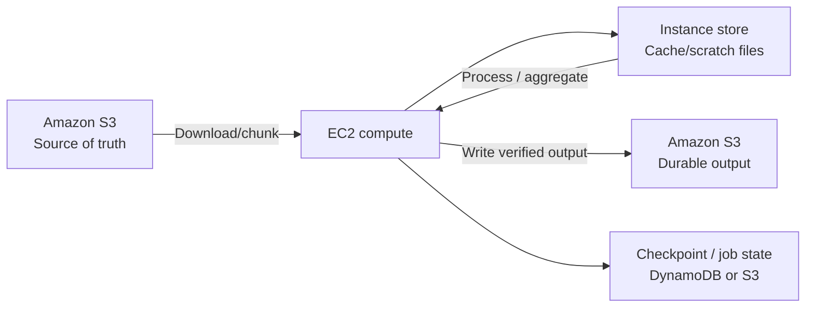
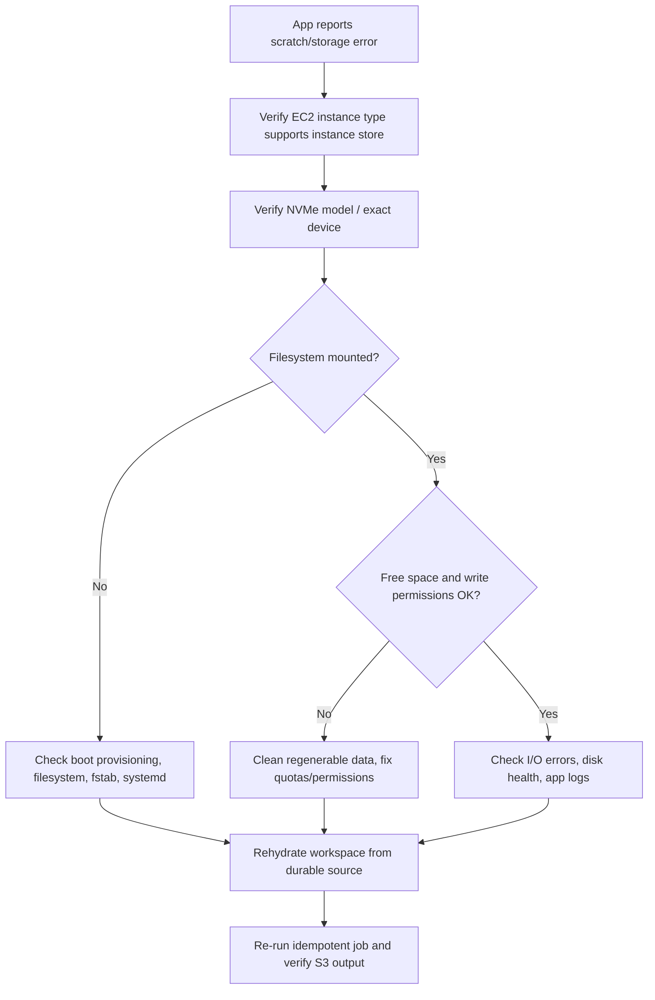

# Instance Store and Ephemeral Data Characteristics

> **Module:** CLOUD_PROVIDERS_AWS  
> **Chapter:** Block and File Storage  
> **Topic:** Amazon EC2 instance store, data lifecycle, host-local temporary storage, failure recovery, and choosing among instance store, Amazon EBS, Amazon EFS, and Amazon S3.  
> **Lab Scope:** Amazon EC2 Linux, instance types with instance store; illustrative examples use NVMe drives and a Java/Spring Boot application.

## 1. Real-World Problem: Fast Disk Needed, Data May Be Lost

An order analytics application running on EC2 reads files from S3, decompresses them into millions of records, sorts temporary data, generates reports, and writes results back to S3. During processing, the app requires heavy local I/O, yet intermediate files do not need to persist after the report is published.

If all temporary files were written to Amazon EBS, the system might pay for EBS capacity and performance beyond actual durable needs. Certain **EC2 instance types** include **instance store** space attached close to compute resources, well suited for scratch space or caches. However, data on an instance store exists only for the **lifetime of the instance**—it is not a durable storage system for business data.

The design question is not merely "how fast is this drive?", but also:

- If the instance **reboots**, do temporary files survive?
- If the instance **stops and then starts**, what happens?
- If the **physical host fails** or Auto Scaling replaces the instance, can data be recovered?
- Where do **backups** truly reside, and has restore capability been verified?
- How do **EC2, EBS, S3, EFS**, networking, and logging contribute to **total cost**?

### Learning Outcomes

After this lesson, learners will be able to:

1. Describe instance store as **ephemeral host-attached block storage** on EC2.
2. Distinguish instance store from EBS, EFS, S3, and root storage.
3. Predict whether data persists or is lost across each EC2 lifecycle event.
4. Identify instance types supporting instance store and accurately recognize **NVMe instance storage** devices.
5. Set up filesystems/mounts safely in a lab environment without accidentally formatting EBS.
6. Design caches, temporary files, ETL staging, and Java workloads to be **rebuildable**.
7. Build checkpoint/backup flows, monitor disk health, test recovery, and control costs.

## 2. What Is Instance Store?

**Amazon EC2 instance store** provides **temporary block storage volumes** backed by physical drives attached to or near the host running the EC2 instance. Size, volume count, and drive technology (SSD/HDD, NVMe, or previous generation) depend on the **instance type** and **instance size**.

"Local" here refers to **host attachment and volume provisioning**, not RAM. Applications see a **block device**; the operating system can format a filesystem and mount it to read/write files just like other block drives.

### 2.1. Core Characteristics

| Characteristic | Design implication |
|---|---|
| **Tied to EC2 instance** | Only certain instance types/sizes include instance store; you cannot arbitrarily add instance store to any EC2. |
| **Attached only at launch** | You cannot attach additional instance store volumes after launch, nor detach one to attach to another instance. |
| **Fixed capacity per instance type** | Changing capacity typically requires choosing a different instance type/size; changing instance type can wipe old local data. |
| **Local block storage** | Can be formatted, mounted, and used for file I/O; the application must manage data stored on it. |
| **Ephemeral data** | No guarantee of data persistence across stop, hibernate, terminate, or drive/host failure. |
| **Performance varies by drive type** | Some NVMe/SSD instance stores offer low latency and high throughput; check specs for the exact instance type rather than assuming all instance stores are equal. |
| **No direct EBS snapshots** | EBS snapshots do not capture instance store data; to preserve data, copy it to durable storage. |

Instance store fits when **losing a volume still allows regenerating data or re-running the task**. If a file exists solely on instance store and is lost, AWS cannot restore it the way EBS restores from a snapshot.

### 2.2. Other Resources That Are Not Instance Store

- **RAM**: process memory, lost on power-off/reboot; typically faster than disk with different capacity constraints.
- **Amazon EBS**: block volumes from a storage service with a **more independent lifecycle** from the instance, supporting snapshots and re-attachment within EBS constraints.
- **Amazon EFS**: network-accessible filesystem shared across multiple Linux workloads via NFS.
- **Amazon S3**: object storage accessed via bucket/key APIs; not a traditional mountable block device without an adapter layer.
- **`/tmp` directory**: simply a path in the Linux filesystem; **not on instance store by default**. On an EBS-rooted EC2 instance, `/tmp` typically resides on the EBS root filesystem or may be `tmpfs` depending on AMI/configuration.

**Common pitfall:** An EC2 instance "having an NVMe drive" is not enough to conclude that drive is **instance store**. On Nitro, **EBS also appears as NVMe**. Always verify the device type before running commands that can overwrite data.

## 3. Data Lifecycle: Reboot Differs from Stop/Start

Instance store is **ephemeral**: data survival depends on instance lifecycle events and physical hardware health. Do not misinterpret "temporary" as meaning data disappears every time a program exits or on every reboot; it follows specific event behavior.

| Event | Instance store data | Explanation |
|---|---|---|
| **Instance reboot** via EC2 or OS reboot | **Normally persists** | Instance continues its lifecycle; remount the filesystem if the OS does not auto-mount. |
| **Stop then start** on EBS-backed instance | **Lost** | Instance store is wiped even though the **EBS root volume** can retain data. |
| **Hibernate** where supported | **Lost** | Although RAM state is saved during hibernation, instance store is not preserved. |
| **Terminate** | **Lost** | Volumes cannot be detached to preserve or move to another instance. |
| **Change instance type via stop/change/start** | **Lost** | New volumes on the new instance type do not carry old local data. |
| **EC2 Auto Scaling replaces instance** | **Lost on old instance** | Replacement instance gets blank volumes; caches/working sets must reload. |
| **Underlying host or disk fails unrecoverably** | **May be lost** | Instance store lacks EBS-equivalent durability mechanisms. |
| **Certain instance recovery actions** | **May be lost** | Never treat instance recovery as a backup of local storage. |
| **Create EBS-backed AMI from instance** | **Excludes instance store data** | EBS-based AMIs/snapshots do not copy local instance store data. |

**Remember the rule:** *Reboot normally keeps data; stop/start, hibernate, and terminate wipe instance store data.* AWS explicitly documents that instance store data is cryptographically erased when an instance stops, hibernates, or terminates.

Note a historical distinction for **instance store–backed root volumes** on older Linux instances: those root types **do not support regular stop operations**. Most modern EC2 configurations use an **EBS root** and may additionally include **instance store data volumes**. Saying "EBS root survives stop/start" does **not** mean instance store data survives.

### 3.1. Why You Cannot Trust a Single Reboot Test

Suppose an application writes `/mnt/instance-store/report.tmp`:

```text
Day 1  09:00:  write report.tmp to instance store
Day 1  09:05:  sudo reboot                 -> file may still exist
Day 2  17:00:  EC2 Stop, then Start        -> local data is lost
Day 3  08:00:  Auto Scaling replaces node  -> new instance lacks report.tmp
```

A test consisting solely of `sudo reboot` can **mislead learners** into thinking instance store is safe persistent storage. Sound design assumes all local temporary files **can vanish unexpectedly** and builds a way to recompute.

### 3.2. Host Failure Can Happen Before Your Scheduled Copy

If you store business outputs only on instance store intending to "back up at end of day," you create a **data-loss exposure window** between writing and backing up. For batch jobs, write checkpoints or critical intermediate results to EBS/S3 in stages; for long-lived business data, write to durable storage immediately per your RPO.

- **RPO** (*Recovery Point Objective*): maximum acceptable data loss.
- **RTO** (*Recovery Time Objective*): maximum acceptable time to restore service or re-complete work.

For an instance store **holding cache only**, RPO might be "zero bytes need preserving," yet RTO still matters because rebuilding or rehydrating the cache takes time.

## 4. Comparing AWS Storage Options

| Criterion | EC2 instance store | Amazon EBS | Amazon EFS | Amazon S3 |
|---|---|---|---|---|
| Model | Block, local to instance | Block storage | Network-attached file storage | Object storage |
| Bound to one EC2 | **Yes**, data lifecycle tied to instance | Can detach/reattach where supported | No, mountable from multiple clients | No |
| Survives stop/start | **No** | Yes, if volume is not deleted and retention config matches | Yes | Yes |
| Survives terminate | **No** | Can persist if `DeleteOnTermination=false`; depends on volume/config | Yes, independent of instances | Yes, independent of instances |
| Native snapshot/backup | Must copy manually elsewhere | **EBS snapshots**, AWS Backup per config | **AWS Backup** and supported tools | Versioning, replication, backups per policy |
| Multi-EC2 access | Not directly shared like a network filesystem | Specific Multi-Attach limits and use cases | Built for shared files | Many clients via API |
| Typical use cases | Scratch, rebuildable cache, shuffle, temporary ETL files | Root volumes, databases, application data | Shared content, home directories, file shares | Source datasets, outputs, backups, artifacts |

This compares **models and lifecycles**, not an absolute claim that one service is always faster or cheaper. EBS `gp3`, `io2`, and instance store drives have vastly different IOPS/throughput/latency characteristics; Amazon EFS and S3 address different access patterns.

### 4.1. Choosing Based on Data Value

- **Non-regenerable source data**: use durable storage such as S3 or EBS/EFS as appropriate, with a backup plan.
- **Production databases**: consider managed database services or properly configured EBS with backups/replication; **never use instance store as the sole copy**.
- **Self-managed Redis cache with replication**: instance store may be considered, provided you evaluate failover, persistence, topology, and data-loss tolerance.
- **ETL intermediate files**: instance store is often a strong candidate if jobs can rerun from S3 and write durable outputs.
- **Files shared across multiple instances**: EFS or S3 with appropriate patterns is much more natural; local instance store does not share automatically.
- **Audit or forensic logs**: ship to CloudWatch Logs, S3, or an independent logging system; **do not keep them solely on instance store**.

## 5. Selecting EC2 Instance Types with Instance Store

Not every EC2 instance provides local instance storage. Many standard families/sizes lack instance store; certain variants **with a `d` suffix or storage-optimized families** include local NVMe SSDs. **Never infer solely from naming suffixes**; check the exact instance type specification table, as product families evolve across generations.

Volume count, total size, and drive technology are fixed by AWS per instance type/size. You **cannot add extra instance store volumes by attaching them like EBS**.

### 5.1. Checking Specs via AWS CLI

In an administrative environment with AWS CLI and permission to describe instance types:

```bash
# Reference example: inspect an instance type supporting instance store.
aws ec2 describe-instance-types \
  --instance-types i4i.large \
  --region ap-southeast-1 \
  --query 'InstanceTypes[].{Type:InstanceType,Storage:InstanceStorageInfo}' \
  --output json
```

Fields such as `Disks`, `SizeInGB`, `Type`, and `TotalSizeInGB` inside `InstanceStorageInfo` reflect AWS-declared specs for that instance type. Check **Regional availability and pricing**, as an instance type having specs does not guarantee every AZ offers capacity or permits launches.

If `InstanceStorageInfo` is absent or empty, verify instance type support. Local storage availability depends on the **instance type**, not on choosing an AMI with NVMe drivers.

### 5.2. NVMe vs. Older Generations

- **NVMe instance store**: on supported modern instances, local volumes are usually exposed automatically at launch.
- **Older non-NVMe instance store**: may require specifying block device mappings such as `ephemeral0` at launch.
- After launch, inspect **filesystems and mounts**; a data volume is not necessarily formatted/mounted for application use.
- If auto-mounting across reboots is needed, configure boot scripts/fstab properly; when an instance is replaced, the **new blank** volume must be initialized again.

**You cannot** attach a new instance store volume to a running instance, nor detach one from an old instance to attach to another. If your workload needs flexible attach/detach or independent capacity scaling, evaluate **Amazon EBS**.

## 6. Accurately Identifying Instance Store Drives on Linux

Before formatting, mounting, or building RAID, verify **which device is the EBS root drive and which is the local instance store**. Destructive commands like `mkfs` or `wipefs` will wipe all data if pointed at the wrong disk.

### 6.1. Read-Only Identification Commands

Run on a Linux EC2 instance with instance store:

```bash
# Display devices, sizes, filesystem types, mount points, models, and serials.
lsblk -o NAME,SIZE,TYPE,FSTYPE,MOUNTPOINTS,MODEL,SERIAL

# Display NVMe devices if nvme-cli is installed.
sudo nvme list

# Check existing filesystems on every block device.
sudo blkid

# View all current mounts.
findmnt -D
```

**Illustrative** example output (not universal across all EC2 instances):

```text
Node           Model
/dev/nvme0n1   Amazon Elastic Block Store
/dev/nvme1n1   Amazon EC2 NVMe Instance Storage
```

Here:

- `/dev/nvme0n1` is **EBS**; never format it if it holds root/system partitions or data to preserve.
- `/dev/nvme1n1` is identified as **instance storage** by its NVMe model.
- Enumeration order (`nvme0n1`/`nvme1n1`) is **not guaranteed to stay identical** across all instances; always identify by **model/serial**, EC2 metadata, and filesystem/mount state.

Never write provisioning scripts that blindly target "the second drive" by hardcoding `/dev/nvme1n1` without verification. On multi-disk instances or across AMI/instance type changes, doing so risks formatting the wrong volume.

### 6.2. When Instance Store Is Not Visible

Common causes:

1. The chosen instance type **does not include** instance store.
2. On legacy non-NVMe families, block device mappings were omitted at launch.
3. The OS lacks required NVMe drivers or the kernel module is inactive.
4. You are inspecting inside a **container** or restricted session without host device visibility.
5. Commands were run on a different instance or Region than intended.

Check the instance type in the EC2 Console or via `describe-instances`, and cross-check AWS docs for that instance type before touching filesystems.

## 7. Lab: Creating a Filesystem and Mounting a Local Drive in a Sandbox

> **Operational Warning:** This section contains commands that **erase all data on a block device**. Run them only in a lab environment with a **new, blank, positively identified** instance store drive; back up needed data and **never run `mkfs` on an active EBS/root/data volume**. Examples are instructional only.

Assume you confirmed via `sudo nvme list` that **`/dev/nvme1n1`** is genuinely **Amazon EC2 NVMe Instance Storage**, has no valuable filesystem, and is not currently mounted.

### 7.1. Final Pre-Format Checks

```bash
# Read-only: verify exact device and confirm it is not mounted.
lsblk -f /dev/nvme1n1
sudo nvme id-ctrl /dev/nvme1n1 | head -40
findmnt --source /dev/nvme1n1
```

If `findmnt` returns output or `lsblk` shows an existing filesystem/data, **stop and verify**—do not format. Never assume a "new" local drive is blank across all AMIs or custom launch scripts.

### 7.2. Initialize and Mount (Verified Blank Drive Only)

```bash
# DESTROYS PRIOR DATA: run only after confirming the exact target device.
sudo mkfs.xfs -f /dev/nvme1n1

sudo mkdir -p /mnt/instance-store
sudo mount /dev/nvme1n1 /mnt/instance-store

# Confirm filesystem is mounted at the expected path.
findmnt /mnt/instance-store
df -hT /mnt/instance-store
```

For an application running under its own user, grant permissions **only on the app's subdirectory**; for example:

```bash
sudo mkdir -p /mnt/instance-store/app-scratch
sudo chown ec2-user:ec2-user /mnt/instance-store/app-scratch
sudo chmod 700 /mnt/instance-store/app-scratch
```

`ec2-user` is an **example** user from certain Amazon Linux AMIs. Replace it with the real system user running your app, and avoid `chmod 777` across the entire drive unless justified.

**Explanation:** `mkfs.xfs` builds an XFS filesystem on the volume; `mount` attaches it at a Linux directory. Creating a filesystem **does not make storage persistent**. After stop/start or instance replacement, the new blank local volume must be **re-initialized and re-mounted** if the application uses it.

### 7.3. Re-Mounting After Reboot

Across a normal reboot, instance store data remains intact, though the OS must remount it if mount config is missing. You can use `/etc/fstab` with the verified filesystem **UUID**:

```bash
# Fetch UUID; never guess from device paths.
sudo blkid /dev/nvme1n1

# Inspect existing fstab before editing.
cat /etc/fstab
```

Example entry in `/etc/fstab` with a **placeholder** UUID:

```fstab
UUID=11111111-2222-3333-4444-555555555555 /mnt/instance-store xfs defaults,nofail,x-systemd.device-timeout=10 0 2
```

Replace the UUID with the real value of the **verified and formatted** drive. The `nofail` option helps the machine boot if the volume is missing, yet **it does not re-initialize a brand-new instance store after stop/start**. Boot scripts/user data or config management must detect the new blank drive, format when appropriate, update mounts, and rebuild the working set.

**Deployment trap:** If mounting fails while `/mnt/instance-store` still exists as an empty directory on the EBS root, the application may silently write onto the root disk and fill EBS. Before launching the app, verify:

```bash
# Is a real filesystem mounted here?
findmnt --mountpoint /mnt/instance-store

# Block app startup if not properly mounted.
mountpoint -q /mnt/instance-store
```

For systemd services, set dependencies such as `RequiresMountsFor=/mnt/instance-store` to bind the service to the required mount. On a fresh node after stop/start, volume provisioning must run before the application starts.

### 7.4. Verifying Behavior with a Marker File

On a lab instance with the local drive mounted:

```bash
echo "ephemeral-storage-lab" \
  | sudo tee /mnt/instance-store/app-scratch/marker.txt

cat /mnt/instance-store/app-scratch/marker.txt
```

Run a **two-stage experiment**:

1. **Reboot:** after confirming the workload permits, reboot the lab instance and read `marker.txt` again. If the filesystem remounts cleanly, the file normally remains.
2. **Stop/start:** **only on an EBS-backed instance with no critical data**, verifying backups before stopping. After stop/start, old instance store data is **gone**; the volume may require formatting/mounting again before a new test.

Never use stop/start as a "test" on instances holding unbacked-up data or serving live users. If no sandbox with instance store is available, analyze this scenario on paper or simulate by wiping and rebuilding a **test scratch directory**—noting that local simulation does not substitute for observing real EC2 lifecycle behavior.

## 8. Using Instance Store Properly: Cache and Scratch

A sound design treats instance store as a **workspace rebuildable from durable sources**.



### 8.1. Suitable Workloads

| Workload | Why instance store fits | Safety prerequisite |
|---|---|---|
| Cache of content downloaded from S3 | Cache can be re-fetched. | Cache misses are handled; never treat cache as sole source of truth. |
| Distributed processing shuffle | Needs fast local I/O for intermediate files. | Framework can retry/recompute after node loss. |
| Video decompression/transcoding files | Intermediate outputs can be regenerated. | Source files and final outputs live on S3. |
| Large batch sort/merge | Avoids paying for oversized scratch EBS. | Checkpoint in durable store; monitor free space. |
| Temporary build/workspace | Reproducible from source and artifact repos. | Final build artifacts are published, not left only on EC2. |
| Local search cache or index | Can accelerate queries. | Rebuild/recovery path exists, plus headroom when cache starts cold. |

**Unsuitable as the sole copy** for production databases, user uploads, financial records, encryption keys, compliance-retained logs, or any data whose loss violates RPO/RTO.

### 8.2. Where Does Data Live Across the Pipeline?

A report-processing workflow should separate tiers cleanly:

```text
S3 input (durable) -> download to local instance store (ephemeral)
                  -> decompress, sort, aggregate (ephemeral)
                  -> write verifiable temp output file
                  -> upload S3 output (durable)
                  -> verify output/manifest
                  -> clean up local scratch
```

Never mark a job **COMPLETED** when local disk processing finishes; mark completion **only after output is durably persisted and verified**. If the instance is replaced before upload finishes, another worker must be able to rerun from durable inputs.

### 8.3. Example Data Load and Save Flow via AWS CLI

The EC2 instance uses an IAM role granting `s3:GetObject` on the input bucket and `s3:PutObject` on the output bucket:

```bash
# Use the EC2-attached IAM role profile; never hardcode access keys.
aws sts get-caller-identity

# Source inputs already live in S3.
aws s3 sync \
  s3://learning-input-demo-123456789012/datasets/ \
  /mnt/instance-store/app-scratch/input/

# After data processing (separate app command), persist final output.
aws s3 sync \
  /mnt/instance-store/app-scratch/output/ \
  s3://learning-output-demo-123456789012/reports/
```

These are **sample commands**; replace bucket and prefix names with your own resources. They illustrate only the input/output steps; validate return codes, checksums/versions, or manifests as required before deleting local files. Avoid multiple concurrent writers targeting the same key without coordination.

### 8.4. When an Instance Loses Data Mid-Job

Suppose a job splits data into 100 chunks:

- Processes chunks 1–30 and writes a **checkpoint** to S3 or a durable database.
- Instance is replaced after chunk 42; scratch data for chunks 31–42 is lost.
- Replacement worker fetches original inputs, reads the checkpoint, and **resumes from the last confirmed state**.
- Writes outputs idempotently or with versioning to prevent duplicates.

The right solution combines **checkpoints**, **idempotency**, **retries**, and **durable outputs**—not merely enlarging local disks.

## 9. Java/Spring Boot Example: Using a Scratch Directory Without Relying on Old Data

Java can use `java.nio.file.Files` to create temporary files inside the mounted instance store path. The snippet below illustrates **local file handling only**, not a full S3 pipeline:

```java
import java.io.IOException;
import java.nio.charset.StandardCharsets;
import java.nio.file.Files;
import java.nio.file.Path;

public final class EphemeralWorkspaceExample {
    private static final Path SCRATCH = Path.of(
        "/mnt/instance-store/app-scratch"
    );

    public static void main(String[] args) throws IOException {
        // Precondition: SCRATCH resides on a mounted instance store filesystem
        // and the application has write permissions.
        if (!Files.isDirectory(SCRATCH) || !Files.isWritable(SCRATCH)) {
            throw new IllegalStateException("Scratch directory unavailable");
        }

        Path taskDir = Files.createTempDirectory(SCRATCH, "job-");
        Path draft = taskDir.resolve("summary.tmp");

        try {
            Files.writeString(
                draft,
                "intermediate result\n",
                StandardCharsets.UTF_8
            );

            // Example: parse draft and upload final results to S3.
            // Confirm job success only after durable storage acknowledges.

            System.out.println("Temporary file: " + draft);
        } finally {
            // In production, recursively clean all child files inside taskDir.
            Files.deleteIfExists(draft);
            Files.deleteIfExists(taskDir);
        }
    }
}
```

**Technical note:** `Files.isDirectory(...)` only checks that a folder exists; it does **not** prove the folder is backed by instance store. Provisioning/systemd must enforce that via `findmnt` or `mountpoint`. If the local mount goes missing, the application must **fail fast** or switch to a pre-designed fallback instead of filling the EBS root.

In Spring Boot, pass the scratch path via application configuration and validate it at startup. When running multiple workers/threads, create **per-job isolated workspaces**, enforce disk quotas, and clean up on completion; avoid placing sensitive data in shared temp folders without strict permissions.

### 9.1. Should Application Startup Require Old Data?

The application must start cleanly when the instance store is **completely empty**. If cached files are needed, the service should:

1. Verify the mount is ready and the directory is writable.
2. Recreate required subdirectories.
3. Fetch or rebuild the cache from durable storage.
4. Report readiness as **READY** only after minimum resources exist to serve requests.
5. Continue warming the rest of the cache asynchronously if design permits.

With Auto Scaling, configure the load balancer to route traffic only to instances **passing health checks**, keeping users off newly launched nodes still hydrating caches.

## 10. RAID and Performance: Speed Does Not Equal Durability

Some instance types include **multiple local volumes**. You can use RAID 0 to pool capacity or stripe I/O for scratch workloads, provided you understand:

- **RAID 0** stripes data across multiple disks; if any single disk fails, the entire filesystem becomes unusable.
- RAID 0 **does not turn local storage into durable storage**, and increases blast radius on a single disk failure.
- **RAID 1 / same-host mirroring** can tolerate a single drive failure in certain setups, yet still offers zero protection against stop/terminate or host loss.
- RAID requires `mdadm`/filesystem/mount management, monitoring, and re-initialization **on every new node**.

Never embed destructive RAID-creation scripts into generic startup scripts without verifying all local devices. Benchmark every system with realistic workloads (read/write ratio, block size, concurrency, I/O pattern) to confirm actual benefit.

### 10.1. Factors Affecting Performance

| Factor | What to observe |
|---|---|
| Instance family/size | Local disk count, sizes, and AWS-published IOPS/throughput specs. |
| Drive technology | NVMe SSD vs. older SATA SSD/HDD; latency profiles differ. |
| Filesystem | XFS/ext4, mount options, fragmentation, free space. |
| Free capacity | Disk full breaks writes, logs, or checkpoints; full SSDs can degrade performance. |
| I/O pattern | Small random vs. large sequential, read/write ratio. |
| Host contention | Multiple processes/containers sharing scratch space reduce per-workload speed. |
| Cache rebuild cost | Fast locally in steady state, but takes time to rehydrate after node replacement. |

Low latency is a **potential advantage**, not a guarantee that instance store always beats every EBS setup. EBS Provisioned IOPS and storage-optimized EC2 families have very different specs; select using requirements and benchmarks.

## 11. Monitoring and Alerting

Instance store typically lacks dedicated managed CloudWatch metrics comparable to EBS volume metrics. Monitor from the OS and application layers alongside EC2/CloudWatch signals:

| Signal | Suggested collection method | Why it matters |
|---|---|---|
| Mount used/free space | `df -hT`, CloudWatch Agent filesystem metrics | Full disks break apps or cause unintended fallback to EBS root. |
| I/O utilization/latency | `iostat`, OS metrics, app instrumentation | Identify bottlenecks. |
| Block device/FS errors | `dmesg`, journal, system logs | Detect disk, mount, or filesystem failures. |
| Mount readiness | `findmnt`, systemd dependencies, health checks | Prevent workloads running while drive is unmounted. |
| Cache hit/miss and rebuild time | Custom application metrics | Track performance impact of node replacements. |
| Instance status/replacement | EC2 status checks, Auto Scaling events, EventBridge | Trigger workload recovery and checkpoint checks. |
| Backup/checkpoint freshness | Application logs and latest timestamp metric | Track real-world RPO/RTO compliance. |

Quick inspection commands on EC2:

```bash
df -hT /mnt/instance-store
lsblk -o NAME,SIZE,FSTYPE,MOUNTPOINTS,MODEL
findmnt --mountpoint /mnt/instance-store
journalctl -p err -n 50
```

With CloudWatch Agent, you must **configure the agent** to emit `disk_used_percent` or equivalent filesystem metrics; detailed guest filesystem metrics **do not appear automatically just by launching EC2**. Alert on low free space, broken mounts, or stalled backups, and watch for abnormal cache-miss spikes after Auto Scaling replacements.

## 12. Security and Access Control

### 12.1. Data Encryption

Per AWS documentation, **NVMe instance storage** uses hardware encryption with **XTS-AES-256**; keys are tied to the physical hardware and destroyed when the instance stops or terminates. Users cannot supply a customer managed KMS key to directly control this local NVMe hardware encryption.

However, drive encryption **does not replace**:

- Linux filesystem permissions and process isolation;
- protecting secrets, personal data, or sensitive payloads in memory/runtime;
- encrypting data **in transit/at rest on S3/EBS/EFS** and managing destination permissions;
- purging sensitive data from logs, dumps, and external copies.

Do not assume older instance generations share identical NVMe encryption mechanics; check documentation for your exact instance type.

### 12.2. IAM Roles for Backups/Checkpoints

To write results to S3, EC2 should use an **IAM instance profile** with a least-privilege policy. Example policy granting writes only to the output prefix:

```json
{
  "Version": "2012-10-17",
  "Statement": [
    {
      "Sid": "WriteOnlyProcessedReports",
      "Effect": "Allow",
      "Action": "s3:PutObject",
      "Resource": "arn:aws:s3:::learning-output-demo-123456789012/reports/*"
    }
  ]
}
```

This policy illustrates **only the object write action**. If your pipeline lists/reads objects, uses multipart uploads, or uses KMS encryption, add the corresponding permissions. Bucket policies, VPC endpoint policies, SCPs, and explicit denies can still restrict actions. **Never embed long-lived access keys** in backup scripts.

### 12.3. Data Cleanup and File Permissions

- Create temp directories accessible only to the application user/process.
- Delete temporary files upon job completion when no longer needed.
- Never write secrets or temporary credentials to scratch and forget to wipe them.
- Cap disk usage per job and implement cleanup for failed jobs.
- For regulated data with retention rules, evaluate whether writing to local instance storage complies with processing policies.

Stopping or terminating wipes local data, yet **erasing local storage does not erase copies already sent to logs, S3, EBS, or elsewhere**. Retention policies must span the entire pipeline.

## 13. Cost and Architectural Decisions

Instance store capacity comes bundled in the **instance type configuration** and is generally included in the corresponding EC2 instance price; it is not an independent EBS volume you resize and pay for per-GB separately the way EBS bills. However, **instance types with local disks can cost more per hour than comparable EC2 types without local disks**.

To estimate total cost, evaluate all components:

1. **EC2 compute**: instance type, pricing model (On-Demand, Savings Plans/Reserved Instances/Spot as appropriate), hours, and capacity.
2. **Durable storage**: EBS/S3/EFS holding inputs, outputs, backups, and snapshots.
3. **Data transfer**: S3 transfers, cross-AZ/Region traffic, NAT gateways, VPC endpoints per design.
4. **Monitoring**: CloudWatch Agent metrics, logs, alarms, and analytics tools.
5. **Operational/recovery cost**: job re-run time, cache warm-up, downtime, and lost data if poorly designed.

Illustrative comparison:

| Option | Design | Questions to evaluate |
|---|---|---|
| A | EC2 without instance store + EBS `gp3` for scratch | Costs extra for EBS, yet survives stops; are snapshots needed? |
| B | EC2 with instance store + S3 for inputs/outputs | Does EBS savings and speed offset higher instance price and rebuild cost? |
| C | Multiple EC2 workers with local disks + distributed checkpoints | Can jobs retry idempotently without relying on any single node? |
| D | Shared EFS scratch across multiple instances | Is a shared filesystem truly required, and can the app tolerate EFS latency/throughput? |

**You cannot** conclude Option B is always cheaper than Option A from the label "instance store" alone; calculate with Regional AWS pricing and real workload benchmarks.

### 13.1. Do Not Confuse Persistence with Backups

EBS **can** outlive an EC2 instance when retention settings allow, yet persistence alone does not equal a **backup**. To recover from accidental deletes, corruption, or software bugs, you still need snapshots/backups/versioning. Likewise, S3 outputs need lifecycle/versioning policies if recovery from bad overwrites is required.

## 14. Troubleshooting Common Issues

| Symptom | Possible cause | How to inspect/resolve |
|---|---|---|
| Local drive not found | Instance type lacks instance store or wrong driver/mapping. | Check EC2 type specs, `lsblk`, `nvme list`, and block device mappings on legacy types. |
| Files missing after reboot | Filesystem did not auto-mount or app wrote to wrong path. | Check `findmnt`, `/etc/fstab`, UUIDs, systemd boot logs, and check if EBS root received writes. |
| Data vanished after stop/start | **Expected ephemeral design behavior.** | Rehydrate from S3/EBS/EFS/checkpoints; fix provisioning scripts. |
| Wrong mount or `mkfs` error | Device in use, existing filesystem, or wrong disk targeted. | **Halt write commands**, check `lsblk`, `nvme list`, `findmnt`, and backups. |
| `No space left on device` | Too many scratch files or missing mount writing onto root. | Check `df -hT`, `findmnt`, job quotas, cleanup, and alerts. |
| Slow boot or emergency mode | `fstab` requires local disk UUID that disappeared after stop/start. | Update boot config with `nofail` and re-provisioning logic; test in sandbox. |
| Batch results lost after Auto Scaling replacement | Output remained only on local disk. | Upload outputs/checkpoints to S3 or durable store before ACKing jobs. |
| Java app cannot read files | Wrong Linux permissions, wrong path, service started before mount. | Verify owner/permissions, `RequiresMountsFor`, and startup ordering. |
| EBS root fills unexpectedly | Empty mount folder allowed app writes onto root EBS. | Fail startup if `mountpoint -q` fails; monitor root filesystem. |
| High bill despite scratch on instance store | Larger instance type, S3/NAT/logging/compute still billed. | Inspect Cost Explorer and actual active architecture components. |

### 14.1. Step-by-Step Troubleshooting Flow



Begin with **read-only** inspection and device identification; never run `mkfs`, `wipefs`, `mdadm --create`, or wipe a filesystem merely because a `mount` command failed.

## 15. Comprehensive Practice Exercise

**Scenario:** A team is building a course reporting system in Java/Spring Boot on AWS. One EC2 instance processes daily CSV files: downloading CSVs from S3, decompressing, sorting, and producing summaries. During sorting, the app needs about **80 GiB of temporary scratch** for 20–40 minutes; the final ~2 GiB output goes back to S3. The instance may be replaced by Auto Scaling or run on Spot to cut costs.

### Tasks

1. Draw a diagram of **S3 input → EC2 compute → instance store scratch → S3 output**. Clearly label which data is the **source of truth** and which is regenerable.
2. List criteria to verify whether an EC2 instance type provides sufficient local disk, IOPS/throughput, CPU/RAM, Region/AZ availability, and cost efficiency.
3. Write a table predicting whether `scratch.csv` survives or is lost after **reboot**, **stop/start**, **terminate**, **instance replacement**, and **host disk failure**.
4. Describe using `lsblk`/`nvme list` to distinguish the EBS root from the instance store before mounting.
5. Build a provisioning checklist: device identification, formatting only when verified blank, mounting, setting app permissions, readiness checks, and auto-recovery config.
6. Outline the algorithm to create per-job temp folders, upload results to S3, write checkpoints, and clean up; explain how a replacement instance resumes work.
7. Propose where to store **critical logs**, checkpoints, and outputs—and why none belong solely on local disk.
8. Propose three metrics or alarms covering disk usage, mount health, instance health, or checkpoint freshness.
9. Compare EC2 instance store + S3 against EC2 + EBS across performance, cost, RPO/RTO, and recoverability.
10. Describe sandbox testing **without risking real data**, including verifying mounts across reboot and recovery after instance replacement.

### Evaluation Criteria

A strong solution demonstrates that:

- Instance store is never used as the sole copy of critical data.
- **Reboot persistence** is clearly separated from **stop/start erasure**.
- It explains how to **avoid accidentally formatting EBS** and why a mount directory existing does not prove a drive is mounted.
- Jobs mark completion only after durable persistence, with retry/idempotency support.
- Drives are chosen by **instance type** and evaluated via **total cost**, not assumed free or universally faster.

### 15.1. Self-Check Questions

**1. Can an instance store volume be detached from EC2 and attached to another instance?**  
No. Instance store is tied to the instance lifecycle and provisioned only at launch.

**2. After `sudo reboot`, is instance store data guaranteed to be lost?**  
No. Normal reboots usually preserve data; however, drive/host failures or unrecoverable events can still cause data loss.

**3. If the root volume is EBS, does data on local instance store survive stop/start?**  
No. EBS root volumes and local instance store have independent persistence lifecycles.

**4. Does taking an EBS snapshot or creating an EBS-backed AMI back up files on instance store?**  
No. Instance store data must be copied to durable storage beforehand if it needs to be kept.

**5. Is seeing `/dev/nvme1n1` enough to prove a device is instance store?**  
No. You must inspect model/serial and system metadata; NVMe devices can also be EBS.

**6. Is `/tmp` always on instance store?**  
No. It is simply a filesystem path depending on mount layout and AMI config.

**7. Can instance store be used for a self-managed Redis cache?**  
It can be considered if data loss is tolerable, proper replication/rebuilding exists, and RPO/RTO are assessed; never treat it as the sole source of truth.

**8. Is instance store billed separately per GB like EBS?**  
Local capacity is bundled in the instance type's config/pricing; you still pay for the instance and supporting services, so compare total cost.

**9. Why check `mountpoint` before letting an app write temp files?**  
To prevent silently writing onto the EBS root filesystem when local storage failed to mount.

**10. If Auto Scaling replaces an instance mid-job, what enables recovery?**  
Durable input storage, checkpoints, idempotent retries, and verified outputs in S3 or another durable store.

## 16. Summary and Reference Documentation

**EC2 instance store is host-attached temporary block storage suited for regenerable data** such as caches, scratch files, shuffles, and intermediate ETL data. Its local performance benefits must pair with the assumption that **data disappears on instance stop, hibernate, terminate, or unrecoverable host failure**. To keep applications safe and resilient, store critical data in EBS/S3/EFS or suitable managed services, verify backups/restores, enforce least-privilege IAM, monitor local filesystems, and automate clean initialization from an empty drive.

Official AWS Documentation:

- [Amazon EC2 — Instance store temporary block storage](https://docs.aws.amazon.com/AWSEC2/latest/UserGuide/InstanceStorage.html)
- [Amazon EC2 — Data persistence for instance store volumes](https://docs.aws.amazon.com/AWSEC2/latest/UserGuide/instance-store-lifetime.html)
- [Amazon EC2 — Instance store volume limits](https://docs.aws.amazon.com/AWSEC2/latest/UserGuide/instance-store-volumes.html)
- [Amazon EC2 — Add instance store volumes](https://docs.aws.amazon.com/AWSEC2/latest/UserGuide/add-instance-store-volumes.html)
- [Amazon EC2 — SSD instance store volumes](https://docs.aws.amazon.com/AWSEC2/latest/UserGuide/ssd-instance-store.html)
- [Amazon EC2 — View block device mappings and identify NVMe volumes](https://docs.aws.amazon.com/AWSEC2/latest/UserGuide/instance-block-device-mapping.html)
- [Amazon EC2 — Storage options for instances](https://docs.aws.amazon.com/AWSEC2/latest/UserGuide/Storage.html)
- [Amazon EC2 — Root volume types](https://docs.aws.amazon.com/AWSEC2/latest/UserGuide/RootDeviceStorage.html)
- [Amazon EC2 — Stop and start EC2 instances](https://docs.aws.amazon.com/AWSEC2/latest/UserGuide/Stop_Start.html)
- [Amazon EC2 — Preserve data on termination](https://docs.aws.amazon.com/AWSEC2/latest/UserGuide/preserving-volumes-on-termination.html)
- [Amazon EBS — Snapshots](https://docs.aws.amazon.com/ebs/latest/userguide/ebs-snapshots.html)
- [Amazon CloudWatch — CloudWatch Agent metrics](https://docs.aws.amazon.com/AmazonCloudWatch/latest/monitoring/metrics-collected-by-CloudWatch-agent.html)
- [Amazon EC2 — Instance types](https://aws.amazon.com/ec2/instance-types/)

> **Lab Note:** Device paths, account IDs, bucket names, and UUIDs in this lesson are illustrative only. Before running commands on real EC2 instances, positively identify the target volume, back up important data, and check AWS docs for your Region and instance type. Never format or stop/start workloads holding critical unsaved data.
