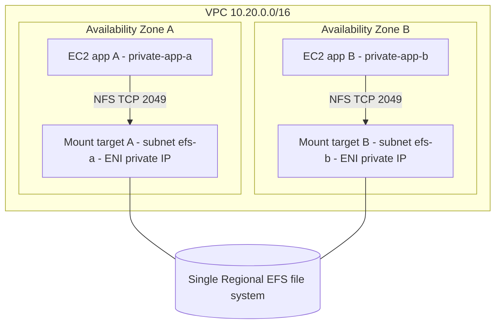
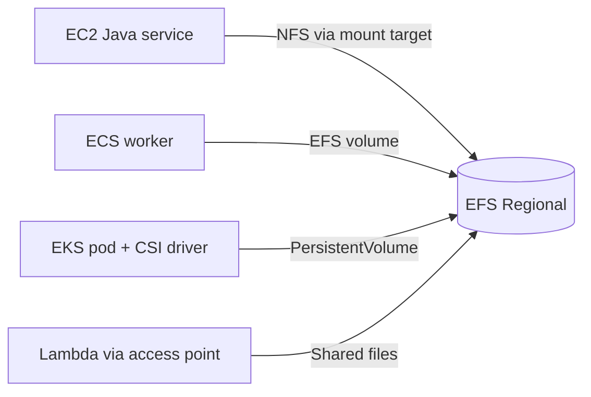
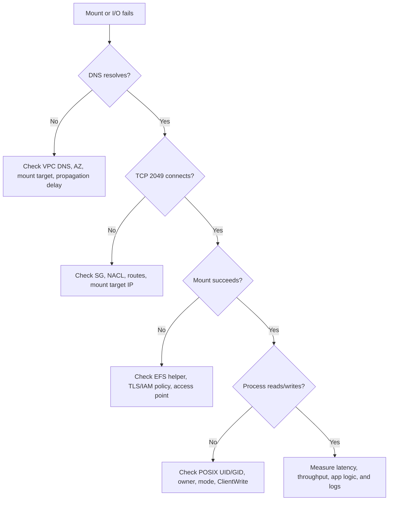

# EFS, Mount Targets, and NFS Access

> **Chapter:** Block and File Storage · **Module:** `CLOUD_PROVIDERS_AWS`

## 1. The Problem: Multiple Servers Need the Same Filesystem

Imagine a Java application running on two Amazon EC2 instances in two Availability Zones (AZs). Users upload documents to the app; an image-processing worker in AZ A and a web server in AZ B need to see the **exact same file path** right after writing. Using each machine's local disk does not synchronize data when an Application Load Balancer (ALB) routes the next request to another server. If an Auto Scaling Group replaces one EC2 instance, data stored solely on that machine's drive can be lost or become inaccessible.

**Amazon Elastic File System (Amazon EFS)** provides a **managed, network-shared filesystem** allowing multiple compatible Linux/Unix clients to connect via **Network File System (NFS)**. Applications interact with directories, files, POSIX permissions, and operations like `open`, `read`, and `write` without integrating an object storage API separately.

In the `CLOUD_PROVIDERS_AWS` module, EFS design skills connect directly with **Regions/AZs, VPC, IAM, EC2, ECS/EKS, Lambda, monitoring, recovery, and cost control**. A sound design must address simultaneously: where data is stored, which mount target carries NFS traffic, who may connect, what read/write permissions processes hold, and whether performance and pricing suit the workload.

**After this lesson, learners will be able to:**

1. Distinguish EFS from Amazon EBS and Amazon S3, choosing file storage when appropriate.
2. Explain Regional/One Zone EFS architecture and mount targets per AZ/VPC.
3. Configure security groups, DNS, and NFS TCP 2049 connectivity.
4. Mount EFS on Linux EC2 using `amazon-efs-utils` with TLS, IAM authorization, and access points.
5. Understand POSIX permissions, EFS file system policies, access points, and data encryption.
6. Design availability, backups, performance monitoring, and cost estimates.
7. Diagnose mount failures, `Permission denied`, timeouts, and latency/throughput issues.

## 2. What Is EFS, and How Does It Differ from EBS and S3?

EFS is a **managed elastic file system**: AWS manages backend storage and automatically scales capacity up or down with stored data while clients mount it onto an OS directory. Clients can be Linux EC2 instances, containers on ECS/EKS, or integrated services; using EFS with AWS Lambda requires appropriate VPC and access point configuration.

| Criterion | **Amazon EFS** | **Amazon EBS** | **Amazon S3** |
| --- | --- | --- | --- |
| Data model | **File**: directories, paths, metadata, and POSIX permissions. | **Block**: volume attached to EC2 to host a filesystem or raw access. | **Object**: buckets, keys, and HTTP/SDK APIs. |
| Typical access | NFS mount at `/mnt/data` across multiple Linux clients. | Attach volume to instance; format/mount via OS. | `GetObject`, `PutObject`, or compatible API/SDK. |
| Concurrent sharing | Built for **multiple clients** sharing the same filesystem. | Typically attached to one EC2/AZ; EBS Multi-Attach applies only to supported setups/types and requires app/FS coordination. | Multiple clients read/write objects via API; not a POSIX/NFS filesystem by default. |
| Scope | Regional EFS stores data across multiple AZs; One Zone stores in a single AZ. | Volume belongs to one AZ; snapshots have separate workflows. | Object storage service with distinct storage classes and access models. |
| Best suited for | Shared content, uploads, common assets/configs, apps needing paths and filesystem semantics. | Boot volumes, databases needing block storage/specific IOPS, app disks. | Images, backups, object distribution, data lakes, large key-addressed datasets. |
| Things to watch | NFS latency, metadata and POSIX permissions, port 2049 connectivity, storage/throughput costs. | Provisioned size/IOPS/throughput, snapshots, AZ scope. | Apps must use object APIs, manage request costs, and follow S3 permission models. |

**Quick rule of thumb:** If your application needs **multiple machines seeing the same POSIX directory** without self-managing an NFS server, EFS is a strong candidate. If it only stores objects accessed by API, S3 usually fits better. If a database or OS needs a low-latency block device, evaluate EBS. EFS does not turn an uncoordinated concurrent-writing app lacking locks/transactions into a safe one; clients must still coordinate concurrency properly.

### 2.1. Good Use Cases for EFS

- Two web instances sharing `/srv/uploads` containing user documents.
- Workers and API servers sharing large intermediate files where a framework expects filesystem paths.
- Multiple ECS tasks sharing a common volume; on EKS, the **Amazon EFS CSI driver** can provision PersistentVolumes in supported modes.
- AWS Lambda accessing shared files when configured with a VPC, mount targets, and an **EFS access point**.

### 2.2. When EFS May Not Be Suitable

- Apps reading/writing millions of tiny files with heavy metadata operations: benchmark latency and metadata throughput first.
- Databases expecting block device/local filesystem semantics or ultra-low IOPS latency: do not swap EBS for EFS by default.
- Publicly served web assets like static images/videos: consider S3 + CloudFront for global distribution without exposing NFS to end users.
- Offline/local-only workloads or networks lacking NFS connectivity: resolve networking or change storage strategy.

## 3. EFS Architecture: File Systems and Mount Targets

An **EFS file system** has an ID like `fs-xxxxxxxxxxxxxxxxx` and is created within one AWS Region. For clients inside an Amazon VPC to access it, EFS uses **mount targets**. A mount target is an EFS-managed network endpoint featuring an **Elastic Network Interface (ENI)**, private IP (IPv4/IPv6 depending on config), and security group inside a VPC subnet. Clients connect to the mount target over **NFS**.

**A mount target is not a copy of data**, nor an EC2 instance you SSH into to manage. It is a network entry point to the EFS service. Creating mount targets across multiple AZs does not create independent filesystems; they all expose the data of one EFS file system.

### 3.1. Regional EFS vs. One Zone EFS

| Characteristic | **Regional file system** | **One Zone file system** |
| --- | --- | --- |
| Data storage | Data is stored redundantly across **multiple AZs** in the Region. | Data is stored in **a single AZ**. |
| Mount targets | Can create **one mount target per AZ** in a VPC. | Allows **only one mount target**, in the **same AZ** hosting the filesystem. |
| Use case | Shared production data across AZs needing AZ fault tolerance. | Regenerable workloads, dev/test, or backups/recovery plans tolerating AZ loss. |
| Risk | Still requires client/network/backup design; not automatic cross-Region DR. | A severe AZ outage can make data unavailable or lost. |
| Cost | Billed at Regional rates plus storage class/throughput. | Can be cheaper for some cases; weigh AZ risk and cross-AZ data transfer fees. |

**Crucial distinction:** Regional EFS persists data across multiple AZs; mount targets are **per-AZ network entry points**. If a client sits in AZ B while only AZ A has a mount target, it may access across AZs by IP, incurring latency and cross-AZ transfer costs. For optimal availability and traffic flow, create a mount target in **every AZ hosting clients**. With One Zone, applications may traverse into the data's AZ and must accept the corresponding single-AZ risk.

### 3.2. One Mount Target per AZ Within the Same VPC

EFS allows **at most one mount target per file system in each AZ of the attached VPC**. If an AZ has three subnets, pick **one** subnet for the mount target; EC2 instances in the other subnets of that **same AZ** can still reach it if routes and security groups permit. You do not need a mount target per EC2 or per subnet.

In the standard mount target model, **an EFS file system's mount targets belong to one VPC at a time**. Clients from another VPC or on-premises can connect via routed connectivity (such as VPC peering, Transit Gateway, or VPN/Direct Connect) per AWS guidance, handling DNS/IPs and policies accordingly; you cannot arbitrarily place mount targets in multiple VPCs for one file system.

Two-AZ example:



At the application tier, EC2 A and EC2 B can both mount the same EFS at `/srv/shared`. Files created by A become visible to B per NFS semantics, though the application must still handle concurrent writes, locking, caching, and consistency as needed.

### 3.3. How EFS DNS Selects a Mount Target

The filesystem DNS name typically looks like:

```text
fs-0123456789abcdef0.efs.ap-southeast-1.amazonaws.com
```

When VPC DNS and mount targets are properly configured, this name **resolves to the IP of the mount target in the client's AZ**. Therefore:

1. Ensure the client and file system are in the matching Region and typically the same VPC.
2. Have an **`available`** mount target in the **same AZ** as the client when using the automatic filesystem DNS name.
3. Enable VPC DNS resolution and required DNS settings; clients must use the appropriate resolver.
4. Allow time for new mount targets to reach `available` and DNS records to propagate; AWS recommends waiting briefly after creation before automated mounting.

If mounting from another network/AZ or where automatic DNS cannot resolve, you can use the **mount target IP** or manual DNS configuration per AWS guidance. Across multiple accounts, AZ names like `ap-southeast-1a` can map differently; compare **AZ IDs** when verifying whether two subnets share the same physical AZ.

### 3.4. Which Protocol and Port Does NFS Use?

EFS supports **NFSv4.0 and NFSv4.1**, with NFSv4.1 generally recommended for compatible Linux clients. Network traffic uses **TCP 2049**. You do not need TCP 22/SSH, RPC mountd ports, or NFSv3 in standard EFS setups. EFS **does not support direct mounting from Windows EC2** via the EFS mount helper; Windows workloads should evaluate suitable file storage such as Amazon FSx for Windows File Server.

**No public IP or Internet Gateway is needed for NFS traffic** between EC2 and mount targets in the same VPC. This is private-IP communication inside AWS networking; keep clients and mount targets in subnets without unnecessary Internet exposure.

## 4. VPC and Security Groups for the NFS Path

A mount command can time out even when EFS was created successfully, because **EFS storage and the network path to mount targets are separate layers**. Identify source (EC2 ENI) and destination (mount target ENI), IPs, AZs, routes, DNS, SGs, and NACLs.

| Location | Direction | Protocol/port | Target/Source |
| --- | --- | --- | --- |
| `sg-app` attached to EC2 client | **Outbound** | TCP **2049** | Mount target's `sg-efs` or controlled IP/CIDR destination. |
| `sg-efs` attached to mount target | **Inbound** | TCP **2049** | **`sg-app`** of authorized client instances. |

Security groups are **stateful**, so return traffic for allowed connections needs no separate return rule. **Network ACLs are stateless**: if restrictive NACLs are present, allow both outbound requests and inbound TCP ephemeral ports for return packets. Client host firewalls must also permit NFS traffic.

**Do not open NFS 2049 from `0.0.0.0/0` or every security group in the VPC** when only specific apps need to mount. Referencing source Security Groups scopes access cleanly by workload role. For mount targets, inbound TCP 2049 from authorized client SGs is the primary network control point.

### 4.1. Routing and DNS Checklist

1. EC2 and mount targets have valid private IP reachability inside the same VPC (`local` route) or via an explicitly designed VPC interconnection.
2. A mount target exists in the matching AZ in state `available`, with an IP type compatible with the subnet and client.
3. EC2 SG allows outbound TCP 2049 and mount target SG allows inbound TCP 2049 from the right sources.
4. Both subnets' NACLs allow request and return traffic; OS firewalls do not block it.
5. VPC DNS settings and resolvers resolve EFS names; no conflicting private hosted zones exist.
6. If IAM authorization / file system policies are enforced, clients also satisfy policy conditions at the filesystem access layer.

Never try to fix mount errors by moving mount targets to public subnets or attaching an Internet Gateway. Same-VPC connection failures must be diagnosed along the **private NFS path**, separate from downloading packages or calling AWS APIs from the instance.

## 5. Mounting EFS on Amazon EC2 Linux

Two common mounting methods:

- **Amazon EFS mount helper** (recommended): install `amazon-efs-utils` and use `mount -t efs`. Supports TLS, IAM authorization, EFS access points, sane mount defaults, and boot integration.
- **Standard Linux NFS client**: use `mount -t nfs4` with the filesystem DNS name or mount target IP. Useful in some environments, but lacks the EFS mount helper's built-in TLS/IAM integration.

Instructions below assume **Amazon Linux 2023** on EC2 with repository access to install packages. On Ubuntu/RHEL/custom AMIs, check package instructions for installing `amazon-efs-utils` matching your OS version and architecture. The EFS mount helper supports AWS-documented platforms; do not assume every Linux distribution is supported out of the box.

### 5.1. Prepare EC2 and File System

Before running commands, ensure you have:

1. An EFS file system `fs-0123456789abcdef0` in Region `ap-southeast-1` (ID is **illustrative**; substitute your real ID).
2. An `available` mount target in the same VPC and AZ as the EC2 instance.
3. Security groups allowing TCP 2049 per Section 4; VPC/DNS resolving EFS names.
4. A compatible Linux EC2 instance accessible via protected SSH or AWS Systems Manager Session Manager.
5. If using IAM authorization, an EC2 **IAM instance profile** with client permissions and a matching file system policy.

### 5.2. Install Mount Helper and Mount with TLS

Run **inside the Linux EC2 instance**, not on your laptop:

```bash
# Amazon Linux 2023
sudo dnf install -y amazon-efs-utils

# Create a mount point (just an ordinary local directory prior to mounting).
sudo mkdir -p /mnt/efs

# Use EFS mount helper; TLS encrypts NFS traffic in transit.
sudo mount -t efs -o tls fs-0123456789abcdef0:/ /mnt/efs

# Verify active mount.
findmnt /mnt/efs
df -hT /mnt/efs
```

This requires the mount helper package installed, matching Region/VPC, working DNS, and an active mount target. `-o tls` enables encryption in transit and should be used for real data. If the EFS file system policy **requires IAM authentication**, mounting with `tls` alone is insufficient; use `tls,iam` with a valid role (Section 6).

### 5.3. Test Shared Reads/Writes Between Two Machines

Run only on an **authorized writable lab file system**—never touch production data. On EC2 A:

```bash
# Write a test file from machine A
echo "created from EC2 A" | sudo tee /mnt/efs/efs-lab-shared.txt
sudo stat /mnt/efs/efs-lab-shared.txt
```

On EC2 B with the **same file system** mounted:

```bash
cat /mnt/efs/efs-lab-shared.txt
findmnt /mnt/efs
```

If B reads the same content, shared file access works between both clients. Do not treat this quick test as proof that **multiple processes can safely write to the same file concurrently**: that requires testing file locking, atomic renames, and application concurrency semantics.

### 5.4. Mounting with Standard NFS Client

Example on Linux with a compatible NFS client package using **NFSv4.1** and EFS DNS:

```bash
sudo mkdir -p /mnt/efs-nfs

sudo mount -t nfs4 \
  -o nfsvers=4.1,rsize=1048576,wsize=1048576,hard,timeo=600,retrans=2,noresvport \
  fs-0123456789abcdef0.efs.ap-southeast-1.amazonaws.com:/ \
  /mnt/efs-nfs

findmnt /mnt/efs-nfs
```

Parameters `rsize`/`wsize` (1 MiB), `hard`, `timeo`, `retrans`, and `noresvport` are examples from EFS documentation; optimal choices depend on kernel, workload, and network health. **This plain NFS mount does not enable the EFS mount helper's TLS or IAM authorization.** To comply with policies mandating TLS, use the mount helper with `tls` instead of copying plain NFS examples into production.

**Avoid using `soft` casually:** `soft` NFS mounts can return I/O errors after timeouts, risking misinterpretation by apps as partial/completed writes. `hard` causes operations to wait during NFS interruptions; pair it with timeouts, monitoring, application recovery, and resilience design.

### 5.5. Automatic Mount on Reboot via `/etc/fstab`

To auto-mount via the EFS helper with TLS, add an entry to `/etc/fstab` on an **authorized host**:

```fstab
fs-0123456789abcdef0:/ /mnt/efs efs _netdev,tls 0 0
```

`_netdev` tells the OS the filesystem depends on networking. Omitting it can cause Linux boot issues if EFS is not yet reachable. With IAM authorization:

```fstab
fs-0123456789abcdef0:/ /mnt/efs efs _netdev,tls,iam 0 0
```

Do not add both lines to `/etc/fstab` for the same mount point; pick **one** configuration matching policy. After editing, test:

```bash
sudo mount -a
findmnt /mnt/efs
```

In systems that must boot even if NFS is temporarily unreachable, `nofail` avoids blocking boot, yet **does not make the application healthy**. If an app strictly requires EFS, its systemd unit should depend on the mount (e.g. `RequiresMountsFor=/mnt/efs`) and health checks must fail when unmounted to avoid writing data onto local directories. OS-supported automount/lifecycle hooks can also be used once tested.

### 5.6. Distinguishing Mount Success from Filesystem Readiness

After mounting, verify:

```bash
findmnt /mnt/efs
df -hT /mnt/efs
mount | grep /mnt/efs
ls -ldn /mnt/efs
```

For real apps, also test reading/writing **under the actual application user** (e.g., `appuser` or container UID), not solely with `sudo`. Root succeeding while Java fails under its own UID yields `Permission denied`—a POSIX issue, not an NFS timeout.

## 6. Three-Layer Security: Network, IAM, and POSIX

**EFS does not inherently authenticate every NFS client by OS login name.** By default, an NFS client passes its process UID/GID to EFS to evaluate POSIX permissions. Therefore, restricting port 2049 via security groups is vital, yet insufficient when workloads of differing trust share a VPC.

Combine three layers:

| Layer | Security question | Controls |
| --- | --- | --- |
| **Network** | Which machines can open NFS connections to the mount target? | VPC, mount target SG, EC2 SG, NACLs, routing. |
| **IAM / EFS file system policy** | Which AWS identities may mount/write/act as root, and under what conditions? | IAM instance role, file system policy, `elasticfilesystem:ClientMount`, `ClientWrite`, `ClientRootAccess`. |
| **POSIX / Access points** | Which processes may read/write which files and directories? | UID, GID, file modes, EFS access point UID/GID/paths. |

### 6.1. IAM Authorization for NFS Clients

To mount with IAM authorization from an EC2 instance with an instance profile, use the **EFS mount helper**:

```bash
sudo mkdir -p /mnt/efs
sudo mount -t efs -o tls,iam fs-0123456789abcdef0:/ /mnt/efs
```

Common IAM client actions:

- `elasticfilesystem:ClientMount`: grants mount/read access per effective policies.
- `elasticfilesystem:ClientWrite`: grants client write operations.
- `elasticfilesystem:ClientRootAccess`: grants client root privileges per policy; grant sparingly only when truly needed.

**Illustrative identity-based policy** for a role needing only mount and write access to one specific filesystem:

```json
{
  "Version": "2012-10-17",
  "Statement": [
    {
      "Sid": "MountAndWriteOnlySelectedEFS",
      "Effect": "Allow",
      "Action": [
        "elasticfilesystem:ClientMount",
        "elasticfilesystem:ClientWrite"
      ],
      "Resource": "arn:aws:elasticfilesystem:ap-southeast-1:111122223333:file-system/fs-0123456789abcdef0"
    }
  ]
}
```

Account ID, Region, and file system ID are placeholders. This is **one layer**; file system policies, explicit denies, SCPs, and POSIX modes can still restrict actions. Never grant `ClientRootAccess` to every workload just to bypass permission errors.

**Crucial default behavior:** When no custom file system policy is attached, EFS applies a **default file system policy** allowing NFS clients reaching a mount target to connect as anonymous clients per AWS documentation. Thus, simply attaching an IAM role to EC2 **does not automatically force all mounts to use IAM authentication**. To mandate IAM/TLS or restrict access points, configure a **file system policy** and matching mount options. To enforce IAM credentials, mount with `tls,iam`; using `tls` alone does not perform IAM authentication.

### 6.2. POSIX: UID/GID and Directory Permissions

Suppose machine A writes a file as UID `1001` GID `1001` with mode `0640`, while the app on machine B runs as UID `2001`. App B may fail to read it even though networking/SGs and mounts work cleanly. Having the same username `appuser` on both machines **does not guarantee matching UID/GID**, because NFS evaluates numeric IDs and permissions.

To avoid mismatches:

1. Standardize **numeric UID/GID** for the application across EC2/container clients unless an access point enforces identity.
2. Set directory ownership and modes intentionally, such as `0770` when a group shares write access.
3. Use `chmod 777` only in risk-assessed environments; never use it as a "quick fix" for every error.
4. Inspect with `ls -ldn` and test operations under the real process UID/GID.

### 6.3. EFS Access Points: Isolating Paths and POSIX Identities

An **EFS access point** is a filesystem-layer entry point, **distinct from a mount target**:

| Component | Purpose | Example |
| --- | --- | --- |
| **Mount target** | Provides IP/NFS network endpoint for clients in an AZ/VPC. | `fsmt-...` attached to subnet and SG. |
| **Access point** | Scopes root directory seen by clients and optionally enforces POSIX UID/GID on mount. | `fsap-...` rooted at `/apps/orders`, UID 1001. |

An access point can:

- Set a **root directory** (such as `/apps/orders`) that clients see as `/` when mounted.
- **Enforce UID/GID** (and secondary GIDs if configured), overriding client-asserted identities for requests through that access point.
- Automatically create a missing root directory if **owner UID, GID, and permissions** (`CreationInfo`) are set when creating the access point. Without those settings, EFS will not auto-create a missing path and mounting may fail.

Example mounting through an existing access point:

```bash
sudo mkdir -p /mnt/orders
sudo mount -t efs -o tls,iam,accesspoint=fsap-0123456789abcdef0 \
  fs-0123456789abcdef0:/ /mnt/orders
```

The access point ID is illustrative. With this setup, the role still needs `ClientMount`, `ClientWrite` if writing, and permission via the file system policy to use that specific access point. If an access point enforces **UID/GID 0 (root)**, `ClientRootAccess` may be required. It is not a shortcut bypassing all POSIX checks. Nor is an access point root directory **the sole security boundary**: pair it with file system policies and prevent low-privilege workloads from mounting the entire filesystem root directly when isolation is required.

**"One application = one access point"** is a helpful pattern when sharing an EFS file system across multiple workloads, though access points do not replace VPC isolation or encryption. File system policy conditions can require an IAM principal to mount exclusively through a specific access point.

### 6.4. Encryption at Rest and in Transit

- **Encryption at rest:** configured on the EFS file system with an AWS KMS key; manage key policies/KMS permissions and recovery plans carefully. Decide encryption at file system creation per service rules; check current policies before migrating data.
- **Encryption in transit:** use the EFS mount helper with `-o tls` to wrap NFS traffic in TLS. With `tls,iam`, connections are both encrypted in transit and IAM-authorized.
- **Policy enforcement:** use a file system policy to mandate secure transport, IAM principals, or access points; verify by testing that non-compliant mounts are actually rejected, not just on paper.

Never store AWS access keys, application passwords, or secrets in `/etc/fstab`. On EC2, use **IAM instance profiles** following least privilege.

## 7. Connecting EFS with ECS, EKS, and Lambda

EFS is not limited to EC2, though other compute services have their own mounting and lifecycle models:

| Compute | Typical integration | Key prerequisites/risks |
| --- | --- | --- |
| **EC2 Linux** | Mount EFS via helper or NFS 4.1. | Packages, mount targets, SG/NACL, IAM, POSIX UID/GID. |
| **Amazon ECS** | Task definition declares an EFS volume, optionally with access point and IAM authorization. | Task role, security groups, network mode, and supported ECS/Fargate platform version. |
| **Amazon EKS** | Uses the **Amazon EFS CSI driver** with Kubernetes PersistentVolume/PersistentVolumeClaim. | CSI controller/node permissions, access points, pod UID/GID, topology, and node networking. |
| **AWS Lambda** | Function configured in a VPC connecting to EFS via an **access point**. | Subnets/mount targets, SGs, concurrency, costs, and filesystem permissions. |

Shared-access example:



This diagram illustrates storage relationships only. Every client still needs network routing to an appropriate mount target, SG/NACL clearance, and matching file system policy / POSIX permissions. Attaching EFS to containers does not replace OS/container namespace isolation or image/secret hygiene.

## 8. Performance: NFS Is Not a Local Disk

EFS is a **network filesystem**, so every operation incurs network and metadata latency. Opening thousands of tiny files per request can be far slower than sequentially reading one large file, even for the same total bytes. Evaluate **operations/sec, bytes/sec, latency, read/write ratio, client count, file size, and metadata intensity** rather than capacity alone.

### 8.1. Throughput Modes

| Mode | Principle | When to consider |
| --- | --- | --- |
| **Elastic Throughput** | EFS adapts dynamically to access load within service quotas/limits; billed based on metered I/O data. | Bursty, unpredictable workloads, or avoiding manual throughput tuning. |
| **Provisioned Throughput** | Specify desired throughput level; pricing relates to provisioned throughput and stored data. | Steady, measured throughput demands; compare concrete pricing. |
| **Bursting Throughput** | Throughput scales with stored data and **burst credits**, bursting within limits while credits remain. | Workloads whose I/O fits baseline/burst ratios with verified limits. |

**No single mode is cheapest for every workload.** Elastic throughput is convenient for variable I/O; steady streaming workloads should compare real costs against Provisioned or Bursting. EFS also enforces per-Region/per-filesystem operation and throughput limits; consult official quota/performance tables rather than hardcoding static numbers in long-term designs.

### 8.2. Metadata, Locks, and Concurrency

- **Metadata operations** like `stat`, `readdir`, and opening/closing tiny files can bottleneck, especially with many clients scanning deep directories.
- **NFSv4 file locking** helps coordinate access but does not automatically replace database transactions/locks. Practice **atomic write + rename**, manage writer ownership, and handle conflicts in application logic where needed.
- **NFS client caching** reduces requests, yet can affect when another client sees updates; test against real semantics instead of assuming every process observes every byte instantly.
- **EFS General Purpose performance mode** suits most latency-sensitive apps; older filesystems may use another mode. Verify active mode when analyzing limits.
- **EFS is not a SAN/block device:** apps relying heavily on fsync/locking and DB access patterns need real benchmarks; do not blindly swap EBS volumes for EFS on databases.

To lower latency: place mount targets in the **same AZ** as clients, use appropriate read/write block sizes, cache hot data safely, batch tiny files where architecture permits, minimize deep directory walks, and avoid putting millions of files in a single flat directory without benchmarking.

### 8.3. Observing Performance with CloudWatch Metrics

Amazon EFS publishes metrics in the **`AWS/EFS`** namespace. Key metrics:

| Metric | Meaning | Diagnostic scenario |
| --- | --- | --- |
| `ClientConnections` | Number of active client connections per EFS stats. | ASG scales out yet no new NFS connections appear. |
| `TotalIOBytes` | Actual I/O bytes, broken down by read/write/metadata via related metrics. | Measure real traffic volume. |
| `MeteredIOBytes` | I/O bytes counted toward throughput metering per EFS rules. | Compare against available throughput. |
| `PermittedThroughput` | Throughput EFS allows under current mode and conditions. | Detect workloads hitting throttling ceilings. |
| `PercentIOLimit` | Proximity to General Purpose I/O operation limits. | Spot metadata/I/O bottlenecks. |
| `BurstCreditBalance` | Credit balance for Bursting mode. | Detect impending throughput drops when credits run low. |
| `StorageBytes` | Stored capacity per storage class and total. | Track growth, lifecycle transitions, and billing. |
| `TimeSinceLastSync` | Elapsed time since last successful sync when using EFS replication. | Monitor replication lag against DR targets. |

**Do not interpret `ClientConnections` as application end-user count**; a single mounted EC2 instance serves many requests. Analyze throughput over appropriate intervals and statistics, correlating with app latency, host CPU/network, kernel NFS metrics, and timeout errors. Many EFS metrics are filesystem-wide, so pair them with EC2, ECS, or EKS metrics/logs to pinpoint noisy clients.

## 9. Storage Classes, Lifecycle, and Cost Estimation

EFS charges based on **stored data by storage class**, throughput mode choices, and applicable access/transition operations. For Regional file systems, common storage classes include:

| Class | Designed for | Cost/behavior considerations |
| --- | --- | --- |
| **EFS Standard** | Frequently accessed data requiring low first-byte latency. | Standard storage rates. |
| **EFS Infrequent Access (IA)** | Less frequently accessed data. | Data access/read-write fees may apply; latency may exceed Standard; watch minimum billable size. |
| **EFS Archive** | Very rarely accessed, long-term retention data. | Minimum storage duration rules, access charges, and distinct latency traits; unsuitable for hot files. |

**One Zone** has its own classes (such as One Zone and One Zone-IA per EFS support); **Archive is for Regional**, so do not assume One Zone includes every Regional storage class.

### 9.1. Lifecycle Management

EFS can automatically transition files based on time since last access. For instance, the AWS Console's recommended default flow may transition data from Standard to IA after **30 days**, then to Archive after **90 days**, without automatically moving files back to Standard unless configured. This is a **recommended Console workflow default at a point in time**, not an automatic rule enforced on every filesystem.

When creating EFS via API/CLI, explicitly verify the lifecycle policy afterward rather than assuming it matches Console defaults. You can configure transitioning files back to Standard on first access where supported. For IA/Archive, AWS may enforce a **128 KiB minimum billable file size** for small files alongside minimum storage durations (e.g., Archive). Thus, millions of small or frequently touched files can yield bills quite different from a naive `capacity × GB-month` calculation.

### 9.2. Cost Categories to Estimate

| Category | When incurred? | How to control |
| --- | --- | --- |
| **EFS storage** | Data stored in Standard, IA, Archive, or One Zone classes. | Monitor `StorageBytes`; tune lifecycle and retention to access patterns. |
| **Throughput / requests / access** | Depends on throughput mode, I/O volume, and storage class. | Benchmark; analyze `MeteredIOBytes` and active mode. |
| **Cross-AZ data transfer** | Clients connecting to mount targets in another AZ or cross-AZ network paths. | Place mount targets in each client's AZ for Regional setups. |
| **Backups, replication** | AWS Backup storage/restores, EFS replication, and transfer per config. | Define RPO/RTO, retention, and copy policies. |
| **Monitoring and compute** | CloudWatch logs/alarms, EC2/ECS/Lambda, and surrounding network paths. | Right-size log retention, alarms, and client fleets. |
| **Stale/accumulated data** | Workloads writing temp files or logs without cleanup. | Automate safe cleanup, logical quotas, and growth alarms. |

Do not count **each mount target** as an independent billed data disk. All mount targets expose the same filesystem data; mount targets primarily provide network endpoints. However, AZ layout and traffic routing affect data transfer costs. Always check rates and terms on [Amazon EFS Pricing](https://aws.amazon.com/efs/pricing/) for your **actual Region**, never applying one fixed USD price globally.

### 9.3. Workload-Based Selection Example

A team holds 200 GiB of active documents and 2 TiB of rarely touched old files. Keeping hot data in EFS Standard and moving cold data via lifecycle to IA/Archive can lower bills **if access fees, latency tolerance, and minimum file sizes align**. If web requests unexpectedly scan thousands of old files, moving them to IA/Archive could raise access fees and latency despite cheaper storage rates. Measure real patterns before enabling transitions.

## 10. Availability, Backups, and Recovery

Regional EFS enables multi-AZ storage and sharing, yet **does not solve application-, human-, or Region-level failures by itself**.

### 10.1. Failure Domains

| Incident | Regional EFS and related components | Design countermeasure |
| --- | --- | --- |
| EC2 A dies, EC2 B stays up | Same EFS remains mountable from EC2 B. | Multi-AZ app tiers, health checks, and ASG replacement. |
| AZ A mount target unavailable | Clients in A lose NFS path even while Regional EFS data remains intact. | Mount targets in all client AZs, workload failover, retries, timeouts. |
| Entire AZ disrupted | Regional filesystem stores data redundantly across AZs, but compute/network must exist in surviving AZs. | Multi-AZ ALB/ASG/ECS/EKS distribution and failover drills. |
| Accidental deletion or ransomware | Multi-AZ redundancy **does not undo valid deletes or edits**. | AWS Backup, POSIX/IAM least privilege, restore tests, auditing. |
| Region outage or loss | Regional filesystem does not automatically replicate to another Region. | Evaluate **EFS replication** to another Region or backup/restore per RPO/RTO. |
| One Zone EFS hits AZ outage | Data/availability can suffer severe disruption or loss. | Choose Regional for multi-AZ durability; back up/replicate as needed. |

### 10.2. Backups, Replication, and Recovery

- **AWS Backup** can protect EFS on a schedule with retention policies; verify policies, vaults, and restore procedures. Never assume backups exist simply because the filesystem is Regional.
- **EFS replication** asynchronously copies to a destination file system in supported configurations. Replication helps DR scenarios, yet **does not replace backups against accidental deletion**, because deletions/corruptions replicate too. Monitor replication lag and rehearse application cutover to the target.
- **RPO** is maximum tolerable data loss; **RTO** is maximum tolerable downtime. Base targets on business requirements rather than assuming zero merely because the service is managed.
- Periodically **test restoring a small file/folder to an isolated test path**, verifying POSIX permissions, IAM/access points, file contents, and application readability post-restore.

### 10.3. Mount-Dependent Application Readiness

If a Java app writes to `/srv/shared` while EFS is unmounted, the OS allows it to write into a **local directory of the same name**. When EFS later mounts over `/srv/shared`, those local files get shadowed from view and the app sees different EFS contents. Therefore:

1. Enforce mount dependencies before starting the Java service (systemd dependencies or an equivalent startup gate).
2. Assert `findmnt /srv/shared` before accepting traffic.
3. Configure ALB/ASG readiness checks so instances fail health checks if mandatory shared storage is unmounted.
4. Never add `nofail` simply to mask mount failures without updating application readiness checks.

## 11. Inspecting EFS Configuration via AWS CLI (Read-Only)

These commands neither create nor delete filesystems; they require credentials with read permissions. Replace placeholder IDs and use the target AWS Region and account.

```bash
# 1. Verify active AWS caller identity.
aws sts get-caller-identity

# 2. Inspect file system state, encryption, and throughput mode.
aws efs describe-file-systems \
  --region ap-southeast-1 \
  --file-system-id fs-0123456789abcdef0 \
  --query "FileSystems[].{Id:FileSystemId,State:LifeCycleState,Mode:PerformanceMode,Throughput:ThroughputMode,Encrypted:Encrypted}" \
  --output table

# 3. List mount targets, subnets, AZs, and IP addresses.
aws efs describe-mount-targets \
  --region ap-southeast-1 \
  --file-system-id fs-0123456789abcdef0 \
  --query "MountTargets[].{Id:MountTargetId,AZ:AvailabilityZoneName,Subnet:SubnetId,State:LifeCycleState,IPv4:IpAddress}" \
  --output table

# 4. List associated EFS access points.
aws efs describe-access-points \
  --region ap-southeast-1 \
  --file-system-id fs-0123456789abcdef0 \
  --output table
```

After retrieving `fsmt-...` from step 3, inspect the mount target's security group IDs:

```bash
aws efs describe-mount-target-security-groups \
  --region ap-southeast-1 \
  --mount-target-id fsmt-0123456789abcdef0 \
  --output json
```

Cross-check those group IDs against SG rules in the EC2 console or CLI. Also inspect the file system policy and lifecycle configuration:

```bash
aws efs describe-file-system-policy \
  --region ap-southeast-1 \
  --file-system-id fs-0123456789abcdef0

aws efs describe-lifecycle-configuration \
  --region ap-southeast-1 \
  --file-system-id fs-0123456789abcdef0
```

**Note:** `describe-file-system-policy` may return `PolicyNotFound` when EFS is using the **default file system policy**. That is not inherently a mount error. Describe commands can fail with IAM denials if permissions are missing; verify the exact API permissions rather than granting AdministratorAccess to test. For IPv6-only/Dual-stack setups, inspect address fields and IP types in current configurations.

## 12. Diagnosing Mount and NFS Access Issues

When mounts or I/O fail, isolate the failing layer instead of opening all permissions:



### 12.1. Troubleshooting Table

| Symptom | Common root cause | Diagnostic check |
| --- | --- | --- |
| `Failed to resolve server` or `Name or service not known` | No mount target in the **same AZ** when using filesystem DNS name; VPC DNS disabled; conflicting resolver or hosted zone. | Check AZs, `describe-mount-targets`, VPC DNS settings, `getent hosts`, and propagation time. |
| Mount hangs then `Connection timed out` | Mount target SG blocks inbound TCP 2049; EC2 SG outbound/NACL blocks traffic; wrong IP or broken network path. | Inspect ENIs, SGs at both ends, NACLs, and private IP routes; never open port 2049 to the Internet. |
| `mount: unknown filesystem type 'efs'` | `amazon-efs-utils` not installed or mount helper unavailable. | Check `dnf list installed amazon-efs-utils` and OS compatibility. |
| `access denied by server` on mount | File system policy/IAM role denies `ClientMount`; TLS/IAM requirements unmet; wrong access point. | Inspect mount options `tls,iam,accesspoint=...`, policies, and CloudTrail for IAM auth. |
| Mount succeeds yet `Permission denied` on write | Process UID/GID mismatches owner/mode; missing `ClientWrite` or policy deny; access point enforces different identity. | Run `id` as service user, `ls -ldn` on directory, check policies and access point config. |
| Mount via access point fails due to missing root dir | Path not pre-created and access point lacks `CreationInfo` owner/mode to auto-create. | Inspect `RootDirectory`/`CreationInfo`, paths, and execute permissions. |
| Mounted filesystem later logs `nfs: server not responding` | Network blip, route change, TCP reconnect, SG/NACL change, or client fault. | Inspect EFS helper/kernel logs, `noresvport`, network stats, and AWS Health. |
| Slow EC2 reboot or app writes to local directory | `fstab` missing `_netdev`; app started before EFS mounted; `nofail` allowed boot without mount readiness check. | Check `findmnt`, systemd dependencies, and application readiness checks. |
| Multiple apps slow when opening tiny files | Metadata latency, file locking/caching, throughput/I/O limits, or excessive concurrency. | Inspect ops counts, `PercentIOLimit`, `MeteredIOBytes`, app profiles, directory layout. |
| Bill spikes after changing storage class | Access/retrieval fees, minimum billable size on tiny files, higher throughput, or cross-AZ traffic. | Analyze `StorageBytes` by class, Cost Explorer, I/O volume, and cross-AZ traffic. |

### 12.2. Safe Inspection Commands on Linux Clients

```bash
# Check whether the EFS DNS name resolves.
getent hosts fs-0123456789abcdef0.efs.ap-southeast-1.amazonaws.com

# Inspect active mount and filesystem type.
findmnt /mnt/efs
mount | grep /mnt/efs

# Inspect numeric POSIX ownership at mount point.
ls -ldn /mnt/efs

# Inspect EFS mount helper logs if present.
sudo tail -n 100 /var/log/amazon/efs/mount.log

# Inspect NFS lines from the kernel journal.
sudo journalctl -k -b --no-pager | grep -i nfs
```

`getent hosts` and `tail` can return empty output if DNS/logs are absent or the OS logs elsewhere. Do not blame EFS solely because a `grep` returned zero lines. If testing the NFS port from a client with an approved TCP probe tool, test connecting to the **mount target private IP** on TCP 2049 per network policy and compare against SGs/NACLs.

### 12.3. Layered Diagnosis When Both NFS and IAM Are Enabled

Suppose an instance has valid SGs yet `mount -t efs -o tls,iam` fails. Check in order:

1. **Network:** EFS mount target and EC2 have TCP 2049 reachability, working DNS, and `available` mount target state.
2. **TLS/helper:** up-to-date EFS utilities, valid TLS client certificates, synchronized OS clock, and mount helper logs.
3. **Authentication:** EC2 has an instance profile, retrieves valid temporary credentials, and no stale credentials shadow it.
4. **Authorization:** `ClientMount`/`ClientWrite` on role and file system policy, `aws:SecureTransport` or access point conditions where applicable, and no explicit deny.
5. **POSIX:** UID/GID and root directory permissions; verify whether an access point overrides identity/path.
6. **Application:** actual OS user of the Java process, file open/lock semantics, stale handle handling, retries, and timeouts.

Avoid changing every layer at once, as that obscures which fix resolved the issue and risks over-granting permissions.

## 13. Reference Design: Java Application Sharing Documents via EFS

Suppose a Spring Boot app offers an upload API and a thumbnail worker behind an ALB distributing traffic to two EC2 instances in private subnets across AZs A/B. User documents live on Regional EFS, while business metadata lives in Amazon RDS.

### 13.1. Components

| Component | Placement | Role |
| --- | --- | --- |
| **ALB** | Two public subnets in AZs A/B. | Terminates public HTTPS; forwards internal HTTP to web servers. |
| **EC2 web A/B** | Two private app subnets. | Runs Spring Boot; mounts EFS at `/srv/shared`. |
| **Regional EFS** | Application's Region. | Stores shared files; uses mount targets in AZs A and B. |
| **EFS mount targets A/B** | One chosen subnet in each AZ. | Private NFS TCP 2049 from EC2 via SG rules. |
| **EFS access point** | Filesystem logical entry at root `/apps/uploads`. | Enforces app UID/GID and scopes entry path. |
| **RDS** | Private/isolated DB subnet group, Multi-AZ if needed. | Stores metadata such as filename, owner, checksum, and processing state. |
| **IAM role** | Attached to EC2 instances. | Grants scoped `ClientMount`/`ClientWrite` and secret reads if needed. |
| **CloudWatch + AWS Backup** | Operations services. | Metrics/logs, alarms, and file recovery. |

### 13.2. Request Journey

1. User calls HTTPS on the ALB, which forwards the request to Spring Boot on EC2 A.
2. Spring Boot authenticates the user and checks document authorization at the application layer.
3. The service user writes a temporary file under `/srv/shared` and performs an atomic rename/commit per conflict-handling design.
4. The worker on EC2 B sees the file via the **same EFS**, reads and processes it, and updates status in RDS.
5. Subsequent requests may hit EC2 B; file data remains accessible on EFS without depending on EC2 A's local disk.
6. If EC2 A is replaced, the new instance mounts EFS and starts serving only after the shared directory, app, and dependencies are ready.

Use **checksums/versioning** and overwrite safeguards when multiple writers exist; file storage does not turn an RDS record update and an EFS file write into an atomic distributed transaction. If the app serves high-volume public downloads, consider moving processed files to **Amazon S3/CloudFront** instead of routing all downloads through EC2 and NFS.

### 13.3. Bootstrap Script Checking Mount Before Starting Java

The example below shows **environment preparation logic**; do not run verbatim without substituting real file system / access point IDs and verifying permissions:

```bash
#!/bin/bash
set -Eeuo pipefail

dnf install -y amazon-efs-utils
install -d -m 0755 /srv/shared

# Pre-created EFS with IAM/TLS + access point in the same VPC/Region.
mount -t efs \
  -o tls,iam,accesspoint=fsap-0123456789abcdef0 \
  fs-0123456789abcdef0:/ /srv/shared

# Halt bootstrap unless a real NFS mount is active.
findmnt --mountpoint /srv/shared >/dev/null

# Start the app service only once mandatory mount is ready.
systemctl enable --now my-java-app.service
```

Prerequisites: AL2023 with repo access; EFS mount targets/DNS/SGs ready; IAM role + file system policy permitting the access point; matching POSIX UID/GID; and `my-java-app.service` configured with mount dependencies. **Do not mount the entire EFS root for an app that only needs one subdirectory** when an access point can scope access.

### 13.4. Validating Availability After an AZ Outage

If AZ A fails, EC2 B and mount target B continue serving when using Regional EFS and deploying app/dependencies in AZ B. Verify:

- ASG/ALB health checks and minimum healthy capacity in AZ B.
- EC2 B mounts via its local AZ mount target rather than hardcoding mount target A's IP.
- Backup/restore for accidental deletes; cross-Region replication if stricter DR is required.
- Network paths to RDS, IAM roles, Secrets Manager/SSM, and package/artifact repos remain reachable.
- CloudWatch alarms and runbooks when `ClientConnections` or throughput drops unexpectedly.

## 14. Practice Exercises and Self-Check Questions

### Exercise 1 — Distinguishing Storage Services

For these three problems, choose EFS, EBS, or S3 and explain why:

1. A PostgreSQL instance needing a block device with specific provisioned IOPS.
2. Two Linux applications across two AZs needing to share `/srv/uploads` with POSIX operations.
3. A website serving millions of static images through a CDN to global users.

Describe the risks of choosing the wrong service and what conditions could change your choice.

### Exercise 2 — Mapping Mount Targets by AZ

A VPC spans two AZs. AZ A has two private subnets; AZ B has one private subnet. Three EC2s in AZ A and two EC2s in AZ B need access to one Regional EFS:

1. At minimum, how many mount targets are needed for optimal per-AZ access? Do you need one target per subnet?
2. Sketch the NFS TCP 2049 path from EC2 instances to mount targets and EFS.
3. Build an inbound/outbound security group table and explain why an IGW is unnecessary.
4. If only AZ A had a mount target, what trade-offs would clients in B face and what DNS issue might arise?

### Exercise 3 — Mounting EFS with TLS/IAM

In an authorized AWS lab, provision/use a Regional EFS and two compatible Linux EC2s, then:

1. Verify `available` mount targets exist in the clients' AZs.
2. Configure client SG outbound TCP 2049 and mount target SG inbound from the client SG.
3. Attach an EC2 IAM instance profile granting `ClientMount` and `ClientWrite` scoped to that exact filesystem.
4. Mount using `sudo mount -t efs -o tls,iam ...`.
5. Write a file from A and read it from B; verify POSIX owner/mode.
6. Intentionally test a user **without write permission** and record which layer rejected it.

**Deliverable:** AZ diagram, SG table, mount logs/status, and explanation of which layer blocks invalid operations. Never run tests on production filesystems. Clean up billable lab resources afterward as permitted.

### Exercise 4 — Access Points and Process UIDs

An `orders` app runs as UID 1001 and a `reports` app runs as UID 1002 on the same file system. Design two EFS access points with separate root directories and UIDs/GIDs; specify ownership and modes for each directory. Then explain:

- Why can identical usernames on two machines still receive different access?
- When an access point root directory does not yet exist, which `CreationInfo` fields are required?
- Why should `ClientRootAccess` not be granted broadly?
- Do access points replace file system policies and SGs?

### Exercise 5 — Performance and Cost

A Regional EFS holds 100,000 rarely accessed small files alongside 500 GiB of hot data. File open/read rates spike sharply at start of business:

1. Which metrics reveal throughput or I/O limits being hit?
2. Should everything move to IA/Archive? Analyze access charges, minimum billable size, and latency.
3. How do Elastic, Bursting, and Provisioned throughput behave differently under shifting loads?
4. Why can a client in AZ B mounting AZ A's target increase costs and hurt resilience?

### Exercise 6 — Data and Application Recovery

Write a runbook describing recovery after an employee accidentally deletes an EFS folder: detecting via audits/logs, scoping blast radius, choosing a recovery point, restoring to a safe path, verifying checksums/ownership, and updating application paths with approval. Explain why Regional replication and Multi-AZ **cannot replace AWS Backup** for valid deletions.

### Self-Check Questions

1. Is a mount target where file replicas are stored, or is it an NFS network entry point?
2. How do Regional EFS and One Zone EFS differ in data scope and mount target placement?
3. Do you need one mount target for **every subnet**? Why or why not?
4. What is the default port for EC2 accessing EFS over NFS?
5. Why can a client in a private subnet still mount EFS without an Internet Gateway?
6. What is the difference between `-o tls` and `-o tls,iam` when mounting with the EFS helper?
7. Why might a process still hit `Permission denied` even when its IAM role has `ClientWrite`?
8. How does an EFS access point differ from a mount target?
9. When the default file system policy is active, can you rely on IAM roles alone to block anonymous NFS clients?
10. Why can adding `nofail` in `fstab` lead to an app writing into a local directory?
11. Which metrics reveal metadata/I/O limits and Bursting credit depletion?
12. Why shouldn't One Zone be treated by default as suitable for multi-AZ production?

## 15. Official Reference Documentation

The links below point to current AWS service documentation. Before real-world deployment, verify your **Region, filesystem type, OS, mount helper version, IAM setup, throughput mode, and pricing**.

- [Amazon EFS — How Amazon EFS works](https://docs.aws.amazon.com/efs/latest/ug/how-it-works.html)
- [Amazon EFS — Features and storage classes](https://docs.aws.amazon.com/efs/latest/ug/features.html)
- [Amazon EFS — Creating mount targets](https://docs.aws.amazon.com/efs/latest/ug/manage-fs-access-create-delete-mount-targets.html)
- [Amazon EFS — Managing mount targets and Availability Zones](https://docs.aws.amazon.com/efs/latest/ug/accessing-fs.html)
- [Amazon EFS — Security groups for NFS connections](https://docs.aws.amazon.com/efs/latest/ug/network-access.html)
- [Amazon EFS — Mounting file systems](https://docs.aws.amazon.com/efs/latest/ug/mounting-fs.html)
- [Amazon EFS — EFS mount helper](https://docs.aws.amazon.com/efs/latest/ug/efs-mount-helper.html)
- [Amazon EFS — Using IAM to control access](https://docs.aws.amazon.com/efs/latest/ug/iam-access-control-nfs-efs.html)
- [Amazon EFS — Mounting with IAM authorization](https://docs.aws.amazon.com/efs/latest/ug/mounting-IAM-option.html)
- [Amazon EFS — Working with access points](https://docs.aws.amazon.com/efs/latest/ug/efs-access-points.html)
- [Amazon EFS — Enforcing access point POSIX identity](https://docs.aws.amazon.com/efs/latest/ug/enforce-identity-access-points.html)
- [Amazon EFS — File and directory POSIX permissions](https://docs.aws.amazon.com/efs/latest/ug/user-and-group-permissions.html)
- [Amazon EFS — Performance specifications](https://docs.aws.amazon.com/efs/latest/ug/performance.html)
- [Amazon EFS — CloudWatch metrics](https://docs.aws.amazon.com/efs/latest/ug/efs-metrics.html)
- [Amazon EFS — Lifecycle policies](https://docs.aws.amazon.com/efs/latest/ug/enable-lifecycle-management.html)
- [Amazon EFS — Troubleshooting mount issues](https://docs.aws.amazon.com/efs/latest/ug/troubleshooting-efs-mounting.html)
- [Amazon EFS — Pricing](https://aws.amazon.com/efs/pricing/)

**Key Takeaway:** EFS is a managed shared NFS filesystem; mount targets are **per-AZ NFS network entry points**, access points **scope root directories and POSIX identities**, and IAM/POSIX/security groups form complementary authorization layers. A resilient deployment requires same-AZ mount targets, properly scoped NFS TCP 2049 rules, TLS/IAM where appropriate, performance monitoring, backup/restore plans, and cost modeling across storage classes, throughput, and traffic.
