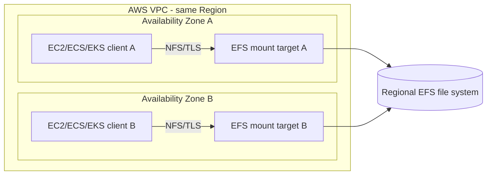
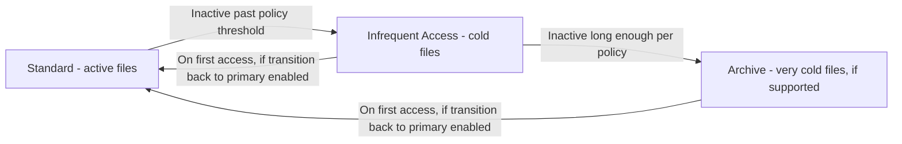
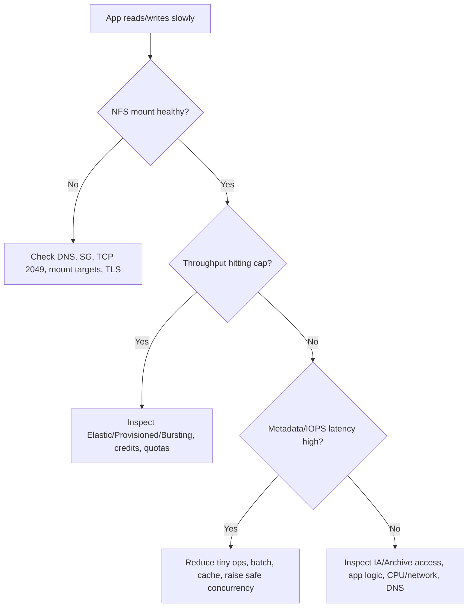

# EFS Performance Modes, Throughput, and Lifecycle

## 1. File Storage Challenges in the AWS Ecosystem

Suppose a company operates a website and document processing system. Multiple EC2 instances, Amazon ECS tasks, and Amazon EKS applications need to share `/uploads`; data must persist even when an instance is replaced. By day, thousands of users upload and read files; at night, traffic drops; many older documents are reopened only after several months. If storage is misconfigured, the app can slow down due to I/O caps or the business may overpay to keep cold files in an unnecessarily expensive tier.

**Amazon Elastic File System (Amazon EFS)** is a **managed file storage** service exposing an **NFS** interface to compatible Linux workloads. Multiple clients can mount the same file system and read/write according to configured permissions. Storage capacity grows and shrinks automatically with actual file usage, freeing operators from pre-allocating disk sizes as in many block storage models.

In the **Block and File Storage** chapter of the **CLOUD_PROVIDERS_AWS** track, EFS choices tie directly to Region/Availability Zone design, VPC, IAM, compute, security, monitoring, recovery, and cost control. This lesson focuses on three commonly confused configuration areas:

1. **Performance mode:** how the file system optimizes file operation handling, especially latency and I/O scalability.
2. **Throughput mode:** how EFS provisions and meters read/write data transfer capacity over time.
3. **Lifecycle management:** rules for automatically transitioning files to cost-appropriate storage classes based on access patterns.

After this lesson, you will be able to explain each mode, choose configurations for real workloads, analyze CloudWatch metrics, write AWS CLI commands to inspect/update settings, design suitable lifecycle policies, and troubleshoot performance, availability, security, and cost issues.

## 2. EFS in AWS Storage Architecture

EFS creates a **file system** and exposes **mount targets** across VPC subnets so clients can connect over NFS, typically via **TCP 2049**. On a **Regional** file system, data is stored redundantly across multiple Availability Zones (AZs) in the Region; clients should use mount targets in their local AZ to avoid unnecessary cross-AZ network paths. EFS also offers a **One Zone** option storing data in a single AZ, trading off AZ fault tolerance for lower cost.



What EFS **does** and **does not automatically do**:

| Characteristic | Practical meaning |
| --- | --- |
| NFS, directories, and POSIX permissions | Linux apps access files via shared paths; you must manage UID/GID, directory permissions, and ownership |
| Multiple concurrent clients | Suits shared files, content, home directories, and containerized apps needing shared data |
| Elastic filesystem capacity | No need to manually resize volumes as total file size grows |
| Regional or One Zone | Choose AZ redundancy vs. outage risk matching RTO/RPO requirements |
| Service-bounded throughput and I/O | Does not mean unlimited bandwidth for every small operation or single client |
| Not a block device | Do not substitute for EBS when software mandates a block drive with specialized IOPS/latency profiles |

### 2.1. Quick Comparison: EFS, EBS, and S3

| Service | Interface model | Primary fit |
| --- | --- | --- |
| **Amazon EFS** | NFS file system, multi-client | File sharing across Linux workloads, automatic elastic sizing |
| **Amazon EBS** | Block volume attached to EC2 per volume type/attachment rules | OS drives, databases, or apps needing block storage and specific IOPS profiles |
| **Amazon S3** | Object storage via API | Objects, static assets, backups, data lakes; not default POSIX NFS |

Do not pick EFS merely because you "need to store files." If an application only calls APIs to read/write objects without needing NFS or POSIX semantics, S3 is often better suited. If a database requires block storage with specific I/O traits, evaluate EBS or a managed database service.

## 3. Distinguishing Performance Mode, Throughput Mode, and Storage Class

These three concepts are **orthogonal configuration dimensions**:

| Configuration dimension | What it governs | Common options/concepts |
| --- | --- | --- |
| **Performance mode** | How the filesystem optimizes file operation processing | General Purpose; Max I/O on older/supported filesystems |
| **Throughput mode** | How EFS provisions and meters bandwidth | Elastic, Provisioned, Bursting |
| **Storage class / lifecycle** | Which tier files live in based on access frequency and availability needs | Standard, Infrequent Access (IA), Archive; supported One Zone variants |

A single file system can combine **General Purpose + Elastic throughput + lifecycle transitioning cold files to IA/Archive**. Changing lifecycle rules does not alter performance mode. Likewise, switching from Bursting to Elastic throughput does not move IA files back to Standard.

**Distinguish mutable vs. immutable settings:** throughput mode and lifecycle policies can be updated subject to AWS conditions, limits, and transition rules; **performance mode is chosen at file system creation and cannot be modified directly afterward**. To change performance mode, you must normally create a new file system, migrate data, and update client mounts.

## 4. Performance Modes: General Purpose and Max I/O

### 4.1. General Purpose

**General Purpose** targets low latency for the majority of everyday file workloads, especially interactive applications performing frequent metadata operations, file opens, small reads/writes, or serving live user requests. It is the **default and recommended choice for new EFS deployments**.

Suitable examples:

- Web applications accessing shared upload directories.
- Multiple containers reading a shared configuration or versioned content tree.
- User home directories, dev environments, and latency-sensitive document processing.
- Workloads paired with EFS Elastic throughput needing responsive operations.

General Purpose still enforces **service I/O operation and throughput limits** per service capacity and configuration scope. Real-world latency also depends on networking, file sizes, sequential metadata calls, client count, app concurrency, and file storage class.

### 4.2. Max I/O and Why You Should Recognize It

Some documentation or **older** EFS file systems feature **Max I/O performance mode**, engineered to scale aggregate concurrent operations higher in suitable scenarios at the cost of **higher per-operation latency than General Purpose**. Creating new Max I/O filesystems and combining Max I/O with modern throughput/storage options carry constraints; check AWS documentation before designing new architectures with it. Never treat Max I/O as a universal speed boost for every workload.

| Criterion | General Purpose | Max I/O on supported systems |
| --- | --- | --- |
| Optimization focus | Low file-operation latency | Higher concurrent operations at scale in fitting scenarios |
| Latency | Usually suits interactive apps | Higher per-op latency, hurting chained small operations |
| New deployment guidance | **Preferred** | Treat as specialized/legacy; verify support |
| Change mode after creation | Not directly modifiable | Not directly modifiable |

When an app is slow because it executes millions of sequential `stat`, `open`, and `close` calls, raising throughput or changing performance mode will not fix the root cause. You may need to **cache metadata, reduce small-file sprawl, batch operations, raise safe concurrency, or redesign access paths**.

## 5. Throughput Modes: Elastic, Provisioned, and Bursting

**Throughput** is the volume of data EFS serves per unit of time, usually expressed in MiB/s or GiB/s. It differs from **IOPS** (I/O operations per second) and **latency** (time to complete a single operation). An app with high throughput headroom can still feel sluggish if it performs many sequential metadata operations.

### 5.1. Elastic Throughput

With **Elastic throughput**, EFS automatically scales serving capacity to match workload reads/writes within service limits. This fits **unpredictable** loads, spiky traffic, or small datasets requiring high transfer bursts. AWS recommends Elastic for most modern EFS workloads where supported.

Characteristics:

- No need to pre-provision a high fixed MiB/s rate just for short peak hours.
- Throughput charges depend on **metered I/O volume under Elastic rules** alongside storage fees; you cannot estimate bills from stored file size alone.
- Does not rely on **burst credit** buckets like Bursting mode.
- Still subject to Regional, configuration, and service throughput/IOPS limits; monitor CloudWatch as load scales.

**Best fit:** campaign-driven web uploads/downloads, dev environments, irregular ETL jobs, and new containerized apps lacking stable traffic baselines.

### 5.2. Provisioned Throughput

With **Provisioned throughput**, you specify a dedicated throughput level largely independent of stored data size. This helps when workloads maintain **steady, predictable** high utilization—especially when EFS holds relatively little data yet transfers large volumes. AWS enforces rules and limits on provisioned rates; billing follows provisioned capacity under current pricing rules.

Example: a system continuously reads large batch files heavily for many hours every day; rather than paying per-byte Elastic I/O rates, the team can measure load and compare economics against a matching Provisioned setting. Never assume Provisioned is automatically cheaper, as total cost depends on **read/write mix, stored GB, provisioned level, and Regional rates**.

**Warning:** setting high provisioned throughput does not turn EFS into a system meeting every IOPS/latency target. Applications still need sufficient concurrency, efficient NFS clients, and network paths supporting that bandwidth.

### 5.3. Bursting Throughput

**Bursting throughput** bases **baseline throughput** on the amount of data stored in eligible storage classes and accumulates **burst credits** when running below that baseline. When bursting above baseline, the filesystem consumes credits. On small filesystems with sustained I/O jobs, credits can drain quickly, throttling throughput down to the low baseline once burst capacity runs out.

Example: a small filesystem running continuous full scans/reads may fail to sustain the throughput developers assumed. Switching to Elastic or Provisioned is an option **after measuring** real usage and cost.

Never design around a static memorized table of throughput/credit figures for all situations: formulas, floors, thresholds, and mode availability evolve by service/config. Verify current EFS docs and live filesystem metrics before deciding.

### 5.4. Throughput Mode Decision Table

| Workload | Elastic | Provisioned | Bursting |
| --- | --- | --- | --- |
| Erratic reads/writes, short peaks | **Usually preferred** | Risks over-provisioning and paying while idle | Credits may deplete during long peaks |
| Steady, predictable high throughput | Compare total metered I/O spend | **Worth evaluating** for sustained rate | May lack sustained baseline throughput |
| Small filesystem with frequent heavy I/O | **Good to try first** | Fits if load is steady | Penalized by small storage-tied baseline |
| Rarely accessed document archive | Can fit; check costs | Often uneconomical if over-provisioned | May fit light loads if mode is supported |

**Decision workflow:** start from workload/SLOs → measure throughput, I/O mix, and peaks → check supported modes → compare Regional pricing → test and compare. Without historical metrics, Elastic is a practical starting point for many new systems.

## 6. Reading Metrics to Understand Performance Bottlenecks

EFS throughput is never just a single MiB/s number. Two apps reading the same total bytes can perform dramatically differently:

```text
Application A: 1,000 files x 10 MiB   -> fewer open/close calls, large block reads
Application B: 1,000,000 files x 10 KiB -> heavy open/stat/close, intense metadata
```

Total data is similar, yet Application B can spend massive time on metadata operations, network round trips, and multi-client synchronization. Measure **latency, IOPS, I/O size, file counts, and concurrency** alongside throughput.

### 6.1. Key CloudWatch Metrics to Monitor

| Metric / signal | Meaning | How to use |
| --- | --- | --- |
| `MeteredIOBytes` | I/O bytes metered by EFS for throughput/billing rules | Analyze read/write patterns and load over time |
| `TotalIOBytes` | Reported active I/O byte volume | Compare with `MeteredIOBytes` to track read/write trends |
| `PermittedThroughput` | Allowed throughput at measurement time per config | Compare against actual I/O to spot throttling |
| `BurstCreditBalance` | Remaining burst credits in **Bursting** mode | Alert when credits drain; not used as a mandatory Elastic signal |
| `PercentIOLimit` | Utilization relative to General Purpose I/O op limits where supported | Detect file-operation bottlenecks |
| `ClientConnections` | Active client connections to EFS | Spot unexpected spikes or drops in mounted clients |
| `StorageBytes` | Stored capacity broken down by AWS-reported tiers | Track Standard/IA/Archive usage and lifecycle impact |

Metrics, statistics (Average, Sum, Minimum, Maximum), units, and dimensions vary. Never take a 5-minute **Average** and conclude the filesystem never hit a ceiling during a 1-second burst. Choose statistics and granularities aligned with metric documentation.

### 6.2. Read Metering vs. Write Metering

Several EFS throughput models rely on **metered throughput** rather than raw physical bytes alone. AWS applies different weighting factors to read operations versus write operations under applicable modes; reads can be weighted lighter than writes per current rules. Therefore, a **read-heavy** workload and a **write-heavy** workload transferring identical GiB may consume different metered throughput.

When comparing Elastic against Provisioned or Bursting, inspect `MeteredIOBytes` and throughput metering docs for your **actual Region/mode**, tracking I/O per workload. Avoid estimating costs solely from directory sizes or client-side network interface counters.

## 7. Storage Classes: Standard, Infrequent Access, and Archive

EFS **Lifecycle management** moves infrequently accessed files to lower-storage-cost tiers in exchange for **data access fees**, latency differences, and class-specific billing rules.

| Storage class / group | Use case | Notes |
| --- | --- | --- |
| **EFS Standard** | Frequently read/written files | Access latency optimized for active workloads |
| **EFS Infrequent Access (IA)** | Less frequently accessed files still needing file-path access | Lower storage cost; per-access fees and higher latency apply per rules |
| **EFS Archive** | Very rarely accessed files on eligible filesystems | Lower storage cost, but incurs access fees, distinct performance traits, and minimum retention terms |
| **EFS One Zone / One Zone-IA** | Single-AZ data tolerating AZ outage risk | Lower availability than Regional; verify supported classes/lifecycle |

With **Regional EFS**, you can use Standard, IA, and Archive where supported by AWS. With **One Zone**, available classes and lifecycle policies differ from Regional; **do not assume Archive is available on every filesystem type**.

### 7.1. Infrequent Access Is Not Offline Storage

Files moved to EFS IA or Archive remain accessible via the **same familiar NFS path** when access rules allow. Applications do not run an offline restore workflow like certain **Amazon S3 Glacier** classes before opening a file. However, access fees and first-byte latency differ from Standard, affecting latency-sensitive apps.

EFS lifecycle operates at the **file** level, not all-or-nothing across the whole filesystem. Hot files stay in Standard while cold files transition to IA/Archive. You do not need separate mount paths for tiered files, though you must watch out for batch jobs unexpectedly scanning old files.

### 7.2. Factors Driving Cost Efficiency

- **Share of cold files:** aging files untouched for long periods yield storage savings when tiered down.
- **Re-access frequency:** frequent reads from IA/Archive rack up access fees that erode storage savings.
- **Tiny files or short retention:** minimum billable object/file sizes or minimum storage durations can apply per tier; verify current pricing.
- **Application access habits:** crawlers, antivirus scans, backups, or indexing jobs opening every old file inflate metered access charges.
- **Read/write throughput ratio:** throughput fees and access fees interact to shape total spend.

Accordingly, an effective tiering policy must reflect **actual access patterns**, not a blind assumption that "files older than 30 days are never touched."

## 8. How EFS Lifecycle Management Works

EFS Lifecycle Management lets you define periods of **inactivity** before transitioning files to supported storage classes. AWS tracks file access for lifecycle transitions internally; do not infer lifecycle state strictly from POSIX `atime` attributes visible to applications.

### 8.1. Primary Transition Paths



You can configure policies transitioning files to **IA**, onward to **Archive** on supported filesystems, and optionally a **Transition to primary storage class** rule moving files back to Standard upon access. Valid day thresholds, combinations, and rules are governed by the AWS EFS API; not every combination works on every filesystem.

**Important note:** transitioning back to Standard on first access is **optional**. If enabled, jobs scanning old files can push data back into Standard and raise storage bills. Transitions are managed asynchronously by the service—not an instant guarantee at the exact threshold second or immediately inside `open()`.

### 8.2. Lifecycle Policy Example via AWS CLI

Suppose a **Regional EFS** holds cold files you want to move to IA after 30 days without access and to Archive after 90 days without access; when reopened, AWS returns them to Standard via a primary-class transition rule. Example JSON:

```json
[
  { "TransitionToIA": "AFTER_30_DAYS" },
  { "TransitionToArchive": "AFTER_90_DAYS" },
  { "TransitionToPrimaryStorageClass": "AFTER_1_ACCESS" }
]
```

Saving this JSON as `efs-lifecycle-policy.json`, the corresponding AWS CLI command is:

```bash
aws efs put-lifecycle-configuration \
  --file-system-id fs-0123456789abcdef0 \
  --lifecycle-policies file://efs-lifecycle-policy.json \
  --region ap-southeast-1
```

This command **writes live configuration** when executed, so run it only after verifying the file system ID, filesystem type, IAM permissions, Archive eligibility, and data requirements. `fs-0123456789abcdef0` is an illustrative ID. Never apply it to production without analyzing access costs and tier-transition impacts on active files.

**If saving the example JSON:** `LifecyclePolicies` is an **array** of policy rules, matching `--lifecycle-policies`. Do not confuse it with an IAM policy document using `Version`/`Statement`; EFS lifecycle does not use IAM JSON syntax.

### 8.3. Questions to Answer Before Enabling Lifecycle

1. Which applications read older files? Does any nightly job scan entire directories?
2. Which files are temporary and better deleted via retention rather than tiered?
3. Does any software require ultra-low first-byte latency? Keep those files in Standard.
4. Should files return to Standard after one access, or stay in cheaper tiers to cap storage spend?
5. Are there **retention, compliance, or backup** mandates? Lifecycle optimizes storage tiers; **it does not replace backup or deletion policies**.
6. Can the workload absorb IA/Archive access charges and minimum storage duration rules?

**Lifecycle policies apply at the file system scope** rather than providing independent per-directory rules. If `hot` and `cold` workloads demand conflicting lifecycle rules, consider separate file systems or a different data layout for cleaner governance.

## 9. AWS CLI Operations: Inspecting Config, Changing Throughput, Checking Lifecycle

First, verify the right account and Region. These **read-only** commands inspect an existing filesystem:

```bash
# Confirm active IAM role/account
aws sts get-caller-identity

# View performance mode, throughput mode, and filesystem state
aws efs describe-file-systems \
  --file-system-id fs-0123456789abcdef0 \
  --query 'FileSystems[0].[FileSystemId,PerformanceMode,ThroughputMode,ProvisionedThroughputInMibps,Encrypted,LifeCycleState]' \
  --region ap-southeast-1

# View active lifecycle rules on the filesystem
aws efs describe-lifecycle-configuration \
  --file-system-id fs-0123456789abcdef0 \
  --region ap-southeast-1
```

If the filesystem uses an older mode and you have measured load and approved the change, a **write** command switches to Elastic throughput where supported:

```bash
aws efs update-file-system \
  --file-system-id fs-0123456789abcdef0 \
  --throughput-mode elastic \
  --region ap-southeast-1
```

To configure Provisioned throughput, illustrative syntax:

```bash
aws efs update-file-system \
  --file-system-id fs-0123456789abcdef0 \
  --throughput-mode provisioned \
  --provisioned-throughput-in-mibps 64 \
  --region ap-southeast-1
```

The value `64` merely illustrates a MiB/s number, not a default recommendation. **AWS restricts how frequently or under what conditions throughput mode / Provisioned throughput can be modified**, so never design automation that flips modes minute by minute. Check quotas, API error messages, and propagation timing before load testing.

Changing **throughput mode** is not changing **performance mode**. There is no direct in-place update from General Purpose to Max I/O on an existing filesystem. If changing performance mode is mandatory, plan to create a new file system, copy data, verify POSIX permissions, cut over mounts, and keep a rollback plan.

## 10. Design Example: Shared File Store for a Multi-AZ Application

Suppose a company runs 6 EC2 instances across 2 AZs hosting a contract-generation API that stores documents on EFS. Active data is roughly 300 GiB, growing daily; older contracts are rarely viewed after 60 days. Month-end spikes drive sharp, irregular hourly throughput surges.

**Recommended design:**

1. Choose **Regional EFS** so files are redundantly stored across multiple AZs rather than placing everything in one AZ if uptime during an AZ outage is required.
2. Use **General Purpose** because the API performs interactive file and metadata operations; evaluate **Elastic throughput** first given the erratic monthly spikes.
3. Create **mount targets** in every AZ hosting clients; restrict NFS TCP 2049 in security groups strictly to authorized compute SGs/CIDRs.
4. Mount via **EFS mount helper over TLS**, optionally using EFS Access Points to enforce root directories, UIDs/GIDs, and per-app scoping.
5. Monitor `MeteredIOBytes`, `PermittedThroughput`, operation counts, app latency, and per-class capacity.
6. Verify whether files truly go cold after 60 days; test IA/Archive lifecycle in a representative environment, evaluating access fees and first-read latency before rolling out globally.
7. Configure **AWS Backup** or an approved backup/restore plan and test restore times; lifecycle never protects against accidental deletion or ransomware edits.

```text
                 Application Load Balancer
                        /       \
                 EC2 in AZ A   EC2 in AZ B
                     |             |
                EFS mount A   EFS mount B
                     \             /
                       Regional EFS
                       | Standard: hot files
                       | IA: infrequently used files
                       | Archive: cold files, if supported
```

**Measure first before picking modes:** if every API request executes hundreds of sequential `stat` calls on tiny files, metadata latency may be the real bottleneck. Elastic throughput cannot erase baseline per-operation NFS round-trip latency; optimize application access and networking too.

## 11. Mounting and Securing EFS Data

### 11.1. Mount Targets, DNS, and Security Groups

To mount an EFS file system from EC2 inside a VPC, clients need working routing/DNS to a mount target whose **security group** allows **TCP 2049** from approved source security groups or IP ranges. Route tables, NACLs, and any VPC peering/Transit Gateway links must also permit the path. A mount target by itself grants no file-level permissions.

Example on Linux with **amazon-efs-utils** installed and valid mount target/DNS:

```bash
sudo mkdir -p /mnt/shared
sudo mount -t efs -o tls fs-0123456789abcdef0:/ /mnt/shared
```

The `tls` option encrypts data **in transit** via the EFS mount helper. Verify mount helper version and OS compatibility before rollout. For persistence across reboots, configure `/etc/fstab` or orchestration tooling per AWS guidance.

### 11.2. IAM, Access Points, POSIX, and Encryption

EFS layers distinct security controls:

- **POSIX permissions:** file ownership, UID/GID, and mode bits govern process `read`, `write`, and `execute` rights inside the filesystem.
- **IAM authorization and file system policy:** control which principals may invoke `ClientMount`, `ClientWrite`, and `ClientRootAccess` per EFS config; using IAM on mounts requires matching mount options and policy permissions.
- **EFS Access Points:** provide per-application entry points enforcing root directories and POSIX identities, useful when multiple workloads share one filesystem.
- **Encryption at rest:** uses AWS KMS per filesystem settings; encryption in transit uses TLS at mount time. Manage KMS permissions, key policies, and rotation/revocation carefully.
- **Network isolation:** security groups, NACLs, and VPC scoping—never expose TCP 2049 broadly without reason.

**Understand clearly:** enabling TLS and KMS **does not grant file permissions**. An app may mount cleanly yet still hit `Permission denied` if POSIX owner/group bits deny access; conversely, overly permissive POSIX modes never substitute for IAM policies, network isolation, and workload separation.

### 11.3. Availability and Backups

Regional EFS eliminates single-AZ risk at the storage layer, yet applications still need multi-AZ compute deployments, mount targets in each AZ, health checks, and proper routing. EFS One Zone carries higher risk during a full-AZ outage; pick it only for regenerable data or matching RPO/RTO tolerances.

**Lifecycle management is not a backup.** Deleted, overwritten, or ransomware-encrypted files cannot be recovered merely because IA/Archive tiering is enabled. Use AWS Backup, supported snapshot/restore workflows, or approved backup tools to satisfy retention and perform regular restore drills.

## 12. Cost Modeling: Storage and Access Together Drive Decisions

Total EFS cost spans at least three components: **GB-months per storage class**, **I/O or throughput charges per mode**, and **IA/Archive access fees**, plus surrounding costs like backups, CloudWatch, cross-AZ data transfer, and networking depending on architecture.

Mental cost model:

\[
\text{Monthly EFS Cost} \approx
\sum_{c\in\{\text{Standard, IA, Archive}\}}
(\text{GB-month}_c\times\text{Storage Rate}_c)
+\text{Throughput Charges}
+\text{Class Access Charges}
+\text{Related Charges}
\]

Never plug fixed numbers into examples, as unit rates vary by **Region, filesystem type, storage class, throughput mode, request type**, and time. Pull live rates from **AWS Pricing**, Cost Explorer/Billing, or the AWS Pricing Calculator at design time.

### 12.1. Qualitative Exercise: Standard vs. IA/Archive

Suppose a filesystem stores **1 TiB of data**: 200 GiB is accessed daily, and the rest is mostly archival documents. Keeping all 1 TiB in Standard pays Standard storage rates across the board. Enabling lifecycle transitions to IA/Archive for cold files lowers **storage** fees, yet re-reading or writing into cheaper tiers triggers **access charges**—and enabling transition back to Standard increases Standard capacity again.

| Access pattern | Decision to evaluate |
| --- | --- |
| 200 GiB hot files read/written daily | Keep in Standard; tune throughput/IOPS for load |
| Files untouched for months | Consider IA/Archive based on supported lifecycle thresholds |
| Nightly job scans every file | Can wipe out IA/Archive savings; optimize the job or adjust policies |
| Files deleted after one week | Timely retention/deletion can beat tiering plus minimum-duration fees |

A critical takeaway: **a lower per-GB storage class does not guarantee a lower total bill**, especially with small files, frequent random accesses, or strict latency requirements.

### 12.2. Monthly Cost Tracking

When modifying settings, track a before/after comparison window across these metrics:

1. Total `StorageBytes` across Standard/IA/Archive and growth trends.
2. `MeteredIOBytes` over time and read/write ratios where available.
3. EFS storage, throughput, and access line items in Cost Explorer/Billing.
4. Application P50/P95/P99 latency, timeouts, and SLO breaches.
5. Backup costs, data transfer, and job retries caused by performance issues.

Simply noting "EFS cost less this month than last month" without tracking application traffic can mistake lower user volume for lifecycle savings.

## 13. Troubleshooting Performance and Lifecycle Issues

| Symptom | Primary suspect | How to check |
| --- | --- | --- |
| Fast at first, slows down after hours | Bursting credits depleted; or load exceeds current mode | `BurstCreditBalance`, `PermittedThroughput`, `MeteredIOBytes`, peak charts |
| Many small files slow despite low throughput | Metadata IOPS/latency, sequential ops, network round trips | Measure `open/stat`, concurrency, p95 latency, `PercentIOLimit` if available |
| Cannot mount EFS | Mount target/DNS, SG TCP 2049, NACL, TLS/mount helper | Check AZs, DNS, network path, client error output |
| Mounts OK, yet writing returns `Permission denied` | POSIX UID/GID, Access Point, IAM file system policy | Check owner/mode and `ClientWrite` permissions per config |
| Enabled IA yet bill stays high | Files still heavily accessed, tiny-file minimums, access fees | Inspect `StorageBytes`, Cost Explorer, check scanning jobs |
| Old files slow on first access | Files sit in IA/Archive; different latency and access behavior | Cross-check lifecycle, storage class, and app read patterns |
| Raised Provisioned throughput yet app not faster | IOPS/latency limits, single-threading, client network, or CPU | Measure actual throughput, request concurrency, and EFS metrics |
| Throughput mode update rejected | Quotas, mode-change cooldown limits, unsupported config | Read AWS API error, inspect current mode/performance settings |
| Multi-AZ setup has erratic slowness | Client hitting cross-AZ mount target, routing, or DNS issue | Check mount target AZs, cross-AZ connections, and app metrics |

### 13.1. Layered Diagnostic Flow



Never rush to raise throughput mode to fix every complaint: it can inflate bills without resolving broken DNS, wrong POSIX permissions, or millions of sequential metadata calls.

## 14. Production EFS Configuration Workflow

### Step 1 — Define Requirements

Document whether workloads run on EC2/ECS/EKS/Lambda or VPC servers, concurrent client counts, Region/AZ scope, capacity growth, latency targets, I/O volume, file sizes, re-access frequency, backup mandates, and budget.

### Step 2 — Choose File System Type and Performance Mode

For multi-AZ HA apps, evaluate **Regional EFS** first. For regenerable data or matching budget trade-offs, consider **One Zone** while explicitly accepting AZ outage risk. For new deployments, **General Purpose** is the sound starting point; never pick Max I/O merely because "Max" sounds faster.

### Step 3 — Choose Throughput Mode

If traffic is unpredictable or spiky, try **Elastic**. If throughput is high and steady, compare **Provisioned** costs. If load is light and considering Bursting, verify baseline/credits and check degradation risks during prolonged jobs.

### Step 4 — Design Lifecycle Around Real Access Patterns

Evaluate Standard/IA/Archive fit, inactivity thresholds, and transition-back-to-Standard rules. Test on representative data and monitor access charges; never use lifecycle as a substitute for retention deletion or backups.

### Step 5 — Secure and Deploy Access

Create mount targets in every AZ hosting clients, scope NFS 2049 strictly, enforce TLS, configure IAM/Access Points/POSIX cleanly, encrypt at rest, and set up auditing and backups.

### Step 6 — Test and Measure Post-Deployment

Run read/write load tests matching production file counts and concurrency; measure throughput, IOPS, latency, mount errors, and tier transitions. Set alarms near limits or rising errors, and prepare a rollback plan before altering policies on live data.

## 15. Applied Scenarios

### Scenario A — Small Filesystem with Huge Nightly Read Jobs

An analytics team has a small EFS volume that reads many GiB in a short nightly burst. Currently using Bursting, some nights the job drags on slowly. **Approach:** measure `BurstCreditBalance`, `MeteredIOBytes`, peak I/O, file sizes, and concurrency; test whether Elastic handles spikes better. Evaluate costs and whether placing data on S3 makes more sense if NFS is not strictly required.

### Scenario B — Multi-Year Document Archive

An organization stores millions of old documents, mostly untouched yet needed via file paths during audits. **Approach:** use lifecycle to move cold files to IA/Archive if supported; weigh access fees, latency, and minimum storage durations. If an indexing job scans the entire archive nightly, optimize its schedule/logic to preserve savings. Maintain independent backups and data-retention controls.

### Scenario C — Kubernetes Application Hitting `Permission denied`

An EKS pod mounts an EFS volume shared with another app; one pod can read files yet cannot create files in `/uploads`. **Approach:** check EFS Access Points, UID/GID and POSIX permissions, and IAM file system policies if IAM auth is used. Switching from Provisioned to Elastic throughput will never grant write permissions to the pod.

### Scenario D — Regional EFS with Two-AZ Application

Two EC2 groups in AZs A and B share a directory. **Approach:** create mount targets in both AZs, ensure clients connect within their local AZ/network, configure SG port 2049, and use a Regional filesystem to mitigate single-AZ storage failure. Applications still need Auto Scaling/health checks and recovery runbooks; EFS does not replace compute-layer HA.

## 16. Self-Check Questions

**Question 1.** Is switching EFS from General Purpose to Max I/O via `update-file-system` a quick way to boost throughput when an app slows down?

**Hint:** No. Performance mode is set at creation and cannot be changed directly in place. Moreover, Max I/O can increase latency and has support constraints. Find the real bottleneck first, and plan a new filesystem/migration only if truly warranted.

**Question 2.** A small filesystem sees sharp daily traffic swings—should you evaluate Elastic, Provisioned, or Bursting first?

**Hint:** Elastic is worth testing first because it scales automatically with I/O; then measure costs/limits. Bursting risks draining credits, and Provisioned can be wasteful if held high during idle periods.

**Question 3.** When EFS moves files to Archive, must you run a separate restore job before applications can access them via NFS?

**Hint:** No S3 Glacier-style restore workflow is needed for EFS files; they stay in the same NFS namespace. However, access fees, latency, and primary-class transition policies must be accounted for.

**Question 4.** Why can an application opening one million tiny files still be slow despite ample EFS throughput?

**Hint:** Metadata operations and NFS round-trip latency can bottleneck execution; high data throughput alone does not speed up individual `stat`/`open` calls.

**Question 5.** Does enabling lifecycle transitions to IA replace backups?

**Hint:** No. Lifecycle only optimizes storage class by access frequency; it provides zero copies to recover deleted or overwritten files. Separate backups/restores are required.

**Question 6.** A container mounts EFS cleanly yet fails to create files; should you raise Provisioned throughput?

**Hint:** No. Inspect POSIX UID/GID, IAM authorization, EFS Access Points, and directory permissions—this is an authorization issue, not a performance bottleneck.

## 17. Key Takeaways

**Performance mode** defines how EFS optimizes I/O handling: **General Purpose** suits most new apps, while Max I/O is mainly encountered in legacy/specialized cases. **Throughput mode** governs data transfer capacity over time: **Elastic** adapts to variable load, **Provisioned** serves known steady rates, and **Bursting** ties to baseline storage and burst credits. **Lifecycle management** automatically tiers cold files to **IA/Archive** where supported to trim storage costs, while introducing access fees and latency trade-offs.

Operating EFS effectively requires combining **real workload benchmarking, per-AZ/VPC mount targets, POSIX/IAM permissions, encryption, CloudWatch monitoring, backups, and Cost Explorer tracking**. The best choice ensures the application meets its SLOs, recovers from failures, and maintains a sensible **total cost of ownership** rather than picking a mode solely for an appealing name.

### AWS Reference Documentation

- [Amazon EFS — User Guide](https://docs.aws.amazon.com/efs/latest/ug/whatisefs.html)
- [Amazon EFS performance](https://docs.aws.amazon.com/efs/latest/ug/performance.html)
- [Amazon EFS performance modes](https://docs.aws.amazon.com/efs/latest/ug/performance.html#performancemodes)
- [Amazon EFS throughput modes](https://docs.aws.amazon.com/efs/latest/ug/throughput-modes.html)
- [Amazon EFS storage classes](https://docs.aws.amazon.com/efs/latest/ug/storage-classes.html)
- [Managing file system lifecycle](https://docs.aws.amazon.com/efs/latest/ug/lifecycle-management-efs.html)
- [Amazon EFS CloudWatch metrics](https://docs.aws.amazon.com/efs/latest/ug/efs-metrics.html)
- [Mount Amazon EFS with the EFS mount helper](https://docs.aws.amazon.com/efs/latest/ug/efs-mount-helper.html)
- [Amazon EFS access points](https://docs.aws.amazon.com/efs/latest/ug/efs-access-points.html)
- [Amazon EFS security](https://docs.aws.amazon.com/efs/latest/ug/security-considerations.html)
- [Amazon EFS pricing](https://aws.amazon.com/efs/pricing/)
