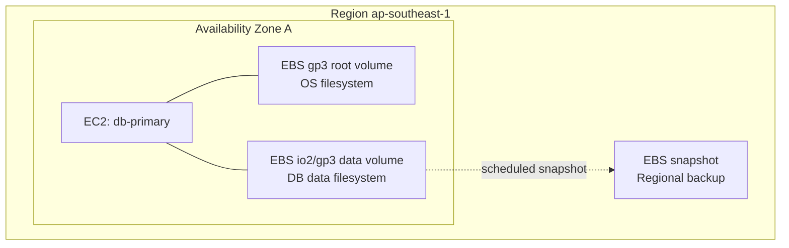
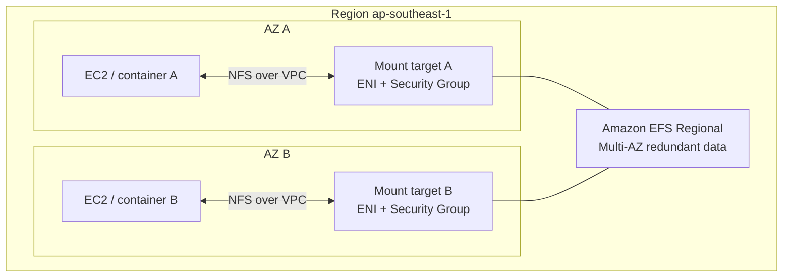
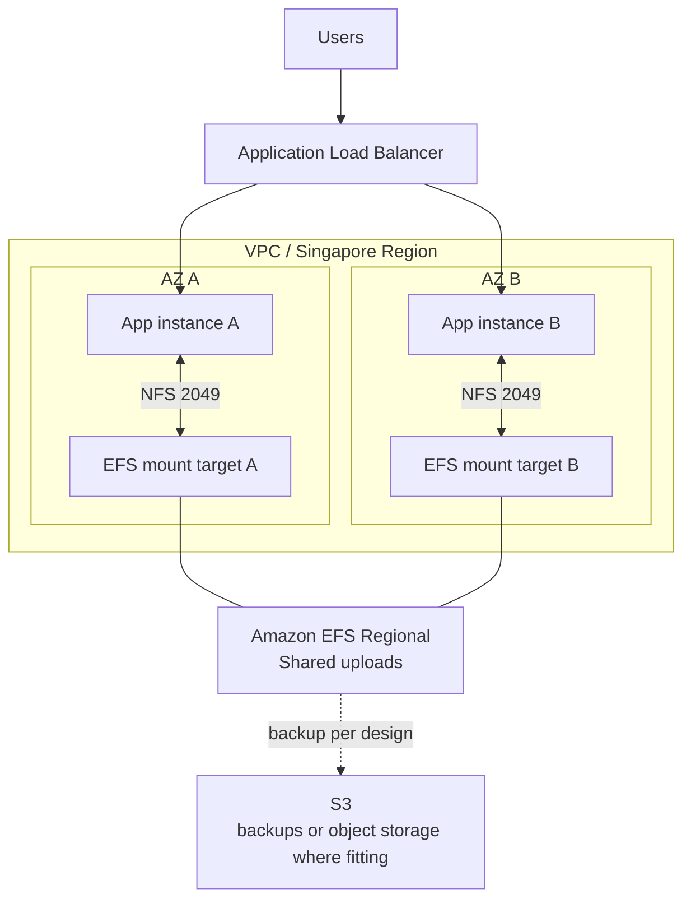
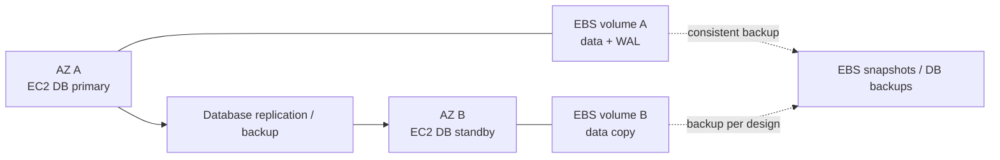
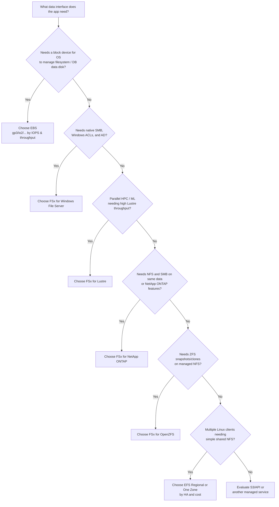

# Choosing Amazon EBS, EFS, or FSx by Application Requirements

> **Chapter:** Block and File Storage  
> **Module:** CLOUD_PROVIDERS_AWS  
> **Goal:** select the right storage system for an AWS application based on access model, operating system, performance, shareability, availability, security, recovery strategy, and total cost.

## 1. Why Does Choosing the Right Storage Type Matter?

Consider three applications all running in the AWS Singapore Region:

1. An **Amazon EC2** instance running self-managed PostgreSQL needing a disk for the OS and data with heavy random reads/writes.
2. An **EC2/ECS** fleet serving web traffic across two Availability Zones (AZs) needing shared access to a directory of user-uploaded images.
3. An enterprise running **Windows Server** with Active Directory (AD), sharing documents over SMB with NTFS permissions; and another research team needing to process very large files at high throughput.

All three "need storage," yet they do not necessarily belong on the same service. **Amazon EBS, Amazon EFS, and Amazon FSx** solve different classes of needs.

- **Amazon Elastic Block Store (EBS):** provides a **block device** attachable to EC2, suited for OS drives, application data disks, and databases requiring filesystem control.
- **Amazon Elastic File System (EFS):** provides a managed **shared file system** accessed via NFS, convenient for multiple Linux workloads sharing data.
- **Amazon FSx:** a family of AWS-managed **specialized file systems**—Windows File Server, Lustre, NetApp ONTAP, and OpenZFS—delivering specific protocols, performance, and capabilities.

**Foundational question:** does the application need a **block drive**, a **network-shared directory**, or a **filesystem with specialized features/protocols**?

This lesson frames these three options within AWS infrastructure—covering **Regions/AZs, IAM, VPC, EC2, containers/serverless, databases, monitoring, recovery, and cost**.

## 2. Distinguish Block, File, and Object Before Comparing Services

### 2.1. Block Storage

**Block storage** presents raw storage blocks as a device, much like a disk drive attached to a server. The OS can create partitions, build a filesystem, and mount the volume.

Example stack with Amazon EBS:

```text
PostgreSQL application
    ↓ data files, WAL
Filesystem on EC2 (ext4, XFS, NTFS...)
    ↓ block I/O
/dev/nvme... device exposed by EBS
    ↓
Amazon EBS volume in the same Availability Zone
```

EBS **does not automatically provide an SMB/NFS shared folder** across all instances. To use it as a filesystem, the OS or application must manage the filesystem. Running `df -h` in Linux shows a filesystem residing on EBS, yet EBS itself remains block storage.

### 2.2. File Storage

**File storage** provides a namespace with directories, files, metadata, and access permissions. Clients connect over filesystem protocols such as **NFS** or **SMB**.

```text
EC2 A / container A ──┐
                      ├── NFS/SMB over VPC ── Shared file system
EC2 B / container B ──┘                       ├── /shared/report.csv
                                              └── /shared/images/
```

EFS and FSx offerings fit when multiple machines or containers must see the **same file path**. However, do not assume every legacy app runs well on a network filesystem without checking: file locking, latency, metadata operations, consistency, permissions, and protocol nuances can make a huge difference.

### 2.3. Object Storage: When Should You Think of S3?

**Amazon S3** stores objects in buckets accessed via APIs (or compatible gateway layers). S3 is not a block drive or a standard NFS/SMB share. For uploaded images, backups, logs, static assets, or data lake datasets where the app can call APIs, **S3 is often a better fit** than maintaining a file server. That still does not make S3 the right answer for workloads requiring a POSIX filesystem or SMB share.

| Criterion | Block (EBS) | File (EFS / FSx) | Object (S3, for comparison) |
|---|---|---|---|
| Primary interface | Block device | Files/directories via NFS, SMB, or other protocol | Object/bucket API |
| Who manages the filesystem | OS/application mounting the volume | File system service and clients | Application/SDK and S3 |
| Multi-machine sharing | Special conditions only, not default | Designed for multiple clients depending on filesystem type | Multiple clients via API |
| Examples | OS drives, databases on EC2 | Shared folders, SMB shares, HPC filesystems | Images, backups, object data lakes |

## 3. High-Level Comparison: EBS, EFS, and FSx

| Criterion | Amazon EBS | Amazon EFS | Amazon FSx |
|---|---|---|---|
| Model | **Block volume** | **Shared NFS file system** | **Family of specialized managed file systems** |
| Protocol/clients | Block attached to EC2; OS formats filesystem | NFS v4.x, primarily Linux/POSIX workloads | Windows: SMB; Lustre: Lustre; ONTAP: NFS/SMB and block protocols; OpenZFS: NFS |
| Deployment scope | Volume in **one AZ** | **Regional** or **One Zone** | Varies by FSx engine and deployment type; Single-AZ/Multi-AZ supported |
| Concurrent access | Normally one EC2; conditional **Multi-Attach** on io1/io2 | Multiple clients mounting one file system | Engine-dependent; generally multi-client |
| Scale/performance | Pick volume type and provision IOPS/throughput | Pick throughput mode, storage classes, and concurrency | Pick engine, SSD/HDD/Intelligent-Tiering where supported, and throughput/IOPS |
| Backup/recovery | EBS snapshots; AWS Backup | EFS Backup/AWS Backup, replication when configured | AWS Backup / engine-specific snapshots/backups or S3 linkage per engine |
| Best suited for | Boot/data disks, dedicated DBs on EC2 | Linux file shares, shared content, RWX containers | SMB/AD, HPC, hybrid NFS+SMB, ZFS/ONTAP capabilities |

This is an **initial orientation table**. To decide, dig into each service's mechanics, your workload, and your recovery targets.

## 4. Amazon EBS: Choose When the App Needs a Block Drive Close to EC2

### 4.1. How Does EBS Work?

An EBS volume is a block storage resource independent of EC2 start/stop lifecycles, created in **one Availability Zone**. An EC2 instance in that AZ can attach multiple volumes up to instance limits; an EBS volume normally attaches to one EC2 instance at a time.

Example:



AWS protects EBS against hardware failures within the same AZ via internal redundancy; nevertheless, **EBS volumes remain zonal**. If an AZ goes down, you cannot directly attach an AZ A volume to an EC2 instance in AZ B.

### 4.2. Key EBS Volume Types

| Volume type | Characteristics | Suitable workloads |
|---|---|---|
| **gp3 – General Purpose SSD** | Balances cost and performance; decouples IOPS and throughput from capacity within limits | Boot volumes, small-to-medium databases, general apps |
| **gp2 – General Purpose SSD** | Previous-gen SSD; performance tied to size and burst credits | Existing gp2 setups; consider evaluating gp3 migration |
| **io2 / io2 Block Express** | Provisioned IOPS SSD for strict I/O needs; high ceilings on supported instances | Transactional databases, latency-sensitive I/O workloads |
| **io1** | Older Provisioned IOPS SSD | Legacy systems needing upgrade review |
| **st1 – Throughput Optimized HDD** | Optimized for sequential reads/writes and high throughput | Sequential log/analytics processing on data volumes |
| **sc1 – Cold HDD** | Low-cost HDD for infrequently accessed data with light I/O | Cold block datasets, low-activity workloads |

**Remember:** EBS `st1`/`sc1` cannot serve as **boot volumes**. When picking a volume, size for **IOPS**, **throughput (MB/s)**, and **latency**—not GiB capacity alone.

For example, gp3 includes a baseline and allows provisioning higher within service limits. A 100 GiB volume running random transactions may need higher IOPS, whereas a 2 TiB volume running sequential scans cares more about throughput. Also verify the **EC2 instance's EBS bandwidth/IOPS cap**; a highly provisioned volume can still be throttled at the instance layer.

### 4.3. Can EBS Be Shared Across Multiple EC2 Instances?

**By default: no.** A standard EBS volume attaches to one EC2 at a time, though one instance can attach multiple volumes.

**Exception:** EBS **Multi-Attach** for eligible **Provisioned IOPS SSD `io1`/`io2`** volumes lets one volume attach to multiple Nitro-based EC2 instances **in the same AZ** (currently documented up to 16 instances). Restrictions apply to OS, instance types, filesystems, and volume lifecycles.

**Critical risk:** standard filesystems like **ext4** and **XFS** are not designed for multiple machines writing concurrently to the **same block device** without coordination. Multi-Attach **does not provide a distributed filesystem** or distributed locks; using it safely requires a **cluster-aware filesystem/application** handling concurrent writes and I/O fencing to prevent corruption. Multi-Attach also never spans AZs.

If the goal is simply allowing 10 EC2 instances to read/write `/uploads` together, start with **EFS or an appropriate FSx engine**, not EBS Multi-Attach.

### 4.4. EBS and Instance Lifecycle

- **Reboot:** volume stays attached, data persists as configured.
- **Stop/start:** EBS volume persists; remains in its AZ and stays attached per block mapping.
- **Terminate:** root volume may delete if `DeleteOnTermination=true`. Data volumes may persist or delete depending on mapping settings; inspect every attachment.
- **Detach:** quiesce I/O, unmount, and flush buffers properly before detaching; force-detaching risks filesystem corruption.
- **Resize/type change:** EBS Elastic Volumes supports modifying several properties under compatible conditions; increasing EBS size **does not automatically** expand OS partitions/filesystems.

Never confuse **EBS** with **EC2 instance store**. Instance store is ephemeral local host storage whose data is lost on stop, terminate, or host failure; EBS has a distinct lifecycle and protection model.

### 4.5. Snapshots and Cross-AZ Recovery

An **EBS snapshot** is a point-in-time copy of a volume, stored and managed at **Region** scope using AWS's incremental mechanism. From a snapshot, you can create a **new volume in another AZ within the same Region**. Cross-Region copies require **cross-Region snapshot copying** or a suitable backup service.

AZ A recovery example:

1. Ensure a consistent snapshot of the data volume exists in Singapore.
2. In AZ B, create a new volume from that snapshot.
3. Launch a replacement EC2 in AZ B and attach the volume.
4. Restore application/database state, verify consistency, and shift traffic.

**Snapshots are not magic for actively writing databases.** Snapshots reflect block state as of capture; applications must quiesce/flush or use DB-native backup tools for business-level consistency. **RPO** depends on backup cadence and method, while **RTO** covers restore, startup, validation, and traffic cutover time.

## 5. Amazon EFS: One NFS Filesystem for Many Workloads

### 5.1. Usage Model

Amazon EFS provides a **managed network file system** accessed over NFS that scales storage capacity automatically with stored data. Multiple Linux clients across EC2, ECS, EKS, and supported services can mount the same filesystem.



Unlike EBS, EFS targets clients accessing **filenames, directories, and POSIX metadata** in a shared namespace. Two EC2s can read the same `/shared/config.json`; two containers can write distinct files in `/shared/uploads`.

**Application note:** a shared filesystem does not replace data coordination. Multiple processes writing to **the exact same file** still need locking, atomic writes, conflict handling, and consistency logic.

### 5.2. Regional EFS vs. One Zone

| Characteristic | **EFS Regional** | **EFS One Zone** |
|---|---|---|
| Storage scope | Data and metadata stored redundantly across multiple AZs in a Region | Data and metadata stored redundantly within **one AZ** |
| Mount targets | Can place one mount target in each AZ of a VPC | **Only one** mount target, inside the filesystem's AZ |
| AZ fault tolerance | Storage-level protection against single-AZ outages alongside operational controls | Unsuitable when storage must survive loss of that AZ |
| Intended use | Shared data requiring high availability | Dev/test, regenerable datasets, or workloads accepting AZ outage risk |
| Cost | Regional pricing model | Can be lower depending on class and access, trading off fault domain |

With Regional EFS, creating mount targets in **every AZ where clients run** lowers latency and avoids cross-AZ transfer fees. Each AZ allows **at most one mount target per filesystem per VPC**, even with multiple subnets. With One Zone, clients from other AZs can still connect when configured properly, though data and the single target remain bound to one AZ.

### 5.3. Which Applications Fit EFS?

- **Shared web content:** multiple web servers reading the same directory tree.
- **Container persistent storage:** ECS/EKS workloads sharing directories across multiple nodes where supported.
- **Home directories / Linux tooling:** users or jobs sharing POSIX files.
- **Legacy filesystem-bound software:** apps hard to rewrite for S3 APIs yet needing horizontal scaling.
- **EFS-integrated serverless workloads:** e.g., Lambda functions configured with VPC access and an EFS access point.

Do not assume EFS is optimal for every low-latency random-write workload, self-managed transactional database, or job executing millions of tiny metadata ops per second. Always benchmark the real app.

### 5.4. EFS Throughput and Storage Classes

EFS offers throughput modes for workloads that vary over time, such as **Elastic Throughput**, **Provisioned Throughput**, and other supported options. Storage classes and lifecycle policies tier cold files to lower-cost classes, with trade-offs in access fees, retrieval timing, and performance.

When designing, measure:

- Dataset size, growth rate, and file counts.
- Aggregate read/write MiB/s, request rates, and read/write mix.
- **Burstiness** or traffic spikes.
- Small-file/metadata activity and open/close frequency.
- Expected access to **Infrequent Access / Archive** data if enabled.

**Do not confuse per-GiB storage rate with total EFS cost:** several options add throughput fees or per-access fees by storage class on top of capacity charges.

### 5.5. EFS Access Points and POSIX Permissions

**EFS Access Points** help apps/containers standardize root directories, POSIX user/group IDs, and permissions. EFS also supports file system policies / IAM authorization for supported operations and in-transit encryption via the EFS mount helper.

Security layers include:

1. **VPC routes and mount targets:** clients need network reachability to targets.
2. **Security groups:** clients typically need TCP **2049 (NFS)** to mount targets; allow inbound only from authorized SGs or sources.
3. **IAM / EFS file system policies:** govern which clients/access points are permitted when IAM authorization is active.
4. **POSIX ownership/modes:** OS users/groups inside the filesystem still determine file read/write rights.
5. **KMS and TLS:** encryption at rest and in transit per requirements.

**Common mistake:** "IAM granted EFS access so every file is readable." In practice, POSIX filesystem permissions, connection auth, and access point config can still deny access.

## 6. Amazon FSx: Choosing a File System Engine by Application

**Amazon FSx** is a family of managed file system services. There is no single generic "FSx" with one protocol; specify the exact variant:

| FSx service | Core protocol / traits | Best fit |
|---|---|---|
| **FSx for Windows File Server** | **SMB**, **Active Directory** integration, Windows ACLs, DFS, Windows file server features | Windows file shares, SMB/NTFS ACL apps, AD-joined enterprises |
| **FSx for Lustre** | **Lustre**, high throughput, parallel filesystem, optional S3 data repository integration | HPC, ML training, simulations, rendering, big media/data analytics |
| **FSx for NetApp ONTAP** | Multi-protocol **NFS + SMB**, **iSCSI** and supported block protocols, snapshots, tiering, replication | Hybrid enterprise NAS, ONTAP migrations, mixed Linux+Windows datasets |
| **FSx for OpenZFS** | **NFS**, ZFS features like snapshots/clones/compression, volume management | Linux/Unix apps wanting NFS alongside ZFS features and performance |

**How it differs from EFS:** EFS focuses on **elastic managed NFS shared storage**. FSx lets you pick a **specialized filesystem technology stack and behavior**, often involving more capacity/throughput parameters and admin controls to unlock engine-specific features.

### 6.1. FSx for Windows File Server: SMB and Active Directory

A company with 100 Windows employees shares `\\corp-share\finance` and governs permissions via AD groups. Requirements include:

- **SMB** so Windows mounts network drives.
- **Windows ACLs** on files/folders preserving existing permissions.
- Integration with **AWS Managed Microsoft AD** or **self-managed AD**.
- **Single-AZ/Multi-AZ** options aligned with availability goals.
- Backups, shadow copies, and familiar Windows file server administration.

**FSx for Windows File Server** is the direct choice. If the workload must survive an AZ outage, choose a compatible **Multi-AZ** deployment with primary/standby file servers across AZs and AWS-managed failover. Clients may still reconnect/retry; Multi-AZ does not mean applications never experience transient timeouts.

**EFS does not provide native SMB/AD ACLs like a Windows file server.** Simply "also storing files" does not make it a drop-in replacement for an existing Windows network.

**Verify VPC/AD/DNS carefully:** mounts can fail due to DNS resolution errors, unreachable domain controllers, Kerberos/clock skew, or blocked SMB/AD ports even when the file system reports AVAILABLE.

### 6.2. FSx for Lustre: Parallel File System for HPC/ML

An ML team reads terabytes of training files quickly across many GPU EC2 instances. Source datasets live in S3; parallel training jobs require massive file throughput.

With **FSx for Lustre**:

- Compute nodes mount a high-performance **parallel filesystem** rather than each node manually downloading and organizing S3 objects.
- You can **link an S3 bucket/prefix** via a **data repository association** when deployment/version supports it, using configured import/export repository tasks.
- Pick **Scratch/Persistent** or newer supported storage models matching durability, availability, and budget needs.
- Size throughput capacity and storage tier to match processing speed.
- Check AZ constraints, client types, network interfaces, instance types, dataset/file counts, and recovery if nodes fail.

**Do not assume a linked S3 repository automatically backs up every new Lustre file in real time.** Understand import/export rules, auto-sync settings, task states, and conflicts when editing the same file on both sides. Some FSx for Lustre variants do not support DRAs or backups the way users might expect.

For ordinary office file shares, FSx for Lustre is unnecessarily complex. It is engineered for **high-throughput data processing**, not replacing an SMB file server.

### 6.3. FSx for NetApp ONTAP: Multi-Protocol and Enterprise NAS

An organization runs NetApp ONTAP on-premises, has Linux apps needing NFS, Windows apps needing SMB, workloads using iSCSI LUNs, and wants space savings via **deduplication/compression/tiering**.

**FSx for ONTAP** is worth evaluating because it:

- Supports **NFS**, **SMB**, plus block protocols like **iSCSI** (and NVMe/TCP on supported variants).
- Organizes storage via **Storage Virtual Machines (SVMs)** and volumes, administering shares/exports the ONTAP way.
- Provides **snapshots**, clones, replication, and tiering consistent with NetApp operations.
- Offers **Single-AZ/Multi-AZ** options on supported generations; specify deployment type at creation.
- Integrates with existing NetApp management/security tools where workflows align.

Although ONTAP exposes multiple protocols, **multi-platform applications still must manage identity mapping, permissions/locks, and filename encoding**. Never assume SMB + NFS on the same volume is conflict-free automatically.

**Key reminder:** ONTAP supports block protocols, yet if you simply need EBS for a database on one EC2 instance, do not jump to FSx ONTAP merely because it has iSCSI. Weigh complexity, network latency, permissions, and sharing needs first.

### 6.4. FSx for OpenZFS: NFS with ZFS Capabilities

A legacy Linux system needs NFS along with **filesystem snapshots/clones**, compression, and ZFS semantics. **FSx for OpenZFS** is a strong candidate:

- Managed ZFS filesystem accessed via **NFS** with volume management.
- Supports ZFS features such as snapshots, cloning, and data compression per config.
- Offers **Single-AZ non-HA**, **Single-AZ HA**, or **Multi-AZ HA** depending on current Regional/deployment/storage class support.
- Serves workloads needing managed ZFS latency/throughput depending on deployment and clients.

**Do not treat OpenZFS as a native SMB file server.** While Windows can run an NFS client in limited cases, AWS recommends **FSx for Windows File Server** or **FSx for ONTAP** for Windows production needs.

## 7. Choosing by Protocol: How Must the Application Talk to Storage?

Protocol is usually the fastest filter:

| Application need | First candidate | Why |
|---|---|---|
| EC2 needing boot disk or block data drive | **EBS** | OS sees block device and builds filesystem |
| Multiple Linux instances/containers sharing NFS directory | **EFS** | Simple shared NFS with elastic capacity |
| Windows needing SMB/AD/NTFS ACLs | **FSx for Windows File Server** | Native Microsoft protocol and permission model |
| Linux+Windows sharing dataset with ONTAP features | **FSx for NetApp ONTAP** | NFS/SMB, snapshots, tiering, plus block protocols |
| Parallel HPC/ML file processing with high throughput | **FSx for Lustre** | High-performance parallel filesystem |
| Linux needing NFS plus ZFS-specific features | **FSx for OpenZFS** | Managed OpenZFS, snapshots/clones |
| Static files accessed via HTTP/API without POSIX | **S3** | Object storage is usually a better fit |
| Managed database | **RDS/Aurora** where suitable | Managed DB/backups/HA; underlying storage handled by service |

**Note:** for **ECS/EKS**, check supported **access modes** and CSI drivers/storage integrations. EBS typically fits single-node/AZ persistent volumes, while EFS fits multi-pod/multi-node shared mounts. Kubernetes access modes like `ReadWriteOnce`/`ReadWriteMany` must be evaluated in the context of the CSI driver, Pod/Node placement, and volume type.

## 8. Choosing by Performance: IOPS, Throughput, Latency, and Metadata

An application has no single "storage speed" metric. Measure at least four attributes:

| Attribute | Meaning | Sensitive workloads |
|---|---|---|
| **IOPS** | Block I/O operations per second | Transactional databases, small-I/O heavy apps |
| **Throughput** | Data transferred per second (MiB/s, GiB/s) | Media processing, HPC, large sequential reads |
| **Latency** | I/O response time, including network/client overhead | Databases, interactive applications |
| **Metadata operations** | Creating/looking up/stat'ing/renaming/opening many files | Build systems, tiny-file fleets, container workloads |

### 8.1. Examples of Reading Workload Requirements

A transactional database on EC2 performs 4 KiB random writes with strict IOPS demands. **EBS gp3/io2** is the direct candidate because the OS needs a block device with measurable/controllable latency.

Conversely, 20 workers processing large files from a shared directory across multiple hosts should evaluate **EFS** or **FSx for Lustre** based on I/O patterns and throughput. FSx for Lustre shines when HPC-scale parallel I/O is needed.

A Windows app with millions of small files and complex ACLs should evaluate **FSx for Windows File Server / ONTAP**, never picking purely by raw throughput while ignoring SMB/AD.

### 8.2. IOPS Does Not Replace Throughput

Suppose a workload writes an average of 16 KiB per operation and needs 5,000 IOPS:

```text
Theoretical throughput by operation size
  = 5,000 I/O/s × 16 KiB/I/O
  = 80,000 KiB/s
  ≈ 78.1 MiB/s
```

This is an **estimated** payload rate excluding overhead, real mix variance, and instance caps. Provisioning 5,000 IOPS while leaving throughput too low or using an under-sized EC2 bandwidth instance will still bottleneck. Conversely, sequentially reading 1 MiB files prioritizes throughput over IOPS.

### 8.3. Always Benchmark with the Real Application

- **EBS:** monitor VolumeReadOps/WriteOps, throughput, queue depth, latency, and EC2 EBS bandwidth caps; use `fio` in an appropriate lab.
- **EFS:** monitor PercentIOLimit, PermittedThroughput, DataReadIOBytes/DataWriteIOBytes, and mode-specific metrics.
- **FSx:** monitor NetworkThroughput/StorageThroughput, client/metadata/CPU/IOPS, and engine-specific metrics.
- **Application:** measure p50/p95/p99 latency, business throughput, and error rates.

Never compare services solely by advertised "max GB/s" when file sizes, concurrency, networking, storage tiers, and mounting methods differ.

## 9. AZ Scope, Availability, and Recovery

### 9.1. Do Not Confuse Compute Availability with Storage Availability

| Question | EBS | EFS | FSx |
|---|---|---|---|
| If EC2 in AZ A dies, can its storage attach straight to EC2 in AZ B? | **Cannot attach AZ A EBS directly to B**; use snapshots/replication | **Regional EFS** can mount from AZ B via mount target | Depends on **engine + Single/Multi-AZ** |
| Can multiple EC2s in two AZs access the same storage concurrently? | Not with normal volumes; Multi-Attach is also single-AZ | **Yes** with Regional EFS and valid networking/mount targets | Possible if deployment/network/protocol supports it; check durability |
| Is data automatically replicated cross-Region? | **No**; requires copying snapshots/backups/replication | **No**; configure replication where suitable | **No**; requires engine-specific replication/backups |
| Does a snapshot/backup replace live HA? | No | No | No |

**FSx has no single universal HA answer.** FSx Windows Multi-AZ, ONTAP Multi-AZ, and OpenZFS Multi-AZ (where Regionally supported) provide cross-AZ failover; Single-AZ/Lustre systems require different recovery designs. Select the concrete **deployment type** before claiming SLAs or fault tolerance.

### 9.2. Multi-AZ Web Architecture Using Regional EFS



Design principles:

- Both app instances serve different requests yet see the same upload directory.
- Regional EFS protects data across multiple AZs; local-AZ mount targets keep client paths efficient.
- **ALB / Auto Scaling** needs healthy targets in the surviving AZ if one AZ fails.
- Do not store user sessions solely in one EC2 instance's RAM if state must survive; use an external session store.
- EFS backups must be configured via **AWS Backup or a supported mechanism**—do not assume EFS automatically copies into an S3 bucket of your choice.

**Important:** EFS is a shared filesystem, yet if the app writes files without concurrency safety, HA storage will not prevent application race conditions.

### 9.3. EC2 Database Architecture Using EBS



This illustrates **database-layer HA**, not EBS replicating volume A to AZ B on its own. Having a standby replica requires native DB replication (PostgreSQL streaming replication, MySQL replication, or clustering) and failover automation. Where business requirements permit, **Amazon RDS / Aurora Multi-AZ** usually cuts operational burden significantly.

### 9.4. Defining RPO and RTO

- **RPO (Recovery Point Objective):** maximum acceptable data loss measured in time.
- **RTO (Recovery Time Objective):** target maximum duration to restore service.

For instance, an app tolerates **RPO = 15 minutes** and **RTO = 60 minutes**. Taking EBS snapshots every 24 hours is **insufficient** for a 15-minute RPO without replication or log shipping. Likewise, Regional EFS or Multi-AZ FSx does not protect against bad deletes, ransomware, or logic bugs; recoverable backups are still mandatory.

## 10. Security: Three Services, Multiple Control Layers

### 10.1. IAM, KMS, and Filesystem Permissions

| Layer | EBS | EFS | FSx |
|---|---|---|---|
| **IAM control plane** | Permissions to create, attach, modify volumes, snapshots | Permissions to create filesystems, access points, mount targets, policies | Permissions to create/modify filesystems, volumes, backups, share configs |
| **Encryption at rest** | EBS encryption via AWS KMS as configured | EFS encryption at rest via AWS KMS | Encryption at rest / KMS per filesystem engine |
| **Encryption in transit** | EBS is a block attachment, not a user-configured VPC NFS/SMB mount | TLS via EFS mount helper and compatible client setups | Protocol/engine dependent, e.g., SMB/Kerberos or NFS/ONTAP per config |
| **Data permissions** | OS file permissions / DB auth inside instance | POSIX, access points, IAM/EFS policies | Windows ACLs/AD, POSIX/NFS exports, ONTAP ACLs/export policies, ZFS/NFS per engine |
| **Network filtering** | Attach EBS to EC2 in same AZ; control EC2/OS and IAM APIs | SG on mount targets, NFS 2049 | SGs, NACLs, SMB/NFS/Lustre/AD ports per engine |
| **Auditing** | CloudTrail APIs, OS/app logs | CloudTrail APIs, EFS metrics, OS/app logs | CloudTrail APIs, FSx metrics, engine-specific audit logs |

**Never assume "an IAM role with `fsx:*` can read every SMB file."** IAM control plane and file-level permissions are distinct layers. For FSx Windows, you need **AD credentials + share permissions + NTFS ACLs**. For EFS, evaluate **POSIX permissions and security groups**.

### 10.2. Secure EFS Permission Example for an App

An API in a private subnet needs to mount `/app/uploads`:

1. Create Regional EFS with appropriate encryption at rest.
2. Create mount targets in the application's AZs.
3. Attach an SG to mount targets allowing TCP **2049** strictly from the app's SG.
4. Create an **EFS Access Point** for `/app/uploads` with explicit UID/GID.
5. Enforce TLS / IAM authorization via client mount options and file system policy where required.
6. Monitor mount failures, unexpected access, and backups.

Never open inbound `0.0.0.0/0` for NFS. EFS is accessed via private VPC/network paths; having mount targets does not make it a public Internet service.

### 10.3. KMS and Restoring from Backups

For encrypted EBS snapshots, EFS backups, or FSx backups, restoring requires **KMS permissions and an active key** in addition to service IAM permissions. Cross-account/cross-Region backups require checking key policies, key types, and copy eligibility.

**Dangerous operational failure:** having successful snapshots/backups that fail to restore in a standby account/Region due to key policies or missing decrypt/copy permissions. Test real restores in a controlled environment.

## 11. Cost: Compare Total Cost, Not Just Price per GB

### 11.1. Components That Commonly Drive Up Bills

| Service | Cost components to include |
|---|---|
| **EBS** | Provisioned capacity (GiB-month), provisioned IOPS/throughput per type, snapshots, Fast Snapshot Restore when enabled, related data transfer/EC2 |
| **EFS** | Stored capacity by storage class, throughput mode, request/access charges per class/mode, backups, cross-AZ transfer if hitting remote mount targets |
| **FSx Windows** | SSD/HDD capacity, throughput capacity, provisioned SSD IOPS, backups, Multi-AZ/network charges |
| **FSx Lustre** | Capacity/performance tier and deployment type, backups or data repository tasks per supported model, transfer/S3-related costs |
| **FSx ONTAP** | SSD storage, throughput/IOPS, capacity pool storage/access, backups, transfer, and compression/dedup/tiering effects |
| **FSx OpenZFS** | Storage class/capacity, throughput/IOPS, backups and chosen HA deployment, data transfer |

Actual pricing varies by **Region, deployment type, configuration, and time**. Never swap EBS for EFS solely based on GiB-month storage rates: your app may generate high access charges, require cross-AZ paths, or change EC2 sizing, shifting total cost.

### 11.2. Shared Data Volume Comparison Example

Suppose three web EC2 instances each need the **same 100 GiB image set**.

- **Three separate EBS volumes**, each holding a local copy: roughly **300 GiB** of provisioned data volume before growth and snapshots—plus file sync tooling, conflict handling, and recovery logic.
- **One Regional EFS** holding the shared 100 GiB: all instances mount the same namespace, cutting sync toil while paying per storage class, throughput, and access volume.
- **One S3 bucket** if the app can read/write objects directly: often cleaner for uploads/static media paired with a CDN, though fundamentally different from POSIX.

From this example alone, **you cannot declare EFS always cheaper**. Measure I/O, request counts, throughput, file counts, transfers, operational effort, and availability.

### 11.3. EBS Capacity Example

A DB needs 100 GiB of data, yet its volume was sized to 1 TiB under an older performance design. With gp3, you can size IOPS/throughput independently within limits instead of inflating capacity just for speed like older models. Compare actual IOPS, data growth, snapshot retention, and provisioned fees to avoid over-provisioning.

### 11.4. Cutting Costs the Right Way

- EBS: **right-size volumes**, evaluate gp3 where suitable, delete verified unused volumes/snapshots, automate backup retention.
- EFS: match lifecycle/IA/Archive to access patterns, pick the right throughput mode, place mount targets in client AZs, reduce unnecessary metadata churn.
- FSx: pick the right engine, Single/Multi-AZ per RTO/RPO, right-size throughput capacity, leverage tiering/dedup/compression where supported, align backup policies.
- Watch **cross-AZ / cross-Region data transfer** and migration tool fees when moving large datasets repeatedly.
- Use **AWS Cost Explorer**, AWS Budgets, and CloudWatch metrics to verify optimizations actually save money.

## 12. Practical Decision Tree



This decision tree **does not replace benchmarking or checking Regional feature availability**. A single application often uses **multiple storage types together**: EBS for OS/databases, EFS for shared files, S3 for uploads/backups, and FSx Lustre for analytics pipelines.

### 12.1. Decision Table for Common Scenarios

| Scenario | Starting choice | What to verify further |
|---|---|---|
| Single EC2 with OS + logs + self-managed DB | **EBS gp3**, consider io2 if strict IOPS/latency needed | Consistent backups, AZ, EC2 EBS limits |
| Multiple Linux web servers needing shared upload dir across AZs | **EFS Regional** | NFS concurrency, mount targets, throughput, SGs |
| Website serving static images only | **S3 + CDN** | Can the app be updated to use object APIs? |
| Windows file share for staff with AD groups | **FSx Windows** | SMB/AD/DNS, Multi-AZ, ACLs |
| Linux + Windows EC2s sharing data with snapshots/tiering | **FSx ONTAP** | Multiprotocol security style, NFS/SMB locking, AZs |
| High-throughput ML training/HPC with S3 datasets | **FSx Lustre** | DRA support, data lifecycle, throughput, compute networking |
| Linux app needing OpenZFS volumes, snapshots, clones | **FSx OpenZFS** | Region/deployment type, NFS clients, HA |
| K8s StatefulSet needing RWO block on one node/AZ | **EBS CSI** | Topology/AZ affinity, access modes, backups |
| K8s multi-pod/multi-node sharing RWX POSIX directory | **EFS CSI**, verify support | POSIX UID/GID, access points, latency |
| File share surviving an AZ outage | **EFS Regional** or matching **FSx Multi-AZ** engine | RTO/RPO, client reconnect behavior, backups |

## 13. Observing and Operating with AWS CLI

The examples below are **read-only** and use AWS CLI v2. They require credentials/profiles with appropriate `Describe*` permissions and the target Region. Replace sample IDs with real values to inspect your resources. None of these commands create or delete storage.

### 13.1. Check EBS Volume, AZ, and Type

```bash
aws ec2 describe-volumes \
  --region ap-southeast-1 \
  --query "Volumes[].[VolumeId,AvailabilityZone,VolumeType,Size,Iops,Throughput,State]" \
  --output table
```

Inspect attachments of one volume:

```bash
aws ec2 describe-volumes \
  --region ap-southeast-1 \
  --volume-ids vol-0123456789abcdef0 \
  --query "Volumes[0].{AZ:AvailabilityZone,Type:VolumeType,SizeGiB:Size,Encrypted:Encrypted,Attachments:Attachments,MultiAttach:MultiAttachEnabled}" \
  --output json
```

**What to check:** which AZ the volume lives in, volume type, whether Multi-Attach is enabled, and which instance it is attached to.

### 13.2. Check Account-Owned EBS Snapshots

```bash
aws ec2 describe-snapshots \
  --region ap-southeast-1 \
  --owner-ids self \
  --query "Snapshots[].[SnapshotId,VolumeId,StartTime,State,VolumeSize]" \
  --output table
```

Snapshot lists can be long; add filters or pagination limits as needed. Never infer from a snapshot list that a database restore will be consistent if the snapshot ran while the app was actively writing.

### 13.3. Check Amazon EFS

```bash
aws efs describe-file-systems \
  --region ap-southeast-1 \
  --query "FileSystems[].[FileSystemId,LifeCycleState,PerformanceMode,ThroughputMode,SizeInBytes.Value]" \
  --output table
```

Inspect mount targets:

```bash
aws efs describe-mount-targets \
  --region ap-southeast-1 \
  --file-system-id fs-0123456789abcdef0 \
  --query "MountTargets[].[MountTargetId,SubnetId,IpAddress,LifeCycleState]" \
  --output table
```

To confirm a mount target's AZ, cross-check `SubnetId` using `aws ec2 describe-subnets`. For Regional EFS, verify every AZ running workloads has a valid mount target; for One Zone, expect only one target.

### 13.4. Check Amazon FSx

```bash
aws fsx describe-file-systems \
  --region ap-southeast-1 \
  --query "FileSystems[].[FileSystemId,FileSystemType,StorageCapacity,Lifecycle]" \
  --output table
```

View full configuration of a known file system:

```bash
aws fsx describe-file-systems \
  --region ap-southeast-1 \
  --file-system-ids fs-0123456789abcdef0 \
  --output json
```

Depending on the FSx engine, inspect **WindowsConfiguration**, **LustreConfiguration**, **OntapConfiguration**, or **OpenZFSConfiguration** in the response to check `DeploymentType`, throughput capacity, endpoints, VPC/subnets, and engine settings. Never assume `DeploymentType` is a uniform top-level field across all engines.

### 13.5. Using CloudWatch to Verify Hypotheses

| Service | What to observe |
|---|---|
| EBS | Volume throughput/IOPS, queue depth, latency, status, EC2 EBS bandwidth |
| EFS | Throughput, I/O limits, storage bytes, NFS client errors, and mount health |
| FSx | Throughput/IOPS/CPU/cache/metadata per engine, free capacity, failover state |
| Network | VPC routes, security groups, NACLs, DNS, Flow Logs where applicable |
| Application | p95 latency, open/read/write errors, I/O wait, retries, data consistency |

If a metric is disabled or an engine emits different metric names, check the actual published metric list for your Region, filesystem, and namespace before creating alarms.

## 14. Symptom-Based Troubleshooting

| Symptom | First area to investigate | Usually related to |
|---|---|---|
| EBS volume fails to attach to EC2 | Check both resources are in the **same AZ** and check instance attachment limits | EBS |
| Resized volume yet `df -h` did not grow | Partition/filesystem inside OS not extended | EBS |
| Low EBS IOPS/throughput despite high provisioning | EC2 bandwidth cap, queue depth, I/O size, volume throttling | EBS |
| Two EC2s cannot mount-write one volume concurrently | Multi-Attach not enabled/supported; missing clustered filesystem | EBS |
| EC2 cannot mount EFS | SG TCP 2049, mount targets, NFS/TLS, DNS, IAM/POSIX | EFS |
| EFS mounts cleanly yet returns `Permission denied` | UID/GID, POSIX permissions, access point, or policy | EFS |
| EFS latency climbs in AZ B | Client hitting cross-AZ mount target, throughput cap, metadata load | EFS |
| Windows cannot map SMB share | AD/DNS/Kerberos/SMB 445/NTFS ACLs/share permissions | FSx Windows |
| FSx ONTAP Linux sees files, Windows gets denied | Multiprotocol security style, export policy, SMB ACLs/identity mapping | FSx ONTAP |
| New Lustre files missing in S3 | Data repository association/task/export policy not run or unsupported | FSx Lustre |
| FSx OpenZFS NFS mount fails | DNS, SGs, NFS export/path, and client options | FSx OpenZFS |
| Filesystem goes down when an AZ fails | **Single-AZ** selected or non-HA backend/dependencies | EFS/FSx/EBS |
| Backup exists yet cannot restore | IAM/KMS permissions, Region/engine compatibility, backup state | All |
| Bill climbs while app traffic is low | Provisioned EBS, FSx throughput/storage allocation, EFS throughput/storage class | All |

Troubleshooting rule: **isolate errors by layer**—API/resource identity → AZ/VPC/network → mount protocol → filesystem permissions → performance → application. Never open `*` permissions or disable encryption just to "make it work" before pinpointing the failing layer.

## 15. Migration and Switching Storage Technologies

### 15.1. Moving from EBS to EFS/FSx Is an Architectural Change

There is no simple "change volume type" operation to turn an EBS block device into EFS NFS or FSx Windows SMB. Migrating requires:

1. Inventorying file formats, applications, permissions, symlinks, locks, ACLs/xattrs, and throughput.
2. Selecting the target filesystem protocol and network path.
3. Provisioning target storage, security, backups, and monitoring.
4. Migrating data with suitable tools (**AWS DataSync**, `rsync`, backup/restore, or vendor tools), verifying sync rules.
5. Testing the application, measuring performance, and catching permission/consistency issues.
6. Executing a controlled cutover with a rollback plan.

Never assume a single file copy preserves all Windows ACLs, UIDs/GIDs, hard links, or snapshot history; verify what each tool and protocol preserves.

### 15.2. Moving EBS Across AZs or Regions

- **Same AZ:** safely detach/attach volumes between compatible EC2 instances per procedure.
- **Different AZ:** create a new volume from a snapshot in the target AZ, or use application replication.
- **Different Region:** copy snapshots/backups or migrate data using supported tools.
- **Critical databases:** use data-consistency mechanisms and native replica/log backups rather than copying an open live filesystem.

### 15.3. FSx May Require Engine-Specific Expertise

Migrating Windows file shares involves evaluating AD, SIDs/ACLs, SMB, and DFS; NetApp migrations may involve SnapMirror; Lustre/S3 requires planning imports/exports and active file changes; OpenZFS has its own volume/snapshot/clone semantics. "Both being FSx" does not make migrating between engines a direct one-step operation.

## 16. Exercises and Answers

### Exercise 1 — Transactional Database on EC2

Self-managed PostgreSQL runs on one EC2 instance, needing reliable `fsync` and low latency. What should you start with?

**Answer:** EBS gp3/io2 sized for measured IOPS/throughput/latency. Create an appropriate filesystem, consistent backups, and replicas if HA is required. Do not choose EFS solely because it mounts over NFS.

### Exercise 2 — Three Web Servers Sharing an Upload Directory

Three EC2 instances span AZs A and B, and a legacy app hardcodes `/var/www/uploads`. Which option should you evaluate?

**Answer:** **Regional** EFS with mount targets in both AZs, proper NFS/TLS/SG rules, and matching POSIX permissions. Also evaluate S3 if the app can be refactored to use object APIs.

### Exercise 3 — Windows File Share with AD

Employees must mount `\\company\documents` while preserving Windows ACLs per AD group.

**Answer:** FSx for **Windows File Server** (or FSx for ONTAP if ONTAP/multiprotocol features are also required); EFS is not a native SMB file server.

### Exercise 4 — HPC Pulling Datasets from S3

GPU nodes process massive datasets requiring parallel file I/O, with source data stored in S3.

**Answer:** Evaluate FSx for Lustre and data repository association under supported deployments; design imports/exports and check throughput costs. Do not assume outputs automatically sync back to S3 unless configured.

### Exercise 5 — EBS Multi-Attach and ext4

An ops team attaches one io2 Multi-Attach volume to two EC2 instances in AZ A, intending to mount ext4 read-write on both.

**Answer:** This risks severe data corruption. Multi-Attach requires a cluster-aware application/filesystem with write coordination and fencing; standard ext4/XFS is unsafe for concurrent multi-writer access.

### Exercise 6 — Single AZ Only

An app requires surviving an AZ outage, yet the team deploys **One Zone** EFS to save money.

**Answer:** This fails the AZ fault-tolerance requirement for storage. Evaluate Regional EFS or another Multi-AZ storage option, paired with backups and recovery drills.

### Exercise 7 — Sharing NFS and SMB

Linux and Windows apps must share a dataset, and the organization has NetApp expertise.

**Answer:** Evaluate FSx for NetApp ONTAP for NFS/SMB support and ONTAP tooling. Carefully design cross-protocol identity mapping, permissions, and file locking.

### Exercise 8 — Cost of Shared Storage

Two options hold the same 200 GiB dataset: (A) separate 200 GiB EBS on each of 4 EC2 instances; (B) one 200 GiB EFS. Can you pick the cheapest purely from capacity?

**Answer:** Not enough data. Option A totals roughly **800 GiB of EBS data volumes** plus sync overhead; Option B has **200 GiB shared EFS** plus throughput, storage class, access, and transfer charges. Evaluate traffic patterns and operational effort.

### Exercise 9 — Cross-AZ Recovery

An EBS volume in AZ A has a snapshot from 10 minutes ago. Can you attach that exact volume directly to EC2 in AZ B?

**Answer:** No. Create a **new volume from the snapshot in AZ B**; minimum RPO must account for changes written after the snapshot, and RTO includes restore, startup, and application validation time.

### Exercise 10 — Filesystem Has Snapshots Yet Files Were Deleted

An FSx filesystem supports snapshots, a user accidentally deletes data, and snapshot retention was too short to recover it.

**Answer:** Snapshots and HA features do not replace a backup policy with proper retention. Configure AWS Backup or engine-specific backups, restrict deletion permissions, and test restores.

### Exercise 11 — EKS Storage Modes

A Kubernetes app runs 5 pods across multiple nodes needing concurrent read/write access to `/shared`.

**Answer:** Evaluate EFS CSI + access points/POSIX and matching access modes. Standard EBS is bound to an AZ/node and does not provide RWX shared filesystems like EFS.

### Exercise 12 — Network Issue or File Permissions?

EC2 connects over TCP 2049 to the EFS mount target and mounts successfully, yet user `app` gets `Permission denied` writing `/shared/data`.

**Answer:** Inspect UID/GID, directory mode, EFS Access Point, and file system policy first; once NFS mounts cleanly, widening security groups will not fix POSIX permissions.

## 17. Storage Selection Checklist

1. **Application interface:** block, NFS, SMB, Lustre, ZFS, ONTAP, or object API?
2. **Access pattern:** single instance or multiple clients; shared reads, shared writes, or multi-writer; how is locking handled?
3. **Geographic scope:** which AZ for volumes; EFS Regional/One Zone; FSx Single-AZ/Multi-AZ and Regional availability?
4. **Performance:** IOPS, throughput, p95/p99 latency, file sizes, metadata operations, EC2/VPC bottlenecks.
5. **Data lifecycle:** consistency, backups, snapshots, retention, restores, replication, and RPO/RTO.
6. **Security:** IAM control plane, KMS, networking, POSIX/Windows ACLs, AD, application auth.
7. **Monitoring:** AWS CloudWatch metrics, CloudTrail, logs, backup job status, and capacity alarms.
8. **Cost:** provisioned/used storage, IOPS/throughput, classes/tiering, backups, cross-AZ transfers, and admin effort.
9. **Scalability:** does auto-scaling compute require a shared namespace; what filesystem throughput caps/configs apply?
10. **Testing:** benchmark realistic patterns, test single-AZ failover, test backup restores, and calculate costs from measurements.
11. **Regional support:** verify instance/deployment/storage class support and quotas before finalizing architecture.
12. **Alternatives:** evaluate **S3, RDS/Aurora, or managed app services** if they solve the problem better than self-managing filesystems.

**Key Takeaway:** **EBS** answers "one EC2 needs a block drive with controllable performance"; **EFS** solves "multiple Linux workloads need a shared managed NFS filesystem"; and **FSx** addresses specialized needs like **Windows SMB/AD, Lustre HPC, multi-protocol ONTAP, or OpenZFS**. Choose by access path and recovery objectives first, then optimize performance and cost.

## AWS Reference Documentation

- [Amazon EBS volumes — Amazon EBS User Guide](https://docs.aws.amazon.com/ebs/latest/userguide/ebs-volumes.html)
- [Amazon EBS volume types](https://docs.aws.amazon.com/ebs/latest/userguide/ebs-volume-types.html)
- [Amazon EBS Multi-Attach](https://docs.aws.amazon.com/ebs/latest/userguide/ebs-volumes-multi.html)
- [Amazon EBS snapshots](https://docs.aws.amazon.com/ebs/latest/userguide/ebs-snapshots.html)
- [How Amazon EFS works](https://docs.aws.amazon.com/efs/latest/ug/how-it-works.html)
- [EFS Regional and One Zone file systems](https://docs.aws.amazon.com/efs/latest/ug/creating-using-create-fs.html)
- [Managing EFS mount targets](https://docs.aws.amazon.com/efs/latest/ug/accessing-fs.html)
- [EFS Access Points](https://docs.aws.amazon.com/efs/latest/ug/efs-access-points.html)
- [Amazon FSx documentation](https://docs.aws.amazon.com/fsx/)
- [FSx for Windows File Server: Single-AZ/Multi-AZ](https://docs.aws.amazon.com/fsx/latest/WindowsGuide/high-availability-multiAZ.html)
- [FSx for Lustre: S3 data repositories](https://docs.aws.amazon.com/fsx/latest/LustreGuide/fsx-data-repositories.html)
- [FSx for NetApp ONTAP: supported clients](https://docs.aws.amazon.com/fsx/latest/ONTAPGuide/supported-fsx-clients.html)
- [FSx for OpenZFS: deployment and availability](https://docs.aws.amazon.com/fsx/latest/OpenZFSGuide/available-aws-regions.html)
- [Amazon EBS pricing](https://aws.amazon.com/ebs/pricing/)
- [Amazon EFS pricing](https://aws.amazon.com/efs/pricing/)
- [Amazon FSx pricing](https://aws.amazon.com/fsx/pricing/)
