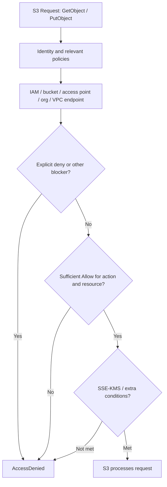
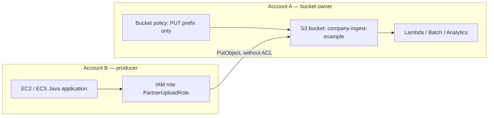
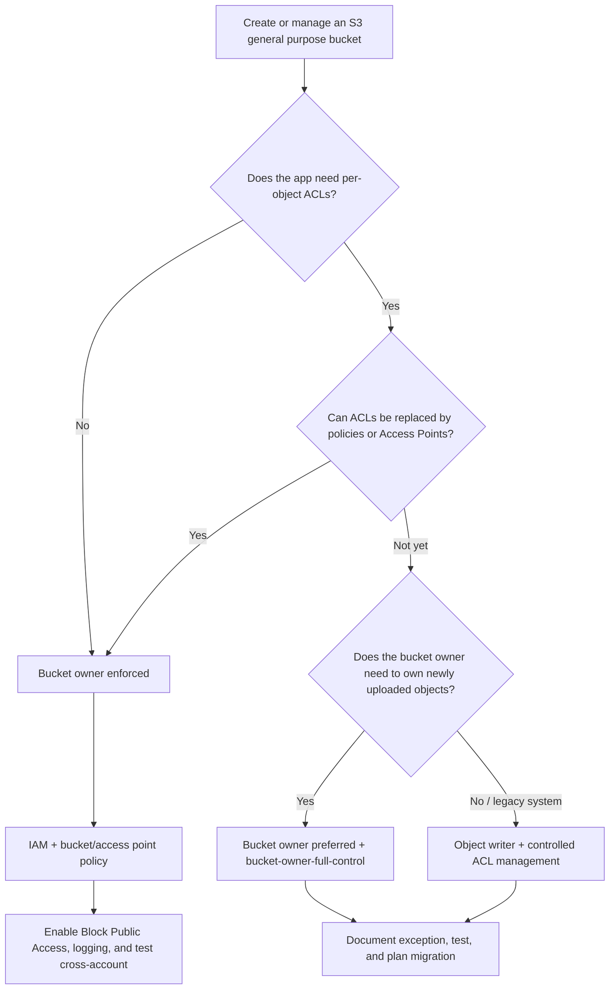

# Object Ownership and ACL Control in Amazon S3

Suppose a data engineering team operates two AWS accounts. Account **A** owns an Amazon S3 bucket used to store records, while account **B** runs a Java application on EC2 to upload files. The application writes objects successfully, yet the operations team in account A cannot read some of the objects uploaded by B. The root cause may lie in **object ownership** and the legacy S3 **Access Control List (ACL)** model.

In modern S3, AWS recommends **S3 Object Ownership: Bucket owner enforced**—the bucket owner owns every object, ACLs are disabled, and access is managed exclusively through **IAM policies, bucket policies**, and related controls. Two other modes still exist to support special cases or legacy systems.

This lesson belongs to the **S3 Object Storage** chapter of the **CLOUD_PROVIDERS_AWS** module. Learners will connect concepts across AWS accounts, IAM, EC2/Lambda applications, VPC endpoints, monitoring, and cost control to deploy S3 securely, governably, auditably, and resiliently.

> **Scope:** Main examples use **S3 general purpose buckets**. **S3 directory buckets** for S3 Express One Zone have differences: they only use Bucket owner enforced and do not support ACLs or Object Ownership management APIs like general purpose buckets. Always check the bucket type and APIs you are using.

## 1. Learning Objectives

After this lesson, you will be able to:

1. Distinguish between **bucket owner**, **object owner**, ACLs, and **Object Ownership**.
2. Accurately explain the three modes: **Bucket owner enforced**, **Bucket owner preferred**, and **Object writer**.
3. Know which uploads are accepted when ACLs are disabled; recognize the `AccessControlListNotSupported` error.
4. Design authorization using **IAM policies**, **bucket policies**, **Block Public Access**, and **S3 Access Points** where appropriate.
5. Design **cross-account** uploads where the bucket owner retains full management control over the data.
6. Migrate legacy ACL-dependent buckets to a policy-based model through a verified workflow.
7. Inspect configurations via the AWS CLI, Java SDK, and CloudTrail, and troubleshoot access permission errors.

## 2. Why Does S3 Have an Object Ownership Problem?

S3 stores data as **objects** inside **buckets**. An object typically has a **key**, data (body), metadata, encryption attributes, and optionally multiple versions when S3 Versioning is enabled. A bucket is created and owned by an AWS account; in legacy ACL-enabled configurations, **an object could be owned by a different account than the bucket owner**.

Example:

| Resource | Principal / Account | Role |
|---|---|---|
| Bucket `company-ingest-example` | Account A | Manages the bucket, bucket policy, and bucket settings |
| EC2/Lambda using IAM role `UploadRole` | Account B | Sends `PutObject` requests to A's bucket |
| Object `inbound/report.csv` | Depends on Object Ownership | Could be owned by bucket owner A or object writer B |
| IAM and bucket policies | Both involved accounts | Determine which requests are allowed under authentication/authorization rules |
| KMS key (if SSE-KMS) | Key-owning account | Determines permission to use the encryption key, in addition to S3 permissions |

**Object ownership and object access permissions are related but distinct concepts.** An account owning an object can still be restricted from an action by relevant policy layers. Conversely, an IAM principal can access an object if appropriate policies allow it, even when that principal is not the owner.

### 2.1. Before Bucket Owner Enforced

Under the `Object writer` model, if account B uploads an object into A's bucket, **B is typically the object owner**. Bucket owner A can manage many bucket settings, yet **A's bucket policy does not automatically grant A all permissions over objects owned by B**. If access relied on object ACLs, A had to be explicitly granted access or the ingestion mechanism had to change.

This caused the classic scenario where "the bucket administrator can see the bucket but cannot open an object just uploaded by a partner account."

### 2.2. The Current Landscape

**Default for new S3 general purpose buckets:** AWS uses **Bucket owner enforced**; ACLs are disabled. Since April 2023, AWS also enables **S3 Block Public Access** by default on new buckets. These two mechanisms are independent in purpose and can be inspected separately.

AWS recommends **keeping ACLs disabled** for most workloads, unifying access governance through policies rather than coordinating per-object ACLs. [Source: S3 Object Ownership](https://docs.aws.amazon.com/AmazonS3/latest/userguide/about-object-ownership.html).

## 3. What Is an ACL and What Permissions Can It Grant?

An S3 **ACL (Access Control List)** is a list of *grants* attached to a bucket or object. Each grant specifies a **grantee** (an AWS account or a predefined group) and a permission. ACLs are a historical mechanism with far less expressive power than IAM or bucket policies.

### 3.1. Basic ACL Permissions

| ACL Permission | On a Bucket | On an Object |
|---|---|---|
| `READ` | List objects per applicable ACL behavior | Read allowed object data/metadata |
| `WRITE` | Create, overwrite, and delete objects per bucket ACL scope | Does not apply with the same semantics as on a bucket |
| `READ_ACP` | Read the bucket ACL | Read the object ACL |
| `WRITE_ACP` | Write/modify the bucket ACL | Write/modify the object ACL |
| `FULL_CONTROL` | Includes the applicable ACL permissions | Includes the applicable ACL permissions |

These ACL permissions **do not map cleanly one-to-one** to all IAM actions. For example, `s3:ListBucket` applies to the bucket resource, whereas `s3:GetObject` applies to an object ARN. An ACL cannot express fine-grained conditions like prefix restrictions, TLS, object tags, principals, or network endpoints with the precision of policies.

### 3.2. Canned ACLs: Predefined Permission Sets

AWS supports several *canned ACLs* commonly found in legacy applications:

| Canned ACL | Meaning When ACLs Are Enabled | Security Notes |
|---|---|---|
| `private` | Only the owner has full ACL control by default | Does not replace IAM policies |
| `public-read` | Grants public read access via ACL mechanism | Avoid for private data; Block Public Access may block it |
| `public-read-write` | Grants public read/write access within applicable scope | High risk; should not be used |
| `authenticated-read` | Grants read to any authenticated AWS account per ACL model | **Does not mean** your app's safely logged-in users |
| `bucket-owner-read` | Allows the bucket owner to read an object owned by another account | Not full control |
| `bucket-owner-full-control` | Grants ACL full control to the bucket owner | Plays a special role in Bucket owner preferred mode |

When per-object ACL granularity is not required, the **IAM/bucket policy** model is easier to audit, standardize, and change safely.

### 3.3. Bucket and Object ACLs Do Not Automatically Inherit

A bucket ACL and an object ACL are two separate resources. Adding a grantee to a bucket ACL **does not mean every object inside has an ACL letting that grantee read it**. This is why legacy systems became confusing when multiple accounts wrote objects.

When **ACLs are disabled**, grants no longer affect data access decisions. Access is governed strictly by policies.

[Source: AWS — ACL overview](https://docs.aws.amazon.com/AmazonS3/latest/userguide/acl-overview.html).

## 4. The Three S3 Object Ownership Modes

**S3 Object Ownership** is a **bucket-level** setting that controls how object owners are determined and whether ACLs are enabled or disabled.

| Mode | ACLs | New Objects Uploaded by Another Account | Existing Objects | When to Consider |
|---|---|---|---|---|
| **Bucket owner enforced** | **Disabled** | Bucket owner owns and has full control | Bucket owner owns and has full control over all objects/versions | **Recommended default** for most workloads |
| **Bucket owner preferred** | Enabled | Bucket owner owns **if uploaded with `bucket-owner-full-control`**; otherwise the writer owns | Switching to this mode does not automatically transfer ownership of existing objects | Legacy systems that still need ACLs and actively enforce the canned ACL on uploads |
| **Object writer** | Enabled | Uploading account owns the object and has full control | Depends on historical ownership/ACLs | Legacy systems that must preserve writer ownership or per-object ACLs |

### 4.1. Bucket Owner Enforced — The Default Choice

When enabled:

- **The bucket owner owns all objects in the bucket**, including pre-existing objects and object versions.
- **ACLs are no longer used to allow or deny access**, even though prior ACL metadata may remain stored.
- **Read-ACL APIs** remain supported and typically show the bucket owner having full control.
- Requests to **create or modify ACLs** are rejected with `AccessControlListNotSupported`.
- `PutObject` is accepted if **no ACL is sent** or if the `bucket-owner-full-control` canned ACL (or equivalent supported header form) is sent; other ACLs are rejected.
- **No new object version is created** solely by switching to Bucket owner enforced.

**Important:** if a client still sends `--acl public-read` or header `x-amz-acl: private`, the upload will fail even if the bucket is private and the principal has `s3:PutObject`. Therefore, **remove ACL configurations from SDKs, CLIs, and pipelines** when using this mode.

### 4.2. Bucket Owner Preferred — Conditional ACL Retention

In this mode, ACLs remain enabled. If account B uploads an object to account A's bucket with `bucket-owner-full-control`, **A becomes the owner of the new object**. If B does not include that ACL, **B remains the object owner**.

Example:

| Request from Account B | Object Owner Under Bucket Owner Preferred |
|---|---|
| Upload without ACL | **B** |
| Upload with `bucket-owner-full-control` | **A** |
| Upload with `private` or another accepted ACL | Typically **B**, depending on configuration semantics and permissions |

If you must keep this mode for legacy workflows, AWS recommends using a **bucket policy requiring `bucket-owner-full-control`** on relevant uploads. However, that means every client must pass the ACL header and hold the corresponding permissions. **Do not pick Bucket owner preferred thinking it always makes the bucket owner the object owner.**

### 4.3. Object Writer — Writer-Owned Objects

In `Object writer` mode, the AWS account that writes the object owns it. The bucket owner can run into access issues on objects owned by other accounts. Sharing requires proper ACL configuration or changing the architecture/ownership mode.

This model may be needed for legacy integrations that cannot be changed immediately, but you should document the exception rationale, owner, and migration plan.

### 4.4. When Switching Modes Back

If you enable **Bucket owner enforced** and later **re-enable ACLs**, old object ACLs (that existed before disabling) can take effect again if they were not replaced with equivalent policies. Objects created **while Bucket owner enforced was active** remain owned by the bucket owner.

**Re-enabling ACLs is not a harmless rollback**: legacy permissions, object owners, and objects created after the switch can end up in mixed states. Evaluate everything thoroughly before changing modes.

[Source: AWS — Object Ownership settings](https://docs.aws.amazon.com/AmazonS3/latest/userguide/about-object-ownership.html).

## 5. How Does S3 Decide Access When ACLs Are Disabled?

When using **Bucket owner enforced**, access operations are evaluated via **AWS IAM, bucket policies, access point policies**, other constraining policies, and service rules. Disabling ACLs **does not make the bucket allow everyone to read**.



*Diagram summarizes evaluation checks and does not replace the full IAM evaluation algorithm. Permissions are evaluated differently depending on principal, same-account vs. cross-account relationship, resource policies, AWS Organizations, access points, and encryption services.*

### 5.1. IAM Policy vs. Bucket Policy

| Mechanism | Attached Where? | Example |
|---|---|---|
| **IAM identity-based policy** | AWS account role/user/group | Allows an application role to call `s3:PutObject` on prefix `inbound/*` |
| **Bucket policy** | S3 bucket; resource-based | Allows a partner account role to upload to a restricted prefix |
| **S3 Access Point policy** | S3 Access Point | Grants access via an application-specific endpoint |
| **SCP / RCP / permissions boundary / session policy** | Governance layer, permission boundary, or session | Limits effective permissions even if an IAM policy grants Allow |
| **VPC endpoint policy** | S3 VPC endpoint when traffic traverses the endpoint | Adds network-path control for requests from private networks |
| **KMS key policy / grants** | KMS key if using SSE-KMS | Allows the principal to use the key for encrypted PUT/GET calls |

**Do not use `s3:PutObjectAcl` as a way to grant object read/write access when ACLs are disabled.** With Bucket owner enforced, data permissions normally rely on `s3:GetObject`, `s3:PutObject`, `s3:DeleteObject`, `s3:ListBucket`, and related actions depending on the use case.

### 5.2. Distinguishing Resource ARNs

Two common ARN formats:

```text
Bucket ARN: arn:aws:s3:::company-ingest-example
Object ARN: arn:aws:s3:::company-ingest-example/inbound/*
```

- `s3:ListBucket` applies to the **bucket ARN**.
- `s3:GetObject`, `s3:PutObject`, and most object-data operations apply to **object ARNs**.
- To restrict uploads strictly to `inbound/*`, the policy must specify that exact object prefix.
- If APIs use an S3 Access Point, the ARNs and policy evaluation differ; verify the endpoint and ARN in use.

### 5.3. Explicit Deny and Constraint Layers

Even when an IAM role has `Allow` for `s3:GetObject`, access can still be denied by:

- An explicit `Deny` in a bucket or access point policy.
- An organizational SCP or resource control policy where applicable.
- A permissions boundary or session policy.
- A VPC endpoint policy when traffic routes through that endpoint.
- Conditions in the bucket policy: TLS, `SourceVpce`, principal ARN, encryption, tags, etc.
- Missing permissions on the **AWS KMS key** when SSE-KMS is used.
- S3 Block Public Access if the request relies on public access.
- Special requirements such as Object Lock, version IDs, requester pays, or other features.

Thus, **Object Ownership solves ownership**, not every `AccessDenied`.

## 6. Bucket Owner Enforced and S3 Block Public Access

These are two **distinct** mechanisms that are commonly combined:

| Mechanism | Purpose | Blocks Public Object ACLs? | Grants IAM Permissions Itself? |
|---|---|---|---|
| **Object Ownership: Bucket owner enforced** | Bucket owner owns all objects; ACLs disabled | **Yes**, ACL creation/modification requests are rejected | No |
| **S3 Block Public Access (BPA)** | Reduces risk of public access via ACLs/policies per configured flags and scope | Has options to block public ACLs | No |
| **IAM / bucket policy** | Defines specific access permissions | Can allow/deny requests per policy logic | Serves as the authorization mechanism |

**Recommended default:** keep **Bucket owner enforced**, enable **Block Public Access** per corporate policy, and use private access via IAM and bucket/access point policies. For serving web content, consider **CloudFront Origin Access Control (OAC)** or presigned URLs as needed instead of attaching a `public-read` ACL.

**Directory buckets:** S3 Express One Zone directory buckets use `Bucket owner enforced` and do not support ACLs; BPA options also differ and are applied according to directory bucket design. Do not run `get-bucket-ownership-controls` against a directory bucket as if it were a general purpose bucket.

[Source: AWS — Block Public Access](https://docs.aws.amazon.com/AmazonS3/latest/userguide/access-control-block-public-access.html); [Working with directory buckets](https://docs.aws.amazon.com/AmazonS3/latest/userguide/directory-buckets-overview.html).

## 7. Designing Secure Cross-Account Uploads

Suppose:

- **Account A**: bucket `company-ingest-example`, Object Ownership = `BucketOwnerEnforced`.
- **Account B**: Java application on EC2 or ECS using IAM role `PartnerUploadRole`.
- Requirement: allow B only to **upload** objects under prefix `inbound/partner-b/`.
- After upload, account A must read, process via Lambda, back up, and manage data lifecycle.



### 7.1. Bucket Policy on Account A

**Illustrative** bucket policy allowing only the specified IAM role in account B to write to the designated prefix:

```json
{
  "Version": "2012-10-17",
  "Statement": [
    {
      "Sid": "AllowPartnerBUploadOnly",
      "Effect": "Allow",
      "Principal": {
        "AWS": "arn:aws:iam::222222222222:role/PartnerUploadRole"
      },
      "Action": "s3:PutObject",
      "Resource": "arn:aws:s3:::company-ingest-example/inbound/partner-b/*"
    }
  ]
}
```

**Replace** account IDs, role ARNs, bucket names, and prefixes for your real environment. Never copy an example policy into production without proper authorization and reviewing all existing statements. This illustrative policy grants only `PutObject`—not `GetObject`, `DeleteObject`, or `ListBucket`—to the role.

### 7.2. IAM Identity Policy for Role B

In a **cross-account** setup, team B must also grant matching permissions to the active principal. Minimal IAM identity policy sample:

```json
{
  "Version": "2012-10-17",
  "Statement": [
    {
      "Sid": "PutOnlyToAgreedPrefix",
      "Effect": "Allow",
      "Action": "s3:PutObject",
      "Resource": "arn:aws:s3:::company-ingest-example/inbound/partner-b/*"
    }
  ]
}
```

Role B must be assumed by EC2/ECS/Lambda through the appropriate trust mechanism; additional permissions may be needed for **multipart uploads**, tags, KMS, or other features used by the app. Explicit denies in organizational/other policies can still cause requests to fail.

**Do not add `s3:PutObjectAcl` or send the `x-amz-acl: public-read` header** when the bucket uses Bucket owner enforced.

### 7.3. Upload Flow

1. The Java service in account B obtains temporary credentials from its IAM role.
2. The application calls `PutObject` to `s3://company-ingest-example/inbound/partner-b/report.csv`, **with no ACL**.
3. S3 evaluates IAM and bucket policies along with any relevant network/KMS conditions.
4. If valid, the object is written; **account A is the owner**.
5. Account A's applications process events or read the object under A's own permissions.
6. If B needs to read back after uploading, A explicitly grants `s3:GetObject` via an appropriate policy; **B does not automatically retain full permissions merely because it uploaded the object**.

**Do not confuse ownership with encryption:** with **SSE-KMS using customer-managed keys**, KMS key policies/grants must permit the relevant principals to perform their actions. An upload succeeding while a subsequent `GetObject` fails can be a KMS issue.

### 7.4. AWS SDK for Java v2: Uploading Without ACLs

Example using `software.amazon.awssdk:s3` from the AWS SDK for Java v2:

```java
import java.nio.file.Path;
import software.amazon.awssdk.auth.credentials.DefaultCredentialsProvider;
import software.amazon.awssdk.core.sync.RequestBody;
import software.amazon.awssdk.regions.Region;
import software.amazon.awssdk.services.s3.S3Client;
import software.amazon.awssdk.services.s3.model.PutObjectRequest;

public class UploadReport {
    public static void main(String[] args) {
        String bucket = "company-ingest-example";
        String key = "inbound/partner-b/report.csv";
        Path file = Path.of("report.csv");

        try (S3Client s3 = S3Client.builder()
                .region(Region.AP_SOUTHEAST_1)
                .credentialsProvider(DefaultCredentialsProvider.create())
                .build()) {

            PutObjectRequest request = PutObjectRequest.builder()
                    .bucket(bucket)
                    .key(key)
                    .contentType("text/csv")
                    // Do not call .acl(...)
                    .build();

            s3.putObject(request, RequestBody.fromFile(file));
            System.out.println("Upload completed");
        }
    }
}
```

Running this requires a real file, Maven/Gradle dependency setup, a valid bucket/Region, and appropriate IAM credentials. **This is a business-logic example; no commands are executed against an AWS account in this lesson.** Production code must also include exception handling, idempotent retries, checksums, metrics, input validation, secret management, and policy-compliant encryption settings.

### 7.5. If a Legacy Application Must Send an ACL

Under `BucketOwnerEnforced`, **`bucket-owner-full-control` is a compatible canned ACL** accepted by S3 on PUT, even though ACLs are no longer used for authorization. This allows certain legacy clients to keep uploading during a transition period.

However, the better solution for new code is to **remove the ACL requirement altogether**. Do not treat this compatibility exception as an excuse to keep adding ACLs to every SDK request.

## 8. When Is Bucket Owner Preferred Still Needed?

A legacy workflow may require ACLs because an application or integration cannot yet be modified. **Bucket owner preferred** serves as a transitional option if the organization still needs object ACLs for specific objects.

### 8.1. Conditions to Avoid Writer Ownership

When using Bucket owner preferred, for account A to own new objects uploaded by B, you need:

1. Bucket configured as `BucketOwnerPreferred`.
2. Uploads from B include the `bucket-owner-full-control` canned ACL.
3. A bucket policy requiring B's uploads to specify this ACL.
4. B's IAM role granted required upload permissions plus `s3:PutObjectAcl` if the request sets an ACL.
5. Test uploading from B and verify owner/ACL; test that uploads missing the header are denied per policy.

### 8.2. Illustrative Policy to Enforce the Header When ACLs Are Mandatory

Example **explicitly denying** uploads from role B **if the expected canned ACL is missing or incorrect**:

```json
{
  "Version": "2012-10-17",
  "Statement": [
    {
      "Sid": "DenyPartnerUploadWithoutOwnerFullControlAcl",
      "Effect": "Deny",
      "Principal": {
        "AWS": "arn:aws:iam::222222222222:role/PartnerUploadRole"
      },
      "Action": "s3:PutObject",
      "Resource": "arn:aws:s3:::company-ingest-example/inbound/partner-b/*",
      "Condition": {
        "StringNotEquals": {
          "s3:x-amz-acl": "bucket-owner-full-control"
        }
      }
    }
  ]
}
```

**This is a supplementary statement**, not a full deployment policy. It must be paired with an appropriate `PutObject` **Allow** mechanism. Use it only when the bucket is configured as **Bucket owner preferred** and there is an explicit business need for ACLs; **do not add this condition to a new Bucket owner enforced bucket**, as it forces clients to pass an unnecessary ACL header.

Common pitfall: `BucketOwnerPreferred` **does not automatically enforce** `bucket-owner-full-control`; a writer omitting the header can still become the object owner unless the bucket policy blocks it. [AWS — Enforce object ownership](https://docs.aws.amazon.com/AmazonS3/latest/userguide/ensure-object-ownership.html).

## 9. Preparing to Migrate Legacy Buckets to Bucket Owner Enforced

When an older bucket has ACLs enabled, **do not switch it immediately in production without investigation**: disabling ACLs renders permissions granted solely via ACLs **ineffective**. A safe workflow covers inventory, migrating permissions to policies, testing, and monitoring.

### 9.1. Step 1 — Inventory and Identify Owners

Collect:

- Current Object Ownership setting of the bucket.
- Bucket ACL and any grants given to external accounts or predefined groups.
- Object ACLs with special grants, such as partner-uploaded objects.
- Applications, Lambdas, ETL jobs, logging services, CloudFront distributions, or backup tools accessing the bucket.
- Whether upload clients send `x-amz-acl` or grant headers.
- Existing IAM/bucket policies; identify any policy relying on the `s3:x-amz-acl` condition.
- SSE-KMS, Object Lock, replication, logging, and data lifecycle settings.

**S3 server access logs and CloudTrail include an `aclRequired` field** to help spot requests that relied on an ACL for authorization. For certain requests, this field may be absent or carry special values depending on the log source. Do not conclude "zero ACL dependency" just because one day of logs lacked this field; inspect a representative timeframe and verify which logging mechanisms are enabled.

### 9.2. Step 2 — Migrate Permissions Off ACLs

If the bucket ACL grants `READ` or `WRITE` to an external account, you must **migrate those permissions to an appropriate bucket/access policy** and **reset the bucket ACL to private** before applying Bucket owner enforced. Otherwise, S3 may reject the change with `InvalidBucketAclWithObjectOwnership`.

At the same time:

- Inventory **object ACLs** granting access to users or services; migrate necessary permissions to IAM/bucket/access point policies before disabling ACLs.
- Remove client logic passing `public-read`, `private`, or unsupported ACL grants.
- Test cross-account uploads via SDK/CLI with no ACL or with `bucket-owner-full-control` during compatibility transitions.
- Replace log-delivery grants using the **S3 Log Delivery group ACL** with **service-principal bucket policies** per AWS guidance where applicable.
- Verify that consumers relying on historical object ownership or ACL permissions continue to operate.

**Caution:** AWS advises **against bulk-deleting legacy object ACLs** during migration. They may be needed by applications if ACLs are ever re-enabled; instead, create equivalent policies and plan the lifecycle of legacy permissions. The goal is ensuring no active access path depends on ACLs in the new state.

[Source: AWS — Prerequisites for disabling ACLs](https://docs.aws.amazon.com/AmazonS3/latest/userguide/object-ownership-migrating-acls-prerequisites.html).

### 9.3. Step 3 — Test Before Changing

Use a staging environment with comparable characteristics and validate a test matrix:

| Case | Expected Outcome After Transition |
|---|---|
| Account A reads legacy objects uploaded by B | Works via policies; bucket owner holds full ownership |
| Account B uploads without an ACL | Succeeds if IAM/bucket policy/KMS permit |
| Account B uploads with `bucket-owner-full-control` | Accepted if relevant permissions and conditions are met |
| Account B uploads with `public-read` | Fails with `AccessControlListNotSupported` |
| Read access previously granted only by object ACL | Must be migrated to policy if still needed |
| Services delivering access logs to the bucket | Works via appropriate service principal policy |
| Upload/GET using SSE-KMS | KMS permissions valid in both required directions |
| Replication workflows | Verify ownership behavior, permissions, and replicated data |
| IaC/pipelines modifying ACLs | No longer call `PutObjectAcl`/`PutBucketAcl` under the disabled model |

### 9.4. Step 4 — Controlled Rollout

Once approved by the bucket owner and with a rollback plan ready:

1. Migrate required grants from bucket ACLs and object ACLs into policies.
2. Test cross-account flows, logging delivery services, and active bucket consumers.
3. Reset the bucket ACL to private if needed.
4. Apply `BucketOwnerEnforced` via Console, API, or IaC.
5. Confirm `get-bucket-ownership-controls` returns the expected mode.
6. Verify active read/write workloads and monitor 4xx/`AccessDenied` metrics.
7. Monitor across a full workload cycle; update runbooks, IaC, and organizational policies.

**Note:** changing configuration is a **write** operation that can impact production. The write commands shown below are for administrator-authorized environments, not untested instructions for live production accounts.

## 10. AWS CLI: Inspecting and Configuring Object Ownership

### 10.1. Read-Only Commands

Example—replace `company-ingest-example`, Region, and profile according to your authorized environment:

```bash
# Inspect Object Ownership (general purpose bucket)
aws s3api get-bucket-ownership-controls \
  --bucket company-ingest-example \
  --profile learning

# Inspect bucket ACL (reading ACLs remains supported under BucketOwnerEnforced)
aws s3api get-bucket-acl \
  --bucket company-ingest-example \
  --profile learning

# Inspect an object ACL, if authorized
aws s3api get-object-acl \
  --bucket company-ingest-example \
  --key inbound/partner-b/report.csv \
  --profile learning

# Inspect Block Public Access configuration
aws s3api get-public-access-block \
  --bucket company-ingest-example \
  --profile learning

# Check whether the bucket is considered public by policy
aws s3api get-bucket-policy-status \
  --bucket company-ingest-example \
  --profile learning
```

**IAM permissions:** `s3:GetBucketOwnershipControls` is needed to read ownership settings; the remaining commands need their respective read permissions. Receiving `AccessDenied` may mean missing read permissions rather than a broken bucket configuration.

Very old buckets may lack an OwnershipControls record if never configured; **do not infer state from a single empty or error response**. Check history and actual ACL/ownership state before making changes.

### 10.2. Configuration Commands (Illustrative Only)

After migrating permissions and holding `s3:PutBucketOwnershipControls`:

```bash
# Run only on a bucket that has passed testing/change-control review
aws s3api put-bucket-ownership-controls \
  --bucket company-ingest-example \
  --ownership-controls 'Rules=[{ObjectOwnership=BucketOwnerEnforced}]' \
  --profile admin-approved

# Read back the result
aws s3api get-bucket-ownership-controls \
  --bucket company-ingest-example \
  --profile admin-approved
```

If the bucket ACL still contains non-default grants, reset it to private beforehand using the command below **only after permissions have been successfully migrated**:

```bash
# Impacts bucket permissions; do not run before migrating and testing
aws s3api put-bucket-acl \
  --bucket company-ingest-example \
  --acl private \
  --profile admin-approved
```

Across PowerShell, macOS/Linux, or different CI pipelines, adjust CLI quoting as needed. Manage changes through **peer-reviewed IaC** rather than making manual edits that Terraform or CloudFormation might later overwrite.

### 10.3. Outcome Table When ACLs Are Disabled

| Operation | Expected Result (With Valid API Permissions) |
|---|---|
| `PutObject` **without ACL** | Accepted |
| `PutObject` with `bucket-owner-full-control` | Accepted as a supported compatibility case |
| `PutObject` with `public-read` | **400 AccessControlListNotSupported** |
| `PutObject` with `private` | **400 AccessControlListNotSupported** |
| `PutObjectAcl` to modify an existing ACL | **AccessControlListNotSupported** |
| `GetObjectAcl` | Readable; typically shows bucket owner with full control |
| `GetObject`/`DeleteObject` | Evaluated by policies and conditions, not ACLs |
| `PutBucketAcl` to edit ACLs | Not supported when ACLs are disabled |
| `PutBucketOwnershipControls` | Requires administrative permissions and valid preconditions |

[Source: AWS — Object Ownership troubleshooting](https://docs.aws.amazon.com/AmazonS3/latest/userguide/object-ownership-error-responses.html).

## 11. Recognizing Common Errors

### 11.1. `AccessControlListNotSupported`

**Symptom:** SDK/CLI fails when uploading or modifying ACLs. Example:

```text
An error occurred (AccessControlListNotSupported)
when calling the PutObject operation:
The bucket does not allow ACLs
```

**Common cause:** the bucket is set to `BucketOwnerEnforced`, while the client sends `--acl public-read`, `--acl private`, grant headers, or calls `PutObjectAcl`.

**Remediation:** remove ACL fields/headers from SDK calls, upload tools, CI/CD scripts, or IaC. For certain legacy clients, `bucket-owner-full-control` can serve as a transitional compatibility option on PUT, though not for new designs. If errors persist, check IAM/bucket/KMS policies and the actual request.

### 11.2. `InvalidBucketAclWithObjectOwnership`

**Symptom:** switching a bucket to `BucketOwnerEnforced` fails.

**Common cause:** the bucket ACL still contains non-default grants to external accounts or predefined groups.

**Remediation:** inventory grants, migrate them to a bucket policy, reset the bucket ACL to `private`, and retry. **Never delete grants before migrating permissions** if applications still depend on them.

### 11.3. `AccessDenied` When Reading Objects

Possible causes include:

- Principal lacks `s3:GetObject`.
- Bucket policy has an explicit deny or lacks a cross-account allow.
- SSE-KMS key denies decryption.
- VPC endpoint policy or SCP/RCP restricts the request.
- Object version, lock, requester-pays, or policy condition mismatch.
- If the bucket still uses `Object writer` or `Bucket owner preferred`, the object may be owned by another account, and a bucket policy alone cannot grant access to that object.

**Troubleshooting workflow:** verify caller via `sts:GetCallerIdentity` → check bucket Object Ownership → inspect IAM/bucket/access point policies → check KMS/network/organization layers → examine CloudTrail and server access logs per observability setup.

### 11.4. Errors After Re-Enabling ACLs

When ACLs are re-enabled, legacy grants can take effect again. Systems that worked via policies while enforced may hit ownership constraints on older objects. Audit object owners, historical ACLs, policies, and cross-account jobs. Never judge a rollback solely by a single new upload test.

### 11.5. Public Read Fails

If an application attempts to use `public-read` and fails, **do not immediately disable Block Public Access to force it through**. Validate the business requirement and consider a private bucket + CloudFront OAC or time-limited presigned URLs. If truly public content is required, design explicit bucket/resource policies and evaluate Block Public Access levels with security approval.

## 12. Object Ownership in Application Design and AWS Integrations

### 12.1. Java EC2/ECS/Lambda Data Uploads

With Bucket owner enforced:

- Use IAM roles instead of long-lived access keys.
- Never call `PutObjectAcl` or set canned ACLs unnecessarily.
- Scope `s3:PutObject` by bucket/prefix with minimal additional actions.
- If using a VPC endpoint, inspect the endpoint policy; for an S3 gateway endpoint, configure route tables properly.
- Enable logging, metrics, and error handling that distinguish 403 from 400 errors.
- If using SSE-KMS, grant required KMS permissions; for cross-account scenarios, align key policies for both writers and readers.

### 12.2. S3 Events → Lambda / EventBridge / SQS

Uploads can trigger event notifications for downstream processing. **Event delivery and object access permissions are independent**: a Lambda receiving an event does not automatically gain `s3:GetObject` or `kms:Decrypt`. With Bucket owner enforced, the bucket owner can apply uniform read policies regardless of which account uploaded the object.

Applications must still implement **idempotency** (duplicate event handling), retries, dead-letter handling where appropriate, and prefix-scoped permissions. Object Ownership does not replace event-processing logic.

### 12.3. CloudFront and Content Delivery

For static assets or private downloads, the modern pattern is typically:

- Private S3 bucket with **Bucket owner enforced**.
- **CloudFront Origin Access Control (OAC)** so CloudFront reads from the origin via a scoped bucket policy.
- When user-specific authorization is needed, use signed URLs/cookies or application-level authentication.
- Never grant `AllUsers READ` via ACL just so a CDN can fetch content.

Also verify encryption, cache behaviors, and origin access policies aligned with your architecture.

### 12.4. Cross-Region Replication (CRR) and Same-Region Replication (SRR)

When data is replicated to another bucket, **replica** ownership and ACLs follow rules based on the replication configuration, destination Object Ownership mode, and ownership override options. With **destination Bucket owner enforced**, ownership at the destination is standardized to the destination bucket owner; check the replication IAM role, KMS key permissions, and data requirements.

**Do not treat Object Ownership as a backup or recovery tool.** Replication can replicate modifications or deletions as configured; combine **S3 Versioning, Object Lock**, backups, restore testing, and retention rules when data protection is required.

## 13. Auditing and Monitoring Object Ownership

### 13.1. What Should Be Tracked?

| Audit Question | Appropriate Tool / Source |
|---|---|
| Which buckets still have ACLs enabled? | S3 Storage Lens Object Ownership metrics, AWS Config checks/inventory, API inventory |
| Who changed Object Ownership? | CloudTrail management events for configuration management APIs |
| Are any PUT object requests still sending ACLs? | CloudTrail S3 data events (if enabled), server access logs, client logs, `aclRequired` field analysis |
| Are `AccessDenied` / `AccessControlListNotSupported` errors spiking? | CloudWatch/app metrics, S3 request metrics, CloudTrail / S3 server access logs where available |
| Have buckets blocked public access? | `GetPublicAccessBlock`, AWS Config, AWS Organizations controls |
| Are cross-account roles still limited to their assigned prefix? | IAM/bucket policy reviews, Access Analyzer, live tests from the actual role |
| Do any objects require SSE-KMS? | S3 encryption settings, KMS key policies, event/logging checks, and integration tests |

**CloudTrail S3 data events are not enabled by default for every object request.** Configure bucket/prefix scope, cost budgets, and retention according to security needs. CloudTrail management events record configuration changes as supported by the service; application metrics help detect clients failing on ACL uploads.

### 13.2. Periodic Governance Process

- Define a baseline standard for new buckets: `BucketOwnerEnforced` + Block Public Access per policy.
- Review exception buckets still using `BucketOwnerPreferred` or `ObjectWriter`; record justification, owner, and migration deadline.
- Monitor **`s3:PutBucketOwnershipControls`**, **`s3:PutBucketAcl`**, **`s3:PutObjectAcl`**, and changes to bucket/access policies.
- Audit permissions for **least privilege**, eliminating unnecessary broad wildcards.
- Use IaC and policy reviews; consider AWS Organizations SCPs to prevent creating buckets with non-compliant Object Ownership where governance allows.
- Review **retention**, **S3 Lifecycle**, log volume, storage classes, data transfer, replication, and costs.
- Run real access tests from relevant roles after major changes.

## 14. Decision Workflow for Choosing Object Ownership

Use the following questions to decide:



**Practical rule:** start with `BucketOwnerEnforced`. Only consider enabling ACLs after clearly demonstrating that policies cannot meet the use case, and establish a formal exception management process.

### 14.1. Quick Decision Table

| Scenario | Recommended Choice | Rationale |
|---|---|---|
| New bucket for Java API uploads | **Bucket owner enforced** | Unified ownership governance, no ACLs |
| Account B uploads into account A's bucket | **Bucket owner enforced** | A owns the objects; A grants Put to B via policy |
| Legacy integration only supports `bucket-owner-full-control` | Prefer **Bucket owner enforced** if compatible; if other ACLs needed, evaluate **preferred** | Reduces ACL dependency along a roadmap |
| Must retain distinct per-object ACLs | **Bucket owner preferred** or **Object writer** with documented exception | Tied to legacy functionality/ownership not yet replaceable |
| Static site needing a CDN | **Bucket owner enforced + CloudFront OAC** | No `public-read` ACL needed |
| Legacy bucket with many cross-account ACLs | **Phased migration** | Migrate permissions before disabling ACLs |
| S3 Express One Zone directory bucket | **Bucket owner enforced** | ACLs are not supported |

## 15. Hands-On Scenarios

### Exercise A — Three Ownership Modes

Suppose a bucket belongs to account **A**, and a new object is uploaded by account **B** with the headers below. Identify the object owner:

| Mode | B Sends No ACL | B Sends `bucket-owner-full-control` |
|---|---|---|
| **Bucket owner enforced** | **A** | **A** |
| **Bucket owner preferred** | **B** | **A** |
| **Object writer** | **B** | **B** |

**Question:** In which mode will a `PutObject` request with a `public-read` ACL be rejected by S3 because ACLs are unsupported?

**Answer:** `Bucket owner enforced`; the typical error is `AccessControlListNotSupported`. The other two modes enable ACLs, though **Block Public Access** or policies may still block `public-read` uploads.

### Exercise B — Cross-Account Error Analysis

**Context:** Bucket `company-ingest-example` in account A uses `BucketOwnerEnforced`. Role B has `s3:PutObject`, and A's bucket policy allows B to write to the target prefix. A Java SDK upload returns `400 AccessControlListNotSupported`.

**Question:** What should you check first?

**Hint:** Look in the request for `.acl(ObjectCannedACL.PUBLIC_READ)` or `.acl(ObjectCannedACL.PRIVATE)`, `x-amz-acl` headers, and upload wrapper libraries. **Remove the ACL** and retry; avoid changing bucket ownership just to work around a client bug.

### Exercise C — Bucket Owner Preferred, Yet Writer Still Owns the Object

Bucket A uses `BucketOwnerPreferred`. Account B uploads an object with no ACL; A expects to own it.

**Answer:** B must upload with `bucket-owner-full-control`, and this requirement should be enforced with a matching bucket policy. Preferred mode does not automatically transfer ownership if the client omits that canned ACL. Also verify `PutObjectAcl` permission when setting ACLs and test cross-account.

### Exercise D — Migrating a Legacy Bucket

A bucket has:

- A bucket ACL granting `READ` to a partner account.
- Legacy object ACLs granting `READ` to a data analytics account.
- An SDK client sending `public-read`.
- Log delivery relying on a bucket ACL.

**Propose the migration sequence.**

**Hint:**

1. Inventory grants and requests actively relying on ACLs.
2. Design bucket/access policies to replace bucket and object ACL grants that must be retained.
3. Replace log-delivery ACL grants with an appropriate service-principal bucket policy.
4. Remove `public-read` from the SDK upload and retest.
5. Set the bucket ACL to `private` after migrating permissions, then apply Bucket owner enforced.
6. Verify all accounts/consumers, logs, and recovery workflows; do not bulk-delete legacy object ACLs.

### Exercise E — Fixing an IAM Example with the Wrong ARN

Someone wrote:

```json
{
  "Effect": "Allow",
  "Action": ["s3:ListBucket", "s3:GetObject"],
  "Resource": "arn:aws:s3:::company-ingest-example/*"
}
```

**Issue:** `s3:ListBucket` must target the bucket ARN, not an object ARN. Split into two statements or match each action with its proper Resource:

```json
{
  "Version": "2012-10-17",
  "Statement": [
    {
      "Sid": "ListBucket",
      "Effect": "Allow",
      "Action": "s3:ListBucket",
      "Resource": "arn:aws:s3:::company-ingest-example"
    },
    {
      "Sid": "ReadInboundObjects",
      "Effect": "Allow",
      "Action": "s3:GetObject",
      "Resource": "arn:aws:s3:::company-ingest-example/inbound/*"
    }
  ]
}
```

If you need to restrict listed prefixes, add a `s3:prefix` condition compatible with how the application calls the API.

## 16. Self-Check Questions

1. What does S3 Object Ownership control?
2. What is the default Object Ownership mode for new S3 general purpose buckets?
3. How does Bucket owner enforced affect objects previously written by another account?
4. When ACLs are disabled, is `GetObjectAcl` still supported?
5. Will an upload with `--acl private` succeed on an enforced bucket?
6. Why doesn't `BucketOwnerPreferred` guarantee the bucket owner owns every new object?
7. Who owns the object in `ObjectWriter` mode if account B uploads with `bucket-owner-full-control`?
8. How is an IAM role from account B authorized to `PutObject` into account A's bucket?
9. When `GetObject` returns `AccessDenied` despite an IAM role Allow, what other layers must be checked?
10. Why can't Block Public Access and Object Ownership substitute for each other?
11. Before disabling ACLs on an old bucket, what must be done with bucket ACL grants given to external accounts?
12. What typically causes `InvalidBucketAclWithObjectOwnership`?
13. What consequences can occur if ACLs are re-enabled after a period of being enforced?
14. Can CloudTrail management events replace data events when auditing individual uploads?
15. Do directory buckets support Object Ownership settings like general purpose buckets?

**Summary answers:** (1) object ownership and ACL enabled/disabled status; (2) Bucket owner enforced; (3) the bucket owner gains ownership/full control over pre-existing objects and versions; (4) yes; (5) no, except for uploads with no ACL or `bucket-owner-full-control`; (6) the client must pass the matching canned ACL; (7) B; (8) bucket policy + permissions on role B and related policies; (9) explicit deny, SCP, endpoint policy, KMS, resource policy, network, and other conditions; (10) one governs ACLs/ownership, the other blocks public access; (11) migrate grants to policies and set the bucket ACL to private; (12) invalid/non-reset bucket ACL grants; (13) legacy ACLs may regain effect; (14) no; (15) no, directory buckets are always enforced and do not support ACLs.

## 17. Production Readiness Checklist

- [ ] Confirmed **bucket type**: general purpose vs. directory.
- [ ] New buckets default to **Bucket owner enforced**; any ACL exception has documented justification.
- [ ] **Block Public Access** is enabled per organizational standard.
- [ ] Java/SDK/CLI apps do not send unnecessary ACL headers.
- [ ] Cross-account roles are scoped by IAM and bucket policies to exact prefixes.
- [ ] Bucket owner has policy permissions to process objects; other consumers have strictly needed permissions.
- [ ] SSE-KMS key policies and role permissions are tested when encryption is used.
- [ ] `GetObject`, `PutObject`, `ListBucket`, `DeleteObject`, and multipart operations are tested per business workflows.
- [ ] No remaining bucket/object ACL dependencies un-migrated to policies.
- [ ] S3 server access logging / CloudTrail data events are configured appropriately for needs and cost.
- [ ] Alerts exist for API errors and changes to ownership controls or bucket policies.
- [ ] IaC, CI/CD, logging integrations, and CloudFront OAC do not rely on `public-read` ACLs.
- [ ] Backup/versioning/replication/restore plans exist independently of ownership settings.
- [ ] Designated owner, runbooks, and evaluated rollback plan exist before changing Object Ownership.
- [ ] Risks of re-enabling ACLs and reactivating legacy permissions have been reviewed.

## 18. Conclusion

**S3 Object Ownership** clarifies who owns objects and whether **ACLs** are still used to govern permissions. For most modern cloud applications, **Bucket owner enforced** is the simpler and safer choice: the bucket owner owns every object, ACLs are disabled, and permissions are centrally managed through policies.

**Bucket owner preferred** and **Object writer** remain useful for select legacy requirements, but add complexity around ownership and ACLs. When connecting EC2, ECS, Lambda, or data systems across multiple AWS accounts, simultaneously verify **IAM/bucket policies, Block Public Access, encryption/KMS, VPC endpoints, logging**, and consumer permissions.

Mastering the boundaries of **ownership – authorization – public access – encryption** is foundational to designing S3 storage that is secure, auditable, recoverable, and cost-controlled.

### Official AWS Documentation

1. [Controlling ownership of objects and disabling ACLs](https://docs.aws.amazon.com/AmazonS3/latest/userguide/about-object-ownership.html)
2. [ACL overview](https://docs.aws.amazon.com/AmazonS3/latest/userguide/acl-overview.html)
3. [Access management in Amazon S3](https://docs.aws.amazon.com/AmazonS3/latest/userguide/access-management.html)
4. [Bucket policies for Amazon S3](https://docs.aws.amazon.com/AmazonS3/latest/userguide/bucket-policies.html)
5. [Enforcing Object Ownership for new buckets](https://docs.aws.amazon.com/AmazonS3/latest/userguide/ensure-object-ownership.html)
6. [Setting Object Ownership on an existing bucket](https://docs.aws.amazon.com/AmazonS3/latest/userguide/object-ownership-existing-bucket.html)
7. [Prerequisites for disabling ACLs](https://docs.aws.amazon.com/AmazonS3/latest/userguide/object-ownership-migrating-acls-prerequisites.html)
8. [Troubleshooting Object Ownership](https://docs.aws.amazon.com/AmazonS3/latest/userguide/object-ownership-error-responses.html)
9. [S3 Block Public Access](https://docs.aws.amazon.com/AmazonS3/latest/userguide/access-control-block-public-access.html)
10. [Getting started with Amazon S3 CLI](https://docs.aws.amazon.com/AmazonS3/latest/userguide/GettingStartedS3CLI.html)
11. [Working with directory buckets](https://docs.aws.amazon.com/AmazonS3/latest/userguide/directory-buckets-overview.html)
12. [Data protection in Amazon S3](https://docs.aws.amazon.com/AmazonS3/latest/userguide/DataDurability.html)
