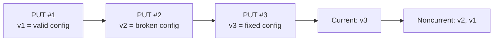
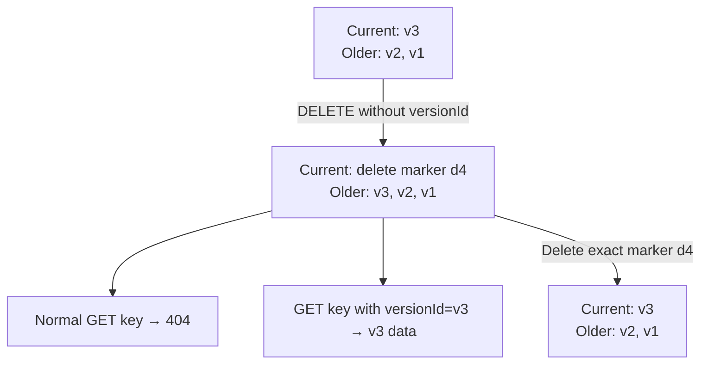

# Versioning, Delete Markers, and Data Protection

**Amazon Simple Storage Service (Amazon S3)** stores data as **objects** inside **buckets**. When an application overwrites an object or a user accidentally deletes one, the data may no longer appear at the original path. **S3 Versioning** retains historical versions so you can recover from operator mistakes, application bugs, or certain security incidents. To use it properly, you must understand the difference between an **object version**, a **delete marker**, and **permanently deleting a version**.

This lesson belongs to the **S3 Object Storage** chapter of the **CLOUD_PROVIDERS_AWS** module. These concepts apply when designing EC2/Lambda applications that upload objects, storing business documents, protecting database exports in S3, integrating backups, configuring IAM/KMS, monitoring recovery, and controlling costs across the AWS ecosystem.

> **Scope:** This lesson covers **S3 general purpose buckets**. S3 **directory buckets** (associated with features such as S3 Express One Zone) do not support S3 Versioning, S3 Object Lock, or S3 Replication within the directory bucket feature set. Verify your bucket type before practicing.

## 1. Learning Objectives

After this lesson, you will be able to:

1. Distinguish the three S3 Versioning states: **Unversioned**, **Enabled**, and **Suspended**.
2. Explain **key**, **version ID**, **current version**, **noncurrent version**, **null version**, and **delete marker**.
3. Predict the outcomes of `PUT`, `GET`, and `DELETE` when a bucket has versioning enabled or suspended.
4. Recover an object after an overwrite or after being hidden by a delete marker, while avoiding accidental deletion of data versions.
5. Use the AWS Console and AWS CLI to check bucket status, list versions, and read older versions.
6. Contrast Versioning protection with **S3 Object Lock**, **MFA Delete**, **Lifecycle**, **Replication**, and independent backups.
7. Design IAM policies, operational procedures, monitoring, and version retention aligned with RPO/RTO.
8. Estimate cost risks from accumulating noncurrent versions and delete markers.

## 2. S3 Objects and Why Versioning Matters

An S3 object consists of a **key** (its logical identifier in the bucket), **data**, and **metadata**. Example:

```text
Bucket: app-documents-example
Key:    invoices/2026/invoice-001.pdf
URI:    s3://app-documents-example/invoices/2026/invoice-001.pdf
```

When versioning is off, uploading a new file to the same key replaces the existing data at that key. When versioning is enabled, S3 writes a **new version with its own version ID**, while preserving older versions.

Invoice system example:

- Day 1: upload `invoice-001.pdf` with valid content.
- Day 2: an application bug overwrites the exact same key with empty content.
- Day 3: operators discover the invoice is unreadable.

With Versioning enabled **before the bug occurred**, the team can locate and restore the Day 1 version, provided that version was not permanently deleted by a policy or another operation.

**Versioning is a recovery layer, not automatically an independent backup.** If someone with elevated privileges permanently deletes all versions or Lifecycle expires them, the data is gone from the bucket. For critical data, consider Object Lock, cross-account/cross-Region replication, and independent backups.

## 3. The Three States of S3 Versioning

S3 Versioning is configured at the **bucket level** and applies to objects within that bucket.

| State | Behavior on `PUT` to Same Key | Behavior on `DELETE` Without Version ID | Recoverability |
| --- | --- | --- | --- |
| **Unversioned** | Current data is replaced by the write operation | Deletes the object; no version history inside the bucket | No Versioning protection |
| **Enabled** | S3 assigns a new version ID; old version becomes noncurrent | S3 inserts a **new delete marker** as the current version | Can recover older versions if retained and permitted |
| **Suspended** | S3 creates or overwrites a **null version**; prior versions with unique IDs remain | S3 may remove an existing null version and place a **null delete marker** | Prior versions with unique IDs remain; null versions can be lost on overwrite |

**Unversioned** is the state of a bucket that has never had Versioning enabled. Once switched to **Enabled** for the first time, a bucket **cannot return to Unversioned**; you can only toggle between **Enabled** and **Suspended**.

### 3.1. Enabled Does Not Duplicate Pre-Existing Objects

Suppose a bucket already contained `reports/summary.csv` before Versioning was enabled. That object has a version ID of `null`. When Versioning is enabled:

- The existing object keeps version ID `null`.
- S3 **does not automatically create an extra version copy** of the old object.
- A subsequent PUT to the same key after Enabled receives a **new version ID**, turning the old `null` object into a noncurrent version accessible by its version ID (`null`).

After **enabling Versioning for the first time**, AWS recommends waiting roughly **15 minutes** for the setting to fully propagate before performing write/delete operations on the bucket. During this transition, GET requests for newly created or updated objects may briefly receive `404 NoSuchKey`.

### 3.2. Suspended Does Not Delete Existing History

Suspending Versioning stops accumulating unique version IDs **for new writes**, without deleting existing version history.

Example:

```text
Before suspending:
  reports/a.json  current: v3
                  older:   v2, v1

After suspending, first PUT:
  reports/a.json  current: null  (new content)
                  older:   v3, v2, v1

After suspending, another PUT to the same key:
  reports/a.json  current: null  (newer content, overwrites prior null)
                  older:   v3, v2, v1
```

Key takeaway: **a `null` version written while Suspended can be permanently overwritten**, because subsequent writes share the same `null` version ID. Do not assume Suspended provides the same recoverability as Enabled.

## 4. Version IDs, Current Versions, and Noncurrent Versions

Every stored object version has an S3-generated **version ID**. When Versioning is enabled, the ID is an opaque string that can contain special characters; do not assume version IDs are timestamps or sequential numbers.

| Concept | Meaning | Example |
| --- | --- | --- |
| **Object key** | Logical name of the object inside the bucket | `contracts/contract.pdf` |
| **Version ID** | Unique identifier for a version (or `null` where applicable) | `3Lg...Qx` |
| **Current version** | Latest version at the key; can also be a delete marker | `v3` |
| **Noncurrent version** | Version that was previously current before being superseded by a newer version or delete marker | `v1`, `v2` |
| **Delete marker** | Special marker version holding no object data; makes the key appear deleted | `d4` |
| **Null version** | Version whose version ID is `null` | Data written before Versioning was enabled, or written while Suspended |

A single key can hold multiple **object versions**. Each object version is billed as a full object copy in S3 storage, **not as a delta/diff between writes**.

### 4.1. Overwrite Timeline

Suppose a bucket is Enabled and stores `settings/app.json`:



After three writes, standard reads target version **v3**, while v1 and v2 still exist unless explicitly deleted. Normal GET/HEAD calls without a version ID operate on the **current version**.

**Do not confuse object bytes with diffs:** for example, overwriting a 100 MiB file three times consumes roughly 300 MiB of version storage (excluding metadata, storage class rules, billing minimums, and other data). A version's billed size does not shrink just because few bytes changed.

## 5. Delete Markers: Why Data Looks Deleted Yet Still Exists

In an **Enabled** bucket, deleting an object **without specifying a version ID** does **not remove the underlying data**. S3 inserts a special marker version called a **delete marker**, which becomes the **current version** of that key.

### 5.1. Soft-Delete Timeline



A **delete marker contains no object payload**. It records a logical deletion state. When the current version is a delete marker:

- `GET` or `HEAD` without `versionId` normally returns `404 Not Found` with header `x-amz-delete-marker: true`.
- `GET` **explicitly specifying the delete marker's version ID** can return `405 Method Not Allowed` with the delete-marker header.
- `GET` with the version ID of an older data version can still retrieve the data if permissions and conditions allow.
- `ListObjectsV2` hides keys whose current version is a delete marker from normal listings; use `ListObjectVersions` to view version history and markers.

**Do not immediately conclude data is lost when an app reports `NoSuchKey`.** First check bucket Versioning, object versions, and delete markers.

### 5.2. Deleting a Marker vs. Deleting an Object Version

| Operation | Result in an Enabled Bucket | Risk Level |
| --- | --- | --- |
| `DELETE key`, omitting `versionId` | Inserts a new delete marker; older data versions remain | Recoverable if older versions still exist |
| `DELETE key?versionId=d4` (`d4` is a **delete marker**) | Removes marker `d4`; the next older version becomes current | Safe way to undo a soft delete once the marker is verified |
| `DELETE key?versionId=v3` (`v3` is a **data version**) | **Permanently deletes** version `v3` without inserting a marker | Cannot be undone via Versioning itself |
| `PUT` same key | Creates a new data version as current | Old markers and versions remain; not automatically purged |

**Critical hazard:** The Console UI includes a **Show versions / List versions** toggle. Deleting a specific version ID is permanent. During recovery, verify whether the selected entry is a **delete marker** or a **data version** before confirming.

### 5.3. Multiple Delete Markers and Repeated Deletes

If an application calls `DELETE` multiple times on the same key in an **Enabled** bucket, S3 inserts **multiple distinct delete markers**. Deleting the current marker exposes the version immediately beneath it; if that version is also a delete marker, the object **still does not appear** to normal GET calls.

To recover accurately, inspect the entire **version history** and identify the target state before deleting any markers.

## 6. Suspended Versioning and `null` Delete Markers

The **Suspended** state follows different rules from Enabled:

1. `PUT` creates a new **`null` version** or overwrites an existing `null` version at the same key.
2. `DELETE` **without a version ID** creates a **`null` delete marker**.
3. If the object currently has a **`null` data version**, S3 removes that `null` data version when inserting the `null` delete marker.
4. Non-`null` versions created while Enabled **are preserved** unless permanently deleted.

Example:

```text
While Enabled:
  invoices/a.pdf: current=v3, noncurrent=v2

Suspend, then PUT:
  invoices/a.pdf: current=null(data), noncurrent=v3,v2

DELETE without versionId:
  invoices/a.pdf: current=null(delete marker), noncurrent=v3,v2
  → null(data) was replaced and can no longer be recovered via Versioning.

GET with versionId=v3:
  can still read v3 if retained and authorized.
```

In a Suspended bucket, you can still call `DELETE` with a real version ID to **permanently delete** a specific version, provided permissions allow and no lock prevents it.

**Recommendation:** Do not use Suspended as a "cost-freeze button" without evaluating your data. It does not remove charges for existing noncurrent versions, can lose overwritten `null` versions, and may conflict with replication, Object Lock, or organizational policies.

## 7. Recovering from Overwrites or Accidental Deletes

There are **two main recovery scenarios**:

- **A delete marker is currently latest:** delete **that specific delete marker** if authorized; the underlying data version reappears as current.
- **A corrupt/bad data version is currently latest:** pick a **good older version** and create a **new current version** from its content, rather than deleting historical versions.

### 7.1. Standard Pre-Recovery Checklist

1. Identify the bucket, key, AWS account, Region, and source of the recovery request.
2. Verify whether the bucket is Enabled or Suspended; inspect **Show versions / `ListObjectVersions`**.
3. Confirm the version ID, last modified time, size, checksum/metadata, and desired payload.
4. Check IAM permissions, encryption (SSE-KMS if applicable), and Object Lock/retention.
5. For critical data, preserve evidence and consider taking a backup/replica before modifying state.
6. Choose the appropriate recovery action and execute within an approved window/environment.
7. Validate content, read permissions, metadata, CDN/caches, and application behavior after recovery.

### 7.2. Case A: Deleting the Exact Delete Marker

Suppose the version history for `reports/monthly.csv` is:

| Type | Version ID (abbreviated example) | Current? |
| --- | --- | --- |
| Delete marker | `d3` | Yes |
| Good object data | `v2` | No |
| Older object data | `v1` | No |

Deleting **delete marker `d3`** promotes `v2` back to current; applications reading the key normally receive `v2` again.

> **Caution:** Deleting a delete marker is still a **version** delete operation and requires `s3:DeleteObjectVersion`. If you accidentally pass `versionId=v2`, you permanently delete the `v2` data. Cross-check `IsLatest` and the `DeleteMarkers` array before executing.

### 7.3. Case B: A Bad Version Is Currently Latest

Suppose `v3` contains bad data and is current, while `v2` holds the good content. Use **S3 Console → Show versions → select `v2` → copy back to the same key** (where supported) or **`GET` version `v2` and `PUT` the verified content back**. Writing/copying to an Enabled bucket creates version `v4` as the new current version.

Flow:

```text
Before recovery:
  current: v3 (bad)
  history: v2 (good), v1

After copying/PUTting v2 as a new version:
  current: v4 (copied from v2)
  history: v3 (bad), v2 (good), v1
```

When copying or downloading/re-uploading, verify **`Content-Type`**, user metadata, tags, encryption, ACL/ownership, checksums, and size; do not assume every attribute of an old version is preserved automatically across all restore methods.

### 7.4. When a Version Was Permanently Deleted

If a data version was deleted via `DELETE` with a `versionId` or removed by Lifecycle `NoncurrentVersionExpiration`, **S3 Versioning inside that bucket cannot recover it**. Only external protection layers still holding the data (backups, replicas, independent exports, or upstream source systems) can restore it.

Therefore, object versions should never be the **sole protection layer** for data with strict audit requirements or low RPO targets.

## 8. AWS Console Guide: Enabling Versioning and Inspecting History

The steps below apply to a **general purpose bucket** under your administration. Console UI labels may vary slightly across Console updates.

### 8.1. Enable S3 Versioning

1. Open the [Amazon S3 Console](https://console.aws.amazon.com/s3/) and select the correct AWS account.
2. Go to **General purpose buckets** and choose the target bucket.
3. Open the **Properties** tab and locate **Bucket Versioning**.
4. Choose **Edit → Enable → Save changes**.
5. Confirm the status displays **Enabled**.
6. When enabling for the first time, follow the recommendation to **wait roughly 15 minutes** before issuing new PUT/DELETE workloads to avoid propagation anomalies.

If the bucket has **S3 Object Lock** enabled, suspending Versioning is prohibited. Never change production bucket settings without evaluating impacts on retention, replication, cost, and applications.

### 8.2. Inspect Object Versions and Delete Markers

1. Open the **Objects** tab inside the bucket.
2. Toggle **Show versions** or **List versions**.
3. Select the key to inspect and view versions and delete markers chronologically.
4. Identify the **current version**, data versions, delete markers, and recovery targets.
5. For existing objects, inspect version IDs and metadata; for hidden objects, look for delete markers in the version listing.

Never run **Delete objects** on historical versions just to "declutter the view"—that can permanently destroy data.

## 9. AWS CLI: Observing Versioning, Versions, and Delete Markers

The `get`, `list`, `head`, `describe`, and `sts get-caller-identity` commands in this section are read-only operations within your authorized scope. Use **AWS CLI v2** and an IAM Identity Center/role profile; replace example bucket names with authorized real names.

```bash
# Verify the active AWS account.
aws sts get-caller-identity --profile training

# Check the versioning state of a general purpose bucket.
aws s3api get-bucket-versioning \
  --bucket my-training-versioned-bucket \
  --profile training

# List all versions and delete markers for a key.
aws s3api list-object-versions \
  --bucket my-training-versioned-bucket \
  --prefix reports/monthly.csv \
  --profile training

# Read metadata of a specific data version.
aws s3api head-object \
  --bucket my-training-versioned-bucket \
  --key reports/monthly.csv \
  --version-id "VERIFIED_VERSION_ID" \
  --profile training

# Download a specific version locally to verify its content.
# Run only on objects containing no secrets and with proper authorization.
aws s3api get-object \
  --bucket my-training-versioned-bucket \
  --key reports/monthly.csv \
  --version-id "VERIFIED_VERSION_ID" \
  --profile training \
  ./monthly-recovered.csv
```

`get-bucket-versioning` may return an **empty object** if Versioning has never been enabled on the bucket; `Status: Enabled` or `Status: Suspended` indicates those respective states. In `list-object-versions` output, distinguish two arrays:

- `Versions`: versions **containing data**, each with `VersionId`, `IsLatest`, and metadata.
- `DeleteMarkers`: **delete marker** entries, also with `VersionId` and `IsLatest`.

**Important:** `--prefix reports/monthly.csv` can also match keys starting with that string, such as `reports/monthly.csv.backup`. Verify the exact `Key` field before acting.

### 9.1. State-Change Commands: Run Only When Authorized

```bash
# MODIFIES BUCKET CONFIG: enable S3 Versioning.
aws s3api put-bucket-versioning \
  --bucket my-training-versioned-bucket \
  --versioning-configuration Status=Enabled \
  --profile training

# MODIFIES BUCKET CONFIG: suspend Versioning.
# Do not run if the bucket uses Object Lock or policies prohibit it.
aws s3api put-bucket-versioning \
  --bucket my-training-versioned-bucket \
  --versioning-configuration Status=Suspended \
  --profile training
```

`Status=Suspended` does not revert the bucket to Unversioned, does not remove existing unique version IDs, and does not protect new writes the way Enabled does.

### 9.2. Deleting a Delete Marker for Recovery — High-Sensitivity Action

After **confirming with certainty** that the target ID is a **delete marker**, the syntax is:

```bash
# EXAMPLE ONLY: substitute the VERSION ID of a verified DELETE MARKER.
# Passing the wrong version ID permanently deletes data instead of recovering it.
aws s3api delete-object \
  --bucket my-training-versioned-bucket \
  --key reports/monthly.csv \
  --version-id "VERIFIED_DELETE_MARKER_VERSION_ID" \
  --profile training

# Re-check version history and current version after the change.
aws s3api list-object-versions \
  --bucket my-training-versioned-bucket \
  --prefix reports/monthly.csv \
  --profile training
```

Do not run this command without data-owner approval and marker verification. In production, enforce peer review (two-person verification) and log the change event.

## 10. IAM: Who Can View Versions, Delete Markers, Delete Versions, and Edit Lifecycle?

**Versioning alone does not stop an authorized principal from permanently deleting data.** IAM and bucket policies should strictly separate day-to-day operations from recovery actions:

| Action | Relevant IAM Permission | Notes |
| --- | --- | --- |
| Read current object | `s3:GetObject` | Does not automatically permit reading historical versions |
| Read specific object version | `s3:GetObjectVersion` | Must also align with bucket policy, SCPs, and KMS if encrypted |
| List versions / delete markers | `s3:ListBucketVersions` | Permission applies to the **bucket** ARN |
| Delete object without version ID | `s3:DeleteObject` | In Enabled state, adds a delete marker |
| Delete a data version **or** delete marker by ID | `s3:DeleteObjectVersion` | Highly sensitive; can cause irreversible deletion |
| Change Versioning state | `s3:PutBucketVersioning` | Restrict to controlled administrative roles |
| Edit Lifecycle | `s3:PutLifecycleConfiguration` | Can cause noncurrent versions to be permanently expired |
| Read Lifecycle | `s3:GetLifecycleConfiguration` | Useful for auditing retention rules |
| Set Object Lock retention/hold | `s3:PutObjectRetention`, `s3:PutObjectLegalHold` | Restrict strictly to approved governance roles |

### 10.1. Sample Policy for Read-Only Current Objects and Versions

Illustrative **IAM identity policy** for an audit team on sample bucket `app-documents-example`, granting read access only:

```json
{
  "Version": "2012-10-17",
  "Statement": [
    {
      "Sid": "ListObjectsAndVersions",
      "Effect": "Allow",
      "Action": [
        "s3:ListBucket",
        "s3:ListBucketVersions"
      ],
      "Resource": "arn:aws:s3:::app-documents-example"
    },
    {
      "Sid": "ReadObjectsAndPreviousVersions",
      "Effect": "Allow",
      "Action": [
        "s3:GetObject",
        "s3:GetObjectVersion"
      ],
      "Resource": "arn:aws:s3:::app-documents-example/*"
    }
  ]
}
```

This policy **does not grant** `s3:DeleteObjectVersion` or `s3:PutBucketVersioning`. When deploying, replace the ARN with your real bucket and evaluate other attached policies, SCPs, bucket policies, and KMS key policies to determine effective permissions. S3 SSE-KMS objects may also require `kms:Decrypt` to read.

### 10.2. Operational Safeguards

- Applications normally need only `PutObject`/`GetObject` on assigned prefixes—**never grant `DeleteObjectVersion` by default**.
- Operators may read version history, while recovery permissions capable of deleting markers require **approval and audit logging**.
- Permissions to alter Versioning, Lifecycle, Replication, or Object Lock belong strictly to authorized administrators.
- Use **bucket policies and SCPs** where appropriate to restrict sensitive version deletions across accounts/organizations.
- Require **MFA for human users**, temporary sessions via IAM Identity Center, and IAM roles; never create root access keys for applications.

## 11. MFA Delete: An Extra Control Layer with Specific Constraints

**S3 MFA Delete** requires additional multi-factor authentication for protected operations in a versioned bucket:

- **Changing the Versioning state**.
- **Permanently deleting an object version** (requests specifying a version ID).

Key distinctions:

1. MFA Delete is **not** simply turning on MFA for normal AWS console sign-in.
2. Only the **root user of the bucket-owning account** can enable or disable MFA Delete.
3. MFA Delete cannot be enabled via the S3 Console; you must use the **AWS CLI or API**.
4. MFA Delete **cannot be used together with S3 Lifecycle configurations**; verify business requirements before selecting it.
5. It does not replace Object Lock or backups, and is not the default protection mechanism for every bucket.

Because it involves root credentials/MFA devices and carries operational limitations, this lab **does not require enabling MFA Delete**. In enterprise environments, compare it against **Object Lock** and IAM/SCP guardrails before choosing a solution.

## 12. S3 Object Lock: Protecting Versions from Deletion for a Defined Period

**S3 Object Lock** adds **Write Once, Read Many (WORM)** protection to **individual object versions**, used when data must be retained for a fixed duration or placed under legal hold.

Important prerequisites:

- Object Lock applies to **S3 general purpose buckets** with **Versioning Enabled**.
- Once Object Lock is enabled on a bucket, **you cannot disable Object Lock or suspend Versioning** on that bucket.
- Retention/Legal Hold **binds to individual versions**; it does not lock future versions that might be PUT later unless configured as a default or per-PUT.
- S3 can still insert a **delete marker** above a locked version when receiving a DELETE without a version ID; the protected data version itself remains intact.

### 12.1. Governance, Compliance, and Legal Hold

| Mechanism | Protection | Who Can Modify? |
| --- | --- | --- |
| **Governance mode** | Prevents most users from deleting or altering version retention | Special permission such as `s3:BypassGovernanceRetention` with the bypass header can allow changes |
| **Compliance mode** | Version cannot be deleted or have retention shortened before expiration, even by root | Retention of a locked version cannot be shortened; design retention periods carefully |
| **Legal Hold** | Prevents deletion until the hold is removed, with no fixed end date | Identities with `s3:PutObjectLegalHold` can toggle the hold per policy |

**Audit example:** `audit/2026-11/report.pdf` is stored under Compliance retention for 365 days. Calling `DELETE` with its version ID before expiration is rejected. Calling `DELETE` without a version ID inserts a delete marker while the locked report stays preserved; recovery simply requires inspecting version history.

### 12.2. Design Mistakes to Avoid

- Using Governance mode while granting bypass permissions to too many roles.
- Applying very long Compliance retention periods without assessing legal obligations or account-closure impacts.
- Assuming Object Lock blocks every `PUT` or delete marker; it protects **specific versions**, while new versions can still be written.
- Assuming Object Lock provides a cross-Region copy; use **replication/backups** separately for Region-level resilience.
- Expecting Lifecycle to delete versions still under active retention; S3 will not delete locked versions until retention/holds clear.

## 13. S3 Lifecycle and the Lifecycle of Object Versions

Versioning enables recovery, yet **every retained noncurrent version incurs storage charges**. **S3 Lifecycle** lets you transition storage classes or expire versions based on age and retained version count.

### 13.1. Primary Lifecycle Actions

| Rule Element | Target | Effect |
| --- | --- | --- |
| **Expiration** | Current data version | In an Enabled bucket, typically **creates a delete marker**, turning current data into noncurrent |
| **NoncurrentVersionTransition** | Noncurrent data versions | Transitions historical versions to eligible storage classes |
| **NoncurrentVersionExpiration** | Noncurrent data versions | **Permanently deletes** eligible versions; cannot be undone via Versioning |
| **ExpiredObjectDeleteMarker** | Current delete marker when **no data versions remain** beneath it | Removes orphaned delete markers |
| **AbortIncompleteMultipartUpload** | Incomplete multipart uploads older than N days | Cleans up abandoned upload parts to save costs |

Specifically:

- **Current Expiration** in an Enabled bucket does **not** automatically delete noncurrent versions.
- When a key's current version is a delete marker and older data versions still exist, **ExpiredObjectDeleteMarker** does not delete that marker because it is not yet "expired" by definition.
- **`NoncurrentVersionExpiration` permanently deletes data**. Set retention based on RPO/RTO and business rules.
- When combining **`NoncurrentDays`** with **`NewerNoncurrentVersions`**, an older version becomes eligible for deletion only when **both the age threshold and the count of newer noncurrent versions are exceeded**; for infrequently updated objects, old versions may be retained longer than expected.
- Versions under Object Lock retention or Legal Hold remain governed by Object Lock constraints.

### 13.2. Sample Lifecycle JSON for a Lab Prefix

**Illustrative configuration only:** noncurrent versions under `lab/` become eligible for deletion after being **noncurrent for at least 30 days** and when **more than three newer noncurrent versions** exist; clean up delete markers once no data versions remain.

```json
{
  "Rules": [
    {
      "ID": "lab-version-retention",
      "Status": "Enabled",
      "Filter": {
        "Prefix": "lab/"
      },
      "NoncurrentVersionExpiration": {
        "NoncurrentDays": 30,
        "NewerNoncurrentVersions": 3
      },
      "Expiration": {
        "ExpiredObjectDeleteMarker": true
      }
    }
  ]
}
```

This configuration **permanently deletes eligible data**, so never apply it to a production bucket merely to experiment. When crafting real policies, validate against the AWS API schema, impact on historical versions, Object Lock, replication, minimum storage durations of storage classes, and cost.

**Clarifying example:** if a file has only two noncurrent versions and receives no new writes, the rule above keeping three newer noncurrent versions will keep those two old versions indefinitely even past 30 days. Plan retention around **age, count, and actual update frequency**.

### 13.3. Balancing Data Protection and Cost via Lifecycle

A common approach:

1. Classify data: transactional documents, logs, temporary files, backups.
2. Define the **recovery window** (e.g., must recover overwrites within 30 days) and compliance rules.
3. Estimate overwrite frequency and per-version size.
4. Choose noncurrent retention and storage classes per prefix or tag.
5. Have data owners and security teams review Lifecycle rules before enabling.
6. Monitor actual noncurrent version counts via S3 Storage Lens / Inventory.
7. Test restoring within the retained window to validate the design.

Never apply a single Lifecycle rule deleting all versions after the same number of days to both **regulated records** and **regenerable cache files**.

## 14. Replication and Backups: Going Beyond a Single Bucket

**Versioning protects multiple versions within one bucket**, but does not guarantee an independent copy isolated from shared permissions or bucket/Region failures. Extensions include:

### 14.1. S3 Replication

S3 Replication asynchronously copies objects to a destination bucket in the same Region (**SRR**) or a different Region (**CRR**) per rules. Typically:

- Both source and destination buckets must have **Versioning** enabled.
- The replication IAM role needs read/write permissions; with SSE-KMS, KMS permissions are also required.
- Use cross-account/cross-Region replication to isolate failure domains or administrative boundaries.
- Enabling replication **does not automatically backfill pre-existing objects** in all cases; **S3 Batch Replication** may be needed for existing data.
- Replication has **lag and cost**; do not treat the mere existence of a rule as proof of a completed backup.

### 14.2. Delete Marker Replication

With current (V2) replication rules, **delete markers are not replicated by default**. You can enable delete marker replication on eligible rules, but understand the consequences:

| Configuration | Source `DELETE` Without Version ID | Impact at Destination |
| --- | --- | --- |
| **Delete marker replication Disabled** | Source creates a delete marker | Destination does not receive the marker automatically; may keep serving data versions |
| **Delete marker replication Enabled** | Source creates an eligible delete marker | Destination receives the marker via replication; key can become hidden at destination |
| **`DELETE` a specific version ID** | Source permanently deletes a version | S3 normally **does not replicate version-specific deletes** to the destination |

Note: delete markers inserted by **S3 Lifecycle Expiration** are **not replicated** by delete marker replication. Replication rules using **tag filters** do not support replicating delete markers. Thus, if consistent behavior across buckets is required, inspect rule types, marker origins, and replication lag carefully.

### 14.3. AWS Backup and Independent Copies

For mission-critical data, consider **AWS Backup for S3** or a dedicated backup solution with separate retention policies and administrative boundaries. To defend against malicious deletion or ransomware, combine isolated accounts/copies, Object Lock or backup immutability, and IAM/SCP guardrails.

**Do not confuse replication with backup:** replication typically propagates changes quickly (and optionally delete markers), whereas backups maintain independent retention schedules and point-in-time recovery. A solid plan defines **RPO** (maximum tolerable data loss window) and **RTO** (maximum tolerable recovery time) and tests restores regularly.

## 15. S3 Data Security: Versioning Is Only One Layer

A complete object-protection architecture spans multiple layers:

| Layer | Control | Purpose |
| --- | --- | --- |
| **Access** | Least-privilege IAM, bucket policies, SCPs | Prevents unauthorized writes or deletes |
| **Authentication** | IAM Identity Center, MFA, temporary credentials | Reduces credential-exposure risk |
| **Encryption** | Default SSE-S3; SSE-KMS when key control is needed | Protects data at rest and governs decryption |
| **Version history** | S3 Versioning Enabled | Enables recovery from overwrites and soft deletes |
| **Immutability** | S3 Object Lock retention / Legal Hold | Prevents permanent deletion of protected versions |
| **Recovery copies** | Replication, AWS Backup, cross-account/cross-Region | Eliminates single-bucket / single-account dependency |
| **Monitoring** | CloudTrail S3 data events, S3 Storage Lens, AWS Config, Security Hub | Detects changes and suspicious activity |
| **Cost** | S3 Lifecycle, S3 Storage Lens, Budgets | Controls growth of noncurrent versions |

Encryption **does not replace access control**: if a compromised role holds `s3:DeleteObjectVersion`, encrypted versions can still be deleted unless blocked by policies or retention locks. Conversely, Object Lock cannot restore a version that was never created or was deleted before retention was applied.

### 15.1. Recommended Role Separation Model

- **Data-writing apps:** grant `s3:PutObject`/`s3:GetObject` scoped by prefix; avoid `DeleteObjectVersion` unless strictly required.
- **Operators inspecting history:** grant `ListBucketVersions`/`GetObjectVersion`, without permission to alter retention.
- **Recovery operators:** role granted via change process with permission to read versions and create restored versions; deleting markers requires separate oversight.
- **Security administrators:** manage lifecycle, retention, replication, and bucket settings under approved changes.
- **Auditors:** read-only access to configurations, logs, and evidence, with no modify or delete permissions.

## 16. Observing and Auditing Versioning and Delete Markers

### 16.1. Tracking Data History and Cost

**S3 Storage Lens** provides metrics to pinpoint storage growth:

- **Current version storage bytes**.
- **Noncurrent version storage bytes/count**.
- **Delete marker object count/bytes**.
- Total storage, object counts, incomplete multipart uploads, and additional metrics depending on tier.

**S3 Inventory** can export full object and version lists (when configured), useful for large-scale reconciliation. Both Storage Lens and Inventory have reporting intervals/lag; neither provides a real-time stream of every recent API call.

### 16.2. Auditing Deletions and Configuration Changes

To investigate who deleted a key or altered Versioning state:

1. For bucket configuration changes, check **AWS CloudTrail management events** such as `PutBucketVersioning` or `PutBucketLifecycleConfiguration`.
2. For object-level `PutObject` and `DeleteObject` calls, enable **CloudTrail S3 data events** for the target bucket/prefix scope; data events are not enabled by default on all trails and incur additional charges.
3. Inspect the calling principal/role, source IP, request parameters, object key, version ID, timestamp, and API outcome.
4. Correlate with S3 version history, S3 Storage Lens/Inventory, and application logs.
5. Set up alerts for unauthorized Lifecycle/Versioning changes and abnormal deletion spikes per operational requirements.

**Never conclude an object was deleted solely from an app's HTTP 404:** 404 can stem from a delete marker, wrong key/Region, permissions (lack of `ListBucket`), or an app bug. Confirm via version listings and CloudTrail.

## 17. Cost Analysis When Enabling Versioning

### 17.1. Why Can Costs Grow Rapidly?

S3 bills for **the full size of each version**, rather than storing automatic byte-level diffs.

Illustrative scenario: an app stores a `100 MiB` dataset and overwrites it **daily** for 30 days. Without expiring versions or transitioning storage classes, it accumulates roughly **30 versions**, consuming approximately **3,000 MiB (~2.93 GiB)** for a single key.

This is an estimation example, **not an exact invoice**. Actual billing also depends on retention duration per version, storage class, Region, API requests, replication, inventory, and early-deletion/retrieval minimums.

### 17.2. Do Delete Markers Cost Money?

**Yes.** Although a delete marker has no object payload, it still carries metadata and a key name. Storage costs for delete markers are tiny compared to large objects, yet can become noticeable in volume and management overhead if applications generate millions of markers. Large numbers of markers can also degrade version-listing and management performance.

### 17.3. Cost Levers to Consider

- Configure **Lifecycle** rules aligned with RPO/retention to expire aging noncurrent versions.
- Choose appropriate **storage classes** for noncurrent data, factoring in retrieval fees, minimum storage durations, and restore SLAs.
- Clean up **expired object delete markers** once no data versions remain underneath.
- Reduce frequency of **rewriting entire large objects** if the app can partition data into smaller logical objects/records.
- Account for **replication**, data transfer, advanced Storage Lens, CloudTrail data events, Inventory, and KMS costs.
- Track **AWS Budgets** / Cost Explorer and assign ownership for cleaning up test resources.

**Suspending Versioning does not delete existing noncurrent versions.** If a bucket has accumulated extensive history, bills will not drop simply by switching status from Enabled to Suspended.

## 18. Quick Scenario Reference: Which Operations Are Recoverable?

| Scenario | Outcome | Recoverable via Versioning? |
| --- | --- | --- |
| Overwrite key while Enabled | Old version becomes noncurrent | **Yes**, if the old version still exists |
| `DELETE` without `versionId` while Enabled | Inserts delete marker | **Yes**, remove verified marker or write new version |
| `DELETE` with `versionId` of a data version | Permanently deletes that version | **No**, requires external protection layer |
| `DELETE` with `versionId` of a delete marker | Removes marker; exposes prior version | **Can restore visibility**, must verify underlying version |
| `PUT` same key while Suspended | Overwrites previous `null` version | **No**, overwritten `null` version cannot be recovered via Versioning alone |
| Lifecycle expires noncurrent version | Permanently deletes eligible version | **No**, unless backup/replica exists |
| Delete object version under Object Lock Compliance retention | S3 denies version deletion before expiration | Version preserved; a marker may still hide it |
| Delete marker is the only remaining version | No underlying data version at the key | **No data left to recover** in the bucket |
| Bucket has cross-account replica/backup | Copy exists if replication/backup completed | **Potentially yes**, check the recovery source |

## 19. Hands-On Practice: Simulating an App Bug and Recovery Plan

**Context:** A Java service on EC2/ECS/Lambda writes `reports/daily.json` to a Versioning-enabled bucket `my-training-versioned-bucket`. You are tasked with designing recovery procedures for accidental overwrites or deletions.

### 19.1. Exercise A: Paper Simulation (No Resources Created)

Given this sequence of operations:

| Time | Operation | Version ID | Content |
| --- | --- | --- | --- |
| T1 | `PUT` `reports/daily.json` | `v1` | `{"total":100}` |
| T2 | `PUT` same key | `v2` | `{"total":0}` due to bug |
| T3 | `DELETE` without version ID | `d3` | Delete marker |

Answer:

1. After T2, what is the current version? Does `v1` still exist?
2. After T3, what does a `GET` without a version ID return?
3. What does a `GET` with `versionId=v1` retrieve?
4. To restore the T1 content as the current version **without deleting history**, what should you do?
5. If you only delete marker `d3`, does `v1` become current? Explain.
6. If `v1` is permanently deleted, can Versioning itself restore `v1`?

**Answer hint:** deleting marker `d3` makes `v2` (the buggy version) current because it sits immediately beneath the marker; to restore `v1` as current content, copy or PUT `v1`'s content to create a new version.

### 19.2. Exercise B: AWS Console/CLI Inspection in a Sandbox Bucket

Perform only if you have been assigned a **learning general purpose bucket** with appropriate permissions:

1. Confirm your active AWS account and managed bucket.
2. Read the Versioning status using `get-bucket-versioning`.
3. List versions and delete markers on a test key.
4. Record the current version, noncurrent data versions, and markers with **redacted** IDs in your report if required by policy.
5. If permitted and the file contains no secrets, download **one older version** via `get-object --version-id` to verify content.
6. Document the proposed recovery command/procedure **without executing real version deletes** unless approved.
7. Inspect S3 Lifecycle / Storage Lens to explain the cost impact of retained versions.

### 19.3. Exercise C: Designing a Safe Data Protection Policy

Choose one application such as **e-invoices**, **internal documents**, or **temporary file uploads** and complete:

| Design Item | Expected Answer |
| --- | --- |
| Which data needs version retention? | Critical keys/prefixes; note Versioning is **bucket-wide**, while Lifecycle can filter by prefix |
| Recovery window | Number of days overwrites must remain recoverable |
| `DeleteObjectVersion` permissions | Strictly restricted group with approval |
| Is Object Lock needed? | Yes/No; choose Governance/Compliance and retention if required |
| Is replication needed? | Same Region / cross-Region / cross-account or none, with rationale |
| Lifecycle | Noncurrent age, newer versions retained, delete marker cleanup |
| Monitoring | CloudTrail data events / Storage Lens / Budgets per data criticality |
| How to test recovery | Create test object, verify GET/copy and restore before rollout |
| Owner and budget | Accountable team and expected cost budget |

### 19.4. Report Template (No Sensitive Information)

```text
AWS account / Region: ...
Bucket type: General purpose / Other
Bucket Versioning: Unversioned / Enabled / Suspended
Object key tested: ...
Current version type: Data / Delete marker
Current version ID (redacted): ...
Noncurrent data versions count: ...
Delete markers count: ...
Recovery approach: Remove verified marker / Copy verified old version / Backup
Expected recovery window: ...
Lifecycle noncurrent policy: ...
Object Lock / retention: ...
Replication / backup: ...
IAM role with DeleteObjectVersion: Restricted / Review needed
Monitoring and cost owner: ...
Evidence and reviewer date: ...
```

**Completion criteria:** learners distinguish **soft delete** via markers from **permanent version deletion**, specify how to restore the exact right data version, explain the limits of Suspended mode, and propose appropriate protection, retention, and cost controls. Creating billable buckets or running DELETE commands is not required to satisfy the knowledge objectives.

## 20. Self-Check Questions

1. Why can a single key consume more storage than the size of the current object?
2. After enabling Versioning, do previously uploaded objects automatically receive a new unique version ID?
3. When calling `DELETE key` in an Enabled bucket, is the data immediately and permanently deleted?
4. Why might `GET key` return 404 while `ListObjectVersions` still shows data versions?
5. How does deleting by `versionId` of a **delete marker** differ from deleting by `versionId` of a **data version**?
6. Does Suspended mode still generate new unique version IDs on every PUT? What can happen to an existing `null` version?
7. Why might someone authorized to read current objects still be unable to read older object versions?
8. How do S3 Object Lock Governance and Compliance modes differ? Does retention on `v1` prevent creating `v2`?
9. Can MFA Delete be enabled via the S3 Console? Can it be used alongside Lifecycle configurations?
10. With a Lifecycle rule retaining three newer noncurrent versions and `NoncurrentDays=30`, if an object has only two noncurrent versions, will they automatically expire after 30 days?
11. Does Replication automatically replicate every delete marker and every version-specific delete?
12. If ransomware compromises a role holding `s3:DeleteObjectVersion`, is enabling Versioning alone enough protection?
13. What logs and metrics help determine whether a delete marker was created by a user or by Lifecycle?
14. How do you reduce noncurrent version storage costs while still meeting RPO/RTO targets?

## 21. Official AWS Documentation

1. [S3 Versioning — Overview](https://docs.aws.amazon.com/AmazonS3/latest/userguide/Versioning.html).
2. [How S3 Versioning works](https://docs.aws.amazon.com/AmazonS3/latest/userguide/versioning-workflows.html).
3. [Enable Versioning on a bucket](https://docs.aws.amazon.com/AmazonS3/latest/userguide/manage-versioning-examples.html).
4. [Working with delete markers](https://docs.aws.amazon.com/AmazonS3/latest/userguide/DeleteMarker.html).
5. [Manage delete markers and undelete objects](https://docs.aws.amazon.com/AmazonS3/latest/userguide/ManagingDelMarkers.html).
6. [Delete object versions](https://docs.aws.amazon.com/AmazonS3/latest/userguide/DeletingObjectVersions.html).
7. [Objects in a versioning-suspended bucket](https://docs.aws.amazon.com/AmazonS3/latest/userguide/VersionSuspendedBehavior.html).
8. [Deleting objects from versioning-suspended buckets](https://docs.aws.amazon.com/AmazonS3/latest/userguide/DeletingObjectsfromVersioningSuspendedBuckets.html).
9. [Configure S3 MFA Delete](https://docs.aws.amazon.com/AmazonS3/latest/userguide/MultiFactorAuthenticationDelete.html).
10. [S3 Object Lock](https://docs.aws.amazon.com/AmazonS3/latest/userguide/object-lock.html).
11. [S3 Object Lock considerations](https://docs.aws.amazon.com/AmazonS3/latest/userguide/object-lock-managing.html).
12. [S3 Lifecycle rule elements](https://docs.aws.amazon.com/AmazonS3/latest/userguide/intro-lifecycle-rules.html).
13. [Lifecycle examples for versioning-enabled buckets](https://docs.aws.amazon.com/AmazonS3/latest/userguide/lifecycle-configuration-examples.html).
14. [Replication requirements](https://docs.aws.amazon.com/AmazonS3/latest/userguide/replication-requirements.html).
15. [Replicating delete markers between buckets](https://docs.aws.amazon.com/AmazonS3/latest/userguide/delete-marker-replication.html).
16. [S3 Storage Lens metrics glossary](https://docs.aws.amazon.com/AmazonS3/latest/userguide/storage_lens_metrics_glossary.html).
17. [Differences for S3 directory buckets](https://docs.aws.amazon.com/AmazonS3/latest/userguide/s3-express-differences.html).
18. [Amazon S3 pricing](https://aws.amazon.com/s3/pricing/).

> **Key Takeaway:** **Versioning preserves history; delete markers hide keys without deleting underlying data versions; deleting by version ID can permanently destroy data.** True S3 data protection combines **least-privilege IAM, S3 Object Lock/backups where required, controlled Lifecycle rules, and active cost monitoring**.
