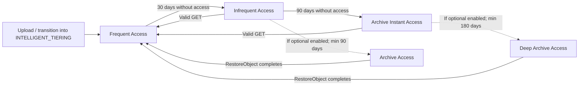
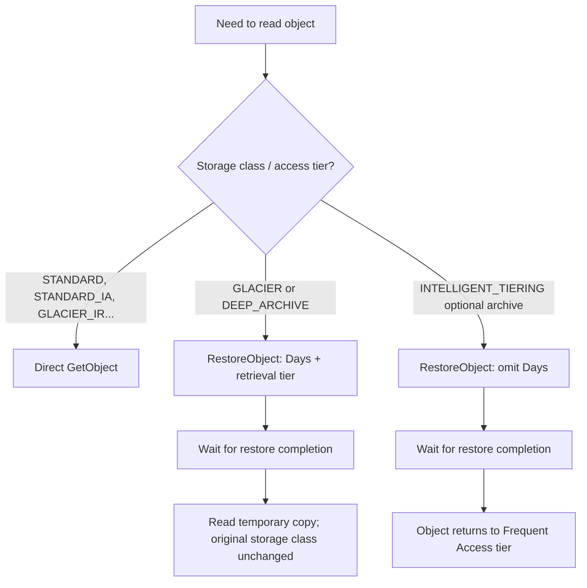
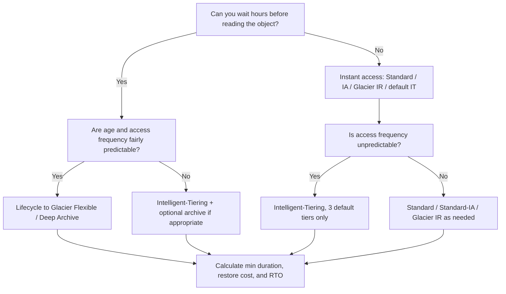

# Storage Classes, S3 Intelligent-Tiering, and Glacier Tiers

> **Chapter:** S3 Object Storage  
> **Module:** `CLOUD_PROVIDERS_AWS`  
> **Scope:** Selecting Amazon S3 storage classes based on access frequency, retrieval latency, availability, durability, security, and cost; applying S3 Intelligent-Tiering, S3 Glacier, and S3 Lifecycle in AWS architectures with monitoring and recovery capabilities.

## Learning Objectives

After this lesson, learners will be able to:

1. Distinguish between an **S3 storage class** and an **access tier** within S3 Intelligent-Tiering; explain why they are not equivalent concepts.
2. Compare S3 Standard, Standard-IA, One Zone-IA, Intelligent-Tiering, Glacier Instant Retrieval, Glacier Flexible Retrieval, and Glacier Deep Archive; recognize S3 Express One Zone when ultra-low latency is the priority.
3. Accurately describe the **three automatic access tiers** and **two optional archive access tiers** of Intelligent-Tiering, including inactivity thresholds and the small-object limit.
4. Choose a long-term storage tier among Glacier classes based on **retrieval time**, **minimum storage duration**, object count, and restore costs.
5. Design **S3 Lifecycle** rules to transition storage classes and expire objects; distinguish them from Intelligent-Tiering's automatic tier movement.
6. Run AWS CLI commands to inspect storage classes, configure Intelligent-Tiering, monitor Lifecycle, and restore archived objects.
7. Identify required controls across IAM, encryption, versioning, Object Lock, replication, monitoring, data recovery, and cost.

## 1. Why Does Amazon S3 Have Multiple Storage Classes?

Amazon Simple Storage Service (Amazon S3) is an **object storage** service. An object consists of **data**, an **object key**, and **metadata** managed inside a bucket. Applications access objects via S3 APIs/SDKs rather than treating them like an EBS block device or traditional EFS file system.

Different workloads have very different requirements:

- Website product images are downloaded many times every day.
- PDF reports may be opened a few times per month and then left untouched for long periods.
- Large backups are retained for years for disaster recovery.
- Regulatory compliance records may go unread for years yet must be retained.
- Analytics datasets see erratic access patterns with unpredictable read frequencies.

Using one storage class for everything can cause unnecessary storage spending or unacceptable retrieval delays. **Storage classes** let you choose the right balance between storage price, access fees, retrieval latency, and availability.

### 1.1 Storage Classes Apply Per Object, Not Fixed Bucket-Wide

A single **general purpose S3 bucket** can hold objects in different storage classes:

```text
s3://orders-assets-example/
├── products/images/p001.jpg            S3 Standard
├── documents/2026/invoice-001.pdf       S3 Intelligent-Tiering
├── backups/quarterly/db-2026-q3.tar     S3 Glacier Instant Retrieval
└── compliance/2021/audit-records.gz     S3 Glacier Deep Archive
```

The keys and bucket above are illustrative only, not real resources. Every object has its own storage class. When calling `PutObject` without specifying a storage class in a general purpose bucket, S3 defaults to **S3 Standard**.

Certain storage classes enforce specific bucket types: for example, **S3 Express One Zone** uses **directory buckets** and has a different endpoint and operational model from general purpose buckets. Never assume every storage class works with the same bucket type, endpoint, or feature set.

### 1.2 Durability, Availability, and Retrieval Latency Differ

| Term | Practical Question | Example |
|---|---|---|
| **Durability** | How resilient is the data against loss? | S3 Standard and most S3 storage classes are designed for 11 nines of durability |
| **Availability** | To what degree is the service designed to allow reads/writes on demand? | S3 Standard has a different availability target than One Zone-IA |
| **Retrieval latency** | Once authorized, how soon can data be read? | Milliseconds for Glacier Instant Retrieval; hours for Deep Archive |
| **RPO** | How much data loss in time is tolerable? | Requires versioning/replication or backups if older recovery points are needed |
| **RTO** | How fast must service/data be restored? | Multi-hour archive restores cannot meet a few-minute RTO |

**High durability does not prevent accidental deletion.** An authorized `DeleteObject` call, ransomware holding IAM permissions, or a misconfigured lifecycle rule can still remove access to data or delete current objects. Versioning, Object Lock, and isolated copies address different risks.

## 2. Comparing Common Storage Classes

The figures below summarize **design principles** and baseline minimums commonly published by AWS. Pricing, quotas, and certain capabilities vary by Region, bucket type, and over time; verify current S3 documentation and pricing pages before deployment.

| Storage Class / API Value | Suitable Use Case | Reading Data | Minimum Storage Duration | Key Considerations |
|---|---|---|---|---|
| **S3 Standard** / `STANDARD` | Frequently accessed data | Direct, milliseconds | None | Stored across multiple AZs; default for new objects in general purpose buckets |
| **S3 Intelligent-Tiering** / `INTELLIGENT_TIERING` | Unknown or changing access patterns | Direct in 3 default tiers; requires restore in 2 optional archive tiers | No storage-class minimum duration | Monitoring/automation fee for eligible objects; small objects do not auto-tier |
| **S3 Standard-IA** / `STANDARD_IA` | Infrequently read objects needing instant access | Direct, milliseconds | 30 days | 128 KB minimum billable size; retrieval fee |
| **S3 One Zone-IA** / `ONEZONE_IA` | Infrequently read, recreatable data tolerating single-AZ loss | Direct, milliseconds | 30 days | Single AZ; 128 KB minimum billable size; retrieval fee |
| **S3 Glacier Instant Retrieval** / `GLACIER_IR` | Long-term archive, rarely read but requiring instant access | Direct, milliseconds | 90 days | 128 KB minimum billable size; retrieval fee |
| **S3 Glacier Flexible Retrieval** / `GLACIER` | Rarely read backups/archives where wait time is acceptable | **Restore first**, minutes to hours | 90 days | Expedited/Standard/Bulk options; metadata overhead |
| **S3 Glacier Deep Archive** / `DEEP_ARCHIVE` | Multi-year retention, very rare access, long RTO | **Restore first**, typically hours | 180 days | No Expedited tier; metadata overhead |
| **S3 Express One Zone** / `EXPRESS_ONEZONE` | Latency-critical apps in a single AZ | Direct, single-digit millisecond latency | None | Directory bucket, single AZ; APIs/features differ from general purpose buckets |

**Minimum storage duration** is a **minimum billing period**, not a lock preventing deletion. Deleting or overwriting an object earlier incurs a prorated charge for the remaining duration. Distinguish this from enforced retention via **S3 Object Lock**.

### 2.1 S3 Standard and Standard-IA

**S3 Standard** fits live website images, Java services reading objects frequently, streaming data, or workloads needing high availability.

**S3 Standard-IA** (Infrequent Access) allows instant reads at a lower storage rate while incurring a **data retrieval charge**. It fits objects that live long enough, are reasonably sized, and are read infrequently. If an app downloads every object hourly, Standard-IA will usually cost more due to retrieval fees.

### 2.2 S3 One Zone-IA and S3 Express One Zone

Both store data in a **single AZ**, yet serve different goals:

- **One Zone-IA**: optimizes storage cost for infrequently read, recreatable data that can tolerate single-AZ loss. Unsuitable as the sole copy of irreplaceable data.
- **Express One Zone**: optimizes performance/latency using directory buckets for frequent, high-throughput access in a single AZ; it is not simply "a faster One Zone-IA."

For data requiring AZ-level fault tolerance, prefer multi-AZ storage classes or appropriate copy/replication strategies rather than relying solely on a One Zone class.

## 3. S3 Intelligent-Tiering: Optimizing Unpredictable Access

**S3 Intelligent-Tiering** is a **storage class** containing multiple **access tiers** internally. Once an object is placed in this storage class, S3 automatically moves it across access tiers to lower storage costs based on access patterns.

Maintain this distinction clearly:

```text
Storage class = INTELLIGENT_TIERING
                   |
                   +-- Frequent Access
                   +-- Infrequent Access
                   +-- Archive Instant Access
                   +-- Archive Access       (optional)
                   +-- Deep Archive Access  (optional)
```

While moving across access tiers, the object's **storage class remains `INTELLIGENT_TIERING`**. It is not an S3 Lifecycle action rewriting the storage class to `STANDARD_IA` or `GLACIER`.

### 3.1 Three Automatic Tiers Requiring No Manual Archive Activation

| Tier | Typical Condition | Access Speed | Requires `RestoreObject`? |
|---|---|---|---|
| **Frequent Access** | Default tier upon entering Intelligent-Tiering; actively accessed objects | Milliseconds | No |
| **Infrequent Access** | No qualifying access for **30 consecutive days** | Milliseconds | No |
| **Archive Instant Access** | No qualifying access for **90 consecutive days** | Milliseconds | **No** |

These three tiers are built into standard S3 Intelligent-Tiering behavior. **Archive Instant Access is not S3 Glacier Instant Retrieval**: despite similar names, one is an **access tier** inside Intelligent-Tiering, while the other is the **`GLACIER_IR` storage class**.

A new object starts in Frequent Access. If left unread, it progressively moves to lower-cost tiers. When an object in Infrequent Access or Archive Instant Access receives a qualifying access, S3 automatically promotes it back to Frequent Access without an asynchronous restore.

### 3.2 Two Optional Archive Access Tiers

To further reduce storage costs for data that **can wait for a restore**, you must explicitly enable an Intelligent-Tiering archive configuration for the bucket, prefix, or object tags.

| Optional Tier | Configuration Threshold | Reading Object | Notes |
|---|---|---|---|
| **Archive Access** | After **at least 90 days** without access; configurable up to 730 days | Requires `RestoreObject`; Standard typically 3–5 hours | Same retrieval behavior as S3 Glacier Flexible Retrieval |
| **Deep Archive Access** | After **at least 180 days** without access; configurable up to 730 days | Requires `RestoreObject`; Standard typically within 12 hours | Same retrieval behavior as S3 Glacier Deep Archive |

**These two tiers are off by default.** You may enable one, both, or neither. If Archive Access is configured right at 90 days, objects can bypass Archive Instant Access and move directly to asynchronous archive when eligible. Verify your **application's SLA/RTO** before enabling them.

### 3.3 Tier Transition Flow Over Time



The diagram simplifies transition paths and counts days from the **most recent qualifying access**. Do not read it as a guarantee that every transition happens at the exact second day 30, 90, or 180 arrives.

### 3.4 What Operations Count as Access?

Operations such as `GetObject`, object downloads/copies, and certain content-reading APIs documented by AWS count as qualifying accesses.

Conversely, **`HeadObject` or `ListObjectsV2` does not automatically move objects from Infrequent Access or Archive Instant Access back to Frequent Access**. Reading metadata and reading payload are distinct operations. Certain APIs like `SelectObjectContent` have specific rules; when building automation, check the official AWS documentation list of APIs that affect tiering rather than guessing from API names.

When an object resides in either optional archive tier, reading its content requires an **asynchronous restore**. Once the restore completes, the object moves back to Frequent Access; it does not create a temporary expiring copy like Glacier Flexible Retrieval or Deep Archive.

### 3.5 The Under-128 KB Object Limit

Within Intelligent-Tiering:

- Objects **smaller than 128 KB** are not monitored and are ineligible for automatic tiering.
- They **always remain in the Frequent Access tier** and **do not incur per-object monitoring/automation fees**.
- Objects **128 KB or larger** are monitored and eligible to tier down, incurring a per-object **monitoring and automation charge**.

**Example:** if an app stores millions of tiny JSON files, selecting Intelligent-Tiering does not mean those files will drop into Infrequent Access after 30 days. For high object counts, factor request fees, metadata, and monitoring fees (for eligible objects) into your total cost model.

### 3.6 Does S3 Intelligent-Tiering Truly Have Zero Retrieval Fees?

AWS advertises **no data retrieval fees** for S3 Intelligent-Tiering. However:

- Monitoring/automation fees still apply to eligible objects.
- `PUT`, `GET`, restore requests, data transfer, and services like KMS still incur their standard charges.
- **Expedited** restores from Archive Access are a premium option and can incur separate charges.
- Both optional archive tiers **still require waiting for a restore** before content can be read.

Therefore, "no retrieval fee" does not mean every read or restore from Intelligent-Tiering is completely free.

### 3.7 When Should You Not Enable Optional Archive Tiers?

Do not enable Archive Access or Deep Archive Access for objects that applications **must return immediately** on demand—such as images rendered in UIs, receipts downloaded in hundreds of milliseconds, or files read automatically even after 6 months of inactivity.

For unpredictable access patterns requiring instant reads, **use only the three default tiers**. For data that can tolerate multi-hour waits and unpredictable access, consider enabling optional archive tiers and build an explicit restore-before-download workflow.

## 4. Three S3 Glacier Storage Classes: Same "Glacier" Name, Different Experience

Amazon S3 provides three Glacier storage classes. These are **object storage classes inside an S3 bucket**, distinct from the legacy **Amazon Glacier vault** service.

### 4.1 S3 Glacier Instant Retrieval

- API value: `GLACIER_IR`.
- Designed for rarely accessed, long-lived objects needing **immediate millisecond retrieval**.
- No `RestoreObject` call needed before `GetObject`.
- **Minimum storage duration: 90 days**.
- **Minimum billable object size: 128 KB**.
- Incurs retrieval fees and request charges per pricing schedule.

**Scenario:** Contracts or records downloaded only a few times per quarter, yet customer support needs to open any document immediately when requested. If reads are genuinely rare and cannot wait hours, Glacier Instant Retrieval fits well.

### 4.2 S3 Glacier Flexible Retrieval

- API value: `GLACIER` (display name **S3 Glacier Flexible Retrieval**).
- Data is **archived** and cannot be read directly via `GetObject` before restoring.
- **Minimum storage duration: 90 days**.
- Supports **Expedited**, **Standard**, and **Bulk** retrievals.
- Especially suited for backups or disaster recovery datasets rarely read.

Typical reference times:

| Retrieval Option | Reference Time | Use Case |
|---|---|---|
| **Expedited** | Typically 1–5 minutes for objects under 250 MB; availability conditional | Urgent recovery of select objects |
| **Standard** | Typically 3–5 hours | Routine restores |
| **Bulk** | Typically 5–12 hours | Large-scale, cost-sensitive restores |

These ranges are **typical times**, not hard guarantees across all sizes and load conditions. Expedited costs more and may require provisioned capacity for predictable availability. Bulk retrieval on S3 Glacier Flexible Retrieval is documented by AWS as having zero retrieval fee, though request, restore copy, and data transfer fees still apply per configuration.

### 4.3 S3 Glacier Deep Archive

- API value: `DEEP_ARCHIVE`.
- Suited for multi-year retention where reads are rare and long recovery times are acceptable.
- **Minimum storage duration: 180 days**.
- Must **restore first** before reading; Expedited retrieval is not available.
- Standard retrieval typically completes within 12 hours; Bulk retrieval can take up to 48 hours.

**Scenario:** Audit or legal records retained for years, almost never read, with an SLA allowing a couple of days to fulfill audit requests. If the business requires 30-minute recovery, storing the sole copy in Deep Archive will fail the requirement.

### 4.4 Comparing the Three Glacier Classes

| Criterion | Glacier Instant Retrieval | Glacier Flexible Retrieval | Glacier Deep Archive |
|---|---|---|---|
| Direct read | Yes, milliseconds | No | No |
| Restore before GET | No | Yes | Yes |
| Minimum duration | 90 days | 90 days | 180 days |
| Expedited | Not needed | Yes (conditional) | No |
| Standard restore | N/A | Typically 3–5 hours | Typically within 12 hours |
| Bulk restore | N/A | Typically 5–12 hours | Typically within 48 hours |
| Best fit | Infrequent reads needing instant access | Backups/archives tolerating hours of wait | Multi-year retention, very rare reads, long RTO |

### 4.5 Overhead for Very Small Archived Objects

For **S3 Glacier Flexible Retrieval** and **S3 Glacier Deep Archive**, AWS stores an additional **40 KB of metadata per object**: 32 KB billed at the respective archive rate and 8 KB billed at the S3 Standard rate. This becomes significant when archiving millions of tiny objects.

If storing small event logs of a few KB each, thoughtfully batching/compressing logs into larger indexed objects can reduce overhead—just do not pack them so coarsely that searching, restoring, or processing a subset misses your RTO.

**Glacier Instant Retrieval** uses a 128 KB minimum billable object size; that is a different billing mechanism from the 40 KB metadata overhead of Flexible/Deep Archive.

## 5. How Does Restoring in S3 Glacier Differ from Intelligent-Tiering?

This is a critical operational distinction.

### 5.1 Restoring Objects in Glacier Flexible Retrieval / Deep Archive

When an object is in `GLACIER` or `DEEP_ARCHIVE`:

1. The application calls `RestoreObject`, specifying how many days to retain the temporary copy and the retrieval tier.
2. S3 queues an asynchronous restore job.
3. Once complete, the original object **remains in the archive storage class**.
4. S3 serves a **temporary readable copy** for the chosen number of days; billing can apply to both the archived object and the restored temporary copy.
5. Once the temporary copy expires, the application must restore again to read the data.

To permanently move a restored object to a different **long-term storage class**, you must **copy** the object to the target key/class using the appropriate API/SDK/CLI after restore completes; `RestoreObject` alone does not permanently change the storage class.

### 5.2 Restoring Optional Archive Access Tiers in Intelligent-Tiering

When an object has storage class `INTELLIGENT_TIERING` and sits in Archive Access or Deep Archive Access:

1. Call `RestoreObject` **without passing `Days`**.
2. Wait for S3 to finish the asynchronous restore.
3. The object is **moved back to the Frequent Access tier** within Intelligent-Tiering.
4. If left unaccessed later, automatic tiering resumes according to configuration.

Do not apply the "7-day temporary copy" mental model from Flexible/Deep Archive to Intelligent-Tiering optional archive tiers.

### 5.3 Flow Comparison Diagram



### 5.4 Restore Time and RTO

Glacier restore duration is a **hard design constraint**. Restoring millions of archived objects under load can take longer due to request rate limits, restore throughput, object sizes, and capacity demand.

For large-scale restores, consider **S3 Batch Operations** to issue bulk restore requests and track progress centrally. Test the entire end-to-end flow: submit job, wait for restore, verify status, download data, decrypt/decompress, and rebuild application state.

## 6. S3 Lifecycle: Automating Storage Class Transitions and Object Expiration

**S3 Lifecycle** lets you define bucket **rules** to automatically:

- **Transition:** move objects to another storage class once they reach a configured age/days or match rule criteria.
- **Expiration:** delete eligible objects/versions per retention policy.
- Manage historical versions in versioned buckets via **noncurrent version transitions/expiration**.
- Clean up incomplete multipart uploads and perform other lifecycle actions.

**Lifecycle differs from Intelligent-Tiering auto-tiering:**

| Mechanism | Primary Trigger | Result |
|---|---|---|
| **S3 Lifecycle transition** | Object age since creation, prefix/tag/size filters, and rules | Changes **storage class**, e.g., `STANDARD` → `GLACIER` |
| **S3 Intelligent-Tiering automatic tiering** | Observed access frequency / inactivity duration | Keeps storage class `INTELLIGENT_TIERING`, changes **access tier** |
| **Intelligent-Tiering archive configuration** | Optional tier enabled + inactivity threshold | Moves into optional archive tier while remaining in Intelligent-Tiering |
| **S3 Lifecycle expiration** | Current/noncurrent age and rules | Deletes per versioning, retention, and Object Lock constraints |

If data has a predictable lifecycle—such as "no instant reads needed after one year"—Lifecycle transitions to Glacier are straightforward to budget. If access frequency is unpredictable, Intelligent-Tiering eliminates manual rule tuning.

### 6.1 Example 2-Year Data Lifecycle Roadmap

Suppose a system exports new PDF reports:

```text
Day 0         : Standard (newly published reports may be read frequently)
After 30 days : Standard-IA (rarely read, must open immediately)
After 120 days: Glacier Flexible Retrieval (hours-long restore acceptable)
After 365 days: Glacier Deep Archive (long-term retention, very rare reads)
End of retention: Expire per data policy and Object Lock (if enabled)
```

This is an **illustrative scenario**, not a universal default rule. Milestones are spaced so objects are not transitioned out of a storage class before its minimum storage duration expires. If users unexpectedly resume reading older reports frequently, retrieval and restore fees could make this roadmap unsuitable.

### 6.2 How Does Lifecycle Work in a Versioning-Enabled Bucket?

When S3 Versioning is enabled, a single object key can have multiple **version IDs**. Lifecycle actions on the current version differ from actions on **noncurrent versions**.

For instance, when an object is deleted in a versioned bucket:

- S3 normally inserts a **delete marker** as the current version instead of immediately purging prior version payloads.
- Noncurrent versions continue consuming storage until a matching noncurrent lifecycle/delete rule removes them.
- `Expiration` rules for current objects and `NoncurrentVersionExpiration` rules for older versions address distinct needs.
- S3 Object Lock retention or legal holds can **block deletion of protected versions**, even when Lifecycle deadlines arrive.

**Never enable expiration or noncurrent version expiration on critical data without reviewing recovery windows, accidental-deletion protection, and compliance rules.**

### 6.3 Default Rule for Objects Under 128 KB

Since **September 2024**, for new or updated S3 Lifecycle configurations, the default behavior is **not to transition objects smaller than 128 KB to any storage class**. Before this change, some configurations allowed small objects to transition into Glacier Flexible Retrieval or Deep Archive.

API overrides or explicit **object size filters** in Lifecycle rules remain available. However, only enable small-object transitions after calculating transition/request fees and metadata overhead; with large object counts, transition fees can outweigh storage savings.

**Note these two distinct 128 KB thresholds:**

- Intelligent-Tiering: objects under 128 KB **are not monitored or auto-tiered**.
- S3 Lifecycle: by current default, objects under 128 KB **are not transitioned** by Lifecycle unless an explicit exception filter is configured.

### 6.4 Does Lifecycle Execute at an Exact Hour?

S3 Lifecycle evaluates rules on AWS's internal schedule and is **asynchronous/eventual**. An object may become eligible on a given day and actually transition or expire later. Never build application logic assuming a transition happens on the exact first second of Day N.

If immediate deletion is required for legal compliance, build an explicit API-driven deletion workflow with auditing, while respecting any active Object Lock/retention controls.

## 7. Real-World Costs: Beyond Per-GB/Month Storage Rates

Choosing a storage class based solely on per-GB storage price is a common mistake. Total cost can include:

| Cost Category | When Incurred |
|---|---|
| **Storage GB-month** | Actual bytes stored per class/tier plus metadata overhead |
| **Minimum storage duration** | Deleting, overwriting, or transitioning before 30/90/180 days |
| **Minimum billable object size** | Standard-IA / One Zone-IA / Glacier IR bill at least 128 KB per object |
| **Requests** | PUT/COPY/GET/LIST, Lifecycle transitions, restore requests, and Batch Operations |
| **Data retrieval** | Standard-IA / One Zone-IA / Glacier IR or Glacier archive retrieval options |
| **Temporary restore copy** | Restored temporary copies in Glacier Flexible Retrieval / Deep Archive |
| **Monitoring/automation** | S3 Intelligent-Tiering per eligible object |
| **Data transfer** | Egress to the Internet or across Regions/accounts per pricing rules |
| **Replication** | Cross-Region / Same-Region Replication requests, transfer, and replica storage |
| **Security/observability** | KMS calls, S3 Inventory, advanced Storage Lens, CloudTrail data events, and logs if enabled |

**Rates and free tiers vary by Region, over time, and by request type.** Never hardcode fixed dollar figures into architecture docs without checking current pricing and real traffic metrics.

### 7.1 Why Can "Cheap Archive" Become Expensive?

Suppose a system generates millions of tiny JSON events updated continually. If each object transitions across multiple tiers:

1. Transition and request fees scale with **object count**.
2. Archive classes add **metadata overhead** or minimum billable object sizes.
3. Early deletions trigger **early deletion charges**.
4. During audits, restore/request fees and wait times can become substantial.
5. Overly broad lifecycle rules can archive objects still actively read by production apps, causing outages.

Mitigations: classify data by prefix/tag, batch/compress small objects thoughtfully, measure real access rates, test restores, and model costs across both object count and GB volume.

### 7.2 Structured Decision Flow



After this initial pass, verify data criticality, AZ redundancy, compliance, encryption, versioning, object sizes, and total estimated cost.

## 8. Three Typical Design Scenarios

### 8.1 E-Commerce Website: Product Images

**Characteristics:** Active product images are read many times per hour; discontinued product images are rarely viewed yet must render immediately when a user opens an old order.

**Recommended classification:**

- Active product images with frequent reads: **S3 Standard**, paired with a CDN like Amazon CloudFront where appropriate.
- Older images with unpredictable access that still need instant display: **S3 Intelligent-Tiering without optional archive tiers**.
- Consider Glacier Instant Retrieval only when reads are reliably rare, object sizes/costs align, and millisecond latency suffices.
- Never move actively served web images into Glacier Flexible Retrieval or Deep Archive, as the application cannot serve them immediately without an async restore.

### 8.2 Monthly Financial Reporting System

**Characteristics:** Newly published reports are read heavily during the first month, then rarely, though older reports can be accessed unexpectedly at any time.

**Option A:** S3 Intelligent-Tiering. Eligible large reports automatically move Frequent → Infrequent → Archive Instant; any old report requested unexpectedly promotes back to Frequent with zero wait.

**Option B:** Lifecycle to Standard-IA or Glacier Instant Retrieval if clear age/frequency rules hold. Compare total retrieval/request fees against Intelligent-Tiering monitoring fees.

**Do not enable by default:** Deep Archive Access after 180 days if finance still expects multi-year-old reports to download in seconds.

### 8.3 Compliance Vault and Multi-Year Backups

**Characteristics:** Data is almost never read, retained for many years, can wait 12–48 hours during audits or incidents, and must be protected against premature deletion.

**Suitable design:**

- Use **Glacier Deep Archive** (or Intelligent-Tiering with optional Deep Archive Access if access patterns are uncertain).
- Use **S3 Versioning + Object Lock** when WORM/retention rules apply.
- Maintain backup copies in a separate Account/Region if large-scale disaster recovery is required.
- Establish a `RestoreObject` runbook, monitor restore completions, and practice downloading/verifying restored data.
- Never schedule Lifecycle expiration before the required retention date expires.

Final selection must account for industry regulations, audit timelines, and contractual data-protection clauses.

## 9. AWS CLI: Inspecting Storage Classes and Existing Configurations

> **Prerequisites:** AWS CLI v2 configured with a valid profile/Region and authorized role. Bucket names and keys in examples are illustrative; replace them with authorized resources. This section prioritizes **read** commands; configuration-modifying commands are clearly marked.

### 9.1 Check Account and Region

```bash
aws sts get-caller-identity
aws configure get region

# Buckets are Regional resources; check LocationConstraint
aws s3api get-bucket-location --bucket orders-assets-example
```

For certain Regions (such as `us-east-1`), `LocationConstraint` follows a special convention (`null`); do not interpret `null` as "the bucket has no Region."

### 9.2 Inspect Single Object Metadata

```bash
aws s3api head-object \
  --bucket orders-assets-example \
  --key documents/2026/invoice-001.pdf \
  --query '{StorageClass:StorageClass,ContentLength:ContentLength,LastModified:LastModified,Restore:Restore,ArchiveStatus:ArchiveStatus}' \
  --output json
```

- `StorageClass` shows the object's storage class; for Standard, some responses **omit the `StorageClass` field**.
- `ArchiveStatus` indicates Intelligent-Tiering archive tier status when applicable.
- `Restore` shows restore status for archived objects; not every object includes this field.
- When versioning is enabled, specify `--version-id` to inspect the exact target version.

### 9.3 List Objects and Their Storage Classes Under a Prefix

```bash
aws s3api list-objects-v2 \
  --bucket orders-assets-example \
  --prefix documents/ \
  --query 'Contents[].{Key:Key,Size:Size,StorageClass:StorageClass}' \
  --output table
```

`ListObjectsV2` is paginated; for large datasets, use **S3 Inventory** or **S3 Storage Lens** for analytics instead of running continuous listing loops that inflate request costs. Do not treat `StorageClass` from a list response as full visibility into internal Intelligent-Tiering access tiers.

### 9.4 Inspect S3 Lifecycle and Intelligent-Tiering Configurations

```bash
# Lifecycle config on a general purpose bucket (if configured)
aws s3api get-bucket-lifecycle-configuration \
  --bucket orders-assets-example \
  --output json

# Configurations enabling Intelligent-Tiering optional archive tiers
aws s3api list-bucket-intelligent-tiering-configurations \
  --bucket orders-assets-example \
  --output json
```

If a bucket has no Lifecycle rules, the first command returns `NoSuchLifecycleConfiguration`; that is normal and not an error with the bucket or S3.

## 10. Infrastructure Modification Examples: Uploading Objects and Configuring Archive Tiers

### 10.1 Upload an Object into Intelligent-Tiering

Command to create a new object in the chosen storage class:

```bash
aws s3api put-object \
  --bucket orders-assets-example \
  --key documents/2026/invoice-001.pdf \
  --body ./invoice-001.pdf \
  --storage-class INTELLIGENT_TIERING
```

The object starts in the **Frequent Access tier**. If Object Lock, bucket policies, SSE-KMS, tag requirements, or other constraints apply, real requests may require additional parameters.

### 10.2 Enable Optional Archive Tiers for a Prefix

To scope optional archive tiers only to reports that can wait for restore, create a JSON config:

```json
{
  "Id": "long-term-documents",
  "Status": "Enabled",
  "Filter": {
    "Prefix": "documents/archiveable/"
  },
  "Tierings": [
    {
      "Days": 120,
      "AccessTier": "ARCHIVE_ACCESS"
    },
    {
      "Days": 210,
      "AccessTier": "DEEP_ARCHIVE_ACCESS"
    }
  ]
}
```

This sets Archive Access after **120 days** without access and Deep Archive Access after **210 days**. These values are valid because they meet the minimums of 90/180 days and stay under 730 days. Objects under that prefix that **do not have storage class `INTELLIGENT_TIERING`** do not automatically become Intelligent-Tiering just by adding this archive config.

Assuming the JSON is saved locally as `intelligent-tiering.json`:

```bash
aws s3api put-bucket-intelligent-tiering-configuration \
  --bucket orders-assets-example \
  --id long-term-documents \
  --intelligent-tiering-configuration file://intelligent-tiering.json
```

**This modifies bucket configuration.** Perform only in an authorized lab environment after checking prefixes/tags, recovery paths, and application impact. Never apply `Archive Access` to objects that endpoints must read synchronously.

### 10.3 Sample Lifecycle Rule for Fixed-Schedule Data

Suppose exports need age-based lifecycle management:

```json
{
  "Rules": [
    {
      "ID": "exports-to-archive",
      "Status": "Enabled",
      "Filter": {
        "Prefix": "exports/"
      },
      "Transitions": [
        {
          "Days": 30,
          "StorageClass": "STANDARD_IA"
        },
        {
          "Days": 120,
          "StorageClass": "GLACIER"
        },
        {
          "Days": 365,
          "StorageClass": "DEEP_ARCHIVE"
        }
      ]
    }
  ]
}
```

Here:

- `Days` represents **object age** under the Lifecycle rule, not days since the last `GET`.
- The rule targets **current object versions** in this example; versioned buckets require separate rules for noncurrent versions.
- S3 Lifecycle applies default restrictions to objects under 128 KB as explained earlier.
- Transitions must respect minimum storage durations and valid class-transition paths.
- If the bucket already has multiple Lifecycle rules, always supply the full merged rule set when updating so you **do not accidentally overwrite existing rules**.

Command using JSON saved locally as `lifecycle.json`:

```bash
aws s3api put-bucket-lifecycle-configuration \
  --bucket orders-assets-example \
  --lifecycle-configuration file://lifecycle.json
```

**Operational warning:** `put-bucket-lifecycle-configuration` replaces the **entire bucket** Lifecycle configuration. Before applying, fetch the current configuration, merge any rules to keep, and carefully review expiration/transition actions. The example above omits expiration; never add expiration to data subject to retention requirements.

## 11. AWS CLI: Restoring Objects from Glacier and Intelligent-Tiering

### 11.1 Restore from Glacier Flexible Retrieval or Deep Archive

Suppose `compliance/2021/audit-records.gz` is in `DEEP_ARCHIVE`. To read a temporary copy for **7 days** using Standard retrieval:

```bash
aws s3api restore-object \
  --bucket orders-assets-example \
  --key compliance/2021/audit-records.gz \
  --restore-request '{"Days":7,"GlacierJobParameters":{"Tier":"Standard"}}'
```

Then check status:

```bash
aws s3api head-object \
  --bucket orders-assets-example \
  --key compliance/2021/audit-records.gz \
  --query '{StorageClass:StorageClass,Restore:Restore}' \
  --output json
```

Once `Restore` indicates completion, download the object:

```bash
aws s3api get-object \
  --bucket orders-assets-example \
  --key compliance/2021/audit-records.gz \
  ./audit-records-restored.gz
```

These commands will **fail** if the object, bucket, or IAM/KMS permissions are missing or misconfigured. JSON quoting above uses Unix/Bash syntax; on PowerShell/Windows, adjust quoting or pass `--restore-request file://restore-request.json`.

### 11.2 Restore from Intelligent-Tiering Archive Access / Deep Archive Access

For an object **still in `INTELLIGENT_TIERING`** sitting in an optional archive tier:

```bash
aws s3api restore-object \
  --bucket orders-assets-example \
  --key documents/archiveable/invoice-old.pdf \
  --restore-request '{}'
```

**Do not pass `Days`** when restoring from Intelligent-Tiering archive access tiers. Once complete, the object returns to the Frequent Access tier. If choosing a supported retrieval tier, consult the `RestoreObject` API docs and applicable pricing.

### 11.3 Avoid Misreading Restore Status

A successful `RestoreObject` API response **does not mean the data is immediately readable**. Applications should:

1. Log the restore request with bucket, key, version ID (if any), storage class, and timestamp.
2. Poll `HeadObject` or configure **S3 Event Notifications** for restore-completed events.
3. Once ready, download content via `GetObject`.
4. Verify checksums, metadata, decryption/decompression, and business integrity.
5. Clean up temporary copies or permanently copy the object to another storage class if planned.

At large scale, use S3 Batch Operations with job tracking and event notifications instead of firing millions of unthrottled restore requests concurrently.

## 12. S3 with Java Applications: Choosing Storage Class at Upload Time

With the AWS SDK for Java v2, applications can set the storage class when writing objects. Example using the **default credentials provider chain** without hardcoding access keys:

```java
import java.nio.file.Path;
import software.amazon.awssdk.core.sync.RequestBody;
import software.amazon.awssdk.regions.Region;
import software.amazon.awssdk.services.s3.S3Client;
import software.amazon.awssdk.services.s3.model.PutObjectRequest;
import software.amazon.awssdk.services.s3.model.StorageClass;

public class UploadReport {
    public static void main(String[] args) {
        String bucket = "orders-assets-example";
        String key = "documents/2026/monthly-report.pdf";
        Path source = Path.of("monthly-report.pdf");

        try (S3Client s3 = S3Client.builder()
                .region(Region.AP_SOUTHEAST_1)
                .build()) {
            PutObjectRequest request = PutObjectRequest.builder()
                    .bucket(bucket)
                    .key(key)
                    .storageClass(StorageClass.INTELLIGENT_TIERING)
                    .contentType("application/pdf")
                    .build();

            s3.putObject(request, RequestBody.fromFile(source));
            System.out.println("Uploaded: s3://" + bucket + "/" + key);
        }
    }
}
```

To run this, add a compatible `software.amazon.awssdk:s3` dependency and verify the bucket, Region, local file, and `s3:PutObject` IAM permission. If the bucket uses SSE-KMS, configure KMS permissions and bucket policies accordingly.

**Runtime considerations:** A Java app can read directly from Standard, IA, or Glacier Instant Retrieval whenever authorized. For Glacier Flexible/Deep Archive or Intelligent-Tiering optional archive tiers, design an asynchronous **request restore → monitor → deliver file later** workflow rather than assuming `GetObject` always returns bytes synchronously.

## 13. Security, Compliance Retention, and Resilience

### 13.1 Storage Classes Do Not Grant Access Permissions

Choosing Glacier or Intelligent-Tiering **does not grant or revoke IAM permissions**. Security controls still rely on:

- **IAM policies**, bucket policies, VPC endpoint policies where applicable, AWS Organizations SCPs, and explicit denies.
- **S3 Block Public Access** to prevent unintended public exposure.
- **SSE-S3** as default encryption for new objects when no custom rule exists; choose **SSE-KMS** when key policies, auditing, or advanced controls are required.
- **TLS** on S3 API calls and least-privilege roles for application workloads, restore operators, and automation.
- **CloudTrail data events** when object-level access auditing is required, factoring in associated costs.

Note that a principal holding `s3:GetObject` still cannot immediately read an archived object before restore completes; valid permissions do not bypass storage-class retrieval delays.

### 13.2 S3 Versioning and Object Lock

**Versioning** retains older versions on overwrite or delete to mitigate accidental mistakes. Versioning alone does not stop an overly privileged actor from permanently deleting prior versions.

**S3 Object Lock** enforces WORM retention with **governance mode**, **compliance mode**, and **legal hold** as required. This protection is distinct from storage-class **minimum storage duration**:

- Minimum storage duration affects **billing when deleting early**.
- Object Lock retention governs **whether an object version is allowed to be deleted or overwritten**.

When archiving compliance records in Deep Archive for years, pair proper Object Lock configuration with KMS key and AWS account governance. Never pick long retention periods without validating legal retention and data-disposal obligations.

### 13.3 Does Replication Replace Backups?

S3 Replication copies objects per rules to same-Region or cross-Region buckets, improving resilience and locality. However, replication follows **copy rules and version/delete-marker settings** and does not automatically guarantee an isolated copy immune to all accidental deletions or logic bugs.

Verify:

1. Source/destination buckets, versioning, and KMS keys/permissions.
2. **Destination** storage class and replication support for each storage class/bucket type.
3. Replication Time Control if measurable replication SLAs are required and eligible.
4. Separate-account storage, Object Lock/retention, and dedicated backup permissions.
5. Regular restore drills from the destination Region/Account.

**Best practice:** keep active data in Standard or Intelligent-Tiering, long-term protected copies in an appropriate Glacier class inside a separate backup Account/Region as required, and maintain tested restore runbooks.

## 14. Monitoring and Troubleshooting Storage-Class Issues

### 14.1 Tracking Accessibility and Cost

| Tool | Questions It Helps Answer |
|---|---|
| **S3 Storage Lens** | How are storage bytes and object counts changing? What is the breakdown across storage classes/tiers? |
| **S3 Inventory** | Bulk list of objects, sizes, storage classes, encryption, and metadata for batch analysis |
| **S3 Storage Class Analysis** | Which access patterns are good candidates to transition to Standard-IA / Lifecycle? |
| **AWS Cost Explorer / Budgets** | Are storage, request, retrieval, data transfer, or KMS costs spiking abnormally? |
| **CloudWatch request metrics** | Are `GET`/4xx/5xx errors or request rates spiking (when request metrics are enabled)? |
| **CloudTrail** | Who modified lifecycle rules, bucket policies, archive configs, or invoked relevant APIs (when logged)? |
| **S3 Event Notifications** | Emits events for archive transitions and restore completions when configured |

**Monitoring must track object counts too.** A bucket with millions of tiny objects has a completely different cost profile from one holding a few large files at the same total byte volume.

### 14.2 Common Troubleshooting Matrix

| Symptom | Possible Cause | Investigation / Fix |
|---|---|---|
| `GetObject` returns `InvalidObjectState` | Object is in Glacier Flexible/Deep Archive or optional archive tier and not restored | Check `HeadObject`; call `RestoreObject` with right parameters and wait for completion |
| Intelligent-Tiering does not lower costs as expected | Objects under 128 KB, accessed too frequently, monitoring fees, or optional archive tiers disabled | Inspect sizes, access patterns, Storage Lens, tiering config, and pricing |
| Objects fail to transition after eligible days | Lifecycle rule not matching, size under 128 KB, rule disabled, version/replication/condition mismatch | Check rule filters/prefix/tag/size/replication and allow for asynchronous processing delay |
| App cannot immediately load older records | Data needing instant access was moved to asynchronous archive | Adjust storage class/tier, trigger restore beforehand, revisit RTO |
| Costs spike right after deleting data | Minimum duration fees or remaining object versions/snapshots/replicas | Check early-deletion charges, versioning, replicas, Object Lock, and Cost Explorer |
| Deleted current object yet storage usage remains | Versioning retained noncurrent versions; Lifecycle hasn't expired old versions | Inventory object versions, delete markers, and retention rules |
| Restore requested yet object still unreadable | Restore still in progress, missing IAM/KMS permissions, wrong key/version, or failed request | Inspect `Restore` status, logs, permissions, and exact version ID |
| Team confuses Glacier Instant with Flexible | Different retrieval behaviors between the two classes | Verify API `StorageClass`: `GLACIER_IR` reads instantly; `GLACIER` requires restore |
| High data retrieval charges | Heavy `GET` traffic on IA / Glacier IR or frequent archive restores | Measure requests/GB; evaluate Standard, Intelligent-Tiering, or caching |
| Data lost after applying a new lifecycle rule | Overly broad expiration or noncurrent expiration rule | Check versioning/Object Lock/replicas; strictly review rules before applying |

### 14.3 Optimal Investigation Sequence

1. Identify **Account, Region, bucket, object key, and version ID**.
2. Inspect storage class and archive status with `HeadObject`.
3. Confirm the expected access path: synchronous direct read vs. asynchronous restore.
4. Classify any errors into **permissions/KMS**, **`ObjectState`/restore**, **network/endpoint**, or **throttling**.
5. Check whether S3 Lifecycle or Intelligent-Tiering archive configs apply to that prefix/tag.
6. Assess urgency/RTO before selecting Expedited, Standard, or Bulk retrieval.
7. Record restore duration, costs, and verification results; tune rules if usage patterns shift.

## 15. Self-Check Exercises

**Exercise 1 — Terminology.** An object has `StorageClass=INTELLIGENT_TIERING` and sits in Archive Instant Access. Is this the `GLACIER_IR` storage class, or still Intelligent-Tiering? Does it require `RestoreObject` for an immediate read?

**Exercise 2 — Automatic Tiering.** A 5 MB object is uploaded to Intelligent-Tiering and receives no qualifying access for 100 days. If optional archive access tiers are not enabled, which tier is it likely in? What if the object were only 20 KB?

**Exercise 3 — RTO.** A business must download old contracts in under one second even though documents are viewed only once per quarter. Within the Glacier family, which class should be considered? Why are Flexible Retrieval and Deep Archive unsuitable if that is the sole copy?

**Exercise 4 — Lifecycle vs. Tiering.** A `Days=120` rule transitions objects from Standard to `GLACIER`. Is that measured from object creation or from the last read? How does this differ from Intelligent-Tiering's optional Archive Access?

**Exercise 5 — Restores.** Explain the difference between `RestoreObject` with `{"Days":7}` on `DEEP_ARCHIVE` versus `RestoreObject` omitting `Days` on Intelligent-Tiering Deep Archive Access.

**Exercise 6 — Cost.** An organization has millions of tiny log objects and wants to move them immediately to Glacier Flexible Retrieval. Which fees and limits should be calculated upfront? Why might compressing/batching logs help?

**Exercise 7 — Early Deletion.** A `GLACIER_IR` object stored for 20 days is deleted. Why might storage charges still apply for the remaining days? Is this Object Lock?

**Exercise 8 — Data Protection.** Legal records must be retained undeletable for years, with day-level retrieval acceptable. How would you combine storage class, versioning, Object Lock, replication/backups, and restore testing?

<details>
<summary>Answer Hints</summary>

1. It remains in the `INTELLIGENT_TIERING` storage class, in the Archive Instant Access tier; reads are direct in milliseconds with no restore needed.
2. The 5 MB object automatically transitions to Archive Instant Access after at least 90 days without access. A 20 KB object is not monitored/auto-tiered and stays in Frequent Access.
3. Glacier Instant Retrieval if instant reads are mandatory; the other two Glacier classes require asynchronous restores.
4. Lifecycle transitions count from **object age**; Intelligent-Tiering optional archive relies on **time without access** and must be explicitly configured.
5. Glacier Deep Archive creates an expiring temporary copy; Intelligent-Tiering Deep Archive Access moves the object back to Frequent Access and does not accept `Days`.
6. Account for request/transition fees, minimum duration, small-object rules, 40 KB metadata overhead per object, restore charges, and data transfer. Batching/compressing helps as long as it doesn't hinder search and recovery.
7. Glacier Instant Retrieval has a 90-day minimum storage duration, so early deletion incurs charges for the remaining days. This is a **billing** rule, not Object Lock.
8. Choose Deep Archive or long-term retention matching RTO; enable versioning + appropriate Object Lock retention, protect with KMS/IAM, keep independent backups/replicas, and run scheduled restore drills.

</details>

## 16. Selection and Operations Checklist

- [ ] Measured **access frequency**, object sizes/counts, instant-read vs. restore tolerance, and **RPO/RTO**.
- [ ] Distinguished storage classes from Intelligent-Tiering access tiers.
- [ ] Understood **30/90 days** for the three automatic tiers and **90/180 days minimum** for the two optional archive tiers.
- [ ] Accounted for objects **under 128 KB** in Intelligent-Tiering and S3 Lifecycle default rules.
- [ ] Distinguished Glacier Instant Retrieval (instant read) from Flexible/Deep Archive (restore required).
- [ ] Factored in **30/90/180-day** minimum storage durations, minimum billable sizes, metadata overhead, request/restore fees, and data transfer.
- [ ] If using S3 Lifecycle, verified prefix/tag/size filters, versioning/noncurrent versions, transitions, and expiration rules.
- [ ] If enabling Intelligent-Tiering optional archive tiers, ensured applications implement asynchronous restore workflows.
- [ ] Verified IAM, Block Public Access, SSE-KMS/SSE-S3, and Object Lock/retention according to data sensitivity.
- [ ] Established cross-Account/cross-Region copy strategy if disaster recovery requires it.
- [ ] Practiced restoring an object and measured **actual recovery duration**.
- [ ] Configured monitoring via S3 Inventory/Storage Lens, Cost Explorer/Budgets, and appropriate alerts.

## Official AWS Documentation

- [Amazon S3 — Understanding and managing storage classes](https://docs.aws.amazon.com/AmazonS3/latest/userguide/storage-class-intro.html)
- [Amazon S3 — How S3 Intelligent-Tiering works](https://docs.aws.amazon.com/AmazonS3/latest/userguide/intelligent-tiering-overview.html)
- [Amazon S3 — Using S3 Intelligent-Tiering](https://docs.aws.amazon.com/AmazonS3/latest/userguide/using-intelligent-tiering.html)
- [Amazon S3 — Managing S3 Intelligent-Tiering](https://docs.aws.amazon.com/AmazonS3/latest/userguide/intelligent-tiering-managing.html)
- [Amazon S3 — Glacier storage classes](https://docs.aws.amazon.com/AmazonS3/latest/userguide/glacier-storage-classes.html)
- [Amazon S3 — Understanding archival storage](https://docs.aws.amazon.com/AmazonS3/latest/userguide/archival-storage.html)
- [Amazon S3 — Working with archived objects](https://docs.aws.amazon.com/AmazonS3/latest/userguide/archived-objects.html)
- [Amazon S3 — Restoring an archived object](https://docs.aws.amazon.com/AmazonS3/latest/userguide/restoring-objects.html)
- [Amazon S3 — Retrieval options for archived objects](https://docs.aws.amazon.com/AmazonS3/latest/userguide/restoring-objects-retrieval-options.html)
- [Amazon S3 — Transitioning objects with Lifecycle](https://docs.aws.amazon.com/AmazonS3/latest/userguide/lifecycle-transition-general-considerations.html)
- [Amazon S3 — S3 Lifecycle configuration rules](https://docs.aws.amazon.com/AmazonS3/latest/userguide/intro-lifecycle-rules.html)
- [Amazon S3 — Object Lock](https://docs.aws.amazon.com/AmazonS3/latest/userguide/object-lock.html)
- [Amazon S3 — Storage Lens](https://docs.aws.amazon.com/AmazonS3/latest/userguide/storage_lens.html)
- [Amazon S3 — Pricing](https://aws.amazon.com/s3/pricing/)

**Key Takeaway:** A **storage class** selects an object's **storage model and retrieval characteristics**; **Intelligent-Tiering** automatically adjusts **access tiers** as read patterns shift; **Glacier** classes optimize long-term retention based on **acceptable restore latency**. A well-designed S3 architecture balances storage fees, retrieval fees, RTO/RPO, security, and tested recovery on real data.
