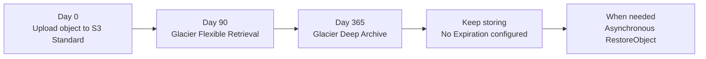
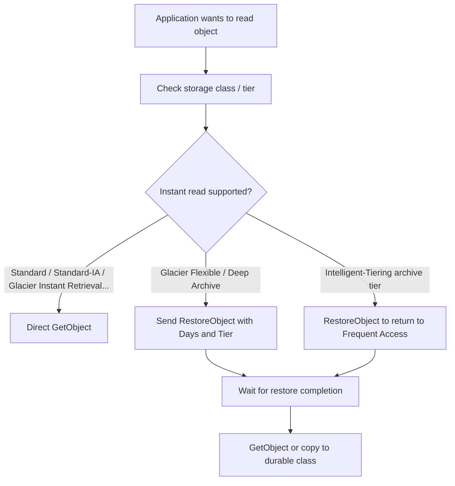
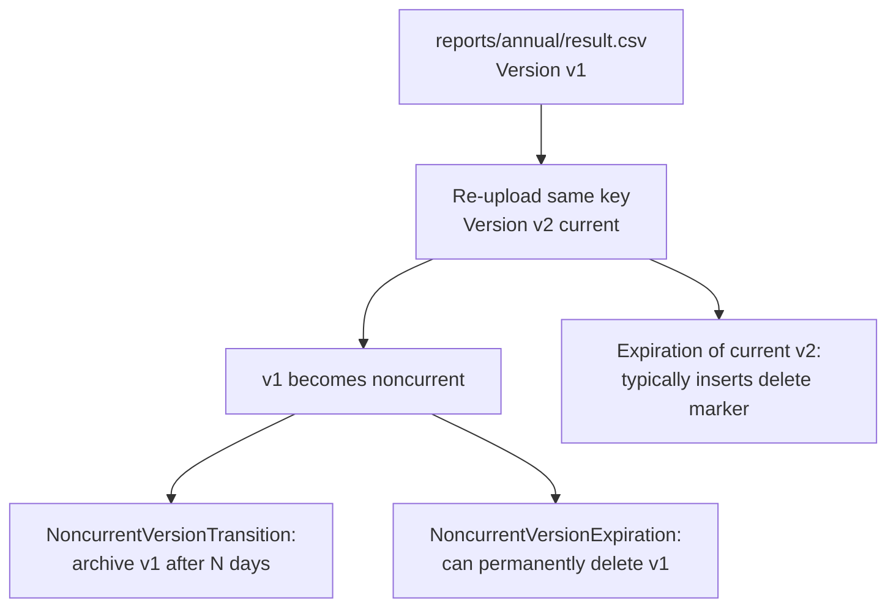
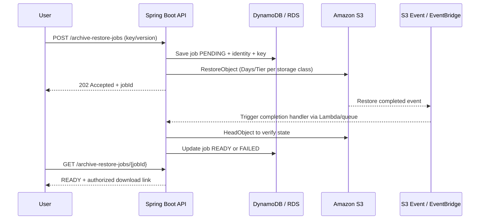
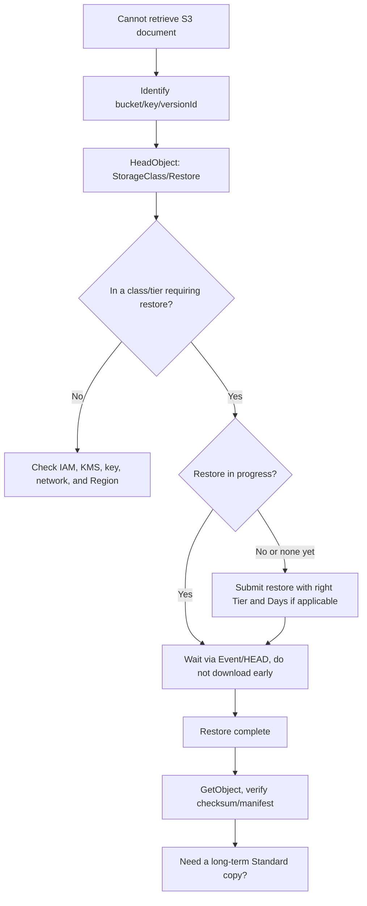

# Lifecycle Rules and Long-Term Archive Data Recovery

> **Module:** CLOUD_PROVIDERS_AWS  
> **Chapter:** S3 Object Storage  
> **Goal:** Design data lifecycles on Amazon S3, transition objects to appropriate storage classes, restore long-term archived data, and control costs, security, and application resilience.

## 1. The Problem: Storing Data Long-Term with Rare Reads Yet Reliable Recovery

A Java/Spring Boot learning management system stores submissions, academic reports, and data exports in **Amazon S3**. Files are accessed heavily during the first month, occasionally after a semester, and may need to be retained for several years for auditing. Keeping every object indefinitely in **S3 Standard** may not be cost-effective. Yet moving everything into an archive tier without a restore workflow will cause application failures when users request older reports.

**S3 Lifecycle** automates object management based on age, key prefix, tags, and size. **S3 restore** is a separate operation: bringing data stored in non-instant-access archive classes or tiers back into a readable state.

Separate three distinct decisions:

1. **When and which data should change storage classes?** → Design Lifecycle rules while accounting for storage-class constraints.
2. **When should data be deleted?** → Define retention periods, Versioning, Object Lock, and deletion approvals.
3. **When archived data is needed, how do we restore it and notify the application?** → Issue a restore request, track status, retrieve data, and verify integrity.

In the AWS module, these concepts connect directly to running applications inside VPC/EC2/Lambda, using IAM to govern S3 API calls, monitoring with CloudWatch and EventBridge, protecting data, and optimizing costs across multi-Region/AZ architectures.

### Learning Outcomes

After this lesson, learners will be able to:

- Explain the components of an **S3 Lifecycle configuration** and the differences among `Transition`, `Expiration`, `NoncurrentVersionTransition`, and `NoncurrentVersionExpiration`.
- Select storage classes for **instant-access**, **infrequent-access**, and **long-term archive** data.
- Create Lifecycle rules scoped to a prefix, avoiding accidental bucket-wide impact.
- Predict the impact of the **128 KiB size threshold**, minimum storage durations, and request/restore fees.
- Restore objects from **S3 Glacier Flexible Retrieval** or **S3 Glacier Deep Archive**, and know when no restore is required.
- Distinguish restoring a **temporary copy** from creating a **permanent S3 Standard copy**.
- Design asynchronous restore workflows for Java/Spring Boot applications with status tracking and error handling.
- Avoid confusing Lifecycle with backups, accidental-deletion protection, or disaster recovery solutions.

## 2. What Does S3 Lifecycle Manage?

S3 Lifecycle is a **bucket-level** configuration. A bucket can contain multiple **rules**; each rule includes:

| Component | Role | Example |
|---|---|---|
| `ID` | Rule identifier | `archive-annual-reports` |
| `Status` | Enables or disables the rule | `Enabled` or `Disabled` |
| `Filter` | Selects objects by prefix, tags, and/or object size | Matches only keys starting with `reports/annual/` |
| `Transitions` | Moves **current object versions** to another storage class by object age | After 90 days → `GLACIER` |
| `Expiration` | Expires current versions after a configured age/date | After 2,555 days, if policy permits |
| `NoncurrentVersionTransitions` | Transitions versions that have become noncurrent | 90 days after becoming noncurrent |
| `NoncurrentVersionExpiration` | Permanently deletes noncurrent versions when eligible | After approved retention period |
| `AbortIncompleteMultipartUpload` | Cleans up abandoned multipart uploads | Aborts incomplete uploads after 7 days |

In the AWS Console, some actions appear under labels such as **Move current versions**, **Move noncurrent versions**, **Expire current versions**, **Permanently delete noncurrent versions**, or **Delete incomplete multipart uploads**.

**Important:** S3 Lifecycle acts primarily on **object/version age, prefixes, tags, and size**—it does not dynamically pick storage classes based on actual download counts. If you need automatic tier movement driven by access patterns, evaluate **S3 Intelligent-Tiering**; if using Lifecycle to transition objects into Intelligent-Tiering, review the applicable fee rules and conditions.

### 2.1. Prefixes in S3 Are Key Substrings

Suppose bucket `course-archive-demo-123456789012` holds:

```text
reports/annual/2025/result.csv
reports/annual/2026/result.csv
reports/monthly/2026-10.csv
uploads/student-01/submission.zip
logs/app/2026-11-20.log
```

A prefix filter `reports/annual/` matches **the first two objects**. S3 does not interpret "folders" like a Linux filesystem; `/` is simply a character in the key.

**Pitfall:** A prefix of `reports/` matches both `reports/annual/` and `reports/monthly/`. Applying a rule bucket-wide when you only meant to archive annual reports can strip instant-read access from active reports.

### 2.2. Lifecycle Is Not Instantaneous

An object reaching the age threshold merely becomes **eligible** for transition or expiration. S3 executes Lifecycle actions **asynchronously**, so the actual transition or deletion can occur later than the exact day boundary. Billing adjustments typically take effect when the object becomes eligible, with specific exceptions such as transitions to S3 Intelligent-Tiering.

Therefore, never build application logic expecting "at exactly 00:00:00 the object is guaranteed transitioned or deleted." If compliance requires deletion by a strict deadline, implement a separate API deletion and verification workflow.

## 3. Archive-Related Storage Classes

Exact storage class naming matters, because **not every class with "Glacier" in its name requires an async restore**.

| Storage Class / Tier | Access Method | Minimum Retention to Avoid Early-Deletion Fees | Use Case |
|---|---|---|---|
| **S3 Standard** | Direct read, low latency | No archive-style minimum | Frequently accessed data |
| **S3 Standard-IA** | Direct read, retrieval fee applies | **30 days** | Infrequently read data needing instant access |
| **S3 One Zone-IA** | Direct read, stored in a single AZ | **30 days** | Recreatable data tolerating single-AZ loss |
| **S3 Glacier Instant Retrieval** | **Direct read**, no `RestoreObject` needed | **90 days** | Long-lived, rarely read data needing millisecond latency |
| **S3 Glacier Flexible Retrieval** | **Requires async restore** | **90 days** | Infrequent archive tolerating minutes/hours wait |
| **S3 Glacier Deep Archive** | **Requires async restore** | **180 days** | Ultra-long-term archive tolerating many hours or longer |
| **S3 Intelligent-Tiering Archive Access tier** | Must initiate restore to return to Frequent Access tier | Per Intelligent-Tiering mechanics | Rarely accessed data under auto-tiering |
| **S3 Intelligent-Tiering Deep Archive Access tier** | Must initiate restore to return to Frequent Access tier | Per Intelligent-Tiering mechanics | Very rarely accessed data tolerating slow recovery |

The **30/90/180-day** intervals in the table are **billing minimum storage durations**, not commitments by AWS to delete objects after that many days. You can retain data longer and tailor Lifecycle rules to your needs.

**Distinctions:**

- `GLACIER_IR` is **S3 Glacier Instant Retrieval**: read directly with standard `GetObject`, no restore step.
- `GLACIER` is **S3 Glacier Flexible Retrieval**: must call `RestoreObject` before `GetObject`.
- `DEEP_ARCHIVE` is **S3 Glacier Deep Archive**: must call `RestoreObject`; restore times are typically longer than Flexible Retrieval.
- For **Intelligent-Tiering**, archive tiers are **access tiers inside the `INTELLIGENT_TIERING` storage class**, and their restore mechanics differ from Glacier Flexible/Deep.

### 3.1. "Durability" and "Immediate Availability" Are Different

An object in Deep Archive is designed for the same high durability, yet you **cannot download it immediately the way you read S3 Standard**. Durability measures resilience against data loss, whereas retrieval time measures latency when accessing data.

If an application has a **10-minute RTO**, you cannot default to Deep Archive and expect users to download results immediately. Design a Standard cache/copy layer, pick Instant Retrieval, or adjust recovery expectations.

### 3.2. Selection Table by Business Requirement

| Requirement | Suitable Candidate | Why |
|---|---|---|
| Users download lecture materials anytime | S3 Standard or appropriate Intelligent-Tiering | Instant access |
| Reports rarely read yet must return within seconds | S3 Glacier Instant Retrieval | No restore job wait |
| Reconciliation data that can wait a few hours | S3 Glacier Flexible Retrieval | On-demand archive restore |
| Multi-year records, very rare access, 12–48 hr wait acceptable | S3 Glacier Deep Archive | Prioritizes storage savings over retrieval speed |
| Data with unpredictable access patterns | S3 Intelligent-Tiering (evaluate optional archive tiers) | Automatically adapts to access patterns |
| Regulated records protected against early deletion | Versioning + Object Lock + appropriate retention workflow | Lifecycle alone does not prevent accidental/malicious deletion |

## 4. Designing a Timeline for Long-Term Reports

Suppose business requirements specify:

- For the **first 90 days**, annual reports stay in S3 Standard for frequent access.
- At **day 90** after object creation, transition to **S3 Glacier Flexible Retrieval**.
- At **day 365** after object creation, transition to **S3 Glacier Deep Archive**.
- **Do not auto-delete** data yet because no deletion retention policy has been approved.



**Transition day counts are measured from the object/current-version creation date.** In the example, "365 days to Deep Archive" **does not mean waiting another 365 days after the Flexible step**. From day 90 to day 365 is 275 days, well beyond Glacier Flexible Retrieval's 90-day minimum billing period.

This is a **hypothetical model** for practice, not a universal schedule for every business. Organizations may retain records for 3 years, 7 years, or indefinitely; gather legal and product inputs before configuring Expiration.

### 4.1. Cost and Behavior Across Stages

| Time | Expected Storage Class | Can App Call `GetObject` Immediately? | When Needed |
|---|---|---|---|
| Day 20 | Standard | Yes | Direct read |
| Day 150 | Glacier Flexible Retrieval | No | Restore, wait for completion, then read |
| Day 400 | Glacier Deep Archive | No | Standard/Bulk restore, longer wait |
| After Flexible/Deep restore | **Original storage class remains archive** | Yes **while the temporary copy is valid** | Download or copy to Standard if needed long-term |

## 5. Configuring a Lifecycle Rule via the AWS Console

Example walkthrough on a **general purpose S3 bucket** you own. Menu labels may vary slightly across Console updates.

1. Open the [Amazon S3 Console](https://console.aws.amazon.com/s3/) and select the target AWS account and bucket.
2. Go to **General purpose buckets → select bucket → Management**.
3. Under **Lifecycle rules**, choose **Create lifecycle rule**.
4. Enter a rule name, such as `archive-annual-reports`.
5. Under rule scope, select **Limit the scope of this rule using one or more filters**.
6. Enter the prefix `reports/annual/`, ensuring you do not select the entire bucket.
7. Select the action **Move current versions of objects between storage classes**.
8. Configure transition to **S3 Glacier Flexible Retrieval** after **90 days** from creation, and **S3 Glacier Deep Archive** after **365 days**.
9. Leave **Expire current versions** and **Permanently delete noncurrent versions** unchecked unless retention/deletion requirements are confirmed.
10. Review warnings regarding storage class pricing, object sizes, and minimum durations; verify the target scope.
11. Create the rule, then reopen its details to verify the filter, **Enabled** status, transition days, and actions.
12. Monitor sample objects via the S3 Console, S3 Inventory, or HEAD API over the coming days; transitions do not complete instantly.

**Key note:** When Versioning is enabled, current-version transitions differ from **noncurrent-version** transitions. Do not mistakenly apply expiration actions to older versions that applications still rely on for recovery.

### 5.1. Why Start with a Narrow Prefix?

Suppose the same bucket holds `uploads/`, `reports/annual/`, and `reports/realtime/`. Applying a rule bucket-wide could push real-time reports and active user files into an async-restore tier. Designing clear prefixes or tags upfront prevents unintended blast radius.

Test first in a **sandbox bucket** or an isolated prefix rather than applying new policies directly to Production before auditing all existing objects. A new Lifecycle rule will also evaluate **existing objects that already meet the age criteria**.

## 6. Configuring Lifecycle via AWS CLI and JSON

Assuming the operator has bucket Lifecycle permissions, CLI commands enable repeatable deployment and Infrastructure-as-Code verification.

### 6.1. Sample JSON: Archive Annual Reports Without Auto-Deletion

Create `lifecycle.json` in **your AWS CLI working environment** with:

```json
{
  "Rules": [
    {
      "ID": "archive-annual-reports",
      "Status": "Enabled",
      "Filter": {
        "Prefix": "reports/annual/"
      },
      "Transitions": [
        {
          "Days": 90,
          "StorageClass": "GLACIER"
        },
        {
          "Days": 365,
          "StorageClass": "DEEP_ARCHIVE"
        }
      ]
    }
  ]
}
```

In the API/CLI:

- `GLACIER` = **S3 Glacier Flexible Retrieval**.
- `DEEP_ARCHIVE` = **S3 Glacier Deep Archive**.
- `Days` is object age since creation, not reset at prior transitions.
- This config **contains no Expiration**, so it does not actively delete objects by age.
- If the bucket already has other rules, they must be included in the full configuration or they will be overwritten.

**Critical warning:** `PutBucketLifecycleConfiguration` **replaces the entire bucket Lifecycle configuration**—it does not merely append one rule. Before writing, fetch the current configuration and **merge** the rules you want to preserve. Never run this single-rule example against a bucket that already has active rules.

### 6.2. Read Current Configuration Before Modifying

```bash
# Read-only operation: inspect active Lifecycle configuration.
aws s3api get-bucket-lifecycle-configuration \
  --bucket course-archive-demo-123456789012 \
  --region ap-southeast-1
```

If the bucket has no Lifecycle configuration yet, the API returns `NoSuchLifecycleConfiguration`; this does not mean the bucket is missing. If rules exist, back up the current config per team procedures and append your new rule instead of overwriting.

### 6.3. Apply Configuration After Verification

```bash
# Run only on a sandbox bucket or after change review.
aws s3api put-bucket-lifecycle-configuration \
  --bucket course-archive-demo-123456789012 \
  --lifecycle-configuration file://lifecycle.json \
  --region ap-southeast-1
```

Read back to verify:

```bash
aws s3api get-bucket-lifecycle-configuration \
  --bucket course-archive-demo-123456789012 \
  --region ap-southeast-1
```

Managing Lifecycle requires permissions such as `s3:PutLifecycleConfiguration` on the bucket. Reading requires `s3:GetLifecycleConfiguration`. Organizational and bucket policies may enforce additional conditions.

### 6.4. Do Not Expect API Calls to Simulate "Immediate Transition" of All Objects

After saving the rule, S3 evaluates Lifecycle in the background. Do not expect an old object to immediately show `StorageClass=DEEP_ARCHIVE` seconds after calling `put-bucket-lifecycle-configuration`. To test, monitor aged objects over time or read back the configuration to confirm the rule definition.

If you need to move **one specific object immediately**, use an explicit copy/storage-class change operation; that is not how Lifecycle configuration commands behave.

## 7. Constraints That Alter Outcomes and Costs

### 7.1. Default Rule: Objects Under 128 KiB Are Not Transitioned

Under current default behavior for new or updated Lifecycle configurations, S3 **does not transition objects smaller than 128 KiB** to any storage class unless explicitly overridden. AWS introduced this default change in **September 2024**.

Example:

| Object | Size | 90-Day Rule to Glacier Flexible | Expected Behavior Under Current Default |
|---|---:|---|---|
| `annual-report.csv` | 12 MiB | Eligible if other conditions match | Transitions when eligible |
| `summary.json` | 50 KiB | Blocked by default size threshold | Does not transition |
| `invoice.pdf` | 256 KiB | Eligible if other conditions match | Transitions when eligible |

**128 KiB = 131,072 bytes**. If truly required, you can add `ObjectSizeGreaterThan`/`ObjectSizeLessThan` size filters or AWS-supported API options to override the default. However, transitioning millions of tiny objects is rarely economical because **each object incurs transition/request fees and metadata overhead**.

Lifecycle configurations created **before September 2024** may still retain legacy behavior for small objects until modified. Always inspect actual bucket configurations rather than assuming every legacy bucket behaves identically.

### 7.2. Minimum Storage Duration Is Not an Auto-Delete Deadline

Several classes enforce minimum billing periods:

| Storage Class | Billing Minimum Duration |
|---|---:|
| Standard-IA / One Zone-IA | 30 days |
| Glacier Instant Retrieval | 90 days |
| Glacier Flexible Retrieval | 90 days |
| Glacier Deep Archive | 180 days |

Deleting or transitioning an object too early **can still incur prorated charges for the remainder of the minimum period**. Successive transition steps must also obey AWS-supported minimums; do not design "day 4 Instant Retrieval, day 20 Deep Archive" assuming it is free of early-transition charges.

### 7.3. Small Objects and Metadata Overhead

For Glacier Flexible Retrieval and Deep Archive, AWS adds **roughly 40 KiB of metadata overhead per archived object**, billed across the relevant classes. Transition requests and future retrieval requests also incur fees.

Illustrative math:

```text
100,000 objects, 20 KiB each
Payload volume    = 100,000 × 20 KiB ≈ 1.91 GiB
Metadata overhead = 100,000 × 40 KiB ≈ 3.81 GiB
```

This illustrates **data volume**, not an exact invoice. Trying to transition these tiny objects by overriding the small-object default can cost more in metadata and transition requests than it saves. Consider **batching/packing small objects into larger archives** in a way that preserves safe search and recovery.

### 7.4. Avoiding Overlapping Lifecycle Rules

An object can match multiple rules. When two rules conflict, AWS applies action precedence rules—for instance, **permanent deletion can take precedence over transition** when both are eligible simultaneously.

Never rely on visual rule ordering to guess behavior. Write disjoint, unambiguous filters, review bucket-wide rules as reviewed Infrastructure as Code, and test in a sandbox first.

### 7.5. Objects Under Replication or Object Lock

With S3 Replication, versions whose replication status is `PENDING` or `FAILED` may not qualify for transition as expected. S3 Object Lock protects locked versions from permanent deletion, though Lifecycle can still transition objects when allowed.

Therefore, if a rule appears "stuck," check **storage class, object size, replication status, versioning, and retention**, not just the day count.

## 8. When Must You Restore Data?

**Restore** specifically applies to storage classes or access tiers that do not support instant reads. For objects transitioned to **Glacier Flexible Retrieval** or **Deep Archive**, `GetObject` will fail until the object is restored.



**Do not confuse the names:**

- **Glacier Instant Retrieval** needs no async restore step.
- **Glacier Flexible Retrieval / Deep Archive** need a restore to create a **temporary readable copy**.
- **Intelligent-Tiering Archive Access / Deep Archive Access** need a restore to **move the object back to the Frequent Access tier**, not to create a `Days`-expiring temporary copy like Glacier Flexible/Deep.

### 8.1. Restoring Does Not Change the Original Storage Class in Glacier Flexible/Deep

After a successful restore from Glacier Flexible or Deep Archive:

1. The **original archived object** remains in its archive storage class.
2. S3 serves a **temporary copy** readable for the requested number of days.
3. Once that period expires, the temporary copy disappears; reading again requires another restore.
4. To **keep the object long-term in S3 Standard**, you must **copy** the restored object to a new object/key with the desired storage class.

Never say "restoring permanently moves the object back to Standard." That is one of the most common operational misconceptions with S3 archives.

### 8.2. Retrieval Speeds: Expedited, Standard, Bulk

| Archive Source | Expedited | Standard | Bulk |
|---|---|---|---|
| Glacier Flexible Retrieval | Typically 1–5 min for smaller objects per AWS terms | Typically 3–5 hours | Typically 5–12 hours |
| Glacier Deep Archive | **Not supported** | Typically ~12 hours | Typically up to 48 hours |
| Intelligent-Tiering Archive Access | Expedited option available per terms | Typically 3–5 hours | Typically 5–12 hours |
| Intelligent-Tiering Deep Archive Access | **Not supported** | Typically ~12 hours | Typically up to 48 hours |

These are **typical times per AWS documentation**, not guaranteed SLAs. Restoring massive data volumes, millions of objects, or exceeding quotas can take longer. Expedited costs more and may require **provisioned capacity** to guarantee restore availability where supported.

**Choose by RTO:** an incident needing data in minutes cannot depend on Deep Archive. If waiting one or two days to recover millions of objects is acceptable, Bulk offers major cost savings.

## 9. Hands-On Restore via the AWS Console

Suppose a sample report was transitioned to S3 Glacier Flexible Retrieval at:

```text
s3://course-archive-demo-123456789012/reports/annual/2025/result.csv
```

Steps:

1. Open **S3 Console → General purpose buckets → select bucket → Objects**.
2. Locate the exact key and verify its **Storage class** and **Version ID** (if Versioning is enabled).
3. Select the object and choose **Actions → Initiate restore**.
4. For Glacier Flexible/Deep, enter **Number of days that the restored copy is available**, e.g., **7 days**.
5. Choose the **Retrieval tier** (Standard/Bulk; Expedited only where supported) aligned with RTO and budget.
6. Confirm the restore request and monitor the object's status; **do not attempt to download while the job is still running**.
7. Once status shows complete, download it or copy it to a new key for long-term use.
8. Verify content, checksums/manifests, and permissions before notifying users that data is ready.

If the object sits in **Intelligent-Tiering Archive Access or Deep Archive Access**, the Console flow is similar except you do not specify temporary copy retention days, because the object returns to the **Frequent Access tier**.

**Do not create billable archive objects solely to click through the UI.** You can practice reading metadata in an existing sandbox, draft a restore plan, and execute once valid archived objects exist.

## 10. Hands-On Restore via the AWS CLI

The AWS CLI is well-suited for automating restore requests and status checks. The commands below target **Glacier Flexible Retrieval or Glacier Deep Archive**; for Intelligent-Tiering archive tiers, the request payload differs because it **omits `Days`**.

### 10.1. Read Metadata Before Restoring

```bash
aws sts get-caller-identity

aws s3api head-object \
  --bucket course-archive-demo-123456789012 \
  --key reports/annual/2025/result.csv \
  --region ap-southeast-1 \
  --query '{StorageClass:StorageClass,Restore:Restore,VersionId:VersionId,Size:ContentLength}'
```

The response may show `StorageClass: "GLACIER"` or `"DEEP_ARCHIVE"`. The `Restore` field is absent if no restore has been requested yet. `HeadObject` authorization is evaluated alongside `s3:GetObject` and applicable policies.

### 10.2. Submit a Restore Request Without Printing Credentials

Create `restore-request.json`:

```json
{
  "Days": 7,
  "GlacierJobParameters": {
    "Tier": "Standard"
  }
}
```

Submit the request:

```bash
aws s3api restore-object \
  --bucket course-archive-demo-123456789012 \
  --key reports/annual/2025/result.csv \
  --restore-request file://restore-request.json \
  --region ap-southeast-1
```

This command does not return the object body. API acceptance **does not mean the object is readable yet**. Submitting duplicate requests while one is active can return `RestoreAlreadyInProgress`; check status rather than retrying blindly.

**Alternative tiers:** for Bulk, change `"Tier": "Bulk"`. Glacier Flexible Retrieval supports Expedited, whereas Deep Archive does not.

### 10.3. Poll Progress with HEAD

```bash
aws s3api head-object \
  --bucket course-archive-demo-123456789012 \
  --key reports/annual/2025/result.csv \
  --region ap-southeast-1 \
  --query '{Restore:Restore,StorageClass:StorageClass,VersionId:VersionId}'
```

Example `Restore` field while running:

```text
ongoing-request="true"
```

Meaning S3 is still restoring. Once complete, it looks like:

```text
ongoing-request="false", expiry-date="Wed, 25 Nov 2026 00:00:00 GMT"
```

The date above is a **simulated example**, not a fixed AWS guarantee. `expiry-date` shows when the Glacier Flexible/Deep temporary copy expires; AWS calculates it from restore completion rounded up to 00:00 UTC.

Prefer **S3 Event Notifications** for restore-completed events if downstream processing is automated; avoid tight polling loops calling HEAD every second.

### 10.4. Download the Object After Restore Completes

```bash
aws s3api get-object \
  --bucket course-archive-demo-123456789012 \
  --key reports/annual/2025/result.csv \
  --region ap-southeast-1 \
  ./result-restored.csv
```

This downloads the file to the CLI host; verify local paths and never save sensitive records into shared/public directories. If the temporary copy has expired, submit a new restore request.

### 10.5. Keeping a Permanent Copy in S3 Standard

If the object needs ongoing instant access without waiting for future restores, once the temporary copy is ready, **copy it to a new key** in S3 Standard.

Example for an already-restored object **no larger than 5 GiB**:

```bash
aws s3api copy-object \
  --bucket course-archive-demo-123456789012 \
  --copy-source course-archive-demo-123456789012/reports/annual/2025/result.csv \
  --key recovered/2025/result.csv \
  --storage-class STANDARD \
  --region ap-southeast-1
```

The destination `recovered/` sits **outside the `reports/annual/` prefix** targeted by our archive rule, preventing the newly copied Standard object from being re-archived by the same rule later.

For objects **larger than the single-request `CopyObject` limit (5 GiB)**, use a multipart copy workflow or appropriate tool. When metadata, tags, SSE-KMS encryption, ACLs, or permissions must be preserved, specify the relevant copy parameters explicitly; the example above focuses purely on storage class and key.

**Copying creates a second object with its own storage charges.** Verify content and downstream delivery, then clean up copies once no longer needed.

## 11. Special Case: Intelligent-Tiering Archive Access

An object in **S3 Intelligent-Tiering** moves automatically across access tiers. If optional archive tiers are enabled, objects cannot be read immediately while in **Archive Access** or **Deep Archive Access**.

When restoring from these two tiers:

- Do not pass `Days` for a temporary copy.
- Upon completion, the object **transitions back to the Frequent Access tier** of the same Intelligent-Tiering storage class.
- There is no temporary copy expiring after N days as in Glacier Flexible/Deep.
- Subsequent inactivity continues to be managed by Intelligent-Tiering rules.

Because `head-object` on an Intelligent-Tiering object still reports **storage class `INTELLIGENT_TIERING`**, checking storage class alone is **not enough** to know the active access tier. Inspect additional AWS status/tier fields (`ArchiveStatus`), S3 Inventory, or appropriate monitoring metrics.

**Quick comparison:**

| Question | Glacier Flexible / Deep | Intelligent-Tiering Archive Tier |
|---|---|---|
| Must initiate restore? | Yes | Yes |
| Where is the object after restore? | Original archive + **temporary readable copy** | Moved back to **Frequent Access tier** |
| Specify `Days`? | Yes | **No** |
| When `Days` expires | Temporary copy disappears; archive remains | Not applicable |
| Want a permanent Standard copy? | Copy to a new Standard object | Optionally copy if moving to a different storage class |

Never reuse the same `Days`-based restore JSON across both mechanisms.

## 12. Versioning: Current Versions, Noncurrent Versions, and Delete Markers

When **S3 Versioning** is enabled, each upload to the same key creates a new version, turning the previous one into a **noncurrent version**.



Key differences:

| Action | Unversioned Bucket | Versioning-Enabled Bucket |
|---|---|---|
| `Transition` | Transitions the current object | Transitions the current version |
| `Expiration` | Deletes object irreversibly unless backed up | Typically inserts a **delete marker**; older versions remain noncurrent |
| `NoncurrentVersionTransition` | Not applicable | Transitions older versions once eligible |
| `NoncurrentVersionExpiration` | Not applicable | **Permanently deletes** eligible noncurrent versions |

**Do not assume "having Versioning" guarantees data can never be lost.** `NoncurrentVersionExpiration` permanently deletes older versions, and administrative actions or misconfigurations can still impact data. Define explicit retention schedules.

### 12.1. Example Noncurrent Version Management

Suppose requirements state:

- Keep the current version as the latest report under an appropriate archive policy.
- Retain noncurrent versions for at least 180 days after being superseded.
- Do not delete noncurrent versions yet pending compliance review.

You can configure `NoncurrentVersionTransition` while **omitting** `NoncurrentVersionExpiration`. If deletion rules are later approved, configure noncurrent expiration carefully after checking minimum storage durations and validating on test data.

For noncurrent versions, `NoncurrentDays` is counted **from the date a version became noncurrent**, not from initial upload age. You can also specify how many **newer noncurrent versions** to retain; understand how both conditions interact before enabling automated deletion.

### 12.2. Restoring the Exact Version ID

When a key has multiple versions, you may need to restore a **specific version**. Omitting `--version-id` targets the **current version**. If an object is hidden behind a delete marker, calling restore by key alone fails or misses the older version.

Safe workflow:

1. List versions with authorized permissions to locate the exact point-in-time version.
2. Check `StorageClass` and restore status of the **selected version**.
3. Submit the restore request with `--version-id` when needed.
4. Once complete, download using the exact same `version-id` and verify checksums/manifests before using.

Read-only example:

```bash
aws s3api list-object-versions \
  --bucket course-archive-demo-123456789012 \
  --prefix reports/annual/2025/result.csv \
  --region ap-southeast-1
```

Never guess or use a placeholder `--version-id` in a restore call on real data. Always fetch the exact ID from the API or Console.

## 13. Object Lock, Retention, and Data Protection Requirements

**S3 Object Lock** applies retention periods or legal holds to **object versions** when Versioning is enabled. It enforces WORM (*write once, read many*) compliance and blocks premature permanent deletion.

| Concept | Purpose | Relation to Lifecycle |
|---|---|---|
| Versioning | Retains multiple versions of the same key | Enables recovering older versions if not deleted |
| Lifecycle Expiration | Age-based object expiration | Typically inserts a delete marker in versioned buckets |
| `NoncurrentVersionExpiration` | Deletes old versions | Permanently deletes unless blocked by Lock/legal hold |
| Object Lock retention | Blocks premature version deletion | Lifecycle cannot permanently delete locked versions |
| Legal hold | Retains version until explicitly lifted by an authorized identity | Blocks permanent deletion independently of retention dates |
| S3 Replication / Backup | Maintains copies for recovery | Complements Versioning and Lifecycle; does not replace retention rules |

**Note:** Object Lock does not block inserting a **delete marker** or uploading a new version to the key. An object can appear deleted to normal readers while the locked version remains intact and recoverable by authorized principals.

**Never configure Expiration carelessly** on financial, healthcare, audit, or contractual data without verified retention and disposal policies. Lifecycle is automation capable of permanent deletion—always peer-review and test impact before enabling.

## 14. Integrating Restores into a Java/Spring Boot Application

An HTTP endpoint such as `GET /reports/2025/download` **must never invoke restore and hold the HTTP request open for hours**. Restores are asynchronous workflows; applications should return a job status and notify callers when the file is ready.

### 14.1. Business Workflow Design



The diagram depicts an **event-consumer** architecture; EventBridge/S3 notifications do not call your app's REST API without configured targets/consumers. You can route S3 Event Notifications → SQS/Lambda to update the DB. Even with events, keep a periodic reconciliation/polling fallback so jobs never get stuck indefinitely if an event is missed.

### 14.2. Job States to Track

| State | Meaning | Handling |
|---|---|---|
| `REQUESTED` | User requested a valid key/version | Validate permissions, quotas, RTO, and cost estimates |
| `RESTORING` | AWS accepted the restore request | Disallow download until complete |
| `READY` | HEAD confirms the object is readable | Issue a short-lived authorized download link |
| `EXPIRED` | Temporary restored copy expired | Allow submitting a new restore request |
| `FAILED` | Request failed, policy denied, or job could not finish | Log actionable diagnostics; retry with control |

Bind `jobId` strictly to **bucket/key/versionId/customerId** to prevent cross-user or cross-tenant data leaks. Never accept arbitrary bucket/key pairs from clients and read them with an overly privileged role.

### 14.3. AWS SDK for Java 2.x: Creating a Restore Request

Example targeting **Glacier Flexible Retrieval or Deep Archive**, using the workload's default credentials chain (EC2 IAM role, Lambda execution role, or ECS task role) without hardcoded access keys:

```java
import software.amazon.awssdk.regions.Region;
import software.amazon.awssdk.services.s3.S3Client;
import software.amazon.awssdk.services.s3.model.GlacierJobParameters;
import software.amazon.awssdk.services.s3.model.RestoreObjectRequest;
import software.amazon.awssdk.services.s3.model.RestoreRequest;
import software.amazon.awssdk.services.s3.model.Tier;

public final class ArchiveRestoreExample {
    public static void main(String[] args) {
        String bucket = "course-archive-demo-123456789012";
        String key = "reports/annual/2025/result.csv";

        try (S3Client s3 = S3Client.builder()
                .region(Region.AP_SOUTHEAST_1)
                .build()) {

            RestoreRequest restore = RestoreRequest.builder()
                .days(7)
                .glacierJobParameters(
                    GlacierJobParameters.builder()
                        .tier(Tier.STANDARD)
                        .build())
                .build();

            s3.restoreObject(
                RestoreObjectRequest.builder()
                    .bucket(bucket)
                    .key(key)
                    .restoreRequest(restore)
                    .build());

            // Request acceptance does not mean the object is ready yet.
            System.out.println("Restore request accepted; check asynchronously");
        }
    }
}
```

This snippet uses **AWS SDK for Java 2.x**, requiring the `software.amazon.awssdk:s3` dependency and the bucket's real Region. In Spring Boot, manage `S3Client` via dependency injection, configure timeouts/retries, persist job state, and enforce user/tenant authorization.

**Do not reuse this exact payload for Intelligent-Tiering archive tiers:** that mechanism rejects `days(...)`. Build separate request parameters per storage class/tier and current AWS API rules.

### 14.4. Checking Status with the SDK

Sample metadata check after submitting a restore:

```java
import software.amazon.awssdk.services.s3.model.HeadObjectResponse;

// s3 is a configured S3Client; bucket/key come from a validated job record.
HeadObjectResponse metadata = s3.headObject(request -> request
    .bucket(bucket)
    .key(key));

String restoreHeader = metadata.restore();
System.out.println("Storage class: " + metadata.storageClass());
System.out.println("Restore status: " + restoreHeader);
```

This is an **illustrative snippet** for integration into a service where `s3`, `bucket`, and `key` are defined. To inspect a specific version, pass `versionId` to `HeadObjectRequest`. Even after HEAD shows `ongoing-request="false"`, verify `GetObject` permissions, copy expiration, and access conditions.

### 14.5. Providing Download Access to Users

Once data is ready, generate a short-lived **presigned URL** via S3 Presigner on the backend, scoped to the exact object and authorized user. Enforce a short TTL and verify authorization before issuing the URL; never make an archive bucket public just to simplify downloads.

If users repeatedly request the same historical files, consider **intentionally copying them to S3 Standard** or fronting with a TTL cache instead of triggering repeated uncontrolled restores.

## 15. IAM, Networking, and Encryption During Restores

### 15.1. Least-Privilege Permissions

An operational restore role typically requires:

| Task | Common IAM Permission | Scope |
|---|---|---|
| View Lifecycle rules | `s3:GetLifecycleConfiguration` | Bucket ARN |
| Modify Lifecycle rules | `s3:PutLifecycleConfiguration` | Bucket ARN |
| Find objects | `s3:ListBucket` | Bucket ARN, optionally scoped by prefix |
| Read metadata / download object | `s3:GetObject` | Object ARN / prefix |
| Submit restore request | `s3:RestoreObject` | Object ARN / prefix |
| Copy to a new key | Source `s3:GetObject`, dest `s3:PutObject` | Source/destination object scopes |
| Handle versions | `s3:GetObjectVersion`, `s3:ListBucketVersions`, plus version restore permissions | Per version and scope |

Illustrative identity-based policy **allowing only viewing and restoring** objects under `reports/annual/` (without deleting or editing Lifecycle):

```json
{
  "Version": "2012-10-17",
  "Statement": [
    {
      "Sid": "ListReportKeys",
      "Effect": "Allow",
      "Action": "s3:ListBucket",
      "Resource": "arn:aws:s3:::course-archive-demo-123456789012",
      "Condition": {
        "StringLike": {
          "s3:prefix": "reports/annual/*"
        }
      }
    },
    {
      "Sid": "ReadAndRestoreReportObjects",
      "Effect": "Allow",
      "Action": [
        "s3:GetObject",
        "s3:RestoreObject"
      ],
      "Resource": "arn:aws:s3:::course-archive-demo-123456789012/reports/annual/*"
    }
  ]
}
```

This sample policy grants access for **current versions** within the same account assuming no other Denies apply. For specific version IDs, KMS, copying, Object Lock, or cross-account access, extend permissions explicitly for the target resources, accounts, and actions.

### 15.2. Encryption and KMS Permissions

If objects use **SSE-KMS**, reading or copying requires corresponding KMS permissions (such as `kms:Decrypt`) and key policy allowance for the caller. When copying to a new key or bucket encrypted with SSE-KMS, you may also need destination encryption permissions such as `kms:GenerateDataKey`, depending on configuration.

An `AccessDenied` after restore finishes can come from a bucket policy, KMS key policy, VPC endpoint policy, SCP, or another condition. **Never fix it by granting `s3:*` and `kms:*` across all resources.**

### 15.3. VPC and Regional Networking

Applications running on EC2/ECS/Lambda in a **private subnet** must have a valid network route to S3: such as a supported **S3 gateway VPC endpoint** or an appropriate NAT/endpoint path. Valid IAM permissions **do not create network routes**.

S3 buckets are pinned to a single Region; configure the matching Region when creating clients and requests. Cross-Region access, NAT gateways, data transfer, and bulk retrievals affect both cost and performance.

## 16. Monitoring, Auditing, and Troubleshooting

### 16.1. Observing Lifecycle Progress and Outcomes

Useful tools include:

- **S3 Console and `head-object`**: verify storage class, restore status, and metadata for specific objects.
- **S3 Inventory**: export catalogs of objects/versions, storage classes, and configured fields; ideal for batch audits.
- **S3 Storage Lens**: high-level usage/storage metrics and trend analysis.
- **S3 Storage Class Analysis**: helps identify access patterns suitable for transitioning.
- **CloudTrail**: audits Lifecycle config changes (management events); object-level operations require **S3 data events** if detailed auditing is needed.
- **S3 Event Notifications / EventBridge**: listen for supported events like restore completion to trigger downstream jobs.
- **Cost Explorer / Cost and Usage Report**: evaluate storage, transition, request, and retrieval spending.

Never rely on a single notification email to assume every object transitioned, restored, or expired properly. For audit compliance, reconcile **actual object metadata and inventory listings**.

### 16.2. Common Troubleshooting Table

| Symptom | Possible Cause | Diagnostic Steps |
|---|---|---|
| Lifecycle rule Enabled yet object stays Standard | Object too young, smaller than 128 KiB default, filter mismatch, or async job pending | Check creation date, key, tags/size, replication status, and rule definition |
| `GetObject` returns `InvalidObjectState` | Object in Flexible/Deep not restored or temporary copy expired | Check storage class/restore status, initiate restore, wait for completion |
| `RestoreAlreadyInProgress` | Another restore on the same object is already running | Poll HEAD/events instead of submitting duplicate restore calls |
| Restore takes longer than expected | Bulk tier, Deep Archive, huge dataset, or throughput/quota limits | Check retrieval tier, object volume, API status, and RTO assumptions |
| HEAD shows `ongoing-request="false"` yet download fails | IAM/KMS/endpoint policy block, wrong version ID, expired copy, or deleted object | Inspect exact error code, metadata, and effective permissions |
| Restored S3 object becomes unreadable again days later | Temporary restored copy expired | Re-restore or copy to Standard if ongoing reads are needed |
| Noncurrent versions still incur storage fees | Current-version Expiration does not delete old versions | Inspect noncurrent Lifecycle rules, Object Lock retention, and Versioning |
| Object appears deleted yet versions remain | Bucket has Versioning enabled; Lifecycle inserted a delete marker | Run `list-object-versions` to identify versions to recover |
| Lifecycle deleted objects earlier than expected | Overly broad or overlapping Filter/Expiration rules | Audit full config and restore from backups/versions if available |
| Costs increased despite archiving | Transition request fees, 40-KiB overhead, minimum duration fees, restore/retrieval/copy costs | Inspect Cost Explorer/CUR and analyze object counts and sizes |

### 16.3. Clear Debugging Flow



Record the **request ID**, storage class, version ID, and error code when troubleshooting, while never logging access keys, secrets, or sensitive document payloads in tickets or logs.

## 17. Cost Modeling: Look Beyond Per-GB/Month Rates

An archive design should evaluate at least:

| Cost Component | Example Driver |
|---|---|
| Per-class GB-month storage | Standard, Glacier Flexible, Deep Archive |
| Per-request transition fees | Each object transitioned by Lifecycle can incur a request fee |
| Archive metadata overhead | Very high counts of tiny objects |
| Minimum storage duration | Deleting or transitioning too early incurs remainder charges |
| Restore requests and data retrieval | Differs across Standard, Bulk, and Expedited |
| Temporary restored copy | Glacier Flexible/Deep charges for the temporary restored copy while active |
| Copying to Standard and new objects | Additional storage and API request charges |
| S3 Inventory, Athena, CloudWatch, KMS | Observability, querying, and encryption costs |
| Data transfer / NAT / networking | Depends on traffic flows and network topology |

### 17.1. Comparing Two Policies

Suppose a bucket stores **20,000 new reports per month**, averaging **5 MiB** each, retained for 3 years. These are **learning assumptions** with no fixed USD rate:

```text
Monthly added volume = 20,000 × 5 MiB
                     = 100,000 MiB ≈ 97.7 GiB

After 36 months, with no deletion and ignoring metadata:
Object count   ≈ 720,000
Payload volume ≈ 3,516 GiB
```

Option A: **all objects stay in S3 Standard** for 36 months.  
Option B: **90 days Standard → Flexible → 365 days Deep Archive**, then retain.

To compare accurately, calculate **days each cohort spends in each class**, transition request fees for **720,000 objects**, metadata overhead, restore rates, temporary copy days, and Regional pricing. If older reports are almost never downloaded, Option B cuts storage costs substantially. If users frequently demand tens of thousands of old reports immediately, retrieval costs and latency can make Option B unsuitable.

**There is no simple formula based solely on per-GB/month rates.** Model total lifecycle cost using **age distribution, object count, object size, read frequency, RTO, and retention policy**.

### 17.2. Optimization Plan

1. Classify objects by access pattern and retention duration.
2. Avoid transitioning tiny objects unless modeling proves net savings.
3. Audit object counts and metadata overhead, not just total GiB.
4. Choose Bulk retrieval when recovery timelines allow it.
5. Keep temporary Standard copies only as long as needed rather than leaving duplicates forever.
6. Ensure Expiration runs only when **deletion is legally authorized**, never as an unreviewed cleanup shortcut on sensitive data.
7. Use AWS Budgets and Cost Explorer to catch cost anomalies after deploying new rules.

## 18. Capstone Exercise: Retaining Learning Data for 5 Years

**Scenario:** An online learning platform on AWS stores certificate reports and academic records in `s3://course-archive-demo-123456789012/reports/annual/`. Reports are downloaded frequently in the first 3 months, rarely during the first year, and must be retained for **5 years**. Users must be able to request recovery and get notified when ready. Data must never be deleted before the confirmed legal retention period expires.

**Tasks:**

1. Design a storage timeline from **Standard → Glacier Flexible → Deep Archive**. Justify picking day 90 and day 365 or propose alternatives.
2. Write a **Lifecycle JSON** scoped strictly to prefix `reports/annual/`. Do not enable `Expiration` until retention and Versioning rules are verified.
3. Explain the impact of the **128 KiB** default rule if many reports are only 30 KiB.
4. Build a table predicting storage class and instant-read capability at **day 20, day 150, and day 400**.
5. In a sandbox, read Lifecycle via the CLI and inspect an object with `head-object`. If no archived object is present, trace the restore steps on paper.
6. Write a **`RestoreObject` request** for an object in Glacier Flexible with `Days=7` and `Tier=Standard`; explain how to detect completion.
7. Explain why the object remains in `GLACIER` after restore and how to copy it to `recovered/` for long-term Standard access.
8. Compare this design against **Glacier Instant Retrieval** and **Intelligent-Tiering Archive Access**.
9. Design a Spring Boot API that accepts requests, returns `202 Accepted`, persists job state, and handles restore-completed signals via a consumer.
10. Explain what happens if an `Expiration` rule runs on a versioned bucket, and how `NoncurrentVersionExpiration` could cause data loss.
11. Propose least-privilege IAM, KMS protection, Object Lock, and restore auditing for security compliance.
12. List all cost components and how to model total 5-year cost.

### Evaluation Criteria

A complete solution demonstrates:

- Clear distinction between `GLACIER_IR` and `GLACIER`/`DEEP_ARCHIVE`.
- Understanding that Glacier Flexible/Deep restore creates a **temporary readable copy**, while Intelligent-Tiering archive moves objects back to Frequent Access.
- No confusion between Lifecycle `Days` (object age) and elapsed time since a previous transition.
- Consideration of at least **Versioning, Object Lock, transition fees, the 128 KiB threshold, and minimum storage durations**.
- Asynchronous waiting, completion verification, least-privilege IAM, and safeguards against unintended deletion.

### Self-Check Questions

**1. After moving an object to Glacier Instant Retrieval, do you need `RestoreObject` to download it?**  
No. That storage class supports direct reads.

**2. Once a Deep Archive restore finishes, does the object's storage class automatically become Standard?**  
No. The original archive remains in Deep Archive, while a temporary readable copy exists for the specified number of days.

**3. With a Lifecycle rule moving to Flexible at day 90 and Deep Archive at day 365, how many days does the object spend in Flexible before becoming eligible for the next transition?**  
About **275 days**, because transition days are measured from object creation age.

**4. When Versioning is enabled, does current-version `Expiration` permanently delete all versions?**  
No. S3 normally inserts a delete marker; noncurrent versions require separate rules.

**5. Can editing a Lifecycle configuration affect objects created earlier?**  
Yes. Pre-existing objects that already satisfy the rule criteria become eligible once the rule is enabled.

**6. Does restoring from Intelligent-Tiering Archive Access use `Days=7` like Glacier Flexible?**  
No. Restoring moves the object back to the Frequent Access tier; the request omits `Days`.

**7. Why are backups and Lifecycle not the same capability?**  
Lifecycle manages object age, tiering, and expiration; backups provide independent recovery points to restore good data after loss, corruption, or accidental deletion.

**8. If an application needs old reports within 2 seconds, should the sole copy live in Deep Archive?**  
No, unless an instant-access copy/cache exists or the RTO requirement is relaxed.

**9. What should you check if a restore finishes yet `GetObject` still returns `AccessDenied`?**  
IAM policies, bucket policy, version ID, Object Lock/retention if relevant, KMS key policy, VPC endpoint policy, SCPs, and other policy conditions.

**10. Will transitioning one million tiny objects to Glacier definitely save money?**  
No. Transition fees, metadata overhead, and the default 128 KiB threshold can increase total cost.

## 19. Summary and Official AWS References

**S3 Lifecycle** automates data management by age and scope, while **archive restore** is a separate process bringing objects in non-instant classes/tiers back into a readable state. Architects must pick storage classes based on **access patterns and RTO**, write tightly scoped filters, account for transition/retention charges, distinguish **temporary restores** from **permanent copies**, and never enable deletion rules before verifying Versioning, Object Lock, and retention requirements.

Official AWS documentation for reference:

- [Amazon S3 — Managing the lifecycle of objects](https://docs.aws.amazon.com/AmazonS3/latest/userguide/object-lifecycle-mgmt.html)
- [Amazon S3 — Lifecycle configuration elements](https://docs.aws.amazon.com/AmazonS3/latest/userguide/intro-lifecycle-rules.html)
- [Amazon S3 — Examples of Lifecycle configurations](https://docs.aws.amazon.com/AmazonS3/latest/userguide/lifecycle-configuration-examples.html)
- [Amazon S3 — Transitioning objects using Lifecycle](https://docs.aws.amazon.com/AmazonS3/latest/userguide/lifecycle-transition-general-considerations.html)
- [Amazon S3 — Configuring Lifecycle rules](https://docs.aws.amazon.com/AmazonS3/latest/userguide/how-to-set-lifecycle-configuration-intro.html)
- [Amazon S3 — Troubleshooting Lifecycle](https://docs.aws.amazon.com/AmazonS3/latest/userguide/troubleshoot-lifecycle.html)
- [Amazon S3 — Storage classes](https://docs.aws.amazon.com/AmazonS3/latest/userguide/storage-class-intro.html)
- [Amazon S3 — Working with archived objects](https://docs.aws.amazon.com/AmazonS3/latest/userguide/archived-objects.html)
- [Amazon S3 — Restoring an archived object](https://docs.aws.amazon.com/AmazonS3/latest/userguide/restoring-objects.html)
- [Amazon S3 — Archive retrieval options](https://docs.aws.amazon.com/AmazonS3/latest/userguide/restoring-objects-retrieval-options.html)
- [Amazon S3 — RestoreObject API](https://docs.aws.amazon.com/AmazonS3/latest/API/API_RestoreObject.html)
- [Amazon S3 — Versioning and Lifecycle actions](https://docs.aws.amazon.com/AmazonS3/latest/userguide/lifecycle-expire-general-considerations.html)
- [Amazon S3 — Object Lock](https://docs.aws.amazon.com/AmazonS3/latest/userguide/object-lock.html)
- [Amazon S3 — Object notification events](https://docs.aws.amazon.com/AmazonS3/latest/userguide/EventNotifications.html)
- [AWS SDK for Java 2.x — Amazon S3 examples](https://docs.aws.amazon.com/sdk-for-java/latest/developer-guide/java_s3_code_examples.html)

> **Deployment Note:** Bucket names, keys, account IDs, Regions, timelines, sizes, and requests in this lesson are illustrative examples. Verify current feature support, pricing, and retention requirements in your AWS account before applying changes. Configuring `Expiration` or `NoncurrentVersionExpiration` on live data can cause permanent data loss and requires formal change control.
