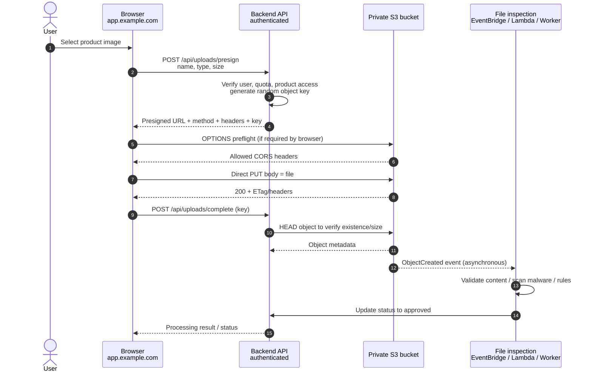
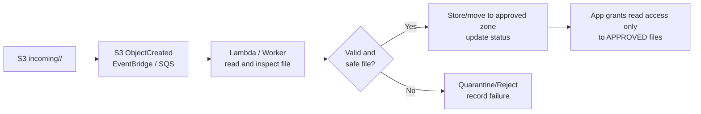
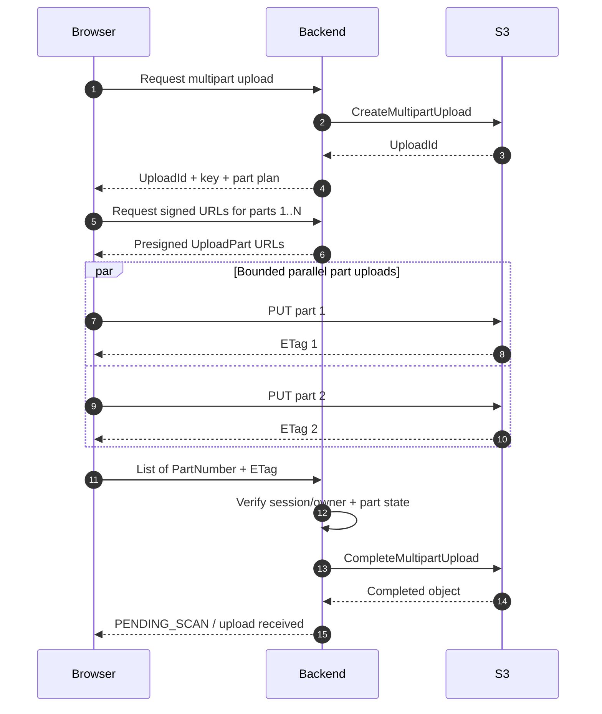
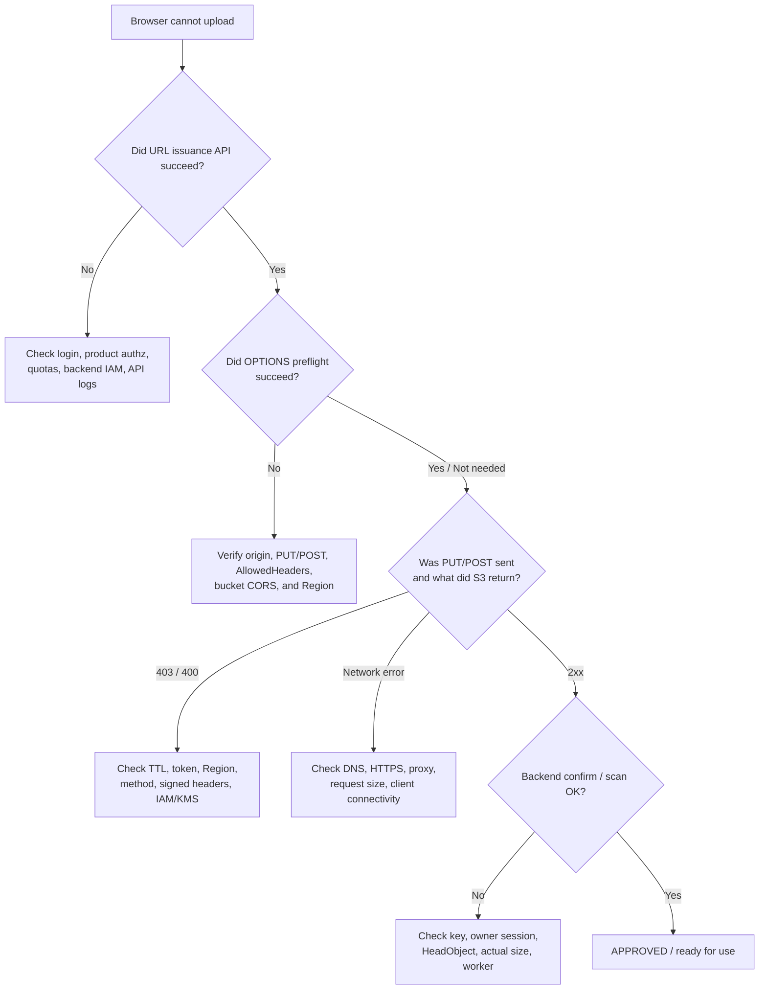

# Presigned URLs, CORS, and Browser Uploads with Amazon S3

Web applications frequently allow users to upload avatars, PDF invoices, documents, or attachments. Routing every file byte through the backend consumes extra application server bandwidth, memory, and long-lived connections. With **Amazon Simple Storage Service (Amazon S3)**, the backend can issue a short-lived **presigned URL** so the browser uploads files directly to S3 **without exposing AWS access keys in frontend code**.

However, a presigned URL operates at the **S3 request authentication** layer, whereas the browser enforces **Cross-Origin Resource Sharing (CORS)** at the web security layer. Configuring only one piece is not enough: a URL can be valid while the browser blocks the response due to CORS; or CORS can allow the origin while S3 still returns `403 AccessDenied` due to IAM permissions.

This lesson belongs to the **S3 Object Storage** chapter of the **CLOUD_PROVIDERS_AWS** module. Within an AWS ecosystem spanning Regions/AZs, IAM, VPC, compute, storage, databases, integration, and serverless, this material builds the skills to design upload/download flows that are **secure, testable, observable, resilient, and cost-controlled**. The focus is **Presigned URLs, CORS, and browser file uploads**; examples use AWS SDK for JavaScript v3, a Node.js backend, and a browser frontend.

## 1. Problem Statement and Target Outcomes

Suppose an e-commerce web app at `https://app.example.com` lets staff upload product images. Images must be stored in a private S3 bucket in Region `ap-southeast-1`. The backend runs on ECS/EC2/Lambda or equivalent infrastructure.

Requirements:

1. Users must be authenticated and authorized to upload images for the right store/product.
2. Never place AWS access keys, secret keys, or session credentials in the browser.
3. Files travel directly from browser to S3; the backend handles only metadata and authorization.
4. Accept only file types, sizes, and upload counts permitted by policy.
5. Keep the bucket private; new objects must be validated before use.
6. The system must detect errors, control costs, record audit evidence, and handle abandoned uploads.

After this lesson, you will be able to distinguish **presigned GET, presigned PUT, and presigned POST**, explain CORS preflight, author CORS policies, implement browser uploads, mitigate risks, and diagnose `403`, `SignatureDoesNotMatch`, `ExpiredToken`, and CORS errors.

## 2. Direct-to-S3 Upload Architecture



This diagram illustrates the logical sequence; the completion call and background processing event **are not guaranteed to arrive in strict order**. The system should persist state in a reliable database, support retries, and handle duplicate events idempotently.

| Component | Responsibility | What Not to Do |
|---|---|---|
| **Browser** | Select files, request URL from API, PUT/POST file to S3, display progress | Embed IAM credentials or decide bucket access rules |
| **Backend** | Authenticate user, check authorization, generate key/URL, track upload session | Blindly trust MIME type, filename, or user ID sent by browser |
| **Signing IAM role** | Permit scoped S3 actions only on the target bucket/prefix | Use `AdministratorAccess` or issue overly long-lived URLs |
| **S3 bucket** | Store objects, validate signatures/permissions, return CORS headers | Enable public PUT/GET "to make uploads easier" |
| **File inspection worker** | Read new object, verify magic bytes/format, scan malware if needed, promote/mark safe | Expose uninspected objects immediately |
| **Business database** | Store owner, key, status, and file metadata | Store a presigned URL long-term as a file identifier |

**Principle:** the browser uploads directly, yet **upload authorization remains strictly with the backend**. A signed URL is a **bearer capability**: anyone holding an active URL can execute the signed action within applicable policy boundaries.

## 3. What Is a Presigned URL?

A **presigned URL** is a URL embedding AWS Signature Version 4 (SigV4) query parameters, allowing a caller without AWS credentials to submit a pre-authorized request to S3. Permissions are evaluated against the **identity that signed the URL**, the requested action, the target object, and applicable policy layers.

A typical URL looks like:

```text
https://shop-uploads-example.s3.ap-southeast-1.amazonaws.com/incoming/...
  ?X-Amz-Algorithm=AWS4-HMAC-SHA256
  &X-Amz-Credential=...
  &X-Amz-Date=...
  &X-Amz-Expires=300
  &X-Amz-SignedHeaders=...
  &X-Amz-Signature=...
```

This shows structure only and is **not a usable URL**. Never paste real presigned URLs into issue trackers, analytics, public chat, or unprotected access logs, because the query string carries temporary access capability.

### 3.1. Three Important Forms

| Form | Usage | Characteristics |
|---|---|---|
| **Presigned GET URL** | Browser downloads a private object or renders a private image | Grants read access to a specific object during TTL; does not grant bucket listing |
| **Presigned PUT URL** | Browser PUTs a file directly to the signed object key | Simple with `fetch`; HTTP method, key, and signed headers must match |
| **Presigned POST** | Browser submits `multipart/form-data` to S3 with signed form fields and policy | Supports policy conditions like `content-length-range`, key prefix/exact match, and `Content-Type` |

**A presigned POST is not a PUT URL sent with method POST.** POST relies on a signed **policy document** and form fields; the browser must submit those exact fields.

### 3.2. What Permissions Does a Presigned URL Grant?

A presigned PUT for `incoming/shop/uuid.png` does **not** permit:

- Listing objects in the bucket.
- Downloading other objects or editing bucket policies.
- Writing any key other than the signed key.
- Deleting objects or invoking unsigned APIs.

Conversely, a valid PUT URL **can be reused for that same key until it expires** unless additional controls exist. PUTting to an existing key overwrites the current object; if S3 Versioning is enabled, previous versions are retained per S3 rules. Always use **unpredictable random keys** paired with session state and write conditions where appropriate.

### 3.3. URL Expiration and Temporary Credentials

With standard SigV4 presigned URLs signed using long-term IAM user credentials, maximum expiration can be up to **7 days** depending on signing method; for upload workflows, use **a few minutes**. If signed with temporary credentials from an IAM role/STS, the URL **stops working as soon as the session credentials expire**, even if `X-Amz-Expires` has time remaining.

Examples:

| Configuration | Expected Effective Lifetime |
|---|---|
| URL signed with `expiresIn=300`, credentials valid for 1 hour | Usable for up to ~5 minutes |
| URL signed with `expiresIn=3600`, credentials expire in 10 minutes | Stops working when credentials expire (~10 minutes) |
| Active URL leaked while valid | Anyone with the URL can execute the signed request; never treat URLs as long-term secrets |

Beyond URL TTL, policies can constrain signature age via condition keys such as `s3:signatureAge` in supported contexts. There is no simple one-click "revoke individual URL" button; consider signature age, role/policy changes, credential rotation, conditional writes, or object state controls.

### 3.4. HTTPS, Region, and Endpoints

Always use **HTTPS** when delivering URLs and uploading files. An S3 bucket lives in a specific Region; the URL must be signed for the exact Region and endpoint the client hits. Region mismatches or HTTP redirects that change the method or host break the signature or trigger CORS failures.

**Never use an S3 static website endpoint URL in a presigned PUT flow.** Website hosting endpoints and S3 API endpoints serve different purposes. Frontends normally sit behind a custom domain on CloudFront; PUT uploads should target the Regional S3 API endpoint matching the signature.

## 4. What Is CORS and Why Can Uploads Fail Even with a Valid Signature?

An **origin** consists of **scheme + host + port**. Examples:

```text
https://app.example.com            # Origin A
https://admin.example.com          # Origin B (different host)
http://app.example.com             # Origin C (different scheme)
https://app.example.com:8443       # Origin D (different port)
```

When JavaScript on `https://app.example.com` sends a `fetch` request to `https://shop-uploads-example.s3.ap-southeast-1.amazonaws.com`, the origins differ. The browser enforces the **Same-Origin Policy** and uses **CORS** to decide whether JavaScript may send cross-origin requests and read cross-origin responses.

**CORS is neither IAM nor a control protecting the bucket from non-browser clients.** A script using cURL or an SDK calls S3 without browser CORS enforcement. S3 still enforces signatures, IAM, bucket policies, KMS, and related rules.

### 4.1. Preflight Requests (OPTIONS)

When a browser initiates a cross-origin request that is not a CORS "simple request"—such as a `PUT` with `Content-Type: image/png`—the browser typically sends an **OPTIONS preflight** request first:

```http
OPTIONS /incoming/shop/file.png HTTP/1.1
Host: shop-uploads-example.s3.ap-southeast-1.amazonaws.com
Origin: https://app.example.com
Access-Control-Request-Method: PUT
Access-Control-Request-Headers: content-type
```

S3 returns matching CORS response headers if the bucket has a rule matching the origin, method, and request headers:

```http
HTTP/1.1 200 OK
Access-Control-Allow-Origin: https://app.example.com
Access-Control-Allow-Methods: PUT, GET, HEAD
Access-Control-Allow-Headers: content-type
Access-Control-Max-Age: 300
```

The response above is **illustrative**; exact header casing/order and status vary by S3 and browser behavior. If preflight fails, the browser **aborts before sending the PUT**. If the PUT is sent yet its response lacks valid CORS headers, S3 may still store the object while JavaScript throws a network/CORS error because the browser blocks reading the response. Always check both the **Network tab** and backend/S3 object state before retrying to prevent duplicate uploads.

### 4.2. S3 CORS Rules Do Not List `AllowedMethods=OPTIONS`

In S3 CORS configuration, list the **actual HTTP methods** allowed (`GET`, `PUT`, `POST`, `DELETE`, `HEAD`). The browser sends `OPTIONS` preflight automatically, and S3 evaluates it against `Access-Control-Request-Method`. **Do not add `OPTIONS` to `AllowedMethods`** just because you see preflight requests in DevTools.

### 4.3. CORS Configuration Properties

| Property | Meaning | Notes |
|---|---|---|
| `AllowedOrigins` | Allowed origin strings | Match exact scheme/hostname/port; no trailing `/` |
| `AllowedMethods` | HTTP methods browsers may execute | `PUT` for presigned PUT, `POST` for presigned POST |
| `AllowedHeaders` | Request header names permitted in preflight | Include headers the client sends, such as `content-type` or `x-amz-checksum-sha256` if used |
| `ExposeHeaders` | Non-safelisted response headers readable by JavaScript | Include `ETag`, `x-amz-version-id` if needed by the app |
| `MaxAgeSeconds` | How long browsers may cache preflight responses | Reduces repeated OPTIONS calls; browsers enforce their own max caps |

**Distinguish request vs. response headers:** `AllowedHeaders` governs headers **sent by the client**; `ExposeHeaders` governs headers **returned by S3** that JavaScript can read. Adding `ETag` to `AllowedHeaders` will not let JavaScript read `ETag`.

## 5. Securing the S3 Bucket Before Signing URLs

A product upload architecture might use a bucket `shop-uploads-example` with prefixes:

```text
shop-uploads-example/
  incoming/<owner-scope>/<upload-uuid>.png
  approved/<product-id>/<asset-id>.png
  rejected/<upload-uuid>/
```

Bucket names, keys, and identifiers are examples only. For sensitive workloads, split **incoming/quarantine** and **approved** into **two separate buckets** with distinct KMS keys, roles, and read policies so uninspected files are never accidentally served.

### 5.1. Configuration Baseline

1. **S3 Block Public Access** enabled per organizational policy, especially on user-upload buckets.
2. **S3 Object Ownership = Bucket owner enforced** where appropriate; ACLs disabled and governance handled via IAM/bucket policies. Never pass `x-amz-acl: public-read`.
3. **Default bucket encryption** configured; S3 encrypts new objects with SSE-S3 by default, or use SSE-KMS if custom key governance is required.
4. **Versioning** evaluated based on recovery/key-reuse needs; budget storage for retained versions.
5. **Lifecycle rules** to clean up expired incoming objects, rejected files, and **incomplete multipart uploads** when multipart is used.
6. **Bucket policy / IAM roles** restricting `PutObject`/`GetObject`/`DeleteObject`; consider enforcing TLS (`aws:SecureTransport`) and appropriate conditions.
7. **CloudTrail S3 data events**, S3 server access logging, or equivalent observability configured per audit requirements and budget.

With SSE-KMS, both the URL-signing role and downstream processing/reading roles need appropriate KMS permissions plus a matching key policy. Missing KMS permissions trigger `AccessDenied` even when S3 permissions look valid.

### 5.2. Least-Privilege IAM for the Backend Presigning Role

A dedicated role for **issuing presigned PUT URLs** can start with:

```json
{
  "Version": "2012-10-17",
  "Statement": [
    {
      "Sid": "SignUploadsOnlyIntoIncoming",
      "Effect": "Allow",
      "Action": "s3:PutObject",
      "Resource": "arn:aws:s3:::shop-uploads-example/incoming/*"
    }
  ]
}
```

This is a **sample identity policy**, not a bucket policy. If the backend also reads metadata post-upload (`HEAD`) or promotes approved objects, use a **separate execution role** with `s3:GetObject`/`s3:CopyObject` permissions. Granting `s3:PutObject` to sign upload URLs does not require granting `s3:ListBucket` to the frontend.

Even if the signing role holds other S3 permissions, each presigned URL only authorizes the exact signed request. Nonetheless, applying **least privilege** to the presigner limits blast radius if the backend is compromised.

### 5.3. Designing Safe Object Keys

The backend should generate keys itself:

```text
incoming/8c97f1.../7ef5fb30-...-4b23.png
```

Never accept `../../admin/config`, `users/other-user/file.jpg`, or raw client-supplied filenames as the object key. While S3 keys are not OS paths, downstream workers often download objects to disk or treat prefixes like directories; unsanitized names can lead to permission confusion or downstream bugs.

**Safe practice:** derive tenant/owner from the verified session, use an authorized prefix, generate a UUID for the object name, pick the extension from an allowlisted MIME map, and store the original filename in the database for display if needed.

## 6. Generating a Presigned PUT URL on the Backend with AWS SDK for JavaScript v3

Assume the Node.js backend obtains temporary credentials automatically from an ECS task role, EC2 instance profile, or Lambda execution role. Locally, use an authorized AWS CLI/SSO profile instead of embedding keys in code.

Install dependencies:

```bash
npm install @aws-sdk/client-s3 @aws-sdk/s3-request-presigner
```

Example backend `issueUpload` function. `authenticatedUserId` **must come from a backend-verified session or token**, never from a client-supplied request body field:

```javascript
import { createHash, randomUUID } from "node:crypto";
import { S3Client, PutObjectCommand } from "@aws-sdk/client-s3";
import { getSignedUrl } from "@aws-sdk/s3-request-presigner";

const bucket = process.env.UPLOAD_BUCKET;
const s3 = new S3Client({
  region: process.env.AWS_REGION ?? "ap-southeast-1",
});

const EXTENSION_BY_MIME = {
  "image/png": "png",
  "image/jpeg": "jpg",
  "application/pdf": "pdf",
};
const MAX_FILE_BYTES = 10 * 1024 * 1024; // 10 MiB

export async function issueUpload({
  authenticatedUserId,
  contentType,
  sizeBytes,
}) {
  if (!bucket) throw new Error("UPLOAD_BUCKET is not configured");
  if (typeof authenticatedUserId !== "string" || !authenticatedUserId) {
    throw new Error("Authenticated user is required");
  }

  const extension = EXTENSION_BY_MIME[contentType];
  if (!extension) throw new Error("Unsupported file type");
  if (
    !Number.isSafeInteger(sizeBytes) ||
    sizeBytes <= 0 ||
    sizeBytes > MAX_FILE_BYTES
  ) {
    throw new Error("File size is invalid or exceeds limit");
  }

  // Avoid exposing raw user IDs in object paths.
  const ownerScope = createHash("sha256")
    .update(authenticatedUserId)
    .digest("hex");
  const key = `incoming/${ownerScope}/${randomUUID()}.${extension}`;

  const command = new PutObjectCommand({
    Bucket: bucket,
    Key: key,
    ContentType: contentType,
  });

  const uploadUrl = await getSignedUrl(s3, command, {
    expiresIn: 300,
    signableHeaders: new Set(["content-type"]),
  });

  return {
    uploadUrl,
    key,
    method: "PUT",
    headers: { "Content-Type": contentType },
    expiresInSeconds: 300,
  };
}
```

**API integration flow:** `POST /api/uploads/presign` runs behind authentication middleware; middleware verifies the user, tenant, and product edit permission, enforces rate limits/quotas, calls `issueUpload`, and returns the JSON grant. Persist an upload session record with status `PENDING` tied to user, product, and key at issuance time. The snippet above covers only **URL signing**, not full upload session management.

Security characteristics of this example:

- Backend generates a UUID key; users cannot choose arbitrary keys.
- IAM role permits PUT only into `incoming/*`.
- URL expires in 5 minutes; no AWS credentials are sent to the browser.
- `Content-Type` is included and required in `signableHeaders`. The browser must send the exact signed header value; changing it causes `SignatureDoesNotMatch`.
- The 10 MiB check here only validates **client-declared metadata before signing**. **A presigned PUT does not stop a client from sending more bytes**; verify actual size post-upload or use a presigned POST with a size condition if S3-side enforcement is required.
- Client-declared MIME type is only a **hint**, not proof that the payload is a safe image or PDF.

If stricter upload constraints are needed—such as checksums, SSE-KMS headers, object tags, or overwrite prevention—sign the exact S3-supported headers/conditions and ensure the browser sends them verbatim without appending arbitrary extra `x-amz-*` headers.

### 6.1. APIs Must Never Trust Client-Supplied User IDs or Product IDs

Sample request:

```json
{
  "productId": "PRD-1005",
  "fileName": "camera.jpg",
  "contentType": "image/jpeg",
  "sizeBytes": 2176000
}
```

The backend must verify:

1. Who is the authenticated session user, and are they authorized to modify `PRD-1005`?
2. Does the account/merchant have remaining quota and permission for that file type?
3. Does the user already have too many incomplete uploads?
4. Are content type, size, and original filename **syntactically** valid—without trusting them as truth about file bytes?
5. Does the generated key stay inside the authorized scope without client tampering?

Never issue a signed URL just because `productId` exists in the database; verify the authorization relationship among user, tenant, product, and upload action.

## 7. Frontend Upload Using the Fetch API

The frontend captures a file from `<input type="file">` or drag-and-drop and requests a signed URL from the backend. JavaScript example:

```javascript
export async function uploadProductFile(file, productId) {
  if (!file) throw new Error("Please choose a file");

  // Application API; uses existing authenticated session.
  const presignResponse = await fetch("/api/uploads/presign", {
    method: "POST",
    credentials: "include",
    headers: { "Content-Type": "application/json" },
    body: JSON.stringify({
      productId,
      fileName: file.name,
      contentType: file.type,
      sizeBytes: file.size,
    }),
  });
  if (!presignResponse.ok) {
    throw new Error(`Unable to request upload URL (${presignResponse.status})`);
  }

  const grant = await presignResponse.json();

  // Direct request to S3: omit application cookies.
  // Use the exact method and headers returned by the backend.
  const uploadResponse = await fetch(grant.uploadUrl, {
    method: grant.method, // "PUT"
    headers: grant.headers,
    body: file,
    credentials: "omit",
  });
  if (!uploadResponse.ok) {
    throw new Error(`S3 upload failed (${uploadResponse.status})`);
  }

  // Only indicates "upload sent", not "file verified safe".
  const completeResponse = await fetch("/api/uploads/complete", {
    method: "POST",
    credentials: "include",
    headers: { "Content-Type": "application/json" },
    body: JSON.stringify({ key: grant.key, productId }),
  });
  if (!completeResponse.ok) {
    throw new Error("Upload stored, but confirmation failed");
  }

  return completeResponse.json();
}
```

**Important error and retry notes:**

- If the URL expires before starting or finishing, the browser must request a fresh URL or follow a backend-approved retry flow.
- If the PUT succeeds yet the confirm call fails, do not immediately allocate a brand-new key without checking the prior session. The backend can inspect via `HeadObject`, verify ownership, and handle confirmation idempotently.
- If the browser reports a CORS error on the PUT response, **you cannot assume the object was not saved**. Check backend/S3 state before uploading duplicates.
- `fetch` does not natively expose **upload byte progress** the way `XMLHttpRequest.upload.onprogress` does. If the UI needs a progress bar for large files, use XHR or a multipart upload tracking progress per part.

### 7.1. Minimal HTML Input Example

```html
<input id="productFile" type="file" accept="image/png,image/jpeg,application/pdf" />
<button id="uploadButton" type="button">Upload</button>
<p id="uploadStatus" role="status"></p>
```

The `accept` attribute only improves file-picker UX; it is not a security control. Attackers can send raw HTTP requests or spoof extensions/MIME types. Backend and workers must inspect actual file contents.

### 7.2. Backend CORS and S3 CORS Are Two Separate Configurations

If the frontend at `https://app.example.com` and backend at `https://api.example.com` have different origins, the backend must also return appropriate CORS headers for `/api/uploads/*`. Configuring **S3 bucket CORS will never fix CORS errors on your backend API**.

In the snippet above, `/api/uploads/*` is same-origin with the frontend for simplicity. When using cookie sessions with `credentials: "include"`, protect against CSRF and configure cookies, `SameSite`, and CORS properly. When calling S3 via presigned URLs, omit application cookies (`credentials: "omit"`).

## 8. Configuring CORS on the S3 Bucket

In the Amazon S3 Console: **Buckets → select bucket → Permissions → Cross-origin resource sharing (CORS)**. Paste an illustrative JSON configuration:

```json
[
  {
    "AllowedHeaders": [
      "Content-Type",
      "x-amz-checksum-sha256",
      "x-amz-meta-*"
    ],
    "AllowedMethods": [
      "PUT",
      "POST",
      "GET",
      "HEAD"
    ],
    "AllowedOrigins": [
      "https://app.example.com",
      "https://staging.example.com"
    ],
    "ExposeHeaders": [
      "ETag",
      "x-amz-version-id"
    ],
    "MaxAgeSeconds": 300
  }
]
```

`PUT` supports presigned PUT; `POST` supports presigned POST; `GET`/`HEAD` support read interactions if needed. Do not allow methods the app never uses. Split rules by origin and method for cleaner control.

**Never default to `AllowedOrigins: ["*"]` for private applications.** A wildcard lets any origin make CORS requests matching the rule, even though signatures/IAM remain the true access control. In browser flows involving cookies/credentials, wildcards are also incompatible with credentialed CORS responses per browser specifications. Direct S3 uploads typically omit application cookies.

### 8.1. Configuring CORS via AWS CLI

The S3 `put-bucket-cors` API expects an outer `CORSRules` wrapper, unlike the bare JSON array used in the S3 Console:

```json
{
  "CORSRules": [
    {
      "AllowedOrigins": ["https://app.example.com"],
      "AllowedMethods": ["PUT", "GET", "HEAD"],
      "AllowedHeaders": ["Content-Type", "x-amz-checksum-sha256"],
      "ExposeHeaders": ["ETag"],
      "MaxAgeSeconds": 300
    }
  ]
}
```

Assuming the JSON above is saved as `cors-config.json` in your deployment environment:

```bash
aws s3api put-bucket-cors \
  --bucket shop-uploads-example \
  --cors-configuration file://cors-config.json

aws s3api get-bucket-cors \
  --bucket shop-uploads-example
```

This illustrates a deployment workflow; the lesson creates no files. Practitioners should manage CORS policies in CloudFormation/CDK/Terraform for peer review and consistent deployment.

### 8.2. Testing Preflight with cURL

Assuming the bucket and Region are configured:

```bash
curl -i -X OPTIONS \
  "https://shop-uploads-example.s3.ap-southeast-1.amazonaws.com/incoming/example.png" \
  -H "Origin: https://app.example.com" \
  -H "Access-Control-Request-Method: PUT" \
  -H "Access-Control-Request-Headers: content-type"
```

Verify `Access-Control-Allow-Origin`, `Access-Control-Allow-Methods`, and `Access-Control-Allow-Headers`. If the origin differs in `http`/`https`, hostname, or port, the rule will not match.

**cURL does not enforce CORS like a browser.** A cURL request can succeed where a browser fails; use cURL to inspect response headers, then verify end-to-end in browser DevTools.

### 8.3. CORS Does Not Grant Public Access

A bucket with `AllowedOrigins: ["https://app.example.com"]` can still be **completely private** under Block Public Access and IAM/bucket policies. Requests lacking a valid signature or sufficient permissions receive `AccessDenied`. Conversely, a misconfigured public bucket does not become private just because `AllowedOrigins` is restricted.

CORS governs **whether browsers allow cross-origin JavaScript requests/responses**, whereas IAM, bucket policies, and authorization govern **who can act on S3 objects**.

## 9. Signed Headers, File Content, and Data Integrity

A presigned PUT URL binds to the **HTTP method, host, path/query, and signed headers**. The `X-Amz-SignedHeaders` query parameter lists which headers are covered by the signature. You cannot change the key, Region, or signed headers and expect the URL to work.

### 9.1. `Content-Type` Must Match Exactly

If the backend signed `Content-Type: image/jpeg`, the browser must send that **exact value**:

```javascript
const response = await fetch(uploadUrl, {
  method: "PUT",
  headers: { "Content-Type": "image/jpeg" },
  body: jpegFile,
  credentials: "omit",
});
```

If the browser sends `image/png` or alters signed headers, S3 rejects the request with `SignatureDoesNotMatch`. **However, a matching `Content-Type` still does not prove the bytes inside are a valid JPEG.** A sender can upload arbitrary bytes while declaring the signed MIME type.

Never manually set `Content-Length` in browser JavaScript: browsers manage that header automatically and forbid scripts from overriding it. To enforce size constraints on S3 itself with form policies, use **presigned POST** as covered next.

### 9.2. Using Checksums When Data Integrity Matters

Some workflows must verify files are not altered in transit. S3 supports request checksums such as **SHA-256**, where:

1. The client computes a checksum over the **file bytes**.
2. The backend or client includes the checksum in signing/headers per supported APIs and SDKs.
3. S3 verifies the checksum upon receiving the object.
4. The backend can store the expected checksum to compare against downstream metadata.

For `x-amz-checksum-sha256`, the value is the **Base64-encoded digest**, not a hex string. When using checksum headers, add the header name to CORS `AllowedHeaders`, and if signed into the URL, ensure the browser sends the exact value. For large files, follow SDK/S3 streaming checksum guidance rather than loading the entire file into RAM.

**Do not treat ETag as a universal MD5 guarantee.** S3 ETags can differ from whole-object MD5 hashes, particularly for multipart uploads or certain encryption/copy modes. When integrity verification is required, use explicit checksums.

### 9.3. Presigned PUT Is Not Automatically a "One-Time Token"

A URL can be replayed within its validity window. To prevent overwrites, evaluate S3-supported **conditional requests** (such as `If-None-Match: *` where supported), ensuring headers are properly signed/sent, API compatibility is checked, and precondition errors are handled. Generating a UUID key only lowers collision risk; it does not turn a URL into a single-use token.

A more reliable pattern for most applications:

- Backend creates an **upload session** with its own ID and state.
- The S3 object key binds to that session, with a short TTL and quota checks.
- On completion, the backend verifies the object and transitions state.
- Only verified objects are linked to business records.
- Abandoned or expired objects are cleaned up via workflows and lifecycle rules.

## 10. Presigned POST: Enforcing Upload Conditions in Policy

Presigned POST is often preferred when browsers upload via **HTML form semantics** and you want S3 to enforce upload conditions—such as **request size ranges**, key prefixes, `Content-Type`, and metadata. The backend generates a target URL plus signed **form fields**.

### 10.1. Comparing PUT and POST

| Criterion | Presigned PUT | Presigned POST |
|---|---|---|
| Browser request | `PUT` with raw file bytes as body | `POST multipart/form-data` with fields and file |
| Ease of use with `fetch` | Very simple | Must construct `FormData` in the right order |
| Size enforcement at S3 | No POST `content-length-range` policy; verify elsewhere | Supports `content-length-range` condition in POST policy |
| `Content-Type` | Request header, signed if needed | Form field / policy condition |
| CORS method | `PUT` | `POST` |
| Response | Typically HTTP 200 on `PutObject` | Typically HTTP 204 or configured POST status |
| Multipart Upload API for huge files | Requires separate multipart workflow | Form POST does not replace the Multipart Upload API |

### 10.2. Generating a Presigned POST on the Backend

Install the package:

```bash
npm install @aws-sdk/s3-presigned-post
```

Continuing with `s3`, `bucket`, and the backend-generated `key` validated for owner and file type from section 6:

```javascript
import { createPresignedPost } from "@aws-sdk/s3-presigned-post";

const maxBodyBytes = 10 * 1024 * 1024 + 64 * 1024;
// 64 KiB buffer for multipart/form-data overhead; actual file size
// must still be verified by backend/worker after upload.

const { url, fields } = await createPresignedPost(s3, {
  Bucket: bucket,
  Key: key,
  Expires: 300,
  Fields: {
    "Content-Type": contentType,
  },
  Conditions: [
    ["content-length-range", 1, maxBodyBytes],
    ["eq", "$Content-Type", contentType],
  ],
});

// Return { url, fields, key } to the browser after authorization.
```

`content-length-range` constrains the entire **HTTP POST request body**, which includes multipart form-field overhead, so pair it with **actual file size verification** afterward. Here, the frontend checks <= 10 MiB, the POST policy caps the full request, and the backend checks `ContentLength` after upload; do not treat the 64 KiB multipart margin as permission to exceed business file limits.

Conditions like `["eq", "$Content-Type", contentType]` validate the form field value; they **do not inspect file magic bytes or payload contents**. The backend must still validate real file content, especially for images, PDFs, or executables.

### 10.3. Browser Submitting Presigned POST with FormData

```javascript
async function uploadWithPresignedPost(file, grant) {
  const form = new FormData();
  for (const [name, value] of Object.entries(grant.fields)) {
    form.append(name, value);
  }
  // File must be appended last so S3 parses the form properly.
  form.append("file", file);

  const response = await fetch(grant.url, {
    method: "POST",
    body: form,
    credentials: "omit",
  });
  if (!response.ok) {
    throw new Error(`Presigned POST failed (${response.status})`);
  }
  return { key: grant.key, status: response.status };
}
```

**Never manually set `Content-Type: multipart/form-data`** in the fetch call above. The browser must automatically generate the `Content-Type` header including its multipart `boundary`; overriding it breaks multipart parsing and causes S3 to reject the upload.

### 10.4. What Controls Does a POST Policy Enforce?

| Condition | Enforces | Notes |
|---|---|---|
| `content-length-range` | Accepted request body size range | Includes multipart framing overhead |
| `eq $Content-Type` | `Content-Type` form field value | Does not inspect payload bytes |
| `starts-with $key` | Allowed key prefix when using flexible keys | Prefer exact backend-generated keys whenever possible |
| `eq $key` / exact Key | Exact allowed object location | Prevents clients from writing arbitrary keys |
| `x-amz-meta-*` and matching fields | Metadata attached to the object | Client-supplied metadata remains untrusted |

**IAM note:** presigned POST still executes under the signing principal's permissions for the target S3 object; a POST policy does not replace IAM or bucket policies. Policy conditions act as an **additional constraint layer**.

## 11. Confirmation, File Inspection, and Publishing Objects

Receiving HTTP 200 on PUT or a 2xx on POST only proves **S3 accepted the request**. The uploaded file could still carry a spoofed MIME type, malware, polyglot payloads, invalid content, or belong to an unauthorized flow.

### 11.1. Separating Business States

| State | Meaning | What Can the User Do? |
|---|---|---|
| `PENDING` | Backend issued URL; object not yet confirmed | View progress; retry/cancel per rules |
| `UPLOADED` | Object exists; basic metadata matches session | Await inspection; not publicly shared yet |
| `SCANNING` | Worker is inspecting/scanning content | View processing status |
| `APPROVED` | Content passed all checks and is linked to business record | Accessible per permissions and policy |
| `REJECTED` | Invalid, mismatched, or unsafe file | Display safe error; quarantine/clean up object |
| `EXPIRED` | Upload session timed out before completion | Request a new session if permitted |

Persist object key, user/tenant, resource owner, expected type/size, issuance timestamp, completion timestamp, and status in the database. **Never store a presigned URL as a primary key**, because signatures expire and multiple URLs may be issued for one object over time.

### 11.2. Backend Confirmation Using HEAD

The backend receives `key` from the browser, yet **must match that key against an active upload session owned by the authenticated user**; never let users pass arbitrary keys to `HEAD` and probe the bucket.

Basic verification snippet:

```javascript
import { HeadObjectCommand } from "@aws-sdk/client-s3";

async function verifyUploadedObject({
  key,
  expectedMaxBytes,
  expectedContentType,
}) {
  const result = await s3.send(new HeadObjectCommand({
    Bucket: bucket,
    Key: key,
  }));

  if (
    !Number.isSafeInteger(result.ContentLength) ||
    result.ContentLength <= 0 ||
    result.ContentLength > expectedMaxBytes
  ) {
    throw new Error("Unexpected object size");
  }
  if (result.ContentType !== expectedContentType) {
    throw new Error("Unexpected declared content type");
  }
  return {
    key,
    actualSize: result.ContentLength,
    etag: result.ETag,
  };
}
```

This function checks only **S3 metadata**—it neither reads magic bytes nor scans for malware. The backend requires `s3:GetObject` to call `HeadObject`, plus KMS permissions where SSE-KMS applies. Without `s3:ListBucket`, calling `HEAD` on a missing key may return `403` instead of `404`; never infer object existence solely from a `403`.

Additional steps:

1. Accept confirmation only for an upload session belonging to the exact user and issued key.
2. Verify object existence, size, and required checksums/metadata; handle retries idempotently.
3. Run deep file validation (magic bytes, image decoding, PDF parsing, malware scanning per sensitivity).
4. Promote objects to the serving bucket/prefix only after approval.
5. Update the database in a controlled transaction; retain audit logs and lifecycle cleanup for rejected objects.

### 11.3. `ObjectCreated` Events and Asynchronous Processing

Amazon S3 can emit **object creation notifications** via S3 Event Notifications to SQS/SNS/Lambda or via EventBridge. A worker can:



S3 event notifications are **asynchronous and may be delivered more than once or out of order**. Workers must be idempotent, have retries and DLQs, and avoid infinite loops (e.g., never write processed outputs back into a prefix that re-triggers the same event).

To prevent race conditions where a valid PUT URL is reused after scanning, workers should track **version ID, ETag/checksum, timestamp, and upload status**. Never blindly approve "whatever bytes currently sit at that key" without guarding against post-scan overwrites. For sensitive flows, use versioning or immutable promotion into a separate approved prefix/bucket.

### 11.4. Serving Approved Files

Once an object reaches `APPROVED`, the backend can issue a short-lived **presigned GET URL** to authorized readers:

```javascript
import { GetObjectCommand } from "@aws-sdk/client-s3";
import { getSignedUrl } from "@aws-sdk/s3-request-presigner";

async function createDownloadUrl(approvedKey) {
  return getSignedUrl(
    s3,
    new GetObjectCommand({
      Bucket: bucket,
      Key: approvedKey,
    }),
    { expiresIn: 60 }
  );
}
```

**Before calling this helper:** verify the requester is authorized to read the object, the key is in `APPROVED` state, and the signing IAM role holds `s3:GetObject`. Never reuse a `PutObject`-only presigner role to sign `GET` URLs without granting the proper read permission.

For high download volumes or CDN distribution, evaluate **Amazon CloudFront** with a private S3 origin (OAC) and CloudFront signed URLs/cookies when access control is needed. S3 presigned URLs suit direct short-lived access, while CloudFront excels at caching, latency optimization, and distribution control.

## 12. Multipart Upload for Large Files and Unstable Connections

For large files, a single PUT takes a long time and must restart from byte zero on mid-transfer failure. The **S3 Multipart Upload API** splits an object into **parts**, uploads parts individually, and asks S3 to assemble them into the final object.



Steps:

1. **Backend** initiates an authorized multipart upload for the exact bucket/key, persisting `UploadId` and owner.
2. Backend issues **presigned `UploadPart` URLs** bound to that `UploadId` and specific `PartNumber`s.
3. Browser slices the file into S3-compliant part sizes, uploads with bounded concurrency, and records each part's `ETag`.
4. Browser sends the `PartNumber`, `ETag`, and upload status list to the backend; backend validates the session and calls `CompleteMultipartUpload`.
5. On long timeouts or user cancellation, backend calls `AbortMultipartUpload`; configure an S3 Lifecycle rule to clean up abandoned **incomplete multipart uploads**.

**Important limits:** non-final parts must meet S3's minimum part size (typically at least 5 MiB); verify maximum part counts and object limits in current S3 docs. Avoid slicing files into too many tiny parts. Track `UploadId` carefully, as uncompleted uploads continue incurring part storage charges.

### 12.1. CORS for Multipart Uploads

The browser issues **PUT** requests for parts and must read **`ETag`** from each response. Bucket CORS must specify:

- `AllowedMethods` containing `PUT`.
- `AllowedOrigins` matching the frontend origin.
- `AllowedHeaders` covering all signed/sent request headers.
- `ExposeHeaders` containing `ETag` so JavaScript can read it.

If `ExposeHeaders: ["ETag"]` is missing, parts may upload fine while the browser cannot read the ETags needed to complete the upload. Do not mistake this for S3 rejecting the upload.

### 12.2. Who Should Call Complete or Abort?

Keep completion and abort decisions inside the **trusted backend** after validating the upload session, part sizes, and total bytes. Users must never be able to complete an upload on another tenant's key merely by knowing an `UploadId`. The backend's IAM role must include all S3 APIs it actually calls—do not assume a simple `PutObject` policy covers `AbortMultipartUpload`, `ListParts`, or SSE-KMS operations.

### 12.3. Safe Retries

Individual parts can be retried after network drops; account for re-uploading the same `PartNumber`. Call complete only once the part list is consistent. If the browser disconnects between S3 finalizing the object and the backend confirming completion, the backend should check status **idempotently** rather than creating duplicate objects or aborting a finished upload.

## 13. Security Threats and Defense-in-Depth Controls

| Threat | Example | Mitigation |
|---|---|---|
| **Leaked signed URL** | URL copied into client logs, analytics, or support tickets | Short TTL, sanitize logs, never treat URLs as permanent public links |
| **Signing URL without authorization check** | User A requests a key belonging to User B's product | Backend verifies owner/tenant/product before signing |
| **Predictable keys or overwrites** | Client supplies `products/admin/logo.png` | Server generates UUIDs and scoped prefixes; enforce overwrite/version controls |
| **Oversized uploads** | Client claims 1 MiB yet uploads gigabytes | Presigned POST policy or post-upload size check + quotas + cleanup |
| **Spoofed MIME / malicious payload** | File claims `image/png` yet embeds scripts/malware | Verify magic bytes/parser, scan, and quarantine before use |
| **URL replay** | One PUT URL submitted repeatedly before expiration | Session state, conditional writes, random keys, block unapproved reads |
| **Public bucket** | Anyone can read `incoming` | Block Public Access, IAM/bucket policies, separate read permissions |
| **App XSS/CSRF** | Attacker abuses valid session to mint many URLs | Harden frontend, CSRF protection on cookie auth, rate limits, auditing |
| **Cost abuse** | Bot repeatedly requests URLs and uploads massive bytes | Per-user quotas, max concurrent sessions, short TTLs, billing alerts |
| **KMS permission failure** | Role has `PutObject` yet KMS denies encryption | Verify KMS key policy/IAM and real encryption workflow |
| **Serving uninspected files** | Malicious payload image rendered immediately after PUT | Grant GET only on approved objects; isolate quarantine from serving |
| **Overly broad CORS origins** | Unintended origin JS abuses leaked URL | Specify exact origins and enforce authorization around URLs |

### 13.1. Bucket Policies and Access Conditions

Bucket policies can enforce guardrails such as requiring TLS:

```json
{
  "Version": "2012-10-17",
  "Statement": [
    {
      "Sid": "DenyRequestsWithoutTLS",
      "Effect": "Deny",
      "Principal": "*",
      "Action": "s3:*",
      "Resource": [
        "arn:aws:s3:::shop-uploads-example",
        "arn:aws:s3:::shop-uploads-example/*"
      ],
      "Condition": {
        "Bool": {
          "aws:SecureTransport": "false"
        }
      }
    }
  ]
}
```

This is an **illustrative statement**, not a complete bucket policy. When AWS services write logs, emit events, or replicate objects, test the full policy with service principals and context keys so legitimate service flows are not blocked. Where signature age constraints are desired, `s3:signatureAge` can complement guardrails—ensure compatibility with real SigV4 request types.

**Never rely on CORS to stop tampering or malicious uploads.** CORS is enforced solely by browsers; anyone holding a valid signed URL can use cURL or an SDK outside a browser. All critical security checks belong in the backend, IAM/bucket policies, and object inspection.

### 13.2. File Download and Rendering Risks

A file named `invoice.pdf` can contain different bytes; an image can exploit parser vulnerabilities. When serving user-uploaded files:

- Serve only approved files from an appropriate domain/bucket/CDN, enforcing `Content-Type` and `Content-Disposition`.
- Never render user-uploaded HTML/SVG inline as trusted application origin content.
- Apply CSP and origin isolation for user content where appropriate.
- Never use original filenames as server filesystem paths; encode/normalize when displaying.
- Apply retention/cleanup and read controls per corporate data policies.

### 13.3. VPC Endpoints vs. Internet Access

A presigned URL **does not automatically route browser → S3 traffic through a VPC**. An Internet browser hits S3's public HTTPS endpoint, protected by TLS and SigV4 signatures. Inside a VPC, backend workloads calling S3 can use an S3 **gateway endpoint** or **interface endpoint** based on network, Region, and routing design.

If a bucket policy forces all traffic through a specific VPC endpoint (e.g., via `aws:SourceVpce`), **Internet browsers will be denied**, even with a valid presigned URL. Decide your client topology before enforcing such a policy, or proxy uploads through a private/backend network path if compliance mandates VPC-only access.

## 14. Observability, Cost, and Resilience

### 14.1. Instrumenting Every Upload Stage

| Stage | What to Log | What Not to Log |
|---|---|---|
| Issuing URL | Upload session ID, owner, bucket/key, TTL, expected type/size, authz outcome | Full presigned URL, secrets, credentials |
| Browser PUT/POST | Timestamp, HTTP status, request ID if exposed, expected byte count | Signature query params in client analytics |
| Backend confirm | Object key, actual size, checksum/ETag for diagnostics, session status | Secrets or unnecessary file payloads |
| Worker scan | File version/checksum, timestamp, scan outcome/rules, errors | Sensitive user data in logs |
| Publish/download | Owner/tenant, approval state, read authorization, request ID | Signed download URLs in public logs |

S3 **CloudTrail management events** do not log individual object operations like `PutObject`/`GetObject` by default. For object-level API auditing, enable selective **S3 data events** (incurs fees) or S3 server access logs. Application logs must distinguish "URL issued" from "S3 stored the object."

### 14.2. Cost Components

A presigned URL is a **request-signing mechanism**, not a free storage tier. Costs can include:

- **S3 request charges**: PUT, GET, POST, LIST, and other APIs per pricing schedule.
- **Storage**: approved objects, older versions, unapproved/quarantined objects, and incomplete multipart parts.
- **Data transfer**: browser uploads into S3 and downloads out to Internet/CloudFront per directional Regional pricing.
- **KMS requests**: if using SSE-KMS, proportional to KMS API operations.
- **Lambda / SQS / EventBridge / Step Functions**: post-upload scanning and processing.
- **CloudTrail data events, logs, CloudWatch metrics**: proportional to enabled observability scope.

For example, if an app mints many presigned URLs that users abandon before uploading, **signing URLs on the backend** incurs zero S3 storage or request fees. However, if multipart uploads are initiated and never aborted, orphaned parts continue accruing storage charges until cleaned up.

### 14.3. Useful Metrics and Alarms

- URL-issuance denial rate (401/403/429) vs. upload completion rate.
- Confirmed upload ratio vs. issued URLs; count of expired `PENDING` sessions.
- P95 upload latency by size bucket, retry rate, CORS errors, and S3 errors.
- Objects stuck waiting for scan, scan worker timeouts, and DLQ backlog.
- Storage volume across `incoming`/`quarantine`/`approved` and incomplete multipart upload count.
- Spikes in PUT/GET requests, data transfer, or KMS calls.

To validate SLAs, measure both **browser/backend latency** and **S3/worker processing time**. S3 may ingest bytes rapidly while downstream scanning takes minutes; user experience depends on both.

### 14.4. Recovery and Regional Outages

S3 provides high service durability by design, yet **does not replace controls for accidental deletion, overwrites, account compromise, or business recovery**. Consider:

- S3 Versioning / Object Lock per retention and accidental-deletion requirements.
- Lifecycle rules to purge temporary files without prematurely deleting approved assets.
- Backups/copies/replication to another Region or account when DR requires it, testing restores and KMS access.
- DB records and metadata structured to re-link restored objects cleanly.
- Runbooks to pause URL issuance and notify users gracefully during bucket/Region/quota incidents.

A presigned URL signed for a specific Regional endpoint **does not automatically fail over to another Region** during an outage; the URL-issuing backend must orchestrate failover routing per architecture design.

## 15. Layered Upload Troubleshooting

When a browser reports `TypeError: Failed to fetch` or `403 Forbidden`, never flip the bucket to public. Isolate each stage: **URL issuance**, **OPTIONS preflight**, **PUT/POST**, **S3 signature/authorization**, **backend confirmation**, and **background file inspection**.



### 15.1. Common Error Matrix

| Symptom | Likely Cause | How to Verify |
|---|---|---|
| `/presign` API returns 401 | Unauthenticated or expired session | Check API auth middleware, cookies/tokens, CSRF |
| `/presign` API returns 403 | User lacks permission for product/tenant | Check server-side authorization logic |
| `/presign` API returns 500 | Backend lacks AWS credentials, wrong SDK/Region config, or app bug | Inspect API logs, credentials chain, and SDK errors |
| Browser reports CORS preflight failed | Origin/method/header mismatch in S3 CORS | Network tab: inspect `OPTIONS`, `Origin`, `Access-Control-Request-*` |
| Browser hits CORS error yet cURL PUT works | cURL does not enforce Same-Origin Policy | Inspect CORS headers on `OPTIONS` and actual `PUT` response |
| S3 returns `SignatureDoesNotMatch` | Signed header altered, URL modified, wrong method, or host/Region mismatch | Compare `X-Amz-SignedHeaders`, `Content-Type`, original URL, and Region |
| S3 returns `Request has expired` | Signature TTL elapsed | Check issuance timestamp, TTL, and client send time |
| S3 returns `ExpiredToken` | Temporary credentials of signing role expired | Check credential session lifetime vs. URL TTL; mint a new URL |
| S3 returns `AccessDenied` | Blocked by IAM, bucket policy, SCP, KMS, or condition | Verify presigner principal, key, action, policies, and KMS |
| S3 returns Region/redirect error | URL signed for wrong Region/endpoint, or client followed redirect altering signature | Sign with the exact bucket Region and Regional endpoint |
| PUT succeeds yet JS cannot read `ETag` | `ETag` missing from `ExposeHeaders` or response blocked | Check S3 CORS `ExposeHeaders` and DevTools |
| Presigned POST fails `Policy Condition failed` | Missing/mismatched fields, size outside range, wrong `Content-Type` | Compare POST fields, `Conditions`, and actual body |
| Presigned POST fails multipart parsing | Client forced `Content-Type`, missing boundary, or file not last in form | Use `FormData`, append fields first, file last, omit manual multipart header |
| Backend `HeadObject` returns 403/404 | Wrong/missing key, role lacks `GetObject`, or policy blocks | Check key/session, bucket, permissions, and request |
| UI says "upload complete" yet file doesn't appear | Worker hasn't set `APPROVED`, object rejected, or DB mismatch | Inspect `PENDING`/`SCANNING`/`APPROVED` state and worker logs |
| Large file fails mid-upload | Timeout, unstable connection, quota, or size limit | Switch to multipart, retry parts safely, check limits |

### 15.2. Debugging Workflow in Browser DevTools

1. Open the **Network** tab and filter by your API domain or S3 host.
2. Inspect the `/api/uploads/presign` call: did it return 2xx with the expected method, URL, and headers?
3. Inspect the **OPTIONS** request (if sent): check `Origin`, `Access-Control-Request-Method`, and `Access-Control-Request-Headers`.
4. Inspect the OPTIONS response: `Access-Control-Allow-Origin` must match the origin, and the method/headers must be allowed.
5. Inspect the PUT/POST request: confirm HTTP method, Host, URL, `Content-Type`, and form fields.
6. Read S3's HTTP response and XML error body where available; save the request ID for operational tracing.
7. If 2xx, inspect backend confirmation and background processing—never equate a successful PUT with `APPROVED`.

**Never paste full presigned URLs** when posting errors to forums or support channels. Redact signature query params, credentials, and sensitive keys with placeholders while sharing non-sensitive details like error codes, Region, HTTP method, and header names.

### 15.3. Why Does the Same URL Work in cURL Yet Fail in a Browser?

Suppose cURL PUT succeeds while the browser shows a CORS error. Possible reasons:

- The CORS rule does not list the website's exact origin.
- The browser sends a preflight for `PUT` or `content-type`, and S3 CORS is missing it in `AllowedMethods`/`AllowedHeaders`.
- A browser CSP, network proxy, or browser extension interferes.
- S3 omits `Access-Control-Allow-Origin` because `Origin` didn't match.
- The browser attempted to send credentials/cookies or extra disallowed headers.

Conversely, if cURL also gets 403, investigate **Signature/IAM/KMS/expiration** first rather than tweaking CORS.

### 15.4. Very Common Misdiagnoses

| Hasty Conclusion | Why It's Wrong | Right Check |
|---|---|---|
| "CORS allows it, so anyone can PUT." | CORS does not grant IAM permissions | Check signatures, roles, and bucket policies |
| "HTTP 200 means the image is safe." | S3 stores raw bytes without content inspection | Worker scan + `APPROVED` state |
| "Making the bucket public fixes errors." | Exposes private data unnecessarily | Fix exact Origin, header, URL, or policy mismatch |
| "Presigned URLs are single-use." | Valid until TTL expires unless constrained | Unique keys, session state, overwrite protection |
| "`Content-Type` proves file format." | Client-declared MIME can be spoofed | Magic bytes, decoding, malware scanning |
| "`ETag` is always MD5." | False for many upload and encryption types | Use explicit checksums |
| "Uploading via signed URL goes privately through VPC." | Internet browsers call S3's public HTTPS endpoint | Design network paths around client origin |

## 16. Reference Design: Product Image Uploads for an Online Store

Suppose an enterprise runs:

- **Frontend:** `https://merchant.example.com`, allowing staff to upload JPEG/PNG images.
- **Backend:** API on ECS Fargate in an application account, authenticated via OIDC, managing products in RDS.
- **S3:** `merchant-assets-incoming` bucket solely for ingestion; `merchant-assets-approved` bucket for serving vetted assets.
- **Inspection:** S3 `ObjectCreated` → EventBridge/SQS → Lambda/worker to scan and resize images.
- **Delivery:** CloudFront + OAC accessing the approved bucket, controlling download/view URLs per product rules.
- **Monitoring:** CloudWatch, CloudTrail data events where object-level auditing is needed, and AWS Budgets.

### 16.1. Access Control Design

| Principal | Required Permissions | Scope |
|---|---|---|
| Store staff | Business API authorizing uploads for managed products | No S3 access keys |
| Backend presigner role | `s3:PutObject` | `incoming/*` in the ingestion bucket |
| Backend verifier role | `s3:GetObject` / `HeadObject` via `GetObject` | Only objects tied to recorded upload sessions |
| Scan worker role | `GetObject` incoming, `PutObject` approved, update DB/queue state | Strictly scoped prefixes/buckets + KMS if used |
| Content-serving role / CDN | `GetObject` approved via OAC bucket policy and app rules | Never reads incoming/quarantine |
| Security admin | Audited administrative and incident-response roles | Separate from application runtime roles |

**Account boundaries and environments:** keep dev, staging, and prod buckets, IAM roles, and data strictly isolated. Never let a dev frontend request URLs targeting production, even within the same AWS Organization. Production bucket CORS should allow only approved production frontend origins.

### 16.2. End-to-End Business Flow

1. Staff selects an image and product `PRD-1005`.
2. Backend authenticates the user and verifies they belong to the merchant authorized to edit `PRD-1005`.
3. Backend rejects declared files > 10 MiB or outside JPEG/PNG; enforces merchant quotas.
4. Backend creates an upload session and a 5-minute presigned PUT URL for a random UUID key in the incoming bucket.
5. Browser PUTs directly to S3 over HTTPS; CORS permits the exact origin and headers.
6. Backend handles confirmation, checking key, size, declared type, and upload session ownership.
7. Worker reads raw bytes, validates magic bytes/format, scans content, resizes, and writes the approved asset to the approved bucket.
8. Backend updates the product image record to `APPROVED`; the frontend displays the image via the authorized delivery path.
9. Lifecycle expires stale incoming objects; scan failures route to DLQs with alerts.

### 16.3. Failure and Threat Responses

| Scenario | System Response |
|---|---|
| User loses product edit rights right after receiving URL | Backend blocks confirm/publish; old URL could still PUT within short TTL, mitigated by short TTL and session checks |
| User uploads malicious file | Stays isolated in incoming/quarantine; worker rejects; approved bucket untouched |
| Browser drops network mid-PUT | UI supports retrying within TTL or starting a new session; backend reconciles state |
| Worker experiences transient failure | SQS retries/DLQ; object stays unpublished; alert fires |
| File exceeds actual size limit despite small declared metadata | Backend/worker checks `ContentLength`, rejects and deletes object, controls cost |
| Signed URL is leaked | Attacker can only PUT to that unapproved incoming key within TTL; cannot read bucket or publish |
| Object overwritten right after scan | Track version/checksum and promote only the exact scanned version to a separate approved key |

## 17. Hands-On Exercises

### Exercise A — Distinguishing CORS Errors from IAM Errors

A developer configures:

```text
Frontend Origin: https://app.example.com
S3 CORS AllowedOrigins: ["https://admin.example.com"]
Presigned PUT expiresIn: 300
IAM presigner role: s3:PutObject on exact key
```

**Questions:** Will the browser upload succeed? Can cURL succeed with PUT?

**Solution guide:** Browser origin `https://app.example.com` does not match `AllowedOrigins`, so preflight will be blocked and JavaScript cannot read the response. cURL does not enforce CORS, so PUT succeeds if signature, method, headers, and IAM/bucket policies are valid. Fix by adding/updating the exact origin in CORS—never open public access.

### Exercise B — Spotting Design Risks

A backend generates presigned URLs from this payload:

```json
{
  "userId": "customer-007",
  "key": "products/featured/banner.png",
  "contentType": "image/png",
  "expiresInSeconds": 604800
}
```

The API performs no login check and uses an IAM role allowed to write any object. Identify at least five issues.

**Suggested answers:**

1. `userId` is client-supplied; no authentication or authorization.
2. `key` is client-chosen, enabling overwrites of other users' or system assets.
3. Signing IAM role is overly broad; must be scoped by bucket/prefix.
4. A one-week TTL is far too long for normal uploads; leaked URLs stay dangerous for days.
5. No enforcement of actual size, file type, quotas, or malware scanning.
6. No upload session or `APPROVED` state; unverified objects could be served immediately.
7. Missing CORS, TLS, key-rotation, and cost-monitoring considerations.

### Exercise C — Writing Correct CORS for Image PUTs

An app allows only frontend `https://shop.example.com` to upload images via presigned PUT, sending two headers:

```text
Content-Type: image/jpeg
x-amz-checksum-sha256: <base64-digest>
```

The frontend needs to read `ETag`.

**Task:** Write the minimal S3 CORS JSON and explain each field.

Sample solution:

```json
[
  {
    "AllowedOrigins": ["https://shop.example.com"],
    "AllowedMethods": ["PUT"],
    "AllowedHeaders": [
      "Content-Type",
      "x-amz-checksum-sha256"
    ],
    "ExposeHeaders": ["ETag"],
    "MaxAgeSeconds": 300
  }
]
```

**Explanation:** `PUT` is in `AllowedMethods`, both client request headers are in `AllowedHeaders`, and `ETag` is in `ExposeHeaders`. Do not add `OPTIONS` to `AllowedMethods`. S3 permitting CORS still requires a valid presigned URL and IAM permissions.

### Exercise D — Choosing PUT vs. POST

A system supports three upload types:

1. Avatars under 2 MiB, simple UI, backend checks size after upload.
2. PDFs under 10 MiB, requiring S3 to reject oversized requests directly.
3. Multi-GiB videos over flaky mobile connections requiring part-level retries.

**Recommendations:**

| Case | Suitable Mechanism | Why |
|---|---|---|
| Small avatar | Presigned PUT | Single simple request; backend verifies/scans afterward |
| PDF with S3-enforced size rule | Presigned POST | POST policy `content-length-range` condition |
| Large video | Multipart Upload + presigned `UploadPart` URLs | Part splitting, per-part retries, parallelism, complete/abort |

All three still require caller authentication, safe keys, proper CORS, real file inspection, and cost controls.

### Exercise E — Handling a "False" CORS Error

The browser logs a "CORS error" after sending PUT, yet operators see the new object appear in S3.

**Question:** What likely happened, and how should you resolve it?

**Solution guide:** S3 likely processed the PUT request, while the response lacked valid CORS headers so the browser blocked JavaScript from reading it. Inspect the Network tab, CORS rules, and response headers; reconcile the upload session via `HEAD` idempotently. Do not immediately retry to a new key before checking the first upload.

## 18. Production Deployment Checklist

### Identity and Permissions

- [ ] Backend authenticates users and verifies product/tenant authorization before issuing URLs.
- [ ] IAM role uses temporary credentials with least-privilege `s3:PutObject` scope.
- [ ] Keys are backend-generated, random, and scoped strictly to the authorized upload session prefix.
- [ ] Bucket enables Block Public Access; ACLs and Object Ownership are configured properly.
- [ ] No AWS credentials or full presigned URLs are written to public logs or analytics.
- [ ] URL TTLs are short; handle early STS credential expiration cleanly.
- [ ] Only `APPROVED` objects are readable by authorized users.

### Browser and CORS

- [ ] CORS `AllowedOrigins` lists exact scheme/host/port of supported frontends.
- [ ] `AllowedMethods` matches `PUT` or `POST`; `OPTIONS` is not added to the rule.
- [ ] `AllowedHeaders` includes every header the browser actually sends or signs.
- [ ] `ExposeHeaders` includes `ETag`/`x-amz-version-id` if JavaScript reads them.
- [ ] Browser sends exact method, URL, `Content-Type`, and fields issued by the backend.
- [ ] Application cookies are omitted on S3 calls; TLS verification is never disabled.
- [ ] Both browser DevTools and cURL have been tested during debugging.

### Files, Metadata, and Post-Processing

- [ ] MIME, size, and quota limits enforced, with actual `ContentLength` verified post-upload.
- [ ] Unverified files remain isolated in incoming/quarantine and never public.
- [ ] Magic-byte/parser validation and malware scanning match file risk levels.
- [ ] Backend confirmation validates owner/session/key and executes idempotently.
- [ ] Workers handle duplicate events, delayed events, retries, and DLQs.
- [ ] Overwrite-after-scan protection in place via versions, checksums, or promotion.
- [ ] Multipart uploads enforce Complete/Abort and a Lifecycle rule for incomplete parts.

### Operations

- [ ] CloudWatch/app logs, metrics, and CloudTrail S3 data events configured where required.
- [ ] Alarms track failed uploads, stale pending sessions, scan backlogs, and cost spikes.
- [ ] Lifecycle rules expire temporary objects with retention/deletion policies aligned to data rules.
- [ ] KMS and encryption tested end-to-end across upload, read, worker, and recovery paths.
- [ ] Region, bucket policies, VPC endpoint policies (if any), and real network paths verified.
- [ ] Dev/staging/prod accounts, buckets, roles, and datasets strictly separated.
- [ ] Tested edge cases: expired URLs, mismatched `Content-Type`, bad CORS origin, 403 IAM, duplicate uploads, malicious files, and flaky connections.

## 19. Key Takeaways

A **Presigned URL** is how a backend delegates short-lived authorization for a specific S3 operation; **CORS** is how a browser enforces cross-origin rules; **IAM, bucket policies, and KMS** are the resource-protection layers. These three mechanisms serve distinct purposes and must be configured in alignment.

```text
Authenticated user
    -> Backend checks permissions, quotas, generates object key
    -> Backend signs short-lived PUT URL or POST policy
    -> Browser uploads bytes directly to S3 over HTTPS + CORS
    -> Backend verifies object, owner, and size
    -> Worker inspects content / scans for malware
    -> Only APPROVED objects are used or downloaded
```

Selection rules:

- **PUT** for simple uploads, verifying actual size and content afterward.
- **POST** when form policy conditions—especially request size ranges—are needed at S3.
- **Multipart Upload** for large files and part-level retries.
- **Presigned GET / CloudFront signed URLs** for private downloads after verifying authorization and approval state.

Within the **CLOUD_PROVIDERS_AWS** module, this upload pattern connects S3 directly with IAM, Regions, VPCs, backends on EC2/ECS/Lambda, event processing via SQS/EventBridge, CloudWatch observability, cost governance, and recovery strategies. A well-engineered upload flow offloads backend bandwidth while safeguarding data and preserving business control.

### AWS Reference Documentation

- [Amazon S3 — Sharing objects with presigned URLs](https://docs.aws.amazon.com/AmazonS3/latest/userguide/ShareObjectPreSignedURL.html)
- [Amazon S3 — Uploading objects with presigned URLs](https://docs.aws.amazon.com/AmazonS3/latest/userguide/PresignedUrlUploadObject.html)
- [Amazon S3 — Browser-based uploads using HTTP POST](https://docs.aws.amazon.com/AmazonS3/latest/API/sigv4-UsingHTTPPOST.html)
- [Amazon S3 — HTML forms and POST policies](https://docs.aws.amazon.com/AmazonS3/latest/API/sigv4-HTTPPOSTConstructPolicy.html)
- [Amazon S3 — Configuring cross-origin resource sharing (CORS)](https://docs.aws.amazon.com/AmazonS3/latest/userguide/cors.html)
- [Amazon S3 — CORS configuration elements](https://docs.aws.amazon.com/AmazonS3/latest/userguide/ManageCorsUsing.html)
- [Amazon S3 — Uploading and copying objects using multipart upload](https://docs.aws.amazon.com/AmazonS3/latest/userguide/mpuoverview.html)
- [Amazon S3 — Checking object integrity](https://docs.aws.amazon.com/AmazonS3/latest/userguide/checking-object-integrity.html)
- [Amazon S3 — Event notifications](https://docs.aws.amazon.com/AmazonS3/latest/userguide/EventNotifications.html)
- [Amazon S3 — Blocking public access](https://docs.aws.amazon.com/AmazonS3/latest/userguide/access-control-block-public-access.html)
- [Amazon S3 — Object Ownership and ACLs](https://docs.aws.amazon.com/AmazonS3/latest/userguide/about-object-ownership.html)
- [Amazon S3 — Limiting presigned URL capabilities](https://docs.aws.amazon.com/AmazonS3/latest/userguide/using-presigned-url.html)
- [AWS SDK for JavaScript v3 — S3 request presigner examples](https://docs.aws.amazon.com/sdk-for-javascript/v3/developer-guide/javascript_s3_code_examples.html)
- [Amazon CloudFront — Restrict access to S3 origins with OAC](https://docs.aws.amazon.com/AmazonCloudFront/latest/DeveloperGuide/private-content-restricting-access-to-s3.html)
