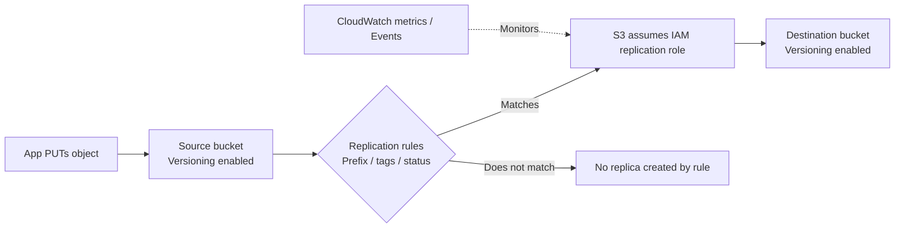
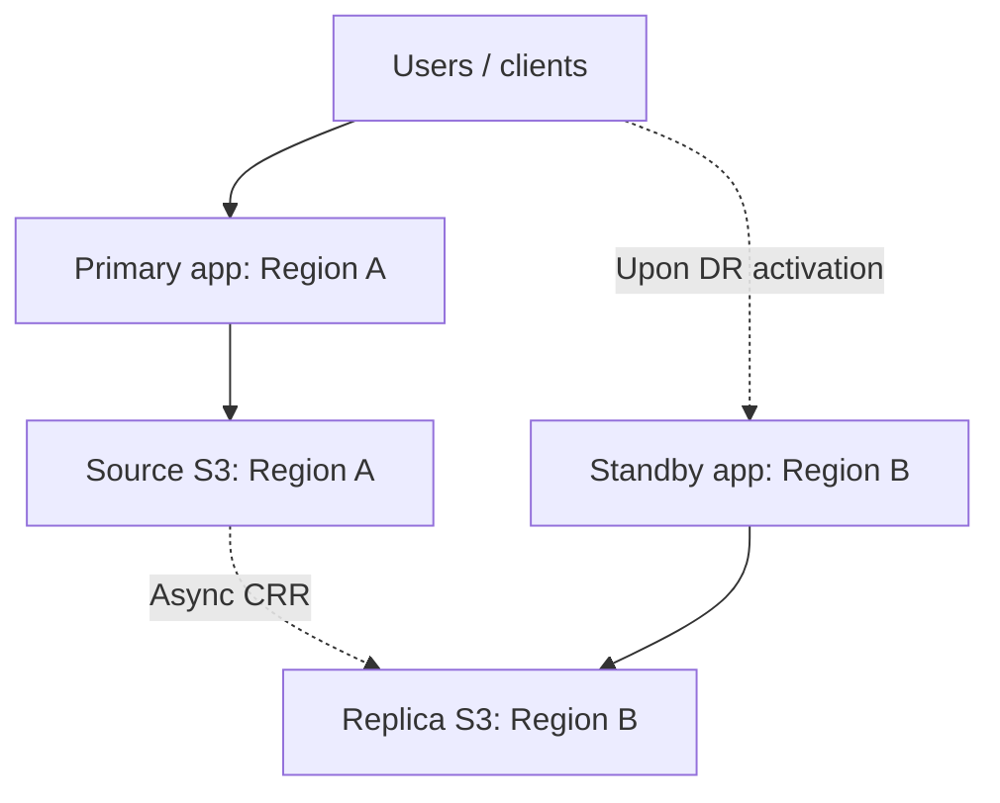

# Same-Region and Cross-Region Replication

## 1. Context and Learning Objectives

An enterprise stores product images, invoices, and processing outputs in **Amazon S3**. Development teams operate across multiple AWS accounts, the audit team wants an independent copy managed by a security account, and operations needs a way to keep reading data if the primary Region experiences an outage. Scheduled manual copy scripts easily miss new versions, are hard to monitor for failures, and do not scale well as object counts grow.

**Amazon S3 Replication** solves rule-based object copying from a **source bucket** to one or more **destination buckets**. The two primary forms are **Same-Region Replication (SRR)** between buckets in the same Region and **Cross-Region Replication (CRR)** between buckets in different Regions. Beyond continuous replication of new objects and newly written versions, AWS provides **S3 Batch Replication** to process pre-existing objects or previously failed replications.

This lesson belongs to the **S3 Object Storage** chapter in the **CLOUD_PROVIDERS_AWS** track. Designing replication requires combining knowledge of Regions/AZs, IAM, VPC, compute/serverless, encryption, monitoring, recovery, and cost control. Having a replica in another bucket is one component of a data strategy, yet applications still need network paths, permissions, failover testing, and recovery procedures.

After this lesson, you will be able to:

- Distinguish SRR, CRR, live replication, Batch Replication, and S3 Replication Time Control (S3 RTC).
- Identify prerequisites: **versioning**, IAM role, bucket policy, rule filters, encryption, and KMS permissions.
- Configure, inspect, and test a replication rule using AWS CLI and JSON.
- Explain replication behavior for object versions, delete markers, metadata, Object Lock, and items not automatically replicated.
- Design cross-account/cross-Region replication for separation of duties, disaster recovery, and data residency requirements.
- Monitor replication lag, handle `PENDING`/`FAILED` states, evaluate costs, and test failover workflows.

## 2. How S3 Replication Works

A replication configuration lives on the **source bucket**. Within the configuration, each rule specifies **which objects qualify**, **which destination bucket receives copies**, **which IAM role S3 assumes**, whether delete markers are replicated, and additional options. When an eligible object is written to the source, S3 performs replication to the destination **asynchronously**.



**Replication is asynchronous:** a successful write to the source bucket **does not mean** the replica immediately exists at the destination. Applications must separate primary object status from replication status. Never use replication as a synchronous two-Region commit before returning a business transaction response.

### 2.1. Core Configuration Components

| Component | Meaning | Example |
| --- | --- | --- |
| Source bucket | Bucket where apps write primary data and where replication config resides | `demo-orders-source-unique` |
| Destination bucket | Target bucket receiving replicas in the same or another Region | `demo-orders-dr-unique` |
| Versioning | Retains multiple object versions; **must be enabled on both buckets** | `Enabled` |
| IAM replication role | Authorizes S3 to read source versions and write replicas to destination | `S3ReplicationRole` |
| Rule filter | Selects objects by key prefix, tags, or supported combinations | `orders/` |
| Replication status | Tracks replication state of each object version | `PENDING`, `COMPLETED`, `FAILED`, `REPLICA` |
| S3 RTC | Optional feature offering predictable replication SLA and metrics | 15-minute target under service terms |

Bucket names, ARNs, account IDs, and timelines in this lesson are for learning purposes only. S3 buckets require **globally unique names** within the applicable service scope; replace placeholders with real owned names and verify account and Region before executing write commands.

### 2.2. How Do SRR and CRR Differ?

| Criterion | Same-Region Replication (SRR) | Cross-Region Replication (CRR) |
| --- | --- | --- |
| Location | Source and destination in the **same AWS Region** | Source and destination in **different AWS Regions** |
| Common goals | Isolate data across buckets/accounts, aggregate logs, restrict replica deletion | Regional disaster recovery, lower-latency access in another geography, multi-Region compliance |
| Owning accounts | Same or different AWS accounts | Same or different AWS accounts |
| Regional outage resilience | Both buckets share the same Regional risk | Replica exists in another Region once replication completes |
| Inter-Region transfer cost | No **cross-Region** data transfer fee from SRR | Inter-Region replication data transfer charges apply per pricing |
| Shared requirements | Versioning, role, policies, rule config, and monitoring | Same as SRR, plus Regional policies, KMS keys, and inter-Region costs |

Placing two buckets in the same Region across different **accounts** separates administrative control and limits blast radius if credentials in the application account are compromised. However, an SRR replica remains exposed if the entire Region experiences an outage. If Regional disaster recovery is the goal, evaluate CRR, replication lag, and application failover to the destination Region.

## 3. Live Replication, Batch Replication, and S3 RTC

### 3.1. Live Replication

**Live replication** uses SRR or CRR to automatically replicate new objects or new versions written **after the replication rule takes effect**. For example, if a rule is enabled at 10:00 and `orders/2026/001.json` is uploaded at 10:05 matching the filter, S3 replicates it.

**Enabling a rule does not automatically backfill existing data.** Objects created before the rule existed are not retroactively replicated by live replication. To copy pre-existing objects, use S3 Batch Replication or an explicit data migration workflow.

Once configured, S3 replicates object versions generated by new writes/updates matching rule criteria; that does not mean bucket settings or every action on replicas propagate automatically. Review what is and is not replicated carefully below.

### 3.2. S3 Batch Replication

**S3 Batch Replication** executes replication via **on-demand jobs** using S3 Batch Operations. It is suited when:

- A bucket already contains millions of objects **created before** SRR/CRR was enabled.
- Objects ended up in `FAILED` status after an IAM or KMS permission issue.
- Operations adds a new destination and needs to copy objects previously replicated elsewhere.
- You need selective replication of specific versions/objects using a manifest and Batch Replication filters.

For example, suppose the source already holds 3 TiB of images from last year and continues receiving new images. Configure CRR so **new images** replicate automatically, and run an **S3 Batch Replication job** for **existing images**. Monitor both paths separately: live replication and batch jobs have distinct progress metrics, IAM permissions, and costs.

Do not confuse S3 Batch Replication with `aws s3 sync`: `sync` is a client-driven CLI command, whereas Batch Replication is an S3-managed job using S3's native replication model and capabilities.

### 3.3. S3 Replication Time Control (S3 RTC)

**S3 RTC** provides predictable replication timing backed by an AWS SLA. AWS states a replication target/SLA of **99.99% of new objects within 15 minutes** under applicable service terms. It can be enabled on eligible SRR or CRR rules.

Important caveat: **15 minutes is not a guarantee that every single object has a replica by minute 15**. Systems must still handle delays or failures, monitor metrics/events, and evaluate RPO realistically. **Delete marker replication is excluded from S3 RTC's 15-minute SLA.**

| Requirement | Approach |
| --- | --- |
| Replicate new objects between two buckets in the same Region | SRR live replication |
| Maintain replicas of new objects in another Region | CRR live replication |
| Need a replication latency SLA and tighter monitoring | SRR/CRR with S3 RTC where supported |
| Replicate pre-existing objects or retry `FAILED` objects | S3 Batch Replication |

## 4. Prerequisites Before Enabling Replication

### 4.1. Versioning Enabled on Both Source and Destination

**S3 Versioning must be `Enabled` on both buckets** involved in S3 replication. This allows S3 to track and replicate **object versions**. If versioning is suspended on either side or misconfigured, replication will not work as intended.

For example, source bucket in Singapore (`ap-southeast-1`) and destination in Sydney (`ap-southeast-2`):

```bash
# Enable versioning on the source bucket, in the source Region
aws s3api put-bucket-versioning \
  --bucket demo-orders-source-unique \
  --versioning-configuration Status=Enabled \
  --region ap-southeast-1

# Enable versioning on the destination bucket, in the destination Region
aws s3api put-bucket-versioning \
  --bucket demo-orders-dr-unique \
  --versioning-configuration Status=Enabled \
  --region ap-southeast-2

# Verify status on both buckets
aws s3api get-bucket-versioning \
  --bucket demo-orders-source-unique --region ap-southeast-1
aws s3api get-bucket-versioning \
  --bucket demo-orders-dr-unique --region ap-southeast-2
```

These commands modify live bucket configuration if executed. Before running, create the buckets, confirm owners, AWS CLI profiles, IAM/SCP permissions, and Regions, and replace sample bucket names. After enabling Versioning for the first time, confirm propagation before testing replication.

**Versioning is not an independent backup:** even with multiple versions retained, an identity permitted to permanently delete versions can still destroy data unless blocked by additional guardrails. Cross-account copies, Object Lock, backups, and restore drills are complementary layers.

### 4.2. IAM Role Assumed by S3

S3 must be authorized to **read object versions** from the source, **write replicas** to the destination, and **read the replication configuration**. An **IAM role** is referenced in the replication config; S3 assumes this role. Standard trust policy:

```json
{
  "Version": "2012-10-17",
  "Statement": [
    {
      "Effect": "Allow",
      "Principal": { "Service": "s3.amazonaws.com" },
      "Action": "sts:AssumeRole"
    }
  ]
}
```

Sample permissions policy for same-account source/destination and **SSE-S3 encrypted objects**, scoped only to `orders/`:

```json
{
  "Version": "2012-10-17",
  "Statement": [
    {
      "Sid": "ReadSourceBucketReplicationSettings",
      "Effect": "Allow",
      "Action": ["s3:GetReplicationConfiguration", "s3:ListBucket"],
      "Resource": "arn:aws:s3:::demo-orders-source-unique"
    },
    {
      "Sid": "ReadSourceObjectVersions",
      "Effect": "Allow",
      "Action": [
        "s3:GetObjectVersionForReplication",
        "s3:GetObjectVersionAcl",
        "s3:GetObjectVersionTagging"
      ],
      "Resource": "arn:aws:s3:::demo-orders-source-unique/orders/*"
    },
    {
      "Sid": "WriteReplicas",
      "Effect": "Allow",
      "Action": [
        "s3:ReplicateObject",
        "s3:ReplicateDelete",
        "s3:ReplicateTags"
      ],
      "Resource": "arn:aws:s3:::demo-orders-dr-unique/orders/*"
    }
  ]
}
```

This is a **minimal example for the assumed scenario**, omitting advanced features like SSE-KMS/DSSE-KMS, Object Lock, ownership overrides, multi-destination replication, or explicit `Deny` statements. Grant additional permissions strictly as required by enabled features under **least privilege**. A trust policy alone does not grant S3 permissions; a permissions policy alone does not let S3 assume the role.

### 4.3. Bucket Policies and Organizational Guardrails

In a **same-account** setup, the role and its S3 permissions may suffice if no denying policies block it. In a **cross-account** setup, the destination bucket owner must attach a **bucket policy** allowing the source account's replication role to write replicas; also verify Object Ownership, encryption/KMS key policies, SCPs, and explicit `Deny` statements in both accounts.

For example, a destination account owns `company-audit-replica` for immutable log retention. It should grant only `s3:ReplicateObject` and related actions to the source role, keeping version-deletion and retention rights restricted to the destination security team. Never grant `s3:*` or open public access as a "quick fix" for replication errors.

**S3 Object Ownership – Bucket owner enforced** is generally worth evaluating so the destination bucket owner cleanly owns replicas with ACLs disabled. If another ownership mode is used, you may need **Access Control Translation** and `s3:ObjectOwnerOverrideToBucketOwner` permissions per your model.

## 5. Configuring SRR/CRR Rules with JSON and AWS CLI

### 5.1. Example: Replicating Prefix `orders/` to Another Region

Suppose two buckets exist in the same account:

- Source: `demo-orders-source-unique`, Region `ap-southeast-1`.
- Destination: `demo-orders-dr-unique`, Region `ap-southeast-2`.
- Both buckets have versioning enabled; the replication role ARN is real, properly permissioned, and not blocked by bucket policies.

Save the configuration below as **`replication-rule.json`**:

```json
{
  "Role": "arn:aws:iam::111122223333:role/S3ReplicationRole",
  "Rules": [
    {
      "ID": "replicate-orders-to-dr",
      "Priority": 10,
      "Status": "Enabled",
      "Filter": { "Prefix": "orders/" },
      "DeleteMarkerReplication": { "Status": "Disabled" },
      "Destination": {
        "Bucket": "arn:aws:s3:::demo-orders-dr-unique",
        "StorageClass": "STANDARD"
      }
    }
  ]
}
```

In this configuration:

- `Role` is the ARN of the **IAM role S3 assumes**; substitute your real account ID and role.
- `Rules` contains one or more rules; `Priority` resolves precedence when multiple rules match objects going to the same destination.
- `Filter.Prefix = "orders/"` scopes replication to keys starting with `orders/`, not the entire bucket.
- `DeleteMarkerReplication = Disabled` **avoids replicating delete markers** in this example rule; this decision directly shapes DR behavior.
- `Destination.StorageClass` sets the storage class of replicas per supported options; it does not alter the source object's storage class.

Apply the rule to the source bucket:

```bash
aws s3api put-bucket-replication \
  --bucket demo-orders-source-unique \
  --replication-configuration file://replication-rule.json \
  --region ap-southeast-1

# Read back the saved configuration
aws s3api get-bucket-replication \
  --bucket demo-orders-source-unique \
  --region ap-southeast-1
```

**Command scope warning:** `put-bucket-replication` replaces the entire replication configuration on the source bucket. If other rules already exist, merge them into the final document; **never push a single new rule and accidentally wipe out active rules**. Always inspect first with `get-bucket-replication`, back up the existing config, and maintain a rollback plan.

This example is **CRR** because the buckets sit in two different Regions. If the destination bucket were in the same Region as the source, the configuration mechanics would be identical as **SRR**. Changing a destination Region requires provisioning a bucket and matching IAM/KMS/bucket policies in that Region; you cannot change an existing bucket's Region by editing a JSON field.

### 5.2. Testing with a New Object

Once the configuration is active, upload a new object matching the prefix:

```bash
# orders-test.json is a sample local file on the operator's machine
aws s3api put-object \
  --bucket demo-orders-source-unique \
  --key orders/orders-test.json \
  --body orders-test.json \
  --region ap-southeast-1

# Check replication status at the source
aws s3api head-object \
  --bucket demo-orders-source-unique \
  --key orders/orders-test.json \
  --query '[VersionId,ReplicationStatus,ServerSideEncryption]' \
  --region ap-southeast-1

# Check replica at the destination after replication finishes
aws s3api head-object \
  --bucket demo-orders-dr-unique \
  --key orders/orders-test.json \
  --query '[VersionId,ReplicationStatus,ServerSideEncryption]' \
  --region ap-southeast-2
```

These commands require real sample files and appropriate permissions. Never test against production datasets before validating with approved test keys. Right after upload, `head-object` on the destination may return **not found** while replication is still in progress. When multiple versions share the same key, match by **`VersionId`** to avoid confusing replicas with other writes.

### 5.3. Tag Filtering and Multiple Rules

Beyond prefixes, S3 replication rules can filter by object tags or supported filter combinations. For instance, an enterprise may replicate only objects tagged `Classification=Confidential` to an audit account. However, tag-based rules require the tag to exist at write time (or on an update that triggers replication); do not assume tagging an old object later retroactively replicates every legacy object automatically.

A bucket can define multiple rules—sending `orders/` to a DR bucket and `audit/` to a security bucket, or replicating to **multiple destinations**. Avoid unintended filter overlaps, check rule priorities, verify role permissions per destination, and budget for multiplied storage costs. **Delete marker replication is not supported on rules using tag filters**, so it cannot simply be enabled in every configuration.

## 6. Versions, Object Deletions, and Replication Limits

S3 Replication operates on object payloads and supported attributes/metadata. Clearly distinguish **writing a new version**, **inserting a delete marker**, **permanently deleting a specific version**, and **modifying bucket configuration**.

### 6.1. Versioning Clarifies PUT and DELETE Behavior

Suppose source `orders/001.json` has two versions:

```text
Source bucket
  orders/001.json
    v1: older content
    v2: newer content      <-- current version

Destination bucket
  orders/001.json
    replica of v1
    replica of v2          <-- after replication completes
```

When a new object is PUT to the same key on a versioned bucket, S3 assigns a **new version**. If matched by a rule, S3 replicates it asynchronously. The destination retains replicas under its own versioning setup; do not rely solely on `LastModified` or independent version ID checks without verifying replication status and content.

### 6.2. Delete Marker Replication

In a versioned bucket, `DELETE` **without a `versionId`** inserts a **delete marker**, hiding the object from standard GET calls while older data versions remain until explicitly deleted.

- When **`DeleteMarkerReplication = Disabled`** (as in our example), source delete markers are not replicated by that rule. The destination copy remains accessible—useful for shielding replicas from accidental source deletions.
- When **`Enabled`** on a supported rule, eligible source delete markers are replicated, hiding the object from standard GETs at the destination as well. This keeps logical deletion state aligned, at the cost of propagating accidental deletions.
- **Permanently deleting a specific object version via `versionId` is not replicated as a synchronous delete.**
- Delete markers created by **S3 Lifecycle expiration** are not replicated by delete marker replication; rules using tag filters do not support delete marker replication either.

Replication is therefore **not two-way delete synchronization**. Whether to enable or disable delete marker replication must be agreed upon jointly by application owners, storage administrators, and the DR team.

### 6.3. Objects and Changes Requiring Special Handling

| Case | Key Behavior / Limitation |
| --- | --- |
| Objects created before enabling the rule | Not copied by live replication; use Batch Replication |
| Objects that are already **replicas** created by another rule | Not chained automatically through live replication by default; may require Batch Replication |
| Changing a rule's destination | Previously replicated objects do not re-replicate automatically to the new destination; use Batch for existing data |
| Bucket policies, IAM policies, lifecycle rules, CORS, event notifications | **Bucket/account configs**, not replicated as object data by S3 Replication |
| Objects encrypted with **SSE-KMS / DSSE-KMS** | Must opt into KMS object replication and configure destination keys/permissions |
| Objects with **Object Lock** | Destination must also support and enable Object Lock; replication role needs extra retention/legal-hold permissions |
| Metadata, tags, ACL/ownership | Supported per specific replication options; never assume every edit on a replica syncs back to the source |

In **bidirectional** setups, each bucket defines its own replication rules, yet **not every replica mutation or deletion bounces back and forth cleanly**. AWS provides features like **replica modification sync** for supported metadata changes. Review documentation, test conflicts, and enforce a **single-writer** pattern or conflict-resolution design before letting two Regions write to the same keys concurrently.

## 7. SSE-S3, SSE-KMS, and DSSE-KMS During Replication

### 7.1. SSE-S3 and Standard Cases

For **SSE-S3** objects, S3 replicates them whenever versioning, IAM, and rules are valid. Replica encryption follows S3 replication semantics: if the source uses SSE-S3, the replica typically keeps SSE-S3. Do not assume setting a different default encryption on the destination automatically converts all incoming replicas to that encryption mode.

### 7.2. SSE-KMS / DSSE-KMS Require Explicit Opt-In

By default, S3 **does not replicate SSE-KMS/DSSE-KMS encrypted objects** under a basic rule. You must explicitly **opt in** within the rule, designate an appropriate KMS key in the destination Region, and grant KMS permissions to the replication role.

Additional JSON snippets for a CRR rule handling **SSE-KMS** with a specific KMS key:

```json
{
  "SourceSelectionCriteria": {
    "SseKmsEncryptedObjects": { "Status": "Enabled" }
  },
  "Destination": {
    "Bucket": "arn:aws:s3:::demo-orders-dr-unique",
    "EncryptionConfiguration": {
      "ReplicaKmsKeyID": "arn:aws:kms:ap-southeast-2:111122223333:key/00000000-0000-0000-0000-000000000000"
    }
  }
}
```

This is a **partial snippet of fields to integrate into a replication rule**, not a full `put-bucket-replication` payload. `SourceSelectionCriteria` and `Destination` belong inside the rule object alongside `Role`, `Filter`, `Status`, `Priority`, and other required fields. The key ARN above is a placeholder.

The replication role and KMS key policies must allow the necessary operations, typically:

- **`kms:Decrypt`** on the source KMS key encrypting source objects.
- **`kms:Encrypt`** on the destination KMS key encrypting replicas in the destination Region (and `kms:GenerateDataKey` in certain bucket/encryption configurations).
- Object version read (`s3:GetObjectVersionForReplication`) and replica write (`s3:ReplicateObject`), plus permissions for tags, ACLs, or Object Lock when used.
- For **cross-account** setups, the destination KMS key policy must allow the source account's replication role to use the key within scope; AWS managed keys cannot be customized for cross-account sharing like customer managed keys.

**KMS keys are Regional and governed by distinct policies.** When replicating from Singapore to Sydney, never specify a single-Region Singapore KMS key ARN as the destination encryption key in Sydney. AWS supports **KMS multi-Region keys** and destination-Region keys in supported configs, yet keys, policies, and replication settings must still follow official guidance.

An easily missed pitfall: the `put-bucket-replication` API can return success **even if the destination KMS key ARN is wrong or lacks permissions**, and replication only fails later at runtime. Always test by uploading a real SSE-KMS object and inspecting `ReplicationStatus`, logs, and metrics—never trust configuration API success alone.

## 8. Cross-Account Replication and Replica Ownership

### 8.1. Why Isolate the Destination Account?

Suppose a `workload-production` account hosts the source bucket and application roles. If an IAM principal in that account is compromised with broad permissions, it could modify or delete source data. Replicating into a `security-backup` account managed by a separate team reduces the chance that one compromised credential set directly affects both copies.

```text
AWS Organizations
├── Workloads OU
│    └── Account 111122223333
│         └── Source S3 bucket (application writes)
└── Security OU
     └── Account 444455556666
          └── Destination S3 bucket (restricted delete access)

          Source replication role ---> Destination bucket policy
```

Account separation only provides real defense if **delete permissions, KMS keys, policy modification rights, AWS Organizations/IAM controls, and root administration** are genuinely separated. If a single admin role controls both accounts unchecked, the security benefit shrinks.

### 8.2. Cross-Account Authorization Steps

1. Destination account creates the bucket, enables versioning, configures Block Public Access, and sets appropriate encryption and Object Ownership.
2. Source account creates the replication role trusting **`s3.amazonaws.com`** with permissions scoped strictly to reading the source and writing the target destination prefix.
3. Destination bucket policy grants the **source replication role ARN** only the required replication actions on target objects—never open access to the entire source account unnecessarily.
4. If using SSE-KMS, configure **customer managed KMS keys** and align key policies/role policies across both accounts.
5. Source account configures the replication rule pointing to the destination. Test uploading new objects, tags, encryption, replication statuses, reading replicas as the destination owner, and verifying the source cannot delete destination copies if isolated.

Illustrative **destination bucket policy** structure to adapt to real requirements:

```json
{
  "Version": "2012-10-17",
  "Statement": [
    {
      "Sid": "AllowOnlySourceReplicationRole",
      "Effect": "Allow",
      "Principal": {
        "AWS": "arn:aws:iam::111122223333:role/S3ReplicationRole"
      },
      "Action": [
        "s3:ReplicateObject",
        "s3:ReplicateDelete",
        "s3:ReplicateTags"
      ],
      "Resource": "arn:aws:s3:::demo-orders-dr-unique/orders/*"
    }
  ]
}
```

The destination bucket policy does not replace permissions needed by the role inside the source account, nor does it replace KMS key policies for KMS-encrypted objects. If the destination bucket enables **Bucket owner enforced**, verify replica ownership and destination operational access under current Object Ownership semantics.

## 9. Replication for DR: Understanding RPO and RTO Properly

A CRR copy in another Region gives applications **already-replicated data** if the primary Region fails. However, replication does not automatically swing DNS or API endpoints, deploy compute in the backup Region, or guarantee that `PENDING` objects finish replicating before an outage hits.

| Term | Meaning for S3 CRR |
| --- | --- |
| **RPO (Recovery Point Objective)** | Maximum tolerable data loss window; must account for replication lag and `PENDING`/`FAILED` objects |
| **RTO (Recovery Time Objective)** | Time required to resume serving from the backup Region/bucket; requires compute, permissions, networking, DNS, and data |
| **S3 RTC** | Provides a replication-time SLA within supported scope; does not automatically satisfy every app's RPO/RTO |
| **Versioning / Object Lock / backups** | Controls enhancing protection against accidental/malicious deletes depending on design and permissions |

### 9.1. Primary Region Outage Scenario



To execute an actual failover, operations must:

1. Provision or keep ready **compute/serverless, IAM roles, KMS keys, VPC/networking, and dependent services** in the destination Region.
2. Define how applications switch from source bucket to destination bucket: via config, DNS, appropriate routing, or **S3 Multi-Region Access Points** where architecture supports and configures them.
3. Reconcile replicated versions, identify missing objects from the outage window, and plan post-incident backfill.
4. Enforce a **single-writer** strategy during failover and failback. If new objects are written in Region B during failover, plan how to replicate them back to Region A; unidirectional CRR A → B does not automatically reverse direction.
5. Drill both failover and failback: verify bucket read/write permissions, KMS access, policies, endpoint switching, data integrity, and recovery timing.

**Multi-Region Access Points do not automatically replicate data.** If using them to route traffic across Regions, you still must configure replication, permissions, failure behavior, and write strategies.

### 9.2. Replication Does Not Replace Backups and Accidental-Delete Protection

A buggy application can write corrupted new object versions, and replication will faithfully copy **that corrupted data**. If delete marker replication is enabled, logical deletes on the source propagate to the destination as well. Combine **Versioning**, retention rules, **S3 Object Lock** for WORM compliance, isolated destination-account permissions, and tested backups/restores.

A sound data strategy answers: **who can permanently delete versions, how long must data be kept, how do we restore an older version, and how fast can we recover from the backup account?** Simply seeing objects land in a destination bucket is not enough to satisfy audit or resilience requirements.

## 10. Monitoring Replication and Object Status

### 10.1. `ReplicationStatus` Values

When inspecting an object covered by a rule, `HeadObject`/`GetObject` returns the `x-amz-replication-status` header, surfaced by the AWS CLI as `ReplicationStatus`.

| Status | Appears Where? | Meaning | Action Needed |
| --- | --- | --- | --- |
| `PENDING` | Source | Object qualifies and replication is queued/in progress | Monitor lag and metrics; track elapsed wait time |
| `COMPLETED` | Source | Replication succeeded to all applicable destinations | Spot-check replicas by key/version if needed |
| `FAILED` | Source | Replication failed | Check role, bucket/KMS policies, and failure events; retry via Batch Replication |
| `REPLICA` | Destination | Object is an S3-created replica | Verify ownership, encryption, and reader permissions |

**Not every object has a `ReplicationStatus`.** Objects that do not match any rule or existed prior to rule creation may lack this field. When a source replicates to **multiple destinations**, `COMPLETED` appears only once replication succeeds at every target destination; a failure on one destination marks overall status `FAILED`.

Sample status query at the source:

```bash
aws s3api head-object \
  --bucket demo-orders-source-unique \
  --key orders/orders-test.json \
  --query '{VersionId:VersionId,ReplicationStatus:ReplicationStatus,Encryption:ServerSideEncryption}' \
  --region ap-southeast-1
```

### 10.2. CloudWatch Metrics and Event Notifications

AWS provides **S3 Replication metrics** when enabled on a rule, and enables corresponding metrics automatically with S3 RTC. Key metrics:

| Metric | Question It Answers |
| --- | --- |
| **Bytes Pending Replication** | How many bytes are still queued for replication? |
| **Operations Pending Replication** | How many operations/objects are awaiting replication? |
| **Replication Latency** | What is the maximum replication lag behind the source within the metric scope? |
| **Operations Failed Replication** | How many operations failed to replicate in aggregate? |

Replication metrics may be billed as **CloudWatch custom metrics**. In addition, **S3 Event Notifications** emit events such as `s3:Replication:OperationFailedReplication`, `OperationMissedThreshold`, and `OperationReplicatedAfterThreshold` where supported. Route notifications to SQS/SNS/Lambda for alerting or automated investigation.

An operational dashboard should track pending objects/bytes, failure counts, replication latency, role/KMS health, incremental costs, and real DR readiness. When using S3 RTC, set alarms aligned with your SLO/RPO and service SLA rather than merely watching source write counts.

### 10.3. Troubleshooting `FAILED` Replications

1. Confirm the object actually **matches the rule** and was written after the rule took effect; check prefix, tags, rule `Status`, `Priority`, and versioning on both buckets.
2. Inspect the IAM replication role: trust for `s3.amazonaws.com`, `GetReplicationConfiguration`, `GetObjectVersionForReplication`, `ReplicateObject`, and permissions for tags/delete markers if enabled.
3. Check the **destination bucket policy** and any **SCPs** or explicit denies—especially cross-account.
4. If using SSE-KMS/DSSE-KMS, verify `SourceSelectionCriteria`, destination key ARN in the right Region, KMS key policies, and `Decrypt`/`Encrypt`/`GenerateDataKey` permissions.
5. If Object Lock is enabled, verify destination Object Lock config and retention/legal-hold permissions.
6. Inspect metrics and failure events; after fixing permissions or configuration, run **S3 Batch Replication** to re-process `FAILED` objects, or re-upload new versions per approved procedures.

**Long `PENDING` is not identical to `FAILED`:** during transient destination or Regional disruptions, S3 keeps objects `PENDING` and resumes once conditions recover. Once an object is marked `FAILED`, simply fixing the policy and waiting indefinitely is rarely a complete remediation—use Batch Replication for failed items.

## 11. Cost, Lifecycle, and Data Compliance

### 11.1. Cost Items Easily Overlooked

S3 Replication creates **additional copies of data**, adding costs beyond source storage:

| Cost Category | Why It Occurs |
| --- | --- |
| Destination storage | Replicas consume storage, and older versions continue accumulating |
| Replication requests | S3 executes write/replication operations per pricing rules |
| Inter-Region data transfer | CRR transfers bytes across Regions per current transfer rates |
| S3 RTC | Additional fee per GB replicated under RTC when enabled |
| KMS | Encrypt/decrypt/data-key calls for SSE-KMS/DSSE-KMS configurations |
| Batch Replication | Batch Operations jobs/manifests, object processing, and copy requests |
| Monitoring | S3 Replication metrics, CloudWatch, and event-handling targets |
| Storage class / lifecycle | Access/retrieval or transition fees when using lower-cost classes and lifecycle rules |

Example: 1 TiB of source data replicates to another Region, followed by daily updates creating new versions on many objects. Total storage can easily exceed 2 TiB if version history accumulates in both buckets, before counting requests and inter-Region transfer. **Versioning + replication + no lifecycle** quickly builds months of stale version growth.

### 11.2. Lifecycle Rules on Source and Destination Are Independent

Replication rules and **S3 Lifecycle rules** serve different goals. Replication copies objects; Lifecycle transitions storage classes or expires objects per **each bucket's own policy**. Source Lifecycle configurations **do not automatically replicate** to the destination.

When applying Lifecycle:

- Decide whether source and destination need **different** retention windows, storage-class transitions, and expiration rules.
- Avoid expiring source objects too early before replication finishes. S3 delays lifecycle transition/expiration for objects still in `PENDING` or `FAILED` replication states per service rules.
- Account for minimum storage durations and retrieval fees on classes like S3 Standard-IA, Glacier Flexible Retrieval, or Deep Archive.
- Verify replicas remain readable fast enough for DR under the chosen destination storage class; putting DR replicas straight into slow-restore archive classes may violate RTO.

**Low-cost archival and rapid recovery can conflict.** A DR bucket expected to serve reads within minutes should be tiered differently from a compliance bucket holding rarely accessed audit records.

### 11.3. Data Residency and Compliance

CRR copies **data out of the source Region**. If data contains personal information or is subject to data-residency mandates, get approval for the destination Region, destination account, KMS keys, retention policies, and authorized readers. Using encrypted transport and AWS Regions **does not automatically guarantee** compliance with local residency or cross-border transfer laws.

SRR fits requirements to keep data inside a single Region while separating accounts or business units. However, if policy mandates surviving a full Regional outage, SRR alone will not meet that requirement.

## 12. Design and Testing Walkthrough: Invoice Processing Company

An enterprise runs an invoice-issuing API in Singapore (`ap-southeast-1`). New invoices are written under `invoices/`, must have a copy managed by a security account, and must support recovery in Sydney (`ap-southeast-2`). Data uses SSE-KMS encryption; erroneously issued invoices must be retained per compliance rather than deleted freely.

**Sample design:**

1. **Source:** bucket in `ap-southeast-1`, Versioning enabled, SSE-KMS encryption, writes/deletes constrained via IAM and bucket policies; application runs with a least-privilege role.
2. **Destination:** bucket in `ap-southeast-2` inside the security account, Versioning and Block Public Access enabled, Bucket owner enforced standardized; customer managed KMS key in the destination Region.
3. **Replication:** CRR rule filtering `invoices/`, using a dedicated replication role and `SourceSelectionCriteria.SseKmsEncryptedObjects=Enabled`; scope source, destination, and KMS permissions strictly.
4. **Deletion and retention:** consider keeping delete marker replication disabled; enable Object Lock/retention where legally required and supported; test behavior when a user performs a logical delete at the source.
5. **Pre-existing data:** if invoices existed before enabling the rule, run Batch Replication with an approved manifest and scope.
6. **Monitoring:** enable replication metrics, evaluate S3 RTC if RPO demands a time SLA; alert on `FAILED`, backlog/latency, and periodically verify replicas can be read and decrypted.
7. **Failover:** prepare destination API/compute, IAM/KMS, and bucket configs; document traffic switching, write rules, and failback procedures.
8. **Testing:** upload a new invoice, write a new version, simulate a delete marker, intentionally test a mis-permissioned role in a non-prod sandbox, read replicas from the destination account, and measure replication latency.

**Expected verification matrix:**

| Test Case | Expected Observation |
| --- | --- |
| PUT `invoices/demo.json` after enabling CRR | Source creates new version; replica appears asynchronously at destination |
| PUT `temp/debug.txt` outside prefix | Not replicated under the `invoices/` rule |
| PUT SSE-KMS object | Destination receives replica decryptable with valid KMS permissions; no `FAILED` due to key policy |
| DELETE object without version ID (delete marker replication Disabled) | Source gets delete marker; destination replica remains accessible under destination permissions |
| Pre-existing object created before CRR | Replicated only via Batch Replication / backfill workflow |
| Remove destination write permission in sandbox test | Triggers expected alert/`FAILED` status and recovers via Batch Replication once fixed |
| Switch API to destination Region | Reads replicated objects successfully; new writes/failback follow dedicated plan |

## 13. Common Misconceptions

| Misconception | Accurate Understanding |
| --- | --- |
| "Enabling CRR immediately copies all old objects to the destination." | Live replication processes only eligible objects written after configuration; use Batch Replication for pre-existing data. |
| "Replication means both buckets always hold identical data at every instant." | Replication is asynchronous, with lag and `PENDING`/`FAILED` states. |
| "SRR also protects apps from a full Region outage." | SRR keeps both buckets in the same Region; only CRR places copies in another Region. |
| "Granting `s3:PutObject` lets S3 replicate with that role." | Replication requires an `s3.amazonaws.com` trust policy plus specialized actions like `s3:GetObjectVersionForReplication` and `s3:ReplicateObject`. |
| "SSE-KMS objects replicate automatically under a default rule." | Must explicitly opt in and configure destination KMS keys and permissions in the target Region. |
| "Deleting at the source always permanently deletes the replica." | Delete marker replication is configurable; deleting a specific version ID does not automatically sync-delete replicas. |
| "S3 RTC guarantees 100% of objects finish in exactly 15 minutes." | Provides a service SLA over an eligible percentage/scope; monitoring and lag/failure handling are still required. |
| "CRR automatically fails over applications to the backup Region." | You must still design compute, endpoints, permissions, DNS/routing, DR runbooks, and failback. |
| "Replication replaces backups and Object Lock." | Bad writes, logical deletes, or data changes can still propagate; keep independent backups, retention, and isolated permissions. |

## 14. Self-Check Questions

**Question 1.** Why does a bucket holding millions of objects still have no replicas for older data right after creating a CRR rule?

**Hint:** Live replication does not retroactively copy objects that existed before the rule. Run S3 Batch Replication for existing objects.

**Question 2.** Are two buckets in the same Region across different AWS accounts SRR or CRR? What risks does this protect against, and what does it not protect against?

**Hint:** It is SRR. It separates administrative permissions across accounts, yet does not provide a cross-Region copy to survive a full Regional outage.

**Question 3.** An SSE-KMS object shows `ReplicationStatus=FAILED` even though rule creation succeeded. What should you check?

**Hint:** `SourceSelectionCriteria`, destination KMS key ARN in the matching Region, `kms:Decrypt`/`kms:Encrypt` (and related config-specific KMS permissions), KMS key policies, the replication role, and destination bucket policy.

**Question 4.** With `DeleteMarkerReplication=Disabled`, what does a `DELETE` without `versionId` at the source do to the replica?

**Hint:** The source inserts a delete marker while the destination does not replicate that marker under the rule; the destination version can remain readable. Check destination Lifecycle rules and permissions.

**Question 5.** Does S3 RTC make an application's RTO equal to 15 minutes?

**Hint:** No. RTC governs replication timing under the service SLA. RTO depends on destination-Region compute, IAM/KMS, endpoints, databases, and failover execution.

**Question 6.** If bidirectional CRR A→B and B→A is configured, do all replica edits and version deletes sync both ways like a multi-primary database?

**Hint:** No. Replicas do not automatically chain-replicate in loops, and version deletes/metadata follow specific rules. Design primary-writer ownership, supported sync features, and conflict handling.

## 15. Key Takeaways

**SRR** replicates objects between buckets in the **same Region**; **CRR** replicates between **two Regions**. Both use source replication rules and require **Versioning on both buckets**, an **IAM replication role**, and aligned policies. **Live replication** handles new writes, **Batch Replication** handles pre-existing or `FAILED` objects, and **S3 RTC** provides a replication-latency SLA within supported scope.

Production designs must address **SSE-KMS and key policies, cross-account ownership, delete markers, Object Lock, replication metrics, latency, lifecycle rules, and costs**. To rely on replicas for DR, drill both data access and running applications in the destination Region. The core rule is: **solid replication + isolated permissions + observability + tested recovery procedures**.

### AWS Reference Documentation

- [Amazon S3 — Replicating objects within and across Regions](https://docs.aws.amazon.com/AmazonS3/latest/userguide/replication.html)
- [Setting up live replication](https://docs.aws.amazon.com/AmazonS3/latest/userguide/replication-how-setup.html)
- [Requirements and considerations for replication](https://docs.aws.amazon.com/AmazonS3/latest/userguide/replication-requirements.html)
- [Replication configuration elements](https://docs.aws.amazon.com/AmazonS3/latest/userguide/replication-add-config.html)
- [Setting up permissions for live replication](https://docs.aws.amazon.com/AmazonS3/latest/userguide/setting-repl-config-perm-overview.html)
- [Replicating encrypted objects](https://docs.aws.amazon.com/AmazonS3/latest/userguide/replication-config-for-kms-objects.html)
- [Replicating delete markers between buckets](https://docs.aws.amazon.com/AmazonS3/latest/userguide/delete-marker-replication.html)
- [What does S3 replicate?](https://docs.aws.amazon.com/AmazonS3/latest/userguide/replication-what-is-isnot-replicated.html)
- [Replicating existing objects with Batch Replication](https://docs.aws.amazon.com/AmazonS3/latest/userguide/s3-batch-replication-batch.html)
- [S3 Replication Time Control](https://docs.aws.amazon.com/AmazonS3/latest/userguide/replication-time-control.html)
- [Getting replication status information](https://docs.aws.amazon.com/AmazonS3/latest/userguide/replication-status.html)
- [Using S3 Replication metrics](https://docs.aws.amazon.com/AmazonS3/latest/userguide/repl-metrics.html)
- [Troubleshooting S3 replication](https://docs.aws.amazon.com/AmazonS3/latest/userguide/replication-troubleshoot.html)
- [Amazon S3 pricing](https://aws.amazon.com/s3/pricing/)
