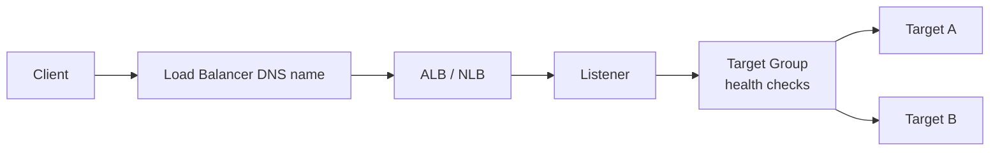
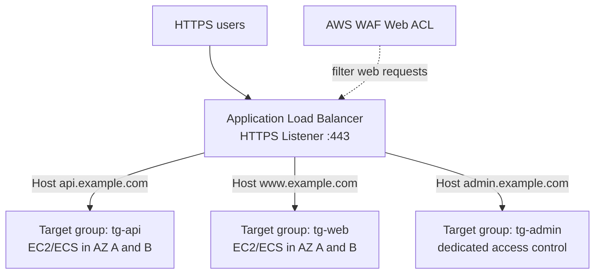
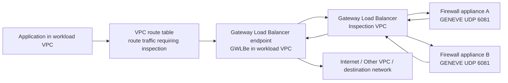
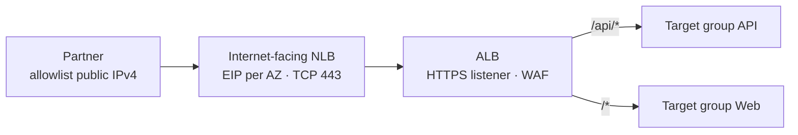
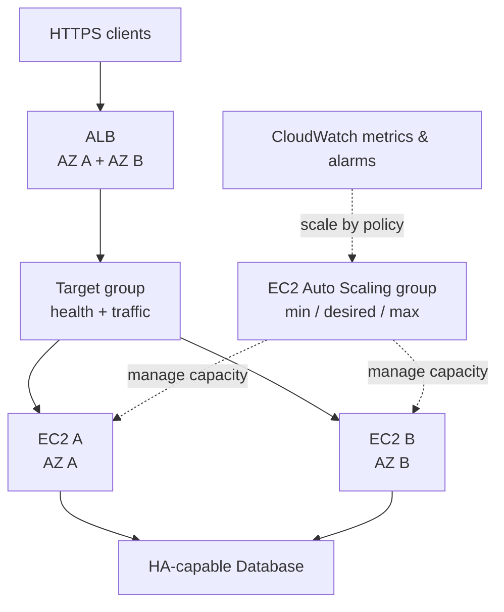

# Choosing Between Application, Network, and Gateway Load Balancers on AWS

> **Chapter:** Load Balancing and Scaling  
> **Module:** CLOUD_PROVIDERS_AWS  
> **Focus:** choosing the right Elastic Load Balancing type based on protocol, routing behavior, IP address requirements, security, fault tolerance, and cost; combining with EC2 Auto Scaling, containers, IAM, VPC, and monitoring.

## 1. Why Is There No Single Load Balancer for Every Application?

Suppose an enterprise deploys three systems in the AWS Singapore Region:

1. **Website and REST API** with multiple services: `shop.example.com/api/*` must go to the API, and `shop.example.com/images/*` to the image server; requires HTTPS, AWS WAF, health checks, and EC2 scaling as user traffic grows.
2. **TCP/UDP service** for partners requiring **static public IPv4 addresses** for allowlist configuration; maintains many long-lived connections and must not have a proxy modifying HTTP content.
3. **Traffic inspection system** in a central network: must force traffic between the Internet, application VPCs, and internal networks through a virtual firewall/IDS/IPS cluster before reaching its destination.

These three problems require different capabilities from **Elastic Load Balancing (ELB)**:

- **Application Load Balancer (ALB):** load balancing at **Layer 7** for HTTP/HTTPS, understands request content, and supports routing rules by host/path/header/query.
- **Network Load Balancer (NLB):** load balancing at **Layer 4** for connection flows; supports multiple transport protocols, static IP addresses per AZ, and high throughput.
- **Gateway Load Balancer (GWLB):** processes IP traffic at **Layer 3**, forwarding packets to **virtual network appliances** over GENEVE for inspection, filtering, or policy enforcement.

The goal of this lesson is not just memorizing "ALB Layer 7, NLB Layer 4, GWLB Layer 3", but knowing **why** an architecture succeeds or fails when the wrong type is chosen.

### 1.1. What Happens Without Load Balancing?

A single EC2 instance can become overloaded, fail at the instance or AZ level, require maintenance downtime, and require manual intervention to increase capacity. A load balancer provides a unified entry point, checks target health, and distributes traffic to eligible targets.

However, **a load balancer does not replicate data, increase the number of EC2 instances, or fix application bugs on its own**. It must be combined with an **Auto Scaling group (ASG), health checks, multiple AZs, redundant data tiers, and safe deployment practices**.

## 2. Quick Comparison: ALB, NLB, and GWLB

| Criterion | **Application Load Balancer** | **Network Load Balancer** | **Gateway Load Balancer** |
|---|---|---|---|
| Primary OSI layer | **L7 – Application** | **L4 – Transport** | **L3 – Network** |
| Data processed | HTTP/HTTPS requests, paths, hostnames, headers, etc. | TCP, TLS, UDP, TCP_UDP, QUIC/TCP_QUIC flows per current support | IP packets encapsulated with GENEVE |
| Primary listeners | **HTTP, HTTPS** | **TCP, TLS, UDP, TCP_UDP, QUIC, TCP_QUIC** | **GENEVE/6081** to forward packets to appliances |
| Routing | Host/path/header/query/method/source IP, weighted target groups | Flows and port/protocol; supports rules selecting target groups by **IPv4/IPv6** source address in supported dual-stack configurations | Routes traffic through appliances via route tables; does not route by HTTP path |
| Target group | **instance, ip, lambda** | **instance, ip, alb** | **instance, ip** as GENEVE-capable appliances |
| Stable public IP | ALB uses DNS; node IP addresses can change | Can assign **Elastic IPs per AZ** for internet-facing NLB | Not a solution for providing direct public IPs to web apps |
| TLS termination | HTTPS listener | TLS listener; TCP 443 can pass TLS through intact | Does not perform application TLS offloading on its own |
| Typical security | AWS WAF, HTTPS, OIDC/Cognito authentication, SG | TLS, SG when configured, client IP preservation per target/attributes, Shield | Third-party firewall, IDS/IPS, policy enforcement via appliances |
| Best use cases | Web apps, HTTP APIs, gRPC, WebSocket, microservices | TCP/UDP/QUIC, static IPs, long-lived connections, high-performance transport | Centralized, transparent traffic inspection through appliances |

**Version note:** according to Network Load Balancer documentation updated through **2026**, NLB listeners now include **QUIC/TCP_QUIC** and support **listener rules** in **dual-stack** configurations to select target groups based on IPv4/IPv6 addresses. Therefore, older guidance claiming NLB "only supports TCP/UDP/TLS" or "never has listener rules" is no longer fully accurate. Current NLB rules are **not equivalent** to ALB's L7 host/path/query rules.

## 3. Common Components: Load Balancer, Listener, Rule, Target Group, and Target

Before choosing a type, understand the core components:

| Component | Question to Answer | Example |
|---|---|---|
| **Load balancer** | Through which endpoint does traffic enter? | `shop-alb-123.ap-southeast-1.elb.amazonaws.com` |
| **Scheme** | Is the entry point public or private? | `internet-facing` or `internal` for ALB/NLB |
| **Listener** | Which protocol and port are accepted? | ALB: HTTPS 443; NLB: TCP 443 |
| **Listener rule/action** | After receiving traffic, how is it processed and routed? | ALB: `/api/*` → `tg-api` |
| **Target group** | Which backends can receive traffic, and how is health checked? | `tg-api` containing EC2/ECS tasks |
| **Target** | What is the actual processing destination? | EC2 ID, private IP, Lambda, or appliance |
| **Health check** | Is the target healthy enough to serve traffic? | HTTP `/health/ready`, TCP connect |
| **Load balancer node/AZ** | How does the service receive and distribute traffic across AZs? | Nodes in enabled subnets of AZ A/B |

### 3.1. Conceptual Load Balancing Flow



With **GWLB**, the path is different: the VPC route table sends packets to a **Gateway Load Balancer endpoint (GWLBe)**, through an endpoint service to the GWLB, and then to the appliance for packet processing. GWLB does not operate like an HTTP/HTTPS reverse proxy with host/path rules.

### 3.2. Health Checks Do Not Test Full Business Logic

An EC2 instance returning `200 OK` on `/health` might still have lost database connectivity; an open TCP port might keep accepting connections without processing requests properly. You should design for:

- **Liveness:** is the process still running?
- **Readiness:** is the target ready to receive new traffic, including required dependencies?
- **Actual latency and errors:** monitor at the application layer beyond health checks.

ALB, NLB, and GWLB each have their own health check mechanisms. When all targets are unhealthy, certain ELB mechanisms can **fail open**, meaning they still route traffic to unhealthy targets under service-defined conditions. Therefore, never claim "health checks guarantee traffic is never sent to a failing target."

## 4. Application Load Balancer: When You Need to Understand HTTP Requests

### 4.1. Requirements ALB Solves Well

**ALB** is the default choice to consider for **HTTP/HTTPS** web apps and APIs that require:

- **Host-based routing:** `api.example.com` and `admin.example.com` routed to two separate target groups.
- **Path-based routing:** `/api/*`, `/images/*`, `/checkout/*` routed to different backends.
- **Rules by header/query/method/source IP** where supported by the feature.
- **HTTP → HTTPS redirect**, fixed responses, and forwarding to one or more weighted target groups.
- HTTPS termination using certificates, TLS security policies, and optional HTTPS connections to targets.
- **AWS WAF** to filter web requests and block common attack patterns based on configured rules.
- **Authentication** prior to forwarding requests using built-in Amazon Cognito or OIDC integration.
- WebSocket, HTTP/2 frontend, and HTTP/2/gRPC to targets when the target group is properly configured.
- **Lambda** target type for cases where ALB invokes a function directly.

### 4.2. Host/Path Routing Diagram



HTTPS 443 listener example:

| Priority | Condition | Action |
|---|---|---|
| 10 | Host = `api.example.com`, path = `/v1/*` | Forward to `tg-api-v1` |
| 20 | Host = `www.example.com` | Forward to `tg-web` |
| 30 | Host = `admin.example.com` | Authenticate OIDC then forward to `tg-admin` |
| Default | No rule matches | Fixed response 404, or appropriate default route |

**Priority order matters.** Listener rules are evaluated by priority; specific rules must be ordered properly to avoid being matched first by broader rules.

### 4.3. ALB Target Groups and Health Checks

ALB target groups typically support these types:

- `instance`: registers EC2 instances by instance ID.
- `ip`: registers AWS-supported IP addresses, convenient for containers/tasks or backends with private IPs.
- `lambda`: invokes an AWS Lambda function, subject to the integration limits of this target type.

Backends can use HTTP/HTTPS. When sending **HTTP/2 or gRPC**, you must set the corresponding **target group protocol version**; the HTTPS listener and client/backend protocol support must also match.

For an API listening on port 8080, health checks typically use a path like **`/health/ready`** and an appropriate HTTP status code matcher. Only return 200 once the application has loaded its configuration and has essential dependencies available to handle requests.

If targets are unhealthy, check:

1. Listener port and target group port.
2. Security groups (SGs) of the ALB and backend: the backend must allow traffic **from the ALB's SG** on the backend port, including health checks.
3. Route tables, NACLs, subnets/AZs.
4. Health check path, protocol, matcher, timeout, and application startup time.
5. Whether targets are registered with the right instance/IP and in enabled AZs.

### 4.4. HTTPS, Client IP, and Authentication

With an HTTPS listener, ALB can decrypt TLS and then forward HTTP or HTTPS to the backend. You must configure an **ACM certificate**, TLS security policy/ciphers, and an appropriate certificate renewal process.

ALB provides proxy headers such as **`X-Forwarded-For`, `X-Forwarded-Proto`, and `X-Forwarded-Port`**. Backends must be configured to trust these headers only from controlled proxies; do not blindly trust an arbitrary `X-Forwarded-For` header sent by clients through other access paths.

**ALB authentication** (OIDC/Cognito) acts as an authentication layer in front of the backend, but **does not automatically enforce full business authorization** (e.g., who is allowed to edit which order). The application still needs authorization, session management, and private data protection.

### 4.5. WebSocket, gRPC, and Sessions

- **WebSocket:** ALB supports HTTP Upgrade to WebSocket; once upgraded, the connection persists to the target. If a target is replaced, the connection can drop and the client must reconnect.
- **gRPC:** ALB supports gRPC with proper target group/protocol version configuration, including appropriate health checks and metrics.
- **Session stickiness:** stickiness can be enabled at the target group level, but if your goal is horizontal scaling and failover, move session state to a shared store whenever possible.
- **Connection draining:** use `deregistration_delay` and graceful shutdown handling to minimize dropped requests during deployments or scale-in events.

### 4.6. Limitations of ALB

- ALB only supports **HTTP/HTTPS** listeners; it is not a generic UDP/TCP load balancer.
- IP addresses of ALB nodes can change over time. **Use the ALB's DNS name**; do not hard-code current IPs as static addresses.
- Does not directly provide per-AZ static EIPs like an internet-facing NLB.
- ALB is not a Layer 3 network firewall; WAF only inspects supported web application traffic.
- ALB does not scale EC2 instances on its own: **Auto Scaling groups / ECS Service Auto Scaling** are responsible for scaling backend capacity.

## 5. Network Load Balancer: When Requirements Center on Transport Connections and IPs

### 5.1. Needs NLB Solves Well

**NLB** processes flows at the transport layer, making it suitable when you need:

- Load balancing for **TCP, UDP**, and supported listener variants.
- **Static public IPv4 addresses per AZ** using Elastic IPs on an internet-facing NLB when configured appropriately.
- Applications with long-lived connections, high throughput, or low transport latency requirements.
- **TLS termination** at NLB or **TLS pass-through** to backends using a TCP listener.
- Client IP preservation depending on target type/protocol and appropriate `preserve_client_ip.enabled` settings.
- Routing traffic to targets of type **EC2, private IP, or an ALB** under supported conditions.
- Connectivity via **AWS PrivateLink** (NLB is commonly the provider for an endpoint service) for private services across VPCs/accounts in supported models.

**NLB does not inspect HTTP path, Host, or query parameters to make L7 backend routing decisions.** If an application needs that, choose ALB or place NLB in front of ALB.

### 5.2. Supported Protocols

According to AWS NLB listener documentation updated in 2026:

| Listener | Role |
|---|---|
| **TCP** | Forwards TCP flows; can pass TLS through intact to backends |
| **TLS** | Terminates TLS at NLB; requires a certificate and TLS security policy |
| **UDP** | Load balances UDP flows |
| **TCP_UDP** | Accepts both TCP and UDP on the same port under corresponding configuration |
| **QUIC** | Forwards QUIC traffic to supporting backends |
| **TCP_QUIC** | Combines TCP and QUIC on the same port under supported configurations |

**QUIC conditions:** current documentation includes constraints around listeners, dual-stack, and security groups; for instance, QUIC/TCP_QUIC configurations cannot be used with certain dual-stack/SG combinations and cannot be arbitrarily mixed with UDP/TCP_UDP. Before selecting QUIC for production, check **Region availability, listener compatibility, backend TLS/QUIC support, and the latest AWS limits**.

**NLB listener rules:** as of 2026, NLB supports rules in **dual-stack** configurations to route IPv4 and IPv6 traffic to appropriate target groups; this is still not ALB's path-based/host-based HTTP routing.

### 5.3. Flow Routing and Client IP

For TCP, NLB selects a target using an algorithm based on connection/flow tuple information. Packets belonging to the same connection generally continue going to the chosen target for the lifetime of that connection; other connections may be distributed to different targets.

Therefore:

- If a client holds a single TCP connection open for hours, adding new EC2 instances **does not automatically move** that existing connection to a new instance.
- When a target is replaced or becomes unhealthy, existing connections can break; clients/applications must handle retries, reconnection, and idempotency.
- To ensure the backend sees the real client IP, verify **target type, protocol, and client IP preservation**; do not assume every NLB connection preserves source IP across all setups.
- Where source IP cannot be preserved directly, **Proxy Protocol v2** can be used if supported by the NLB/target group and understood by the backend. Do not enable it indiscriminately, as applications that do not parse Proxy Protocol headers will misread the payload.

### 5.4. Elastic IPs and Stable Addressing

An internet-facing NLB can have an **Elastic IP** attached per enabled AZ when created/configured appropriately. For example:

```text
NLB in Region ap-southeast-1
├── AZ A: EIP A → NLB node A
└── AZ B: EIP B → NLB node B
```

Partners can allowlist these EIPs. However:

- NLB still provides a **DNS name** for resolution and tracking AZ health.
- If you remove an AZ or change zones/targets, DNS, EIP, and failover designs must be reviewed.
- EIPs **do not work across Regions**. Global/cross-Region static IP requirements require looking at **AWS Global Accelerator** or an appropriate DNS/multi-Region strategy.
- Public IPv4 addresses, EIPs, and data transfer may incur charges under current pricing policies.

If the business requirement is "path-based web access while partners only allowlist static IPs," you can use an **NLB → ALB** hybrid pattern (see `7.1`).

### 5.5. TLS Termination and mTLS

A **TLS listener** allows NLB to decrypt HTTPS/TLS connections from clients. If you want the backend to handle end-to-end TLS or **mutual TLS (mTLS)** in the application, use a **TCP listener** to pass encrypted traffic untouched to the backend, and configure certificates/client certificate verification on the backend.

AWS NLB **TLS listeners do not directly support mTLS client authentication** per service documentation; setting up a TLS listener expecting it to validate client certificates is an architectural mistake.

### 5.6. NLB Target Groups and Health Checks

Target types:

- `instance` — EC2 instance IDs.
- `ip` — supported IP addresses.
- `alb` — an **Application Load Balancer** as a target, subject to documented protocol/port/configuration requirements.

NLB health checks are typically **TCP, HTTP, or HTTPS** depending on the target group/protocol; not every UDP/QUIC target group has a matching "UDP ping" or "QUIC health check" mirroring the listener. Choose a health check that verifies the backend is actually serving properly.

If NLB returns errors or connection resets:

1. Verify the NLB listener uses the right protocol/port.
2. Verify the target group protocol/port/target type.
3. Verify target health, SGs/NACLs, routing, and health check port.
4. Check whether client IP preservation or Proxy Protocol v2 is compatible with the backend.
5. Check CloudWatch metrics for flows, resets, and target health.
6. Check whether clients are holding stale DNS/IPs if an AZ was removed from DNS.

**Security groups:** NLB can be created with SGs; certain behaviors and capabilities depend on whether an SG was specified **at NLB creation time**. Do not assume you can attach an SG at any time to an NLB originally created without one.

## 6. Gateway Load Balancer: Balancing Traffic to Firewalls/IPS

### 6.1. What Does GWLB Do?

**GWLB** is a service that distributes Layer 3 packets across network appliances supporting **GENEVE**. These appliances can be:

- Virtual firewalls deployed by your organization or software vendors.
- Intrusion Detection/Prevention Systems (IDS/IPS).
- Flow filtering, deep packet inspection, and security analytics tools.
- Other network functions compatible with GWLB requirements.

GWLB does not replace ALB when an application needs `/api/*` routing to web backends, and it is not a firewall itself. **Allow/deny policies are enforced on the appliances**; GWLB primarily steers packets to the right appliance and manages flow distribution and health.

### 6.2. GWLB Flow with Gateway Load Balancer Endpoints

A common pattern uses an **inspection VPC** hosting GWLB and appliances, while **application VPCs** consume the service through a **Gateway Load Balancer endpoint (GWLBe)**.



The diagram shows the conceptual processing flow; return traffic must follow a proper **symmetric routing** architecture so stateful firewalls see both directions of a flow.

Actual components:

1. **Service provider VPC:** GWLB, target groups, appliances.
2. **GWLB endpoint service:** exposes GWLB accessibility via AWS PrivateLink mechanisms.
3. **Service consumer/workload VPC:** subnets containing GWLBe.
4. **VPC route tables:** direct inbound/outbound traffic through GWLBe.
5. **Appliance security groups/routes:** allow GENEVE UDP 6081 and health checks as designed, returning packets to GWLB.
6. **Flow affinity / target health:** ensures related traffic is routed consistently within service limits.

### 6.3. GENEVE and Security Inspection

GWLB listens for IP packets and **encapsulates** original packets using **GENEVE** to forward them to appliances on **UDP port 6081**. Appliances must support decapsulation/processing and return packets as required by the service.

**GENEVE does not mean application data is TLS-decrypted.** If the original packet is encrypted HTTPS, a firewall only sees network/header metadata unless authorized and configured with an appropriate TLS inspection/decryption mechanism.

**Do not open port 6081 publicly without restriction.** Appliances typically run in private subnets of the inspection VPC; security groups/NACLs must allow traffic from legitimate sources and health checks.

### 6.4. Proper Routing and Bidirectional Traffic Handling

The hardest part of deploying GWLB is usually **routing**:

- Routes must direct traffic requiring inspection from application subnets or ingress/egress paths into **GWLBe**.
- Traffic returning from appliance inspection must proceed to its true destination without looping endlessly back to the endpoint.
- The **return path** must traverse the appropriate inspection flow when appliances are stateful.
- In ingress inspection patterns, a route table associated with an Internet Gateway can send traffic to GWLBe before reaching application subnets; egress return routes from application subnets must also be carefully designed.
- Across multiple AZs, align endpoints/appliances/routes per AZ and weigh availability against cross-AZ data transfer costs.
- When traversing Transit Gateway or multiple VPCs, account for route propagation, symmetry/affinity, and flow observability.

**A GWLBe does not automatically grant network reachability.** VPC routing and security groups still determine the actual path.

### 6.5. Flow Stickiness and Failover

Stateful appliances such as firewalls must maintain connection state. GWLB uses target selection/flow stickiness to route packets of a related flow to the selected appliance, but:

- If an appliance fails, **active flows may be interrupted**; a replacement appliance does not automatically possess the old appliance's connection state.
- Health checks detect unhealthy targets; **they do not guarantee session preservation during failover**.
- When all appliances become unhealthy, the service has fail-open/forwarding behavior to unhealthy targets under AWS-documented conditions; review configuration and failure-handling policies carefully to avoid false security assumptions.
- **Do not assume "GWLB guarantees blocking all traffic when the firewall dies."** Fail-open/fail-closed behavior must be tested at both the architectural and vendor-appliance levels.

### 6.6. How GWLB Differs from AWS WAF and Network Firewall

| Tool | Role |
|---|---|
| **AWS WAF** | Inspects HTTP(S) requests at the application layer for supported resources like ALB; commonly used for web exploits and bot/rate rules |
| **Gateway Load Balancer + appliances** | Steers IP traffic through virtual firewalls/IDS/IPS managed by your organization or vendors |
| **AWS Network Firewall** | AWS-managed network firewall service with its own endpoint/routing model, avoiding the need to self-manage a fleet of EC2 appliances like GWLB |
| **Security Group/NACL** | Connection filtering at the ENI/subnet level; does not replace deep inspection of application content |

If you only need to block HTTP attack patterns against a website, ALB + WAF may suffice. If you need a vendor firewall product inspecting multi-protocol traffic across VPCs, GWLB is a strong candidate.

## 7. Combining Multiple Load Balancer Types

### 7.1. NLB → ALB: Static IPs + HTTP Routing/WAF

Suppose a partner only allows static IPs for inbound traffic, yet your web app needs **host/path routing**, **WAF**, and listener rules.



Technical points:

- NLB uses **target type `alb`** and a **TCP** target group as required by AWS.
- NLB can receive traffic on a TCP port and forward it to the **ALB listener** on the corresponding port in a valid configuration.
- ALB continues handling HTTP(S), listener rules, and authentication/WAF (if configured).
- Appropriate health checks are needed at both layers; the NLB listener/target group must link to the right ALB.
- Align subnets/AZs and security groups consistently; account for the cost of **both NLB and ALB**, data transfer, and public IPv4 addresses.
- NLB does not add path routing on its own. **ALB** still performs L7 work; if static IPs or PrivateLink are not required, this architecture may add unnecessary complexity.

### 7.2. ALB in Front of EC2 Auto Scaling



In this structure:

- **ALB:** accepts HTTPS, checks health, distributes requests.
- **Target group:** the backend pool receiving traffic.
- **ASG:** launches/terminates EC2 instances based on desired capacity and scaling policies.
- **CloudWatch:** monitors `RequestCountPerTarget`, CPU, latency, errors, etc. to drive scaling policies.
- **Database/state:** must handle load and have its own resilience mechanisms.

**Auto Scaling is not an ALB-only feature.** You can pair NLB with appropriate target groups and Auto Scaling as well. For ECS/EKS/Lambda, backend scaling mechanisms differ accordingly.

### 7.3. GWLB in Architectures with ALB/NLB

A multi-tier architecture might use:

- GWLB to steer traffic from application networks through firewall appliances via VPC routes.
- ALB for HTTPS termination, HTTP routing, and WAF for web services.
- NLB where transport-level TCP/UDP or stable IPs are required.

Adding all three types does not automatically increase security. Each layer adds **cost, routes, security rules, health checks, operational overhead, and misconfiguration surface**. Combine them only when requirements justify the benefit.

## 8. Availability Zones, Cross-Zone Load Balancing, and Resilience

### 8.1. What Does Enabling Multiple AZs Mean?

ALB and NLB operate within a Region and place load balancer nodes in enabled AZs. When deploying applications requiring AZ fault tolerance:

1. Use subnets in **at least two AZs** as required by the load balancer type.
2. Register healthy targets across multiple AZs—do not place all backends in AZ A.
3. Design data tiers and dependent services without single points of failure.
4. Verify security groups, routes, NACLs, and health checks in every AZ.
5. Test target and AZ failures to measure actual failover time.

**Multiple AZs on a load balancer do not make the backend HA by themselves.** If the database has only a single instance in the failed AZ, users still cannot complete transactions even if the ALB stays up.

### 8.2. Cross-Zone Load Balancing

**Cross-zone** determines whether a load balancer node in one AZ can distribute traffic to targets in other AZs or only to targets in the same AZ.

| Type | Default and Configurability |
|---|---|
| **ALB** | Cross-zone is **enabled at the load balancer level** and cannot be disabled there. **Target groups** can override to disable cross-zone, subject to related feature constraints |
| **NLB** | Cross-zone is **disabled by default at the load balancer level**; it can be enabled, and target groups can override |
| **GWLB** | Cross-zone is **disabled by default**; can be enabled via supported configuration |

**Trade-offs to consider:** Cross-zone can smooth load distribution when target counts are uneven across AZs, but it can also introduce cross-AZ traffic, extra cost, and cross-AZ dependencies. Base the decision on **per-AZ capacity, isolation goals, service behavior, and current pricing**, rather than simply turning everything on.

### 8.3. Health-Based DNS and Failover

Some load balancer types can remove a node/AZ IP from DNS when no sufficiently healthy targets remain according to service thresholds and conditions. However:

- Clients may cache DNS longer than the TTL or keep using old addresses.
- Existing TCP connections are not necessarily migrated to another target without disruption.
- ALB/NLB have specific **unhealthy-state routing / fail-open** rules when healthy targets are lacking.
- Recovering from a **full Region** outage requires deployments in another Region, multi-Region routing mechanisms (Route 53, Global Accelerator, CloudFront/origin failover depending on architecture), and data replication.
- RTO/RPO must be measured through drills rather than inferred from "the load balancer uses multiple AZs."

## 9. Security, TLS, and Access Control

### 9.1. Choosing the Corresponding Security Layer

| Requirement | Appropriate Service/Approach |
|---|---|
| TLS certificates for web HTTPS | **ALB HTTPS listener** with ACM |
| HTTPS request filtering, rate rules, SQLi/XSS rule sets | **ALB + AWS WAF** |
| Edge user authentication before web backends | **ALB + Cognito/OIDC authentication** |
| TCP/TLS service with static IPs | **NLB**, choosing TLS listener or TCP pass-through |
| Backend handles mTLS authentication itself | **NLB TCP pass-through** to mTLS-enabled backend |
| Multi-protocol IP/packet inspection | **GWLB + firewall/IDS/IPS appliances** |
| Basic network segmentation | **Security Groups, NACLs, VPC routing** |
| Private service across VPCs/accounts | **NLB + interface endpoint service** via PrivateLink |

### 9.2. Internet-Facing vs. Internal Load Balancers

- **Internet-facing ALB/NLB** exposes endpoints accepting Internet traffic when subnets/routes/SGs allow. Backends can still reside in private subnets.
- **Internal ALB/NLB** exposes private endpoints within a VPC; reachable from legitimately connected networks such as VPN, Direct Connect, peering, Transit Gateway, or PrivateLink as supported.
- **GWLB** is typically deployed in an inspection VPC and accessed via GWLBe/endpoint services; it is never chosen as a "public web load balancer."

Setting `internal` **does not automatically grant routing or IAM authentication**. Application permissions, network security, DNS, and routing paths must still be designed.

### 9.3. IAM with Load Balancing

**IAM** controls **who can create/modify/delete** load balancers, listeners, target groups, target registrations, and attributes. Example APIs:

- `elasticloadbalancing:DescribeLoadBalancers`, `DescribeListeners`, `DescribeRules`.
- `elasticloadbalancing:CreateLoadBalancer`, `ModifyListener`, `RegisterTargets`, `ModifyTargetGroupAttributes`.
- `ec2:DescribeVpcs`, `DescribeSubnets`, `DescribeSecurityGroups` for network visibility.
- `acm:DescribeCertificate` and required certificate permissions when configuring HTTPS.
- Related AWS WAF/CloudWatch/IAM permissions when deploying integrations.

IAM administrative permissions for ELB **do not mean** end users automatically gain access to APIs/backends. Application authentication/authorization, WAF, SGs, and database policies are separate layers.

### 9.4. Logging and Data Protection

- **ALB access logs** record request details, status codes, processing times, and targets; configured to store in S3 per documentation.
- **NLB access logs** have support scoped to TLS listeners and appropriate settings; not all TCP/UDP flows appear like HTTP access logs by default.
- **GWLB metrics, VPC Flow Logs, and appliance logs** are useful for monitoring traffic inspection.
- **CloudTrail** logs ELB management API calls; it does not replace user request access logs.

Logs may contain IP addresses, paths, or sensitive data; configure retention, encryption, access permissions, and storage costs according to policy.

## 10. Monitoring and Troubleshooting

### 10.1. Essential CloudWatch Metrics

| Type | Example Metrics to Track | Interpretation |
|---|---|---|
| **ALB** | `RequestCount`, `TargetResponseTime`, `HTTPCode_ELB_5XX_Count`, `HTTPCode_Target_5XX_Count`, `HealthyHostCount` | Request spikes, slow backends, errors from ALB vs. targets |
| **NLB** | `ActiveFlowCount`, `NewFlowCount`, `TCP_ELB_Reset_Count`, `TCP_Target_Reset_Count`, `HealthyHostCount` | Connection growth, TCP resets, backend health |
| **GWLB** | `ActiveFlowCount`, `NewFlowCount`, `ProcessedBytes`, `HealthyHostCount` (per supported metrics) | IP traffic volume and appliance health |
| **ASG/backend** | CPU/memory (with agent), custom latency, scaling activities | Whether services have sufficient capacity |

Metric names and dimensions may vary by ELB type and current support. Always verify the actual resource's CloudWatch namespace before configuring alarms.

### 10.2. ALB Returns 502, 503, or 504

These status codes can stem from multiple sources. Investigation hints:

- **502 Bad Gateway:** target resets connection or returns malformed HTTP response, TLS/backend mismatch, target closes connection prematurely.
- **503 Service Unavailable:** lack of eligible healthy targets, or routing/target group has no matching targets under current conditions.
- **504 Gateway Timeout:** target responds too slowly, network timeouts, application locks, or slow downstream dependencies.

Distinguish `HTTPCode_ELB_5XX_Count` (errors generated by the load balancer) from `HTTPCode_Target_5XX_Count` (errors returned by targets). Inspect access logs, target health, request duration, deployment/scaling timestamps, and application logs. Do not blindly mask an overloaded backend by simply raising timeouts.

### 10.3. NLB Connects Successfully, Yet the App Still Fails

Follow this path:

1. Do the listener protocol and port match what the client uses?
2. Which target is NLB routing the flow to? Is the target healthy?
3. Is the backend running the expected TCP/UDP/QUIC service, listening on that port, and permitted by SGs/NACLs?
4. Is TLS terminated at NLB or passed through to the backend? Are certificate/SNI/ALPN configured properly?
5. Are Proxy Protocol v2 or client IP preservation breaking application protocol expectations?
6. Are connection timeouts or deregistration cutting off long-lived flows?
7. Does the backend have sufficient capacity, conntrack entries, or ephemeral port allocations?

**A successful NLB TCP health check does not guarantee HTTP application logic works.** When needed, use an HTTP/HTTPS health check on an application-supported port.

### 10.4. GWLB: Traffic Does Not Reach or Pass Through the Firewall

Investigate step by step:

1. Does the **GWLBe** exist, is it AVAILABLE, and is it linked to the right endpoint service?
2. Do the **route tables** of source/destination subnets and Internet Gateway/TGW (if present) route traffic requiring inspection through GWLBe?
3. Does the **GWLB target group** have healthy appliances? Is the health check port valid?
4. Does the appliance properly handle **GENEVE UDP 6081**, MTU, and encapsulation as required?
5. Do SGs/NACLs/internal appliance firewalls allow GENEVE, health checks, and post-decapsulation traffic?
6. Are forward and return paths **symmetric** so stateful appliances process flows properly?
7. Is there a routing loop, or is the appliance sending packets out the wrong ENI/route?
8. If a target fails, how are failover policies and stateful sessions handled?

With GWLB, checking only an application's HTTP status is **insufficient** to prove appliances actually inspected the traffic. Correlate flow logs, appliance logs, and policy decisions.

## 11. Selection by Business Scenario

### 11.1. E-Commerce Website with Multiple Microservices

**Requirements:** HTTPS, multiple domains/paths, canary releases, AWS WAF, backend scaling across AZs.

**Choice:** **ALB** with an HTTPS 443 listener, target groups for `web`, `orders`, and `payment`; rules by hostname/path; ECS Service Auto Scaling or EC2 ASG; CloudWatch and WAF. Weighted target groups can be used for version rollouts.

**Rationale:** this problem requires understanding HTTP requests, not merely forwarding TCP packets.

### 11.2. Gaming or IoT Application Using UDP

**Requirements:** high-volume UDP connections, low network latency, no HTTP path routing.

**Choice:** **NLB** with an appropriate UDP/TCP_UDP listener, backends supporting the protocol, and designed TCP/HTTP/HTTPS health checks. Use EIPs if static IPs are needed.

**Rationale:** ALB does not support UDP listeners; GWLB is meant for network appliances rather than scaling game servers directly.

### 11.3. Backend Requiring QUIC

**Requirements:** clients connect over QUIC and backends support QUIC; need load balancing while preserving protocol characteristics.

**Choice:** evaluate **NLB QUIC or TCP_QUIC** depending on Region availability, listener/target compatibility, and current constraints.

**Rationale:** NLB currently supports these protocols in specific configurations. You must verify QUIC v1, backend TLS, and dual-stack/SG limitations; do not use a legacy TCP listener configuration and assume it handles QUIC/UDP properly.

### 11.4. Enterprise Partner Only Allowlists Two Public IPv4 Addresses

**Requirements:** HTTPS partner traffic to backend needs per-AZ static IPs.

**Choice:** **internet-facing NLB with per-AZ EIPs**. If the application also needs HTTP path routing/WAF, use **NLB → ALB**.

**Rationale:** ALB uses DNS and node IPs can change; NLB supports the static EIP model. Factor in costs for both layers when combining them.

### 11.5. Centralized Firewall Across Multiple VPCs

**Requirements:** traffic between application VPCs and the Internet/on-prem must pass through a third-party virtual firewall.

**Choice:** **GWLB + GWLBe + appliances** deployed in an inspection VPC, verifying routes in every workload VPC and across AZs.

**Rationale:** requires IP packet inspection, flow affinity, and independent scaling of network appliances. ALB/WAF cannot provide equivalent inspection for arbitrary L3 traffic.

### 11.6. Webhook Forwarding Requests Only to Lambda

**Requirements:** simple HTTP endpoint needing an HTTP/HTTPS listener and Lambda processing.

**Options:** **ALB with a Lambda target group** if ALB routing/integration is needed; also evaluate API Gateway or Lambda Function URLs based on features, authentication, and cost.

**Rationale:** NLB does not directly target Lambda; GWLB is not used to invoke Lambda as an application backend.

## 12. Cost: Evaluating the Entire System

ELB generally bills by **load balancer running hours** plus usage measured in corresponding capacity units:

| Type | Cost Components |
|---|---|
| **ALB** | Load balancer-hours + **LCU-hours** based on usage dimensions such as connections, bytes, and rule evaluations; feature/traffic surcharges depending on configuration |
| **NLB** | Load balancer-hours + **NLCU-hours** based on flows/bytes and AWS-defined dimensions |
| **GWLB** | Gateway Load Balancer-hours + **GLCU-hours**, plus **Gateway Load Balancer endpoint** charges and processed traffic |
| **Additional** | Public IPv4/EIP, cross-AZ/cross-Region data transfer, WAF, CloudWatch/S3 logs, appliance EC2/licenses, Route 53, Shield/Global Accelerator if used |

Do not hard-code USD/hour unit prices in this lesson, as pricing varies by Region, time, and configuration.

### 12.1. Estimation Mindset Example

If an environment has:

- **1 ALB** running continuously for 30 days.
- **1 NLB** running continuously for 30 days.
- **2 EIPs** attached to two AZs of the NLB.
- **2 AZs** hosting auto-scaling EC2 groups.

Then baseline uptime alone for each load balancer equals **720 LB-hours** (30 × 24). To reach the total bill, you also need LCUs/NLCUs, public IPv4 hours, data transfer, target EC2 instances, logs, and WAF if enabled. You cannot estimate cost solely from the number of ALBs/NLBs.

**GWLB** also incurs appliance/license costs, GWLBe count, traffic processing, and cross-zone impacts. In centralized firewall architectures spanning many VPCs/accounts, this can be a major cost driver.

### 12.2. Optimization Practices

- Use ALB when L7 features are truly needed; avoid splitting into many ALBs if a single ALB can safely serve multiple backends via listener rules.
- Use NLB when L4/static IP requirements exist; do not add an NLB in front of an ALB solely to "boost performance" without benchmarks.
- With GWLB, right-size appliances to real capacity, AZs, traffic, endpoint placement, and security policies.
- Watch **cross-zone**, data transfer, public IPv4 counts, and log retention.
- Pair **Auto Scaling** with real health checks/metrics; maintain enough headroom for AZ failures and traffic spikes.
- Use **Cost Explorer, Budgets**, and load balancer/target group metrics rather than estimating only from EC2 counts.

## 13. Inspecting Configuration with AWS CLI (Read-Only)

The following commands neither create nor modify resources. They require AWS CLI v2, a profile with `elasticloadbalancing:Describe*` and `ec2:Describe*` permissions, and the target Region. Replace sample ARNs/IDs with real resources.

### 13.1. List All Load Balancer Types in a Region

```bash
aws elbv2 describe-load-balancers \
  --region ap-southeast-1 \
  --query "LoadBalancers[].[LoadBalancerName,Type,Scheme,VpcId,DNSName,State.Code]" \
  --output table
```

Read the `Type` field to distinguish `application`, `network`, and `gateway`. `Scheme`, `DNSName`, and `AvailabilityZones` clarify the deployment topology. To inspect legacy Classic Load Balancers as well, use the separate `aws elb describe-load-balancers` API.

### 13.2. View Listeners for ALB/NLB/GWLB

```bash
aws elbv2 describe-listeners \
  --region ap-southeast-1 \
  --load-balancer-arn arn:aws:elasticloadbalancing:ap-southeast-1:111122223333:loadbalancer/app/demo-alb/0123456789abcdef \
  --query "Listeners[].[ListenerArn,Protocol,Port]" \
  --output table
```

The ARN above is illustrative. For NLB, listeners can be TCP, TLS, UDP, TCP_UDP, QUIC, or TCP_QUIC; for GWLB, the listener forwards GENEVE 6081.

### 13.3. View Listener Rules

```bash
aws elbv2 describe-rules \
  --region ap-southeast-1 \
  --listener-arn arn:aws:elasticloadbalancing:ap-southeast-1:111122223333:listener/app/demo-alb/0123456789abcdef/abcdef0123456789 \
  --output json
```

For ALB, read `Priority`, `Conditions`, and `Actions` to verify host/path routing. For NLBs with listener rules, check dual-stack compatibility and IP family condition limits; do not assume NLB has ALB's L7 condition set.

### 13.4. View Target Groups and Health

```bash
aws elbv2 describe-target-groups \
  --region ap-southeast-1 \
  --query "TargetGroups[].[TargetGroupName,Protocol,Port,TargetType,HealthCheckProtocol]" \
  --output table
```

```bash
aws elbv2 describe-target-health \
  --region ap-southeast-1 \
  --target-group-arn arn:aws:elasticloadbalancing:ap-southeast-1:111122223333:targetgroup/demo-tg/0123456789abcdef \
  --query "TargetHealthDescriptions[].[Target.Id,Target.Port,TargetHealth.State,TargetHealth.Reason]" \
  --output table
```

Common state values: `healthy`, `unhealthy`, `initial`, `unused`, `draining`. If `unhealthy`, inspect `TargetHealth.Reason` and `Description` in the full JSON output and correlate with backend logs.

### 13.5. View Cross-Zone Settings and Attributes

```bash
aws elbv2 describe-load-balancer-attributes \
  --region ap-southeast-1 \
  --load-balancer-arn arn:aws:elasticloadbalancing:ap-southeast-1:111122223333:loadbalancer/net/demo-nlb/0123456789abcdef \
  --query "Attributes[].[Key,Value]" \
  --output table
```

Look for `load_balancing.cross_zone.enabled` and related attributes. You may also need to check **target group attributes**, as a target group can override the load balancer policy:

```bash
aws elbv2 describe-target-group-attributes \
  --region ap-southeast-1 \
  --target-group-arn arn:aws:elasticloadbalancing:ap-southeast-1:111122223333:targetgroup/demo-tg/0123456789abcdef \
  --output json
```

### 13.6. View Gateway Load Balancer Endpoints

```bash
aws ec2 describe-vpc-endpoints \
  --region ap-southeast-1 \
  --filters Name=vpc-endpoint-type,Values=GatewayLoadBalancer \
  --query "VpcEndpoints[].[VpcEndpointId,VpcId,ServiceName,State]" \
  --output table
```

From the endpoint ID/subnets and VPC route tables, verify whether traffic passes through GWLBe as designed. Inspect endpoint services and appliances from accounts with corresponding permissions; a consumer VPC does not automatically have permission to view provider VPC configuration.

## 14. Common Misconceptions

| Statement | Assessment |
|---|---|
| "ALB provides static IPs for partners to whitelist." | **Incorrect in normal usage:** ALB is accessed via DNS; if static IPs are required, consider NLB/Global Accelerator depending on design. |
| "NLB reads URL paths and forwards `/api` to backend A." | **Incorrect:** choose ALB for HTTP content-based routing; newer NLB IP family rules do not replace L7 routing. |
| "GWLB balances REST APIs instead of ALB." | **Incorrect:** GWLB steers IP packets through GENEVE appliances; it is not a host/path HTTP proxy. |
| "ALB only forwards HTTP/1.1 and does not support gRPC." | **Incorrect:** supports HTTP/2/gRPC with matching listener/target protocol configuration. |
| "NLB only supports TCP and UDP." | **Incomplete:** now supports TLS, TCP_UDP, and certain QUIC/TCP_QUIC configurations. |
| "NLB TLS listener supports mTLS client authentication." | **Incorrect:** use TCP pass-through and implement mTLS at the target when needed. |
| "Enabling ALB automatically doubles EC2 count when traffic rises." | **Incorrect:** requires ASG/ECS Service Auto Scaling or a corresponding scaling mechanism. |
| "With ALB health checks, no failing backend ever receives traffic." | **Not an absolute guarantee:** health checks are indicators; fail-open/timeout scenarios and business errors outside health checks still exist. |
| "NLB cross-zone is always enabled by default." | **Incorrect:** NLB cross-zone is disabled by default at the load balancer level, though it can be enabled/overridden. |
| "ALB cross-zone cannot be changed at any level." | **Incomplete:** always enabled at the LB level, but can be disabled at the target group level under supported conditions. |
| "GWLB enforces firewall policies itself and keeps all sessions on appliance failover." | **Incorrect:** policies and connection state belong to the appliances and architecture; failover can disrupt active flows. |
| "A multi-AZ load balancer means the database is already AZ-fault-tolerant." | **Incorrect:** backends, data tiers, and dependencies still require their own resilience design. |

## 15. Practice Scenarios with Answers

### Exercise 1 — Website with Three Microservices

A website has `/auth/*`, `/orders/*`, and `/images/*` and requires WAF.

**Answer:** Choose **ALB** on HTTPS 443, path-based listener rules, independent target groups, and WAF. Consider API Gateway or CloudFront if requirements evolve.

### Exercise 2 — UDP and Fixed IPs

A partner sends telemetry over UDP and requires a public IPv4 allowlist.

**Answer:** **NLB** with an appropriate UDP/TCP_UDP listener, per-AZ EIPs for an internet-facing NLB, and backend-compatible health checks. ALB has no UDP listener.

### Exercise 3 — Routing All TCP Traffic Through IDS

A company needs application network traffic to pass through a virtual IDS/IPS fleet before egress.

**Answer:** **GWLB + GWLBe + GENEVE-capable appliances**, proper bidirectional routing, and an inspection verification process. ALB + WAF cannot replace inspecting arbitrary TCP/UDP packets.

### Exercise 4 — Static IPs Yet Host Routing Required

Web users arrive from a partner that only allowlists two IPs, and the site needs host-based routing, OIDC, and WAF.

**Answer:** **NLB → ALB** when deployment conditions allow: NLB uses EIPs/TCP with target type `alb`; ALB handles HTTPS/OIDC/WAF/routing. Account for two-tier pricing.

### Exercise 5 — NLB Targets Healthy, Yet HTTP Requests Fail

NLB uses a TCP health check on port 8080; the app returns 500 due to a database failure.

**Answer:** A TCP health check only sees that the port is open. Use an HTTP/HTTPS health endpoint reflecting readiness if configurable, combined with application logs/metrics.

### Exercise 6 — Auto Scaling Does Not Add Instances

ALB has 1 EC2 instance, traffic grows 5x, and ALB returns 502/504. The administrator says "ELB will add servers."

**Answer:** No. An **ASG** or backend scaling mechanism is required, with scaling policies driven by appropriate metrics, checking dependencies and headroom.

### Exercise 7 — Single AZ Failure

ALB has AZ A/B enabled, but all app EC2 instances and RDS run only in AZ A.

**Answer:** The load balancer is multi-AZ, but the application lacks HA. You need app EC2 instances and database redundancy in AZ B, plus health checks and failover.

### Exercise 8 — NLB TLS and mTLS

The backend validates client certificates, but NLB terminates TLS in front of it so the backend never sees the original TLS handshake.

**Answer:** Use a **TCP listener** passing TLS through intact to perform mTLS on the backend, if architecturally appropriate. An NLB TLS listener does not perform mTLS client validation on its own.

### Exercise 9 — GWLB Breaks Sessions When Firewall Replaces

GWLB shifts flows to another healthy appliance after a failure, yet active TCP connections are reset.

**Answer:** This is an expected risk because the new **stateful firewall** lacks the old connection state. You need session/state management strategies and retry logic; health checks do not guarantee session continuity.

### Exercise 10 — Cross-Zone and Cost

NLB spans two AZs; AZ A has 1 target and AZ B has 9 targets; heavy requests hitting the AZ A node overload target A.

**Answer:** Evaluate enabling NLB cross-zone load balancing or rebalancing capacity across AZs, while accounting for cross-AZ traffic/cost and fault tolerance. Do not simply raise the `healthy` threshold.

### Exercise 11 — QUIC Protocol

A new application uses QUIC, and the engineering team plans to use an ALB HTTPS listener just like they did for gRPC.

**Answer:** **gRPC over HTTP/2 on ALB** is different from **QUIC**. Evaluate **NLB QUIC/TCP_QUIC** per current support and constraints; do not extrapolate from gRPC to QUIC.

### Exercise 12 — Separating WAF from Network Firewall

A company already uses GWLB to inspect traffic and wants to block SQL injection against its web application.

**Answer:** You should still evaluate **AWS WAF** integrated with ALB/CloudFront or an appropriate L7 inspection mechanism. GWLB mainly steers packets through appliances; only if the appliance supports and is configured for HTTP/TLS inspection can it perform such content checks.

## 16. Selection Checklist for a New Project

1. **Identify the real protocol:** HTTP/HTTPS/gRPC/WebSocket, TCP, UDP, QUIC, or IP traffic requiring inspection?
2. **Identify routing logic:** need path/host/header/query or just flow/port distribution; is traffic routed to network appliances?
3. **IP addressing:** require static EIPs, DNS, global IPs, or third-party allowlists?
4. **Security:** TLS termination/pass-through, mTLS, WAF, OIDC, SGs, firewall/IDS/IPS, and administrative IAM.
5. **Backends:** EC2 instances, ECS/EKS task IPs, Lambda, ALB targets, or GENEVE appliances?
6. **Availability:** multiple AZs, target health, cross-zone, spare capacity, backend/database HA.
7. **Auto Scaling:** what scales targets and when? Is there graceful deregistration and sufficient capacity?
8. **Traffic path:** internet-facing/internal, VPC routes, PrivateLink/GWLBe, symmetric traffic, and DNS.
9. **Monitoring:** CloudWatch metrics, access logs, CloudTrail, VPC Flow Logs, application/appliance logs.
10. **Performance:** connection duration, request rates, throughput, latency, peak flows, and failure behavior.
11. **Cost:** LB-hours, LCU/NLCU/GLCU, public IPv4, endpoints, cross-AZ transfer, WAF/appliances.
12. **Testing:** health/failover, scale-out/scale-in, certificate renewals, rollback, and AZ/Region outage recovery.

**Selection principle:** choose **ALB** when you need to understand and route HTTP; **NLB** when prioritizing transport-layer protocols, stable IP addresses, or high throughput/connection volume; **GWLB** when steering packets through network appliances. Select based on **traffic and application requirements**, then combine Region/AZ, IAM, VPC, EC2 Auto Scaling, storage, databases, monitoring, and cost to build a production-ready system.

## AWS References

- [What is an Application Load Balancer? — AWS Elastic Load Balancing](https://docs.aws.amazon.com/elasticloadbalancing/latest/application/introduction.html)
- [Listeners for Application Load Balancers](https://docs.aws.amazon.com/elasticloadbalancing/latest/application/load-balancer-listeners.html)
- [Target groups for Application Load Balancers](https://docs.aws.amazon.com/elasticloadbalancing/latest/application/load-balancer-target-groups.html)
- [Listener rules for Application Load Balancers](https://docs.aws.amazon.com/elasticloadbalancing/latest/application/listener-rules.html)
- [What is a Network Load Balancer?](https://docs.aws.amazon.com/elasticloadbalancing/latest/network/introduction.html)
- [Network Load Balancer listeners: TCP/TLS/UDP/QUIC](https://docs.aws.amazon.com/elasticloadbalancing/latest/network/load-balancer-listeners.html)
- [Target groups for Network Load Balancers](https://docs.aws.amazon.com/elasticloadbalancing/latest/network/load-balancer-target-groups.html)
- [Network Load Balancer document history](https://docs.aws.amazon.com/elasticloadbalancing/latest/network/doc-history.html)
- [What is a Gateway Load Balancer?](https://docs.aws.amazon.com/elasticloadbalancing/latest/gateway/gateway-load-balancers.html)
- [Gateway Load Balancer target groups: GENEVE](https://docs.aws.amazon.com/elasticloadbalancing/latest/gateway/target-groups.html)
- [Getting started with Gateway Load Balancers](https://docs.aws.amazon.com/elasticloadbalancing/latest/gateway/getting-started.html)
- [Cross-zone load balancing for ALB target groups](https://docs.aws.amazon.com/elasticloadbalancing/latest/application/edit-target-group-attributes.html)
- [Cross-zone load balancing for NLB target groups](https://docs.aws.amazon.com/elasticloadbalancing/latest/network/edit-target-group-attributes.html)
- [AWS Elastic Load Balancing pricing](https://aws.amazon.com/elasticloadbalancing/pricing/)
- [EC2 Auto Scaling target tracking scaling policies](https://docs.aws.amazon.com/autoscaling/ec2/userguide/as-scaling-target-tracking.html)
