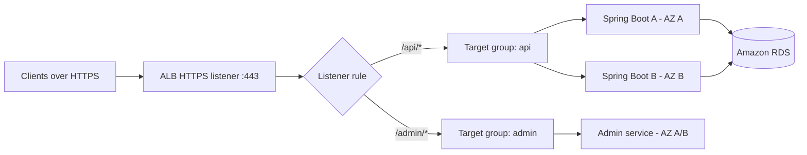
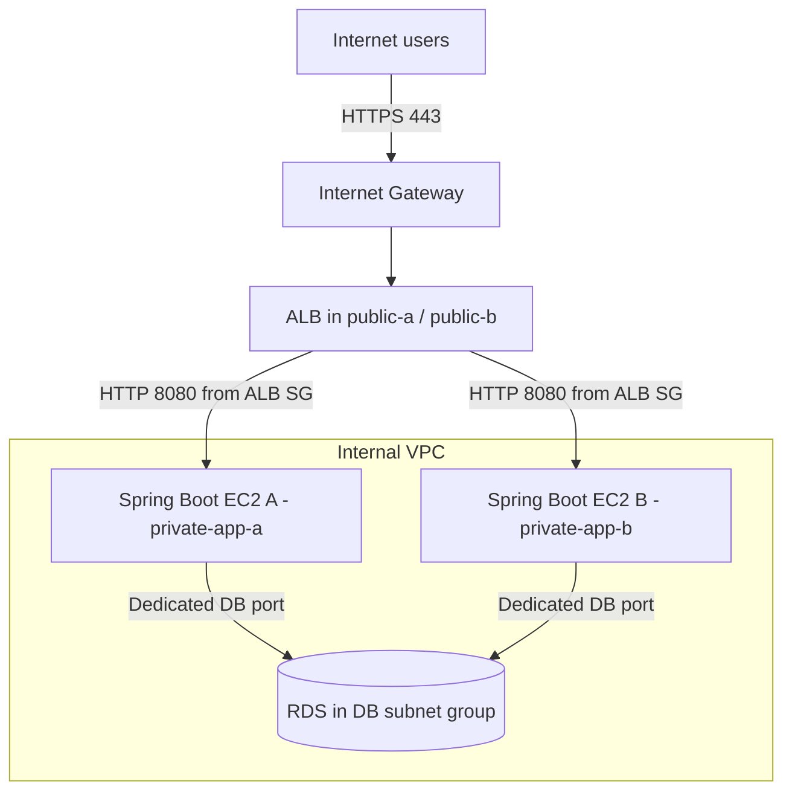
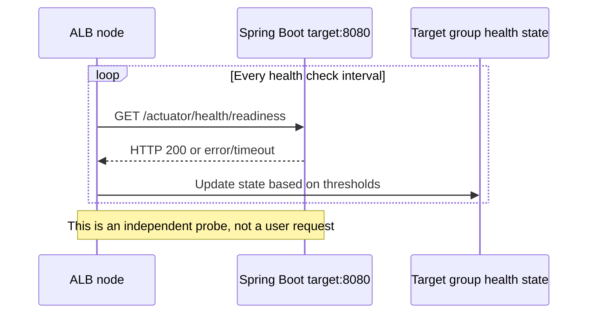
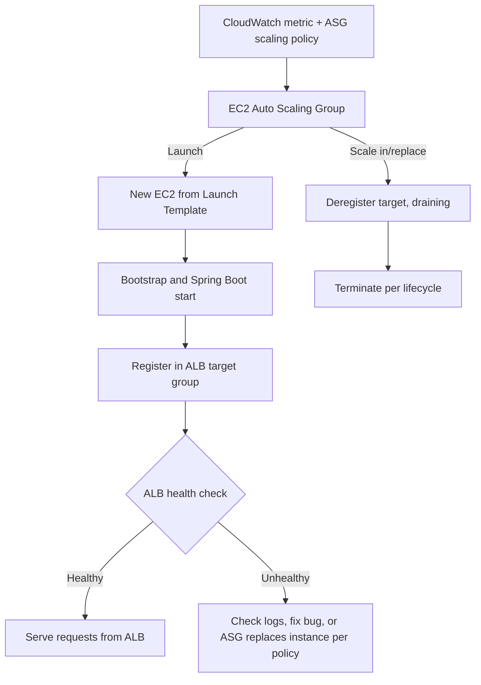
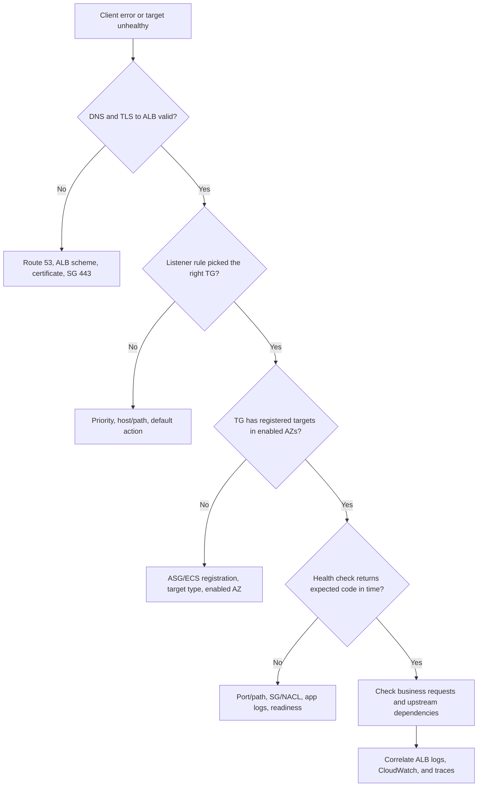

# ALB Listeners, Target Groups, and Health Checks

> **Chapter:** Load Balancing and Scaling · **Module:** `CLOUD_PROVIDERS_AWS`

## 1. The Problem: Multiple Backends, One Stable Entry Point

A Java Spring Boot application may run across multiple EC2 instances or ECS tasks in different Availability Zones (AZs). If clients connect directly to individual instance IPs, scaling out, deploying new versions, or replacing failed instances forces clients to track multiple addresses and handle per-instance availability themselves.

**Application Load Balancer (ALB)** is AWS Elastic Load Balancing's **Layer 7 (HTTP/HTTPS)** load balancer. ALB provides a DNS name as a stable entry point, accepts client connections, evaluates **listeners and listener rules**, forwards requests to a **target group**, and selects eligible targets to serve traffic. A target group's **health check** indicates whether a backend passes the configured check, helping ALB avoid routing requests to unhealthy targets.

Three-tier example:



ALB solves **traffic distribution and target health checking**; it does not create EC2 instances on its own, fix buggy code, deploy a Multi-AZ database, or replace application authentication and authorization.

In the `CLOUD_PROVIDERS_AWS` module, ALB design directly ties into **Regions/AZs, VPC subnets and security groups, IAM, EC2/ECS/EKS/Lambda, databases, CloudWatch, Auto Scaling, resilience, and cost control**. A well-configured ALB answers: on which ports do requests arrive, which rules process them, which targets are selected, what criteria mark a target healthy, how network/security layers are enforced, and what happens when no healthy targets remain.

**Learning outcomes:** After this lesson, you will be able to:

1. Distinguish ALB from NLB and identify listeners, listener rules, target groups, targets, and health checks.
2. Design HTTPS ingress in public subnets with backends in private subnets across multiple AZs.
3. Configure rules based on host/path, forward, redirect, and fixed response; understand priority ordering.
4. Choose target types and configure health check path, port, matcher, interval, timeout, and thresholds.
5. Diagnose `initial`, `unhealthy`, `unused`, and `draining` targets; distinguish infrastructure checks from application readiness.
6. Integrate ALB with Auto Scaling, rolling/blue-green deployments, CloudWatch, and Access Logs.
7. Evaluate security risks, cross-AZ traffic, fail-open behavior, ALB/LCU costs, and recovery strategies.

## 2. Components Forming the Request Path

### 2.1. ALB Operates at Layer 7

ALB understands HTTP/HTTPS requests: hostname, path, HTTP method, headers, query strings, and other HTTP attributes. As a result, ALB can route `/api/*` to the API backend pool and `/images/*` to a separate pool while clients access a single DNS name.

| Component | Responsibility | Example |
| --- | --- | --- |
| **Load balancer** | DNS name, scheme, subnets/AZs, network nodes, security groups, and attributes. | `app-prod-alb`, internet-facing, two AZs. |
| **Listener** | Accepts connections on a protocol/port; has a default action. | `HTTPS:443` using a certificate in ACM. |
| **Listener rule** | Evaluates conditions and executes actions by priority. | `Host=api.example.com` and `Path=/v1/*`. |
| **Target group** | Destination group, protocol/port, target type, health check, and attributes. | `orders-tg`, HTTP:8080. |
| **Target** | Actual destination address receiving requests. | EC2 instance ID, private IP of an ECS task, or Lambda function. |
| **Health check** | Independent probe sent to targets to evaluate readiness to serve traffic. | `GET /actuator/health/readiness` returning HTTP 200. |

A target group can be referenced by listener actions. A target group **is not synonymous with an Auto Scaling Group**: ASG manages EC2 instance count and lifecycle; the target group manages routing targets and health states. ASG can automatically register and deregister EC2 instances with a target group during scale-in/scale-out when properly integrated.

### 2.2. Choosing ALB or Another Load Balancer Type?

| Requirement | ALB | Network Load Balancer (NLB) | Gateway Load Balancer (GWLB) |
| --- | --- | --- | --- |
| Routing by HTTP host/path/header | **Yes**, Layer 7. | Does not perform HTTP host/path routing. | Not meant for HTTP application routing. |
| TCP/UDP, static IP use cases, and transport connections | Geared toward HTTP/HTTPS (and HTTP/2, gRPC under supported conditions). | Suited for TCP/UDP/TLS/transport traffic. | Suited for security/inspection appliance chaining. |
| TLS termination and certificates | Has HTTPS listener and TLS policies. | Has TLS listener for suitable use cases. | Different purpose. |
| Health checks and target groups | Yes, suited for HTTP applications. | Yes, at the connection/protocol layer per configuration. | Per appliance use case. |

**Do not choose ALB** for a custom non-HTTP TCP protocol just because you need load balancing; consider NLB instead. For Java REST apps, web frontends, HTTP microservices, or gRPC, ALB is typically the natural choice.

### 2.3. A Single ALB Can Serve Multiple Applications

If you serve multiple hostnames—such as `api.example.com`, `admin.example.com`, and `shop.example.com`—one HTTPS listener can accept all of them using appropriate certificates/SNI and route via host-header rules. This reduces the number of separate ALBs to operate, though you must weigh security boundaries, rule quotas, aggregate load, blast radius, and cost. Do not merge every application onto one ALB if teams require strict policy isolation or independent release schedules.

## 3. Choosing Internet-Facing vs. Internal ALB and VPC Layout

ALB supports two common schemes:

- **Internet-facing:** provides a public entry point via DNS; typically placed in **public subnets** with a route to an Internet Gateway (IGW). Open only necessary inbound HTTP/HTTPS ports.
- **Internal:** provides only private entry points within routed networks; used for internal APIs, service-to-service traffic, or applications accessed over private connectivity (VPN, Direct Connect, VPC peering/Transit Gateway by design).

When creating a standard ALB, AWS requires selecting **at least two subnets in two different AZs** to host load balancer nodes; each subnet must have enough free IP addresses for ALB scaling. AWS guidance for ALB recommends a **minimum subnet CIDR of /27 with at least eight available IP addresses per subnet**. For Local Zones/Outposts or special deployment models, requirements may differ; check AWS documentation for your specific setup.

Example VPC `10.20.0.0/16`:

| Resource | AZ A | AZ B | Role |
| --- | --- | --- | --- |
| **Public subnet** | `10.20.0.0/24` | `10.20.1.0/24` | Hosts internet-facing ALB nodes, route `0.0.0.0/0 → IGW`. |
| **Private app subnet** | `10.20.10.0/24` | `10.20.11.0/24` | EC2/ECS tasks as targets; no public IPv4 required. |
| **Isolated DB subnet** | `10.20.20.0/24` | `10.20.21.0/24` | RDS accepting connections from backends. |



**Note:** Traffic **ALB → target** between subnets in the same VPC uses internal (`local`) routing and does not traverse an Internet Gateway or NAT gateway. Backends may need a NAT gateway or VPC endpoints for their **own outbound traffic** (such as downloading artifacts or calling AWS APIs); that is independent of inbound traffic arriving from ALB.

### 3.1. Security Groups in Both Directions

| Attach SG to | Required Inbound | Recommended Outbound Restrictions |
| --- | --- | --- |
| **`sg-alb`** | TCP 443 from intended clients (e.g., `0.0.0.0/0` for a public website). TCP 80 if listener only redirects HTTP → HTTPS. | TCP 8080 to app targets/`sg-app` and health check port if different. |
| **`sg-app`** | TCP 8080 **only from `sg-alb`**. If the health check port differs, allow that port from `sg-alb` too. | DB port to `sg-db`, HTTPS to required services. |
| **`sg-db`** | Database port only from `sg-app` (e.g., PostgreSQL TCP 5432). | Per DB requirements. |

Security groups are **stateful**: responses to valid connections are automatically allowed. **Network ACLs are stateless**, so if NACLs are tightened, you must permit both request and return traffic including corresponding ephemeral ports. Every target should restrict inbound sources to the ALB's SG rather than opening the application port to the entire Internet.

### 3.2. Availability Zones and Distribution Capability

ALB provisions nodes in enabled AZs. ALB supports cross-zone load balancing; at the load balancer level this behavior is enabled for ALB, while target groups offer an option to control cross-zone in certain cases. During design, verify **enabled AZs, registered targets in each AZ, target health**, and target group settings. An ALB spanning two AZs does not achieve high availability if **all application instances run in only one AZ**.

ALB DNS records may change IP addresses over time as AWS scales and recovers nodes. Clients should use the **ALB's DNS name or an appropriate Route 53 alias/CNAME**, never hard-coding ALB node IPs into applications. For internal ALBs, private DNS and routing from internal networks must be configured accurately.

## 4. Listener: Protocol, Port, and Routing Rules

A **listener** waits for client connections on a **protocol + port**. For example, an HTTPS:443 listener accepts TLS connections, selects an appropriate certificate, parses HTTP requests, and applies listener rules. An HTTP:80 listener is commonly created solely to **redirect to HTTPS**.

### 4.1. HTTPS Listeners and Certificates

On an HTTPS listener, ALB terminates TLS from clients (**TLS termination**), using certificates from **AWS Certificate Manager (ACM)** or a compatible certificate mechanism. **Server Name Indication (SNI)** enables hosting multiple hostnames/certificates on the same listener. Choose a TLS security policy matching security standards and supported clients, and manage certificate rotation and expiration.

The **ALB → backend** hop can use HTTP or HTTPS depending on the target group. If you select an HTTPS target group, ALB establishes a separate TLS connection to the target; this is **not the same TLS session** as the client's. To encrypt traffic inside the VPC as well, configure an HTTPS target group and manage backend certificates accordingly. According to current AWS documentation, when ALB connects to HTTPS targets, ALB **does not validate the target's certificate the way a browser validates against a public CA**; assess the risk and apply appropriate network/identity controls rather than inferring end-to-end mTLS solely from the HTTPS protocol name.

### 4.2. How Listener Rules Are Evaluated

Each listener has:

- A **default rule** with no numeric priority, evaluated **last**.
- **Non-default rules** with numeric priorities; **lower numbers are evaluated first**.
- Each rule combines **conditions** and **actions**; the first matching rule determines how the request is handled.

Common conditions:

| Condition | Example | Purpose |
| --- | --- | --- |
| **Host header** | `api.example.com` | Route multiple domains to multiple apps. |
| **Path pattern** | `/orders/*` | Route by API path. |
| **HTTP method** | `POST` | Handle specific HTTP methods separately when appropriate. |
| **HTTP header** | `X-Environment: canary` | Route requests carrying a matching header (must consider header source security). |
| **Query string** | `version=v2` | Route by selected request query parameters. |
| **Source IP** | An allowed CIDR. | Route by client IP when using the right address type/architecture. |

Example rule design for listener `HTTPS:443`:

| Priority | Condition | Action |
| --- | --- | --- |
| 10 | `host=api.example.com`, `path=/v2/*` | Forward to `api-v2-tg`. |
| 20 | `host=api.example.com` | Forward to `api-v1-tg`. |
| 30 | `host=admin.example.com` | Forward to `admin-tg` (with appropriate auth/WAF protection). |
| Default | All remaining requests | Fixed response HTTP 404 or forward to default site by design. |

If you place the broad rule `host=api.example.com` at priority 5, it matches before `/v2/*` and the v2 rule **will never be hit**. Assign lower priority numbers to more specific conditions, and test both matching and non-matching paths as well as URL-encoded cases.

### 4.3. Listener Actions

| Action | Outcome | Example Usage |
| --- | --- | --- |
| **Forward** | Sends requests to one or more target groups, optionally weighted. | `/api/*` → `api-tg`. |
| **Redirect** | Returns an HTTP redirect instructing the client to call another URL. | HTTP:80 → HTTPS:443 with HTTP 301 (or 302 as needed). |
| **Fixed response** | Returns a preconfigured HTTP response without reaching targets. | Return 404/403 for unrouted requests or a suitable maintenance notice. |
| **Authenticate (OIDC/Cognito)** | Performs an authentication step on an HTTPS listener before the terminating action. | Protect OIDC/Cognito-compatible web applications. |

Do not configure a redirect from HTTPS back to the same HTTPS:443 host/path unchanged, as this creates a **redirect loop**. A listener rule has one terminating action (forward/redirect/fixed-response) per AWS constraints; if an authentication step is included, it must precede the final action in the right order. For ALB versions supporting advanced header/URL transforms, review official limits and rule semantics before using them.

### 4.4. HTTP → HTTPS Example

On an HTTP:80 listener, set the default action:

```text
Action: Redirect
Protocol: HTTPS
Port: 443
Host: #{host}
Path: /#{path}
Query: #{query}
Status code: HTTP_301
```

This is a conceptual configuration representation, not an AWS CLI command. The HTTPS:443 listener still requires a valid certificate, security group allowing port 443, and ready target groups. Redirecting HTTP to HTTPS will not fix invalid certificates or misconfigured secure cookies in the application.

## 5. Target Groups: Backend Pools Receiving Traffic

A **target group** has these key properties:

1. **Target type**: `instance`, `ip`, or `lambda` for ALB.
2. **Protocol/port**: e.g., HTTP:8080 or HTTPS:8443 for instance/IP targets. ALB also supports protocol versions HTTP/1.1, HTTP/2, or gRPC for compatible use cases.
3. **VPC**: required for instance/IP target groups; defines the network scope within which ALB connects to targets.
4. **Health check**: protocol, port, path, HTTP/gRPC success codes, timeout, interval, and healthy/unhealthy thresholds.
5. **Attributes**: deregistration delay, stickiness, load balancing algorithm, slow start, and cross-zone where supported.
6. **Registered targets**: specific list of destinations and ports; registering into a target group does not prove a target is healthy.

### 5.1. Three Target Types for ALB

| Target Type | Registered By | Best Use Case | Points to Watch |
| --- | --- | --- | --- |
| **Instance** | EC2 **instance ID** and corresponding backend port. | ASGs running EC2, Spring Boot apps on instances. | Network, AZ, and EC2 SG must allow ALB access; registration is usually managed by ASG. |
| **IP** | **Private IP address** and port within ALB-supported ranges/configs. | ECS tasks using `awsvpc`, EKS pod/IP targets, IP-based workloads. | IPs change when tasks/pods replace; controllers/orchestrators should handle register/deregister. |
| **Lambda** | AWS Lambda function ARN, with appropriate invocation permissions. | HTTP APIs/events processed by Lambda using ALB payloads. | Request/response format, limits, health checks, and timeouts differ from instance/IP; **no NFS/port 8080**. |

Do not choose the `instance` target type for an ECS Fargate task with its own ENI just because it runs on AWS: that case typically requires the `ip` target type. With Amazon EKS, the AWS Load Balancer Controller can manage target registration using either `instance` or `ip` depending on Ingress/Service annotations; check each deployment.

**Note:** The `alb` target type is used in the **Network Load Balancer pointing to ALB** pattern, not as a normal target type for an ALB to forward to another ALB.

### 5.2. A Target Group Is Not a Single Instance

Suppose `orders-tg` has registered:

| Target | Port | AZ | Health state |
| --- | --- | --- | --- |
| EC2 A | 8080 | AZ A | `healthy` |
| EC2 B | 8080 | AZ B | `healthy` |
| EC2 C | 8080 | AZ B | `unhealthy` |

ALB selects among eligible healthy targets; C should be investigated and will not receive new requests while unhealthy as long as healthy targets remain, except under special routing/fail-open conditions. When ASG replaces C, the old target is deregistered, the new target is registered, and health checks evaluate it before sending traffic.

Keep the two lifecycles distinct:

- **Auto Scaling Group**: decides how many EC2 instances are needed and when to launch/replace them.
- **Target group**: holds the list of targets, health states, and how ALB distributes requests.

Thus, setting ASG desired capacity to 3 does not guarantee 3 **healthy** backends. Monitor `HealthyHostCount`, `UnHealthyHostCount`, and application status—not just `running` EC2 counts.

### 5.3. One Target Group Referenced by Multiple Rules

A listener rule `/orders/*` can forward to `orders-tg`, and another listener can also reference that same group. Shared target groups reduce configuration sprawl, but expand the blast radius if health checks, attributes, or target membership change. When multiple applications need distinct policies and rollout schedules, separate target groups are usually cleaner.

### 5.4. Changing Backends Without Clients Changing Addresses

ALB exposes a DNS name and listener port; clients never see internal instance IDs. When ASG scales out from two to four EC2 instances, target registration and health state update while the public URL stays unchanged. For DNS, use a Route 53 alias record pointing your corporate hostname to the ALB.

## 6. Health Checks: Verifying Target Readiness

An ALB **health check** is a recurring probe sent from ALB to each target based on **target group** settings, independent of user requests. For HTTP/1.1 backends, ALB sends an HTTP request to the target's configured `path` and `port`, evaluating the result by response code and timing.

Illustrative configuration for Spring Boot:

| Property | Sample Value | Meaning |
| --- | --- | --- |
| Protocol | `HTTP` | Sends health checks to targets over HTTP inside the VPC. |
| Health check port | `traffic-port` | Uses the registered target port, e.g., 8080. |
| Health check path | `/actuator/health/readiness` | Endpoint reporting whether the app is ready to accept requests. |
| Success codes (matcher) | `200` | Treats only HTTP 200 as success. |
| Interval | `15 seconds` | Time between health check probes. |
| Timeout | `5 seconds` | Exceeding this marks a probe as failed. |
| Healthy threshold | `3` | Consecutive successful probes to transition to healthy where applicable. |
| Unhealthy threshold | `2` | Consecutive failed probes to mark unhealthy. |

These are **example values**, not necessarily the defaults for every target type. Valid ranges, defaults, and timing rules vary by ALB protocol and target type; consult the Target Group Health Checks documentation when configuring. Avoid setting interval/timeout overly low if the app has network latency or heavy load, as this can trigger flapping (oscillating between healthy and unhealthy).

### 6.1. Readiness vs. Liveness

In a Spring Boot application, distinguish:

- **Liveness:** is the process still alive and not in an unrecoverable state?
- **Readiness:** is the application **currently ready to accept traffic** under appropriate criteria?

ALB should check **readiness**. The `/actuator/health/readiness` endpoint can be helpful in Spring Boot Actuator versions configured with probes enabled and exposed over HTTP. It is **not always present by default** in every Spring Boot version/configuration; configure and test it directly. An endpoint returning a static `200 OK` before initialization finishes will report false healthy status.

Conversely, if the endpoint checks too many non-essential dependencies (such as a secondary analytics service), it could knock all backends out of rotation even though the core API still works. Scope readiness to **dependencies strictly required to serve requests**, with sensible timeouts, and avoid exposing sensitive details in the response.

Simple HTTP response example:

```http
HTTP/1.1 200 OK
Content-Type: application/json

{"status":"UP"}
```

If the application is not ready, return a code **outside the matcher**, typically HTTP 503:

```http
HTTP/1.1 503 Service Unavailable
Content-Type: application/json

{"status":"DOWN"}
```

If the endpoint requires login and returns HTTP `401`, or redirects to a login page with `302`, a matcher accepting only `200` marks the target unhealthy. Expose the health endpoint with **network access restricted to ALB**, requiring no user login while leaking no secrets. Do not loosen the matcher to accept all 3xx/4xx codes just to turn the health check "green."

### 6.2. How Do Health Checks Travel?



Health checks carry a **Host header** and headers generated by ALB, which may differ from the application's public hostname. If a web server/virtual host only permits `api.example.com` and returns 404 when the Host is the IP/port used by the health check, targets become unhealthy even though browsers can reach other endpoints. The application or reverse proxy must handle the health route according to how ALB sends probes.

Healthy status reflects probes **from ALB nodes to targets**—it does not prove end users can traverse DNS, TLS, WAF, and listener rules successfully. Likewise, passing health checks does not mean the database and every business flow are always healthy.

### 6.3. Target Health States

| State | Meaning | Action |
| --- | --- | --- |
| `initial` | Newly registered or starting initial health checks. | Wait for initial probes and verify bootstrap, listener/port. |
| `healthy` | Passes health check criteria. | Eligible to receive traffic per active rules/algorithm. |
| `unhealthy` | Failed health checks per threshold. | Inspect reason codes, app logs, security groups, and health endpoint. |
| `unused` | Target is not used by ALB under current config, AZ is disabled, or target group is unreferenced. | Check listener rules, enabled AZs, registration, and target group. |
| `draining` | Deregistering, waiting for active connections to finish per configuration. | Monitor deregistration delay and rollout progress. |
| `unavailable` | Health information unavailable for the given check type/feature. | Check target type, probe status, and configuration. |

States and reason codes returned by `describe-target-health` pinpoint the cause: e.g., `Target.Timeout`, `Target.ResponseCodeMismatch`, `Target.FailedHealthChecks`, `Target.NotRegistered`, or messages indicating a disabled AZ. Never guess the cause solely from a red indicator in the Console.

### 6.4. Health Checks for gRPC and Lambda Targets

- For **HTTP/2/gRPC target groups**, ALB supports corresponding protocol versions and health checks that evaluate **gRPC status codes** instead of plain HTTP status codes. Do not blindly apply an HTTP `/actuator/health/readiness` path to a gRPC-only service unless an appropriate endpoint is implemented.
- For **Lambda target groups**, health checks can be **disabled by default**; Lambda has no TCP port 8080 or systemd process like EC2. Configure invocation permissions, response payloads, and testing per the Lambda-as-target guide.

### 6.5. Fail-Open Behavior When All Targets Are Unhealthy

This is an easily overlooked operational detail: **if a target group has only unhealthy targets remaining in enabled AZs, ALB may "fail open" and continue routing requests to all those targets regardless of their unhealthy state**. The intent is to attempt preserving availability when zero healthy destinations remain, but it means **a health check is not a firewall or kill switch guaranteeing traffic stops completely**.

If **no targets are registered or available for a rule**, ALB can return HTTP `503 Service Unavailable`. Distinguish `0 healthy + unhealthy still registered` from `no targets at all`. When seeing a surge of 5xx errors, check target registrations, unhealthy reason codes, ALB metrics, target logs, and environment status.

Never build data protection mechanisms that rely solely on flipping a health state to `unhealthy`. To isolate a compromised or misbehaving backend, change routing/registration, access permissions, or network blocks through a controlled incident-response procedure.

### 6.6. Detection Time and Recovery Latency

With a 15-second interval and an unhealthy threshold of 2, a single failure is not enough to mark a target unhealthy; **two consecutive failed probes** are required, depending on failure timing and timeouts. Do not treat `15 × 2 = 30 seconds` as an exact SLA, since failure timing, probe ordering, timeouts, and per-node behavior vary.

When a service recovers, the target must pass the configured number of consecutive healthy checks before returning to rotation where applicable. Setting the interval too long slows failover and recovery; setting it too short increases probe load and flapping risk. Measure Java startup latency, GC pauses, backend timeouts, and your application's error budget before choosing values.

## 7. Hands-On Walkthrough: Spring Boot Behind an HTTPS ALB

Suppose you need to deploy an `orders` service running on **two Amazon Linux 2023 EC2 instances**, one per AZ. The app listens on HTTP:8080 and exposes a health endpoint returning HTTP 200 when ready. Users visit `https://api.example.com/orders`; ALB accepts HTTPS:443, terminates TLS, and forwards HTTP:8080 to EC2 across the private VPC.

### 7.1. Architecture and Assumptions

| Component | Illustrative Config | Conditions |
| --- | --- | --- |
| Region | `ap-southeast-1` | IDs/ARNs must belong to a real Region and account. |
| VPC | `10.20.0.0/16` | Two public subnets and two private app subnets. |
| ALB | `orders-prod-alb`, internet-facing, IPv4, two AZs | Public subnets route to IGW; SG allows inbound 443. |
| Listener 80 | Redirect HTTP → HTTPS | Optional per policy; port 80 may be omitted. |
| Listener 443 | TLS certificate from ACM | Certificate covers `api.example.com`. |
| Target group | `orders-tg`, target type `instance`, HTTP:8080 | EC2 instances run the app on port 8080. |
| Health check | `GET /actuator/health/readiness`, matcher 200 | Endpoint works without user login from ALB. |
| Backends | EC2 A and B without public IPv4 | SG accepts TCP 8080 only from ALB SG. |
| Database | Private/isolated RDS (if required by app) | DB SG accepts only from app SG; secrets kept out of user data. |

Names, account IDs, domains, and ARNs in these examples **do not pre-exist** and are purely illustrative. In a real lab, replace them with your own resources and clean up billable items afterward.

### 7.2. Spring Boot Readiness

For Spring Boot versions supporting Actuator readiness probes, example configuration:

```yaml
# application.yml - only the portion related to the health endpoint
server:
  port: 8080

management:
  endpoint:
    health:
      probes:
        enabled: true
  endpoints:
    web:
      exposure:
        include: health,info
```

Once the app starts, verify directly on the EC2 instance:

```bash
curl --fail --silent --show-error --max-time 5 \
  http://127.0.0.1:8080/actuator/health/readiness
```

**Note:** Property names, management port location, and endpoints may vary by Spring Boot version/configuration. If `management.server.port` separates the health check port, open that port from ALB and set `Health check port` accordingly. If security filters block `/actuator/health/readiness`, add a scoped allow rule and test it; do not expose all Actuator endpoints to the Internet.

In some architectures, readiness only confirms the server accepts requests; complex DB status checks, migrations, or third-party dependency checks should be designed separately. Avoid putting heavy queries on a probe running every few seconds, or health checks themselves can overload the app.

### 7.3. Configuration Steps in the AWS Console

1. **Prepare the VPC**: two public subnets for ALB, two private subnets for EC2, route tables, IAM instance profile, and EC2 instances running the app on port 8080.
2. **Create security groups**: `sg-alb` inbound TCP 443 from expected clients, outbound TCP 8080 to `sg-app`; `sg-app` inbound 8080 from `sg-alb`.
3. Go to **EC2 → Target Groups → Create target group**, choose target type `Instances`, protocol `HTTP`, port `8080`, and the target VPC.
4. Set health check protocol `HTTP`, path `/actuator/health/readiness`, success matcher `200`, and suitable interval/timeout/thresholds; register EC2 A/B if not yet managed by an ASG.
5. Go to **EC2 → Load Balancers → Create → Application Load Balancer**, choose **Internet-facing**, two subnets across two AZs, and `sg-alb`.
6. Add an **HTTPS:443 listener** with an ACM certificate and default action forwarding to `orders-tg`; optionally add an HTTP:80 listener redirecting to HTTPS.
7. Create listener rules by hostname/path if serving multiple services; verify priority order. If there is only one app, the default forward action is often enough.
8. Wait for the target group to report `healthy`, inspecting `describe-target-health` if it does not. Then create a Route 53 alias record for the hostname and test HTTPS from a real client.
9. Verify an **invalid route** returns 404/fixed response as designed rather than reaching an unintended backend. For public applications, verify WAF/rate controls, logs, and alarms.
10. Document resources/ARNs, owner, policies, health checks, dashboards, expected cost, and rollback procedures.

### 7.4. Two Different Verification Methods

**On EC2**, test the local path to the application:

```bash
curl -i --max-time 5 http://127.0.0.1:8080/actuator/health/readiness
```

**From an external client** (once public DNS/HTTPS is ready):

```bash
curl --fail --show-error --verbose https://api.example.com/orders
```

The first command verifies the local app; the second verifies DNS, TLS certificate, listener, rules, target group, security groups, request routing, and the app together. Never conclude ALB is broken just because local curl works, nor assume the app is healthy just because the ALB TLS handshake succeeds.

### 7.5. When Backends Do Not Yet Run the Application

If you create the ALB before EC2 instances are running the app, targets stay `initial` or `unhealthy`. You can provision infrastructure ahead of time, but **do not cut over customer traffic** until:

- The build/release artifact version is verified.
- The EC2 service runs via systemd, independent of an SSH terminal.
- The health endpoint returns the expected code under timeout.
- The ALB target group shows sufficient healthy targets across expected AZs.
- Dashboards, logs, and a rollback path are ready.

## 8. Inspection with AWS CLI (Read-Only)

AWS CLI commands help verify actual state, especially when the Console only shows `Unhealthy`. The following examples assume AWS CLI v2 configured via IAM Identity Center/role with appropriate `elasticloadbalancing:Describe*` permissions.

### 8.1. List ALB and Retrieve ARN

```bash
aws sts get-caller-identity

aws elbv2 describe-load-balancers \
  --region ap-southeast-1 \
  --names orders-prod-alb \
  --query "LoadBalancers[].{Arn:LoadBalancerArn,Name:LoadBalancerName,DNS:DNSName,Scheme:Scheme,State:State.Code,Type:Type}" \
  --output table
```

Record `LoadBalancerArn` and the DNS name. Do not confuse the **load balancer** ARN with a **listener** ARN or **target group** ARN.

### 8.2. Inspect Listeners and Rules

```bash
# Replace the ARN string below with an actual ARN.
aws elbv2 describe-listeners \
  --region ap-southeast-1 \
  --load-balancer-arn 'arn:aws:elasticloadbalancing:ap-southeast-1:111122223333:loadbalancer/app/orders-prod-alb/example' \
  --output json

# Replace with the ListenerArn obtained from describe-listeners.
aws elbv2 describe-rules \
  --region ap-southeast-1 \
  --listener-arn 'arn:aws:elasticloadbalancing:ap-southeast-1:111122223333:listener/app/orders-prod-alb/example/example-listener' \
  --output json
```

In the output:

- `Listeners[].Port`/`Protocol`: client-facing port and protocol.
- `Listeners[].DefaultActions`: default action.
- `Rules[].Priority`: rule order; the default rule shows `default`.
- `Rules[].Conditions`: host/path/header/query/method/source-IP conditions.
- `Rules[].Actions`: which target group to forward to, redirect, or fixed response.

### 8.3. Inspect Target Groups and Target Health

```bash
# Retrieve TargetGroupArn by name.
aws elbv2 describe-target-groups \
  --region ap-southeast-1 \
  --names orders-tg \
  --output json

# Replace the ARN with the actual TargetGroupArn from above.
aws elbv2 describe-target-health \
  --region ap-southeast-1 \
  --target-group-arn 'arn:aws:elasticloadbalancing:ap-southeast-1:111122223333:targetgroup/orders-tg/example' \
  --query "TargetHealthDescriptions[].{Id:Target.Id,Port:Target.Port,State:TargetHealth.State,Reason:TargetHealth.Reason,Description:TargetHealth.Description}" \
  --output table
```

If status is `unhealthy` with reason `Target.ResponseCodeMismatch`, check the matcher and actual HTTP response status. If `Target.Timeout`, verify the app listens on the port, routes/SGs/NACLs, timeouts, and host resources. If `unused`, check listener rules, enabled AZs, and target registration before launching more instances.

### 8.4. Inspect Target Group Attributes

```bash
aws elbv2 describe-target-group-attributes \
  --region ap-southeast-1 \
  --target-group-arn 'arn:aws:elasticloadbalancing:ap-southeast-1:111122223333:targetgroup/orders-tg/example' \
  --output table
```

Important keys can include `deregistration_delay.timeout_seconds`, `stickiness.enabled`, `slow_start.duration_seconds`, and `load_balancing.algorithm.type`. Limits, compatibility, and defaults depend on target group type and configuration; never modify an attribute before understanding its impact.

## 9. AWS CLI: Controlled Examples for Creating Target Groups and Listeners

Commands in this section **can create billable resources or alter traffic paths if executed in a real AWS account**. They are shown purely to explain the workflow and have not been executed. Replace all sample IDs/ARNs and use an authorized lab environment before running.

### 9.1. Create an HTTP:8080 Target Group with Health Check

```bash
aws elbv2 create-target-group \
  --region ap-southeast-1 \
  --name orders-tg \
  --protocol HTTP \
  --port 8080 \
  --vpc-id vpc-0123456789abcdef0 \
  --target-type instance \
  --health-check-protocol HTTP \
  --health-check-port traffic-port \
  --health-check-path /actuator/health/readiness \
  --health-check-interval-seconds 15 \
  --health-check-timeout-seconds 5 \
  --healthy-threshold-count 3 \
  --unhealthy-threshold-count 2 \
  --matcher HttpCode=200
```

Returns `TargetGroupArn`. With an ASG, attach the target group to the ASG so it manages targets automatically; for standalone EC2 instances, you can use `register-targets` by ID when permitted and needed:

```bash
aws elbv2 register-targets \
  --region ap-southeast-1 \
  --target-group-arn 'arn:aws:elasticloadbalancing:ap-southeast-1:111122223333:targetgroup/orders-tg/example' \
  --targets Id=i-0123456789abcdef0,Port=8080
```

Registration **does not guarantee healthy status**; the target still needs network reachability, a matching listener, and a valid health response from the app.

### 9.2. Create an ALB and HTTPS Listener

Example creating an ALB across two public subnets with `sg-alb`:

```bash
aws elbv2 create-load-balancer \
  --region ap-southeast-1 \
  --name orders-prod-alb \
  --type application \
  --scheme internet-facing \
  --ip-address-type ipv4 \
  --subnets subnet-aaaaaaaaaaaaaaaaa subnet-bbbbbbbbbbbbbbbbb \
  --security-groups sg-0123456789abcdef0
```

Once the ALB is active and you have `LoadBalancerArn`, create the HTTPS listener:

```bash
aws elbv2 create-listener \
  --region ap-southeast-1 \
  --load-balancer-arn 'arn:aws:elasticloadbalancing:ap-southeast-1:111122223333:loadbalancer/app/orders-prod-alb/example' \
  --protocol HTTPS \
  --port 443 \
  --certificates CertificateArn=arn:aws:acm:ap-southeast-1:111122223333:certificate/example \
  --default-actions Type=forward,TargetGroupArn=arn:aws:elasticloadbalancing:ap-southeast-1:111122223333:targetgroup/orders-tg/example
```

The `example` ARN here is not valid for live execution. Select a TLS security policy meeting organizational standards when creating the listener; the CLI uses a default policy if omitted. Adjust security policies/certificates through reviewed configuration and test after deployment.

### 9.3. Path-Based Rule

With another existing target group, create a rule at priority `10`:

```bash
aws elbv2 create-rule \
  --region ap-southeast-1 \
  --listener-arn 'arn:aws:elasticloadbalancing:ap-southeast-1:111122223333:listener/app/orders-prod-alb/example/example-listener' \
  --priority 10 \
  --conditions Field=path-pattern,Values='/orders/*' \
  --actions Type=forward,TargetGroupArn=arn:aws:elasticloadbalancing:ap-southeast-1:111122223333:targetgroup/orders-tg/example
```

On an HTTPS listener, host/path conditions match according to ALB semantics; ALB **does not strip the `/orders` prefix** before forwarding to the app in a standard forward configuration. If the backend only handles `/api/orders` or `/`, update the app's context path or configure supported rewrite/transform rules and test thoroughly. After changes, run `describe-rules` and send test requests from a client to verify.

## 10. Advanced Listener Routing: Weights, Stickiness, and Version Rollouts

### 10.1. Weighted Forwarding

A listener action can forward to **multiple target groups with different weights**. Example:

```text
Listener HTTPS:443
  Rule host=api.example.com
    Forward:
      orders-v1-tg  weight=90
      orders-v2-tg  weight=10
```

This is a conceptual **canary rollout** setup: roughly 10% of new requests may be routed to v2 based on weights, though actual observed proportions depend on traffic volume, stickiness, target group health, and distribution limits. Never equate `weight=10` with "exactly 10% of users" or "10% of connections every single minute."

**Important:** ALB **does not automatically shift all traffic from an unhealthy target group to another target group** simply because a weighted forward rule lists both. You need automation or a runbook to adjust weights or update the rule if v2 fails. Weighted forwarding is a traffic-shifting tool, not an automatic cross-target-group failover mechanism.

### 10.2. Stickiness and Session State

**Stickiness** keeps a client sending requests to the same target or target group for a configured duration using cookies. It helps legacy applications storing sessions in memory, but carries risks:

- Load distributes unevenly if certain clients generate far more requests.
- When a target fails or scales in, clients must still move to another target; in-memory state can be lost.
- Cookies have expiration and policy constraints; pay attention to HTTPS, SameSite, secure cookies, CORS, and privacy.
- With weighted forwarding across multiple target groups, **target group stickiness** and **target stickiness** operate at different scopes.

For modern Java applications, favor **stateless services**, storing required session data in a dedicated store (such as a properly operated Amazon ElastiCache/Redis cluster) or securely verified tokens; enable stickiness only for validated requirements.

### 10.3. Deregistration Delay and Graceful Shutdown

When ASG scales in or replaces an EC2 instance, targets typically enter `draining` upon deregistration. **Deregistration delay** gives in-flight requests/connections a configured window to finish. If the delay is too short, long requests are cut off; if too long, rollouts and scale-in slow down.

A Spring Boot application should:

1. Start **rejecting or draining new requests** on shutdown in a way compatible with the load balancer/orchestrator.
2. Allow in-flight requests to complete within a reasonable timeout.
3. Cleanly close database connections, file handles, and active message consumers.
4. Ensure ASG instance lifecycle and deregistration delay allow enough time without waiting indefinitely.

In Spring Boot, configure graceful shutdown per your supported version and measure real termination time; never assume every Java process handles SIGTERM cleanly out of the box. Align stop timeouts, ALB deregistration delay, and background jobs under one cohesive plan.

### 10.4. Slow Start and Load Balancing Algorithms

A newly healthy target may still have cold caches, un-warmed JIT compilation, or empty connection pools. **Slow start** (when compatible with the target group/algorithm) gradually ramps up traffic to new targets over a configured duration, preventing sudden overload.

ALB supports target group load balancing algorithms per type and feature support, including **round robin**, **least outstanding requests**, and **weighted random**. Choose based on latency distribution, uneven processing capacity across targets, and system characteristics; no algorithm fixes slow database queries or exhausted thread pools. Certain attribute combinations are incompatible (for example, some slow start/stickiness pairings with specific algorithms), so verify documentation before enabling them together.

## 11. Security When Running ALB in Production

Placing an ALB in front of an application reduces direct exposure of EC2 instances, but does not eliminate HTTP application threats on its own. Combine **TLS, listener rules, IAM, VPC security groups, AWS WAF, application controls, and data protection**.

### 11.1. Choosing Where to Terminate TLS

| Layer | Common Design | Controls |
| --- | --- | --- |
| **Client → ALB** | HTTPS:443, ACM certificate, appropriate TLS security policy. | Valid certificate for hostnames, auto-renewal/monitoring, HTTP→HTTPS redirect if port 80 is open. |
| **ALB → backend** | HTTP inside VPC or HTTPS to targets depending on requirements. | SG allows traffic only from ALB; use HTTPS if encryption in transit is required on this hop too. |
| **Backend → RDS/other destinations** | Separate TLS/encryption if supported by service and required by policy. | Do not assume client HTTPS protects all downstream internal traffic. |

Protect the **client-facing server certificate** and choose a TLS security policy aligned with organizational standards; enabling HTTPS does not address OWASP vulnerabilities, credential theft, or application authorization flaws. If ALB must authenticate clients using certificates/mTLS, check **mutual TLS** capabilities, trust store limits, and certificate revocation in current AWS documentation before finalizing the design.

### 11.2. Passing Client Information to Backends via Headers

Because ALB terminates TLS and opens a new connection to the backend, the backend sees the **ALB node's IP** as the peer address rather than the original user's IP. ALB populates headers such as:

- `X-Forwarded-For`: chain of IP addresses associated with the client and proxies per forwarding configuration.
- `X-Forwarded-Proto`: original protocol from client to ALB (e.g., `https`).
- `X-Forwarded-Port`: port the client used to connect to ALB.

These are essential for generating correct HTTPS redirect URLs, enforcing cookie policies, and logging. However, a client or upstream proxy can spoof similar headers; **never blindly trust an arbitrary entry in `X-Forwarded-For` to grant permissions, block access, or establish identity** without verifying trusted proxies. Design a clear trust chain, WAF, routing, and logging. Backends should only accept traffic from the ALB/trusted network if relying on forwarded headers.

In Spring Boot, configure forwarded header handling appropriately for your web stack/proxy. Test carefully to avoid infinite HTTP↔HTTPS redirect loops, incorrect absolute URLs, or host header injection exposure.

### 11.3. AWS WAF, Authentication, and Least Privilege

- **AWS WAF** attaches to ALB to filter HTTP requests with rules, managed rule groups, and IP/rate conditions. WAF provides an extra defense layer—it does not replace input validation, API authorization, or secure coding.
- **Listener authentication** integrates Amazon Cognito or OIDC on HTTPS listeners for suitable web apps; fine-grained business authorization remains the application's job.
- **IAM** restricts who can modify ALBs, listeners, target groups, certificates, WAF, or CloudWatch logging. Anyone with `ModifyListener` or `ModifyRule` permissions can divert traffic to another backend, so changes require review and CloudTrail monitoring.
- **Security groups** protect targets; **NACLs/routes** and VPC endpoints add further network controls. Never assign public IPv4 addresses to backends just so ALB health checks work.
- **Logging** must handle PII, URLs, and query strings carefully; never put tokens in URLs or log secrets.

### 11.4. Protecting Admin Endpoints and Avoiding Accidental Public Exposure

An internal API using an internal ALB must only be reachable over VPCs, private links, or approved gateways. Accidentally picking the `internet-facing` scheme exposes the ALB's DNS/IP publicly even if an SG restricts traffic. Verify:

1. Actual ALB scheme and subnet mapping.
2. Inbound/outbound SGs matching allowed client groups.
3. Listener default rule: never forward unknown hosts/paths to an admin API.
4. TLS certificates and domain ownership; HSTS policies when appropriate and tested.
5. WAF/authentication for high-sensitivity endpoints.
6. Monitoring and rollback procedures for route/SG/rule changes.

## 12. Auto Scaling, Availability, and Deployment Strategies

ALB is commonly paired with **EC2 Auto Scaling Groups**, Amazon ECS services, or EKS controllers to automatically register/deregister targets as workloads fluctuate. However, **ALB does not provision compute capacity**: the compute layer must be configured to scale with traffic.

### 12.1. ALB + EC2 Auto Scaling Group



The actual sequence of target registration, app startup, health checks, and termination depends on ASG settings and lifecycle hooks. The diagram illustrates **logical relationships**, not a guarantee that ASG always waits for bootstrap completion before registering a target. Configure **ELB health check type** when you want ASG to factor in ALB target health rather than EC2 status checks alone, and set an appropriate **health check grace period**, warmup, and bootstrap time.

For instance, an EC2 instance may reach `running` in one minute while user data takes three minutes to download the JAR and start the JVM. If the grace period is too short with ELB health checks enabled, ASG may terminate the initializing instance, creating a launch → unhealthy → terminate loop. Fix this with reliable bootstrapping, accurate readiness, and an adequate grace period—not by accepting any HTTP status code as healthy.

### 12.2. ECS and EKS

- **Amazon ECS**: services can register tasks into an ALB target group; with Fargate/`awsvpc`, `ip` target type is typically used. Coordinate ECS deployment health checks, grace periods, and ALB health checks.
- **Amazon EKS**: the AWS Load Balancer Controller provisions and manages ALBs/target groups from Kubernetes Ingress/Service annotations and configuration. Align pod readiness probes, target registration, pod termination/draining, and routing.
- **Lambda**: ALB forwards to a Lambda target group using ALB's payload/response integration; scaling, IAM invocation permissions, and health checks differ from EC2/ECS. If an API requires full API management capabilities, also compare Amazon API Gateway.

Do not create an `instance` target group with a fixed port out of habit when workloads are tasks/pods with dynamic IPs/ports. Target type and registration permissions must match the orchestrator.

### 12.3. Blue-Green and Canary Deployments

With two target groups:

```text
api-v1-tg: 3 healthy targets (serving production)
api-v2-tg: 3 healthy targets (new version)

Canary  ->  v1 weight=95, v2 weight=5
Expand  ->  v1 weight=50, v2 weight=50
Cutover ->  v1 weight=0,  v2 weight=100
```

At each step, monitor `HTTPCode_Target_5XX_Count`, response time, business metrics, error logs, and target health **per version**. If v2 breaches SLOs, revert weights or rules back to v1 per your runbook. Do not shift 100% of traffic just because v2 returns health 200; verify representative business workflows and database schema compatibility.

**Canary does not solve database schema migrations automatically.** When Spring Boot v1 and v2 run concurrently, schema changes should follow backward/forward-compatible practices (expand-and-contract) where appropriate, with safe data rollback plans.

### 12.4. True Multi-AZ Resilience

To survive an AZ outage, you need **enough healthy targets in other AZs**, not just two ALB subnets. Verify:

- ALB subnets and enabled AZs are configured properly.
- ASG/ECS tasks are distributed across AZs with adequate minimum capacity.
- Targets in each AZ are registered, and network paths/SGs/NACLs allow health checks.
- Databases, caches, DNS, and dependent services have no single point of failure.
- Health check timeouts and app retries behave reasonably when an AZ fails.
- Scaling/recovery mechanisms can launch new capacity in surviving AZs; AMIs, user data, IAM, and artifact repositories remain reachable.

To validate resilience, run chaos/failover drills in authorized environments against clear RTO/RPO targets. **A multi-AZ ALB does not replace RDS Multi-AZ or data backup plans.**

## 13. Monitoring ALB and Target Groups

### 13.1. Essential CloudWatch Metrics

AWS publishes ALB metrics in the **`AWS/ApplicationELB`** namespace. Depending on the metric, you can filter by load balancer, target group, and Availability Zone:

| Metric | Meaning | Used to Detect |
| --- | --- | --- |
| `RequestCount` | Number of requests processed in the period per metric definition. | Traffic shifts, hourly load, spikes. |
| `TargetResponseTime` | Response time from targets per ALB's definition. | Slow backends, DB/repository latency, GC pauses. |
| `HTTPCode_ELB_5XX_Count` | HTTP 5xx generated by ALB itself. | Errors along the path to targets/ALB or configuration issues. |
| `HTTPCode_Target_5XX_Count` | HTTP 5xx returned by targets. | Application bugs or failing backend dependencies. |
| `HealthyHostCount` | Number of healthy targets in a target group. | Loss of redundancy, targets pulled from rotation. |
| `UnHealthyHostCount` | Number of unhealthy targets. | Bootstrap failures, network issues, timeouts, app errors. |
| `TargetConnectionErrorCount` | Connection errors from load balancer to targets. | SG/route/port blocks, server refusing connections. |
| `RejectedConnectionCount` | Connections rejected per service limits and metric conditions. | Abnormal load or connection resource/limit exhaustion. |
| `ConsumedLCUs` | ALB Load Balancer Capacity Units consumed per service definition. | Cost trends and traffic/connection/rule complexity. |

**Never read a single metric in isolation and jump to conclusions.** For example, `HealthyHostCount=0` might stem from `/health` returning `401`, a missing SG rule, EC2 instances failing to boot, or all targets returning 500. Correlate reason codes from `describe-target-health`, application logs, the health endpoint, and access logs.

### 13.2. Access Logs, Connection Logs, and VPC Flow Logs

- **ALB access logs** can be written to Amazon S3 when enabled, capturing request paths, ALB/target statuses, processing times, and routing fields. Manage sensitive data and retention carefully.
- **ALB connection logs** (when configured and supported) capture TLS/client connection details at their own scope; check current log types, formats, and service settings.
- **VPC Flow Logs** record network metadata such as source/destination/ports/ACCEPT/REJECT, helpful when suspecting SGs/NACLs/routes; they do not capture HTTP bodies.
- **CloudWatch Logs and application logs** provide stack traces, request IDs, and database/third-party API status.

Propagate correlation IDs between ALB/access logs and applications with spoofing safeguards; never write authorization headers, tokens, or customer PII into open logs.

### 13.3. Recommended Dashboards and Alarms

| Signal | Alert Type | Owner |
| --- | --- | --- |
| `HealthyHostCount` below required backend count longer than grace window. | Redundancy degradation. | Platform/On-call. |
| Sustained rise in `HTTPCode_Target_5XX_Count / RequestCount`. | Application errors. | Application owner. |
| Spike in `HTTPCode_ELB_5XX_Count` or `TargetConnectionErrorCount`. | Listener/backend connection errors. | Platform + application. |
| `TargetResponseTime` p95/p99 breaching SLO. | Performance degradation. | Application + DB + platform. |
| `ConsumedLCUs` rising with anomalous traffic. | Cost/capacity investigation. | Platform + FinOps/Security. |

When configuring alarms, verify **statistic, period, missing data handling, and dimensions**. Avoid computing 5xx ratios by dividing by zero requests during quiet intervals. With multiple target groups, alarm per service so one healthy group does not mask a failing one.

### 13.4. Health Checks Are Not Complete Uptime Monitoring

Backend endpoints can be healthy while:

- Public DNS points to the wrong target.
- Certificates are expired or mismatch the hostname.
- Rule priorities misroute traffic.
- WAF blocks legitimate requests.
- User authentication or payment APIs fail.
- Another business endpoint on the backend malfunctions.

Therefore, pair ALB health checks with **external synthetic monitoring**, TLS/HTTP checks, application SLO metrics, and business alerts. This prevents a "green dashboard" while customers cannot actually use the service.

## 14. Troubleshooting: ALB Errors or Unhealthy Targets

### 14.1. Distinguishing Common HTTP Errors

| Symptom | Likely Areas to Investigate | First Checks |
| --- | --- | --- |
| **HTTP 400** | Malformed requests/headers, exceeded limits, or target rejection. | Check access logs and metrics to see whether ALB or target returned the status. |
| **HTTP 401/403** | WAF/authentication, listener auth, or application rejection. | Check WAF logs, auth actions, app security, and policies. |
| **HTTP 404** | Listener default fixed response or missing backend route. | Check listener rule priorities, target groups, and app context path. |
| **HTTP 502 Bad Gateway** | ALB received invalid response from target, connection reset/closed, protocol mismatch, or backend crash. | Inspect ALB access logs, `HTTPCode_ELB_5XX_Count`, backend logs, TCP/HTTP/TLS. |
| **HTTP 503 Service Unavailable** | No eligible registered/routed targets, or ALB cannot serve due to config/capacity. | Check target registrations, enabled AZs, target health, listener rules, and ALB metrics. |
| **HTTP 504 Gateway Timeout** | Backend responds too slowly, connection fails to finish within timeout, or network path issue. | Check ALB idle timeout, backend latency, SGs/NACLs, app/RDS, and traces. |
| **Target unhealthy + `ResponseCodeMismatch`** | Health endpoint returns `301`, `302`, `401`, `403`, `404`, `500` instead of matcher. | `curl` the health endpoint like ALB does; check path/Host/headers/health config. |
| **Target unhealthy + `Timeout`** | Service not listening, wrong port, SG/NACL blocking, hung request, or overloaded app. | Check app listening port, routes, SGs, and kernel/application logs. |

**Do not lump HTTP 502/503/504 into the same failure.** A 503 returned by a backend increments the target 5xx metric; a 503 generated by ALB has a different cause and usually shows up in ELB 5xx metrics. Read exact parameters and reason details in AWS ELB troubleshooting docs and access logs.

### 14.2. Outside-In Isolation Workflow



**Step 1 — Scope the issue:** Is one endpoint failing or the whole domain? One AZ or both? All users or a subset? Only HTTP/2/gRPC or all HTTP requests? Note timestamps and recent changes (deployments, rules, policies, SGs, certificates, DNS).

**Step 2 — Check listeners:** Do `describe-listeners`/`describe-rules` show the right protocol, port, certificate, priorities, conditions, and default action? A specific rule shadowed by a broader rule above it is a routing logic bug, not a server failure.

**Step 3 — Check target registration:** What targets, states, and reason codes does `describe-target-health` report? Is the ASG actually attached to the target group? Do target type, port, and VPC match EC2/ECS?

**Step 4 — Check networking:** ALB SG outbound to targets, target SG inbound **from ALB SG**, stateless NACLs, application listener binding, and private IP routes. Do VPC Flow Logs show any REJECTs?

**Step 5 — Check the health endpoint:** From the instance or an authorized source on the network, send `GET /actuator/health/readiness` on the target port with the appropriate Host header. Check HTTP status, timing, TLS errors, dependencies, and auth redirects.

**Step 6 — Check the application:** `systemctl`/container logs, Java heap/GC/thread pools, DB connections, service discovery, secrets, upstream latency, and business request errors. An ALB health check 200 does not rule out any of these.

**Step 7 — Controlled recovery:** If a bad deployment caused the issue, roll back the version or shift rule/weights to the stable target group; if a network rule is wrong, make the minimal fix and verify; if capacity is lacking, scale carefully. Afterward, confirm metrics, client requests, and alerts recover.

### 14.3. Case 1: Health Check Returns 302 Instead of 200

Spring Security redirects `GET /actuator/health/readiness` to `/login`, returning 302. Because the health matcher only accepts 200, ALB marks targets unhealthy.

**Resolution:** In application security config, allow **only the health endpoint** without login while still restricting inbound network traffic via security group to the ALB. Ensure the endpoint leaks no sensitive details. Verify HTTP 200 when ready and 503 when not ready. Never change the matcher to `200-499`, as that would treat 401/403/404 as healthy.

### 14.4. Case 2: Local `curl` Succeeds, Yet ALB Reports Timeout

The app returns 200 on `127.0.0.1:8080` locally on the EC2 instance, yet ALB health checks time out. Possibilities:

1. The app binds only to `127.0.0.1` instead of the ENI/private IP or `0.0.0.0` as intended.
2. The EC2 SG does not allow **sg-alb → TCP 8080**.
3. The health check port is set to 9090 while the app listens on 8080.
4. A NACL blocks the return port; route/target IP is wrong.
5. The app responds fast locally but hangs on requests carrying different headers or paths.

Verify with appropriate commands on EC2 and **do not open the app port to the entire Internet**:

```bash
# Check which process is listening on TCP:8080.
sudo ss -ltnp | grep ':8080'

# Test the internal endpoint.
curl --fail --silent --show-error --max-time 5 \
  http://127.0.0.1:8080/actuator/health/readiness
```

To test via private IP, obtain the address from the EC2 Console or an authorized API, test from a permitted client in the VPC, and verify SGs/NACLs. Never use direct Internet-to-private-EC2 tests as a criterion for ALB routing.

### 14.5. Case 3: Scale-In Triggers 502 on Long Requests

A report-generation job takes 40 seconds, but target deregistration/termination finishes too early, cutting off the request mid-flight. Investigate `draining` state, deregistration delay, application graceful shutdown, and ASG lifecycle. Consider redesigning long-running tasks as **asynchronous jobs via SQS/workers** instead of holding HTTP requests open. Raising the ALB timeout indefinitely is not a sustainable fix.

### 14.6. Case 4: Both AZs Are Unhealthy, Yet Requests Still Hit the App

A dependency failure causes readiness to return 503 on every target, yet app logs still show requests arriving from ALB. This may be **fail-open** behavior when zero healthy targets remain in the target group. Verify target health, request logs, ALB routing, and dependency status. Never rely on readiness 503 as a hard traffic block; when isolation is needed, apply a different rule or pause routing through an approved procedure.

## 15. Cost, Capacity, and Limits to Plan Ahead

Under AWS pricing, ALB is a resource that **incurs charges simply by existing**, even with low request volume. Typical billing includes **ALB hours** plus **Load Balancer Capacity Units (LCUs) or the supported billing model for the Region/feature**. LCU dimensions to watch:

- **New connections**: number of new connections.
- **Active connections**: number of active connections.
- **Processed bytes**: volume of data processed by ALB, affected by configuration/features.
- **Rule evaluations**: number of rules evaluated per billing rules.

LCUs typically reflect the **highest consumed dimension** during the billing interval according to AWS-defined units/rates. Do not compute cost by simply adding all four dimensions as independent resources. AWS may offer **LCU reservation/capacity** options under certain conditions, so verify current availability and pricing.

| Line Item | Can Increase Cost When | Mitigation |
| --- | --- | --- |
| **ALB hours** | Creating many ALBs or leaving lab ALBs running continuously. | Consolidate apps sharing administrative boundaries where appropriate; clean up labs. |
| **LCUs/processed bytes** | High traffic, many active connections, and large response bodies. | Use caching/CDN for static content; measure p95/p99 and volume. |
| **Listener rules** | Many complex rules evaluated per request. | Place specific rules at clean priorities; measure real impact. |
| **Public IPv4 and data transfer** | Internet-facing ALBs/network traffic billed by service and Region. | Review public IPv4, cross-zone, and data transfer pricing. |
| **AWS WAF / logs** | Enabling WAF, managed rules, S3 access logs, or CloudWatch queries. | Choose retention and scope intentionally. |
| **Compute targets** | ASG scaling out more EC2 instances, ECS tasks, EBS, or heavier DB load. | Tune autoscaling to SLOs and budgets using proper cooldowns/warmups. |
| **TLS/requests and backends** | Backend CPU rising due to encryption or compute load. | Benchmark TLS termination and app throughput before upsizing instances. |

**Traffic lesson:** ALB balances traffic, but **does not reduce total bytes generated by the application**. Serving gigabyte-scale videos or static files through ALB inflates processed bytes and compute traffic; an S3 + CloudFront architecture is usually better for public file distribution. For Java APIs, measure request count, response time, backend concurrency, and total system cost rather than optimizing ALB fees in isolation.

### 15.1. Quotas and Limits

Before consolidating multiple apps onto one ALB, check Service Quotas for:

- Allowed load balancers, listeners, and rules.
- Target groups, targets, and rules per ALB.
- Host/path/header condition limits and certificates/SNI.
- Timeouts, HTTP header/body size limits, and feature-specific protocol restrictions.
- Characteristics of gRPC/HTTP2, Lambda targets, WAF, and authentication.

Quotas can change by account, Region, or resource type; never architect strictly around numbers remembered from static lessons. Use **AWS Service Quotas** and current documentation to plan growth.

### 15.2. Relationship Between ALB and Application Efficiency

Suppose each Spring Boot instance steadily handles 100 requests/second in your own system's benchmark, and projected traffic is 250 requests/second. Do not naively conclude "three EC2 instances are always enough." Leave headroom for single-AZ failure, p95/p99 latency, bursts, connection pools, DB load, uneven traffic, and rolling deployments. Base capacity numbers on **benchmarks using realistic traffic profiles and failure scenarios**, then configure ASG minimum/desired/maximum, CloudWatch alarms, and target tracking policies accordingly.

## 16. Practice Exercises and Design Scenarios

### Exercise 1 — Designing a Multi-AZ ALB for a Java Application

A company deploys `shop-api` on three Spring Boot EC2 instances across two AZs in VPC `10.20.0.0/16`. Tasks:

1. Carve at least two public subnets for the internet-facing ALB and two private subnets for EC2 without overlapping CIDRs.
2. Diagram the request path from Internet → HTTPS listener 443 → HTTP:8080 target group → Java app → RDS.
3. Write the inbound/outbound security group table, explaining why EC2 needs neither public IPs nor an IGW route to receive traffic from ALB.
4. Select an appropriate readiness endpoint and health check parameters; define HTTP status codes for ready vs. not-ready.
5. List at least three items to check if targets fail to become healthy after EC2 instances reach `running`.

**Success criteria:** Dual-AZ coverage, protected HTTPS listener, right target group port/type, backends accepting traffic only from ALB, meaningful business readiness check, and adequate monitoring metrics.

### Exercise 2 — Listener Rule Ordering

An HTTPS:443 listener has three requirements:

- `api.example.com/v1/orders` → `orders-v1-tg`.
- `api.example.com/v2/orders` → `orders-v2-tg`.
- `admin.example.com/*` → `admin-tg` with appropriate authentication.

Build a priority/conditions/actions table, choose a default response for unmatched hosts/paths, and answer:

1. What happens if a broad `Host=api.example.com` rule has a lower priority number than `Path=/v2/*`?
2. Why should the `HTTP:80 → HTTPS:443` redirect have its own listener?
3. Does the backend automatically receive the path with `/v2` stripped?
4. When should the admin workload get a separate ALB even though a shared listener rule would work?

### Exercise 3 — Unhealthy Health Checks

`describe-target-health` returns:

```text
Target A: healthy, Port=8080
Target B: unhealthy, Reason=Target.ResponseCodeMismatch
Target C: unhealthy, Reason=Target.Timeout
```

Create separate diagnostic plans for B and C without assuming both share the same root cause:

- For B, inspect the HTTP matcher, `/actuator/health/readiness`, auth redirects, and actual HTTP status returned.
- For C, inspect EC2 private IP, target port, listening process, target/ALB SGs, NACLs, and startup duration.
- Explain the difference between **local `curl` succeeding** and **ALB health checks succeeding**.
- Explain what can happen if A also turns unhealthy while all targets remain registered.

### Exercise 4 — Safe Canary Rollout

The app team deploys `orders-v2` to a new target group and wants 5% of requests routed to v2:

1. Design weighted forwarding between v1/v2; note the limitations of treating weights as exact percentages.
2. Define pre-flight criteria: at least two healthy v2 targets, smoke tests, dashboards, and a rollback action.
3. Pick metrics to govern ramping 5% → 25% → 50% → 100%; define organization-chosen thresholds **without inventing AWS SLA numbers**.
4. Explain why ALB does not automatically shift 100% of traffic back to v1 if the v2 target group loses all healthy targets.
5. Analyze the impact of sticky sessions and database schema changes while two versions run side by side.

### Exercise 5 — Auto Scaling During an AZ Outage

An ALB has two AZs enabled, but the ASG only has targets in AZ A. When AZ A goes down, clients receive errors. Explain:

- Why "the ALB spans two AZs" did not provide resilience.
- Which ASG/placement settings must change so AZ B has healthy backends.
- How readiness, grace periods, and Launch Templates/user data must be designed.
- How to combine ALB `HealthyHostCount`, app error rate, and RDS failover to confirm recovery.
- Additional costs incurred when raising minimum capacity to keep headroom.

### Exercise 6 — Avoiding Over-Permissive Fixes During Troubleshooting

ALB health checks to private EC2 instances time out. A teammate suggests opening TCP 8080 from `0.0.0.0/0` on the EC2 SG "just to be safe." Push back using a diagram of the real health check source → destination, propose a rule allowing only `sg-alb`, and list checks for routing, NACLs, application listeners, and target group ports. The desired outcome is restoring traffic **with the smallest possible change**, preserving CloudTrail evidence, and monitoring post-fix.

### Self-Check Questions

1. At which layer does ALB operate, and what makes it suited for REST APIs?
2. How do listeners, listener rules, target groups, and targets differ?
3. Is the default listener rule evaluated before or after numeric-priority rules?
4. What bug occurs when a broad rule has too high a precedence (too small a priority number)?
5. Which target type is typically suited for ECS Fargate tasks using `awsvpc` network mode?
6. Why does `EC2 running` not equal target `healthy`?
7. How does a health check matcher of `200` evaluate `302`/`401` responses?
8. How does readiness differ from liveness when choosing a health endpoint?
9. Why does a health endpoint returning HTTP 200 not prove HTTPS clients can use the application?
10. What can happen if all targets in a target group become `unhealthy`?
11. What roles do `draining` and deregistration delay play in rolling deployments?
12. Does weighted forwarding automatically shift traffic away from an unhealthy target group?
13. How can sticky sessions affect scale-in and load balancing?
14. Why can backend EC2 instances in private subnets still receive traffic from an internet-facing ALB?
15. Distinguish `HTTPCode_ELB_5XX_Count` from `HTTPCode_Target_5XX_Count`.
16. Why is selecting a multi-AZ ALB insufficient to ensure multi-AZ application availability?
17. Which dimensions drive LCUs and ALB cost?
18. When should you use NLB instead of ALB?

## 17. Official AWS Documentation for Reference

The links below are official sources for checking features, limits, default values, and pricing **for your actual deployment time and Region**:

- [Elastic Load Balancing — Application Load Balancers](https://docs.aws.amazon.com/elasticloadbalancing/latest/application/introduction.html)
- [Application Load Balancers — Create an Application Load Balancer](https://docs.aws.amazon.com/elasticloadbalancing/latest/application/create-application-load-balancer.html)
- [ALB — Listeners](https://docs.aws.amazon.com/elasticloadbalancing/latest/application/load-balancer-listeners.html)
- [ALB — Listener rules](https://docs.aws.amazon.com/elasticloadbalancing/latest/application/listener-update-rules.html)
- [ALB — Forward/redirect/fixed-response actions](https://docs.aws.amazon.com/elasticloadbalancing/latest/application/rule-action-types.html)
- [ALB — Target groups](https://docs.aws.amazon.com/elasticloadbalancing/latest/application/load-balancer-target-groups.html)
- [ALB — Register targets](https://docs.aws.amazon.com/elasticloadbalancing/latest/application/target-group-register-targets.html)
- [ALB — Target group health checks](https://docs.aws.amazon.com/elasticloadbalancing/latest/application/target-group-health-checks.html)
- [ALB — Target group attributes](https://docs.aws.amazon.com/elasticloadbalancing/latest/application/target-group-attributes.html)
- [ALB — Cross-zone load balancing](https://docs.aws.amazon.com/elasticloadbalancing/latest/application/disable-cross-zone.html)
- [ALB — Security groups](https://docs.aws.amazon.com/elasticloadbalancing/latest/application/load-balancer-security-groups.html)
- [ALB — TLS policies and HTTPS listeners](https://docs.aws.amazon.com/elasticloadbalancing/latest/application/create-https-listener.html)
- [ALB — Authenticate users](https://docs.aws.amazon.com/elasticloadbalancing/latest/application/listener-authenticate-users.html)
- [ALB — CloudWatch metrics](https://docs.aws.amazon.com/elasticloadbalancing/latest/application/load-balancer-cloudwatch-metrics.html)
- [ALB — Access logs](https://docs.aws.amazon.com/elasticloadbalancing/latest/application/load-balancer-access-logs.html)
- [ALB — Troubleshooting](https://docs.aws.amazon.com/elasticloadbalancing/latest/application/load-balancer-troubleshooting.html)
- [EC2 Auto Scaling — Attach a load balancer to an Auto Scaling group](https://docs.aws.amazon.com/autoscaling/ec2/userguide/attach-load-balancer-asg.html)
- [Elastic Load Balancing — Pricing](https://aws.amazon.com/elasticloadbalancing/pricing/)

**Key takeaway:** The **listener** determines where ALB accepts requests and which rules apply; the **target group** defines the backend pool and target management; and the **health check** evaluates readiness according to the configured protocol/port/path/matcher. A highly reliable system must combine proper **TLS, VPC/SG, multiple AZs, Auto Scaling, metrics/logs, rollback plans, and budgets**, because ALB is just one link in the application delivery chain.
