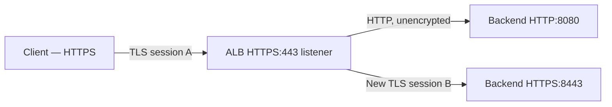
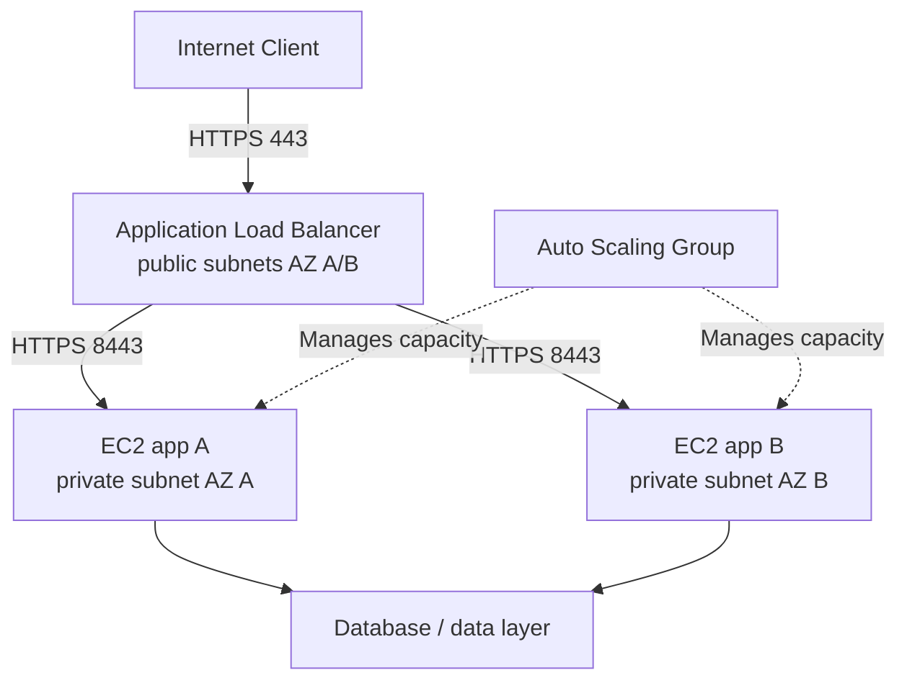

# TLS Termination and HTTPS Connections to Backends

When users visit `https://api.example.com`, the application may run on multiple EC2 instances across different Availability Zones. An **Application Load Balancer (ALB)** accepts the HTTPS connection, picks a healthy target, and forwards the request to the app. Yet there are two independent questions: **Where does TLS terminate?** And **is the hop from the load balancer to the backend encrypted?**

If the ALB has an `HTTPS:443` listener while the target group uses `HTTP:8080`, the **client → ALB** hop is encrypted whereas the **ALB → backend** hop uses plain HTTP. If the target group uses `HTTPS:8443`, the ALB **decrypts the traffic and establishes a new TLS connection** to the backend. Those two TLS connections have separate keys, certificates, protocol settings, and lifecycles; this pattern is commonly called **TLS termination + re-encryption**.

This lesson belongs to the **Load Balancing and Scaling** chapter of the **CLOUD_PROVIDERS_AWS** module, tying together AWS Regions/AZs, IAM, VPC, EC2, Auto Scaling, containers, storage/databases, and serverless. Learners will know how to choose the right TLS architecture, protect traffic in transit, troubleshoot failures, and build services with monitoring, resilience, and cost control.

## 1. Learning Objectives

After this lesson, you will be able to:

1. Explain the **TLS handshake**, certificates, **TLS termination**, **TLS re-encryption**, **TLS passthrough**, and the differences between these models.
2. Architecturally configure an **ALB HTTPS listener**, certificates in **AWS Certificate Manager (ACM)**, **security policies**, and `HTTPS` target groups.
3. Distinguish the capabilities of **ALB** and **Network Load Balancer (NLB)** when using TLS, HTTP routing, and mutual TLS modes.
4. Design **security groups, subnets, certificate rotation, health checks, HTTP→HTTPS redirects**, and safe forwarded headers.
5. Operate a Java/Spring Boot application behind an ALB with a dual-AZ layout, Auto Scaling, logging, and TLS error monitoring.
6. Verify configurations using `curl`, `openssl`, and read-only AWS CLI commands, while diagnosing `502`, `503`, `504`, certificate errors, and unhealthy targets.
7. Evaluate **trade-offs** across cost, performance, auditability, and compliance requirements.

## 2. At Which Layers Does TLS Operate?

**TLS (Transport Layer Security)** protects data in transit via key agreement, encryption, and integrity verification. HTTPS is **HTTP over TLS**.

For an `https://api.example.com` connection, the client typically:

1. Resolves DNS to obtain the destination IP address.
2. Connects to the load balancer over the transport protocol.
3. Performs a **TLS handshake**, during which client and server negotiate TLS version and cipher suite, and the server presents an X.509 certificate.
4. **Validates the certificate** against the hostname, CA trust chain, validity period, and client policy.
5. Once the handshake succeeds, exchanges HTTP requests/responses protected inside the TLS session.

TLS protects the transport channel, but **does not prove** the caller is authorized to invoke an API. User authentication (OAuth/OIDC, sessions, API tokens, mTLS client certificates, etc.) and business authorization remain separate responsibilities.

### 2.1. Terms to Distinguish

| Term | Meaning | AWS Example |
|---|---|---|
| **TLS termination** | Endpoint accepts TLS, completes the handshake, and decrypts data | ALB `HTTPS:443` listener or NLB `TLS:443` listener |
| **TLS offloading** | Moves TLS processing off the backend onto the load balancer | Java service serving HTTP behind an ALB |
| **TLS re-encryption** | Establishes a second TLS session from the load balancer to the backend | ALB `HTTPS:443 → target HTTPS:8443` |
| **TLS passthrough** | Load balancer forwards raw TLS bytes without decrypting the application payload | NLB `TCP:443 listener → TCP target` |
| **Certificate** | Public key identity credential signed by a CA or system owner | ACM certificate for `api.example.com` |
| **SNI** | TLS extension letting the client specify the target hostname so the server picks the right certificate | Multiple hostnames sharing one ALB HTTPS listener |
| **Security policy** | Set of TLS versions and ciphers allowed by the load balancer | `ELBSecurityPolicy-TLS13-1-2-2021-06` |
| **mTLS** | Both parties authenticate certificates during the TLS handshake under a supported model | ALB mTLS verify mode using a client trust store |

### 2.2. Where Is TLS Maintained?



In both paths, **ALB has already decrypted the client request** to apply host/path routing, redirects, listener conditions, and other HTTP features. On the HTTPS-to-backend path, data is **re-encrypted** over a new TLS session; **the client's original TLS session is not passed intact** to the backend.

## 3. Three Common Traffic Patterns

| Architecture | Listener | Target group | Where does TLS end? | When to Choose |
|---|---|---|---|---|
| **A. TLS termination at ALB** | ALB `HTTPS:443` | `HTTP:8080` | ALB | Internal backend HTTP is permitted by security/compliance requirements |
| **B. Termination + re-encryption** | ALB `HTTPS:443` | `HTTPS:8443` | At ALB and again at backend | Need encryption on the ALB → app hop too, within an assessed trust boundary |
| **C. TLS passthrough** | NLB `TCP:443` | `TCP:443` | Backend only | Application must directly control the client TLS session (e.g., TLS-layer protocols/identity) |

### 3.1. Architecture A: Encrypt Only Client → ALB

```text
Client                         ALB                        EC2
  └──────── HTTPS/TLS ────────► [443] ───── HTTP ────────► [8080]
             encrypted          decrypt        unencrypted
```

Pros: backends avoid managing certificates, TLS handshakes, and CA issues; simpler to deploy and scale Java services. Trade-off: internal traffic from ALB → backend is **not TLS-encrypted**, which must be acceptable under your threat model and compliance rules. VPCs, security groups, and AWS networking establish a protective boundary, yet **internal plain HTTP should never be labeled "end-to-end encryption."**

### 3.2. Architecture B: Re-Encrypt to Backends

```text
Client                      ALB                          EC2
  └──── TLS session 1 ──────► [443] ──── TLS session 2 ──► [8443]
       public certificate    decrypt    backend cert       decrypt
```

Pros: payloads remain encrypted in transit on **both hops**, helping satisfy policies requiring encryption in transit inside internal networks.

Trade-off: requires managing backend TLS/certificates, verifying cipher/protocol compatibility, monitoring health checks, and accounting for CPU cost. **ALB does not validate the identity of the target's certificate** the way a browser validates public websites. Thus, this model provides **ALB → target encryption**, not automatic **CA/hostname authentication on the backend hop**. If policy requires strict mutual identity verification between services, add an appropriate mTLS/service-to-service identity solution.

### 3.3. Architecture C: TLS Passthrough

```text
Client                      NLB TCP                        Backend
  └──────── TLS bytes ─────► [443] ─────────────────────► [443]
                           no decryption              TLS termination
```

An NLB `TCP` listener forwards connection traffic without inspecting decrypted HTTP requests. The backend owns the server certificate directly and can enforce its own TLS client authentication. In return, **NLB TCP passthrough cannot provide ALB-style path/host-based HTTP routing** on encrypted payloads.

**Key distinction:** An NLB `TLS listener` **terminates TLS**. `NLB TLS listener → TLS target group` uses two TLS sessions; `TCP listener → TCP target` is true TLS passthrough.

Sources: [ALB listeners](https://docs.aws.amazon.com/elasticloadbalancing/latest/application/load-balancer-listeners.html), [NLB listeners](https://docs.aws.amazon.com/elasticloadbalancing/latest/network/load-balancer-listeners.html).

## 4. Application Load Balancer HTTPS Listener

A **listener** accepts connections for a **protocol/port** and applies **actions/rules**. ALB listeners support HTTP and HTTPS.

To accept public HTTPS on port 443, you typically need:

- An **internet-facing ALB** for Internet clients, or an **internal ALB** for private traffic only.
- Subnets in **at least two Availability Zones** per ALB deployment architecture and availability requirements.
- A security group allowing **TCP 443** from authorized client sources.
- A valid **server certificate** for the service hostname, usually managed via **AWS Certificate Manager (ACM)**.
- A **TLS security policy** compatible with supported client TLS versions and ciphers.
- A **default action** or listener rules routing requests to target groups, redirects, fixed responses, or supported features.
- A DNS record, such as a Route 53 Alias pointing to the ALB DNS name.

### 4.1. ACM Certificates and Domains

Suppose DNS `api.example.com` points to the ALB:

1. Issue or import a certificate covering `api.example.com` (or appropriate SAN/wildcard) in **the same Region as the ALB**.
2. For ACM-issued public certificates, verify domain ownership using a supported method, usually DNS validation.
3. Attach the certificate ARN to the `HTTPS:443` listener.
4. Create the DNS record pointing to the ALB.
5. Verify clients see a valid, trusted certificate matching the hostname.

**Do not use the default `*.elb.amazonaws.com` DNS name to test a custom domain's public certificate**: an `api.example.com` certificate does not match the load balancer's default DNS hostname. Use `curl --resolve` or `--connect-to` to test the right **SNI/Host** while connecting to the intended ALB.

ACM supports automatic renewal for **ACM-issued certificates that meet management/renewal criteria**. **Imported certificates** must be renewed and re-imported by their owner. Certificates installed directly on backends have separate operational lifecycles; never assume ACM installs or renews them automatically.

### 4.2. SNI and Multiple Certificates

If an ALB serves both `api.example.com` and `admin.example.com` on the same `443` listener, attach a default certificate plus additional certificates to the **certificate list**. Modern clients send the hostname via **SNI**, and ALB selects the matching certificate according to configuration and selection rules.

Common pitfalls:

- DNS points to the ALB, yet the certificate lacks that hostname → name mismatch error.
- Legacy clients without SNI support → may receive the default certificate.
- Certificate expired or still pending ACM validation → TLS fails.
- Having a frontend certificate **does not automatically install** any certificate on backend EC2 instances.

### 4.3. TLS Security Policy Is a Security Decision

A security policy governs which TLS versions and ciphers can be negotiated. Common choices cover TLS 1.2/1.3; the catalog also includes FIPS, Post-Quantum TLS, and policies tailored to specific compliance standards. **Do not pick a policy solely because it says "latest"**—balance client compatibility, compliance mandates, and protection strength.

Example public policy name:

```text
ELBSecurityPolicy-TLS13-1-2-2021-06
```

This is an **example**, not a guarantee that it is the default in every listener creation method. According to current AWS documentation, default policies **can differ between the Console and CLI/CloudFormation/CDK**; therefore, in production always **specify the policy explicitly** in IaC and verify the deployed listener afterward.

Notably, **the TLS policy for ALB → backend connections cannot be chosen independently the way the frontend policy is**. AWS selects the backend policy automatically based on the policy family used by the ALB's HTTPS listeners: TLS 1.3, FIPS, Post-Quantum, and RFC 9151 families map to different backend behaviors. If backends lack compatible ciphers/protocols, target TLS handshakes can fail.

Source: [Security policies for ALB](https://docs.aws.amazon.com/elasticloadbalancing/latest/application/describe-ssl-policies.html).

## 5. Creating an HTTPS Target Group for Backends

A **target group** specifies protocol, port, target type, health checks, and routing parameters. ALB supports **HTTP or HTTPS target groups**.

### 5.1. Configuration Example

| Property | Illustrative Value | Meaning |
|---|---|---|
| ALB listener | `HTTPS:443` | Accepts TLS traffic from users |
| Listener certificate | ACM cert for `api.example.com` | Presents certificate to clients |
| Security policy | Suitable TLS 1.2/1.3 policy | Negotiates client ↔ ALB TLS |
| Target group | Protocol `HTTPS` | Uses TLS on the ALB → target hop |
| Target port | `8443` | Java app / reverse proxy listens for TLS |
| Target type | `instance` or `ip` | EC2 instance or corresponding IP |
| Health check | `HTTPS:8443 /actuator/health/readiness` | Verifies backend endpoint readiness |
| Matcher | `200` | Expected HTTP success code, app-dependent |
| Target SG | Only `TCP 8443` from ALB SG | Restricts network source to backends |

**Readiness name/path is illustrative:** a Spring Boot app needs Actuator and the matching endpoint enabled. If your app exposes `/healthz`, configure the actual path.

### 5.2. Backends Must Have a TLS Server Certificate

An `HTTPS:8443` target must genuinely speak TLS: it needs a server certificate, private key, and compatible TLS versions/ciphers. If the Java app only opens plain HTTP on `8080` while the target group sends HTTPS to `8443`, the handshake cannot succeed.

The backend certificate can be issued by an internal CA, self-signed, or provisioned by your organization's PKI. **Per ALB documentation, the load balancer does not validate target certificates**, so AWS accepts even self-signed or expired certificates on this hop. However:

- Do not treat this as CA/hostname server authentication.
- Still **manage expiration dates, key rotation, and private key access controls** per policy; other consumers may validate the certificate.
- Confine the backend hop within controlled VPCs, routes, security groups, and accounts.
- If targets reside outside the same AWS VPC security perimeter, evaluate additional authentication and protection controls.
- Verify real TLS behavior with connection tests and logs rather than inferring it from the target group name.

Source: [Target groups for ALB](https://docs.aws.amazon.com/elasticloadbalancing/latest/application/load-balancer-target-groups.html).

### 5.3. Upgrading from an HTTP Target Group to an HTTPS Target Group

Suppose your system currently looks like:

```text
ALB HTTPS:443 → TG HTTP:8080 → Spring Boot
```

And you plan to migrate to:

```text
ALB HTTPS:443 → TG HTTPS:8443 → Spring Boot
```

You cannot simply edit the protocol field on an existing target group. Typically you must:

1. Prepare the backend TLS listener on `8443`, certificates/keys, and Java or reverse-proxy configuration.
2. Allow ALB SG → target SG on `8443`; verify NACLs and routes.
3. Create a **new HTTPS target group** or replace via an AWS-supported deployment workflow; immutable target group protocol properties cannot be edited in place.
4. Register targets, configure the HTTPS health check, and wait for targets to become **healthy**.
5. Update ALB listener rules to point to the new TG, using phased/weighted rollout if migrating live traffic.
6. Monitor 5xx errors, latency, TLS handshakes, health checks, and keep rollback ready.
7. Remove the old target group/port after clearing the observation window and finishing cutover.

## 6. Health Checks and Why HTTPS Targets Turn Unhealthy

Health checks are **separate from user requests**. ALB periodically probes each target using the configured protocol/port/path/matcher. Targets receive normal traffic only when deemed eligible by health checks, aside from **fail-open** behavior in certain scenarios when all targets are unhealthy.

### 6.1. What Does an HTTPS Health Check Need?

Example:

```text
Protocol: HTTPS
Port: traffic-port (8443)
Path: /actuator/health/readiness
Matcher: 200
Interval: per policy
Timeout: per real latency
Healthy/unhealthy thresholds: per operational needs
```

Backends must return the expected status within the allowed timeout. Returning `301`/`302` causes health checks to **fail a `200` matcher** even if the application serves user pages normally.

### 6.2. Health Check `Host` Header

A frequent mistake occurs when backends only accept `api.example.com`. Per ALB documentation, for target `10.0.12.34` and health check port `8443`, probes may carry:

```text
Host: 10.0.12.34:8443
User-Agent: ELB-HealthChecker/2.0
```

If a reverse proxy or Java app demands `Host: api.example.com` on every request, health checks get rejected. Configure a **default virtual host** or ensure the health endpoint accepts probes structured the way AWS sends them. Do not disable HTTP Host validation across the entire app unnecessarily.

For HTTPS health checks, ALB opens a TLS connection to the target using its supported protocol set. Verify backends offer compatible ciphers/protocols and do not require TLS features ALB does not send on this hop.

Sources: [ALB target health checks](https://docs.aws.amazon.com/elasticloadbalancing/latest/application/target-group-health-checks.html), [ALB troubleshooting](https://docs.aws.amazon.com/elasticloadbalancing/latest/application/load-balancer-troubleshooting.html).

### 6.3. Checklist When `unhealthy`

| Symptom | Possible Cause | Verification Step |
|---|---|---|
| `Target.Timeout` | SG/NACL/route blocking, app unresponsive, TLS timeout | Test TCP/TLS from an in-VPC host to the target; inspect flow logs |
| `Target.FailedHealthChecks` | Handshake error, premature close, backend not serving | Check app/proxy logs, TLS versions/ciphers, certificate/key |
| `Target.ResponseCodeMismatch` | Returns `302`, `401`, `403`, or `404` instead of matcher | Check health path, Host header, auth/redirects |
| `Target.NotInUse` | Target group unused by listener or AZ not enabled | Check listener rules and enabled AZs |
| `Target.InvalidState` | EC2 stopped/terminated or invalid instance state | Check ASG/EC2 lifecycle |
| `Target.DeregistrationInProgress` | Target draining connections | Check deployments and deregistration delay |

## 7. Redirecting HTTP to HTTPS for Users

Common pattern:

- **HTTP:80 listener**: only **redirects** to `HTTPS:443`, preserving hostname/path/query as configured.
- **HTTPS:443 listener**: terminates TLS with certificate and forwards to target groups.
- Edge and application security policies govern **HSTS**, cookies, and internal redirects.

### 7.1. Redirect at the ALB, Avoiding Loops

Example client request:

```text
http://api.example.com/orders?id=123
```

ALB returns a redirect to:

```text
https://api.example.com/orders?id=123
```

Choose the status code matching application semantics: **HTTP_301** is typical for permanent canonical URLs, **HTTP_302** for temporary redirects. With POST/PUT requests, check how clients handle method/body across 301/302; never assume all clients preserve the original HTTP method.

**Common redirect loop cause:**

1. Client accesses the ALB over HTTPS.
2. ALB decrypts TLS and forwards plain HTTP to the backend.
3. The backend sees only the internal HTTP connection and assumes the client is not using HTTPS.
4. The backend responds with a redirect to HTTPS.
5. The client requests HTTPS again, and the loop repeats.

**Fix:** make the backend aware of the **client-side protocol** using a trusted proxy header (such as `X-Forwarded-Proto` set by ALB), or handle public redirects at the ALB and configure reverse-proxy awareness properly.

### 7.2. Key Forwarded Headers

| Header | Purpose | Must Verify |
|---|---|---|
| `X-Forwarded-Proto` | Client → ALB protocol, e.g., `https` | Trust only from verified/controlled ingress proxies |
| `X-Forwarded-Port` | Port client used to reach ALB | Used when constructing redirect/canonical URLs |
| `X-Forwarded-For` | Chain of client/proxy IPs | Do not blindly pick the first element if clients can spoof headers |
| `Host` | HTTP host requested by client | Routing, virtual hosts, CORS, and canonical URLs |
| `X-Amzn-Trace-Id` | Assists request tracing in AWS | Does not replace full distributed tracing |

AWS ALB can preserve, append, or remove `X-Forwarded-For` depending on configuration mode. Because client requests might already include such headers, applications should **accept proxy headers only when traffic arrives from the load balancer/trusted proxy**, locking down networking so outsiders cannot reach the backend directly and forge them.

### 7.3. Client-Side HTTPS Does Not Automatically Inform the Backend

If a Java backend speaks plain HTTP, configure forwarded header handling properly to avoid:

- APIs generating `Location: http://...` instead of `https://...`.
- Session cookies missing the `Secure` flag in HTTPS contexts.
- OAuth/OIDC callbacks using the wrong scheme or redirect URI.
- CORS/origin checks failing on host or protocol.
- Infinite `http ↔ https` redirect loops.

Source: [X-Forwarded headers and ALB](https://docs.aws.amazon.com/elasticloadbalancing/latest/application/x-forwarded-headers.html).

## 8. Java Spring Boot on the Backend

Spring Boot typically runs behind an ALB in two main modes:

- **Internal HTTP model**: ALB terminates HTTPS; Spring Boot listens on `8080` and reads `X-Forwarded-Proto` under a trusted-proxy policy.
- **Internal HTTPS model**: ALB terminates HTTPS and re-encrypts to `8443`; Spring Boot (or an Envoy/Nginx sidecar) manages backend TLS certificates/keys.

### 8.1. Backend HTTPS Example with Spring Boot

Example using a Spring Boot version supporting SSL properties:

```yaml
server:
  port: 8443
  ssl:
    enabled: true
    key-store: file:/etc/app/tls/keystore.p12
    key-store-type: PKCS12
    key-store-password: "${APP_KEYSTORE_PASSWORD}"
    key-alias: app-backend

management:
  endpoint:
    health:
      probes:
        enabled: true
  endpoints:
    web:
      exposure:
        include: health,info
```

**Meaning:** the app listens for HTTPS on `8443` using a certificate/private key stored in a PKCS#12 keystore. `APP_KEYSTORE_PASSWORD` must come from a secrets manager—never commit real secrets to a repository. Placeholder syntax depends on how Spring resolves configuration; test environment-variable loading in your exact Spring Boot version.

This snippet **does not generate the certificate or keystore**. You must provision an appropriate certificate, store the file securely, restrict private key permissions, automate rotation, and verify restarts do not disrupt connections excessively.

**Note:** Spring Boot typically exposes health endpoints at `/actuator/health` or `/actuator/health/readiness` when probes are enabled; exact availability depends on the Actuator dependency and exposure/path config. Verify the returned HTTP status matches the target group matcher.

### 8.2. When the Backend Uses HTTP Behind External HTTPS

Reference configuration example:

```yaml
server:
  port: 8080
  forward-headers-strategy: native
```

This instructs Spring Boot to process forwarded headers via the servlet container where supported. Depending on version/framework, `framework` may fit better; always test redirects, HTTPS awareness, and resolved client IPs.

**Trust boundary:** enable forwarded header processing only behind controlled ingress, restrict the app SG to accept traffic only from the ALB, and never expose `8080` to the Internet. Never treat `X-Forwarded-Proto` on an arbitrary request as proof that TLS protected the call.

### 8.3. Dedicated TLS Proxy on the Instance/Container

If the application should not manage keystores directly, place **Nginx/Envoy** on the backend to terminate TLS on `8443` and proxy plain HTTP to the Java process over loopback/sidecar. This decouples PKI from application code, though it adds reverse-proxy operations, header forwarding, health checks, and certificate management.

Whether using Spring TLS directly or a sidecar proxy, monitor:

- TLS handshakes and certificate/private key errors.
- CPU and latency overhead with TLS enabled.
- Connection rates/pools, keep-alive, and draining.
- Readiness checks during rollouts and restarts.
- Missing keys/certificates after deployments or scale-out events.

## 9. Security Groups, Subnets, and Least Privilege

Example **internet-facing ALB + private-subnet EC2** multi-AZ architecture:



### 9.1. Reference Network Rules

| Component | Inbound | Outbound | Notes |
|---|---|---|---|
| **ALB SG** | TCP 443 from valid IPs; TCP 80 if redirecting | TCP 8443 to target SG (or 8080 for HTTP targets) | Scope client sources as needed; SGs are stateful |
| **EC2 app SG** | TCP 8443 **only from ALB SG** | Required DB/endpoints/services | Never open 8443 to `0.0.0.0/0` |
| **DB SG** | DB port from app SG | Per connection needs | DB TLS is an independent decision |
| **Network ACL** | Inbound/outbound rules plus ephemeral ports for custom ACLs | Matching return rules | NACLs are stateless, unlike SGs |
| **Route tables** | Per subnet/VPC | Per data path | In-VPC ALB-to-EC2 traffic does not need NAT |

**Important:** EC2 backends do **not** require public IPs. An internet-facing ALB accepts public traffic in public subnets while backends stay in private subnets. A NAT gateway or VPC endpoint supports **EC2 outbound traffic**, not ALB forwarding to private in-VPC targets.

### 9.2. TLS Hops Still Need Source and Destination Controls

An encrypted connection with an overly permissive security group still leaves a wide attack surface. Conversely, an SG blocking `8443` renders targets unhealthy even when certificates are completely valid. Designs must simultaneously get **networking, identity, encryption, and permissions** right.

If the ALB sits in a central VPC and backends sit in another VPC across peering/Transit Gateway or use IP targets, evaluate **cross-VPC routing, target types, network policies, CIDRs, and traffic protection across boundaries**. Do not extrapolate same-VPC protections to traffic leaving AWS.

## 10. When to Use Network Load Balancer?

ALB specializes in Layer 7 HTTP/HTTPS; NLB specializes in Layer 4 connection/transport distribution. Depending on features and AWS updates, NLB supports multiple protocols and target types.

### 10.1. Common NLB TLS Combinations

| NLB Listener | Target group | Data Sent to Target | Use Case |
|---|---|---|---|
| **TLS:443** | **TCP:8080/443** | NLB decrypts TLS, sends plaintext TCP payload | TLS offloading for TCP services |
| **TLS:443** | **TLS:8443** | NLB decrypts frontend TLS and opens new TLS session to target | TLS termination + re-encryption |
| **TCP:443** | **TCP:443** | Forwards encrypted TLS bytes directly to target | TLS passthrough; backend controls the handshake |

An NLB TLS target group uses certificates on targets, yet per AWS documentation, **NLB does not validate target certificates**. For NLB → backend TLS, AWS picks the backend security policy based on the listener, similar to ALB where backend TLS parameters are not tuned completely independently.

**Do not choose NLB solely because you need an HTTPS backend.** If your workload needs host/path-based routing, HTTP redirects, or L7 HTTP features, an **ALB HTTPS target group** is usually the better fit.

### 10.2. mTLS and Confusion Over the Word "Passthrough"

**Client-side mTLS** means the client also presents a certificate and the server verifies it:

- **ALB mTLS verify**: ALB validates the client certificate against a configured trust store.
- **ALB mTLS passthrough mode**: ALB **still terminates frontend TLS**, then **forwards the client certificate chain to the backend via HTTP headers** for backend verification. This is **not raw TLS byte passthrough**.
- **NLB TLS listener mTLS verify**: per current NLB documentation, NLB supports **client certificate verification in verify mode** on TLS listeners. Do not assume it has an ALB-style header passthrough mode.
- **NLB TCP passthrough**: the backend receives the client's TLS handshake directly; if the backend requests and verifies client certificates, that is mTLS handled **by the backend**.

**Client → load balancer mTLS does not automatically imply mTLS between ALB/NLB → backend.** The backend hop is a separate connection with separate verification mechanics; ALB/NLB TLS target groups do not perform strict PKI validation of target certificates.

Sources: [ALB mutual TLS](https://docs.aws.amazon.com/elasticloadbalancing/latest/application/mutual-authentication.html), [NLB mutual TLS](https://docs.aws.amazon.com/elasticloadbalancing/latest/network/mutual-authentication.html), [NLB target groups](https://docs.aws.amazon.com/elasticloadbalancing/latest/network/load-balancer-target-groups.html).

## 11. Certificate Design and Lifecycle Management

A secure system does not stop at "the browser shows a padlock." You need **two certificate strategies** if encrypting all the way to backends.

### 11.1. Frontend Certificates

- Issue or import into ACM in the ALB/NLB's Region.
- Ensure DNS/SANs match client-facing names.
- Attach certificates to HTTPS/TLS listeners.
- Monitor renewal/expiration status, domain validation, and certificate list updates.
- Verify all critical clients support the selected policy/ciphers.
- Govern IAM permissions for modifying listeners/certificates under least privilege.

### 11.2. Backend Certificates

- Issued by internal PKI or an appropriate secrets/certificate management system.
- Installed securely on EC2/containers with restricted private-key read permissions.
- Time-bounded, rotated periodically before expiration.
- Automated rolling updates across fleets/ASGs with rollback for invalid configs.
- Track fingerprints/serials, key types, algorithms, and deployment locations.
- If any consumer **actually validates CA/hostname**, ensure certificates meet that consumer's requirements.

To enforce cryptographic target identity verification (mTLS/backend PKI validation) under strict compliance mandates, add components capable of authenticating targets—such as a service mesh/sidecar proxy with a trusted CA, network controls, and application-level identity. **Never cite an ALB HTTPS target group accepting a self-signed cert as proof of end-to-end mTLS compliance.**

### 11.3. Do Not Confuse Transport Certificates with Encryption-at-Rest Keys

TLS certificates provide **encryption in transit**. EBS/S3/RDS encryption, AWS KMS, and encrypted backups address **encryption at rest**. Even when backends are called over HTTPS, stored data still needs at-rest protection, IAM/KMS policies, and retention controls.

## 12. Testing HTTPS from the Client Side

Run the following commands against **domains/accounts you are authorized to test**. They only generate HTTP/TLS requests and do not modify AWS resources.

### 12.1. Inspect Certificates and TLS Negotiation

```bash
# Check HTTP to HTTPS redirect
curl -I http://api.example.com/health

# Inspect handshake details and HTTPS endpoint response
curl -v https://api.example.com/health

# Test TLS 1.2 negotiation if permitted by the endpoint
openssl s_client -connect api.example.com:443 \
  -servername api.example.com -tls1_2 </dev/null

# Test TLS 1.3 negotiation if permitted by the endpoint
openssl s_client -connect api.example.com:443 \
  -servername api.example.com -tls1_3 </dev/null
```

`openssl s_client` displays the certificate chain and negotiated parameters. To **verify** the certificate against a hostname/CA, enable appropriate OpenSSL verification flags or use `curl` with default certificate checking. Never treat `CONNECTED` alone as proof of a valid certificate.

### 12.2. Testing While Preserving SNI/Host

During DNS migrations, you can test the ALB directly via an IP **resolved from the ALB's DNS** while preserving the target hostname:

```bash
# Using a documentation IP (replace with the ALB's actual IP at test time)
curl --resolve api.example.com:443:203.0.113.10 \
  https://api.example.com/health
```

`203.0.113.10` is a documentation-only address, not a real AWS IP. ALB node IPs change over time and span multiple AZs; **never hardcode ALB IPs** in production configurations.

### 12.3. Separating Frontend Errors from Backend Errors

- **TLS handshake rejected before any HTTP response**: check domain/SNI, frontend certificate, TLS policy, client compatibility, and network reachability first.
- **Frontend HTTPS succeeds, yet returns HTTP 502**: check ALB → backend, target TLS handshake, premature target connection close, or invalid HTTP response.
- **Frontend HTTPS succeeds, yet returns HTTP 503**: check whether the target group has registered/healthy targets and verify listener routing.
- **Frontend HTTPS succeeds, yet returns 504**: check connection/response timeouts and backend latency.
- **Redirect loop**: check HTTP listener, backend `X-Forwarded-Proto`, and Spring/reverse-proxy config.

## 13. Inspecting Configuration with AWS CLI (Read-Only)

The commands below require an AWS CLI profile with `elasticloadbalancing:Describe*` and related read permissions. Substitute your real Region/ARNs/IDs.

```bash
# Inspect created ALBs and their schemes
aws elbv2 describe-load-balancers \
  --region ap-southeast-1 \
  --profile learning \
  --query "LoadBalancers[].{Name:LoadBalancerName,Type:Type,Scheme:Scheme,DNS:DNSName}"

# Inspect listeners, protocols, ports, and security policies
aws elbv2 describe-listeners \
  --load-balancer-arn arn:aws:elasticloadbalancing:ap-southeast-1:111111111111:loadbalancer/app/example/abcdef0123456789 \
  --region ap-southeast-1 \
  --profile learning

# Inspect target groups and traffic ports
aws elbv2 describe-target-groups \
  --region ap-southeast-1 \
  --profile learning \
  --query "TargetGroups[].{Name:TargetGroupName,Protocol:Protocol,Port:Port,Health:HealthCheckProtocol}"

# Inspect target health states and reason codes
aws elbv2 describe-target-health \
  --target-group-arn arn:aws:elasticloadbalancing:ap-southeast-1:111111111111:targetgroup/example/0123456789abcdef \
  --region ap-southeast-1 \
  --profile learning

# List available SSL/TLS security policy names
aws elbv2 describe-ssl-policies \
  --region ap-southeast-1 \
  --profile learning \
  --query "SslPolicies[].Name"
```

The `111111111111` ARNs are placeholders and do not represent a real account. ALB/target group resources are Regional; ARNs must match the target Region. These read commands neither create nor modify listeners or certificates.

To inspect an ACM-managed frontend certificate:

```bash
aws acm describe-certificate \
  --certificate-arn arn:aws:acm:ap-southeast-1:111111111111:certificate/00000000-0000-4000-8000-000000000000 \
  --region ap-southeast-1 \
  --profile learning \
  --query "Certificate.{Domain:DomainName,Status:Status,NotAfter:NotAfter,InUseBy:InUseBy}"
```

Checking `NotAfter` helps track frontend certificates, but **does not replace** monitoring rotation of self-managed backend certificates.

## 14. Logging and Metrics for Monitoring TLS

### 14.1. ALB Access Logs, Connection Logs, and CloudWatch

| Signal | Helps Answer | Notes |
|---|---|---|
| **ALB access logs** | Requests, targets, response codes, processing times, and selected client TLS details | Enable and configure S3 destination, retention, and permissions |
| **ALB connection logs** | Which TLS protocol, cipher, and key exchange clients negotiated | Valuable when changing security policies or debugging client TLS |
| **CloudWatch `HTTPCode_ELB_5XX_Count`** | How many 5xx responses ALB generated itself | Separates ELB errors from backend-returned errors |
| **`HTTPCode_Target_5XX_Count`** | How many 5xx responses backends returned | Spikes during app or DB failures |
| **`TargetConnectionErrorCount`** | Are errors occurring when ALB connects to targets? | Check network/port/TLS/app lifecycle |
| **`HealthyHostCount / UnHealthyHostCount`** | Healthy/unhealthy target counts per TG/AZ | Critical during canaries or backend certificate rotation |
| **`TargetResponseTime`** | Target response latency per metric definition | Performance analysis; does not replace end-user p95/p99 |
| **VPC Flow Logs** | Are network flows between ALB/targets being rejected? | Does not log plaintext HTTP/TLS payloads |
| **CloudTrail** | Who modified listeners/certs/TGs/security policies | Management-plane audit trail, not traffic logs |

Metric names and dimensions can differ between ALB and NLB; check the CloudWatch namespace and documentation before creating alarms. Factor in privacy, log retention, access controls, and S3/CloudWatch costs.

### 14.2. Useful Alarms

- `HealthyHostCount` drops to 0 in one or more AZs.
- `HTTPCode_ELB_5XX_Count` spikes after deploying or restarting backend TLS.
- `TargetConnectionErrorCount` spikes during certificate rotation or security policy updates.
- `TargetResponseTime` p95 exceeds business thresholds.
- Frontend certificate nears expiration or loses auto-renewal eligibility.
- Backend logs report TLS handshake errors or key/certificate load failures.
- Unusual surge in ALB traffic/LCUs impacting budget.

**Never rely on a single green health check to declare the whole chain safe**: a health endpoint can return 200 while the database, external dependencies, or certificate rotation are broken.

## 15. Performance and Cost of TLS Termination

### 15.1. Costs to Consider

- **ALB/NLB**: hourly running charges and capacity units consumed (LCU/NLCU per product pricing).
- **EC2/ECS/EKS**: CPU and RAM overhead for backend handshakes and encryption when re-encrypting.
- **Network/data transfer**: cross-AZ/cross-Region, NAT, or Internet data transfer per topology.
- **Certificates/PKI**: ACM public/private CAs, internal PKI, secrets/rotation, and operational overhead.
- **Observability**: S3/CloudWatch log storage, metrics, and log queries.
- **Availability**: multi-AZ spare capacity, or running x86/ARM or HTTP/HTTPS fleets in parallel during architecture transitions.

### 15.2. Do Not Assume "HTTPS to Backends Is Always Prohibitively Expensive"

TLS cost depends on new TLS sessions, keep-alive, connection reuse, CPU architecture, traffic patterns, and cipher algorithms. For IO/DB-bound workloads, crypto overhead may be minor compared to other bottlenecks; for workloads with massive short-lived connection churn, handshakes/CPU can become significant.

How to verify:

1. Measure a baseline of **frontend HTTPS → backend HTTP** under realistic load.
2. Benchmark **frontend HTTPS → backend HTTPS** with the identical app, network, and instance types.
3. Measure req/s, p95/p99 latency, CPU, memory, target errors, handshake failures, connection reuse, and cost.
4. Test under peak traffic, rolling deployments, and single-AZ failure scenarios.
5. Weigh security/compliance mandates; never choose plain HTTP solely due to slightly lower cost if policy requires encryption in transit.

### 15.3. Encryption and Scalability Are Linked Goals

Whenever an ASG launches a new EC2 target, the system must simultaneously:

- Ensure the **backend TLS certificate/keystore** is present and validly configured on the instance.
- Ensure SGs allow ALB connections on `8443`.
- Complete startup and pass readiness checks before serving live traffic.
- Handle connection draining / deregistration delay during scale-in.
- Maintain minimum healthy capacity per AZ within budget.

A Launch Template that forgets to install the keystore can cause **every new target to fail health checks**, preventing Auto Scaling from restoring capacity.

## 16. Example Architecture: Multi-AZ Java API

**Scenario:** a company runs a Java REST API on EC2 Auto Scaling across two AZs. Internet users must use HTTPS. Internal security policy mandates encryption on ALB → EC2 as well. The database sits in private subnets with its own backup plan.

### 16.1. Design Diagram

```text
Route 53 record api.example.com
        │
        ▼
Internet-facing ALB — public subnets, AZ A/B
  HTTP:80 listener  → redirect HTTPS:443
  HTTPS:443 listener
    - ACM certificate api.example.com
    - Explicitly chosen TLS security policy
    - Rule forwarding to TG java-api-https
        │
        ├── TLS session B → private EC2 AZ A, HTTPS:8443
        │                    Spring Boot + keystore
        │                    readiness endpoint
        └── TLS session B → private EC2 AZ B, HTTPS:8443
                             Spring Boot + keystore
                             readiness endpoint

EC2 IAM role → S3 / Secrets Manager / CloudWatch (scoped permissions)
EC2 SG       → Database SG on the required application port
ASG          → scales out/in and maintains healthy capacity
```

### 16.2. Decision Matrix

| Requirement | Design Choice | Must Verify |
|---|---|---|
| Client HTTPS | ALB HTTPS `443` + ACM | SNI/hostname, certificate, policy |
| Block plain public HTTP | ALB HTTP `80` redirect `443` | No redirect loop; method semantics |
| TLS to backend | Target group `HTTPS:8443` | Installed cert, protocol/cipher, SG |
| HA | Multi-AZ ALB and ASG | Healthy targets per AZ, capacity, health checks |
| IAM | Least-privilege EC2 instance profile | Secrets/cert access and CloudWatch permissions |
| Observability | Access/connection logs, CloudWatch alarms | ALB vs. target errors, log storage cost |
| Database | Private network, auth, and DB TLS per policy | Do not assume ALB TLS protects the DB hop |
| DR | Database backups, restore drills, RTO/RPO | Do not confuse Multi-AZ with backups |

### 16.3. Rollout Procedure

1. Ensure backends accept HTTPS on `8443` and test internally with `curl`/`openssl`.
2. Create the **new HTTPS TG**, register targets from the ASG or deployment mechanism, and confirm `HealthyHostCount`.
3. Update the listener rule to the new TG through an approved change process; use canary weights when appropriate.
4. Monitor 5xx responses, TLS errors, p95/p99 latency, CPU, and health across both AZs.
5. Test scale-out: verify new instances receive certs/secrets/config and become healthy.
6. Verify rollback to the old route/TG, then shift 100% traffic once SLOs hold.
7. Decommission the old target group/config per procedure; update IaC and runbooks.

## 17. Diagnosing Common Failures

### 17.1. Browser Reports Invalid Certificate

**Symptoms:** `NET::ERR_CERT_COMMON_NAME_INVALID`, `CERT_DATE_INVALID`, or `curl: (60) SSL certificate problem`.

**Check layer by layer:**

- Verify the DNS hostname the client actually queried.
- Run `openssl s_client -servername api.example.com` to inspect the served certificate.
- Confirm the ACM certificate covers the SAN/hostname, is Issued, and is attached to the listener.
- Check whether clients are hitting the ALB's default DNS name instead of the custom hostname.
- Check TLS security policy, client TLS support, and system clock.

If the error occurs **before HTTP**, you rarely need to debug the backend target group first.

### 17.2. `502 Bad Gateway` After Switching Target Group to HTTPS

**Hypotheses:**

- Backend `8443` is closed or serving plain HTTP instead of TLS.
- Backend certificate/private key has the wrong format or failed to load at startup.
- Backend only supports protocols/ciphers incompatible with ALB's backend TLS policy.
- SG/NACL/route blocks ALB → backend.
- Backend drops connections abnormally or returns malformed responses.

**How to verify:** check `TargetConnectionErrorCount`, target health reason, Java/proxy logs, local TLS handshake on the instance, and backend SSL settings. Do not immediately replace the frontend cert: **client → ALB already succeeded** if ALB returns HTTP 502.

### 17.3. `503 Service Unavailable`

First verify whether the target group has registered/available targets, check health checks, and confirm the listener rule points to the right TG. Verify AZs are enabled and instances/ASGs are running. Distinguish ALB-generated 503s from 503 responses returned by backends.

### 17.4. `504 Gateway Timeout`

Usually caused by target connections or responses failing to complete within timeout limits. Check SGs/NACLs/routes, slow app/DB queries, keep-alive settings, request timeouts, and logs by trace ID. Simply raising timeouts can mask bottlenecks rather than solving them.

### 17.5. Backend TLS Works, Yet Health Checks Fail

Most common causes:

- Health path requires authentication.
- Backend returns `302` to a login page or redirects HTTPS to the wrong port.
- Virtual host accepts only `api.example.com` while health checks send the target IP as `Host`.
- Matcher expects `200`, yet the endpoint returns `204` or another code.
- Health check port differs from traffic port, or backend requires unsupported TLS settings.
- Backend is slow during JVM warm-up, DB migrations, or shutdown.

Pick a health check that **accurately reflects readiness without introducing fragile dependencies that knock the whole fleet unhealthy**. Separate liveness and readiness per framework best practices.

### 17.6. Encryption Works, Yet Headers/Client IPs Are Spoofed

The flaw may allow bypassing the ALB to hit the app directly, or the app may trust `X-Forwarded-For` indiscriminately. Lock down the backend SG to accept traffic only from the ALB/trusted sources, use standard framework proxy-header parsers, and define an explicit trusted proxy chain.

## 18. Practice Exercises

### Exercise A — Analyzing Three Traffic Paths

Given these configurations:

| Option | Listener | Target group | Where Is TLS Used? |
|---|---|---|---|
| 1 | ALB HTTPS:443 | HTTP:8080 | Client → ALB |
| 2 | ALB HTTPS:443 | HTTPS:8443 | Client → ALB and ALB → target, two separate sessions |
| 3 | NLB TCP:443 | TCP:443 | Client → backend via NLB passthrough |

**Question:** which option lets ALB route by HTTP path while still encrypting the ALB → target hop?

**Answer:** **Option 2**. Backend `8443` requires a TLS server certificate and compatible config. ALB reads the HTTP request after termination, applies routing rules, and re-encrypts to the target.

### Exercise B — Distinguishing Encryption from Backend Authentication

A team runs ALB `HTTPS:443 → target HTTPS:8443`; targets use a self-signed certificate and ALB forwards requests successfully.

**Question:** can you claim "ALB verified the EC2's CA and hostname"?

**Answer:** **No.** Per AWS documentation, ALB **does not validate target certificates**. The backend hop has TLS encryption; if cryptographic target identity verification via CA/hostname/mTLS is required, add an appropriate verification mechanism and prove policy compliance.

### Exercise C — Diagnosing a Spring Boot Redirect Loop

After moving behind an ALB, clients visiting `https://api.example.com` repeatedly receive 301 redirects to the exact same URL.

**Explanation hint:** ALB terminates HTTPS and forwards HTTP, so the backend thinks requests are insecure and redirects. Check listener redirects, `X-Forwarded-Proto`, Spring Boot trusted proxy header settings, and direct backend access controls.

### Exercise D — Explaining an Unhealthy Target

An EC2 backend returns `200` when calling `https://10.0.12.34:8443/actuator/health/readiness` from an internal host with a custom Host header, yet ALB reports `Target.ResponseCodeMismatch`.

**Task:** name two possible causes.

**Hint:** (1) ALB health checks send **Host: 10.0.12.34:8443**, which the virtual host rejects or redirects; (2) the health check path/port or matcher differs from your test command. Check actual status codes in backend logs and target health details.

### Exercise E — Failure During an Auto Scaling Event

The fleet has two healthy existing EC2 instances. ASG scales from two to six instances, yet all four new instances stay unhealthy.

**Investigation hint:** verify whether the AMI/launch template installs the JDK, certificate/keystore, IAM secret permissions, SG `8443`, Java readiness, and health check thresholds properly. Avoid endlessly raising min size when every new instance lacks backend TLS configuration.

### Exercise F — Choosing a Solution for Client Certificates

An enterprise requires clients to present certificates issued by an internal CA, while the Java backend needs path-based routing.

- **ALB mTLS verify:** ALB validates the client certificate and routes HTTP by path; backends can inspect AWS-provided headers per config and business logic.
- **ALB mTLS passthrough mode:** ALB terminates TLS and forwards the certificate chain to backends via headers for backend verification.
- **NLB TCP passthrough:** the backend checks TLS/mTLS directly, but NLB cannot route by HTTP path.
- **NLB TLS mTLS verify:** mTLS verification at NLB for suitable traffic, without ALB-style HTTP path rules.

**Task:** choose an approach based on where certificates must be verified, HTTP routing needs, and who must terminate the client TLS session directly. State the trust boundary for headers/PKI.

## 19. Review Questions

1. What is TLS termination?
2. Is `HTTPS listener → HTTP target` end-to-end HTTPS?
3. Does `HTTPS listener → HTTPS target` use one or two TLS sessions?
4. When using an ALB HTTPS target group, does ALB validate the target certificate's hostname/CA?
5. Is an ACM certificate attached to the frontend automatically installed on backend EC2 instances?
6. Why can the frontend security policy affect TLS handshakes to the backend?
7. If an NLB `TCP:443` listener forwards TLS bytes to targets, where is TLS decrypted?
8. What is the difference between ALB mTLS passthrough and NLB TCP TLS passthrough?
9. Why do HTTP backends behind an ALB sometimes cause redirect loops?
10. What `Host` header do ALB health checks typically send?
11. Why does a healthy target not guarantee the system meets its SLOs?
12. Are security groups still necessary when the backend uses HTTPS?
13. What is the risk of placing all backends in a single AZ?
14. What can a spike in `TargetConnectionErrorCount` after a certificate deployment indicate?
15. How do you justify the cost of re-encryption in production?

**Short answers:** (1) completing TLS and decrypting at the receiving endpoint; (2) no; (3) two separate TLS sessions; (4) no; (5) no; (6) AWS selects the backend policy based on the frontend policy family; (7) at the backend; (8) ALB still decrypts TLS and passes certificate info via headers, whereas NLB TCP does not decrypt; (9) the app sees internal HTTP; (10) typically the target IP and health check port when non-default; (11) latency/error metrics and dependencies are not fully covered; (12) yes, TLS does not replace least privilege; (13) single-AZ point of failure; (14) protocol/cipher/key/port mismatch or network block; (15) benchmark realistic load against SLOs and TCO.

## 20. Production Deployment Checklist

- [ ] Clear diagram of **client TLS**, **backend TLS**, and trust boundaries at ALB/NLB.
- [ ] Selected ALB/NLB and termination/re-encryption/passthrough mode matching requirements.
- [ ] DNS records and frontend certificates match hostnames; certificates monitored and renewed.
- [ ] `HTTPS:443` listener uses an explicitly specified security policy in IaC.
- [ ] `HTTP:80` listener redirects to HTTPS where appropriate.
- [ ] Backend `HTTPS:8443` has verified keystores/keys, protocols/ciphers, and rotation.
- [ ] Never claim ALB/NLB validates backend certificates when documentation states otherwise.
- [ ] HTTPS target group and health checks point to the right port, path, and matcher.
- [ ] Backend health endpoint handles ALB's Host header cleanly without auth/redirects.
- [ ] ALB SG opens only required ports; target SG allows traffic only from ALB/trusted sources.
- [ ] `X-Forwarded` headers processed inside a trusted proxy boundary; redirect loops and IP spoofing prevented.
- [ ] Multi-AZ layout, ASG capacity, and connection draining tested.
- [ ] Canary/rollback criteria defined around 5xx, TLS errors, p95/p99, and healthy target counts.
- [ ] Logging, metrics, and alarms active for frontend TLS, target connections, and application SLOs.
- [ ] IAM, KMS, DB TLS, and encryption at rest evaluated independently.
- [ ] Certificate rotation and scale-out verified on freshly launched instances.
- [ ] Costs budgeted for ALB/NLB, compute, logs, CA/PKI, and data transfer.
- [ ] Ownership, incident runbooks, and periodic policy/certificate reviews established.

## 21. Summary

**TLS termination** at an ALB lets the load balancer decrypt HTTPS and apply HTTP routing before forwarding. With an **HTTP** target group, the backend hop has no TLS. With an **HTTPS** target group, ALB establishes a **second TLS session** to re-encrypt traffic; this protects confidentiality and integrity in transit, but **does not mean ALB authenticates the target's CA or hostname**.

**NLB TCP passthrough** fits when backends must own the client TLS handshake directly; an **NLB TLS listener** terminates TLS and can re-encrypt to a TLS target group. Client mTLS, backend identity, and per-hop encryption are distinct requirements that must be designed explicitly.

Production architectures must integrate **ACM, security policies, listeners/target groups, health checks, VPC/security groups, forwarded headers, Auto Scaling, logging, and cost control**. For Java workloads, ensure certificates/keystores and readiness checks are automated on every newly launched instance so HTTPS remains resilient during scale-outs and AZ failures.

### Official AWS and Spring Documentation

1. [Application Load Balancer listeners](https://docs.aws.amazon.com/elasticloadbalancing/latest/application/load-balancer-listeners.html)
2. [Create an HTTPS listener for your ALB](https://docs.aws.amazon.com/elasticloadbalancing/latest/application/create-https-listener.html)
3. [ALB TLS security policies](https://docs.aws.amazon.com/elasticloadbalancing/latest/application/describe-ssl-policies.html)
4. [Target groups for ALB](https://docs.aws.amazon.com/elasticloadbalancing/latest/application/load-balancer-target-groups.html)
5. [Health checks for ALB target groups](https://docs.aws.amazon.com/elasticloadbalancing/latest/application/target-group-health-checks.html)
6. [Troubleshoot your Application Load Balancer](https://docs.aws.amazon.com/elasticloadbalancing/latest/application/load-balancer-troubleshooting.html)
7. [X-Forwarded headers and ALB](https://docs.aws.amazon.com/elasticloadbalancing/latest/application/x-forwarded-headers.html)
8. [Mutual authentication with TLS in ALB](https://docs.aws.amazon.com/elasticloadbalancing/latest/application/mutual-authentication.html)
9. [NLB listeners and TLS passthrough](https://docs.aws.amazon.com/elasticloadbalancing/latest/network/load-balancer-listeners.html)
10. [NLB TLS target groups](https://docs.aws.amazon.com/elasticloadbalancing/latest/network/load-balancer-target-groups.html)
11. [NLB mutual authentication](https://docs.aws.amazon.com/elasticloadbalancing/latest/network/mutual-authentication.html)
12. [AWS Certificate Manager](https://docs.aws.amazon.com/acm/latest/userguide/acm-overview.html)
13. [ELB pricing](https://aws.amazon.com/elasticloadbalancing/pricing/)
14. [Spring Boot SSL documentation](https://docs.spring.io/spring-boot/reference/features/ssl.html)
