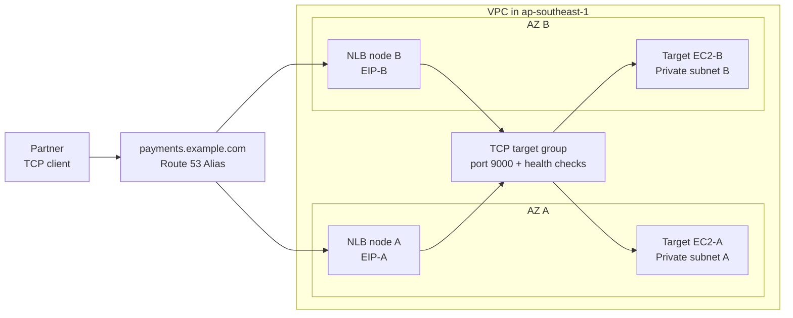
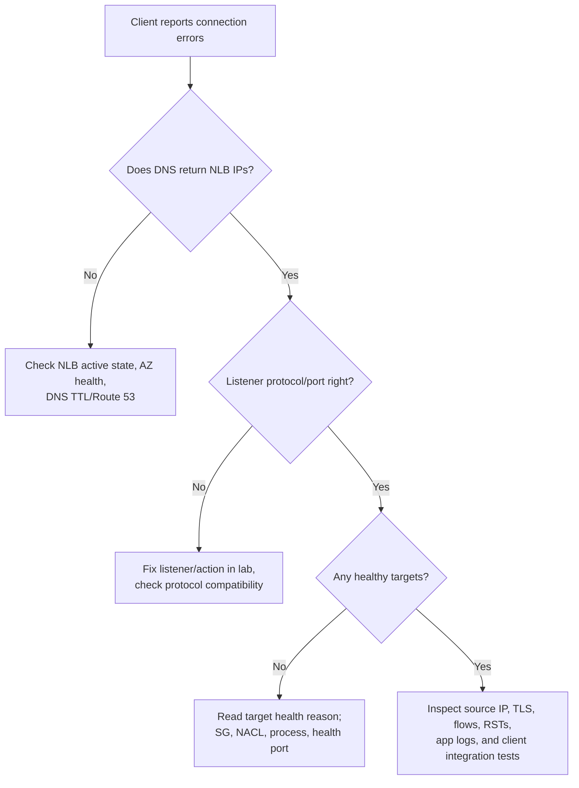

# NLB, Static IP Addresses, and Transport-Layer Traffic

## Learning Objectives

After this lesson, learners will be able to:

1. Explain **Network Load Balancer (NLB)** within Amazon Elastic Load Balancing, how it operates primarily at **Layer 4 (transport)**, and how it differs from Application Load Balancer (ALB).
2. Distinguish **internet-facing** from **internal NLBs**, and understand **static IPv4 addresses per Availability Zone (AZ)** via Elastic IPs (EIPs) or private IPv4 addresses.
3. Configure and explain the roles of **listeners**, **target groups**, **targets**, **health checks**, **VPC subnets**, **Security Groups (SGs)**, and **Network ACLs (NACLs)**.
4. Choose among **TCP, TLS, UDP, TCP_UDP, QUIC, and TCP_QUIC** protocols, and understand the difference between **TLS termination** and **TLS passthrough**.
5. Understand **client source IP preservation**, **Proxy Protocol v2**, connection distribution, **cross-zone load balancing**, and their impact on multi-AZ availability.
6. Use the AWS CLI to create a TCP NLB with two Elastic IPs, register EC2 targets, check health, monitor CloudWatch, and diagnose common errors.
7. Know when to choose NLB, ALB, AWS Global Accelerator, or **AWS PrivateLink**, while factoring in security, resilience, and cost.

## 1. Architectural Problem: A Service Needing Static Addresses and High Throughput

Suppose a payment system accepts TCP connections from partners on port `9000`. Partners only allow outbound traffic to **a fixed IP allowlist** and do not want to update IPs whenever your team replaces EC2 instances or scales out. The application must run across at least two AZs so a single host failure does not take down the entire service.

If partners connect directly to a single EC2 instance:

- The IP or instance can change when replacing hosts or when Auto Scaling launches new instances.
- Losing one instance drops all connections.
- Adding new instances requires changing partner configurations or building custom connection coordination.

**Network Load Balancer (NLB)** provides a transport-layer entry point to distribute flows across multiple targets. With an **internet-facing NLB**, you can assign **one Elastic IP per enabled AZ**. Partners add these IPs to their allowlists, while behind the NLB you can replace EC2 instances, containers, or target addresses without changing the EIPs of retained AZs.

NLB does not manage your application, database, every target's TLS certificate, or release deployments by itself. It is one piece of an architecture that includes VPCs, EC2/containers, IAM, monitoring, backups, Auto Scaling, and recovery procedures.

> **Key takeaway:** NLB maintains a stable network entry point for **TCP/UDP/TLS/QUIC flows** and selects healthy targets. It does not solve user authentication, database session storage, or data recovery on behalf of your application.

## 2. What Is NLB? Why Is It Said to Operate at Layer 4?

In the OSI model, **Layer 4** concerns transporting data between endpoints, such as TCP/UDP ports. NLB is designed to process **connections and data flows** rather than primarily parsing HTTP requests by path, header, or cookie.

| Requirement | NLB | ALB |
| --- | --- | --- |
| Transport-layer TCP/UDP routing | **Suited** | Not for UDP or arbitrary TCP protocols. |
| Client-side TLS | `TLS` listener can terminate; `TCP` supports passthrough. | HTTPS listener provides TLS termination and HTTP logic. |
| Needs specific static public IPv4 per AZ | **EIP per enabled AZ** on internet-facing NLB. | ALB does not support attaching EIPs directly. |
| Routing by `/api/orders`, hostname, HTTP headers | Not NLB's core application routing capability. | **Suited** via ALB listener rules. |
| Tracking client source IP on backend | Yes depending on target type/protocol; supports Proxy Protocol v2. | Uses HTTP headers like `X-Forwarded-For` per ALB rules. |
| AWS PrivateLink endpoint service integration | **Supported** with NLB and proper endpoint service config. | Can place an ALB as a target **behind NLB** when both are needed. |
| Web/API needing WAF and deep HTTP routing | Consider NLB → ALB if static IPs are needed. | Usually the better direct choice. |

NLB currently supports **TCP, TLS, UDP, TCP_UDP, QUIC, and TCP_QUIC** listener protocols. AWS expanded this beyond older docs that listed only TCP/UDP/TLS. Newer features (QUIC, IPv4/IPv6 routing rules, weighted target groups) carry specific support conditions; check current documentation before deploying.

### The Unit of Distribution Is a Flow, Not Each HTTP Request

For TCP, NLB selects a target using a hash algorithm over flow attributes such as protocol, source/destination IP, source/destination port, and TCP sequence number. **A single TCP connection** goes to **one target** for the lifetime of that connection; new connections from the same client may land on different targets.

For UDP, NLB uses the flow's 5-tuple to route consistently for the lifetime of the flow. UDP does not perform a handshake like TCP; flow state and idle timeouts still matter.

Consequences:

- If a client holds a single TCP connection open for hours, NLB **does not split individual packets of that connection** across different EC2 instances to "even out CPU."
- If an application opens many short-lived connections, NLB has more opportunities to spread load across targets.
- When a target fails, active connections through it **can be reset or disrupted**; clients should implement retries/reconnection and applications should handle idempotency where needed.

## 3. Components of a Network Load Balancer

| Component | Role | Example |
| --- | --- | --- |
| **Load balancer** | Entry point receiving traffic, with a DNS name and nodes per AZ. | `payments-tcp-nlb`. |
| **Scheme** | Determines whether it accepts Internet traffic or only private network traffic. | `internet-facing` or `internal`. |
| **IP address type** | Input address family. | `ipv4` or `dualstack`. |
| **Enabled AZ/subnet** | Where NLB nodes reside; one subnet per selected AZ. | Public subnets in AZ A and AZ B. |
| **Listener** | Accepts protocol/port from clients and routes via actions/rules. | `TCP:9000` → target group. |
| **Target group** | Collection of targets plus health/routing policies. | `tcp-orders-tg`, TCP port `9000`. |
| **Target** | Actual endpoint processing traffic. | EC2 instance ID, private IP, or an ALB per supported features. |
| **Health check** | Evaluates whether a target is ready to accept traffic. | TCP:9000 or HTTP:/ready on a separate port. |
| **Security Group/NACL** | Controls permitted traffic paths to NLB and targets. | Allow partners on TCP:9000; allow NLB to EC2. |

### Illustrative Network Flow



The diagram depicts the general concept. When **cross-zone load balancing is disabled** (the default), node AZ A generally sends traffic to healthy targets in AZ A, and node AZ B sends to targets in AZ B. When cross-zone is enabled, each node can forward to targets across enabled AZs per configuration.

## 4. Static IP Addresses: A Key Differentiator

### 4.1. Internet-Facing NLB: Public IPv4 / EIP per AZ

For an internet-facing NLB, each enabled AZ has a node and a public IPv4 address for client connections. When creating the NLB, you can:

1. Let AWS automatically assign a public IPv4/EIP per AZ; or
2. Specify your own **Elastic IP Allocation ID** for each AZ using **subnet mappings**.

If partners require **allowlisting static IPs that you own**, allocate and map EIPs explicitly at creation time. For example, two AZs might have:

| AZ | Subnet Hosting NLB | Illustrative Public EIP | Meaning |
| --- | --- | --- | --- |
| `ap-southeast-1a` | `subnet-public-a` | `203.0.113.10` | EIP A for NLB node A. |
| `ap-southeast-1b` | `subnet-public-b` | `198.51.100.20` | EIP B for NLB node B. |

These IPs come from **documentation-reserved ranges**, not real AWS EIPs. Each enabled AZ needs **its own EIP**; one EIP cannot serve as the address for two NLB nodes in two different AZs simultaneously.

**Scope of stability:** EIPs stay bound to their corresponding node/AZ while the mapping configuration remains intact; however, if you delete the NLB, remove an AZ, alter subnet mappings, or mismanage EIPs, client connections are not guaranteed to keep reaching the same endpoint. Do not assume an IP list acts as a **single always-healthy** entry point through every failure.

### 4.2. Internal NLB: Stable Private IPv4 per Subnet

An internal NLB holds private IPs inside its selected subnets. At creation time, you can let AWS pick addresses or specify a **private IPv4 address** from each AZ's subnet CIDR.

Example:

```text
VPC 10.40.0.0/16
AZ A: internal NLB node 10.40.1.10
AZ B: internal NLB node 10.40.2.10
Clients: apps inside VPC, peered VPCs, TGW, VPN, or Direct Connect
```

Knowing the private IP does not make an internal NLB public. It relies on designed private network paths; routes, DNS, and security policies must permit client-to-NLB communication.

### 4.3. IPv6 and Dualstack

NLB supports `ipv4` or `dualstack`, depending on network, subnet, and listener requirements. With **dualstack**, NLB gets `A` DNS records for IPv4 and `AAAA` records for IPv6. IPv6 addresses can be specified at creation via subnet mappings where supported.

Do not confuse **IPv4 EIPs with IPv6 addresses**: EIPs are public IPv4 addresses, whereas IPv6 paths require IPv6 VPC/subnet CIDRs, routes, Security Groups/NACLs, and compatible listener/target configs. Certain combinations of IPv6 UDP, QUIC, and IPv4/IPv6 target groups carry specific restrictions.

### 4.4. Still Publish DNS, Even With Static IPs

AWS assigns a DNS name to every NLB, for example:

```text
payments-tcp-nlb-0123456789abcdef.elb.ap-southeast-1.amazonaws.com
```

You can create a **Route 53 alias** like `payments.example.com` pointing to the NLB. NLB DNS returns addresses of serving AZs and **removes an AZ's IP from DNS responses** if that AZ has no healthy targets left. NLB's typical DNS TTL is around **60 seconds**.

Therefore:

- Systems capable of using hostnames should **connect via DNS name** and honor TTLs plus retries/reconnection.
- For partners requiring IP allowlists, provide **all EIPs across every enabled AZ**, while still recommending clients connect via hostname.
- **Pinning a single EIP** on the client side can leave the client hitting a failed AZ even after NLB DNS has shifted traffic away from that AZ.

**Static EIPs assist allowlisting and integration—they do not replace HA and DNS failover strategies.**

## 5. How Does NLB Select Targets?

NLB determines the target group from listener actions/rules, then distributes flows to **registered and healthy** targets according to health state and AZ settings.

### Target Types

| Target Type | Registered By | When to Use |
| --- | --- | --- |
| `instance` | EC2 **Instance ID**. | Services running directly on EC2, typically with Auto Scaling. |
| `ip` | IP address and matching port. | ECS tasks in `awsvpc`, appliances/apps with IPs in supported networks. |
| `alb` | Registering an **Application Load Balancer** as a target, within listener/port constraints. | Need NLB for static IPs/PrivateLink while ALB handles Layer 7 HTTP/HTTPS routing. |

Not every arbitrary public IP on the Internet can be registered as an `ip` target. You must follow address ranges and connectivity rules supported by Elastic Load Balancing. Once a target group is created, **its target type and IP address type cannot be changed**; changing them requires creating a new target group and updating the listener.

### Listener and Target Group Protocols and Ports

| Listener | Supported Target Groups (Overview) | Usage |
| --- | --- | --- |
| `TCP` | `TCP`, `TCP_UDP`, `TCP_QUIC`; for ALB targets must be `TCP`. | TCP apps or TLS/HTTPS passthrough as a raw byte stream. |
| `TLS` | `TCP` or `TLS`. | Terminate TLS at NLB; backend uses TCP or TLS re-encryption. |
| `UDP` | `UDP` or `TCP_UDP`. | DNS/gaming/telemetry over UDP. |
| `TCP_UDP` | `TCP_UDP`. | Same port requiring both TCP and UDP. |
| `QUIC` | `QUIC` or `TCP_QUIC`. | QUIC passthrough to supporting backends. |
| `TCP_QUIC` | `TCP_QUIC`. | Same port supporting TCP and QUIC where service rules allow. |

NLB supports **ports 1–65535**. Listeners have a default action and support listener rules depending on protocol/NLB type, yet NLB **does not inspect HTTP paths/hosts like ALB**. Newer listener rules can route by **IPv4/IPv6 source IP family** on dualstack NLBs—not by arbitrary HTTP conditions or CIDRs like ALB.

## 6. Health Checks: Is the Target Actually Able to Serve?

NLB target groups use active health checks to determine whether targets qualify for traffic. Primary health check protocols are **TCP**, **HTTP**, and **HTTPS**; health checks do not send UDP packets directly to test a UDP service.

Example for a TCP server on port `9000`:

| Check | Evaluation Method | Risk of False Positive |
| --- | --- | --- |
| **TCP:9000** | Opens a TCP connection to the port. | Port is open, yet the process may fail to handle valid messages. |
| **HTTP:8080/ready** | Calls an HTTP health endpoint. | Requires running an HTTP health endpoint alongside the TCP/UDP service. |
| **HTTPS:8443/ready** | HTTP over TLS to the health endpoint. | An endpoint allowing only TLS 1.3 may be incompatible with NLB HTTPS health checks. |

For **UDP/QUIC backends**, run a TCP/HTTP/HTTPS health endpoint on the target indicating whether the UDP/QUIC service is ready. An open TCP port does not prove UDP messages succeed; the application should update the health endpoint based on actual service state.

### Health States to Read

| State | Meaning |
| --- | --- |
| `initial` | Newly registered target awaiting initial health checks. |
| `healthy` | Passing health checks per configured thresholds. |
| `unhealthy` | Failed health checks or target unavailable. |
| `draining` | Target is deregistering and finishing remaining connections. |
| `unused` | Target group is unattached to a listener, target is in a disabled AZ, or other precondition unmet. |
| `unavailable` | Unable to determine health due to a load-balancer-side issue. |

Each target group configures **healthy/unhealthy thresholds**, check intervals, and timeouts. Health checking is distributed; a target may receive **more health probes** than a naive interval calculation predicts.

### DNS Failover and Fail-Open

NLB normally removes **the IP of an AZ lacking sufficient healthy targets** from DNS to steer new traffic away from that zone. This is why DNS matters even when NLB has static EIPs.

If **all targets are unhealthy** across all enabled AZs, NLB may **fail open** and continue routing traffic to targets despite failing checks. An empty target group also has fail-open behavior. Therefore:

- Never treat "a DNS A record still resolves" as proof that all targets are healthy.
- Never rely on NLB blocking all requests to protect data when every backend fails.
- Monitor `HealthyHostCount`, `UnHealthyHostCount`, and health reason codes; design applications with proper error handling and retries.

## 7. Client IP Preservation and Proxy Protocol v2

Partners often want servers to log original client IPs or enforce IP-based access rules. NLB supports **client IP preservation** depending on protocol and target type.

| Target Group Combination | Default Preservation | Notes |
| --- | --- | --- |
| `instance` target, TCP/TLS | **Enabled**. | Servers generally see the client's source IP under supported setups. |
| `ip` target, TCP/TLS | **Disabled**. | Servers generally see the NLB node's private IP unless enabled and supported. |
| `instance/ip` with UDP, TCP_UDP, QUIC, TCP_QUIC | **Enabled and cannot be disabled** per corresponding rules. | Ensure Security Groups/NACLs and apps accept client source IPs. |

You can configure `preserve_client_ip.enabled` on supported TCP/TLS target groups; restrictions apply based on target IP location and networking, especially for targets outside the VPC/supported networks. With dualstack, when client and target use **different IP families** (IPv4 ↔ IPv6), source IP preservation does not apply across families.

### Proxy Protocol v2

When backends need client IP/port metadata without receiving the raw client source IP, NLB supports **Proxy Protocol v2** where applicable. NLB prepends a **binary header** before the payload so the backend can read source/destination addresses and related metadata.

**Never enable `proxy_protocol_v2.enabled=true` unless your server parses this header.** A TCP application expecting the first byte to be a business message will misread the header and treat requests as corrupt.

Target group attribute example:

```bash
aws elbv2 modify-target-group-attributes \
  --target-group-arn "arn:aws:elasticloadbalancing:ap-southeast-1:111122223333:targetgroup/tcp-orders-tg/aaaaaaaaaaaaaaaa" \
  --attributes Key=proxy_protocol_v2.enabled,Value=true \
  --region ap-southeast-1
```

This command mutates live configuration—use it only once backends support Proxy Protocol v2 and operations has tested it. Note that headers may also appear on health-check connections, which must be accounted for when implementing health endpoints.

### The Hairpinning Issue

If an instance acts as both an **NLB client** and a **registered NLB target** with client IP preservation enabled, NLB routing traffic back to that same instance can cause unsupported **NAT loopback/hairpinning**, resulting in timeouts. Conditional workarounds include changing topology or disabling client IP preservation (where permitted) and using Proxy Protocol v2 instead.

## 8. TLS Termination, Passthrough, and UDP/QUIC Protocols

### 8.1. TLS Termination at NLB

Create a `TLS:443` listener and attach an appropriate certificate from **AWS Certificate Manager (ACM)** or a supported source. NLB decrypts client connections at the listener, then connects to the target group using its protocol:

- `TCP`: NLB → target traffic is sent over plain TCP as received by the app without re-encryption.
- `TLS`: NLB opens a **new** TLS session to targets, requiring a certificate on each target; target certificate verification follows service behavior and is not equivalent to application-controlled end-to-end mTLS.

TLS termination offloads certificate/handshake work from backends and satisfies frontend encryption mandates, though you must still evaluate encryption, authentication, and internal security policies for the NLB → target hop separately.

### 8.2. TLS Passthrough

If backends must handle TLS directly (e.g., application-level mTLS or direct inspection of client certificates), use a **TCP listener on port 443** pointing to a **TCP target group on port 443**. NLB forwards encrypted byte streams without terminating TLS at the listener.

```text
Client -- TLS handshake / encrypted TCP --> NLB TCP:443 --> Backend TCP:443
                     NLB does not decrypt application TLS
```

NLB cannot apply HTTP host/path rules while passing through encrypted traffic. If you need L7 controls, evaluate ALB or a dedicated proxy by design.

### 8.3. UDP, TCP_UDP, and QUIC

- `UDP` serves datagram-based apps; design client retries, flow timeouts, and packet-loss handling accordingly.
- `TCP_UDP` handles services needing both TCP and UDP on the same port.
- `QUIC` and `TCP_QUIC` are newer NLB options with **combination limits**: per current documentation, QUIC/TCP_QUIC cannot be used with **dualstack NLBs or NLBs with Security Groups attached**, and have listener/UDP pairing restrictions. Verify current conditions and target compatibility before adopting them.
- A QUIC listener acts as **pass-through for QUIC v1** requiring QUIC-capable backends; it does not magically convert a legacy TCP service into QUIC.

In the lab section below, we choose **TCP** to focus on static-IP NLB and transport-layer flows; QUIC requires its own architecture, load testing, and security review.

## 9. High Availability and Cross-Zone Load Balancing

Every NLB enables at least one AZ; production typically uses **two or more AZs** matching workload placement. With healthy targets in each AZ, NLB can keep serving even if a node, EC2 instance, or AZ degrades.

### Cross-Zone Is Disabled by Default

| Setting | NLB Node in AZ A Sends Traffic To | Pros | Points to Watch |
| --- | --- | --- | --- |
| **Cross-zone OFF** (default) | Healthy targets in **AZ A**. | Clean zonal isolation; traffic stays intra-AZ when targets exist. | Must keep healthy targets in **every serving AZ** to avoid DNS removal. |
| **Cross-zone ON** | Healthy targets in **all enabled AZs**. | Shared capacity; one AZ can serve via targets in another AZ. | Introduces cross-AZ traffic and cross-AZ dependencies; evaluate pricing/transfer and target group limits. |

Cross-zone can be configured on the NLB or via target group attributes within supported limits. Do not confuse a **multi-AZ load balancer** with a **multi-AZ Auto Scaling group**: NLB only routes traffic, while instance counts, replacements, and rollouts are managed by ASGs or other tooling.

### Do Not Assume Every Connection Survives an AZ Failure

A TCP connection pinned to a target can drop when that target dies or its node/AZ is pulled from DNS. DNS failover primarily affects **new connections**; active connections, apps without retry logic, or clients caching IPs past TTL can still fail.

AWS supports **zonal shift** subject to documented conditions and limits to move traffic away from an AZ; it is an operational tool requiring testing, not a magic button guaranteeing every active connection survives.

### Deregistration Delay and Connection Draining

During releases or scale-in, allow NLB/target groups to **deregister targets gracefully**, letting active connections finish within an appropriate `deregistration_delay.timeout_seconds` window. For long-lived connection apps, add application-level reconnect signals or session migration.

## 10. Security: NLB Supports Security Groups, Not WAF

Older documentation often stated that NLB lacked Security Group support. **Modern NLBs support Security Groups**, with one critical rule:

> **If you create an NLB without attaching any Security Group, you cannot attach an SG to that NLB later.** Specify an SG at creation time whenever SG control is anticipated; attached SGs can be updated afterward per procedure.

Design an SG pair:

| Attached To | Inbound | Outbound |
| --- | --- | --- |
| `sg-nlb` on NLB | Allow TCP:9000 **from partner IPs/CIDRs**. | Allow traffic to target:9000 and health-check port as needed. |
| `sg-app` on EC2 targets | Allow TCP:9000 and health-check port **from NLB SG**. | Open only as required by the application. |

Referencing the **NLB SG** in the target SG's inbound rules ensures targets accept traffic only via NLB, even when NLB preserves client IP (under supported configurations).

Distinguish:

- **Security Groups** are stateful, filtering inbound/outbound rules at the network/port level.
- **Network ACLs** are stateless at the subnet boundary, requiring explicit rules for both request and return traffic including ephemeral ports.
- **NLB is a transport load balancer**; it does not provide deep WAF/HTTP inspection like ALB + AWS WAF.
- **TLS/mTLS, IAM, and business authentication** must be designed separately according to where TLS terminates.
- **Public IP allowlists** restrict network sources at Layer 3/4, but do not replace client authentication, abuse prevention, or auditing.

### PrivateLink

For SaaS/B2B services consumed privately by other accounts or VPCs, create a **VPC endpoint service** backed by an NLB. Consumers create **interface endpoints** via AWS PrivateLink without exposing service endpoints to the public Internet.

Even here, **NLB backends still need healthy targets**, endpoint policies/allowed principals, VPC/subnet connectivity, and SGs. PrivateLink does not automatically authorize applications for consumers; business authentication and authorization remain essential.

## 11. AWS CLI Lab: TCP NLB with Two Elastic IPs

This section provides a **command blueprint for practicing in your own environment**. All IDs, ARNs, EIPs, and CIDRs are **placeholders**; run commands only after substituting real values from your account. Creating NLBs, allocating EIPs, and passing traffic can incur charges.

### 11.1. Lab Architecture

```text
AWS Region: ap-southeast-1
VPC: vpc-0123456789abcdef0
AZ A: subnet-01111111111111111 (public)
AZ B: subnet-02222222222222222 (public)
NLB security group: sg-03333333333333333
Target security group: sg-04444444444444444
EC2 target A: i-05555555555555555 (private AZ A)
EC2 target B: i-06666666666666666 (private AZ B)
Service: TCP 9000; health check: TCP 9000
```

**Assumptions:** public subnets have a route to an Internet Gateway for the internet-facing NLB; EC2 instances reside in the same VPC with the app listening on `0.0.0.0:9000` or their private IPs; SGs/NACLs permit traffic and health checks. Your AWS CLI profile has required ELBv2/EC2 IAM permissions.

**Do not assign public IPv4 addresses to EC2 targets** merely because the NLB is internet-facing. NLB receives client connections on the frontend and forwards privately to backends.

### 11.2. Verify Account, VPC, and Subnets

```bash
aws sts get-caller-identity

aws ec2 describe-subnets \
  --subnet-ids subnet-01111111111111111 subnet-02222222222222222 \
  --query 'Subnets[].{Id:SubnetId,Vpc:VpcId,Az:AvailabilityZone,Cidr:CidrBlock}' \
  --region ap-southeast-1
```

Confirm each subnet sits in a **different AZ** and belongs to the same VPC as the targets. Verify route tables, SGs, and EC2 state before creating the NLB.

### 11.3. Allocate Two Elastic IPs

```bash
# Run 1: record AllocationId for AZ A
aws ec2 allocate-address --domain vpc --region ap-southeast-1

# Run 2: record a second AllocationId for AZ B
aws ec2 allocate-address --domain vpc --region ap-southeast-1
```

For example, you receive `eipalloc-0a000000000000001` and `eipalloc-0b000000000000002`. Do not reuse the same AllocationId for both subnets. Both EIPs must belong to the appropriate account and Region.

### 11.4. Create the Internet-Facing NLB with Subnet Mappings and SG

```bash
aws elbv2 create-load-balancer \
  --name payments-tcp-nlb \
  --type network \
  --scheme internet-facing \
  --ip-address-type ipv4 \
  --subnet-mappings \
    SubnetId=subnet-01111111111111111,AllocationId=eipalloc-0a000000000000001 \
    SubnetId=subnet-02222222222222222,AllocationId=eipalloc-0b000000000000002 \
  --security-groups sg-03333333333333333 \
  --region ap-southeast-1
```

Record `LoadBalancerArn` and `DNSName`. Example ARN format:

```text
arn:aws:elasticloadbalancing:ap-southeast-1:111122223333:loadbalancer/net/payments-tcp-nlb/aaaaaaaaaaaaaaaa
```

Verify:

```bash
aws elbv2 describe-load-balancers \
  --names payments-tcp-nlb \
  --query 'LoadBalancers[].{Arn:LoadBalancerArn,State:State.Code,DNS:DNSName,Zones:AvailabilityZones}' \
  --region ap-southeast-1
```

Wait until the NLB reaches `active`. Once EIPs are mapped at creation, AWS reflects them in the NLB's subnet mapping details.

### 11.5. Create the TCP Target Group

```bash
aws elbv2 create-target-group \
  --name payments-tcp-tg \
  --protocol TCP \
  --port 9000 \
  --vpc-id vpc-0123456789abcdef0 \
  --target-type instance \
  --health-check-protocol TCP \
  --health-check-port traffic-port \
  --region ap-southeast-1
```

Save the returned `TargetGroupArn`, e.g.:

```text
arn:aws:elasticloadbalancing:ap-southeast-1:111122223333:targetgroup/payments-tcp-tg/bbbbbbbbbbbbbbbb
```

A TCP health check only checks whether the port opens. If the app exposes a dedicated HTTP health endpoint, you can configure `--health-check-protocol HTTP`, `--health-check-port 8080`, and `--health-check-path /ready` after building that endpoint.

### 11.6. Register EC2 Targets

```bash
aws elbv2 register-targets \
  --target-group-arn "arn:aws:elasticloadbalancing:ap-southeast-1:111122223333:targetgroup/payments-tcp-tg/bbbbbbbbbbbbbbbb" \
  --targets Id=i-05555555555555555 Id=i-06666666666666666 \
  --region ap-southeast-1
```

Targets must reside in AZs enabled on the NLB, the app must listen on the configured port, and SGs/NACLs must permit traffic and health checks.

### 11.7. Create the Listener

```bash
aws elbv2 create-listener \
  --load-balancer-arn "arn:aws:elasticloadbalancing:ap-southeast-1:111122223333:loadbalancer/net/payments-tcp-nlb/aaaaaaaaaaaaaaaa" \
  --protocol TCP \
  --port 9000 \
  --default-actions \
    Type=forward,TargetGroupArn=arn:aws:elasticloadbalancing:ap-southeast-1:111122223333:targetgroup/payments-tcp-tg/bbbbbbbbbbbbbbbb \
  --region ap-southeast-1
```

NLB needs a listener to accept client traffic on this port. Once the target group is attached to a listener, health checks evaluate target readiness.

### 11.8. Verify Target Health

```bash
aws elbv2 describe-target-health \
  --target-group-arn "arn:aws:elasticloadbalancing:ap-southeast-1:111122223333:targetgroup/payments-tcp-tg/bbbbbbbbbbbbbbbb" \
  --region ap-southeast-1
```

Expected result: both `i-055...` and `i-066...` show `State=healthy`. If `unhealthy`, read `Reason` and `Description` rather than immediately opening `0.0.0.0/0` inbound or disabling SGs.

### 11.9. Test Connectivity from an Allowed Client

From a client allowed by `sg-nlb` on TCP:9000 with network reachability to the NLB:

```bash
# Tests TCP connectivity only; does not validate application payload
nc -vz payments-tcp-nlb-0123456789abcdef.elb.ap-southeast-1.amazonaws.com 9000
```

`nc` availability depends on OS; on Windows PowerShell you can run:

```powershell
Test-NetConnection -ComputerName payments.example.com -Port 9000
```

A successful TCP check only confirms the port is reachable; a payment or binary TCP protocol still needs **integration tests** to verify request/response semantics and data integrity.

### 11.10. Monitor Status and Clean Up the Lab

During testing, watch target health and the CloudWatch metrics in Section 12. When cleaning up the lab, the typical order is: **delete listener → delete NLB → deregister/delete unused target group → release EIPs** after confirming they are not attached elsewhere. NLBs and EIPs can accrue charges even with zero traffic; never release EIPs shared with live systems.

## 12. Monitoring NLB with CloudWatch

NLB metrics live in the `AWS/NetworkELB` namespace. Some metrics emit datapoints only when matching traffic or conditions occur, so do not equate "missing datapoints" with "zero errors."

| Metric | Meaning | Usage |
| --- | --- | --- |
| `HealthyHostCount` / `UnHealthyHostCount` | Healthy/unhealthy target counts per dimension. | Alert on missing capacity or single-AZ degradation. |
| `ActiveFlowCount` | Number of active flows/connections. | Track long-lived connection volume. |
| `NewFlowCount` | New flows initiated in the period. | Detect spikes and inform autoscaling trends. |
| `ProcessedBytes` | Bytes processed by NLB. | Track data volume and cost. |
| `TCP_ELB_Reset_Count` | TCP RSTs generated by NLB. | Detect idle timeouts or failing targets. |
| `TCP_Target_Reset_Count` | TCP RSTs generated by targets. | Diagnose application or backend OS issues. |
| `PortAllocationErrorCount` | Port allocation errors when NLB translates client addresses. | Check connection density per target; add targets if needed. |
| `ClientTLSNegotiationErrorCount` | Client-to-TLS-listener handshake failures. | Check certificates, security policies, or client compatibility. |
| `SecurityGroupBlockedFlowCount_*` | Flows blocked by the NLB's SG. | Audit SG/NLB rules, noting direction/protocol metrics. |
| `ConsumedLCUs` | LCUs consumed by NLB. | Track hourly capacity-unit billing. |

Example listing metrics:

```bash
aws cloudwatch list-metrics \
  --namespace AWS/NetworkELB \
  --region ap-southeast-1
```

To query a specific NLB, pass the **LoadBalancer dimension** from the tail of its ARN, e.g., `net/payments-tcp-nlb/aaaaaaaaaaaaaaaa`. Health metrics also require the **TargetGroup dimension** `targetgroup/payments-tcp-tg/bbbbbbbbbbbbbbbb` per metric docs.

Do not monitor NLB alone:

- **VPC Flow Logs** reveal IP/port pairs, ACCEPT/REJECT verdicts, and network paths.
- **EC2/Auto Scaling metrics** report CPU, memory/disk (with agent), instance health, and capacity.
- **Application logs / business metrics** verify whether transactions actually succeed.
- **CloudWatch alarms + EventBridge/SNS** alert on drops in healthy targets or connection errors.
- For critical services, run client/partner-side probes measuring real connection and request latency.

## 13. Cost and Architectural Optimization

NLB generally bills by **NLB running hours** and **Load Balancer Capacity Units (LCUs)** based on usage dimensions such as connections/flows and processed bytes per current pricing. Additional costs may include:

- **Public IPv4 / EIPs** mapped per AZ, even at low traffic, per current pricing.
- **Data transfer** cross-Region, cross-AZ, or out to the Internet along the actual path.
- **EC2/ECS/EKS targets** and backend data infrastructure.
- **CloudWatch alarms, logs, and PrivateLink endpoints** if used.
- **Route 53, AWS Global Accelerator**, or other services required by the design.

Do not equate "two EIPs = two NLBs": one multi-AZ NLB uses multiple nodes/EIPs yet remains **a single load balancer** at the management layer. To estimate cost:

```text
Estimate ≈ NLB-hours charges
         + LCU-hours charges (based on actual load or reserved LCUs)
         + public IPv4, data transfer, compute, and observability charges
```

Do not hard-code fixed unit rates across Regions here because AWS pricing changes. Use the **AWS Pricing Calculator**, Cost Explorer, and CloudWatch `ConsumedLCUs` against real traffic.

### Optimizing Without Sacrificing Too Much Availability

1. Choose NLB when you truly need **transport protocols**, static endpoints, or PrivateLink; pure HTTP web/APIs often fit ALB better.
2. Keep multi-AZ coverage with healthy targets in every AZ while cross-zone defaults to off; do not shrink to one AZ just to save a little cost if SLOs demand HA.
3. Monitor long-lived connections and LCUs; tune application reconnect/idle timeouts and avoid holding idle connections open indefinitely.
4. If source IP is required, choose the right target type/attribute; when preservation is disabled, monitor `PortAllocationErrorCount` and scale targets.
5. Weigh cross-AZ data transfer costs against enabling cross-zone load balancing for your specific traffic and resilience profile.
6. Consider NLB → ALB when you need **both static IPs and Layer 7 HTTP routing**, accounting for the extra cost and operational overhead of two layers.

## 14. Symptom-Based NLB Troubleshooting

| Symptom | Common Causes | Where to Check |
| --- | --- | --- |
| DNS name does not return expected IPs | Wrong account/Region, AZ removed from DNS due to health, client DNS caching. | `describe-load-balancers`, AZ status, target health, TTL. |
| Client cannot connect to TCP:9000 | Missing/wrong listener port, NLB SG or NACL blocking, bad route/IGW. | Listeners, EIP/subnet mappings, VPC routes, and SG/NACL. |
| Target stuck in `initial` | Health checks not passing yet, target still starting. | Listening process, target SG, health protocol, timers. |
| Target `unhealthy` | Wrong health endpoint, app down, SG/NACL blocking, or incompatible check. | `describe-target-health` Reason/Description; app logs. |
| Target `unused` | Target outside enabled AZs or target group not attached to listener. | Enabled AZs, target group, listener actions. |
| Backend sees NLB node IP as source | IP-type TCP/TLS target group disables source IP preservation by default. | `preserve_client_ip.enabled`, Proxy Protocol v2, supported network setup. |
| Enabling Proxy Protocol v2 breaks the app | Backend does not parse the binary header. | Disable in lab or deploy a compatible parser/proxy. |
| `TCP_ELB_Reset_Count` rises | Idle timeout or unhealthy target resetting active connections. | Correlate RST timestamps with `UnHealthyHostCount`, logs, flow duration. |
| `PortAllocationErrorCount` rises | NLB translates client IPs and exhausts ephemeral ports to a target. | Add targets, spread connections, or enable preservation where appropriate. |
| HTTPS/TLS fails while TCP port is open | Wrong TLS listener cert/security policy, or incompatible backend TLS/client cipher. | TLS negotiation metrics, ACM/certs, backend logs. |
| UDP backend is broken yet health check is green | TCP health port stays open even though UDP service is unhealthy. | Build a health endpoint reflecting actual UDP service health. |
| One AZ loses targets, yet partner still calls that AZ's IP | Client pinned an EIP and bypassed DNS failover. | Switch to hostname and honor DNS refresh; allowlist all EIPs. |
| Backend does not see connections balanced | One long-lived TCP connection sticks to one target. | Open multiple parallel connections or balance at application layer. |

### Quick Triage Sequence



Any production configuration change must follow operational change control. Never "fix" errors by opening all inbound traffic to EC2 or disabling health checks.

## 15. Design Scenario Exercise

**Context:** A company provides a financial data ingestion service over TCP:9000. Three partners use IP-allowlisting firewalls; some hold TCP connections open for several minutes. The system runs across two AZs in Singapore, with two EC2 instances in private subnets per AZ. Requirements:

- Service hostname: `feed.company.example`.
- Partners permit only pre-declared public IPv4 addresses.
- When one EC2 instance fails, new connections go to remaining healthy EC2 instances.
- When one AZ fails, clients can connect to the surviving AZ.
- Backends must log each partner's source IP.
- Never expose EC2 directly to the Internet.
- Monitor connections, TLS/protocol errors, and cost.

### A Viable Design

1. Create an **internet-facing NLB** across two public subnets in two AZs, mapping **EIP-A and EIP-B** at creation time.
2. Create a `TCP:9000` listener and an `instance` TCP:9000 target group; register EC2 instances via an Auto Scaling group or deployment pipeline.
3. With an **instance-type TCP target group**, client IP preservation is enabled by default; verify compatibility with topology and SGs. Attach `sg-nlb` at creation permitting only partner CIDRs, and configure `sg-app` on EC2 to accept traffic only from the NLB SG.
4. Create Route 53 alias `feed.company.example` → NLB. Have partners **allowlist both EIP-A and EIP-B** while connecting via the DNS name with TTL-aware retries. If an AZ is removed from DNS, clients refresh DNS and route to the healthy AZ.
5. Design a health endpoint that genuinely checks message-handling readiness. If the custom TCP protocol lacks HTTP, start with a TCP check and then add a lightweight HTTP health endpoint on a dedicated port reflecting app state.
6. Track CloudWatch `HealthyHostCount`, `ActiveFlowCount`, `TCP_ELB_Reset_Count`, and `PortAllocationErrorCount`, combined with logs and client-side integration tests.
7. Implement client retries with idempotency keys / application sequence numbers to prevent duplicate processing when connections reset and clients resend messages.
8. Test draining/removing a target and simulate an AZ outage in an isolated environment to verify DNS failover and reconnection behavior.
9. Periodically review NLB, LCU, public IPv4, data transfer, and EC2 costs. If expanding to multiple Regions with global anycast IPs, evaluate **AWS Global Accelerator**.

### Quick Comparison of Three Design Approaches

| Solution | Best Fit | Trade-offs |
| --- | --- | --- |
| **NLB + per-AZ EIPs** | TCP/UDP transport, Regional IP allowlists, multi-AZ. | Multiple EIPs (one per AZ); clients must respect DNS failover/flow recovery. |
| **ALB** | Web/APIs needing host/path/header routing and WAF. | Cannot attach EIPs directly; no UDP transport support. |
| **Global Accelerator in front of suitable endpoints** | Need global static anycast IPs and optimal/multi-Region routing. | Adds another service layer, support constraints, and cost. |

## 16. Common Misconceptions

**Misconception 1: "NLB has exactly one public IP for the entire Region."**  
False in standard multi-AZ deployments: there is **one node IP per AZ**; if you need owned static IPs, map an EIP to each AZ.

**Misconception 2: "Once you have EIPs, you don't need DNS."**  
False. NLB DNS steers traffic away from AZs with no healthy targets; clients that hard-pin a single EIP bypass this capability.

**Misconception 3: "NLB balances every individual HTTP request independently."**  
False. TCP targets are selected per **connection/flow**, so a long-lived connection stays on one target.

**Misconception 4: "NLB only supports TCP."**  
False. NLB also supports TLS, UDP, TCP_UDP, and newer QUIC/TCP_QUIC listeners with specific constraints.

**Misconception 5: "All target groups preserve client IP by default."**  
False. Instance-type TCP/TLS usually enables it, whereas IP-type TCP/TLS disables source IP preservation by default.

**Misconception 6: "NLB has no Security Groups."**  
False for current NLBs. However, if you create an NLB **without an SG**, service rules prevent attaching one later.

**Misconception 7: "UDP health checks send real UDP probes."**  
False. NLB uses **TCP/HTTP/HTTPS** health checks; build a health endpoint reflecting UDP service readiness.

**Misconception 8: "A passing TCP health check means business transactions work."**  
False. An open port only proves basic reachability; run application and integration tests.

**Misconception 9: "NLB `TLS:443` means TLS passthrough."**  
False. A `TLS` listener terminates TLS at the NLB. To have the backend terminate client TLS, use a `TCP` listener and matching target group.

**Misconception 10: "Cross-zone is always enabled on NLB."**  
False. By default NLB distributes within the same AZ; cross-zone can be enabled when needed.

**Misconception 11: "When all targets are unhealthy, NLB always blocks all traffic."**  
False. NLB has **fail-open** behavior under documented conditions; pair alerts with application-level error handling.

## 17. Self-Check Questions

**Q1.** Partners need to allowlist static IPs for TCP:9000 across two AZs. What do you choose?  
**Answer:** An internet-facing NLB with **one EIP per enabled AZ**, a TCP listener, and a TCP target group. Publish both the EIPs and the DNS name.

**Q2.** Why should clients still use DNS even after allowlisting the NLB's EIPs?  
**Answer:** NLB can remove an AZ's IP from DNS if that AZ has no healthy targets; DNS-aware clients with retries then fail over to another AZ.

**Q3.** A TCP client keeps one connection open for a very long time—will NLB spread its messages across all targets?  
**Answer:** No. The connection stays pinned to the selected target for the lifetime of the flow.

**Q4.** Does an `ip`/TCP target group preserve client IP by default?  
**Answer:** No. It defaults to off; enable the attribute where supported or use Proxy Protocol v2 with a compatible backend.

**Q5.** NLB receives TLS on port 443, yet the backend must handle mTLS directly. Which listener do you pick?  
**Answer:** Typically `TCP:443` passthrough so the backend handles the TLS handshake and client certificates, with matching backend and SG configuration.

**Q6.** Which protocols should a UDP target group use for health checks?  
**Answer:** TCP, HTTP, or HTTPS—NLB does not run direct UDP health checks.

**Q7.** An NLB was just created without a Security Group. Can you attach one later?  
**Answer:** No, per current NLB rules; attach an SG at creation time if needed.

**Q8.** Is cross-zone load balancing on or off by default for NLB?  
**Answer:** Off by default; nodes route to healthy targets in the same AZ. It can be enabled to share capacity across AZs.

**Q9.** NLB health checks mark all targets unhealthy. Is it guaranteed NLB stops forwarding traffic?  
**Answer:** No. NLB exhibits **fail-open** behavior when all targets are unhealthy.

**Q10.** An app needs routing by `Host: api.example.com` and `/v1/orders`. Should you use NLB alone?  
**Answer:** Use **ALB** for Layer 7 HTTP rules. When static IPs or PrivateLink are also required, consider **NLB → ALB** along with its constraints and added cost.

## Official AWS Documentation

- [Network Load Balancer — Concepts and how it works](https://docs.aws.amazon.com/elasticloadbalancing/latest/network/introduction.html)
- [Network Load Balancers — IP address types and cross-zone](https://docs.aws.amazon.com/elasticloadbalancing/latest/network/network-load-balancers.html)
- [Availability Zones and static IP addresses for NLB](https://docs.aws.amazon.com/elasticloadbalancing/latest/network/availability-zones.html)
- [Listeners for Network Load Balancers](https://docs.aws.amazon.com/elasticloadbalancing/latest/network/load-balancer-listeners.html)
- [Create a listener — protocol support and conditions](https://docs.aws.amazon.com/elasticloadbalancing/latest/network/create-listener.html)
- [Target groups for Network Load Balancers](https://docs.aws.amazon.com/elasticloadbalancing/latest/network/load-balancer-target-groups.html)
- [NLB target-group attributes and client IP preservation](https://docs.aws.amazon.com/elasticloadbalancing/latest/network/edit-target-group-attributes.html)
- [Health checks for Network Load Balancers](https://docs.aws.amazon.com/elasticloadbalancing/latest/network/target-group-health-checks.html)
- [Security groups for Network Load Balancers](https://docs.aws.amazon.com/elasticloadbalancing/latest/network/load-balancer-security-groups.html)
- [NLB CloudWatch metrics](https://docs.aws.amazon.com/elasticloadbalancing/latest/network/load-balancer-cloudwatch-metrics.html)
- [NLB troubleshooting](https://docs.aws.amazon.com/elasticloadbalancing/latest/network/load-balancer-troubleshooting.html)
- [AWS CLI — create-load-balancer](https://docs.aws.amazon.com/cli/latest/reference/elbv2/create-load-balancer.html)
- [AWS CLI — create-target-group](https://docs.aws.amazon.com/cli/latest/reference/elbv2/create-target-group.html)
- [AWS PrivateLink endpoint services](https://docs.aws.amazon.com/vpc/latest/privatelink/privatelink-share-your-services.html)
- [Elastic Load Balancing pricing](https://aws.amazon.com/elasticloadbalancing/pricing/)

**Key takeaway:** NLB provides a **transport-layer** entry point for connections and flows, supporting **static Elastic IPs per AZ** on internet-facing NLBs or **private IPv4 addresses per subnet** on internal NLBs. Reliable operations require coordinating DNS and AZ failover, health checks, target groups, SGs/NACLs, client IP handling, TLS, and application retries. NLB solves **connection distribution**; transaction integrity, durable data, and user experience must still be engineered across the remaining layers.
