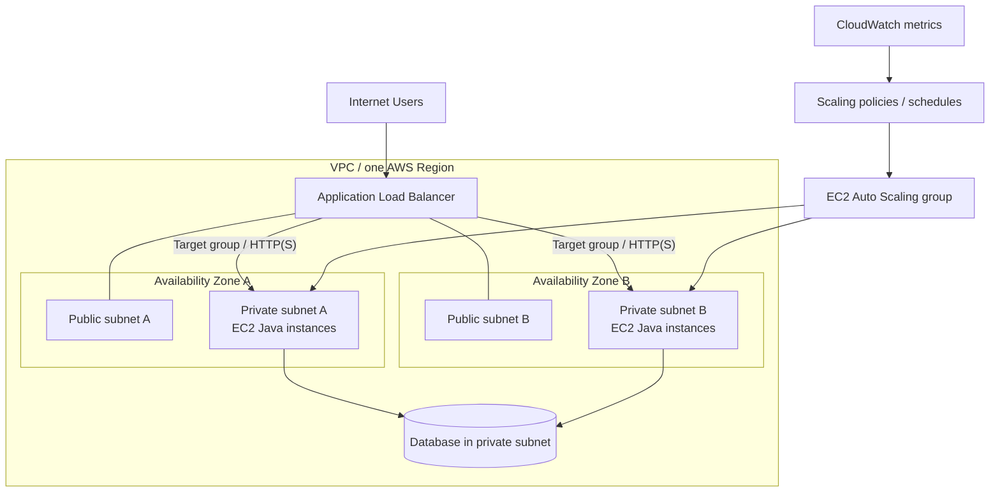
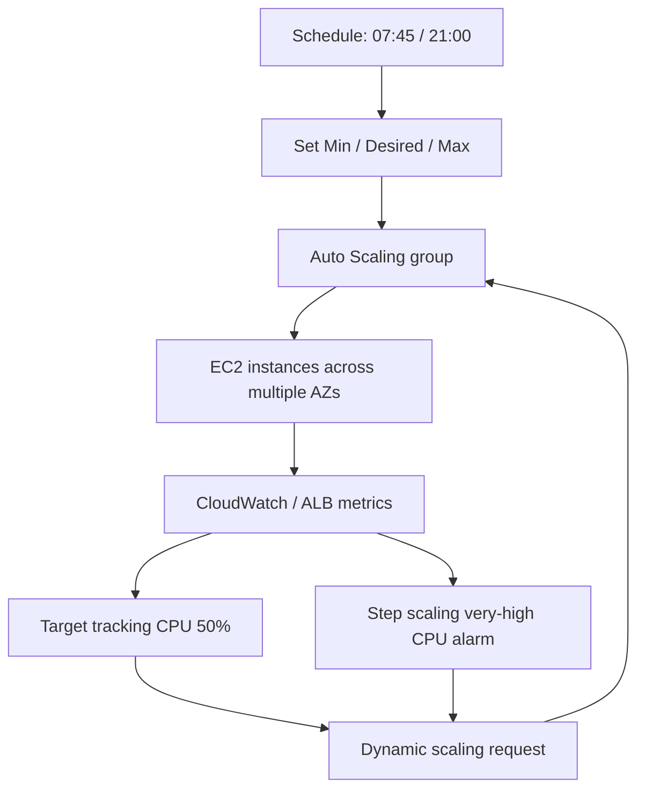

# Target Tracking, Step Scaling, and Scheduled Scaling

A web application might run smoothly at 2:00 AM yet overload during peak business hours. Keeping too many EC2 instances running all day drives up costs; keeping too few causes user latency or errors. **Amazon EC2 Auto Scaling** adjusts EC2 instance counts based on demand and administrator-defined bounds. Three commonly used mechanisms are **target tracking**, **step scaling**, and **scheduled scaling**.

This lesson belongs to the **Load Balancing and Scaling** chapter of the **CLOUD_PROVIDERS_AWS** module. It builds upon Regions/AZs, IAM, VPC, EC2, Application Load Balancer (ALB), CloudWatch, storage/databases, and serverless design. Learners practice choosing the right scaling policy, deploying Java apps safely across multiple Availability Zones, monitoring resilience, and controlling cost.

> **Scope:** Examples focus on **Amazon EC2 Auto Scaling groups (ASGs)**. **Application Auto Scaling** provides similar policy types for other resources (ECS, DynamoDB, etc.), though CLI commands, limits, and metrics differ; do not apply EC2 ASG commands verbatim to every service.

## 1. Learning Objectives

After this lesson, you will be able to:

1. Distinguish **Auto Scaling group**, **launch template**, **desired capacity**, **min size**, **max size**, **target group**, and **instance warmup**.
2. Explain how target tracking keeps a metric near a **target value**, select appropriate metrics, and understand AWS-managed CloudWatch alarms.
3. Design step scaling using **CloudWatch alarms**, thresholds, and breach sizes, with separate scale-out and scale-in rules.
4. Create one-time or recurring scheduled actions using **cron + time zones** to anticipate predictable load.
5. Understand how all three mechanisms interact with min/max/desired and avoid conflicting policies.
6. Configure via Console/CLI, inspect scaling activities, and explain why an ASG has not yet added or removed instances.
7. Design a multi-AZ Java web workload behind an ALB with health checks, warmup, monitoring, and security.
8. Estimate performance, availability, and cost impacts before adjusting policies.

## 2. Foundations: Auto Scaling Group and Load Balancing

### 2.1. Core Components

| Component | Function | Example |
| --- | --- | --- |
| **Launch template** | Template for new EC2 instances: AMI, instance type, IAM instance profile, security groups, user data, etc. | `lt-web-java` |
| **Auto Scaling group** | Maintains and adjusts EC2 count/capacity | `web-java-asg` |
| **Desired capacity** | Target capacity the ASG works to maintain | 4 instances |
| **Min size / Max size** | Floor and ceiling capacity within which the ASG operates | Min 2, Max 10 |
| **Target group** | List of targets health-checked and routed to by ALB | `tg-web-java` |
| **CloudWatch metric** | Telemetry measuring system load or activity | `CPUUtilization`, request count per target |
| **Scaling policy** | Rule deciding desired capacity adjustments | CPU target 50% |
| **Scheduled action** | Request to update capacity at a specified time | Scale to 4 at 07:45 |
| **Instance warmup** | Time needed for a new instance to boot, stabilize, and contribute full capacity | 180 seconds, illustrative value |

**Capacity** typically equals instance count when using equal-weight instances. When an ASG uses **instance weights** in a mixed instances policy, capacity is measured in **capacity units**; in that case `DesiredCapacity=4` does not necessarily mean four physical hosts.

Example:

```text
ASG web-java-asg
  MinSize       = 2
  DesiredCapacity = 4
  MaxSize       = 10
```

When a policy requests increasing capacity from 4 to 6, the ASG attempts to launch additional resources matching the launch template and system constraints. When reducing from 6 to 4, the ASG selects instances to terminate per configured termination policies and protection settings.

**Desired capacity is a goal, not the exact number of ready instances at every instant.** Instances may be `Pending`, `Warming`, `InService`, `Terminating`, or undergoing health-check replacement. Failed instances can also be replaced by the ASG **without** any dynamic scaling policy.

### 2.2. Illustrative Web Application Architecture



In this architecture, ALB distributes requests to **healthy targets** while the ASG manages the number of application instances. The two mechanisms cooperate but have **distinct jobs**: ALB does not launch new EC2 instances, and ASG does not replace ALB's HTTP load balancing.

The Java application should be largely **stateless**: store shared sessions in an appropriate external store and persistent files in S3, EFS, or a dedicated data service. If user sessions live only in a single EC2 instance's RAM, an ASG scale-in can drop active user sessions.

## 3. Three Scaling Strategies: Comparison Table

| Criterion | **Target tracking** | **Step scaling** | **Scheduled scaling** |
| --- | --- | --- | --- |
| Decision signal | Metric kept close to a target value | CloudWatch alarm breach with stepped adjustments | Time or recurring schedule |
| Configuration | Choose metric + target value | Create alarms and step adjustments | Create scheduled actions |
| Example | Target average CPU 50% | CPU 70–80% add 1; 80%+ add 2 | 07:45 weekdays raise baseline |
| Responds to unexpected load | Yes, driven by metric data | Yes, driven by alarms | Does not detect off-schedule spikes |
| CloudWatch alarms | Created and managed by AWS | Created and attached by admin | No alarm needed to run schedule |
| Scale-in behavior | Automatic and typically conservative; can disable | Design separate policy/alarm | Lowers desired/min/max on schedule |
| Best fit | Continuously varying load where metric scales with capacity | Need tailored responses to specific breach magnitudes | Predictable hourly/daily load patterns |
| Design risks | Metric does not scale with capacity; wrong warmup | Thresholds/steps cause oscillation; noisy alarms | Wrong timezone; scaling up/down at wrong times |

No single policy solves every problem on its own. For typical web systems, **target tracking** is usually the easiest starting point to manage. **Scheduled scaling** helps pre-warm instances ahead of peak hours; **step scaling** is useful when operations teams need custom reactions to abnormal threshold breaches.

## 4. Target Tracking Scaling

### 4.1. How It Works

With **target tracking**, you select a metric representing group utilization and a desired **target value**. AWS adjusts capacity to keep the metric close to the target—much like a room thermostat.

Example:

- ASG has 4 EC2 instances.
- Selected metric: `ASGAverageCPUUtilization`.
- Target value = **50%**.
- Load rises and average CPU exceeds target; the policy seeks to scale out.
- Load drops and CPU stays below target long enough; the policy can scale in.

To visualize capacity math, if **4 instances** handle steady load at **80% CPU** and you want to return around **50%**, a simple linear estimate is:

\[
N_{\text{estimated}} = \left\lceil\frac{4 \times 80}{50}\right\rceil = 7
\]

This is **not AWS's exact internal algorithm**. Actual scaling depends on per-instance load, min/max bounds, warmup, metric datapoints, boot latency, and anti-flapping safeguards. The formula simply illustrates why adding just 1 instance (4 to 5) is sometimes not enough to bring CPU back to target.

### 4.2. Choosing the Right Metric

A good target tracking metric must reflect **utilization per unit of capacity**: adding instances while total load stays steady should make the average metric **decrease**.

| Metric | When to Use | Notes |
| --- | --- | --- |
| `ASGAverageCPUUtilization` | CPU-bound apps with fairly even load distribution | Low CPU does not rule out I/O or database bottlenecks |
| `ALBRequestCountPerTarget` | Web/APIs behind an **Application Load Balancer** | Average requests/target; requires the matching target group |
| `ASGAverageNetworkIn` / `ASGAverageNetworkOut` | Network-throughput-bound workloads | Measured in bytes; verify correlation with capacity |
| Proportional custom metric | Job workers, throughput per instance, backlog **per instance** | Must emit accurate namespace/dimensions and monitor data quality |

**Unsuitable for direct target tracking** without normalization:

- Total ALB requests (`RequestCount`): adding EC2 instances does not reduce total incoming ALB requests.
- Total messages queued in SQS: adding instances reduces backlog, but not proportionally per interval; SQS workloads usually need a **backlog per instance** metric.
- Response latency: may correlate with host count, yet rarely scales inversely and linearly with capacity.

For `ALBRequestCountPerTarget`, you must specify the **resource label** of the ALB and target group attached to the ASG. The target value represents **average requests per target per minute**. For instance, 600 requests/target/minute is an **illustrative target**—measure real load to pick yours.

### 4.3. AWS-Managed Scale-Out and Scale-In

When creating a target tracking policy, **EC2 Auto Scaling automatically creates and manages the required CloudWatch alarms**. Do not manually edit or delete those alarms; adjust the metric or target via the **scaling policy**.

Characteristics:

1. Scale-out triggers when the metric exceeds the target.
2. Scale-in is generally more conservative to reduce rapid start/stop churn.
3. A **Disable scale in** option lets this policy handle scale-out only while another mechanism handles scale-in.
4. Set **default instance warmup** or policy warmup long enough for app startup and stabilization.
5. All capacity requests remain bounded by **MinSize/MaxSize** and operational constraints.

**When attaching multiple target tracking policies** to the same ASG, use distinct metrics. EC2 Auto Scaling **scales out if any policy requests scale-out**, and **scales in only when all target tracking policies with scale-in enabled agree to scale in**. This rule prioritizes serving traffic safely.

### 4.4. CPU and Request Count Example

Suppose:

- CPU policy: target = **50%**.
- ALB policy: target = **600 requests/target/minute**.
- During peak hour, CPU = **40%**, requests/target = **850**.

Here, the request policy can trigger **scale-out** even though CPU remains below 50%. The system will not scale in merely because CPU is low while request counts indicate insufficient capacity.

**Add multiple policies only when each metric captures a distinct bottleneck.** More policies do not automatically make a system better; conflicting targets can hold excess capacity running and inflate costs.

## 5. Instance Warmup, Health Checks, and Responsiveness

An EC2 instance entering `running` state does not mean the Java app is ready for requests. Startup may involve booting the AMI, running user data, fetching secrets, starting the JVM, opening database pools, warming caches, and passing ALB health checks.

Three distinct settings:

| Setting | Scope | Meaning |
| --- | --- | --- |
| **Instance warmup** | Dynamic scaling / ASG | Lets policies discount unstabilized capacity from newly launched instances |
| **Health check grace period** | ASG health checking | Gives new instances an initial window before failed health checks trigger replacement |
| **ALB health check** | Target group | Determines whether an instance is eligible to receive load balancer traffic |

For example, suppose a Java app takes roughly **180 seconds** from EC2 boot until ready. If warmup is set too short, policies underestimate effective capacity and keep launching extra hosts. If warmup is too long, reaction to load changes slows down.

**Recommendation:** measure real startup latency (P50/P95 or distribution), pick warmup from data, and validate under load tests. The goal is preventing policies from prematurely counting booting instances as ready capacity.

A health check endpoint like `/actuator/health/readiness` should reflect real traffic readiness without unexpectedly requiring login. For Spring Boot, enable and secure health probes per application security standards without leaking secrets or internal diagnostics on public endpoints.

### 5.1. Why Is a Workload Still Overloaded After Scale-Out?

- EC2 quotas or instance types are exhausted in the target AZ.
- ASG has hit `MaxSize`.
- Launch template/AMI or user data failed, keeping instances from entering `InService`.
- SGs/routes/DNS block instances from fetching dependencies or registering with ALB.
- ALB health checks keep failing.
- The database or downstream API is the bottleneck; adding EC2 instances will not help.
- Metrics lag, lack datapoints, or fail to reflect real application load.
- Long warmup delays how quickly new hosts take full traffic.

Therefore, scaling policies must pair with **observability**, health checks, and load testing.

## 6. Step Scaling: Scaling by Breach Magnitude

### 6.1. How It Works

**Step scaling** uses one or more administrator-created **CloudWatch alarms**. When a metric breaches the alarm threshold, the ASG applies the **step adjustment** corresponding to **how far the metric crossed the threshold**.

For example, an ASG has min 2, desired 4, max 10. Create a scale-out alarm when average CPU is **≥ 70%** for **2 consecutive** 1-minute periods.

| Evaluated CPU | Breach Above 70% | Illustrative Action |
| --- | --- | --- |
| `< 70%` | Not breached | Does not trigger this scale-out policy |
| `70% to under 80%` | `0 to under 10` percentage points | **+1 instance** |
| `80% and above` | `10` percentage points or more | **+2 instances** |

AWS CLI/SDK expresses **MetricIntervalLowerBound/UpperBound relative to the alarm threshold**, e.g.:

```text
Alarm threshold = 70%

Step 1: lower=0,  upper=10   => 70% <= metric < 80% : +1
Step 2: lower=10, upper=null => metric >= 80%      : +2
```

**Boundary handling:** for high-breach alarms, the lower bound of a step is **inclusive** and the upper bound is **exclusive**. For low-breach scale-in alarms, boundary rules differ by alarm direction—check AWS documentation rather than assuming identical bounds.

Evaluated metric values come from CloudWatch points aggregated using the policy's **metric aggregation type** and alarm settings, not necessarily a single raw CPU datapoint. Steps can continue executing while the alarm remains in breach as warmup and capacity limits allow.

### 6.2. Capacity Adjustment Types

| Adjustment Type | Meaning | Example When Current Capacity Is 8 |
| --- | --- | --- |
| `ChangeInCapacity` | Add/subtract exact count or capacity units | `+2` brings target to roughly 10 |
| `PercentChangeInCapacity` | Add/subtract percentage of current capacity | `+25%` equals roughly 2 |
| `ExactCapacity` | Set desired capacity to a specific value | `6` sets target to 6 |

For percentages, AWS applies rounding rules and optional **MinAdjustmentMagnitude**. With **instance weights**, numbers reflect capacity units rather than always physical instance counts. The table illustrates uniform-weight instances.

### 6.3. Separate Scale-In Policies Are Needed

A high-CPU scale-out rule does not define when to remove instances. A complete setup might pair:

- **High alarm:** CPU ≥ 70% for 2 periods, steps +1/+2.
- **Low alarm:** CPU ≤ 30% for 5 periods, step -1, with matching warmup/termination rules.

The gap between 30% and 70% provides **hysteresis** to prevent *flapping*: repeatedly adding and removing instances.

In practice, scale-in also requires safeguards:

- Maintain **MinSize** and safe baseline capacity.
- Set an appropriate ALB **deregistration delay** so in-flight requests can complete.
- Use **scale-in protection** when an instance runs uninterruptible work, noting this can block capacity reduction.
- For long-running jobs, prefer lifecycle hooks and queue draining/handoff instead of abrupt termination.

### 6.4. Step Scaling vs. Simple Scaling

**Simple scaling** also relies on alarms, but supports only a single adjustment and a rigid cooldown model. **Step scaling** supports multiple tiers by breach size and integrates with instance warmup.

For metrics closely proportional to capacity like CPU or requests-per-target, AWS generally recommends **target tracking first**. Step scaling fits when you need sharp custom responses at specific thresholds, such as aggressively adding capacity past 85% CPU.

## 7. Scheduled Scaling: Changing Capacity by Time

### 7.1. When Should You Use It?

Some workloads are **predictable**:

- Booking sites seeing high traffic from 08:00–17:00 on weekdays.
- Batch jobs starting at 23:00.
- Reporting systems surging right before month-end close.
- Enterprise events with known start and end times.

**Scheduled scaling** lets you create **scheduled actions** setting **desired**, and optionally **min/max capacity**, at a future time. Schedules can run **once** or **recur**.

If you raise desired from 2 to 4 at 08:00, new EC2 instances **are not instantly ready at 08:00**, because booting, warmup, and health checks take time. Therefore, **schedule scale-up ahead of the traffic ramp** based on measured startup duration.

### 7.2. Recurring Schedules, Cron, and Time Zones

In the AWS CLI, recurring schedules use a **five-field** cron expression:

```text
minute hour day-of-month month day-of-week

Examples:
45 7 * * 1-5  -> 07:45, Monday through Friday
0 21 * * 1-5  -> 21:00, Monday through Friday
```

Setting `--time-zone Asia/Ho_Chi_Minh` interprets the cron above in Vietnam time. AWS supports standard **IANA time zone** names; without one, schedules default to **UTC**. For time zones observing Daylight Saving Time (DST), schedules evaluate in the chosen time zone and adjust automatically for DST.

**Distinction:** `--start-time` and `--end-time` in CLI/SDK are specified in **UTC**, while `--recurrence` can use `--time-zone`. Do not copy Vietnam local timestamps into UTC ISO fields without converting.

### 7.3. Illustrative Business-Hours Configuration

An ASG using daytime scheduling:

```text
Overnight:
  MinSize=2, DesiredCapacity=2, MaxSize=6

Weekdays, starting 07:45:
  MinSize=4, DesiredCapacity=4, MaxSize=10

After 21:00:
  MinSize=2, DesiredCapacity=2, MaxSize=6
```

In the morning, the scheduled action raises the **minimum baseline** to 4 so the app has capacity ready ahead of rush hour. Throughout the workday, target tracking can still raise desired above 4 if load increases, **up to MaxSize 10**.

In the evening, the action lowers the floor and desired back to 2. If load remains high, dynamic scaling can request capacity again after the scheduled action runs. **Scheduled scaling does not lock desired capacity to a fixed number for the entire window.**

### 7.4. Scheduling Caveats

- Scheduled actions may execute slightly after the exact target second, so do not rely on millisecond precision.
- Multiple actions on the **same ASG** firing at identical times or overlapping crons can cause errors or unpredictable ordering; keep schedules clean and non-overlapping.
- For one-off events, create a **one-time** action with explicit timestamps and plan the return to baseline afterward.
- To temporarily pause schedules, suspend **ScheduledActions** per procedure; verify schedules and current state before resuming.
- Watch **overnight/weekend costs** if `MinSize` is left unnecessarily high.

## 8. Combining Target Tracking, Step, and Scheduled Scaling

### 8.1. A Cohesive Policy Architecture

In an e-commerce platform:

1. **Scheduled scaling** sets baseline min/desired for known ordering hours.
2. **Target tracking** keeps average CPU near **50%** across normal fluctuations.
3. **Step scaling (optional)** watches a **very high CPU** alarm or independent signal to add capacity rapidly during sudden spikes faster than target tracking alone.



**Do not deploy conflicting policies simultaneously without testing.** For instance, target tracking trying to hold 50% CPU while an aggressive step scale-in drops 3 instances at 45% CPU can trigger severe oscillation. When using a separate step policy for scale-in, consider setting **Disable scale in** on target tracking or carefully aligning thresholds.

### 8.2. Three Scenarios

| Scenario | Expected Outcome |
| --- | --- |
| 07:45, traffic has not risen yet | Scheduled action raises desired to baseline 4; dynamic policies adjust afterward |
| 10:00, CPU reaches 78%, ASG below MaxSize | Target tracking can scale out; separate step policy can also fire if its alarm breaches |
| 22:00, traffic is low | Scheduled action lowers baseline; dynamic policies can scale in down to the new floor |

**MinSize/MaxSize are not "suggestions"; they are hard ASG limits.** If MaxSize = 6 while demand needs 10 instances, scaling policies will never breach the ceiling. Conversely, if MinSize = 4, target tracking will not scale in to 2 even when metrics are near zero.

### 8.3. Choosing a Strategy

- Continuously fluctuating load without fixed hours: **target tracking** on a proportional metric.
- Predictable scheduled peaks: **scheduled scaling + target tracking**.
- Need aggressive reaction to severe peaks: add **step scaling** and test carefully.
- Workload not correlated with CPU: pick a better metric (requests/target or queue backlog/worker).
- Very slow app startup: evaluate **warm pools**, startup optimization, or earlier scheduled scale-ups; check cost before enabling.

## 9. Practical Case: Scaling a Java API Behind ALB

Suppose a team runs a Java API across 2 AZs with a private database and HTTPS ALB. Measurements show:

- One instance handles roughly **600 requests/minute** within acceptable latency targets.
- Overnight total load is typically **600 requests/minute**.
- Business-hours total load is roughly **2,400 requests/minute**.
- Promotional events spike up to **4,800 requests/minute**.

Simple estimate assuming even distribution:

\[
N_{\text{needed}} \approx \left\lceil\frac{\text{Total requests/minute}}{600}\right\rceil
\]

| Load Level | Estimated Instances | Notes |
| --- | ---: | --- |
| 600 requests/minute | 1 | Keep at least 2 across two AZs if HA is required |
| 2,400 requests/minute | 4 | Daytime baseline |
| 4,800 requests/minute | 8 | Within MaxSize = 10 in this example |

This is a **preliminary capacity model**, excluding skewed request distribution, request duration variance, database limits, connection pools, JVM GC, ALB health, single-AZ failover, and headroom. For production HA, load-test and verify **surviving capacity when one AZ fails** rather than treating 8 instances from simple division as guaranteed sufficiency.

Initial design:

- ASG runs at least **2 instances** in private subnets across two AZs.
- Target tracking: `ALBRequestCountPerTarget = 600` or CPU 50% based on experiments.
- Weekday scheduled action raises **Min/Desired to 4** before business hours open.
- MaxSize 10 is a starting ceiling; if load tests show shortfalls, evaluate quotas, database capacity, and budget before raising it.
- ALB target group health checks, deregistration delay, and graceful application shutdown draining.
- CloudWatch monitoring HTTP 5XX, latency, target health, CPU, memory (via agent), and scaling activities.

## 10. Preparation Before Configuring EC2 Auto Scaling

In a training AWS account, before creating scaling policies ensure you have:

1. A **Launch template** with valid AMI, instance type, security groups, and IAM instance role; user data/AMI verified to boot cleanly.
2. An existing **Auto Scaling group** with consistent **Min / Desired / Max** bounds; health checks verified before scaling.
3. At least **two Availability Zones** if single-AZ fault tolerance is required, with proper subnets/VPC routes.
4. For web architectures, **ALB + target group** attached to the ASG, with a health endpoint confirming readiness.
5. **CloudWatch metrics** available in the right account/Region at the resolution needed for timely reactions.
6. An IAM Identity Center/role identity authorized to view or manage ASGs, CloudWatch Alarms, and schedules—never root access keys.
7. A **budget and cleanup plan**, since active scaling policies automatically launch EC2/EBS resources and incur charges.

Default EC2 CPU monitoring runs at **5-minute** intervals in many setups; **EC2 detailed monitoring** provides **1-minute** granularity at additional cost. For custom metrics, define emission intervals, zero-handling, and missing-data behavior.

## 11. Configuration in the AWS Console

### 11.1. Inspect the Group First

1. Open the [Amazon EC2 Console](https://console.aws.amazon.com/ec2/) in the **correct Region**.
2. Go to **Auto Scaling → Auto Scaling Groups** and select `web-java-asg`.
3. Verify **Launch template**, subnets, Availability Zones, min/desired/max, and target groups.
4. Open **Instance management** to verify instances are `InService` and `Healthy`.
5. Open **Monitoring** / CloudWatch to confirm metrics are actively emitting datapoints.

**If the app is not yet receiving requests or instances are unhealthy**, testing scaling policies will give misleading results. Fix the baseline configuration first.

### 11.2. Create a Target Tracking Policy

1. Inside the ASG, open **Automatic scaling → Dynamic scaling policies → Create dynamic scaling policy**.
2. Select **Target tracking scaling**.
3. Name it, e.g., `cpu-target-50`.
4. Choose **Average CPU utilization** and **Target value = 50**.
5. Verify instance warmup / Default instance warmup.
6. For scale-out-only behavior, consider **Disable scale in**; normally let the ASG manage both directions.
7. Create the policy and inspect the AWS-managed CloudWatch alarms created alongside it.

If choosing **ALB request count per target**, select only the target group actually attached to this ASG and confirm request/target metrics reflect load. Never track an unrelated ALB and judge this group's scaling by it.

### 11.3. Create a Step Scaling Policy and Alarm

1. Under **Automatic scaling → Dynamic scaling policies**, create a **Step scaling** policy.
2. Select **Scale out**, adjustment type **Change in capacity**.
3. Define steps relative to the alarm threshold, for example:
   - 70% to under 80% CPU: add 1.
   - 80% CPU and above: add 2.
4. Verify instance warmup and save the policy.
5. Open **CloudWatch → Alarms → Create alarm** for CPU with dimension **AutoScalingGroupName** matching your ASG, threshold ≥70%, 2 out of 2 60-second periods when 1-minute metrics are active.
6. Add an **Auto Scaling action** pointing to the new step scaling policy, confirm, and save the alarm.
7. If scale-in is needed, create a **separate** low-threshold policy and alarm with hysteresis.

**Note:** CloudWatch Console and ASG Console workflows occasionally present steps in slightly different order. The core rule stays the same: **the alarm must trigger the exact step policy** and step bounds must align with the threshold.

### 11.4. Create Scheduled Actions

1. Inside the ASG, open **Automatic scaling → Scheduled actions → Create scheduled action**.
2. Name it, e.g., `weekday-morning`.
3. Choose **Recurring** or **Once**.
4. If recurring, set the exact hour, days, and **time zone**.
5. Set `Min=4, Desired=4, Max=10` for morning hours.
6. Create a second action `weekday-evening` returning to `Min=2, Desired=2, Max=6`.
7. Confirm no overlapping schedules, start times account for warmup, and account/Region match.

There is no need to create hourly schedules all day when target tracking already handles intraday variations.

## 12. AWS CLI: Inspecting State and Setting Example Policies

Use **AWS CLI v2** with an appropriately scoped profile. Names like `web-java-asg`, Region `ap-southeast-1`, and capacity numbers are **examples**—substitute real environment values.

### 12.1. Inspect Status (Read-Only)

```bash
# Confirm your active AWS account.
aws sts get-caller-identity --profile training

# Inspect ASG bounds and state.
aws autoscaling describe-auto-scaling-groups \
  --auto-scaling-group-names web-java-asg \
  --query "AutoScalingGroups[].{Name:AutoScalingGroupName,Min:MinSize,Desired:DesiredCapacity,Max:MaxSize,Warmup:DefaultInstanceWarmup}" \
  --region ap-southeast-1 --profile training

# List dynamic scaling policies.
aws autoscaling describe-policies \
  --auto-scaling-group-name web-java-asg \
  --region ap-southeast-1 --profile training

# List existing scheduled actions.
aws autoscaling describe-scheduled-actions \
  --auto-scaling-group-name web-java-asg \
  --region ap-southeast-1 --profile training

# Review recent scaling activities and reasons.
aws autoscaling describe-scaling-activities \
  --auto-scaling-group-name web-java-asg \
  --max-items 10 \
  --region ap-southeast-1 --profile training
```

These commands neither launch nor terminate EC2 instances. Empty ASG results usually indicate the wrong **account**, **Region**, **group name**, or missing read permissions.

### 12.2. Create CPU 50% Target Tracking (Mutating)

```bash
# RUN ONLY ON AN AUTHORIZED ASG.
aws autoscaling put-scaling-policy \
  --auto-scaling-group-name web-java-asg \
  --policy-name cpu-target-50 \
  --policy-type TargetTrackingScaling \
  --target-tracking-configuration '{
    "PredefinedMetricSpecification": {
      "PredefinedMetricType": "ASGAverageCPUUtilization"
    },
    "TargetValue": 50.0,
    "DisableScaleIn": false
  }' \
  --region ap-southeast-1 --profile training
```

This policy can cause the ASG to **launch or terminate EC2 instances** based on metrics. Creating a target tracking policy also creates AWS-managed CloudWatch alarms, so do not create separate manual CPU alarms for this policy.

For `ALBRequestCountPerTarget`, `PredefinedMetricSpecification` differs:

```json
{
  "PredefinedMetricSpecification": {
    "PredefinedMetricType": "ALBRequestCountPerTarget",
    "ResourceLabel": "app/my-alb/ALB_ID/targetgroup/my-target-group/TG_ID"
  },
  "TargetValue": 600.0
}
```

`ResourceLabel` must use the **actual ALB and target group identifier suffix** provided by AWS; the string above is a placeholder, not a target group ARN. Use this metric only when the ALB/target group and ASG are properly linked.

### 12.3. Create a Step Scaling Policy and CloudWatch Alarm (Mutating)

The example below uses **Bash** (Linux/macOS), since `$(...)` and `$POLICY_ARN` syntax differs in PowerShell. Run it on a Linux host with AWS CLI configured; on Windows, adapt syntax for PowerShell and verify shell JSON escaping.

```bash
# Create step scaling policy; intervals are relative to threshold=70%.
# RUN ONLY on an authorized test ASG.
POLICY_ARN=$(aws autoscaling put-scaling-policy \
  --auto-scaling-group-name web-java-asg \
  --policy-name cpu-high-step \
  --policy-type StepScaling \
  --adjustment-type ChangeInCapacity \
  --metric-aggregation-type Average \
  --step-adjustments \
    "MetricIntervalLowerBound=0,MetricIntervalUpperBound=10,ScalingAdjustment=1" \
    "MetricIntervalLowerBound=10,ScalingAdjustment=2" \
  --query PolicyARN --output text \
  --region ap-southeast-1 --profile training)

# Alarm triggers policy when CPU >=70% for 2/2 60s periods.
aws cloudwatch put-metric-alarm \
  --alarm-name web-java-cpu-high \
  --namespace AWS/EC2 \
  --metric-name CPUUtilization \
  --dimensions Name=AutoScalingGroupName,Value=web-java-asg \
  --statistic Average \
  --period 60 \
  --evaluation-periods 2 \
  --datapoints-to-alarm 2 \
  --threshold 70 \
  --comparison-operator GreaterThanOrEqualToThreshold \
  --alarm-actions "$POLICY_ARN" \
  --region ap-southeast-1 --profile training
```

This creates a **scale-out** policy and alarm. To scale in, create a separate low-threshold alarm and negative step adjustments. A 60-second period makes sense only if the system actually **publishes 1-minute data** (detailed monitoring); with 5-minute basic monitoring, the alarm will lack datapoints. Before production use, explicitly configure `TreatMissingData`, warmup, alarm actions, and thresholds based on real load tests.

### 12.4. Create Scheduled Actions in Vietnam Time (Mutating)

```bash
# Weekdays 07:45 in Asia/Ho_Chi_Minh.
aws autoscaling put-scheduled-update-group-action \
  --auto-scaling-group-name web-java-asg \
  --scheduled-action-name weekday-morning \
  --recurrence "45 7 * * 1-5" \
  --time-zone "Asia/Ho_Chi_Minh" \
  --min-size 4 --desired-capacity 4 --max-size 10 \
  --region ap-southeast-1 --profile training

# Weekdays 21:00: return baseline to 2.
aws autoscaling put-scheduled-update-group-action \
  --auto-scaling-group-name web-java-asg \
  --scheduled-action-name weekday-evening \
  --recurrence "0 21 * * 1-5" \
  --time-zone "Asia/Ho_Chi_Minh" \
  --min-size 2 --desired-capacity 2 --max-size 6 \
  --region ap-southeast-1 --profile training
```

Both scheduled actions update **min, desired, and max together** to keep bounds consistent. Once an action runs, **dynamic policies continue operating** within the new bounds; desired is not pinned at 4 all day or 2 all night.

**Important:** creating scheduled actions does not execute them immediately if the scheduled time has not arrived. In a sandbox, test via simulations or scheduled test windows—never alter production schedules merely to force a manual scale event.

### 12.5. Inspect CloudWatch Alarms and Activity History

```bash
aws cloudwatch describe-alarms \
  --alarm-names web-java-cpu-high \
  --region ap-southeast-1 --profile training

aws autoscaling describe-scheduled-actions \
  --auto-scaling-group-name web-java-asg \
  --region ap-southeast-1 --profile training

aws autoscaling describe-scaling-activities \
  --auto-scaling-group-name web-java-asg \
  --max-items 20 \
  --region ap-southeast-1 --profile training
```

Note that an alarm entering `ALARM` state does not guarantee an EC2 instance appears instantaneously. Inspect scaling activities, min/max, quotas, warmup, health checks, and instance states for the full picture.

## 13. Verifying Effectiveness and Avoiding Anomalous Scaling

### 13.1. Metrics to Monitor

| Metric Group | Examples | Purpose |
| --- | --- | --- |
| **ASG capacity** | `GroupDesiredCapacity`, `GroupInServiceInstances`, `GroupPendingInstances` | Compare target vs. ready instances |
| **EC2 workload** | `CPUUtilization`, memory/disk (via CloudWatch Agent) | Spot resource bottlenecks |
| **ALB targets** | `HealthyHostCount`, `UnHealthyHostCount` | Confirm new instances actually serve requests |
| **Application** | P95 latency, HTTP 5XX, request rate, queue length | Validate end-user service quality |
| **Auto Scaling activities** | Timestamps, reasons, success/failure status | Trace why desired changed |
| **Cost** | EC2 hours, EBS, ALB, data transfer, metrics | Evaluate scaling cost-efficiency |

**ASG group metrics** like `GroupDesiredCapacity` must have metric collection enabled where required; do not assume every metric appears automatically. Always pair app latency/5XX with traffic rates, as low average CPU does not guarantee healthy user experience.

### 13.2. Structured Load Testing

1. **Baseline:** record desired/current capacity, CPU, request count, latency, and errors under normal load.
2. **Scale-out:** apply **controlled** load in a sandbox; record alarm triggers, scaling activities, and time until EC2 targets turn healthy.
3. **Stabilize:** wait for warmup and health checks to settle; verify whether CPU or requests/target converge toward the target.
4. **Scale-in:** stop load; verify in-flight requests drain cleanly and terminated instances drop no data or sessions.
5. **Schedule:** verify cron triggers, time zone behavior, and updated capacity bounds after each scheduled action.
6. **Failure modes:** verify behavior when one instance turns unhealthy or an AZ lacks capacity—never deliberately disrupt production.
7. **Costs:** compare instance-hours and supporting service charges before and after policy changes.

Never declare a policy "working" just because it was saved without errors in the Console. A policy succeeds only when **latency, errors, availability, and cost** meet requirements.

## 14. Troubleshooting: Policy Exists, Yet Scaling Misbehaves

| Symptom | Possible Causes | Where to Check |
| --- | --- | --- |
| CPU at 90%, yet no new instances | Hit `MaxSize`, or exhausted EC2 quotas/AZ capacity | Check min/max, scaling activities, EC2 quotas/AZs |
| Target tracking policy does not react | Missing metric datapoints, wrong dimension/target group, IAM permissions | Inspect policy, CloudWatch datapoints, ASG activities |
| Alarm in `ALARM`, yet step policy never runs | Alarm action lacks correct policy ARN or actions disabled | Check alarm actions, policy state, activities |
| Instances added and immediately removed | Warmup too short, conflicting policies, or tight thresholds | Check warmup, hysteresis, and alarm history |
| EC2 `running`, yet gets zero ALB traffic | Failing health check, wrong SG/port/subnet, app not ready | Check target health, readiness probe, and listeners |
| CPU stays high after scale-out | Database, downstream bottleneck, or uneven load distribution | Measure DB/connection pool/latency, requests per target |
| Scheduled action misses expected time | Wrong cron, wrong time zone, future start time, expired end time | Check next scheduled action, time zone, start/end |
| Scheduled action fires, yet target tracking changes desired next | Dynamic scaling remains active inside new min/max bounds | Check scaling activities and intended schedule role |
| No scale-in despite low CPU | High `MinSize`, warmup, another policy blocking, scale-in disabled/protected | Audit all policies, min, warmup, scale-in protection |
| Load dropped, yet instances do not terminate | Deregistration/draining, instance protection, lifecycle hooks | Check ASG termination activities and lifecycle hooks |
| Continuous up-and-down oscillation | Noisy metrics, poor target value, narrow step thresholds | Load-test, tune warmup/thresholds, and refine metric |
| Unexpected bill spike | Schedule set `MinSize` too high, high `MaxSize`, ALB/EBS/NAT/monitoring | Check Cost Explorer, Budgets, instance-hours |

### Ordered Diagnostic Sequence

1. **Clarify expectation:** should the ASG have scaled in or out? Which policy or scheduled action should have triggered it?
2. **Check capacity:** min/desired/max, and how many instances are `InService`, `Pending`, or `Terminating`?
3. **Check metrics/alarms:** are datapoints arriving in the right Region/dimension against the expected threshold? Is the alarm AWS-managed or custom?
4. **Check warmup/health:** are new instances healthy, running the right app version, and serving traffic?
5. **Check scaling activities:** read success/failure reasons and desired-capacity change history.
6. **Check quotas, AZs, and launch template:** out of capacity, missing AMI, missing IAM permissions, or misconfigured SG?
7. **Check concurrent policies/schedules:** is `MinSize` or another policy pinning capacity?
8. **Check app and cost impact:** did adding EC2 instances actually improve latency, error rate, and throughput?

**Never crank production `MaxSize` sky-high** just because one scale-out failed. Establish realistic limits, verify EC2 quotas, and assess budget impact.

## 15. Security, Availability, and Cost

### 15.1. Security During Scale-Out

Every instance launched by an ASG inherits its security posture from the **launch template**, including:

- An IAM instance role using **temporary credentials** scoped strictly to AWS permissions the app needs.
- App Security Groups permitting inbound traffic only from the ALB or approved sources—never opening SSH/RDP to the Internet.
- Patched AMIs, encrypted EBS volumes, and secrets fetched via AWS Systems Manager Parameter Store or Secrets Manager.
- Application logs shipped to centralized logging (e.g., CloudWatch Logs) so logs survive instance termination.
- Outbound paths to dependencies (NAT, VPC endpoints, or approved routes) so new instances boot and pull configuration cleanly.
- User data free of hardcoded passwords/tokens, keeping persistent data separate from EC2 instance lifecycles.

If a launch template is misconfigured, **scaling out simply multiplies broken or insecure hosts**. Version launch templates carefully, publish verified AMIs, and test fleet launches before production.

### 15.2. Availability and Resilience

- Span multiple AZs sized for fault tolerance and surviving capacity if one AZ goes down.
- Use accurate health checks so the ASG replaces failed instances automatically.
- Measure startup and connection-draining times, especially for Java JVMs and database pools.
- Set **MinSize** to guarantee baseline capacity or single-AZ failover headroom.
- Set **MaxSize** with adequate burst headroom without exceeding quotas or approved budgets.
- Review termination policies, capacity rebalancing (if using Spot), and multi-subnet/AZ launch coverage.

### 15.3. Calculating Cost

Scaling policies **do not automatically shrink every other cost line item**. A general estimate structure:

\[
\text{Total cost} \approx
\text{EC2 instance-hours}
+ \text{EBS}
+ \text{ALB/LCU}
+ \text{data transfer}
+ \text{NAT/endpoints}
+ \text{monitoring and logs}
\]

For the same EC2 instance type, running **4 instances for 24 hours** consumes **96 instance-hours/day**. Using a sensible schedule of **4 instances for 8 hours** and **2 instances for 16 hours** reduces baseline compute to **64 instance-hours/day**—saving **32 instance-hours** compared to keeping 4 running all day.

This is a **theoretical illustration**: in practice target tracking may add instances, scheduled actions have slight execution jitter, boot/termination windows overlap, and ALB, EBS, and monitoring costs do not scale down proportionally. Compare estimates using **Cost Explorer** and the [AWS Pricing Calculator](https://calculator.aws/) for your exact Region and instance types.

**The goal of scaling is not merely minimizing EC2 count**—it is meeting SLOs/SLAs, resilience targets, and budgets simultaneously.

## 16. Hands-On Exercise: Designing Scaling for a Java Application

**Context:** an ASG serves a Spring Boot app behind an ALB across two Availability Zones. You do not need to provision live AWS infrastructure to complete this design exercise.

### Task A. Choose the Strategy

System profile:

- Min = 2, Desired = 2, Max = 10.
- One instance handles roughly 600 requests/minute in load tests.
- Overnight load: 600 req/min; daytime: 2,400 req/min; spike: 4,800 req/min.
- A new instance takes 3 minutes to become ready and pass health checks.

Decide:

1. Which **target tracking** metric fits better if CPU is not the bottleneck while request rate reflects load?
2. Propose an illustrative target value and explain which safety/headroom factors must be measured.
3. Should you schedule extra capacity before 08:00? At what time should it trigger if booting takes 3 minutes?
4. Is Max=10 enough for the spike under the preliminary model? Is it enough to survive a full AZ outage?
5. If adding a **step policy** for spikes, how do you choose its threshold/metric so it does not conflict with the primary policy?

### Task B. Trace the Behavior of Three Policies

Suppose an ASG is configured with:

```text
Target tracking:
  CPU target = 50%

Step scale-out:
  CPU >= 70% for 2 minutes
  70 <= CPU < 80 : +1
  CPU >= 80      : +2

Scheduled weekday-morning:
  07:45 -> Min=4, Desired=4, Max=10

Scheduled weekday-evening:
  21:00 -> Min=2, Desired=2, Max=6
```

Analyze each timestamp:

| Time | Signal | Question to Answer |
| --- | --- | --- |
| 07:45 | CPU 25%, currently 2 instances | Why does the ASG still scale up to 4? |
| 10:00 | CPU 82%, desired 4 | Which policies can trigger? Is an immediate +2 increase guaranteed? |
| 11:00 | CPU 35%, desired 8 | Will target tracking definitely drop back to 4 right away? |
| 21:00 | CPU 20%, desired 6 | How can the scheduled action change capacity, and do dynamic policies stay active? |
| 22:00 | CPU 88%, max lowered to 6 | Why can the ASG no longer scale out to 8? |

**Guiding answer:** scheduled actions act on time regardless of CPU; target tracking and step scaling rely on CloudWatch signals and warmup; max bounds all scaling; target tracking does not guarantee instantaneous reactions or exact instance deltas from a simple formula.

### Task C. Incident Analysis

One morning, the ASG shows desired 6, yet the ALB shows only **2 healthy targets**. CloudWatch shows high CPU and rising HTTP 5XX errors.

Build a checklist of at least five items:

- ASG scaling activities and the state of the remaining 4 instances.
- Launch template/AMI/user data and IAM instance profile.
- JVM startup time, health check path/port/timeout.
- SGs, NACLs, routes, and dependency reachability.
- Instance warmup / health check grace period.
- ALB target group health and database/downstream health.
- EC2 quotas, AZ capacity, and deployed software version.

**Never conclude "raise MaxSize" before identifying why new instances are unhealthy.**

### Task D. Read-Only Verification in an AWS Sandbox

If given an existing ASG, run the read-only commands in Section 12.1 and record:

```text
AWS Account / Region: ...
ASG name: ...
Min / Desired / Max: ...
Active policy names and types: ...
Target tracking metric / target value: ...
Step scaling alarm / bounds: ...
Scheduled action name / timezone / recurrence: ...
Default instance warmup: ...
Healthy targets / InService instances: ...
Last 5 scaling activities and causes: ...
Monitoring gaps: ...
Estimated monthly cost and owner: ...
Reviewer / Date: ...
```

**Completion criteria:** learners design policies matching workload demands, interpret min/desired/max, distinguish all three mechanisms, understand warmup/health check interactions, and explain scaling outcomes or limits. Theory and read-only exercises require zero EC2 launches or billable resources.

## 17. Self-Check Questions

1. How does `DesiredCapacity` differ from `GroupInServiceInstances`?
2. Why can an Auto Scaling group replace a failed instance even without target tracking or step scaling policies?
3. Is target tracking suitable for holding **total** ALB request count at 2,400 requests/minute? Why or why not?
4. With two target tracking policies where one wants to scale in and the other wants to scale out, which direction does the ASG prioritize?
5. Who creates the CloudWatch alarms for target tracking? Should you edit those alarms directly?
6. With a step threshold of 70 and bounds 0–10 and 10–∞, which step matches CPU at exactly 80%?
7. Why does scale-in need hysteresis, warmup, connection draining, and termination protection?
8. What does schedule `45 7 * * 1-5` with time zone `Asia/Ho_Chi_Minh` mean? If no time zone is specified, which clock is used?
9. Does a scheduled action setting Desired=4 lock the ASG at exactly 4 EC2 instances until the next schedule?
10. Why might raising MaxSize from 6 to 20 fail to fix errors if every new EC2 instance is unhealthy?
11. Which costs continue when an ASG scales down EC2 instances while the ALB and data volumes/snapshots remain?
12. If a Java app takes 5 minutes to become ready and an event starts at 08:00, what must you factor into the scheduled scale-up time?
13. Should you use CPU 50% target tracking for an app bottlenecked on database connections while CPU stays low?
14. With weighted capacity units, does Desired=4 always mean four instances?

## 18. Official AWS Documentation

- [Dynamic scaling for Amazon EC2 Auto Scaling](https://docs.aws.amazon.com/autoscaling/ec2/userguide/as-scale-based-on-demand.html).
- [Target tracking scaling policies](https://docs.aws.amazon.com/autoscaling/ec2/userguide/as-scaling-target-tracking.html).
- [Create a target tracking scaling policy](https://docs.aws.amazon.com/autoscaling/ec2/userguide/policy_creating.html).
- [Step and simple scaling policies](https://docs.aws.amazon.com/autoscaling/ec2/userguide/as-scaling-simple-step.html).
- [Scheduled scaling for EC2 Auto Scaling](https://docs.aws.amazon.com/autoscaling/ec2/userguide/ec2-auto-scaling-scheduled-scaling.html).
- [Create a scheduled action](https://docs.aws.amazon.com/autoscaling/ec2/userguide/scheduled-scaling-create-scheduled-action.html).
- [Set scaling limits for an Auto Scaling group](https://docs.aws.amazon.com/autoscaling/ec2/userguide/asg-capacity-limits.html).
- [Set default instance warmup for an ASG](https://docs.aws.amazon.com/autoscaling/ec2/userguide/ec2-auto-scaling-default-instance-warmup.html).
- [Health checks for Auto Scaling instances](https://docs.aws.amazon.com/autoscaling/ec2/userguide/health-checks-overview.html).
- [Attach an Application Load Balancer to an ASG](https://docs.aws.amazon.com/autoscaling/ec2/userguide/attach-load-balancer-asg.html).
- [View Auto Scaling scaling activities](https://docs.aws.amazon.com/autoscaling/ec2/userguide/ec2-auto-scaling-scaling-activities.html).
- [Auto Scaling group metrics](https://docs.aws.amazon.com/autoscaling/ec2/userguide/ec2-auto-scaling-metrics.html).
- [Amazon EC2 Auto Scaling pricing](https://aws.amazon.com/ec2/autoscaling/pricing/).
- [AWS Pricing Calculator](https://calculator.aws/).

> **Key takeaway:** **Target tracking** keeps a metric near a goal; **step scaling** adjusts capacity by alarm breach magnitude; **scheduled scaling** prepares capacity by time. Across every policy, verify **the right metric, min/max bounds, warmup, health checks, multi-AZ fault tolerance, and real costs**.
